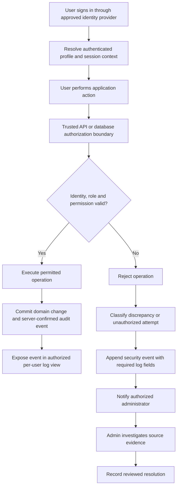

# TACResQ Admin IPS — Web UI/UX Redesign Master Plan

**Status:** Canonical design and implementation specification  
**Scope:** TACResQ administrator Information Processing System (Admin IPS) website  
**Theme decision:** Preserve the existing website theme. Redesign the interface, information architecture presentation, layout, typography, icons, components, responsiveness, and interactions without replacing the theme.  
**Repository baseline inspected:** `RamProjector/TACResQ-School-Project`, commit `b877cb3819484755145834f528252d13c04fb01b` (`main`)  
**Document rule:** This file is the single canonical web-admin redesign plan. Keep Android client redesign documents separate.

---

## 1. Final design decision

TACResQ Admin is an **administrative information system**, not a generic emergency dispatch command center.

The website's primary work is administration and governance: account management, access/security, reports, recorded activity, data continuity, preferences, and operator guidance. Emergency and incident data may appear where existing Admin capabilities require it, but the Admin interface must not be redesigned as a dispatcher console or given unverified dispatch powers.

### Non-negotiable decisions

1. **Keep the existing theme.** Preserve the current TACResQ palette, brand identity, backgrounds, surfaces, sidebar treatment, accent colors, semantic status colors, and existing theme behavior. Do not introduce a replacement palette, a new visual theme, or a competing design identity.
2. **Redesign the complete web experience.** This is not a task to delete paragraphs, hide sections, or apply a few cosmetic CSS changes. Rework the shell, every existing Admin workspace, page composition, tables, forms, dialogs, navigation, responsive behavior, and interaction details.
3. **Make the interface concise.** Remove repeated explanations and redundant labels. Keep essential field labels, status meaning, privacy notices, confirmation details, and accessibility names.
4. **Use information hierarchy rather than decoration.** Prefer clear alignment, compact headings, whitespace, tables, useful grouping, and contextual detail over oversized headings, decorative cards, or paragraphs that restate the page title.
5. **Create a distinctive administrative SVG icon family.** Custom SVGs should identify TACResQ Admin concepts. Keep Lucide for common utility actions; do not replace every familiar control with an unfamiliar custom symbol.
6. **Preserve real functionality.** Existing routes, permissions, API/RPC contracts, data semantics, security boundaries, and working features must remain intact unless a separate evidence-backed change is reviewed.
7. **Never invent operational certainty.** Unknown, unavailable, stale, uncollected, or unverified states must remain explicit. A successful dependency probe is not proof of complete system health.

### What this redesign is not

- Not a new theme or color-system redesign.
- Not a marketing/landing page redesign.
- Not a generic emergency dispatch dashboard.
- Not an excuse to add speculative modules or controls.
- Not a backend, database, infrastructure, or authorization rewrite.
- Not a reduction of critical information merely to make screens look empty.

---

## 2. Repository evidence and current baseline

The following observations were verified by reading source and documentation at the baseline commit above. They describe the inspected revision; re-check the current branch before implementation.

| Area | Verified baseline |
|---|---|
| Main Admin page | `backend/web/src/pages/AdminConsole.tsx` |
| Admin stylesheets | `AdminConsole.css`, `PortalVisualFoundation.css`, and `AdminResolution.css`, imported in that order by `AdminConsole.tsx` |
| Brand component | `backend/web/src/components/Brand.tsx`; displays the existing TACResQ app icon and wordmark |
| Global styles/theme tokens | `backend/web/src/index.css` |
| Web package | `backend/web/package.json`; React 19, Vite, TypeScript, Supabase JS and `lucide-react` |
| Existing Admin HCI contract | `tools/test_admin_hci_layout_contract.py` |
| Admin-only contract | `tools/test_web_admin_only_contract.py` |
| Admin page plan | `docs/plans/admin-page-feature-implementation-plan.md` |
| Admin completion/gap research | `docs/research/ADMIN_WEBSITE_COMPLETION_GAP_ASSESSMENT_2026-11-24.md` |
| Operator guide | `docs/admin-portal-operator-guide.md` |
| CI | `.github/workflows/ci.yml` runs the Admin HCI layout/form contract among other repository checks |

### 2.1 Existing Admin navigation

The inspected `AdminConsole.tsx` defines these eight primary sections:

1. Overview
2. User management
3. Security
4. Analytics & reports
5. Activity log
6. Data & continuity
7. Settings
8. Help & about

Settings is URL-backed and currently has General, Accessibility, Notifications, and Privacy subpages. Security is a separate primary section in the inspected code. Do not copy older documentation that describes a different section count or stale labels without reconciling it against the source.

The navigation groups currently communicate Workspace, Governance, Data & Continuity, and Preferences & Support. The final navigation may refine grouping and labels, but must preserve route compatibility and only expose implemented, authorized destinations.

### 2.2 Existing feature boundaries

| Workspace | Existing capability evidenced in source/docs | Redesign boundary |
|---|---|---|
| Overview | Account summaries, recent recorded-activity preview, dependency reachability probes, workspace shortcuts, explicit loading/error states | Make it a concise administrative landing page. Avoid duplicating Analytics aggregates or Activity Log records. Do not call dependency reachability end-to-end readiness. |
| User management | Protected paginated directory, search/role filters, reasoned role changes, account lifecycle history, protected account activity preview | Improve directory scanability and account detail presentation. Preserve server-side checks and reason/audit requirements. Do not add unverified profile fields. |
| Security | Administrator session/AAL/TOTP status and authenticator safeguards | Separate current-session/security controls from complete security monitoring. Do not imply full sign-in history or arbitrary user-session control unless the source supports it. |
| Analytics & reports | Date-bounded aggregate request metrics, status distribution, daily request volume, assignment timing, Manila-time reporting, CSV export | Keep aggregates distinct from event-level investigation. Make period, timezone, units, data freshness, and export scope clear. |
| Activity log | Searchable, filterable, paginated investigation feed with explicit source-coverage limitations | Keep event provenance and limitations visible. Do not label it a complete system-wide audit trail while sources are incomplete. |
| Data & continuity | Backup/recovery and attachment safeguards information with documented limits | Keep evidence and inspection dates explicit. Do not imply a live backup inventory, successful restore, or media browser without verified integration. |
| Settings | Browser-local density/page-size and accessibility preferences; informational guidance where server-backed policy is absent | Distinguish local preferences from global policy. Do not display inert toggles as functional controls. |
| Help & about | Searchable operator guidance | Keep concise, searchable, accurate, and synchronized with implemented behavior. |

### 2.3 Roles and authorization boundaries

- The Admin interface is for authorized administrators; it is not an alternate dispatcher workspace.
- The inspected Admin role-change options cover requester, responder, driver, and dispatcher. Admin provisioning is a separate trusted-operator process and must not become available through ordinary public signup or a casual role dropdown.
- Hiding a button or navigation item is not authorization. Every privileged read and mutation must remain enforced by the backend.
- Do not infer agency/tenant hierarchy, qualifications, certifications, duty rosters, or other data models unless the deployed schema and policies establish them.
- Keep current MFA/AAL2 requirements and protected investigation access intact.

### 2.4 Existing theme and typography

The inspected `index.css` defines the current theme foundation:

- Main interface font: **DM Sans**
- Display font: **Space Grotesk**
- Technical/monospaced font: **IBM Plex Mono**
- Existing palette tokens include `--ink`, `--ink-deep`, `--ink-soft`, `--paper`, `--card`, `--line`, `--ember`, `--ember-dark`, `--sage`, and semantic green/amber/red tokens.
- The Admin shell uses the existing deep navy sidebar, neutral workspace surfaces, white/near-white panels, and existing accent/status colors.
- `Brand.tsx` uses the existing TACResQ app-icon asset and wordmark.

**Theme freeze:** Continue consuming existing tokens. Do not redefine their values as part of this redesign. Do not add a new color palette, gradient system, dark theme, or new brand mark. If an existing token is insufficient for a specific component, document the gap and reuse the closest semantic token until separately approved.

The inspected global stylesheet imports the three fonts from Google Fonts. Treat font loading, fallback behavior, layout shift, and availability as performance concerns; do not change the typeface family as part of the redesign.

### 2.5 Existing layout and sidebar observations

- The Admin shell is a CSS grid with a sidebar and a min-width-safe main workspace.
- The desktop sidebar collapse state is represented by `admin-shell--sidebar-collapsed` and persisted in browser local storage.
- The Admin stylesheet contains a collapsed-grid contract expecting a `76px minmax(0, 1fr)` layout and hides the wordmark/context/navigation labels in the compact state.
- The source-contract test checks that behavior.
- The styles are split across three imported stylesheets. The shell's base grid width is declared more than once (including 238px and 270px variants), with additional responsive overrides. This creates a cascade/order risk for collapsed sizing.
- The desktop collapse control is inside the sidebar header. The mobile drawer opener is in the topbar outside the drawer; this is correct because the opener must remain reachable when the drawer is closed.
- At the mobile/tablet breakpoint, the sidebar becomes a fixed off-canvas drawer with a backdrop, close control, independent scrolling, focus handling, and reduced-motion treatment.

**Required verification:** Do not assume the reported collapse issue is solved merely because the class and source assertion exist. Inspect computed `grid-template-columns`, sidebar bounding width, and workspace bounding box at each desktop width and after resize. If only the sidebar's contents collapse while the grid column remains wide, fix the cascade/layout contract. Preserve the mobile opener outside the closed drawer.

---

## 3. Research findings and product references

The references below are design-pattern references, not templates to copy and not proof that TACResQ has equivalent features.

### 3.1 Product references

| Reference | Pattern worth borrowing | What not to copy |
|---|---|---|
| **Linear** | Quiet navigation, compact controls, restrained icon treatments, precise alignment, keyboard-friendly workflows, reduced decorative noise | Its issue-tracking information architecture or its theme |
| **Stripe Dashboard** | Data-first tables, clear value alignment, restrained surfaces, focused forms, progressive disclosure for detail | Financial workflows or data structures |
| **ArcGIS Mission** | Only where Admin reviews map-related/incident evidence: spatial context can be paired with contextual information rather than a separate decorative map card | A dispatch-first shell or operational capabilities not present in Admin |
| **Motorola CommandCentral** | High-signal status presentation and separating important alerts from routine information | Command-center navigation, wallboard density, or unimplemented dispatch controls |

### 3.2 Human-interface principles

1. **Recognition over recall:** use familiar navigation, predictable action placement, and visible current context.
2. **Progressive disclosure:** show the fields and actions needed for the current task; place technical detail, audit payloads, and explanatory material behind expandable details.
3. **Consistency:** the same control type should behave and look consistently across Admin pages.
4. **Task-oriented hierarchy:** the page should answer one primary question, such as “Which account needs review?” or “What recorded event occurred?”
5. **Information density without crowding:** prefer compact, aligned information over excessive cards or tiny unreadable text.
6. **Feedback and reversibility:** show whether an action is pending, saved, failed, or unavailable; confirm consequential actions and preserve recoverable form state.
7. **Honest system state:** distinguish healthy, degraded, stale, unknown, not collected, and unavailable.

### 3.3 Admin IPS-specific design conclusion

Use Linear and Stripe as the stronger references for the overall Admin IPS experience. Use GIS/emergency software references only for specific data views where the Admin portal actually needs geographic or incident context. The Admin website should remain an administration and information-processing workspace.

---

## 4. Final visual and interaction direction (existing theme retained)

### 4.1 Application shell

- Keep the existing TACResQ identity and palette.
- Build a stable desktop shell: sidebar, compact topbar, and main workspace.
- The sidebar must have a real expanded and collapsed width; the workspace must reclaim the released width.
- Keep navigation labels available through accessible names and tooltips in the collapsed state.
- Keep the collapse control reachable and visually aligned inside the desktop sidebar header.
- Keep the mobile drawer opener in the topbar, outside the closed drawer.
- Move sign-out into the existing account/profile menu only if a safe, discoverable account menu is implemented; do not simply hide sign-out.
- Keep breadcrumbs short and useful. Avoid repeating the same page name in a large eyebrow, title, subtitle, and card heading.
- Use a consistent page-header pattern: concise title, optional one-line context only when it adds meaning, and page actions aligned to the right.

### 4.2 Page composition

Avoid using the same dashboard template for every page.

| Page | Primary composition |
|---|---|
| Overview | Compact attention/summary area, recent recorded activity, limited shortcuts, dependency reachability with a precise scope label |
| User management | Search/filter toolbar, paginated directory table, contextual account details, guarded actions |
| Security | Current administrator session and authenticator status, grouped security controls, clear capability/coverage limits |
| Analytics & reports | Period/timezone controls, key aggregates, readable chart, supporting data table, scoped export |
| Activity log | Search/filter toolbar, event table/list, expandable event details, visible source coverage |
| Data & continuity | Evidence inventory and dated inspection context, clear unavailable/not-connected states, documented operator guidance |
| Settings | Short grouped preference controls with save/reset behavior; separate local preferences from read-only policy guidance |
| Help & about | Search-first reference, concise answers, version/support details only when grounded in configuration |

### 4.3 Cards, surfaces, and borders

- Do not place every element in a card.
- Use tables for records, lists for sequential activity, simple grouped sections for settings, and panels only when content is a distinct unit.
- Avoid nested cards inside cards.
- Use the existing border and surface tokens; reduce redundant outlines and decorative shadows.
- Use dividers to separate related rows rather than drawing a box around every row.
- Let whitespace and alignment create hierarchy.
- Keep action buttons near the content they affect.
- Keep dangerous actions visually distinct and require confirmation appropriate to their consequence.

### 4.4 Copy and labels

- Remove paragraphs that repeat the page title or explain an obvious control.
- Keep descriptions to one short line when a page needs context.
- Do not repeat the same status in a badge, heading, paragraph, and metadata line.
- Keep persistent form labels; placeholder text is not a replacement for a label.
- Keep critical security, privacy, data freshness, and consequence explanations even when they require more text.
- Prefer direct action names: “Export CSV”, “Refresh”, “Change role”, “View details”.
- Avoid unexplained abbreviations and excessive uppercase/letter spacing.
- Put technical definitions and source-coverage details in expandable help or details sections, not in the primary reading path.

---

## 5. Typography specification

Keep DM Sans, Space Grotesk, and IBM Plex Mono. Change their roles and hierarchy, not the font families.

| Role | Recommended size | Weight/use |
|---|---:|---|
| Page title | 22–26px | 600; Space Grotesk or existing display token |
| Section heading | 15–17px | 600; short and task-specific |
| Panel/table group heading | 14–16px | 600 |
| Body and table content | 13–14px | 400–500; DM Sans |
| Form label | 12–13px | 500–600; persistent |
| Supporting text | 12–13px | 400; only when useful |
| Metadata | 11–12px | 400–500; secondary contrast |
| IDs, timestamps, technical values | 11–12px | IBM Plex Mono; tabular numerals where useful |
| Icon-only tooltip | 12px minimum where feasible | concise action description |

### Typography rules

- Avoid oversized page titles. The current responsive title token reaches 40px; reduce the Admin page-title hierarchy toward the range above.
- Use fluid sizing only where it improves fit; never let viewport width inflate an administrative page title unnecessarily.
- Keep body copy comfortable and readable. Do not shrink table text to fit more columns.
- Use tabular numerals for counts, IDs, dates, and measurements where alignment helps scanning.
- Keep line length controlled for explanatory copy; avoid long full-width paragraphs.
- Use consistent line-height and avoid headings that wrap into awkward single-word lines.
- Respect browser zoom and user text scaling.
- Use font fallbacks that preserve layout if Google Fonts cannot load. Assess self-hosting only after license, build, and performance review; it is not a requirement to add a new font.

---

## 6. Custom TACResQ Admin SVG icon system

A unique SVG family is required, but it must represent **administrative information-system concepts**, not turn the site into an emergency-response icon showcase.

### 6.1 Icon families

Create original TACResQ-specific SVGs for these Admin concepts:

| Concept | Visual direction |
|---|---|
| Overview | Structured dashboard/grid with one emphasized information point |
| User management | Account/profile with a controlled directory or grouping motif |
| Security | Layered access/verification motif; distinct from generic emergency shield imagery |
| Analytics & reports | Measured data/chart motif with a recognizable report structure |
| Activity log | Ordered event/timeline or recorded-entry motif |
| Data & continuity | Structured data/archive with a continuity/restore cue; do not imply a backup is verified |
| Settings | Deliberate control/adjustment motif |
| Help & about | Knowledge/reference motif |

Custom icons should be recognizable at small sizes and should not depend on color alone.

### 6.2 Technical standards

- Use a consistent 24×24 viewBox for standard UI icons; use 32×32 or 48×48 for larger empty-state or feature illustrations.
- Keep stroke weight consistent (approximately 1.75–2px at 24px scale), with coherent caps, joins, corner radii, and optical alignment.
- Use `currentColor` so SVGs inherit the existing theme.
- Keep fills and strokes simple; avoid filters, gradients, tiny details, and excessive path complexity.
- Include outline and selected/emphasized variants only where a state genuinely changes.
- Decorative SVGs must be hidden from assistive technology. Meaningful icon-only controls need accessible names and visible focus.
- Preserve adequate target size around icons; the icon itself is not the interactive target.
- Optimize SVG output and avoid shipping a large icon font for a small set of symbols.

### 6.3 Use Lucide appropriately

Keep `lucide-react` for familiar utility actions such as search, close, refresh, edit, download, sort, pagination, and menu controls. Use the custom library for the TACResQ Admin identity and the eight primary administrative concepts. Do not replace familiar utility icons merely to make every icon different.

---

## 7. Component and page standards

### 7.1 Tables and directories

- Tables are primary interfaces for account directories, activity records, and report detail.
- Use clear column names, aligned numeric values, stable row heights, and subtle row separators.
- Keep search, filters, page size, result count, and pagination in a compact toolbar.
- Avoid forcing a wide table to shrink into unreadable text. Use a local horizontal scroll region or a carefully designed compact row/detail presentation.
- Keep important identity fields together; place secondary technical identifiers in lower-emphasis text.
- Make row actions keyboard accessible and give repeated actions names that identify the affected record.
- Preserve sorting/filter state where existing behavior supports it.
- Use explicit empty, loading, unavailable, and error states; do not show stale privileged data after authorization failure.

### 7.2 Forms and settings

- Prefer single-column forms; use two columns only for short, related fields when there is sufficient space.
- Keep persistent labels above controls.
- Place short hints and validation feedback next to the relevant field.
- Group related settings and clearly distinguish editable local preferences from read-only policy information.
- Explain whether a setting is browser-local or server-backed.
- Provide save/reset feedback and protect unsaved changes when leaving a form.
- Do not render inert toggles for unimplemented notification, privacy, security, or system policies.

### 7.3 Dialogs and confirmations

- Keep dialogs focused on one decision.
- State the affected account/record and consequence.
- Keep primary and destructive actions clearly differentiated.
- Fit within short viewport heights using internal scrolling where necessary.
- Preserve focus, return focus to the trigger, support Escape where safe, and prevent background interaction when modal.
- Do not put long policy paragraphs into every confirmation; link to the relevant details when appropriate.

### 7.4 Status, notifications, and feedback

- Pair status color with text or a meaningful icon; never rely on color alone.
- Distinguish success, warning, error, stale, unknown, and unavailable.
- Show freshness timestamps only when they belong to the currently displayed result set.
- Keep toast messages concise and non-blocking; persistent errors need an actionable recovery path.
- Never show “live”, “healthy”, “complete”, “delivered”, “backed up”, or “restorable” unless the source proves that exact claim.

---

## 8. Responsive and adaptive layout strategy

The design must respond to **available space**, not just device labels. Do not create one media query for every test resolution. Use content-driven breakpoints, fluid sizing, CSS Grid/Flexbox, container queries, and component-level adaptation.

### 8.1 Test viewport width matrix

Use these widths as a broad QA matrix, not as 31 required CSS breakpoints:

`320, 360, 375, 390, 414, 430, 480, 540, 600, 640, 720, 768, 800, 834, 900, 960, 1024, 1080, 1152, 1200, 1280, 1366, 1440, 1536, 1600, 1680, 1728, 1920, 2048, 2560, 3440 px`

### 8.2 Test viewport height matrix

`568, 640, 720, 768, 800, 900, 1080, 1440 px`

Test representative width/height combinations, especially narrow + short, medium + short, and ultrawide + tall. Do not exhaustively run every Cartesian combination on every commit.

### 8.3 Required adaptive behaviors

| Available space | Expected behavior |
|---|---|
| Wide desktop | Expanded sidebar, comfortable workspace, optional contextual detail column |
| Standard desktop | Expanded sidebar and content-width-aware page layout |
| Narrow desktop/laptop | Compact or collapsed sidebar when needed; toolbar wraps without overlap |
| Tablet landscape | Drawer or compact navigation; tables and filters reorganize |
| Tablet portrait | Single workspace column; panels stack; navigation remains reachable |
| Narrow/mobile browser | Drawer navigation, compact topbar, focused single-column task flow |
| Short viewport | Header and navigation remain usable; long panels/dialogs scroll internally |
| Split-screen/resized window | Components adapt to their container instead of assuming full-screen width |
| 200–400% zoom | Content reflows without clipped controls or page-level horizontal scrolling for ordinary content |

### 8.4 Browser and environment variations

Include:
- Portrait and landscape.
- Mouse, keyboard, and touch.
- 100%, 125%, 150%, 200%, and 400% browser zoom.
- Split-screen and narrow browser windows.
- Browser chrome reducing available height.
- High-DPI/device pixel ratio variations.
- Font loading delay/failure.
- Reduced motion and forced-colors/high-contrast modes.
- Resize while menus, dialogs, expanded rows, or filters are open.

### 8.5 Implementation rules

- Use page-level media queries only when the overall composition must change.
- Use container queries when an individual component should adapt to its own available width.
- Use `minmax(0, 1fr)`, `min-width: 0`, and bounded widths to prevent grid/flex overflow.
- Use `clamp()` for fluid spacing and restrained type sizing, with readable minimums.
- Use dynamic viewport units such as `dvh` where supported and safe fallbacks for viewport-height layouts.
- Keep horizontal scrolling local to genuinely wide data tables; avoid page-wide overflow.
- Keep modal and dropdown positioning within the visible viewport.
- Preserve focus and selected state when a layout changes from sidebar to drawer.
- Keep navigation usable with a keyboard and touch, including visible focus and adequate target dimensions.

### 8.6 Existing responsive implementation to consolidate

The inspected stylesheets contain overlapping breakpoints and shell overrides, including 1920px+, 1440px, 1201–1439px, 901–1200px, 761–900px, max 760px, max 480px, max 900px, max 1120px, max 960px, max 700px, and max 520px rules across different files.

Do not add another layer of overrides. First map all existing selectors and their cascade. Consolidate the Admin shell and component responsive rules into a clear, documented system while preserving the existing theme and behavior.

---

## 9. Accessibility and usability requirements

Target WCAG 2.2 AA as an engineering goal, but do not claim conformance without a complete audit.

- Text contrast: at least 4.5:1 for normal text and 3:1 for large text.
- Visible keyboard focus for every interactive element.
- Keyboard access to navigation, tables, menus, dialogs, filters, and pagination.
- Logical focus order and appropriate focus restoration.
- Semantic headings, landmarks, labels, table headers, status announcements, and form error associations.
- Accessible names for icon-only controls; decorative SVGs hidden from screen readers.
- Do not use color as the only signal for status, errors, or selection.
- Reflow at narrow equivalent widths and browser zoom; no loss of information or functionality.
- Touch targets should be comfortably usable; aim for approximately 40–44px where practical, while meeting applicable WCAG target-size requirements.
- Respect reduced-motion preferences; avoid non-essential animation.
- Test forced-colors/high-contrast mode.
- Keep error messages specific and actionable without exposing sensitive implementation details.
- Provide clear empty and unavailable states; do not rely on a blank panel to communicate absence of data.

---

## 10. Performance and implementation quality

- Preserve the current font families; optimize loading/fallback behavior and avoid layout shift.
- Avoid introducing new UI libraries or dependencies unless the repository review proves they are needed.
- Use the existing Lucide dependency and a small optimized custom SVG library.
- Avoid heavy blur, large shadow stacks, expensive animated backgrounds, and unnecessary motion.
- Keep tables and charts responsive; consider virtualization only if measured record volume justifies it.
- Avoid rendering large hidden page trees if it causes measurable performance or accessibility problems.
- Ensure CSS ownership is clear: reduce duplicate selectors and stylesheet-order dependencies.
- Keep components reusable where behavior is genuinely shared; do not over-generalize different workflows into one complex component.
- No console errors, broken links, inaccessible controls, or inert buttons in the redesigned pages.

---

## 11. Security, privacy, and truthful data presentation

The Admin UI is a privileged surface.

1. Backend authorization remains authoritative. UI visibility is never a substitute for RLS, RPC authorization, or server-side role checks.
2. Keep privileged data out of local storage. Browser-local storage may hold non-sensitive presentation preferences only.
3. Do not expose service-role credentials, access tokens, MFA secrets, recovery codes, private attachment bytes, or sensitive incident details unnecessarily.
4. Preserve MFA/AAL2 requirements for protected investigations and security-sensitive actions.
5. Keep role changes reasoned, auditable, and limited to server-authorized roles.
6. Do not expose Admin provisioning through public signup or ordinary role controls.
7. Keep CSV export scoped and protected against spreadsheet formula injection.
8. Keep audit source coverage visible. Missing events must not be interpreted as proof that no event occurred.
9. Do not represent dependency reachability as full application health or emergency readiness.
10. Do not add account suspension, deletion, restore, notification suppression, retention, or global policy controls until the underlying authorization, audit, recovery, and enforcement behavior is verified.
11. Do not invent privacy controller details, legal basis, retention periods, data-subject rights processing, or vendor disclosures.
12. Use synthetic accounts and synthetic records for QA; never use real emergency incidents or personal location data in test fixtures.

---

## 12. Testing and verification plan

### 12.1 Existing checks

At the inspected baseline:
- `tools/test_admin_hci_layout_contract.py` protects key navigation, sidebar, mobile drawer, focus, and form contracts.
- `tools/test_web_admin_only_contract.py` protects Admin-only frontend boundaries.
- `.github/workflows/ci.yml` runs the Admin HCI contract.
- `backend/web/package.json` exposes `build` (TypeScript check + Vite build), `dev`, and `preview`; it does not define a dedicated frontend test or viewport-matrix script.
- `tools/visual_regression.py` uses Playwright to capture the interactive mobile wireframe gallery at a fixed 1440×1080 browser viewport. It is not a live AdminConsole viewport suite; map views are excluded due to nondeterministic external tiles.

Re-check current scripts and workflows before relying on these statements.

### 12.2 Required checks for the redesign

| Check | Minimum expectation |
|---|---|
| TypeScript/web build | `pnpm --dir backend/web build` or the repository's current equivalent |
| Admin HCI contract | Run existing `tools/test_admin_hci_layout_contract.py` |
| Admin-only contract | Run existing `tools/test_web_admin_only_contract.py` |
| Relevant security/source contracts | Run the Admin/auth/audit/security tests affected by the change |
| Navigation | Every Admin section and legacy URL works; browser Back/Forward and keyboard navigation remain correct |
| Data behavior | Loading, empty, error, stale, unavailable, permission denied, and successful states are accurate |
| Sidebar | Verify actual sidebar width and workspace expansion when collapsed at multiple desktop widths |
| Responsive | Run the broad width/height matrix, including just below/at/above each chosen content-driven breakpoint |
| Accessibility | Keyboard-only, focus order, screen-reader names, contrast, zoom/reflow, reduced motion, forced colors |
| Visual review | Capture real Admin pages, not only wireframes; review every section and responsive state |
| Regression | Confirm routes, roles, permissions, APIs, filters, forms, exports, dialogs, and account workflows remain intact |

### 12.3 Viewport test execution strategy

- Pull request smoke suite: representative compact, standard, laptop, tablet, and mobile viewports, plus short-height and zoom checks for changed components.
- Major shell/layout change: full width matrix and representative height combinations.
- Release candidate: full matrix plus manual keyboard, touch, zoom, and assistive-technology review.
- Capture screenshots for each Admin section and key states: loading, populated, empty, error, expanded detail, open menu/dialog, collapsed sidebar, and mobile drawer.
- Test immediately below, at, and above each actual breakpoint.
- Keep screenshot differences report-only only where repository policy says so; navigation, functionality, accessibility, build, and security checks remain blocking.

---

## 13. Implementation phases

### Phase 0 — Baseline and inventory
- Record the current main SHA, open PRs, CI state, routes, section permissions, and backend dependencies.
- Capture screenshots and inspect every Admin section at representative widths.
- Inventory all existing selectors and stylesheet load order.
- Verify the sidebar collapse width using computed browser layout.
- Record existing defects separately from redesign regressions.

**Exit:** source inventory, screenshots, baseline test results, and a list of confirmed versus suspected issues.

### Phase 1 — Design foundation (theme preserved)
- Define spacing, typography roles, border/radius/elevation usage, focus styles, and component density using existing theme tokens.
- Define the custom TACResQ Admin SVG family.
- Define shared patterns for page headers, tables, filters, forms, status indicators, empty/error states, and dialogs.
- Do not change theme token values.

**Exit:** documented design tokens/roles, icon assets/components, and reviewed component examples.

### Phase 2 — Application shell and sidebar
- Consolidate the shell CSS and responsive rules.
- Fix the real desktop collapsed-column behavior.
- Preserve mobile drawer opener/closer placement and accessibility.
- Standardize topbar, breadcrumbs, profile/account menu, and workspace width.
- Verify short-height, zoom, keyboard, and resizing behavior.

**Exit:** sidebar physically shrinks, workspace expands, no overlap/overflow, drawer remains operable.

### Phase 3 — Page-by-page Admin redesign
Recommended order:
1. Overview
2. User management
3. Security
4. Analytics & reports
5. Activity log
6. Data & continuity
7. Settings
8. Help & about

For each page: improve information hierarchy, remove redundant copy, redesign its primary data view, standardize controls, and verify all states and role boundaries.

**Exit:** all existing Admin sections have a consistent but purpose-specific layout; no feature is silently removed.

### Phase 4 — Responsive and accessibility hardening
- Validate the viewport matrix and zoom levels.
- Fix overflow, short-height dialogs, nested scrolling, focus loss, and touch target issues.
- Verify contrast and reduced-motion/forced-color behavior.

**Exit:** responsive and accessibility evidence is attached to the implementation review.

### Phase 5 — Final regression and release review
- Run web build, Admin contracts, relevant security tests, and full repository CI.
- Review actual rendered pages at all major viewport families.
- Verify backend/API behavior and role isolation have not changed.
- Document any manual checks that remain outstanding.

**Exit:** exact-head checks pass, no unresolved blocking issues, and manual acceptance gaps are stated honestly.

---

## 14. Acceptance criteria

The redesign is ready for final review only when all applicable criteria are met:

- [ ] The existing TACResQ website theme and brand are preserved.
- [ ] The product remains clearly an Admin IPS website, not a dispatch dashboard.
- [ ] Every existing Admin section is redesigned and remains reachable.
- [ ] No existing feature, route, permission, or backend contract is removed or silently changed.
- [ ] The sidebar's desktop collapse changes the actual grid column and gives the width back to the workspace.
- [ ] The mobile drawer opener remains reachable outside the closed drawer.
- [ ] Typography is compact, readable, consistent, and not dominated by oversized page titles.
- [ ] Repeated paragraphs, redundant labels, duplicate cards, and decorative noise are removed without hiding essential meaning.
- [ ] Original TACResQ Admin SVG icons are used for core administrative concepts; Lucide remains for familiar utility actions.
- [ ] Tables, filters, forms, dialogs, status indicators, and feedback patterns are consistent.
- [ ] All states are truthful: loading, empty, stale, unavailable, error, success, and permission denied.
- [ ] Responsive layouts work across representative width/height combinations, split-screen, orientation, and zoom.
- [ ] Keyboard navigation, focus, screen-reader names, contrast, reduced motion, and reflow are reviewed.
- [ ] No new client-only security controls or unsupported operational claims are introduced.
- [ ] Build, Admin contracts, security checks, and required CI pass on the exact reviewed commit.
- [ ] Browser/device acceptance is recorded separately from automated source tests.

---

## 15. Research references

Use these as supporting guidance. Re-check current versions and applicability during implementation.

### Product/interface references
- [Linear — How we redesigned the UI](https://linear.app/now/how-we-redesigned-the-ui) — restraint, hierarchy, consistency, and reducing unnecessary interface decoration.
- [Esri — ArcGIS Mission](https://www.esri.com/en-us/arcgis/products/arcgis-mission/overview) — contextual spatial information, relevant only to Admin pages that genuinely need map/incident context.
- [Motorola Solutions — CommandCentral](https://www.motorolasolutions.com/en_us/products/command-center-software.html) — high-signal status and alert presentation; not an Admin IPS information-architecture template.

### Human-computer interaction and accessibility
- [Nielsen Norman Group — Recognition vs. recall](https://www.nngroup.com/articles/recognition-and-recall/) — make actions and context recognizable rather than requiring users to remember hidden conventions.
- [Nielsen Norman Group — Progressive disclosure](https://www.nngroup.com/articles/progressive-disclosure/) — reveal secondary detail when needed without hiding critical information.
- [W3C — WCAG 2.2](https://www.w3.org/TR/WCAG22/) — accessibility success criteria.
- [W3C — Reflow](https://www.w3.org/WAI/WCAG22/Understanding/reflow.html) — responsive reflow and avoiding two-dimensional scrolling for ordinary content.
- [W3C — Target Size (Minimum)](https://www.w3.org/WAI/WCAG22/Understanding/target-size-minimum.html) — interactive target-size requirements.
- [W3C — Decorative Images](https://www.w3.org/WAI/tutorials/images/decorative/) — accessible treatment of decorative graphics.
- [W3C — SVG 2](https://www.w3.org/TR/SVG2/) — SVG structure and semantics.

### Typography, icons, and responsive implementation
- [Material Design — Typography](https://m3.material.io/styles/typography/overview) — type roles and hierarchy.
- [Material Design — Icons](https://m3.material.io/styles/icons/overview) — consistent icon use and sizing.
- [Lucide — Icon design](https://lucide.dev/guide/design/icon-design) — coherent icon geometry.
- [Lucide — Accessibility](https://lucide.dev/guide/advanced/accessibility) — accessible icon implementation.
- [MDN — Responsive design](https://developer.mozilla.org/en-US/docs/Learn_web_development/Core/CSS_layout/Responsive_Design) — responsive layout foundations.
- [MDN — Container queries](https://developer.mozilla.org/en-US/docs/Web/CSS/CSS_containment/Container_queries) — component adaptation based on available space.
- [MDN — clamp()](https://developer.mozilla.org/en-US/docs/Web/CSS/clamp) — bounded fluid sizing.
- [Playwright — Emulation](https://playwright.dev/docs/emulation) — viewport/device emulation for automated verification.

### Security and emergency-context guidance
- [OWASP Application Security Verification Standard](https://owasp.org/www-project-application-security-verification-standard/) — application security verification baseline for privileged workflows.
- [ITU-T F.760.2](https://www.itu.int/rec/T-REC-F.760.2/en) — first-responder interface guidance; use only for relevant readability, feedback, and high-stress information presentation, not as the Admin IPS page architecture.

---

## 16. Maintenance rule

Update this file when the Admin navigation, page capabilities, theme tokens, icon system, responsive architecture, or acceptance gates materially change. Keep source-backed facts distinct from recommendations. If another document covers a narrow topic (for example, security-event coverage or the operator guide), link to it rather than duplicating its entire content here.

**This plan is the final design direction:** complete TACResQ Admin IPS web UI/UX redesign, existing theme preserved, concise professional interface, distinctive administrative SVG icons, real responsive behavior, and all current authorized functionality retained.

---

## 17. Additional research — administrative workflows and data-intensive interfaces

This section extends the existing design foundation with implementation guidance for a real administrative information system. These are design requirements and research conclusions, not claims that every capability already exists in TACResQ. Confirm each capability against current source, schema, RPCs, and authorization before implementing it.

### 17.1 Record lifecycle and end-to-end workflows

Design around the complete lifecycle of an administrative record, not isolated screens.

For every existing record type, document:
- Who can create, view, search, edit, review, export, archive, or delete it.
- Which fields are required, optional, immutable, or system-generated.
- Which state transitions are valid and who may perform them.
- What reason, confirmation, or supporting evidence is required for consequential changes.
- What happens when a save fails, a session expires, or another administrator changes the same record.
- Which events must be auditable and how the user can inspect the resulting history.

Create a workflow map for each current Admin capability: entry point → search/select → inspect → permitted action → confirmation → result → audit/history. Do not add lifecycle states or actions that are not supported by the backend.

**Design implication:** use a directory/list for finding records, a focused detail view for understanding one record, and contextual actions for operations on that record. Avoid forcing users through a dashboard card for every step.

### 17.2 Data tables and record directories

Tables are primary working surfaces in an Admin IPS. Treat them as structured tools, not decorative content.

Required patterns:
- Clear column names and semantic table headers.
- Stable row identity and predictable row actions.
- Sort indicators that disclose the active sort column and direction.
- Search and filters that apply to the complete result set, not only the currently visible page.
- Visible active filters with a simple way to clear one or all.
- Pagination that preserves the current query and filters when moving between pages.
- A clear result count and current page context.
- Column widths that prioritize the fields administrators actually use.
- Local horizontal scrolling or a deliberate compact/stacked alternative for genuinely wide tables; never cause accidental page-wide horizontal overflow.
- Loading, no-results, empty, error, stale, and permission-denied states.
- Selection checkboxes only when a real bulk action exists.
- Row click behavior that does not conflict with nested buttons, links, or checkboxes.

Do not make every column sortable or every field a visible column by default. Prioritize the common decision-making fields and place secondary data in a detail panel.

### 17.3 Search, filtering, and query persistence

Search should help administrators find known records quickly and understand why a result matched.

Specify:
- Which fields are searchable and whether matching is exact, prefix, or partial.
- Whether search is case-insensitive and how punctuation/spacing are normalized.
- How search combines with role, status, date, and other filters.
- Whether filters are server-side and whether counts reflect the full filtered result set.
- What happens when a query returns no matches.
- Whether query state is preserved in the URL so browser Back/Forward, refresh, and shareable links behave predictably.
- Debounce behavior and cancellation of stale requests.
- Clear/reset behavior that does not unexpectedly discard unrelated page state.

Avoid an unexplained universal search box if the backend only searches one dataset. Label the search scope accurately.

### 17.4 Bulk actions and imports/exports

Bulk actions can save time but amplify mistakes. Add them only where the existing data model and backend support safe batch operations.

Before implementation, require:
- Explicit selection count and clear all/none behavior.
- A preview of the affected records and the exact change.
- Permission checks for every affected record, not only the first selected row.
- A reason and confirmation for consequential changes.
- Defined partial-failure behavior and per-record results.
- Idempotency or safe retry behavior where supported.
- An audit event for each affected record or a traceable batch event with item-level outcomes.
- A safe maximum batch size and clear progress feedback.

For exports, show the applied filters, date range, timezone, included columns, and record count. Keep exports permission-checked and protect CSV output against spreadsheet formula injection. Do not imply that a download contains every record if it is limited to the current page.

Imports must not be introduced merely as a convenience. They require schema validation, duplicate handling, preview, rollback/partial-failure rules, and auditability.

### 17.5 Forms and validation

Use persistent labels, logical grouping, and concise help text only where a field is ambiguous or has consequential requirements.

Recommended form behavior:
- Validate required and format constraints at the appropriate point without surprising users.
- Show an error beside the affected field and provide a concise summary for long forms.
- Link summary errors to the corresponding fields and move focus appropriately after failed submission.
- Preserve valid entered values when validation or network submission fails.
- Distinguish field errors, permission errors, network failures, and server conflicts.
- Explain constraints before submission when users need them to complete the form correctly.
- Disable duplicate submission while a request is in flight, but do not leave the user with an indefinite spinner.
- Confirm navigation away only when meaningful unsaved work would be lost.
- Use explicit save/cancel actions; do not silently autosave privileged or consequential changes.
- Use confirmation dialogs for irreversible or high-impact actions, with the target and consequence named.

Do not use placeholder text as the only label. Do not make every field show a long explanatory paragraph. Keep security and privacy explanations when they materially affect the user's decision.

### 17.6 Audit trails and activity investigation

Separate operational activity feeds from security audit logs unless source coverage and semantics prove they are the same dataset.

For each event, establish which fields are actually available:
- Event/action type.
- Actor identity or system actor.
- Target record and stable identifier.
- Timestamp and timezone.
- Outcome (success, denied, failed, pending) where recorded.
- Source/channel and correlation/request identifier where available.
- Reason or change summary where safe and supported.

Audit views should support time range, actor, event type, target, and outcome filters only when the underlying records support them. Keep event details expandable and avoid exposing secrets, session tokens, MFA material, or unnecessary personal data.

Show coverage limitations and retention boundaries. A missing event is not proof that an action did not occur. Never label a partial activity feed as a complete system-wide audit trail.

### 17.7 Permissions and privileged-action UX

Use least privilege and defense in depth:
- Backend authorization remains authoritative for every read and write.
- The frontend should explain unavailable actions without exposing privileged data.
- Hide or disable controls based on verified permission context, but never rely on UI visibility as enforcement.
- Distinguish “not authorized”, “not configured”, “not available”, and “temporarily failed”.
- Require stronger confirmation for high-impact actions, with a reason where policy requires it.
- Do not expose privilege escalation, admin provisioning, role grants, account deletion, or security-policy controls unless the backend has a reviewed and auditable implementation.
- Keep session and MFA state understandable without displaying secrets or implying a stronger assurance level than the backend reports.

### 17.8 Concurrent edits, stale data, and recovery

Administrative records may be changed by more than one operator. Define behavior for:
- A record changing after the detail view was loaded.
- A save conflicting with a newer version.
- A session expiring during an edit.
- A network interruption during submission.
- A retry after an uncertain response.
- A record becoming inaccessible before the action completes.

Show when data was last refreshed if freshness matters. Prefer an explicit conflict state with a reload/review path over silently overwriting newer data. Preserve user-entered data where safe. Do not claim a mutation failed if the server may have completed it; reconcile the result before allowing a duplicate action.

### 17.9 Notifications and feedback

Use notifications for events that need attention, not as a second activity log.

Define:
- Which events warrant an in-app notification.
- Severity and urgency semantics.
- Read/unread state and whether it is server-backed.
- Destination when a notification is opened.
- Dismissal and retention behavior.
- How duplicate or repeated alerts are grouped.
- What happens when the destination is no longer accessible.

Use inline feedback for local actions, persistent banners for page-level conditions, and dialogs only when a decision is required. Avoid success toasts for actions that have not been confirmed by the server.

### 17.10 Analytics and reporting integrity

Every report must disclose enough context to interpret it:
- Metric definition and unit.
- Date range and timezone.
- Aggregation level and filters.
- Data freshness or last successful refresh, if known.
- Missing-data or coverage limitations.
- Whether values are live, cached, or historical.
- Export scope and included fields.

Use a chart only when it helps compare, trend, or understand a distribution. Provide a table or textual equivalent for exact values. Avoid 3D charts, decorative gauges, arbitrary color categories, and dashboards that repeat the same metric in multiple forms.

Do not infer service quality, response performance, or system readiness from metrics that do not measure those outcomes.

### 17.11 Reusable component and design-system governance

Maintain one shared implementation for genuinely shared patterns:
- Page header and action area.
- Search/filter toolbar.
- Data table and pagination.
- Status label and state description.
- Form field, field error, and error summary.
- Confirmation dialog.
- Empty/loading/error/unavailable state.
- Detail panel and expandable event content.
- Toast/banner feedback.
- Icon button and tooltip.

Document component states and interaction contracts, not just screenshots. Avoid a single giant “universal” component with many unrelated flags. A component should be shared when its semantics and behavior are shared, not merely because two pages look similar.

### 17.12 Operational design acceptance checklist

- [ ] Each existing Admin workflow is mapped from entry to completion.
- [ ] Record actions and valid state transitions are backed by current server behavior.
- [ ] Search/filter/sort/pagination operate on the complete intended result set.
- [ ] Query state survives refresh and browser navigation where appropriate.
- [ ] Bulk actions have preview, authorization, partial-failure handling, and audit evidence.
- [ ] Forms preserve input and identify errors accessibly.
- [ ] Concurrent updates cannot silently overwrite newer records.
- [ ] Audit/activity views accurately state their source coverage and retention limits.
- [ ] Permission failures are distinguishable from missing configuration and service errors.
- [ ] Reports disclose units, period, timezone, freshness, and scope.
- [ ] Every action has truthful pending/success/failure feedback.
- [ ] Empty, loading, stale, unavailable, error, and no-permission states are designed consistently.
- [ ] Shared components have documented states and keyboard behavior.

---

## 18. Additional research references

These references extend the source list in Section 15. Apply the guidance selectively and verify current versions during implementation.

### Administrative tables, navigation, and components
- [GOV.UK Design System — Components](https://design-system.service.gov.uk/components/) — reusable component patterns and usage guidance.
- [GOV.UK Design System — Pagination](https://design-system.service.gov.uk/components/pagination/) — responsive pagination, page context, and applying sort/filter behavior to the full result set.
- [GOV.UK Design System — Error summary](https://design-system.service.gov.uk/components/error-summary/) — accessible form error summaries and field links.
- [U.S. Web Design System — Patterns](https://designsystem.digital.gov/patterns/) — task-oriented patterns for complex forms and user profiles.
- [U.S. Web Design System — Validation](https://designsystem.digital.gov/components/validation/) — validation guidance and documented usability/accessibility limitations of its validation component.

### Accessibility and form behavior
- [W3C — WCAG 2.2](https://www.w3.org/TR/WCAG22/) — keyboard access, focus, reflow, target size, text alternatives, and input requirements.
- [W3C WAI — Understanding Error Identification](https://www.w3.org/WAI/WCAG22/Understanding/error-identification) — errors must be identified in text or a text alternative; choose inline or summary patterns according to context.

### Security, sessions, and logging
- [OWASP ASVS 5.0 — Security Logging and Error Handling (V16)](https://github.com/OWASP/ASVS/blob/master/5.0/en/0x25-V16-Security-Logging-and-Error-Handling.md) — structured security-event logging, log protection, sensitive-data minimization, and secure error handling.
- [OWASP ASVS 5.0 — Session Management (V7)](https://github.com/OWASP/ASVS/blob/master/5.0/en/0x16-V7-Session-Management.md) — unique sessions, invalidation, and inactivity timeouts.
- [OWASP Application Security Verification Standard](https://owasp.org/www-project-application-security-verification-standard/) — broader verification framework for privileged web applications.

### Application of research to TACResQ
- These sources support interface and verification requirements; they do not establish that TACResQ currently has bulk editing, imports, complete audit coverage, concurrent-edit versioning, or notification preferences.
- Confirm the current implementation and data contracts before specifying any of those features as deliverable behavior.
- Keep the existing theme and the Admin IPS product identity unchanged.

---

## 19. Mandatory IDS/IPS coursework criteria — source-based requirements

**Source:** user-provided *CRITERIA FOR THE IDS/IPS: Intrusion Detection/Intrusion Prevention System*, one-page handout, page 1. This section preserves the assignment's requirements and translates them into TACResQ-specific design and verification work. It does not claim that the repository currently satisfies them.

### 19.1 Requirements stated in the handout

The handout requires:

1. A web-, desktop-, or mobile-based IDS/IPS using the **same database** and linked to the mobile application.
2. Identification of application users, each user's roles/permissions, sessions per user, and operations/actions. The handout says operations/actions are only **ADD, EDIT, DELETE**.
3. An IDS/IPS system flowchart.
4. System logs recording all operation/actions and sessions with these exact field names: `session_id`, `log_id`, `actions`, `description`, `ip_address`, `timestamp`, `device_used`.
5. Each action must be included in system logs. Its example uses role-specific action names (student: borrow_books, return_books, view_all_books, reserve_books, search_books; staff: manage_borrow_books, manage_return_books, view_all_books, manage_reserve_books, search_books) and a human-readable action/description pair.
6. Each user must have their own system logs.
7. A user may have one or more roles, and roles/permissions may be assigned to users. The system must detect a role/permission assigned to a non-applicable user as a discrepancy/intrusion and warn/notify the administrator.
8. All listed criteria must be met.

### 19.2 TACResQ interpretation and important distinctions

- The handout's **ADD / EDIT / DELETE** is the required operation classification. The handout's examples also include named user activities such as viewing and searching. Preserve both levels: classify a mutation as ADD, EDIT, or DELETE, while recording the specific role action key and a readable description. For read-only events such as view/search, use a separate event category/action family rather than mislabeling them as ADD/EDIT/DELETE. Confirm the instructor's expected treatment if the rubric requires every event to map strictly to one of the three operation values.
- TACResQ's existing roles and workflows must be discovered from current source and database constraints. Do not import the library example's student/staff roles.
- A UI navigation item or hidden button is not a permission. Applicable-role checks and prevention must be enforced at the trusted database/API boundary.
- "Same database" must mean the IDS/IPS consumes authoritative records from the database used by TACResQ's mobile application, not a separate mock database or manually copied log store. Verify actual project environment and database connection before claiming this requirement is met.
- A session record and an action audit event are different things. A session lifecycle event records authentication/session context; an action event records an operation performed within that context. Do not fabricate a session identifier if the authentication provider does not expose a stable, safe identifier to the application.
- The required `ip_address` and `device_used` fields are sensitive/contextual metadata. Record them only from a trusted server/database edge where available, minimize retention and access, and never trust client-supplied IP/device strings as authoritative. If a field is unavailable for a particular source, represent that limitation honestly rather than inventing it.
- Per-user log access must be scoped by authenticated identity and role. Administrators may have a bounded investigation view; ordinary users must not be able to read another user's logs. Apply row-level/server-side authorization and test direct API/RPC/table access, not only UI filtering.
- The discrepancy detector must compare an observed assignment against an authoritative role/permission applicability policy. It must not treat every multi-role user as suspicious: the handout explicitly permits multiple roles. Detection needs an explicit matrix of allowed role combinations, user classes, and applicable permissions.
- Detection and prevention are separate outcomes: detect and record the discrepancy, notify an authorized administrator, and block or quarantine the unauthorized privilege transition where the trusted authorization boundary can enforce it. Do not silently repair role assignments or remove access without a reviewed policy and recovery path.

### 19.3 Verified repository baseline relevant to the criteria

The following are repository findings at baseline commit `b877cb3819484755145834f528252d13c04fb01b`, not live-production verification:

- The Admin authorization design documents distinct Supabase Auth/profile and Laravel Sanctum identity paths. They are not interchangeable; email matching is not a trusted identity link.
- The Admin portal's current role model is a single `admin` role with action-level server enforcement, AAL2 and TOTP for privileged RPCs. The existing managed ordinary roles are `requester`, `responder`, `driver`, and `dispatcher`. The repository's authorization review specifically cautions against inventing a multi-role Admin hierarchy without real responsibilities.
- The Admin audit history is currently a bounded, read-only application audit view focused on successful ordinary-role changes. It is not a complete authentication, session, security, or operational event history.
- A separate Supabase Auth Audit Log source is documented, but persistence into the target project's Postgres database was not verified in the referenced research.
- A later repository migration defines `public.app_action_audit_logs` for a limited set of server-confirmed actions: `incident_message_sent`, `notification_marked_read`, and `duty_status_changed`. Its fields include `id`, `correlation_id`, `actor_profile_id`, `actor_role`, `action`, `target_type`, `target_id`, `target_user_id`, `incident_id`, `outcome`, `metadata`, and `created_at`. It is append-only and intentionally excludes message content, credentials, tokens, and coordinates.
- That schema does **not** use the handout's exact required column names and does not by itself demonstrate per-user session lifecycle logging, IP/device capture, or coverage of every role action. Do not claim rubric compliance from the existence of this table alone.
- The repository contains distinct role-change audit, authentication-provider audit, incident/assignment histories, and app-action audit sources. These must remain source-distinguishable when shown together in an investigation interface.

### 19.4 Required role/action applicability matrix

Create and maintain a source-backed matrix before implementing detection. Fill it from actual app roles, routes, RPCs, database policies, and mobile action handlers. Do not infer permissions from labels alone.

| Principal / role | Action key | Operation class | Applicable? | Authoritative enforcement | Audit source |
|---|---|---|---|---|---|
| requester | create own incident | ADD | Verify against source | Owning RPC/RLS | Incident history + app audit if covered |
| requester | edit own eligible incident | EDIT | Verify status/ownership constraints | Owning RPC/RLS | Request-edit history |
| requester | cancel own eligible incident | EDIT or domain transition | Verify exact rubric classification | Owning RPC/RLS | Incident history |
| responder | duty status change | EDIT | Verify role and permitted transition | Trusted RPC/RLS | App-action audit migration |
| driver | duty status change | EDIT | Verify role and permitted transition | Trusted RPC/RLS | App-action audit migration |
| dispatcher | review/coordinate incident assignment | Domain-specific | Verify actual dispatcher endpoints | Trusted RPC/RLS | Assignment history |
| admin | change an ordinary user's role | EDIT | Admin + AAL2/TOTP + allowed target role + reason | Protected Admin RPC | Admin role-change audit |
| any role | view/search records | Read/query event, not ADD/EDIT/DELETE | Verify dataset-specific access | RLS/RPC/API | Add only if rubric requires read-event logging |

This table is a starting inventory, not a final authorization policy. Replace every "Verify" entry with evidence from the exact current source before implementation. Include all actions found in the Android app and web portal, not just the examples above.

### 19.5 Exact-field compatibility strategy

The assignment explicitly names seven fields. The design must make those fields available in the IDS/IPS system-log view and persisted record contract:

| Required handout field | Intended meaning | Design/verification rule |
|---|---|---|
| `session_id` | Session associated with the event | Nullable only when source cannot provide a safe stable reference; document provider semantics and avoid storing bearer tokens |
| `log_id` | Unique log record identifier | Stable immutable identifier, unique within the defined log source or normalized view |
| `actions` | Action/operation name | Store a stable action key and preserve required ADD/EDIT/DELETE classification |
| `description` | Human-readable event summary | Concise, actor/action/target context; no secrets or unnecessary personal data |
| `ip_address` | Trusted observed client/network address | Capture at trusted ingress where possible; never accept arbitrary client-provided values as authoritative |
| `timestamp` | Event occurrence time | Store UTC with timezone-aware type; render in user's locale/timezone while retaining UTC source |
| `device_used` | Device/client context | Derive from bounded user-agent/device classification where available; avoid fingerprinting and do not claim hardware identity |

Do not rename existing authoritative columns merely to match the assignment if that risks breaking RPCs, policies, or migrations. A safe compatibility view or normalized IDS/IPS projection can expose the exact required field names while retaining source IDs and provenance. If the assignment requires physical columns with those exact names, decide that explicitly before schema changes and provide a migration/backward-compatibility review.

### 19.6 Per-user system-log experience

The Admin IPS website should provide:
- A user-specific activity view reached from the account directory or investigation workspace.
- A clear identity header and the scope of records being shown.
- Filters for date/time, action, operation class, session, source, outcome, and target where supported.
- Server-side pagination and bounded date ranges.
- Source badges that distinguish application actions, Admin role changes, authentication events, and operational histories.
- A clear empty state that says no matching events were returned, not that no activity ever occurred.
- A permission-denied state that does not leak whether another user's private records exist.
- An export action only if implemented, permission-checked, audited, and privacy-reviewed.

The logged-in user may be allowed to inspect their own permitted activity; administrators may inspect other users only under explicit Admin authorization and least-privilege policy. Do not expose authentication secrets, session tokens, message contents, exact coordinates, or raw provider metadata.

### 19.7 IDS/IPS discrepancy detection and response workflow

Detection should be deterministic, explainable, and auditable.

1. **Observe:** a trusted database/API operation attempts to grant or use a role/permission, or a periodic reconciliation reads current assignments.
2. **Resolve principal:** map the authenticated identity to the authoritative application profile. Never correlate accounts solely by matching email.
3. **Evaluate policy:** compare the requested/current role and permission set against the versioned applicability matrix for that principal and context.
4. **Classify:** allowed, suspicious discrepancy, or denied unauthorized attempt. Distinguish invalid role, inapplicable role, missing permission, privilege escalation, stale assignment, and policy/configuration error.
5. **Prevent:** reject unauthorized grant/use at the server/database boundary. A frontend warning alone is not prevention.
6. **Record:** append a security event with source, actor, target, expected policy, observed assignment, outcome, timestamp, correlation identifier, and the seven required handout fields through the compatibility projection.
7. **Notify:** alert authorized administrators with severity, concise reason, affected principal, event time, and a safe link to the investigation view. Do not include secrets or unnecessary personal data.
8. **Investigate:** show evidence and source provenance; provide reviewed remediation steps. Do not auto-change roles or delete accounts without an approved policy.
9. **Close:** record who reviewed the event, the decision, and the resolution outcome, with immutable history.

False-positive controls:
- Support explicitly approved multi-role combinations.
- Distinguish historical role changes from current unauthorized assignments.
- Avoid alerting on a role merely because it is uncommon; use the documented applicability matrix.
- Deduplicate repeated detections while retaining event counts and first/last observed times.
- Show detector/policy version so an administrator can understand why an event was flagged.

### 19.8 IDS/IPS flowchart required by the handout

The following flow is the minimum design artifact to include in the final coursework and implementation documentation:

The flowchart must be checked against the real call paths and transaction boundaries. If an event cannot be written atomically with the domain change, document the failure mode and ensure audit failure cannot silently turn a denied operation into an allowed one.

### 19.9 IDS/IPS acceptance tests mapped to the handout

| Handout criterion | Required evidence / test | Pass condition |
|---|---|---|
| Same database linked to mobile app | Inspect mobile database config, Admin web data access, project/database identity and environment; run read-only integration verification | Both clients use the intended same authoritative database/environment; no mock/second source masquerades as linked |
| Identify users | Enumerate actual application principal types and profiles from source/schema | Complete source-backed user list; no invented roles |
| Roles/permissions per user | Build permission matrix from RPC grants, RLS, API middleware, and UI actions | Every listed action has an authoritative allow/deny rule and test |
| Record sessions per user | Inspect actual auth/session APIs, callbacks, and available session metadata | Session lifecycle events associated safely with users; no token storage |
| ADD/EDIT/DELETE operations | Inventory all mutating actions and map to operation classes | Every create/update/delete action is classified and recorded |
| Flowchart | Review the IDS/IPS flowchart against actual call paths | Shows identity, policy evaluation, allow/deny, logging, alert, and review |
| Exact seven log fields | Schema/view contract test and sample records | All seven names are exposed with correct semantics and populated when available |
| Every action logged | Role/action coverage matrix plus integration tests for each action | Each in-scope action produces a server-confirmed event or documented source-specific event |
| Per-user logs | Cross-user authorization tests | User A cannot read User B logs; Admin access is explicitly authorized and bounded |
| Detect non-applicable role/permission | Positive and negative role-matrix tests, including allowed multi-role combinations | Invalid assignment/use is rejected, recorded, and alerts an authorized Admin |
| Admin warning/notification | Notification integration test | Correct recipient, severity, safe detail, deduplication, and destination |
| Complete criteria | Traceability matrix signed off against handout | No criterion marked complete without evidence |

### 19.10 Critical gaps and non-claims

Based on the cited repository documentation and migration reviewed above:
- The exact seven-field handout contract is not demonstrated by the current `app_action_audit_logs` table.
- Full session lifecycle logging for each user is not demonstrated.
- A complete role/action applicability matrix for every mobile and web action is not yet demonstrated.
- Detection and notification for non-applicable role/permission assignments is not demonstrated by the reviewed Admin audit history.
- A complete IDS/IPS flowchart and end-to-end criterion test evidence must be produced and reviewed.
- Current audit sources are intentionally separate; a unified display must not imply that missing provider persistence, IP/device capture, or uncovered action logging is already solved.

These are verification and implementation gaps, not proof that no related code exists anywhere in the repository. Continue source tracing before declaring absence.

### 19.11 Research and standards to apply

- [OWASP Application Security Verification Standard](https://owasp.org/www-project-application-security-verification-standard/) — verify authentication, authorization, session handling, logging, and security controls at the actual enforcement boundary.
- [OWASP Logging Cheat Sheet](https://cheatsheetseries.owasp.org/cheatsheets/Logging_Cheat_Sheet.html) — event context, actor/action/outcome, sensitive-data exclusion, log integrity, and operational failure handling.
- [OWASP Authorization Cheat Sheet](https://cheatsheetseries.owasp.org/cheatsheets/Authorization_Cheat_Sheet.html) — deny by default, least privilege, and authorization checks on every request.
- [OWASP Session Management Cheat Sheet](https://cheatsheetseries.owasp.org/cheatsheets/Session_Management_Cheat_Sheet.html) — session identifier handling, lifecycle, renewal, invalidation, and secure storage.
- [Supabase Auth Audit Logs](https://supabase.com/docs/guides/auth/audit-logs) — provider-owned authentication event source; verify persistence/configuration in the actual project before use.
- [Supabase Auth Sessions](https://supabase.com/docs/guides/auth/sessions) — session lifecycle and token semantics; do not treat access JWT expiry as immediate global revocation.

### 19.12 Design impact on the Admin IPS website

Add these first-class Admin IPS workspaces or subviews, subject to existing feature boundaries:
- **Users & roles:** principal directory, role assignments, applicability status, and safe account context.
- **Sessions:** per-user session history and lifecycle status, only where the provider exposes authoritative data.
- **System logs:** required seven-field compatibility view with per-user scope and source provenance.
- **Security detections:** suspicious role/permission discrepancies, severity, evidence, status, and review history.
- **Notifications:** administrator warnings linked to the corresponding detection.
- **Policy matrix:** read-only view of approved role/action applicability, with changes restricted to a trusted reviewed process.

Do not add a visible module that has no working backend contract. The website must clearly distinguish implemented controls, provider-dependent evidence, and planned coursework requirements. Preserve the existing TACResQ theme.

---

## 20. Repository source audit — role actions, enforcement paths, and IDS/IPS logging coverage

**Audit baseline:** repository source at commit `b877cb3819484755145834f528252d13c04fb01b`, including the cited Supabase migrations and security/workflow reviews. This is a source inspection, not a live database audit, production telemetry review, or physical-device test. Re-check the current branch and deployed schema before implementation.

### 20.1 Architecture boundary: do not combine unlike identities

The repository documents two distinct identity paths:

- **Supabase Auth + `public.profiles`:** used by the Supabase-backed Android application and the Admin/dispatcher web client. The profile role model includes `requester`, `responder`, `driver`, `dispatcher`, and (in later Admin migrations) `admin`.
- **Laravel Sanctum + Eloquent users:** a separate Laravel/Render API identity store, with its own token lifecycle and role middleware. The REST API contract lists requester, responder, driver, and dispatcher roles; public registration creates requesters.

These are not interchangeable identities. Do not join them by email or assume that a role assignment in one system updates the other. The IDS/IPS should identify the source system and principal namespace for every event. If both identity paths are in scope, define and verify a trusted mapping first.

### 20.2 Source-backed action inventory

The table below lists workflows established by the inspected API contract, migrations, and security reviews. "Operation class" follows the coursework's ADD / EDIT / DELETE vocabulary for state-changing actions. Read-only queries are marked READ/SEARCH so they are not incorrectly called an ADD, EDIT, or DELETE. The precise classification of domain transitions such as cancellation should be confirmed against the instructor's expected convention.

| Role / principal | Action key | Operation class | Source-backed behavior and enforcement | Existing evidence/log source |
|---|---|---|---|---|
| Public visitor | register | ADD | Supabase signup trigger forces requester role; Laravel public registration contract also creates requester only | Auth provider signup events may exist; verify persistence; not proven to be in app-action log |
| Any authenticated user | sign_in / sign_out | Session event | Supabase Auth or Laravel Sanctum token lifecycle; separate provider/session source | Supabase Auth Audit Logs documented; target Postgres persistence not verified. Laravel token event coverage not established |
| requester | view_own_incidents | READ | Requester-scoped incident listing | Domain data access; read-event logging not established |
| requester | create_incident | ADD | Current idempotent Supabase creation RPC derives caller identity, requires requester role, and uses a single-active-request trigger; older compatibility RPCs remain | Incident status history records status transitions; app-action audit coverage for creation not established by reviewed migration |
| requester | edit_own_pending_incident | EDIT | Caller-derived identity, ownership check, pending/unassigned guard, row locks, field validation, cooldown/review confirmation | `incident_request_edit_logs` plus generic dispatcher notification; not shown in the limited app-action migration |
| requester | cancel_own_pending_incident | EDIT / domain transition | Caller-owned pending incident only; row lock and assignment race guard; assigned/in-progress cancellation denied | Incident status history; dispatcher cancellation notification documented |
| requester | send_incident_message | ADD | Incident-scoped conversation and caller-scoped message authorization | `app_action_audit_logs` migration includes `incident_message_sent`; content is intentionally excluded |
| requester | upload_incident_attachment | ADD / file operation | Private incident-scoped storage; upload-before-message lifecycle gap is documented | No complete upload-only audit coverage established; reservation/finalization and cleanup controls require separate verification |
| requester | mark_notification_read | EDIT | Recipient-scoped notification state change | `app_action_audit_logs` migration includes `notification_marked_read` |
| responder / driver | view_claimable_incidents | READ / SEARCH | Query availability and access are constrained by role/policy | Read/search event logging not established |
| responder / driver | claim_incident | ADD / assignment transition | Atomic claim RPC checks role, duty state, claimable incident, membership and capacity; assignment is represented in `incident_assignments` | Assignment/domain history; generic app-action audit coverage not established by reviewed migration |
| responder / driver | change_own_duty_status | EDIT | Only available/off-duty self-transition; active incident and active-account guards; server RPC | `app_action_audit_logs` migration includes `duty_status_changed` |
| responder / driver | view_assigned_incidents | READ | Assigned-member-scoped incident access | Read-event logging not established |
| responder / driver | update_original_emergency_report | DENY | Field units cannot rewrite the requester's original report | Denial logging is not demonstrated by reviewed sources |
| responder / driver | advance_shared_incident_status | DENY / legacy path | Latest documented workflow moves shared incident milestones to dispatcher-managed progression; legacy per-responder status RPC execute grants are revoked | Incident status history records transitions; denied attempt logging not established |
| dispatcher | view_incident_queue | READ / SEARCH | Dispatcher queue and authorized operational records | Read-event logging not established |
| dispatcher | assign_incident | EDIT / assignment transition | Dispatcher assigns an available unit through guarded assignment path; legacy single-unit path retained for compatibility | Assignment history; confirm actor and event completeness per every path |
| dispatcher | coordinate_team_members | EDIT / assignment transition | Team membership/assignment operations use protected server workflows and capacity rules | Assignment history; action-specific event coverage needs inventory |
| dispatcher | advance_incident_milestone | EDIT / domain transition | Dispatcher records shared incident milestone through allowed ordered transitions; DB guard prevents arbitrary field changes | `incident_status_logs` and operational histories; coverage needs full trigger/RPC path verification |
| dispatcher | view_units_and_duty_status | READ | Authorized unit directory/status visibility | Read-event logging not established |
| admin | view_admin_directory | READ | Admin RPC requires current Admin + AAL2 + TOTP | Not a mutation event; Admin query logging coverage not established |
| admin | change_ordinary_user_role | EDIT | Admin + AAL2 + TOTP; allowed target roles, reason, target lock, active-assignment guard; Admin promotion/demotion excluded | `admin_audit_logs`, transactionally coupled to successful role change |
| admin | view_admin_audit_history | READ / SEARCH | Bounded server-side paginated RPC and restrictive direct-table policy; currently role-change event source only | `admin_audit_logs` |
| admin | view_aggregate_analytics | READ | Protected Admin MFA RPC; aggregate reporting | Read-event logging not established |
| admin | manage_own_mfa | EDIT / security setting | Self-service authenticator enrollment/management on current signed-in account | Provider audit event may be available; target project persistence must be verified |
| admin | revoke_own_refreshable_sessions | EDIT / session action | Self-service global sign-out; provider semantics mean issued access JWTs may remain valid until expiry | Auth provider source; not in the role-change audit table |
| trusted operator | provision_or_rotate_admin | EDIT / privileged provisioning | Out-of-band runbook, not public signup or normal Admin UI | Runbook requires verification and audit evidence; unified event coverage needs verification |

This inventory is intentionally conservative. It does not assert that every action listed has its own dedicated event row. The source/log column identifies evidence found or the gap requiring follow-up.

### 20.3 Existing log sources and their actual scope

| Source | What it records | What it does not establish |
|---|---|---|
| `incident_status_logs` | Incident status transitions with incident, status, actor reference, and timestamp in the core schema | Complete read/search history; all assignment sub-events; authentication sessions |
| `incident_assignments` and assignment history | Field-unit membership/assignment state and associated lifecycle operations | Complete log coverage of every UI action or every denied attempt |
| `incident_request_edit_logs` | Before/after requester edit information, including sensitive report/location fields | General-purpose per-user activity stream; safe unrestricted Admin exposure |
| `admin_audit_logs` | Successful ordinary-role changes in the current Admin audit design | Full security audit, Auth history, every Admin read, denied calls, all app actions |
| Supabase Auth Audit Logs | Provider-owned authentication events as documented by Supabase | Verified Postgres persistence in the target project; all application domain actions |
| `app_action_audit_logs` | Three server-confirmed action families in the reviewed migration: incident message sent, notification marked read, duty status changed | Exact coursework field contract, full CRUD coverage, all role actions, session lifecycle, trusted IP/device capture, or comprehensive denied-attempt logging |
| Laravel Sanctum tokens | Current API token mechanism documented for the separate Laravel identity path | Complete token lifecycle audit coverage in the reviewed sources |

Do not flatten these sources into a single table without a source identifier, source event ID, and explicit field mapping. Do not count the same domain transition twice merely because a trigger and an RPC both expose it.

### 20.4 Coursework field coverage against current source

| Required field | Existing evidence | Assessment |
|---|---|---|
| `session_id` | Supabase Auth session context and Laravel Sanctum token model exist as separate mechanisms | **Not yet demonstrated** as a safely persisted per-event session reference across both clients |
| `log_id` | Existing tables use their own identifiers (for example, identity IDs) | **Partial**; normalized compatibility projection needs a stable source-qualified identifier |
| `actions` | Existing event keys include `user_role_changed`, `incident_message_sent`, `notification_marked_read`, and `duty_status_changed`; domain histories use their own status/action values | **Partial**; build a complete action taxonomy and map mutation classes |
| `description` | Some sources have event/action values and structured metadata | **Partial**; human-readable description projection not shown for every event |
| `ip_address` | Supabase provider audit documentation may include IP for some event types | **Not verified** for persistence or coverage; do not accept client-supplied address as authoritative |
| `timestamp` | Existing histories use timestamps such as `created_at` and `recorded_at` | **Partial**; normalize to one UTC timestamp contract with source provenance |
| `device_used` | Provider metadata may contain user-agent for some Auth events | **Not verified** for all sources; user-agent/device class is not proof of physical device identity |

**Conclusion:** current repository source demonstrates several useful audit histories, but does not demonstrate full compliance with the exact seven-field assignment contract. Build a normalized IDS/IPS view or projection that preserves original source IDs and makes all seven requested fields available. Keep optional/unavailable metadata nullable with a documented reason. Never fabricate values to make the table look complete.

### 20.5 Role and permission discrepancy rules

The handout permits a user to have one or more roles. Therefore, the detector must not flag multiple roles by default.

Create a versioned applicability policy with at least:
- Principal namespace and profile type.
- Permitted role set and permitted combinations.
- Action key and operation class.
- Required permission and contextual constraints.
- Target ownership/assignment requirements.
- Account lifecycle state requirements.
- Source of truth and policy version.
- Effective start/end time for an approved assignment where applicable.

The detector should classify:
1. **Invalid assignment:** role or permission is not in the approved policy for the principal.
2. **Unauthorized use:** assigned role is valid, but the requested action is not permitted in this context.
3. **Privilege escalation attempt:** caller attempts to grant itself or another principal authority outside the approved path.
4. **Stale/revoked access:** account/role/session state is no longer eligible.
5. **Policy ambiguity:** source data is incomplete or conflicting; route for review rather than asserting intrusion.

Enforcement must reject the unauthorized operation at the database/API boundary. The detection event should include observed assignment, expected policy, actor/target, source, result, and correlation reference. Notify an authorized Admin only after a trustworthy event has been recorded. The Admin UI must not provide a self-service policy editor until a trusted, reviewed policy-management workflow exists.

### 20.6 Logging coverage matrix and next verification work

| Test family | Required cases | Current evidence status |
|---|---|---|
| Public signup | Forged role metadata, unknown role, duplicate signup, requester default | Signup trigger and Laravel contract documented; run exact integration tests on current branch |
| Requester incident | Create, idempotent retry, duplicate active request, edit, urgent pin correction, cancel, cross-user ID substitution | Strong source reviews exist; execute current migration replay and Android integration tests |
| Field-unit actions | Claim success, claim race, capacity limit, duty on/off, assigned-report mutation denial, legacy status RPC denial | Guarded RPC/migration source exists; verify every current client call and denial path |
| Dispatcher actions | Queue read, single-unit assignment, team assignment/release, allowed milestones, invalid transition | Source guards exist; enumerate all current RPC signatures and legacy compatibility callers |
| Admin actions | Directory, role change, account lifecycle, audit read, analytics, MFA enrollment, own-session sign-out | Admin authorization and audit documentation exists; verify current helper and every wrapper on exact head |
| Sessions | Sign-in, sign-out, refresh, expiry, recovery, MFA add/remove/challenge, revoke | Provider source documented; target persistence and Laravel token events unresolved |
| Metadata | IP, user-agent/device, timestamp, source event ID | Provider-specific partial availability; no universal trusted coverage demonstrated |
| Detection | Invalid role assignment, invalid role combination, unauthorized action, stale/suspended account, repeated attempt | Policy engine and administrator notification coverage not demonstrated in inspected sources |
| Per-user view | User can see own permitted events; cannot inspect another user; Admin access is bounded and justified | Needs new normalized projection and cross-principal authorization tests |
| Exact schema | All seven assignment field names present with stable semantics | Not met by the reviewed app-action audit table alone |

Before implementation, inspect all Android call sites for the RPCs above and all current database grants, RLS policies, triggers, and functions. Search results and documentation are not substitutes for a complete source/permission inventory. For Laravel, separately enumerate `routes/api.php`, role middleware, controllers, Sanctum token operations, and migrations. For the web portal, enumerate route guards and each Admin RPC invocation. Produce one traceability row per actual action handler and its enforcement function.

### 20.7 IDS/IPS architecture recommendation

Use the following logical layers:

1. **Authoritative action boundary:** Supabase RPC/trigger/RLS or Laravel middleware/controller/policy. This is where allow/deny decisions are made.
2. **Domain history:** retain incident status, assignment, requester edit, and other domain-specific histories as authoritative records.
3. **Security event capture:** record security-relevant outcomes, including denied privileged attempts, role/permission discrepancies, and sensitive administrative changes, without logging secrets.
4. **Session event sources:** ingest provider/session events only through documented, configured, privacy-reviewed sources.
5. **Normalized IDS/IPS projection:** map source events into the exact coursework field names while preserving `source`, `source_event_id`, actor namespace, and provenance.
6. **Detection and notification:** evaluate a versioned role/action applicability matrix, deduplicate alerts, and notify authorized administrators.
7. **Admin investigation UI:** per-user event history, filters, event details, source/coverage labels, and reviewed resolution history.

A normalized projection is a presentation/compatibility contract, not permission to destroy or replace existing source tables. Use append-only event semantics, restricted read policies, bounded retention, pagination, and explicit export authorization. Keep message text, passwords, access/refresh tokens, MFA secrets, and unnecessary precise coordinates out of the generic security log.

### 20.8 Exit criteria before declaring the IDS/IPS complete

- [ ] Every Android action handler has a traceable server/database enforcement path.
- [ ] Every Admin web action has a traceable protected RPC or server-side policy.
- [ ] Every Laravel endpoint in scope has a traceable middleware/policy and service-layer check.
- [ ] The Supabase and Laravel identity namespaces remain distinct unless a trusted mapping is formally implemented.
- [ ] Every state-changing action has an operation class and durable server-confirmed event source.
- [ ] Read/search logging expectations are explicitly agreed with the coursework rubric.
- [ ] Every event exposes the seven required fields with honest nullability and provenance.
- [ ] Session lifecycle events are sourced from authoritative provider/token lifecycle hooks.
- [ ] IP/device metadata is captured only from trusted ingress/provider context and has a documented retention policy.
- [ ] Role combinations and action applicability are explicit, versioned, and tested.
- [ ] Unauthorized privilege assignment/use is denied, recorded, and not merely hidden in the UI.
- [ ] Authorized Admin notifications are delivered, deduplicated, and linked to an investigation record.
- [ ] Per-user log access is tested against cross-user access attempts.
- [ ] Clean migration replay, RPC grant contract, integration tests, and manual role walkthroughs pass on the exact proposed commit.
- [ ] The coursework traceability matrix has evidence for every handout criterion.
---

## 21. Backend responsibility audit — Supabase, Render, and Laravel

**Purpose:** Establish which backend components actually serve the Admin IPS and Android clients before adding administration, audit, or monitoring features. This section is based on repository source and documentation, not a live Render deployment, production database, or Supabase project inspection.

### 21.1 Corrected architecture summary

Render is not an unused backend. It hosts the Laravel service and the Admin web portal. However, the Android app's normal production data path is currently configured for direct Supabase access. The existence of Laravel routes does not mean all Android operations pass through Render.

| Component | Verified responsibility | Important boundary |
|---|---|---|
| Supabase Auth + PostgreSQL | Authoritative authentication/data/RPC platform for the current Android direct-Supabase path and Admin web portal | RLS and protected RPCs enforce the Supabase identity path. |
| Render-hosted Laravel 13 service | Hosts the Admin portal static build, runtime browser-safe Supabase configuration, Laravel API routes, selected Supabase bridge operations, and optional routing proxy | Hosting the portal does not make Laravel the system of record. |
| Laravel Sanctum + Eloquent | Separate legacy/API identity and data path with its own local User records and personal-access tokens | Do not assume Sanctum accounts, roles, sessions, or audit history synchronize with Supabase Auth/profiles. |
| Render PostgreSQL TACResQ_DB | A separate database instance documented as disposable staging, not required by the current Render service | Do not use it as production truth or store real emergency/personal data without a separately approved migration and security review. |

Repository evidence:
- backend/README.md states Laravel 13 hosts the administrator portal on Render; Supabase remains the source of truth for authentication, data, and RPC operations; the temporary Render PostgreSQL database is not required.
- backend/src/bootstrap/app.php registers Laravel's /up health endpoint.
- backend/src/routes/api.php contains Laravel API, Sanctum, bridge, and administrative-local-auth routes.
- backend/src/app/SupabaseBridge.php validates Supabase access tokens against Supabase Auth and forwards only allowlisted RPC calls using the caller's JWT. The bridge does not substitute a service-role token for the caller's business operation.
- backend/web/ contains the React Admin portal built into Laravel's public /admin/ path. Runtime config exposes only the Supabase URL and publishable key.
- docs/OWNED_BACKEND_MIGRATION.md records that Android's real API path is direct Supabase, while Laravel endpoints are not yet the single backend used by Android.

### 21.2 Android path selection — do not infer from the presence of Retrofit routes

app/src/main/java/com/tacresq/app/AppConfig.kt derives API selection from build configuration:
- Debug can default to the in-memory fake API.
- A configured non-fake build uses the Supabase adapter.
- USE_RENDER_BRIDGE is an opt-in QA canary for RPCs explicitly allowlisted by Render.
- The Render routing client is separately gated by route-preview build configuration.

app/src/main/java/com/tacresq/app/AppContainer.kt selects FakeTacApi or SupabaseTacApi for the normal app repository and passes the Render bridge flag into the Supabase adapter. The app's realtime notifications and push-token lifecycle are also separately Supabase-specific in the inspected source.

app/src/main/java/com/tacresq/app/data/remote/TacApi.kt contains the Laravel REST contract and comments describing its routes. The presence of that interface alone does not prove it is the selected production adapter. docs/API.md explicitly scopes that REST contract to the Laravel/Render adapter when both fake and Supabase modes are disabled.

**Required audit rule:** Every Android feature must be traced from the active build variant and dependency-injection selection to the concrete adapter implementation. Do not classify a feature as Render-backed solely because a Retrofit endpoint exists.

### 21.3 What Render currently contributes to the Admin IPS

The Admin web portal is served by Render, but its authentication and privileged data operations use Supabase Auth and protected Supabase RPC/RLS paths. Render's contribution is hosting, static asset delivery, runtime configuration, and selected backend proxy functions.

The current portal's dependency panel has a bounded scope:
- Laravel /up verifies that the Laravel service booted.
- Supabase Auth and a fixed-result database health RPC are checked separately.
- These checks do not prove FCM delivery, routing availability, or end-to-end incident workflow readiness.
- The panel uses the publishable key and signed-in user session; it must not expose service-role credentials, provider response bodies, or application data.

The Render Laravel service also contains optional route-preview proxy logic. The repository documents that it validates the Supabase caller and assignment context, derives the destination from the authorized incident, and calls a configured routing provider only when explicit backend and Android build gates are enabled. This is a separate optional capability, not the primary incident data API.

### 21.4 What the Laravel API still provides

The repository documents Laravel routes for local Sanctum login/register/logout, account recovery, current-user and duty-status operations, and incident-related endpoints. The Laravel REST contract defines requester registration and server-side role, ownership, status-transition, coordinate, and assignment checks.

The Laravel bridge additionally:
- Validates Supabase bearer tokens with Supabase Auth rather than trusting decoded client claims.
- Forwards only configured allowlisted RPC names.
- Uses the caller's JWT for the forwarded RPC, preserving the caller identity at the database boundary.
- Records provider-operation metadata such as operation, outcome, HTTP status, duration, and correlation ID through the Laravel API operation audit logger.
- Rejects non-allowlisted RPC requests and sanitizes upstream failures.

These are useful integration and observability capabilities. They do not mean every direct Supabase Android or web request is automatically audited by Laravel. Direct client-to-Supabase requests bypass the Laravel API operation logger.

### 21.5 Admin IPS implications

The Admin IPS must not present a fictional unified backend status. Use separate, clearly named components and evidence:

1. **Render service:** deployment/boot availability, /up, deployed revision where verified, runtime configuration availability, and Laravel request/error telemetry where actually collected.
2. **Supabase:** Auth availability, database/RPC availability, migration/schema evidence, and Supabase-side security/audit sources.
3. **Laravel API:** route-level authorization, Sanctum lifecycle, bridge allowlist, request correlation, API-operation audit coverage, and exception/rate-limit outcomes.
4. **Android direct-Supabase path:** actions that do not traverse Render must be captured and enforced through the appropriate Supabase/database mechanisms.
5. **Optional integrations:** FCM and routing must be shown as separately monitored dependencies; do not infer their health from /up.

Do not label a single green Render health check as “System healthy.” Use scoped states such as “Service reachable”, “Supabase Auth reachable”, “Database health RPC succeeded”, “FCM not checked”, or “Routing disabled”.

### 21.6 Consolidation decision — preserve the current architecture until migration evidence exists

Do not immediately migrate all Android traffic to Render, remove Laravel endpoints, or duplicate Supabase tables in Render PostgreSQL. First complete an operation-by-operation path inventory.

For every user-facing action, record:
- Client screen/handler and active build variant.
- Selected adapter and destination host.
- Whether the request is direct Supabase, Render Laravel, Render bridge, or another explicitly configured provider.
- Authentication principal namespace and token type.
- Authorization boundary (RLS, RPC checks, Laravel middleware/policy, or provider-specific validation).
- Authoritative data store and transaction boundary.
- Domain history and security/audit event source.
- Error, retry, idempotency, and offline behavior.
- Whether the Admin portal can inspect the resulting record/event.

A future single-backend decision must compare operational reliability, authorization consistency, observability, offline/retry behavior, migration risk, and cost. It must not be selected merely to make the architecture diagram look simpler.

### 21.7 Concrete audit gaps and next implementation sequence

| Priority | Work | Exit evidence |
|---|---|---|
| P0 | Trace active Android build variants and all API adapter selections | Source-backed call graph for fake, direct Supabase, Render bridge, and route-preview paths |
| P0 | Inventory Admin web Supabase calls and Laravel runtime endpoints | Every privileged read/write mapped to its true authorization and data boundary |
| P0 | Inventory Laravel API routes and their actual consumers | Used, QA-only, legacy, and unreferenced routes distinguished with evidence |
| P0 | Trace audit events across direct Supabase and Laravel requests | No claim that Laravel logs cover direct Supabase traffic |
| P1 | Verify Render deployment revision, /up, runtime configuration, and environment presence through authorized read-only checks | Current live state recorded with timestamp; no secret values disclosed |
| P1 | Verify whether Render PostgreSQL still exists and its current lifecycle/expiry | Treat as staging only unless separately reviewed and approved |
| P1 | Define a cross-system identity strategy only if both identity domains must coexist operationally | Immutable verified mapping, lifecycle rules, and cross-system authorization tests; never email-based joining |
| P2 | Design Admin dependency/observability UI from verified telemetry | Each status has source, timestamp, scope, and explicit unknown/not-checked state |

**Non-claims:** This source review does not establish the current live Render deployment state, whether a Render PostgreSQL instance still exists, whether environment variables are present, whether the optional bridge canary is enabled in a release build, or whether external FCM/routing providers are currently healthy. Those require separate authorized live verification.

---

## 22. Android transport trace — direct Supabase versus Render bridge

**Scope:** Source-level trace of the active Android API selection and the operation-level branch inside `SupabaseTacApi`. This supplements Section 21 and the existing security transport inventories. It does not establish live deployment flags or prove a physical-device request path.

### 22.1 Build selection and release boundary

- `AppContainer` selects `FakeTacApi` for fake/demo builds and `SupabaseTacApi` for the normal non-fake Supabase configuration.
- `SupabaseTacApi.create(..., useRenderBridge)` constructs a direct Supabase Auth/PostgREST/Storage client in all Supabase builds.
- When the bridge flag is enabled, it additionally constructs a separate authenticated Laravel transport using the Render API base URL.
- The Android Gradle configuration explicitly keeps `USE_RENDER_BRIDGE=false` in release builds. The bridge is an opt-in debug/QA canary, not the current default production gateway.
- The Render route-preview client is a separate feature gate and must not be confused with the RPC bridge.

**Conclusion:** The checked-in release contract is direct Supabase. A Retrofit interface or Laravel endpoint existing in the repository is not evidence that the production app uses it.

### 22.2 Operations routed through the optional Render bridge

When the bridge transport is instantiated, `SupabaseTacApi` branches these methods to the Laravel `bridge/rpc/{function}` transport:
- Profile read and initial profile fetch after authentication: `api_me`.
- Duty status: `api_set_duty_status`.
- Own incidents and dispatcher incident queue: `api_my_incidents`, `api_all_incidents`.
- Units and active responder locations: `api_units`, `api_active_responder_locations`.
- Requester incident create/cancel/edit: `api_create_incident_v4`, `api_cancel_my_incident`, `api_update_my_incident`.
- Dispatcher incident status and assignment: `api_update_incident_status`, `api_assign_incident`, `api_assign_incident_team`.
- Field-unit location recording: `api_record_location_v2`.

The bridge receives the user's Supabase bearer token. The Laravel bridge validates the token with Supabase Auth and forwards the allowlisted RPC using the caller's JWT. This preserves the caller identity at the PostgreSQL authorization boundary; it is not a service-role substitute for the user's operation.

### 22.3 Operations that remain direct Supabase even when the bridge is enabled

The inspected Android implementation deliberately keeps these operations on direct Supabase transports:
- Assignment release: `api_release_incident_assignment`.
- Field-unit claim and claimable-incident retrieval: `api_claim_incident`, `api_claimable_incidents`.
- Dispatcher claimability toggle: `api_set_incident_claimable`.
- Notification list/detail/read: `api_my_notifications`, `api_my_notification`, `api_mark_notification_read`.
- FCM token register/unregister: `api_register_fcm_token`, `api_unregister_fcm_token`.
- Assignment-history read: direct authenticated PostgREST SELECT on `incident_assignment_events`, relying on RLS.
- Chat history and send: `api_my_incident_messages`, `api_send_incident_message`, and image-message finalization RPC.
- Image reservation, upload, and download: direct Supabase RPC and Storage API calls.

The exact list and policy rationale are also recorded in `docs/security/admin-account-suspension-client-operation-map-batch-21.md` and `docs/RENDER_BRIDGE_CANARY.md`. Treat the bridge allowlist as a transport boundary, not as the complete set of Android operations or the database's authorization policy.

### 22.4 Authentication and audit consequences

- Android password sign-in and signup call Supabase Auth directly. They do not pass through Laravel's `ApiOperationAuditLogger`.
- Admin web sign-in also uses Supabase Auth directly.
- Laravel bridge token validation can create a Laravel provider-operation record, but it is not the original password sign-in, signup, refresh, or direct sign-out event.
- Direct Android PostgREST and Storage requests bypass Laravel request logging.
- Therefore Laravel API operation logs cannot be presented as the complete Android or system-wide audit trail.

The existing `docs/security/authentication-event-collection-boundaries.md` already records this distinction and the required provider-side verification. Preserve separate source labels for Supabase Auth events, database authorization/security events, Laravel API telemetry, Admin audit records, and operational incident history.

### 22.5 Admin IPS design implications

The Admin IPS should expose separate, source-attributed observability rather than a single undifferentiated backend status:
1. Render/Laravel service reachability and deployment telemetry.
2. Laravel API/bridge request telemetry, with route and outcome coverage.
3. Supabase Auth event availability and coverage.
4. Supabase database/RPC/RLS enforcement and audit coverage.
5. Supabase Storage policy and operation coverage.
6. Edge Function/service-role operations and notification delivery outcomes.
7. Optional routing-provider status, independent from the core incident database.

For every metric or event stream, show its collection source, last successful observation, coverage limitations, and whether it is unavailable, not configured, or simply not checked. A successful bridge request must not be counted as proof that all direct paths are covered.

### 22.6 Migration guardrails

Do not switch release builds to the bridge, move direct-only operations, or delete direct Supabase code as part of the Admin IPS redesign. Any future cutover requires:
- A complete Android and web operation inventory.
- Equivalent server-side authorization and caller-JWT preservation.
- Explicit bridge routes and allowlist entries for each operation.
- Equivalent RLS/Storage protections; bridge middleware is defense in depth.
- Idempotency, retry, timeout, offline, and emergency-workflow regression tests.
- Audit parity for success and rejection paths.
- Debug canary verification with synthetic accounts before any release decision.
- Explicit approval for the release transport change.

### 22.7 Next source audit

The remaining highest-value work is to trace the Admin web portal's direct Supabase calls and the Laravel API's actual route consumers separately. Map each Admin page action to its exact RPC/table/Auth endpoint, database grant/RLS or RPC authorization, audit event source, and whether the Laravel service is in that request path. Then inspect service-role Edge Functions and background jobs, because their privileged database access does not inherit normal user RLS behavior.

**Evidence boundary:** Reviewed `AppConfig.kt`, `AppContainer.kt`, `SupabaseTacApi.kt`, `app/build.gradle.kts`, `TacApi.kt`, `backend/src/app/SupabaseBridge.php`, `backend/src/config/tacru.php`, `docs/RENDER_BRIDGE_CANARY.md`, and the cited security transport inventories at the repository source baseline. No live Render deployment, Supabase project configuration, environment secret, production data, or Android device session was accessed or changed.

---

## 23. Admin web and Laravel telemetry boundary — first-pass source map

**Scope:** First-pass inspection of `backend/web/src/lib/supabase.ts`, the Admin portal's typed Supabase client, `ApiOperationAuditLogger.php`, `SupabaseBridge.php`, and Laravel API routes. This is not yet a complete page-handler-to-migration authorization audit.

### 23.1 Admin portal uses Supabase directly for privileged data

The Admin portal initializes a Supabase JS client using the runtime-provided Supabase URL and publishable key. The Supabase client persists and refreshes the signed-in browser session. The inspected data-access module invokes Supabase RPCs directly for Admin operations, including:
- `api_me`, `api_all_incidents`, `api_units`, and `api_active_responder_locations`.
- `api_admin_list_users_page` for paginated user directory results.
- `api_admin_set_user_role` and `api_admin_set_account_status` for protected account administration.
- `api_admin_list_audit_logs`, `api_admin_list_audit_logs_page`, `api_admin_list_account_lifecycle_events`, and `api_admin_list_investigation_events` for audit/investigation views.
- `api_admin_analytics_summary` for aggregate reporting.
- `api_dependency_health` for a fixed-result database dependency probe.

These are browser-to-Supabase calls. Render serves the portal and supplies runtime configuration, but these RPC requests do not automatically traverse Laravel's API operation logger. The browser's role checks, hidden controls, and TypeScript types are not trusted authorization controls; the database function grants, internal role/AAL checks, and underlying RLS/policy boundaries must remain authoritative.

### 23.2 Laravel API operation logger has a deliberately narrower scope

`ApiOperationAuditLogger::record()` writes metadata-only records to `api_operation_logs` using a server-only Supabase credential when configured. The inspected fields include correlation ID, actor Auth UUID when available, provider, operation, source `render_api`, outcome, HTTP status, duration, provider request ID, and error code. It does not copy request bodies, authorization headers, passwords, incident descriptions, or provider exception text into the database event.

The logger is fail-open with bounded network timeouts: a telemetry failure is not intended to block the operational API response. If the server-only Supabase secret is absent, the database write is skipped. Therefore:
- A missing audit row does not necessarily mean no API operation occurred.
- Laravel telemetry failure must be visible as a coverage/health limitation, not represented as zero security events.
- The logger is not a replacement for PostgreSQL-side audit events or Supabase Auth events.
- It records selected Laravel-mediated provider/RPC operations, not every HTTP route or every direct Supabase request.

### 23.3 Bridge behavior and trust boundaries

The bridge validates a supplied Supabase access token with Supabase Auth. It does not trust a decoded, unverified JWT or client-supplied role claim. For allowlisted RPCs it forwards the caller's own JWT to PostgREST; a separate server-only credential is used only to write metadata telemetry. Rejected non-allowlisted RPC attempts can be recorded using a bounded operation name and a fixed rejection code, without forwarding the attempted RPC.

The bridge logger can therefore observe bridge validation and bridge RPC outcomes. It cannot observe Android or browser requests sent directly to Supabase Auth, PostgREST, or Storage.

### 23.4 Separate privileged service-role path

The checked-in `supabase/functions/tacresq-notify/index.ts` uses a service-role Supabase client after validating the caller's bearer token. That service-role path bypasses normal authenticated-user RLS protections and must perform explicit caller, incident, and recipient checks in the function itself. It is a separate security and audit source from Laravel's API logger.

Laravel also contains server-side worker/provider integration code. Those jobs and Edge Functions need their own call graph: trigger/queue source, identity derivation, service credential use, data selection, recipient authorization, outcome logging, retry behavior, and cleanup path. Do not infer that all service-role activity is represented by the Admin investigation event feed.

### 23.5 Current Admin IPS coverage model

| Source | What it can establish | What it cannot establish by itself |
|---|---|---|
| Admin Supabase RPC calls | Result of the specific RPC and database-side events available for that operation | Render API logger coverage or every browser interaction |
| Laravel API operation logs | Selected Laravel-mediated Auth/provider/RPC outcomes and timing | Direct Android/web Supabase requests, full UI reads, or all Laravel route activity |
| Supabase Auth audit source | Provider-emitted authentication/session events, subject to actual project configuration and retention | Application authorization denials or all database business actions |
| PostgreSQL/domain audit tables | The event families actually written by their triggers/functions | Events not implemented at those enforcement points |
| Edge Function/worker telemetry | Only the operations instrumented by each function/worker | All service-role access or all recipient-side outcomes unless explicitly captured |
| Incident/assignment history | Operational lifecycle changes | Authentication, general user reads/searches, or complete IDS/IPS history |

### 23.6 Next required audit pass

Before claiming IDS/IPS completeness, inspect:
1. Every Admin page handler and map each call to the exact function name, migration definition, grants, role/AAL enforcement, and audit source.
2. Every Supabase migration that defines those Admin functions, including helper functions and effective execute privileges.
3. The deployed Edge Function and worker inventory, distinguishing checked-in source mirrors from verified deployed functions.
4. Laravel route middleware and controllers/jobs that use Sanctum, service credentials, or provider calls.
5. Whether Admin investigation RPCs expose every event family needed by the handout's seven-field log format, and where missing read/search/auth/denial events are captured.
6. Whether event views preserve original source, event IDs, timestamps, actor namespace, and nullable IP/device/session fields without inventing metadata.

**Evidence boundary:** The repository source establishes the direct browser Supabase client and the logger/bridge implementation boundaries. It does not establish live environment-secret presence, current Render deployment revision, live Supabase Auth log retention, deployed Edge Function parity, or end-to-end audit completeness.

---

## 24. Admin RPC authorization, account lifecycle, and investigation-feed audit

**Scope:** Source-level review of the Admin-facing Supabase migrations and the typed Admin web data-access module at repository baseline b877cb3819484755145834f528252d13c04fb01b. This verifies function bodies and grants in the checked-in migration sequence. It is not a live database privilege query, deployed-schema confirmation, or end-to-end runtime test.

### 24.1 Shared Admin authorization boundary

The migration sequence evolves private.tacresq_require_admin_mfa():

- The initial wrapper migration requires an authenticated UID, JWT AAL2, and a TOTP entry in the JWT AMR list, then checks that the caller's profile has the Admin role.
- Migration 20261125020924_admin_website_account_lifecycle_controls.sql strengthens the shared helper to require both role = 'admin' and account_status = 'active'.
- The helper is SECURITY DEFINER with a pinned pg_catalog search path and client EXECUTE revoked from PUBLIC, anon, and authenticated. Public Admin RPC wrappers invoke it from their own SECURITY DEFINER bodies.

**Finding:** This is the correct server-side enforcement pattern for browser-callable Admin reads and writes. The UI's MFA gate remains usability flow only; the database helper is the authoritative gate. Regression tests must continue to cover an Admin with a still-valid JWT after account suspension, because token validity alone must not preserve Admin privileges.

### 24.2 User directory and role mutation

The directory is server-paginated through api_admin_list_users_page(integer,integer,text,text):

- Page size is constrained to 1–100; offset is non-negative and bounded; search length is limited to 120; role filters are allowlisted.
- The current internal implementation removes phone-number search and output. It returns name, email, role, duty status, and creation time, with account status added by the later public wrapper.
- The legacy unbounded api_admin_list_users() is explicitly revoked from client roles.
- The public page RPC checks the shared active-Admin AAL2/TOTP helper before delegating to its private internal implementation.

The role-change public wrapper takes a transaction-scoped advisory lock shared with account lifecycle transitions, checks the shared helper, then delegates to the private implementation. Existing source reviews establish the internal role allowlist as requester, responder, driver, and dispatcher; Admin provisioning/promotion/demotion remains out-of-band. The role operation requires a reason, locks the target, blocks protected Admin targets and active assignments, and commits the role change with its audit row in one transaction.

**UI implication:** Keep role changes in the account's contextual detail/action area, not as a casual inline dropdown. Show the reason requirement at the point of action and report the confirmed result. Never offer Admin as an ordinary role option.

### 24.3 Account suspension/reactivation compare-and-set

The final checked-in lifecycle RPC signature is:

api_admin_set_account_status(bigint,text,text,text)

with arguments target profile ID, expected prior status, requested status, and reason. The migration first stages the internal transition and then replaces it with a four-argument compare-and-set function. Its body:

- Takes the same transaction-scoped advisory lock as role changes.
- Requires active Admin + AAL2 + TOTP.
- Locks the target profile row and rejects self-change and Admin targets.
- Requires a 10–500 character reason and valid active/suspended states.
- Rejects stale expected state with SQLSTATE 40001 so the browser must refresh rather than overwrite another administrator's change.
- Before suspension, checks both legacy incident assignment and multi-member assignment records; active work blocks suspension with 55006.
- Writes profile lifecycle state and an immutable account_lifecycle_audit_logs row in the same transaction.
- Returns a structured changed/unchanged result.

The final migration revokes client execution and grants the exact four-argument function to authenticated. The earlier three-argument function is dropped before the four-argument replacement, and the website-enablement migration's grant for the final signature appears later in migration order. The web client type and call include p_expected_account_status, matching the four-argument contract.

**UI implication:** The confirmation must display the account's currently reviewed state, explain the active-assignment block when returned, require a reason, and refresh on stale-state conflict. Never optimistically show a successful suspension before the RPC confirms it. The lifecycle audit preview is a distinct history source and must remain clearly labeled.

### 24.4 Audit-history and investigation readers

The checked-in Admin readers have distinct scopes:

| RPC/source | Verified behavior | Important limitation |
|---|---|---|
| api_admin_list_audit_logs_page | Bounded page (1–100), offset bound, search/date/action/actor/target filters, shared Admin AAL2/TOTP helper; authenticated EXECUTE only | Its action filter is currently limited to user_role_changed; it is not the whole IDS/IPS event universe. |
| api_admin_list_investigation_events | Bounded read-only union of Admin role audit, Supabase Auth audit entries, incident status, claimability, requester edit, assignment history, and metadata-only app actions; validates category/source/date/ID filters and requires shared Admin AAL2/TOTP | It is a source-union projection, not a complete event collector. It omits ordinary page reads/searches, many denied operations, universal session events, and the separate account lifecycle ledger. |
| api_admin_list_account_lifecycle_events | Separate bounded read-only reader; count and page use one SQL statement snapshot; shared Admin AAL2/TOTP helper; direct ledger table access remains revoked | Separate pagination means this ledger is not merged into the investigation feed's single cross-source ordering. |
| api_admin_analytics_summary | Public wrapper uses shared Admin AAL2/TOTP helper before delegating to private implementation | Aggregate reporting is not event-level audit evidence. |
| api_dependency_health | Fixed, data-free health literal; no application table reads or writes | Only proves the narrow RPC path responded; not business-service or workflow health. |

The investigation feed deliberately projects source-qualified event IDs, source, category, event type, timestamp, actor/target labels and IDs, incident ID, summary, and minimized details. It does not return raw Auth payloads or IP addresses. The later app-action migration adds app_action_audit_logs to the union for three committed action families: incident message sent, notification marked read, and duty status changed. It is not click tracking and does not establish general read/search coverage.

### 24.5 Material gaps against the IDS/IPS handout

The existing Admin screens and RPCs are useful building blocks, but the source does **not** establish full handout compliance:

1. **Seven-field event schema:** No single normalized event reader currently proves universal session_id, log_id, actions, description, ip_address, timestamp, and device_used coverage. Existing sources have different schemas and semantics. Do not fabricate missing session/IP/device values.
2. **Read/view/search logging:** Directory and investigation RPCs read data, but the reviewed source does not establish a complete per-user log of every applicable read/search action.
3. **Denied actions:** Authorization failures are not comprehensively represented in the investigation feed. A rejected RPC is not automatically a durable event in one of the listed source tables.
4. **Lifecycle-feed integration:** Account suspension/reactivation writes its own immutable ledger and has a separate reader; the main investigation feed does not union that ledger. Admin UI must show the separate lifecycle history or a future reviewed unified projection must include it.
5. **Authentication/session completeness:** Supabase Auth audit rows are one source, but Laravel Sanctum and direct client requests remain separate identity/transport domains. The feed cannot claim every session lifecycle event across both domains.
6. **Per-user logs:** The investigation reader is Admin-scoped. It does not implement the handout's separate user-facing “each user has their own logs” experience or prove that a user can only see their own event records.
7. **Role applicability detection:** Admin role changes are constrained, but a complete versioned role/action applicability matrix and detection/notification workflow for every non-applicable assignment/action is not established by these RPCs alone.

### 24.6 Admin IPS presentation requirements from this audit

- Separate **Role changes**, **Account lifecycle**, **Investigation events**, and **Analytics** as distinct evidence types. Do not merge their labels or imply equivalent coverage.
- In event details, retain source-qualified event ID, source, event type, timestamp, actor identity namespace where known, target/incident references, and explicit missing metadata state.
- Display source-coverage notes beside the investigation feed, not as an oversized warning paragraph on every page.
- Treat a missing event source, unavailable Auth audit table, failed logger write, or uncollected metadata as “coverage unavailable/not collected”, never as “no suspicious activity”.
- Keep account lifecycle history read-only and immutable in the UI. Do not add edit/delete controls for audit entries.
- Keep role and lifecycle mutations behind confirmation, reason capture, server-side authorization, and post-action refresh.
- Do not present api_dependency_health as an audit or security-monitoring check.

### 24.7 Required follow-up tests and implementation gates

| Priority | Test or review | Required evidence |
|---|---|---|
| P0 | Clean migration replay and effective privilege checks for every public Admin RPC | Exact signatures, anon denial, authenticated grant only where intended, internal function EXECUTE revoked, helper inaccessible to client roles |
| P0 | Same-valid-JWT tests for active vs suspended Admin | Every Admin wrapper denies suspended Admin, including directory, role change, audit, investigation, lifecycle history, and analytics |
| P0 | Role/lifecycle concurrency | Advisory-lock ordering, target row locking, last-Admin invariants, active-assignment serialization, immutable audit atomicity |
| P0 | Compare-and-set lifecycle behavior | Stale expected state returns 40001; no mutation or audit row on rejected transition; successful state and audit commit together |
| P0 | Investigation-source coverage contract | Explicitly enumerate included and omitted event families; include lifecycle history only through a reviewed schema-safe change |
| P1 | Per-user log privacy | Own-user read only; cross-user denial; role/permission and session scope tested independently |
| P1 | Read/search/denial event policy | Define which reads are auditable, avoid indiscriminate high-volume logging, and persist trusted actor/session/source metadata at the enforcement boundary |
| P1 | Seven-field normalized projection | Preserve original source and source IDs; nullable fields only where genuinely unavailable; UTC timestamps and documented action taxonomy |
| P1 | Admin UI response behavior | Stale state refresh, active-assignment explanation, ambiguous network outcome recovery, and no false success state |

**Evidence boundary:** This section is a source audit of the named checked-in migrations and web client at the stated repository baseline. It does not prove the migrations have been applied to the connected Supabase project, inspect live PostgreSQL function grants, validate production data, prove Auth audit retention, or replace SQL replay/runtime tests. It identifies no confirmed exploit; gaps above are missing or incomplete coverage evidence, not proof of compromise.

---

## 25. Admin page-to-RPC trace and audit-workflow usability boundaries

**Scope:** Source-level trace of `backend/web/src/pages/AdminConsole.tsx`, `backend/web/src/pages/AuditLogsPage.tsx`, the typed Supabase client, and the reviewed Admin investigation/lifecycle migrations. This section maps what the current Admin UI actually requests and displays. It does not establish live deployment, real-user behavior, or visual/browser acceptance.

### 25.1 Admin workspace navigation and page responsibilities

The current Admin shell exposes these primary sections:

| Navigation section | Source-backed responsibility | Evidence boundary |
|---|---|---|
| Overview | Today's recorded activity preview and summary cards | Preview is bounded to five returned rows; exact count comes from the approved investigation source union, not all system actions |
| User management | Paginated account directory, role changes, suspension/reactivation | Server RPCs enforce authorization; frontend performs preflight re-reads for stale-dialog protection |
| Security | Dependency probes and recent authentication events | Auth events are limited to the Supabase Auth source; probes cover Laravel liveness, Supabase Auth health, and a fixed database RPC only |
| Analytics & reports | Aggregate incident performance with 7/30/90-day period selection and CSV export | Aggregate current-status counts are not a historical event ledger |
| Activity log | Investigation event feed plus separate account lifecycle history | Two distinct readers and pagination states; lifecycle history is not part of the investigation feed's unified sort/filter |
| Data & continuity | Recovery/attachment-related administration surfaces | Requires separate operation-level source and authorization review; section label alone does not prove every recovery action is available |
| Settings | Admin preferences and presentation/accessibility options | Local preference persistence is not a server-side policy or account-security control |
| Help & about | Contextual product guidance | Informational content, not an authorization boundary |

### 25.2 User-management mutation sequence

The account directory uses server-side pagination and filter inputs. Before role or lifecycle mutation, the UI re-reads the selected account by profile ID, compares the current role/status with the values shown in the open dialog, and refuses to submit if the record changed. The database then independently revalidates authorization and target state.

Role changes:
- The UI offers only requester, responder, driver, and dispatcher as managed roles; Admin is not an ordinary selectable target role.
- A 10–500 character reason is required before submission.
- A successful RPC response is validated before a success message is shown.
- Ambiguous network outcomes are treated as unconfirmed; the client directs the operator to refresh the directory and audit history rather than blindly retry.

Account lifecycle:
- The dialog captures a reason and passes the previously observed account status as a compare-and-set precondition.
- The client refreshes on stale-state conflict and does not treat the dialog's original status as authoritative.
- The database additionally blocks suspension while either legacy single-assignee or multi-member assignment records still represent active work.
- Account status remains distinct from responder/driver duty status.
- The recent lifecycle table is a read-only history view; Admin account creation/promotion/demotion remains out-of-band.

**Assessment:** The UI's preflight re-read improves operator clarity, but the database compare-and-set, target lock, assignment guard, active-Admin/TOTP check, and atomic audit insert are the actual security/concurrency controls.

### 25.3 Activity-log page has two independent evidence streams

The Activity log page loads:
1. The investigation feed at 25 rows per page, with text, category, source, date, actor, target, and incident filters.
2. Account lifecycle history separately at five rows per page, with its own page state and refresh path.

The lifecycle reader is not passed the investigation feed's query, date range, source, actor, target, or incident filters. Its rows are not included in the investigation feed's total count or chronological ordering. A refresh updates both through separate request paths; success or failure of one source must not be represented as success or failure of the other.

**UI requirement:** Keep lifecycle history visibly distinct until a reviewed database projection supports safe, bounded, cross-source pagination. Do not display one combined result count or imply that the date/search filters apply to both streams. A future unified feed must retain source-qualified IDs and deterministic ordering across sources.

### 25.4 Evidence coverage statements already surfaced by the UI

The Activity log page explicitly warns that:
- Seven source readers being queried describes feed integration, not proof that all source writers or provider settings are active.
- A zero-row result is not proof that no activity occurred.
- Supabase Auth capture depends on optional Postgres storage configuration.
- Denied privileged RPC attempts, device-security events, and direct-client API/Storage activity are not included.

These are important accuracy safeguards. Preserve them in the redesign, but present them compactly in an expandable coverage panel and attach source-specific availability/last-checked state where the backend can substantiate it.

### 25.5 Additional findings and gaps

1. **Security-page authentication scope:** The recent authentication preview requests category `authentication` across all allowed sources, but the currently reviewed source union contributes Supabase Auth audit entries only. Do not label this as complete TACResQ authentication history across Android, Admin browser, and Laravel Sanctum.
2. **Activity-feed source labels:** The page has explicit labels for the seven integrated sources. It must not list account lifecycle history as one of those seven until the SQL reader actually includes it; it is a separate eighth evidence stream at the UI level, not an eighth member of the current investigation RPC union.
3. **Read/search telemetry:** Opening the Activity log, filtering the directory, opening user details, and querying investigation records are reads. The current UI call sites do not create durable audit events for each such read/search. Avoid claiming that all Admin reads are logged.
4. **Lifecycle filter asymmetry:** The independent lifecycle history pagination has no equivalent filter controls. This is a usability limitation for investigations and an architectural reason not to imply one complete searchable audit ledger.
5. **Data & continuity scope:** The navigation entry groups continuity/recovery surfaces, but it must not be represented as evidence that all attachment downloads, exports, recovery operations, or storage-provider actions are audited. Those require their own handler-to-policy-to-event trace.
6. **Dependency health scope:** The Security page's three probes are reachability checks only. A healthy Laravel `/up`, Supabase Auth health endpoint, or fixed database RPC does not prove FCM delivery, Storage integrity, routing, or an end-to-end incident workflow.

### 25.6 Redesign and acceptance implications

- Keep one primary navigation destination for activity investigation, but visually separate event stream filters/results from account lifecycle history until a genuinely unified backend reader exists.
- Add explicit source scope to every security/health status and every zero-result state.
- Show “last checked” separately for each independent reader; do not use one timestamp to imply all sources refreshed successfully.
- Keep filters and pagination local to the data stream they actually affect.
- Preserve stale-dialog protection, compare-and-set conflict messaging, assignment-block messaging, and “outcome unconfirmed” recovery guidance.
- Treat navigation labels, client-side route checks, and hidden buttons as presentation only. Reconfirm authorization at each database/API boundary.
- Test the Security, Activity log, User management, Analytics, and Data & continuity screens against unavailable-source, empty-source, timeout, stale-state, and partial-refresh scenarios.

**Evidence boundary:** The UI call-site review is based on the checked-in page and client source. It does not prove that each RPC is deployed, that optional Supabase Auth log storage is enabled, that the Laravel service is currently reachable, or that every event writer is active. No code, database, deployment, or production configuration was changed by this audit.

---

## 26. Data & continuity — attachment, Storage-policy, and recovery source trace

**Scope:** Checked-in Admin page, Android Storage transport, Supabase migrations, attachment inventory SQL, Storage-policy test SQL, and backup/restore procedures. This is a source-level contract audit. It does not prove current production migration state, current bucket configuration, successful HTTP transfer, backup freshness, or recoverability.

### 26.1 Admin workspace is intentionally guidance-only

The Data & continuity section contains two internal views:
- **Backup & recovery readiness:** documents the PostgreSQL, Storage object, Auth/configuration, Render, FCM, and isolated restore boundaries.
- **Attachment safeguards:** documents private bucket access, upload restrictions, staged reservation enforcement, lifecycle gaps, and outstanding acceptance.

Neither view exposes a backup/restore command, provider configuration control, attachment browser, object download, or deletion action. This is an intentional least-privilege boundary: Admin role does not imply access to private incident-chat media or authority to alter retention and recovery policy.

The checked-in UI clearly states that live backup evidence is not connected and Storage health is not monitored by the portal. Preserve these explicit limitations in any redesign; do not turn historical evidence or repository instructions into green live-health indicators.

### 26.2 Android attachment path and authorization chain

The reviewed Android implementation in `SupabaseTacApi.kt` performs the image lifecycle in this order:

1. Validate JPEG/PNG/WebP and a 5 MiB maximum in the client.
2. Call `api_reserve_incident_image_upload` with incident ID, MIME type, byte size, and client message UUID.
3. Require the returned deterministic object path to match the expected incident/profile/message path.
4. Upload to the private `incident-chat-attachments` bucket unless the reservation is already consumed.
5. Finalize through `api_send_incident_image_message`; the database checks the uploaded object and message metadata.
6. Download through the authenticated Supabase Storage object endpoint, not a public URL.

The reservation RPC derives the profile from `auth.uid()`; client-supplied sender identity is not the authority. The Storage insert policy independently checks bucket, path shape, caller-owned profile folder, MIME, size metadata, reservation validator, and current incident-chat membership. The read policy independently checks incident-chat membership. The bucket is private and the reviewed policy set does not grant authenticated UPDATE or DELETE.

**Important distinction:** the Android client now uses reserve → upload → finalize, but the database switch `private.incident_chat_upload_policy.reservation_enforcement_enabled` defaults to `false`. In that compatibility mode, the Storage policy still checks caller path, MIME, size, and incident membership, while the reservation validator permits the legacy upload path and finalization can accept a legacy no-reservation message. Reservation-capable clients still create and consume reservations. Therefore the UI's “staged enforcement” wording is accurate; source code alone does not establish that strict reservation enforcement is enabled in the deployed database.

### 26.3 Reservation controls and remaining abuse limits

The reviewed migration creates:
- A private singleton policy table with a configurable 60–3,600 second lease (default 900 seconds).
- A configurable per-profile message/upload ceiling capped at 20 per minute (default 20).
- A private reservation ledger keyed to profile, incident, client message UUID, deterministic object path, MIME, declared byte size, expiry, and consumption time.
- RLS on both private tables and explicit revocation of direct client table privileges.
- A Storage INSERT policy that requires a matching unconsumed, unexpired reservation only when strict enforcement is enabled.
- A finalization path that locks and validates a matching reservation, verifies the actual Storage object metadata, and consumes the reservation with message creation.

The 15-minute lease and 20-per-minute ceiling are implementation defaults, not measured usage targets or a complete storage budget. No daily quota, aggregate byte budget, approved retention period, orphan-cleanup grace period, or scheduled cleanup worker is established by these sources.

### 26.4 Inventory is report-only and metadata-only

`tools/report_incident_chat_attachment_inventory.sql` joins Storage object metadata, message references, and the private reservation ledger. Its aggregate output distinguishes:
- Objects referenced by messages.
- Uploaded but not yet finalized objects.
- Unreserved orphan candidates.
- Active or expired reservations without objects.
- Consumed reservations without message references.
- Missing message objects and path/metadata mismatches.
- Aggregate object counts and metadata byte totals.

The query intentionally omits object paths, reservation IDs, signed URLs, message content, and coordinates. It does not download object bytes, compute object checksums, mutate rows, or delete objects. A report row classed as an orphan is a candidate for investigation, not automatic authorization to delete it.

### 26.5 Backup and restore are separate operator procedures

The database backup procedure, Storage object backup procedure, and isolated restore-drill checklist correctly separate:
- PostgreSQL schema, data, and custom roles.
- Storage object bytes and a separate object manifest/checksum.
- Supabase Auth identities and project configuration.
- Storage policies and bucket settings.
- Render source/deployment configuration and secrets.
- FCM and external integration configuration.

A PostgreSQL dump does not preserve Storage object bytes or managed Auth state. A checksum manifest proves file consistency against that manifest, not that the database can be restored or the application works. The Storage procedure is operator-run, not an automated schedule. The restore checklist requires an approved isolated target and forbids testing destructive restore commands against production.

The Admin portal has no live connection to backup schedules, off-site destinations, manifests, object-copy results, or restore-drill evidence. It must not show an RPO/RTO as achieved; proposed objectives remain planning targets until measured through successful drills.

### 26.6 Security and operations findings

1. **No Admin media access:** preserve the rule that Admin cannot read private attachments merely by virtue of role. Any future exceptional evidence access would require a separately approved purpose, scoped authorization, audit trail, and privacy review—not a generic media-browser feature.
2. **Strict reservation rollout is unresolved at runtime:** the Android code now reserves before upload, but no live switch read is exposed in the Admin portal. Confirm all supported client versions and the deployed switch through a controlled read-only operator check before proposing strict enforcement.
3. **HTTP acceptance remains a distinct gate:** SQL RLS tests and migration replay do not prove actual Storage API binary upload/download, preflight metadata behavior, HTTP conflict retry, or physical-device recovery after network interruption.
4. **Storage telemetry is missing from Admin:** there is no connected live bucket policy probe, upload/download outcome feed, object integrity scan, backup freshness feed, or retention/cleanup status. Show “not connected/not verified,” not “healthy.”
5. **Orphan cleanup is unsafe without policy:** pending-send recovery state is partly device-local. Cleanup must remain disabled until retention, grace period, pending retry treatment, backup implications, bounded deletion, and audit requirements are approved. Never grant client DELETE as a shortcut.
6. **Backup destination remains a governance decision:** an off-site destination, encryption-key recovery, access ownership, retention, and recurring operator/job responsibility must be established before a backup can be called operational.
7. **Source inventory is not live provider evidence:** historical bucket inspection values and object counts must retain their inspection date and must never be presented as current provider configuration.

### 26.7 Admin UI requirements and acceptance gates

- Keep Attachment safeguards and Backup & recovery as separate subviews within Data & continuity.
- Label each item as one of: repository procedure, dated inspection, live provider check, automated telemetry, or completed restore evidence. Do not collapse these evidence classes into one status.
- Display the inspection timestamp and source for historical bucket configuration; visibly mark current state as unverified unless a live check is actually connected.
- Do not show object paths, private URLs, signed URLs, message text, coordinates, or attachment previews in the Admin workspace.
- Keep inventory guidance explicitly read-only and state that it measures metadata, not byte integrity.
- Keep backup and restore actions unavailable until a governed backend workflow, isolated acceptance, audit, and explicit operational approval exist.
- Test reserve → upload → finalize, idempotent retry, expired/unreserved denial under strict mode, participant read access, unrelated/removed-member denial, and no authenticated update/delete against an isolated project through the real HTTP Storage API.
- Verify the live reservation switch and bucket policies with a read-only check; never enable strict mode as part of a UI task or documentation change.
- Require a completed isolated restore drill that includes database, object bytes, Auth/configuration, policies, and representative application workflows before reporting recoverability.

**Evidence boundary:** Reviewed branch files include `SupabaseTacApi.kt`, the reservation and reconciliation migrations, the later chat idempotency guards, Storage-policy SQL tests, the report-only attachment inventory, and the documented backup/restore procedures. The source confirms the intended contracts and explicit outstanding gates; it does not establish current deployed switch state, production bucket policy, successful HTTP upload/download, active backup automation, or a completed restore.

## 27. Additional source audit — Admin authentication, account lifecycle, sessions, and authorization boundaries

**Scope:** Source audit of the Admin web MFA gate and Security workspace, Admin RPC migrations, account lifecycle directory/transition/audit reader, and related source-contract tests. This is not a live Supabase catalog query, deployed migration verification, connected-project session inspection, or executed PostgreSQL/HTTP regression run.

### 27.1 Admin MFA gate and current-session assurance

The Admin portal has a dedicated 'AdminMfaGate' before rendering the protected console:

- It reads the current Supabase Auth assurance level and authenticator factors.
- Access is allowed through the gate only when the session is AAL2 and its current authentication methods include TOTP.
- If a verified TOTP factor exists but the session is AAL1, the user must challenge and verify a registered factor.
- If no verified TOTP factor exists, the gate starts TOTP enrollment and requires a six-digit verification before entering the portal.
- Pending factors from another browser/device are not silently removed. Enrollment cleanup is limited to the factor created by the current gate instance.
- Sign-out remains available during MFA setup and MFA preparation errors do not silently bypass the gate.
- The manual setup secret is hidden by default and the UI warns that it must remain private. The component states that the secret is not written to TACResQ application tables.

The database authorization boundary independently checks 'auth.uid()', JWT AAL2, a TOTP entry in JWT AMR, and the current Admin profile role. The browser gate is a usability layer, not the authorization boundary. The Admin MFA helper is private and its direct client EXECUTE grant is revoked.

**Important refinement:** The earlier MFA migration '20261122050858_require_totp_for_admin_rpcs.sql' checks the Admin role but not lifecycle state. The later migration '20261125020924_admin_website_account_lifecycle_controls.sql' replaces the helper and additionally requires 'profiles.account_status = active'. Treat the later definition as the effective source definition when the complete migration sequence is applied.

### 27.2 Security workspace: factor management and self-session revocation

'AdminSecurityStatus.tsx' implements a current-account security workspace:

- Refresh reads the current session assurance level and TOTP factor inventory. It clears the previous snapshot and checked timestamp while loading; a failed read clears stale values rather than presenting them as current.
- Adding a backup authenticator requires a fresh AAL2/TOTP check immediately before enrollment, then a separate challenge-and-verify step. The code re-reads the factor inventory before enforcing the ten-factor ceiling.
- Factor removal also rechecks assurance before mutation and is scoped to the selected factor belonging to the signed-in administrator.
- Global sign-out requires a fresh AAL2/TOTP check and explicit confirmation. It calls Supabase Auth 'signOut({ scope: global })' for the current signed-in account; it does not accept a target profile ID or revoke another user's sessions.
- Ordinary sign-out remains a local-session operation elsewhere in the portal.

**Session semantics:** Supabase global sign-out revokes refreshable sessions for that same account, but access-token JWTs already issued can remain valid until expiry. Do not label the action 'immediately terminate every device' or imply that it is a session inventory. The residual access-token lifetime remains relevant to risk assessment; changing JWT expiry is outside this UI scope and requires separate operational research and approval.

### 27.3 Admin RPC authorization and grant boundary

The reviewed migration chain establishes these controls:

1. '20261122050858_require_totp_for_admin_rpcs.sql' moves privileged implementations behind wrappers, revokes direct client access to internal routines, and grants authenticated execution only to the MFA-enforcing public wrappers for bounded directory, role change, audit, and analytics operations. The legacy unbounded directory RPC remains revoked.
2. 'private.tacresq_require_admin_mfa()' is 'SECURITY DEFINER' with pinned 'search_path = pg_catalog', is not directly executable by client roles, and checks AAL2 plus TOTP AMR and Admin role.
3. '20261125020924_admin_website_account_lifecycle_controls.sql' strengthens that helper to require an active Admin, adds 'account_status' to the bounded directory response, and grants the website's three-argument lifecycle transition routine to 'authenticated'.
4. '20261125020926_admin_account_lifecycle_compare_and_set.sql' removes that three-argument transition overload and replaces it with the four-argument compare-and-set RPC:
   'api_admin_set_account_status(target_profile_id, expected_account_status, new_account_status, reason)'.
   The final four-argument routine is revoked from 'PUBLIC' and 'anon', and granted to 'authenticated'.

The final four-argument transition function independently requires an active Admin with AAL2/TOTP, takes a transaction-scoped advisory lock shared with Admin role changes, locks and re-reads the target profile, rejects self-change and Admin targets, checks the expected prior state, and writes the state transition plus immutable lifecycle audit record in the same transaction. A stale expected status returns a conflict rather than silently applying a decision based on an old directory row.

The routine also refuses to suspend a field unit while active incident assignments remain in either reviewed assignment model. It does not silently cancel incidents, remove assignments, or alter duty status. The Admin UI must preserve the explicit reassignment/resolution workflow and present conflict/active-assignment errors as actionable failures, not success.

**Do not confuse overloads:** The three-argument function in migration '20261125020838_account_lifecycle_admin_transition_rpc.sql' is an intermediate staged implementation whose client grant is revoked. It is subsequently dropped and replaced by the four-argument compare-and-set function in '20261125020926_admin_account_lifecycle_compare_and_set.sql'. The four-argument function is the website's client-callable contract in the reviewed migration sequence.

### 27.4 Account lifecycle UI and audit reader

The Admin web source imports 'setAdminAccountStatus' and 'getAdminAccountLifecycleEvents'; the typed client invokes the four-argument lifecycle RPC and validates its response. It distinguishes:
- Stale state ('40001'): refresh the directory and review the current state before trying again.
- Authorization, invalid input, missing target, or active assignment conflict: surface a failure rather than reporting a transition as successful.
- Ambiguous transport/invalid confirmation: instruct the operator to refresh directory and lifecycle history before retrying, avoiding blind duplicate mutations.

The bounded 'api_admin_list_account_lifecycle_events(limit, offset)' reader:
- Requires the shared active Admin + AAL2/TOTP helper.
- Bounds page size to 1–100 and offset to 0–1,000,000.
- Returns a separate lifecycle stream with actor, target, action, previous/new state, reason, timestamp, and total count.
- Keeps direct client access to the underlying lifecycle ledger revoked.
- Uses one SQL statement snapshot for the page and total.

Keep lifecycle history distinct from the general investigation feed unless a future migration deliberately unifies their pagination and source contracts. The source comment explicitly says the lifecycle reader remains separate until safe full cross-source pagination is available.

### 27.5 Critical documentation conflict resolved for this plan

Several account-suspension documents contain earlier status statements that are superseded by later migrations:

- 'admin-account-suspension-state-contract.md' still says the transition has no client EXECUTE grant and no Admin control is exposed.
- 'admin-account-suspension-surface-inventory.md' still describes the transition as staged and the browser UI as not guarded/not exposed.
- The later migration '20261125020924_admin_website_account_lifecycle_controls.sql', final compare-and-set migration '20261125020926_admin_account_lifecycle_compare_and_set.sql', current 'AdminConsole.tsx', and 'backend/web/src/lib/supabase.ts' show a website transition RPC with authenticated EXECUTE, active-Admin/AAL2/TOTP checks, and client integration.

For current UI planning, follow the later migration and current source implementation. Do not quote the older status paragraphs as current facts. The older docs remain useful for their enumerated outstanding coverage and release-gate warnings, but their top-level status needs reconciliation in a dedicated documentation cleanup before anyone uses them as operational instructions.

### 27.6 What this does not prove

Even though the latest checked-in migration sequence and client code expose the website lifecycle action, source inspection does not prove that those migrations have been applied to the connected Supabase project, that the deployed website bundle uses this exact source, or that the end-to-end action has passed runtime tests.

The source-contract tests and SQL replay definitions are not equivalent to:
- A fresh clean PostgreSQL migration replay at the exact candidate head.
- Effective grant/catalog inspection after replay.
- Same-still-valid-JWT active/suspended tests across every public and private callable, direct RLS read/write, and every Storage bucket.
- Isolated Edge Function tests proving denied calls make no external OAuth/FCM request and suspended recipients are excluded.
- Laravel/Sanctum identity and bridge route tests.
- Concurrency tests for suspension racing role changes, incident assignment/release, duty changes, location writes, and incident mutations.
- A live, read-only check of deployed migration version and effective authorization state.

The account lifecycle transition must remain clearly labelled as source-implemented but deployment/runtime-unverified until these checks are recorded against one exact commit and isolated environment.

### 27.7 Security detections, denied attempts, and provider authentication events

Do not present the current Activity Log or Security page as a complete IDS/IPS detection console:

- 'admin_audit_logs' primarily records reviewed application role-change events; it is not a universal record of Admin reads, denied RPC attempts, session events, or all security anomalies.
- 'account_lifecycle_audit_logs' records successful suspend/reactivate transitions; it does not by itself record rejected attempts or policy-detection alerts.
- Supabase Auth provider audit events are a separate stream. The reviewed session/audit boundary document says persistence to 'auth.audit_log_entries', retention, schema, and project configuration have not been verified.
- Direct Android/Admin Supabase Auth, PostgREST, and Storage calls do not traverse the Laravel operation logger. The logger only covers selected Laravel-mediated requests.
- A successful role/AAL2 denial check is not automatically an application audit event. Do not claim rejected Admin RPC calls are durably logged unless a verified provider/database writer proves it.

**Admin UI requirements:**
1. Keep current-session assurance/factor controls separate from cross-system security monitoring.
2. Show the lifecycle transition stream as its own source with its own pagination and clear successful-transition semantics.
3. Label authentication events as unavailable/unverified until provider persistence, schema, grants, retention, and safe projection are verified.
4. Do not show a 'threat detected', 'all sessions', 'all activity', or 'system protected' state without a source-backed detection rule, writer, coverage inventory, and tested delivery path.
5. For any future detection feed, define the rule/version, actor and principal namespace, evidence source, event time, decision, response state, notification recipient, retry/dead-letter behavior, and audit retention. Keep secrets, tokens, OTPs, raw Auth payloads, message contents, and unnecessary precise location out of event descriptions.
6. Record monitoring-source health and last successful collection independently from 'no events found'. An empty feed is not proof of no attack.

### 27.8 Acceptance matrix for the Admin security surface

- [ ] MFA gate denies Admin portal entry until a TOTP-authenticated AAL2 session is confirmed.
- [ ] Admin RPCs reject non-Admin, suspended Admin, AAL1, and AAL2-without-TOTP sessions at the database boundary.
- [ ] Private internal Admin implementations and helper routines have no unintended 'PUBLIC'/'anon'/client grants.
- [ ] Backup factor enrollment and factor removal perform fresh assurance checks and verify the resulting factor/session state.
- [ ] Global sign-out affects only the signed-in Admin's refreshable sessions and explains the access-token expiry limitation.
- [ ] Ordinary local sign-out remains distinct from global session revocation.
- [ ] Lifecycle UI uses the final four-argument compare-and-set RPC and handles stale state, active assignments, authorization errors, and ambiguous outcomes.
- [ ] Lifecycle audit reads remain bounded and inaccessible through direct client table grants.
- [ ] No lifecycle action silently changes duty status, assignment ownership, or active incident state.
- [ ] Every relevant public/private RPC, direct RLS surface, Storage bucket, Edge Function, and Laravel route passes same-valid-JWT active/suspended regression.
- [ ] Concurrency tests cover lifecycle changes against role changes and operational assignment/write paths.
- [ ] Provider Auth Audit Log persistence and retention are verified before authentication history is shown as live.
- [ ] Denied privileged attempts and security detections have an explicit writer and notification workflow before the UI claims coverage.
- [ ] Clean replay, effective grants, and runtime checks are attached to the exact release candidate; no live deployment is inferred from source.

**Reviewed source anchors:** 'AdminMfaGate.tsx', 'AdminSecurityStatus.tsx', 'AdminConsole.tsx', 'backend/web/src/lib/supabase.ts', '20261122050858_require_totp_for_admin_rpcs.sql', '20261125020838_account_lifecycle_admin_transition_rpc.sql', '20261125020844_admin_account_lifecycle_audit_reader.sql', '20261125020924_admin_website_account_lifecycle_controls.sql', '20261125020926_admin_account_lifecycle_compare_and_set.sql', 'admin-session-revocation-and-auth-audit-boundaries.md', and the lifecycle callable crosswalk. The findings are repository-source claims only, not live-provider verification.

## 28. Additional source audit — account suspension enforcement across RPC, Storage, Edge Functions, and Laravel identity domains

**Scope:** Reconciled the current branch's account-lifecycle migrations and source contracts against earlier security review documents. This section supersedes older gap statements where later migrations have implemented the guard, but it does not claim a live Supabase/Render deployment, full transitive authorization proof, or completed isolated integration testing.

### 28.1 Important correction: several earlier gap inventories are stale

The older review batches 1, 3, 5, 6, 22, 23, and 24 describe missing account-state checks. The current branch subsequently adds lifecycle-specific migrations from 20261125020823 onward. Examples:

- Batch 23 says tacresq_actor_role, tacresq_auth_profile_id, chat access, assignee checks, dispatch progress, location writes, and reservation validation need active-state guards. The later migrations implement several of these controls.
- Batch 24 describes the original chat/Storage helper chain as unguarded. Migration 20261125020823_account_lifecycle_identity_helpers.sql changes the shared identity and role helpers to resolve only active profiles; subsequent chat RPC guards and the Storage policy chain use those helpers.
- Batch 22 describes the notification Edge Function as lacking actor and recipient checks. The current tacresq-notify/index.ts explicitly reads actor account_status, denies non-active actors, and filters recipients to active profiles before FCM token lookup.
- Batch 22's later PR #347 addendum documents active-profile preflight on both Laravel Supabase bridge routes. The bridge remains separate from the Sanctum local-user domain.

These older files remain useful historical source reviews, but their top-level "not guarded" statements are not current status. Do not use them as a current coverage dashboard without a dated reconciliation.

### 28.2 Account-aware identity and role resolution

Migration 20261125020823_account_lifecycle_identity_helpers.sql replaces:

- private.tacresq_actor_role(): resolves the role only when profiles.account_status = 'active', under FOR SHARE.
- private.tacresq_auth_profile_id(): returns a profile ID only for the current auth.uid() when its account is active, also under FOR SHARE.

Both functions are VOLATILE SECURITY DEFINER, use search_path = pg_catalog, revoke PUBLIC and anon, and grant EXECUTE to authenticated.

The share lock is intentional: protected operations that acquire it serialize against the lifecycle transition's profile-row update. The identity helper is not a general account-status reporting API. A suspended user resolves to no usable profile in the protected paths; any exceptional self-cleanup flow must use a separately scoped helper and not turn identity resolution into protected authorization.

Migration 20261125020835_account_lifecycle_assignment_helper_guard.sql also makes private.tacresq_is_incident_assignee(bigint) return false for a suspended caller after taking the same active-profile share lock.

### 28.3 Read and write RPC guard families

The current migration sequence adds explicit active-profile gates to several SECURITY DEFINER entry points that bypass ordinary RLS:

- 20261125020833_account_lifecycle_read_rpc_guards.sql: notification list/detail, incident chat history, and claimable-incident discovery. These resolve or select the current active profile before returning protected rows.
- 20261125020840_account_lifecycle_chat_idempotency_guards.sql: image-upload reservation, text-message send, image-message finalization, and chat history/idempotency paths. Active profile resolution happens before replaying prior idempotent results, reservation lookup, or protected message reads. This prevents a suspended account from using an old valid JWT to retrieve a successful replay response.
- 20261125020842_account_lifecycle_write_rpc_entry_guards.sql: additional lifecycle-aware write entry points; inspect its complete current definition and the associated replay contract when extending this area.
- 20261125020846_account_lifecycle_fcm_token_guards.sql: FCM token registration requires an active profile. Token cleanup remains a deliberately separate self-owned cleanup path and must not be conflated with permission to register or receive notifications.
- 20261125020835_account_lifecycle_assignment_helper_guard.sql: direct assignment-membership helper denies suspended callers.
- 20261125020856_account_lifecycle_dispatch_progress_guard.sql: the private dispatcher progress implementation requires an active dispatcher under a profile share lock.
- 20261125020857_account_lifecycle_team_assignment_guard.sql and 20261125020859_account_lifecycle_assignment_release_guard.sql: privileged assignment and release paths use active-dispatcher guards, preserving their internal implementations behind revoked client grants.
- 20261125020901_account_lifecycle_location_writer_guard.sql: location writes require an active responder/driver under a share lock; internal privileged implementation remains inaccessible directly to client roles.
- 20261125020903_account_lifecycle_dispatcher_directory_guard.sql: dispatcher queue and field-unit directory reads require active dispatcher state; the preserved directory implementation is private and not directly client-callable.

The clean-replay and source-contract tooling has been extended to check selected exact signatures, source fragments, function volatility/search path, active-state predicates, profile locks, and grant boundaries. These are useful drift guards, but string-based source checks and migration replay assertions do not prove every nested call path is authorized correctly.

**Historical count correction:** the earlier raw 75 public callable / 24 definer / 51 invoker aggregate and twelve-private-helper wording are superseded by Section 30. The connected Supabase catalog shows 38 authenticated-callable public application API functions (24 definers and 14 invokers), 13 callable private definers, and one separate trigger-only public function. Keep the exact-head clean replay and runtime denial tests as release gates; the live catalog is not a substitute for them.

### 28.4 Supabase Storage: shared helper guard is implemented, HTTP integration remains open

The current profile identity helper returns NULL for suspended callers. The incident-chat Storage INSERT and SELECT policies depend on the caller-derived profile/chat helper chain, so both upload and download authorization fail closed for suspended accounts while preserving the existing incident membership checks.

The attachment contract test now explicitly requires source and SQL replay evidence for:
- A suspended requester cannot upload a new incident image.
- A suspended requester with an unexpired JWT is denied chat and Storage access.
- The shared profile resolver includes the active-state predicate and profile share lock.
- Existing bucket inventory remains read-only and fails closed if an unreviewed application bucket appears.

The reservation compatibility switch remains independent. Do not enable strict reservation mode to achieve account suspension. Do not delete historical objects when suspending a profile. The remaining release test is an isolated Supabase Storage HTTP test using the same still-valid JWT, covering upload and download of an existing object, reservation-on and reservation-off modes, and unrelated/non-member denial. SQL policy tests are not binary HTTP upload/download integration tests.

### 28.5 Notification Edge Function: service-role gates are explicit

The current supabase/functions/tacresq-notify/index.ts:

1. Validates the supplied bearer token with Supabase Auth.
2. Resolves the actor profile by verified Auth UUID and selects id, role, account_status.
3. Rejects missing, lookup-error, or non-active actors before incident lookup.
4. Preserves event-specific role, ownership, assignment, and status checks.
5. Resolves event-specific target IDs, then queries target profiles with account_status = 'active'.
6. Loads FCM tokens only for those active recipients.
7. Validates request size (8 KiB), UTF-8, JSON object shape, supported event, and positive safe incident ID before provider work.

This is essential because service-role queries bypass ordinary client RLS. It must not be described as RLS-protected. The source-order contract checks gate ordering, but it does not execute Deno or prove that denied requests make zero Google OAuth/FCM calls in a deployed function. The isolated test matrix in admin-account-suspension-notification-edge-test-contract.md remains a release requirement. No live Edge Function deployment is claimed.

### 28.6 Render bridge versus legacy Laravel Sanctum

Keep these as two distinct identity namespaces:

**Supabase-token bridge:** GET /bridge/me and POST /bridge/rpc/{function} validate the Supabase bearer token and perform an api_me preflight using the same caller JWT before returning identity or forwarding an allowlisted RPC. Suspended or unprovisioned profiles are hidden by profile RLS and fail closed. The bridge does not use email matching or a service-role credential for the profile preflight. It does not cover direct Android/Admin Supabase calls.

**Legacy Laravel Sanctum:** local Laravel User records and personal-access tokens are a separate identity domain with no immutable mapping to profiles.auth_user_id. The current source documents local default-active lifecycle state, account.active middleware on protected Sanctum routes, denial of token issuance for suspended local users, self-service logout/logout-all exceptions, and an append-only local lifecycle ledger. A local Admin step-up/TOTP middleware and audit recorder exist, but no production privileged local-account transition endpoint consumes them. Thus a Supabase Admin suspension does not suspend a Sanctum local user, and a Laravel local suspension does not imply a Supabase profile suspension. Never link these domains by email.

If the legacy Sanctum API is still intended to be operational, it needs a separate reviewed Admin transition endpoint, explicit authorization/recovery policy, route coverage, audit semantics, and disposable-PostgreSQL integration tests before the local lifecycle controls are represented as fully manageable.

### 28.7 Current Admin IPS presentation and release implications

The Admin portal must distinguish these states instead of showing one misleading "account protected" badge:

- Supabase account lifecycle: source-implemented Admin transition and separate lifecycle audit stream; deployment/runtime state unverified.
- Supabase session assurance: current Admin's TOTP/AAL2 and own refreshable-session revocation; not a global session inventory or immediate JWT invalidation.
- Direct Supabase enforcement: several read/write RPC, role, assignment, location, chat, and Storage helper paths now have active-state gates; the complete 75-function transitive coverage is not proven.
- Notification Edge Function: actor/recipient checks source-implemented; isolated provider-spy and deployed-function verification outstanding.
- Render bridge: Supabase caller preflight source and HTTP-fake tests present; exact-head integration run and deployment unverified.
- Laravel Sanctum: separate local account lifecycle gate exists, but no privileged local transition endpoint is available.
- Detection and alerts: a denied request or suspended-account gate is not automatically a durable IDS/IPS security event. Do not claim comprehensive intrusion detection, denied-attempt auditing, or alert delivery without an explicit writer, tested rule, recipient, retries, and source-health telemetry.

### 28.8 Acceptance matrix

- [ ] Re-run a clean PostgreSQL migration replay at the exact candidate commit and save the full callable/grant/policy/view/trigger/sequence inventory.
- [ ] Reconcile all public callable signatures, all authenticated-callable private functions, nested SECURITY DEFINER calls, invoker/RLS paths, views, triggers, and direct privileges.
- [ ] For every protected surface, use the same unexpired JWT before and after suspension; prove protected reads, writes, replay responses, and metadata are denied.
- [ ] Verify suspension racing incident creation/edit/cancel, assignment/claim/release, status progress, location writes, chat send/finalization, and notifications obey the profile-row lock order.
- [ ] Run isolated Supabase Storage HTTP upload/download tests with reservation enforcement both disabled and enabled; do not infer this from SQL policy tests.
- [ ] Run isolated Deno Edge Function tests with provider spies; assert denied actor and no-active-recipient cases make zero Google OAuth and FCM calls.
- [ ] Run the Laravel Supabase bridge feature tests and confirm upstream outage is fail-closed without misclassifying it as a suspended user.
- [ ] Decide whether Sanctum remains a supported production account domain; if yes, implement and test its own privileged lifecycle transition and recovery path.
- [ ] Verify exact deployed migration/function state read-only before describing any guard as live.
- [ ] Keep detection, authentication history, lifecycle success events, and provider health as distinct sources in the Admin UI.

**Reviewed source anchors:** 20261125020823_account_lifecycle_identity_helpers.sql, 20261125020833_account_lifecycle_read_rpc_guards.sql, 20261125020835_account_lifecycle_assignment_helper_guard.sql, 20261125020840_account_lifecycle_chat_idempotency_guards.sql, 20261125020842_account_lifecycle_write_rpc_entry_guards.sql, 20261125020846_account_lifecycle_fcm_token_guards.sql, 20261125020856_account_lifecycle_dispatch_progress_guard.sql, 20261125020857_account_lifecycle_team_assignment_guard.sql, 20261125020859_account_lifecycle_assignment_release_guard.sql, 20261125020901_account_lifecycle_location_writer_guard.sql, 20261125020903_account_lifecycle_dispatcher_directory_guard.sql, tacresq-notify/index.ts, SupabaseBridgeTest.php, and legacy-sanctum-account-lifecycle-boundary.md. Repository-source findings only; no connected provider state is asserted.

## 29. Database callable authorization baseline and stale-matrix reconciliation

### 29.1 Current source-contract baseline

The current branch contains executable SQL inventory contracts that define the expected callable surface:

| Surface | Expected count | Evidence |
|---|---:|---|
| Authenticated-callable public functions | 75 | Public callable inventory contract |
| Public SECURITY DEFINER functions | 24 | Exact-signature inventory and aggregate count assertion |
| Public SECURITY INVOKER functions | 51 | Aggregate count assertion |
| Authenticated-callable private SECURITY DEFINER helpers | 13 | Exact-signature private inventory contract |

The public inventory is enforced by tools/test_account_suspension_definer_inventory.sql. It enumerates 24 exact public definer signatures and asserts 75 total authenticated-callable public functions, split 24/51. The private inventory is enforced by tools/test_account_suspension_private_definer_inventory.sql and enumerates 13 exact private definer signatures. These are expected clean-replay contract values, not a newly executed live or disposable catalog snapshot in this review. Do not label them as a fresh replay result until the current candidate commit's replay job completes and its output is inspected.

The twelve-helper figure in older documents is stale. The exact current private contract includes:
- private.tacresq_active_responder_locations()
- private.tacresq_actor_role()
- private.tacresq_assign_incident_team_guarded(bigint,bigint[])
- private.tacresq_auth_can_access_incident_chat(bigint)
- private.tacresq_auth_profile_id()
- private.tacresq_auth_profile_id_for_token_cleanup()
- private.tacresq_current_account_active()
- private.tacresq_current_account_active_read()
- private.tacresq_dispatch_update_incident_status(bigint,text)
- private.tacresq_is_incident_assignee(bigint)
- private.tacresq_record_location_v2(bigint,double precision,double precision,real,timestamptz)
- private.tacresq_release_incident_assignment(bigint,bigint)
- private.tacresq_upload_reservation_allows_insert(text,text,bigint)

Do not confuse directly callable private helpers with private internal functions whose EXECUTE privilege is revoked from client roles. Both groups require review, but only the former belong in the authenticated-callable total.

### 29.2 Corrections to stale review records

The following historical records must not be used as the current authorization register without the corrections recorded here:

- The clean-replay snapshot reports 74 public functions, 23 public definers, and twelve private definers. Those figures are superseded by the current source contracts: 75 / 24 / 51 public and 13 callable private definers. The old snapshot's table/policy counts are historical observations from its original replay, not current counts.
- The signature-matrix index repeats the old 74 / 23 / 51 and eleven-private figures. Its baseline must point to the current contract values while retaining the historical snapshot as dated evidence.
- Batch 24 incorrectly labels the duty-status signature unresolved. The current exact signature is public.api_set_duty_status(text), implemented as SECURITY INVOKER with an authenticated grant and active responder/driver check under a profile FOR UPDATE lock.
- Batch 24's public team-assignment RPC is SECURITY INVOKER, not SECURITY DEFINER. It delegates to private.tacresq_assign_incident_team_guarded(bigint,bigint[]), which is SECURITY DEFINER and authenticated-callable. The preserved underlying implementation has client EXECUTE revoked.
- Batch 25 omits the exact reservation signature. It is public.api_reserve_incident_image_upload(bigint,text,bigint,uuid).
- Batch 20 calls api_unregister_fcm_token(text) an invoker path. The current crosswalk and public definer inventory classify it as authenticated-callable SECURITY DEFINER with narrowly scoped self-token cleanup. Do not weaken that ownership boundary.
- The older matrix's 52-invoker statement is inconsistent with the current 51-invoker aggregate assertion. Treat 52 as historical and verify extension-provided routines separately from TACResQ application RPCs.

### 29.3 Invoker authorization is a full database-boundary review

For each of the 51 public invokers, the release review must establish:
1. Exact regprocedure signature, owner, execution mode, volatility, pinned search_path, effective authenticated/anon/PUBLIC grants.
2. Direct table, view, sequence, schema, and column privileges used by its body.
3. Every RLS policy on every referenced relation, including permissive OR composition and restrictive AND composition.
4. Whether any referenced view is security-invoker or executes with owner privileges; materialized views require separate stored-data and refresh-owner analysis.
5. Nested helper calls, including private SECURITY DEFINER helpers, and their effective grants and caller assumptions.
6. Trigger-mediated writes and side effects, including lock order and whether all effects remain in the initiating transaction.
7. Same-valid-JWT active and suspended tests for each protected operation, plus positive tests for intentionally retained narrow exceptions.

The current read-only inventory SQL reports public views and materialized views, effective client relation/column privileges, triggers, sequences, schema privileges, role membership in elevated roles, default ACLs, and anon-callable routines. It also prints private SECURITY DEFINER bodies. This is valuable catalog discovery but does not parse a complete transitive function-call graph, prove view security semantics by itself, or execute runtime denial tests. Reviewers must inspect the actual view options/owners, nested source bodies, RLS predicates, and exact replay output.

### 29.4 Application functions versus extension routines

The aggregate public invoker count includes functions that are not TACResQ business RPCs, including extension-provided crypto routines. Keep two inventories:
- TACResQ application entry points, mapped to Android, Admin web, Laravel, direct PostgREST, and Storage call sites.
- Extension-provided functions, reviewed for schema exposure, grants, and unintended access to sensitive values but not misrepresented as application workflows.

A function name match or a public schema location alone does not establish that Android or the Admin portal calls it.

### 29.5 Required exact-head evidence and release gate

- [ ] Run the full migration replay at the exact PR head and archive the resulting public/private callable catalog.
- [ ] Confirm the extension-schema-independent 38/24/14 application API contract and 13 private callable helper contract against exact-head replay output.
- [ ] Reconcile all 51 invoker signatures individually, separating application and extension functions.
- [ ] Inspect view owner/options, materialized-view contents and refresh authority, direct grants, RLS policy composition, triggers, and nested helper calls.
- [ ] Confirm no unexpected anon/PUBLIC execution, client schema CREATE, elevated role inheritance, or unsafe default ACL.
- [ ] Run same-valid-JWT tests for direct RPC, direct table/view reads and writes, private callable helpers, Storage HTTP paths, and service-role Edge Function paths.
- [ ] Run concurrency tests for suspension against assignment, claim, release, duty, location, incident progress, chat, and notification operations.
- [ ] Keep the Supabase profile lifecycle and Laravel Sanctum lifecycle as separate identity domains unless a verified immutable mapping and explicit transition contract are implemented.

**Evidence boundary:** The counts above are source-contract expectations on the reviewed branch. They are not a fresh production catalog, a fresh PostgreSQL replay result, or proof that every runtime path is secure. Do not mark the authorization audit complete until exact-head replay output and the still-valid-JWT integration matrix have been inspected.

## 30. Privileged notification delivery, Edge Function, and worker audit

**Scope and evidence:** source-level review of the branch's `supabase/functions/tacresq-notify/index.ts`, Laravel `FcmNotificationDispatcher`, Artisan command, FCM queue migrations, and notification/dispatch architecture records. This does not establish the current deployed function source, invocation history, active Render process configuration, or successful physical-device delivery. The mirrored Edge Function is repository evidence, not proof that the deployed bundle is byte-for-byte identical.

### 30.1 Two distinct server-side delivery paths

The repository contains two materially different FCM send paths:

1. **Canonical Laravel queue sender:** `php artisan tacresq:dispatch-fcm` calls the service-role-only `api_claim_fcm_delivery_batch`, processes bounded notification/token attempts, sends through the shared Firebase HTTP v1 client using Render ADC, and updates `fcm_delivery_attempts`.
2. **Legacy `tacresq-notify` Edge Function:** validates a caller's Supabase bearer token with `admin.auth.getUser`, then uses a service-role client to read profiles, incidents and FCM registrations and sends directly to FCM. It does not claim queue rows, update the delivery ledger, or participate in the Laravel lease/retry/deduplication contract.

Do not describe these as one unified sender. Do not add new callers to the legacy Edge Function or enable both paths for the same event family: doing so can bypass ledger controls and create duplicate pushes.

### 30.2 Legacy Edge Function authorization checks

The mirrored function performs several meaningful checks:
- POST-only method and required bearer token; validates the token through Supabase Auth rather than trusting decoded client claims.
- Resolves the actor from `profiles.auth_user_id` and requires an active account.
- Accepts only three event keys: `incident_created`, `incident_assigned`, and `incident_status`.
- Resolves the incident from the database rather than trusting a client-supplied recipient.
- Checks requester ownership for incident creation, dispatcher role and assigned state for assignment, and assigned responder/driver identity for status notification.
- Rechecks recipient account state as active before loading FCM registrations.
- Uses a server-side service-account secret and fixed generic notification text rather than accepting arbitrary client message text.

These checks reduce arbitrary-recipient and suspended-recipient risk, but do not make the function equivalent to the canonical queue sender.

### 30.3 Legacy Edge Function residual risks and telemetry gaps

The checked-in source mirror shows:
- No explicit request-body byte limit.
- No per-account, per-incident, or per-token rate limit.
- No idempotency key or durable event-to-delivery ledger.
- A caller can submit a supported event and incident ID repeatedly; role/ownership checks do not prove that each invocation corresponds to one unique committed domain event.
- Provider failures are written to console as bounded status/registration identifiers, but no durable per-attempt event source is shown in this function.
- The response exposes aggregate `sent` and `attempted` counts, which describe provider request outcomes, not confirmed device receipt.
- Invalid-token cleanup is attempted for typed UNREGISTERED responses; cleanup failure is only surfaced as a console diagnostic and response flag.

The function's service-role client bypasses ordinary RLS. Its own explicit actor, incident, assignment and recipient checks are therefore critical authorization controls and require dedicated regression tests. The mirror does not establish that every related account lifecycle, assignment race, or concurrent status transition is transactionally bound to the notification send.

### 30.4 Canonical Laravel queue and ledger controls

The Laravel dispatcher:
- Validates Supabase server configuration and Firebase ADC availability before claiming work, so missing credentials do not consume a queue attempt.
- Caps a batch at 50; the database claim RPC independently enforces the 1–50 batch bound and 60–1800 second lease bound.
- Uses the server-only `api_claim_fcm_delivery_batch` RPC, which is revoked from PUBLIC, anon and authenticated and granted to service_role.
- Uses a unique notification/token pair, claim leases, attempt count capped at eight, due-time retry state, and terminal statuses for sent, invalid-token and permanent failure.
- Skips read notifications and, in the later migration, joins the recipient profile with `account_status = 'active'` before claiming.
- Sends a fixed data-only payload with notification ID, recipient profile ID, event type and optional incident ID.
- Uses bounded retry backoff and typed FCM error classification; invalid-token cleanup is restricted to definitive invalid-token outcomes.
- Logs ledger/cleanup failures with attempt identifiers and exception classes rather than provider bodies or token values. CLI output is aggregate-only.

The active-recipient guard is particularly important because service-role workers bypass RLS. It prevents a stale unread inbox item from being newly claimed for a suspended recipient. It does not by itself prove that a recipient cannot be suspended during an already-claimed send; that race and its accepted semantics need an explicit test/policy.

### 30.5 Worker invocation and operational status

The Artisan command is implemented, but command existence is not evidence of automatic execution. The reviewed Render startup path launches the PHP web server and does not itself invoke the FCM dispatcher. The architecture records state that the Supabase project did not have `pg_cron` or `pg_net` installed at the recorded read-only audit time, so no database Cron invocation of the signed Render endpoint was established by that evidence.

The signed Render dispatch endpoint and Supabase-trigger proposal are implementation/design artifacts until the live scheduler, secret placement, invocation logs, and worker execution are verified. Render Free spin-down also means a Supabase-to-Render request can incur cold-start delay; it is not a prompt-delivery SLA. Do not add a paid worker, new secret, extension, Cron job, or deployment without explicit approval.

Operational guarantee must remain carefully worded: the persistent authenticated in-app inbox is the authoritative notification channel; automatic queue processing, provider acceptance, and physical-device receipt are not established by source code alone. FCM is supplemental and must not be the sole emergency-alert channel.

### 30.6 Admin IPS observability and audit mapping

The FCM attempt ledger is operational delivery telemetry, not a general user-action audit log. It should not be flattened into `api_operation_logs` or represented as proof that a user read or acted on a notification.

For the Admin IPS, expose distinct, role-protected operational summaries only if supported by verified read contracts:
- Queue backlog and oldest due attempt age.
- Counts by claimed, sent/accepted-by-FCM, retrying/failed, invalid-token and permanent-failure states.
- Expired leases and attempts approaching/exceeding retry cap.
- Last successful worker run, last failure category, scheduler invocation status and telemetry-sink health.
- Provider acceptance separated from device receipt, inbox read state and user action.

Do not expose FCM tokens, service-account data, raw provider response bodies, notification content, incident narrative, coordinates, or unrestricted profile identifiers in routine monitoring. Admin investigation events and FCM delivery attempts are different evidence families; a delivery ledger row must not be presented as an authenticated human action.

The current Admin investigation feed's inclusion and field-level projection of every FCM attempt must be verified against its exact RPC definition and effective grants before claiming it provides this operational view. A separate bounded aggregate health RPC may be preferable to granting broad access to token-bearing attempt rows.

### 30.7 Required follow-up checks

- [ ] Compare deployed `tacresq-notify` source/version with the checked-in mirror and inspect invocation logs over a representative period.
- [ ] Identify external callers, Dashboard invocations, manually configured webhooks, and third-party schedulers before retiring the legacy function.
- [ ] Verify current Render startup command, service type/plan, ADC path presence (without reading or printing credential contents), and actual dispatcher invocation history.
- [ ] Verify current Supabase extension inventory, Cron jobs, Vault grants and any `pg_net` request queue visibility; prior inventory is dated and can become stale.
- [ ] Run role/ownership/assignment-race tests for each legacy Edge Function event and repeated/replayed invocation tests.
- [ ] Test service-role claim behavior for suspended recipients, concurrent suspension after claim, lease expiry, concurrent workers, duplicate notifications and retry exhaustion.
- [ ] Verify every ledger outcome write and failure path; distinguish FCM acceptance from device receipt.
- [ ] Trace `fcm_delivery_attempts` into the Admin investigation RPC and confirm whether token-bearing fields are excluded, event family and outcome are safely projected, pagination is bounded, and access is Admin/AAL2 protected.
- [ ] Confirm the Admin UI does not imply that an FCM send means a recipient received, opened, or acknowledged an emergency alert.
- [ ] Keep automatic delivery marked unverified until the exact deployed scheduler/worker and synthetic physical-device test are independently confirmed.

**Conclusion:** The Laravel queue sender is the stronger canonical design because it has a service-only claim boundary and durable per-token retry ledger. The legacy Edge Function has explicit role and ownership checks but remains a separate direct-send path with weaker idempotency and durable observability. The immediate Admin IPS requirement is truthful separation of delivery telemetry from security/audit events—not another generic “notification health” green indicator.

## 31. Admin Activity Log integration audit — database projection, UI behavior, and IDS/IPS compliance

**Scope:** traced the current branch's investigation migration, subsequent app-action audit migration, `backend/web/src/lib/supabase.ts`, `backend/web/src/pages/AuditLogsPage.tsx`, and Admin overview/security call sites in `AdminConsole.tsx`. This is source-level evidence for the branch, not confirmation that the migration chain is deployed or that provider event capture is enabled.

### 31.1 Actual feed source inventory

The effective investigation reader in the later migration contains seven source families:
1. `admin_audit_logs` — successful ordinary role changes.
2. `auth.audit_log_entries` projected as `supabase_auth_audit_logs` — provider authentication events, conditional on Supabase Postgres Auth Audit Log storage being enabled and populated.
3. `incident_status_logs` — recorded resulting incident statuses.
4. `incident_claimability_logs` — claimability transitions.
5. `incident_request_edit_logs` — sanitized changed-field names and edit number, not raw before/after values.
6. `incident_assignment_events` — assignment, release, and team-closure events.
7. `app_action_audit_logs` — currently three selected actions: chat-message send, notification marked read, and field-unit duty-status change.

The first investigation migration predates app-action coverage. The later `20261123045611_20261122230000_app_action_audit_coverage.sql` migration replaces the RPC and adds the seventh source. Review/deploy the ordered migration chain, not the first migration in isolation.

Not included in the investigation feed:
- `api_operation_logs` — Laravel-only, best-effort transport/provider telemetry.
- `fcm_delivery_attempts` — service-only notification delivery ledger.
- `device_security_events` — no verified integrated trusted event writer/read path.
- Comprehensive denied privileged RPC attempts.
- Direct Android/browser Supabase PostgREST, Auth, and Storage operation telemetry.

The Activity Log page explicitly lists these exclusions and distinguishes empty results from proof of no activity. It also describes Auth capture as conditional on the optional provider Postgres-storage setting.

### 31.2 Database authorization and projection

The investigation RPC:
- Calls `private.tacresq_require_admin_mfa()` before reading.
- Is SECURITY DEFINER with a pinned `search_path = pg_catalog`.
- Validates page size (1–100), offset (0–1,000,000), search length (≤120), fixed category/source allowlists, date ordering, and positive profile/incident IDs.
- Uses a fixed UNION projection over approved sources; the caller cannot provide a table name or SQL fragment.
- Applies filters and pagination server-side and returns a deterministic timestamp/event-ID ordering with a total count.
- Revokes default execution from PUBLIC, anon, and authenticated, then grants the exact signature to authenticated; the trusted function body enforces Admin + AAL2 + TOTP.
- Adds a restrictive AAL2/TOTP SELECT policy for Admin reads of assignment history while preserving the dispatcher read branch.

The RPC does not grant broad direct table access to the underlying server-only sources. This is the right general pattern: narrow protected projection rather than exposing operational tables to the browser.

### 31.3 Frontend behavior and separation of responsibilities

The Activity Log UI:
- Uses the protected RPC directly through the typed Supabase client; it is not routed through the Laravel operation logger.
- Provides category, source, search, date, actor, target, and incident filters with server-side pagination.
- Clears old result rows when filters/page change, validates date and numeric ID filters, handles stale/out-of-range pages, and has explicit loading/error/empty/retry states.
- Displays source-specific summaries/details, bounded detail depth/item counts/text lengths, and Asia/Manila timestamps.
- Includes a separate account suspension/reactivation history reader and panel. This is a distinct protected RPC and table, not one of the seven UNION sources.
- Explains that a zero-result query is not proof that no activity occurred, and exposes the current known source gaps in the page.

Admin overview separately queries today's recorded events from the investigation feed and displays a bounded five-event preview with the exact total count. The Security page separately requests the latest five events in the authentication category. These previews are conveniences over the same protected feed, not additional independent event writers or complete session histories.

### 31.4 Important correctness and coverage limits

**The seven coursework fields are not yet satisfied by the unified projection.** The event shape has a source-qualified `event_id`, source, category, event type, `occurred_at`, nullable actor/target/incident IDs, labels, summary, and JSON details. It does not expose a universal:
- `session_id`;
- exact handout `log_id` field (the source-qualified `event_id` is similar in purpose but not the same named contract);
- normalized `actions` field with the required ADD/EDIT/DELETE/read/search distinctions;
- consistently standardized `description` field (the UI uses `summary`);
- `ip_address`;
- `device_used`.

Do not fill missing session/IP/device values with browser guesses, arbitrary client strings, or invented IDs. A normalized compatibility projection can expose nullable values with source provenance only after trusted source capture exists.

**The event feed records selected successful events, not all user operations.** It includes selected mutation/domain events and optional provider Auth events. It does not capture every read/view/search, every direct client operation, or every denied privileged request. Do not label it a complete system-wide activity log.

**App-action semantics are narrow.** The app-action table is populated by database triggers for exactly three action families. It does not represent every button click, every read/search, every failed action, or all CRUD. The trigger records only server-observed successful state changes and bounded metadata; it does not capture message content. Duty-status actor resolution is derived from the authenticated profile where available; null actor values must remain unknown rather than inferred.

**Authentication is conditional.** The feed can query `auth.audit_log_entries`, but source code cannot enable Supabase's optional Postgres storage or prove that it is enabled. Earlier connected-database inventory found zero rows at that audit time; that is a point-in-time observation, not a current live check. The UI correctly avoids claiming complete sign-in/session history.

**Account lifecycle is separate.** Suspension/reactivation history is read from `account_lifecycle_audit_logs` through `api_admin_list_account_lifecycle_events`, not included in the seven-source UNION. The UI currently presents it as a separate section. A future export or consolidated investigation view must include it deliberately, with its own source and semantics, rather than silently omitting it.

**Operational telemetry is separate.** The Activity Log page explicitly says Laravel API operation telemetry and FCM delivery attempts are not included. That is accurate. Do not imply an FCM provider acceptance is a device receipt or human acknowledgement.

### 31.5 Security and UI review notes

- The investigation page renders projected `details` dynamically. Current SQL projections are allowlisted and minimize sensitive values; preserve that server-side allowlist. A generic client renderer is not a substitute for server data minimization.
- The app-action projection includes correlation ID, actor role, target type/ID, outcome and bounded metadata. Keep this metadata constrained and review each future action family before exposing it.
- The feed's search currently includes `details::text`; this is acceptable only while details remain a small, explicitly allowlisted projection. Never add raw incident snapshots, Auth payloads, coordinates, contact data, chat text, attachment paths, access tokens, or FCM tokens to details.
- The Activity Log UI's technical event ID copy function is a reference convenience, not an audit-export or evidence-integrity guarantee.
- The account lifecycle reader is fetched independently from the main event feed. Its loading/error state must remain distinct so failure of one source is not presented as a successful complete history.
- Client-side page/role visibility is supplementary. The database MFA gate and underlying source privileges remain authoritative.

### 31.6 Admin IPS implementation implications

Keep the current Activity Log as the event-level investigation workspace and keep Analytics & Reports separate. Do not combine aggregate metrics with event evidence.

Recommended next increment, subject to verified backend contracts:
1. Add an explicit source-availability/last-capture status separate from row counts. “No events” and “source unavailable/not configured” must never share the same success state.
2. Add account lifecycle history as a first-class filterable event source only after deciding and testing a unified reader contract; until then, retain its separate clearly labeled panel.
3. Add an operational diagnostics view for Laravel `api_operation_logs` and FCM `fcm_delivery_attempts` only through bounded, metadata-only, Admin/AAL2-protected read RPCs. Do not expose raw operational tables or token-bearing rows.
4. Add a trusted event-capture path for denied privileged operations and direct-client actions; do not accept browser-reported denial events.
5. Design the seven-field normalized coursework projection with source namespace, nullable session/IP/device metadata, UTC timestamp, exact action taxonomy, and a human-readable description. Preserve each source's original ID and timestamp.
6. Add tests that assert no raw Auth payload, IP, user-agent, token, message content, incident narrative, precise coordinates, or attachment data enters the browser projection.
7. Verify the actual deployed migration head, Auth Audit Logs storage setting, source writer activity, and effective grants before calling the deployed Admin IPS compliant.

**Conclusion:** The Admin Activity Log is now a meaningful, bounded seven-source investigation interface with a separately displayed account-lifecycle history and explicit known gaps. It is not a universal IDS/IPS event ledger and does not yet meet the handout's exact seven-field log schema or full read/search/denial coverage. Its most important strength is that it states those limits rather than presenting empty or partial data as complete monitoring.

## 30. Live database callable reconciliation and trigger-only grant correction

**Evidence source:** read-only catalog queries against the connected Supabase project named TACResQ-School-Project on 2026-11-26, compared with the current branch migrations and inventory contracts. No live data was modified and no production migration was applied.

### 30.1 Correct application callable baseline

The connected database currently reports:

| Callable surface | Count | Notes |
|---|---:|---|
| Authenticated-callable public application API functions | 38 | 24 SECURITY DEFINER and 14 SECURITY INVOKER |
| Authenticated-callable private SECURITY DEFINER helpers | 13 | anon EXECUTE false for all observed entries |
| Additional public trigger-only function | 1 | Not an application RPC; direct grants are unnecessarily broad |
| Total authenticated-callable public functions including trigger | 39 | 24 definers + 15 invokers |

This supersedes Section 29's raw 75/24/51 public-schema aggregate as the application API count. The 51 invoker figure is not a stable application count: extension routines can inflate a schema-wide count when a clean replay installs extensions into public. The connected Supabase project has pgcrypto, uuid-ossp, and pg_stat_statements installed in the extensions schema. Count application functions by exact api_ signatures, and inventory extension routines separately by extension/schema. The current source contract now asserts the exact 38 API signatures (24 definers and 14 invokers), rather than all functions visible in public.

### 30.2 Exact public application invoker register

The live catalog returned these 14 authenticated-callable public SECURITY INVOKER API functions:

1. public.api_active_responder_locations()
2. public.api_all_incidents()
3. public.api_assign_incident(bigint,bigint)
4. public.api_assign_incident_team(bigint,bigint[])
5. public.api_create_incident(text,text,double precision,double precision,real)
6. public.api_create_incident_v2(text,text,double precision,double precision,real,text,timestamp with time zone)
7. public.api_create_incident_v3(text,text,double precision,double precision,real,text,timestamp with time zone,text)
8. public.api_dependency_health()
9. public.api_me()
10. public.api_my_incidents()
11. public.api_record_location_v2(bigint,double precision,double precision,real,timestamp with time zone)
12. public.api_release_incident_assignment(bigint,bigint)
13. public.api_set_duty_status(text)
14. public.api_update_incident_status(bigint,text)

The API register excludes public.tacresq_require_incident_location(), which is a trigger-returning function rather than an API RPC. api_dependency_health() is the one intentional anon-callable application API in this invoker set; its immutable SQL body returns a fixed data-free constant and reads no application table. All other listed application invokers returned anon EXECUTE false.

### 30.3 Per-invoker dependency and authorization map

| Invoker | Live body dependency | Effective security boundary to preserve |
|---|---|---|
| api_active_responder_locations | private.tacresq_active_responder_locations() | Active dispatcher check and profile share lock inside private definer wrapper |
| api_all_incidents | incidents, profiles, incident_assignments; tacresq_actor_role() | Active dispatcher helper plus SECURITY INVOKER base-table RLS |
| api_assign_incident | api_assign_incident_team(...) | Legacy alias must remain a thin route to guarded team assignment |
| api_assign_incident_team | tacresq_assign_incident_team_guarded(...) | Active dispatcher check and profile lock in private definer guard; underlying implementation remains inaccessible |
| api_create_incident, v2, v3 | profiles, incidents, incident triggers | Requester role check, incident INSERT RLS, restrictive active-account policy and suspended-account write trigger |
| api_dependency_health | No application tables or helpers | Immutable fixed-result health exception; anon execution is intentional and data-free |
| api_me | profiles, incidents, incident_assignments | Self-profile RLS and active-account restrictive policy |
| api_my_incidents | incidents, profiles, incident_assignments; tacresq_is_incident_assignee(...) | Direct-table RLS and active-aware assignment helper |
| api_record_location_v2 | tacresq_record_location_v2(...) | Active responder/driver wrapper; assignment, coordinate, timestamp and rate-limit validation |
| api_release_incident_assignment | tacresq_release_incident_assignment(...) | Active dispatcher wrapper and profile share lock |
| api_set_duty_status | profiles, incidents | Active responder/driver check under FOR UPDATE profile lock; active-incident restriction |
| api_update_incident_status | tacresq_dispatch_update_incident_status(...) | Active dispatcher wrapper and profile lock |

The source and catalog map does not replace same-valid-JWT positive/negative runtime tests or transaction-race tests.

### 30.4 Direct table privileges and RLS

The read-only query found RLS enabled on the reviewed operational relations profiles, incidents, incident_assignments, location_logs, incident_status_logs, and fcm_tokens. The selected incident, assignment, location and status-log tables grant authenticated SELECT but no table-level INSERT, UPDATE or DELETE. Profiles has table-level SELECT/INSERT/UPDATE, with self/dispatcher read policy, restricted self-update policy and a restrictive active-account policy. fcm_tokens has SELECT but no direct table DML; its restrictive operation-specific policies preserve a narrow suspended self-cleanup DELETE path, subject to the required table privilege.

RLS policy composition remains significant: permissive policies combine with OR and restrictive policies combine with AND. A policy name alone is not proof of effective authorization. The same-valid-JWT test matrix must exercise direct table paths in addition to RPC calls.

### 30.5 Views and materialized views

The connected database returned no public views or materialized views at this snapshot. Therefore, no public view-owner or security_invoker exposure path was observed. Re-run the inventory after migrations because future views can create a new boundary. Do not infer that the whole database has no views; this statement is scoped to public views/materialized views in the observed catalog.

### 30.6 Trigger-only function direct EXECUTE finding

The live catalog found public.tacresq_require_incident_location() attached to incidents_require_location_before_write as a BEFORE INSERT OR UPDATE OF latitude, longitude, location_notes, type, description trigger. Its explicit ACL currently includes EXECUTE for PUBLIC, anon, authenticated and service_role.

This function returns trigger and enforces a row invariant. PostgreSQL's trigger machinery invokes it; clients do not need EXECUTE on it. The grants are unnecessary exposure and must be removed without dropping or changing the trigger. Branch migration 20261126100000_revoke_incident_trigger_function_client_execute.sql now revokes EXECUTE from PUBLIC, anon, authenticated and service_role. The foundation replay contract verifies the trigger remains enabled and attached while all those direct EXECUTE checks are false. This is a branch fix only until replay, merge and approved migration deployment occur.

### 30.7 Branch/deployment drift and release requirements

The connected migration ledger's latest observed version is 20261125030354, which is absent from the current documentation branch. The branch contains 20261125120000_read_only_account_profile_rls.sql and 20261125130000_remove_legacy_fcm_active_account_policy.sql, which were not present in the live ledger snapshot. The current branch also adds 20261126100000_revoke_incident_trigger_function_client_execute.sql. Treat these as migration drift/pending work; do not claim the branch is fully deployed.

- [ ] Run exact-head clean PostgreSQL replay with the new extension-independent 24/14 API inventory contract.
- [ ] Verify the trigger-only EXECUTE revocation and trigger attachment in replay.
- [ ] Reconcile the connected migration ledger against the branch and approved deployment history.
- [ ] Run same-valid-JWT active/suspended tests for all 14 invokers, 24 definers, 13 private callable helpers, and direct table paths.
- [ ] Test the legacy incident-create invokers and duty/assignment/location wrappers against account suspension races.
- [ ] Keep Storage HTTP tests, Edge Function provider-spy tests, and Laravel/Sanctum cross-domain tests as separate release gates.

**Evidence boundary:** This is a live catalog snapshot, not an application penetration test. No user data was selected, no function was invoked, no migration was applied, and no production account or operational record was changed.
