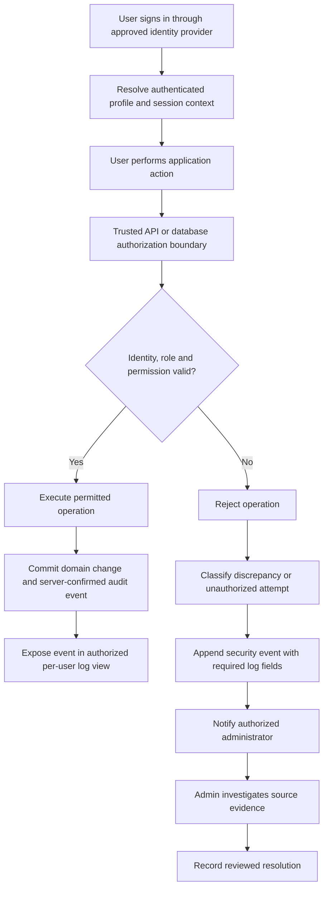

# TACResQ Admin IPS — Web UI/UX Redesign Master Plan

**Status:** Canonical design and implementation specification  
**Scope:** TACResQ administrator Information Processing System (Admin IPS) website  
**Theme decision:** Preserve the existing website theme. Redesign the interface, information architecture presentation, layout, typography, icons, components, responsiveness, and interactions without replacing the theme.  
**Repository baseline inspected:** `RamProjector/TACResQ-School-Project`, commit `b877cb3819484755145834f528252d13c04fb01b` (`main`)  
**Document rule:** This file is the single canonical web-admin redesign plan. Keep Android client redesign documents separate.

---

## 1. Final design decision

TACResQ Admin is an **administrative information system**, not a generic emergency dispatch command center.

The website's primary work is administration and governance: account management, access/security, reports, recorded activity, data continuity, preferences, and operator guidance. Emergency and incident data may appear where existing Admin capabilities require it, but the Admin interface must not be redesigned as a dispatcher console or given unverified dispatch powers.

### Non-negotiable decisions

1. **Keep the existing theme.** Preserve the current TACResQ palette, brand identity, backgrounds, surfaces, sidebar treatment, accent colors, semantic status colors, and existing theme behavior. Do not introduce a replacement palette, a new visual theme, or a competing design identity.
2. **Redesign the complete web experience.** This is not a task to delete paragraphs, hide sections, or apply a few cosmetic CSS changes. Rework the shell, every existing Admin workspace, page composition, tables, forms, dialogs, navigation, responsive behavior, and interaction details.
3. **Make the interface concise.** Remove repeated explanations and redundant labels. Keep essential field labels, status meaning, privacy notices, confirmation details, and accessibility names.
4. **Use information hierarchy rather than decoration.** Prefer clear alignment, compact headings, whitespace, tables, useful grouping, and contextual detail over oversized headings, decorative cards, or paragraphs that restate the page title.
5. **Create a distinctive administrative SVG icon family.** Custom SVGs should identify TACResQ Admin concepts. Keep Lucide for common utility actions; do not replace every familiar control with an unfamiliar custom symbol.
6. **Preserve real functionality.** Existing routes, permissions, API/RPC contracts, data semantics, security boundaries, and working features must remain intact unless a separate evidence-backed change is reviewed.
7. **Never invent operational certainty.** Unknown, unavailable, stale, uncollected, or unverified states must remain explicit. A successful dependency probe is not proof of complete system health.

### What this redesign is not

- Not a new theme or color-system redesign.
- Not a marketing/landing page redesign.
- Not a generic emergency dispatch dashboard.
- Not an excuse to add speculative modules or controls.
- Not a backend, database, infrastructure, or authorization rewrite.
- Not a reduction of critical information merely to make screens look empty.

---

## 2. Repository evidence and current baseline

The following observations were verified by reading source and documentation at the baseline commit above. They describe the inspected revision; re-check the current branch before implementation.

| Area | Verified baseline |
|---|---|
| Main Admin page | `backend/web/src/pages/AdminConsole.tsx` |
| Admin stylesheets | `AdminConsole.css`, `PortalVisualFoundation.css`, and `AdminResolution.css`, imported in that order by `AdminConsole.tsx` |
| Brand component | `backend/web/src/components/Brand.tsx`; displays the existing TACResQ app icon and wordmark |
| Global styles/theme tokens | `backend/web/src/index.css` |
| Web package | `backend/web/package.json`; React 19, Vite, TypeScript, Supabase JS and `lucide-react` |
| Existing Admin HCI contract | `tools/test_admin_hci_layout_contract.py` |
| Admin-only contract | `tools/test_web_admin_only_contract.py` |
| Admin page plan | `docs/plans/admin-page-feature-implementation-plan.md` |
| Admin completion/gap research | `docs/research/ADMIN_WEBSITE_COMPLETION_GAP_ASSESSMENT_2026-11-24.md` |
| Operator guide | `docs/admin-portal-operator-guide.md` |
| CI | `.github/workflows/ci.yml` runs the Admin HCI layout/form contract among other repository checks |

### 2.1 Existing Admin navigation

The inspected `AdminConsole.tsx` defines these eight primary sections:

1. Overview
2. User management
3. Security
4. Analytics & reports
5. Activity log
6. Data & continuity
7. Settings
8. Help & about

Settings is URL-backed and currently has General, Accessibility, Notifications, and Privacy subpages. Security is a separate primary section in the inspected code. Do not copy older documentation that describes a different section count or stale labels without reconciling it against the source.

The navigation groups currently communicate Workspace, Governance, Data & Continuity, and Preferences & Support. The final navigation may refine grouping and labels, but must preserve route compatibility and only expose implemented, authorized destinations.

### 2.2 Existing feature boundaries

| Workspace | Existing capability evidenced in source/docs | Redesign boundary |
|---|---|---|
| Overview | Account summaries, recent recorded-activity preview, dependency reachability probes, workspace shortcuts, explicit loading/error states | Make it a concise administrative landing page. Avoid duplicating Analytics aggregates or Activity Log records. Do not call dependency reachability end-to-end readiness. |
| User management | Protected paginated directory, search/role filters, reasoned role changes, account lifecycle history, protected account activity preview | Improve directory scanability and account detail presentation. Preserve server-side checks and reason/audit requirements. Do not add unverified profile fields. |
| Security | Administrator session/AAL/TOTP status and authenticator safeguards | Separate current-session/security controls from complete security monitoring. Do not imply full sign-in history or arbitrary user-session control unless the source supports it. |
| Analytics & reports | Date-bounded aggregate request metrics, status distribution, daily request volume, assignment timing, Manila-time reporting, CSV export | Keep aggregates distinct from event-level investigation. Make period, timezone, units, data freshness, and export scope clear. |
| Activity log | Searchable, filterable, paginated investigation feed with explicit source-coverage limitations | Keep event provenance and limitations visible. Do not label it a complete system-wide audit trail while sources are incomplete. |
| Data & continuity | Backup/recovery and attachment safeguards information with documented limits | Keep evidence and inspection dates explicit. Do not imply a live backup inventory, successful restore, or media browser without verified integration. |
| Settings | Browser-local density/page-size and accessibility preferences; informational guidance where server-backed policy is absent | Distinguish local preferences from global policy. Do not display inert toggles as functional controls. |
| Help & about | Searchable operator guidance | Keep concise, searchable, accurate, and synchronized with implemented behavior. |

### 2.3 Roles and authorization boundaries

- The Admin interface is for authorized administrators; it is not an alternate dispatcher workspace.
- The inspected Admin role-change options cover requester, responder, driver, and dispatcher. Admin provisioning is a separate trusted-operator process and must not become available through ordinary public signup or a casual role dropdown.
- Hiding a button or navigation item is not authorization. Every privileged read and mutation must remain enforced by the backend.
- Do not infer agency/tenant hierarchy, qualifications, certifications, duty rosters, or other data models unless the deployed schema and policies establish them.
- Keep current MFA/AAL2 requirements and protected investigation access intact.

### 2.4 Existing theme and typography

The inspected `index.css` defines the current theme foundation:

- Main interface font: **DM Sans**
- Display font: **Space Grotesk**
- Technical/monospaced font: **IBM Plex Mono**
- Existing palette tokens include `--ink`, `--ink-deep`, `--ink-soft`, `--paper`, `--card`, `--line`, `--ember`, `--ember-dark`, `--sage`, and semantic green/amber/red tokens.
- The Admin shell uses the existing deep navy sidebar, neutral workspace surfaces, white/near-white panels, and existing accent/status colors.
- `Brand.tsx` uses the existing TACResQ app-icon asset and wordmark.

**Theme freeze:** Continue consuming existing tokens. Do not redefine their values as part of this redesign. Do not add a new color palette, gradient system, dark theme, or new brand mark. If an existing token is insufficient for a specific component, document the gap and reuse the closest semantic token until separately approved.

The inspected global stylesheet imports the three fonts from Google Fonts. Treat font loading, fallback behavior, layout shift, and availability as performance concerns; do not change the typeface family as part of the redesign.

### 2.5 Existing layout and sidebar observations

- The Admin shell is a CSS grid with a sidebar and a min-width-safe main workspace.
- The desktop sidebar collapse state is represented by `admin-shell--sidebar-collapsed` and persisted in browser local storage.
- The Admin stylesheet contains a collapsed-grid contract expecting a `76px minmax(0, 1fr)` layout and hides the wordmark/context/navigation labels in the compact state.
- The source-contract test checks that behavior.
- The styles are split across three imported stylesheets. The shell's base grid width is declared more than once (including 238px and 270px variants), with additional responsive overrides. This creates a cascade/order risk for collapsed sizing.
- The desktop collapse control is inside the sidebar header. The mobile drawer opener is in the topbar outside the drawer; this is correct because the opener must remain reachable when the drawer is closed.
- At the mobile/tablet breakpoint, the sidebar becomes a fixed off-canvas drawer with a backdrop, close control, independent scrolling, focus handling, and reduced-motion treatment.

**Required verification:** Do not assume the reported collapse issue is solved merely because the class and source assertion exist. Inspect computed `grid-template-columns`, sidebar bounding width, and workspace bounding box at each desktop width and after resize. If only the sidebar's contents collapse while the grid column remains wide, fix the cascade/layout contract. Preserve the mobile opener outside the closed drawer.

---

## 3. Research findings and product references

The references below are design-pattern references, not templates to copy and not proof that TACResQ has equivalent features.

### 3.1 Product references

| Reference | Pattern worth borrowing | What not to copy |
|---|---|---|
| **Linear** | Quiet navigation, compact controls, restrained icon treatments, precise alignment, keyboard-friendly workflows, reduced decorative noise | Its issue-tracking information architecture or its theme |
| **Stripe Dashboard** | Data-first tables, clear value alignment, restrained surfaces, focused forms, progressive disclosure for detail | Financial workflows or data structures |
| **ArcGIS Mission** | Only where Admin reviews map-related/incident evidence: spatial context can be paired with contextual information rather than a separate decorative map card | A dispatch-first shell or operational capabilities not present in Admin |
| **Motorola CommandCentral** | High-signal status presentation and separating important alerts from routine information | Command-center navigation, wallboard density, or unimplemented dispatch controls |

### 3.2 Human-interface principles

1. **Recognition over recall:** use familiar navigation, predictable action placement, and visible current context.
2. **Progressive disclosure:** show the fields and actions needed for the current task; place technical detail, audit payloads, and explanatory material behind expandable details.
3. **Consistency:** the same control type should behave and look consistently across Admin pages.
4. **Task-oriented hierarchy:** the page should answer one primary question, such as “Which account needs review?” or “What recorded event occurred?”
5. **Information density without crowding:** prefer compact, aligned information over excessive cards or tiny unreadable text.
6. **Feedback and reversibility:** show whether an action is pending, saved, failed, or unavailable; confirm consequential actions and preserve recoverable form state.
7. **Honest system state:** distinguish healthy, degraded, stale, unknown, not collected, and unavailable.

### 3.3 Admin IPS-specific design conclusion

Use Linear and Stripe as the stronger references for the overall Admin IPS experience. Use GIS/emergency software references only for specific data views where the Admin portal actually needs geographic or incident context. The Admin website should remain an administration and information-processing workspace.

---

## 4. Final visual and interaction direction (existing theme retained)

### 4.1 Application shell

- Keep the existing TACResQ identity and palette.
- Build a stable desktop shell: sidebar, compact topbar, and main workspace.
- The sidebar must have a real expanded and collapsed width; the workspace must reclaim the released width.
- Keep navigation labels available through accessible names and tooltips in the collapsed state.
- Keep the collapse control reachable and visually aligned inside the desktop sidebar header.
- Keep the mobile drawer opener in the topbar, outside the closed drawer.
- Move sign-out into the existing account/profile menu only if a safe, discoverable account menu is implemented; do not simply hide sign-out.
- Keep breadcrumbs short and useful. Avoid repeating the same page name in a large eyebrow, title, subtitle, and card heading.
- Use a consistent page-header pattern: concise title, optional one-line context only when it adds meaning, and page actions aligned to the right.

### 4.2 Page composition

Avoid using the same dashboard template for every page.

| Page | Primary composition |
|---|---|
| Overview | Compact attention/summary area, recent recorded activity, limited shortcuts, dependency reachability with a precise scope label |
| User management | Search/filter toolbar, paginated directory table, contextual account details, guarded actions |
| Security | Current administrator session and authenticator status, grouped security controls, clear capability/coverage limits |
| Analytics & reports | Period/timezone controls, key aggregates, readable chart, supporting data table, scoped export |
| Activity log | Search/filter toolbar, event table/list, expandable event details, visible source coverage |
| Data & continuity | Evidence inventory and dated inspection context, clear unavailable/not-connected states, documented operator guidance |
| Settings | Short grouped preference controls with save/reset behavior; separate local preferences from read-only policy guidance |
| Help & about | Search-first reference, concise answers, version/support details only when grounded in configuration |

### 4.3 Cards, surfaces, and borders

- Do not place every element in a card.
- Use tables for records, lists for sequential activity, simple grouped sections for settings, and panels only when content is a distinct unit.
- Avoid nested cards inside cards.
- Use the existing border and surface tokens; reduce redundant outlines and decorative shadows.
- Use dividers to separate related rows rather than drawing a box around every row.
- Let whitespace and alignment create hierarchy.
- Keep action buttons near the content they affect.
- Keep dangerous actions visually distinct and require confirmation appropriate to their consequence.

### 4.4 Copy and labels

- Remove paragraphs that repeat the page title or explain an obvious control.
- Keep descriptions to one short line when a page needs context.
- Do not repeat the same status in a badge, heading, paragraph, and metadata line.
- Keep persistent form labels; placeholder text is not a replacement for a label.
- Keep critical security, privacy, data freshness, and consequence explanations even when they require more text.
- Prefer direct action names: “Export CSV”, “Refresh”, “Change role”, “View details”.
- Avoid unexplained abbreviations and excessive uppercase/letter spacing.
- Put technical definitions and source-coverage details in expandable help or details sections, not in the primary reading path.

---

## 5. Typography specification

Keep DM Sans, Space Grotesk, and IBM Plex Mono. Change their roles and hierarchy, not the font families.

| Role | Recommended size | Weight/use |
|---|---:|---|
| Page title | 22–26px | 600; Space Grotesk or existing display token |
| Section heading | 15–17px | 600; short and task-specific |
| Panel/table group heading | 14–16px | 600 |
| Body and table content | 13–14px | 400–500; DM Sans |
| Form label | 12–13px | 500–600; persistent |
| Supporting text | 12–13px | 400; only when useful |
| Metadata | 11–12px | 400–500; secondary contrast |
| IDs, timestamps, technical values | 11–12px | IBM Plex Mono; tabular numerals where useful |
| Icon-only tooltip | 12px minimum where feasible | concise action description |

### Typography rules

- Avoid oversized page titles. The current responsive title token reaches 40px; reduce the Admin page-title hierarchy toward the range above.
- Use fluid sizing only where it improves fit; never let viewport width inflate an administrative page title unnecessarily.
- Keep body copy comfortable and readable. Do not shrink table text to fit more columns.
- Use tabular numerals for counts, IDs, dates, and measurements where alignment helps scanning.
- Keep line length controlled for explanatory copy; avoid long full-width paragraphs.
- Use consistent line-height and avoid headings that wrap into awkward single-word lines.
- Respect browser zoom and user text scaling.
- Use font fallbacks that preserve layout if Google Fonts cannot load. Assess self-hosting only after license, build, and performance review; it is not a requirement to add a new font.

---

## 6. Custom TACResQ Admin SVG icon system

A unique SVG family is required, but it must represent **administrative information-system concepts**, not turn the site into an emergency-response icon showcase.

### 6.1 Icon families

Create original TACResQ-specific SVGs for these Admin concepts:

| Concept | Visual direction |
|---|---|
| Overview | Structured dashboard/grid with one emphasized information point |
| User management | Account/profile with a controlled directory or grouping motif |
| Security | Layered access/verification motif; distinct from generic emergency shield imagery |
| Analytics & reports | Measured data/chart motif with a recognizable report structure |
| Activity log | Ordered event/timeline or recorded-entry motif |
| Data & continuity | Structured data/archive with a continuity/restore cue; do not imply a backup is verified |
| Settings | Deliberate control/adjustment motif |
| Help & about | Knowledge/reference motif |

Custom icons should be recognizable at small sizes and should not depend on color alone.

### 6.2 Technical standards

- Use a consistent 24×24 viewBox for standard UI icons; use 32×32 or 48×48 for larger empty-state or feature illustrations.
- Keep stroke weight consistent (approximately 1.75–2px at 24px scale), with coherent caps, joins, corner radii, and optical alignment.
- Use `currentColor` so SVGs inherit the existing theme.
- Keep fills and strokes simple; avoid filters, gradients, tiny details, and excessive path complexity.
- Include outline and selected/emphasized variants only where a state genuinely changes.
- Decorative SVGs must be hidden from assistive technology. Meaningful icon-only controls need accessible names and visible focus.
- Preserve adequate target size around icons; the icon itself is not the interactive target.
- Optimize SVG output and avoid shipping a large icon font for a small set of symbols.

### 6.3 Use Lucide appropriately

Keep `lucide-react` for familiar utility actions such as search, close, refresh, edit, download, sort, pagination, and menu controls. Use the custom library for the TACResQ Admin identity and the eight primary administrative concepts. Do not replace familiar utility icons merely to make every icon different.

---

## 7. Component and page standards

### 7.1 Tables and directories

- Tables are primary interfaces for account directories, activity records, and report detail.
- Use clear column names, aligned numeric values, stable row heights, and subtle row separators.
- Keep search, filters, page size, result count, and pagination in a compact toolbar.
- Avoid forcing a wide table to shrink into unreadable text. Use a local horizontal scroll region or a carefully designed compact row/detail presentation.
- Keep important identity fields together; place secondary technical identifiers in lower-emphasis text.
- Make row actions keyboard accessible and give repeated actions names that identify the affected record.
- Preserve sorting/filter state where existing behavior supports it.
- Use explicit empty, loading, unavailable, and error states; do not show stale privileged data after authorization failure.

### 7.2 Forms and settings

- Prefer single-column forms; use two columns only for short, related fields when there is sufficient space.
- Keep persistent labels above controls.
- Place short hints and validation feedback next to the relevant field.
- Group related settings and clearly distinguish editable local preferences from read-only policy information.
- Explain whether a setting is browser-local or server-backed.
- Provide save/reset feedback and protect unsaved changes when leaving a form.
- Do not render inert toggles for unimplemented notification, privacy, security, or system policies.

### 7.3 Dialogs and confirmations

- Keep dialogs focused on one decision.
- State the affected account/record and consequence.
- Keep primary and destructive actions clearly differentiated.
- Fit within short viewport heights using internal scrolling where necessary.
- Preserve focus, return focus to the trigger, support Escape where safe, and prevent background interaction when modal.
- Do not put long policy paragraphs into every confirmation; link to the relevant details when appropriate.

### 7.4 Status, notifications, and feedback

- Pair status color with text or a meaningful icon; never rely on color alone.
- Distinguish success, warning, error, stale, unknown, and unavailable.
- Show freshness timestamps only when they belong to the currently displayed result set.
- Keep toast messages concise and non-blocking; persistent errors need an actionable recovery path.
- Never show “live”, “healthy”, “complete”, “delivered”, “backed up”, or “restorable” unless the source proves that exact claim.

---

## 8. Responsive and adaptive layout strategy

The design must respond to **available space**, not just device labels. Do not create one media query for every test resolution. Use content-driven breakpoints, fluid sizing, CSS Grid/Flexbox, container queries, and component-level adaptation.

### 8.1 Test viewport width matrix

Use these widths as a broad QA matrix, not as 31 required CSS breakpoints:

`320, 360, 375, 390, 414, 430, 480, 540, 600, 640, 720, 768, 800, 834, 900, 960, 1024, 1080, 1152, 1200, 1280, 1366, 1440, 1536, 1600, 1680, 1728, 1920, 2048, 2560, 3440 px`

### 8.2 Test viewport height matrix

`568, 640, 720, 768, 800, 900, 1080, 1440 px`

Test representative width/height combinations, especially narrow + short, medium + short, and ultrawide + tall. Do not exhaustively run every Cartesian combination on every commit.

### 8.3 Required adaptive behaviors

| Available space | Expected behavior |
|---|---|
| Wide desktop | Expanded sidebar, comfortable workspace, optional contextual detail column |
| Standard desktop | Expanded sidebar and content-width-aware page layout |
| Narrow desktop/laptop | Compact or collapsed sidebar when needed; toolbar wraps without overlap |
| Tablet landscape | Drawer or compact navigation; tables and filters reorganize |
| Tablet portrait | Single workspace column; panels stack; navigation remains reachable |
| Narrow/mobile browser | Drawer navigation, compact topbar, focused single-column task flow |
| Short viewport | Header and navigation remain usable; long panels/dialogs scroll internally |
| Split-screen/resized window | Components adapt to their container instead of assuming full-screen width |
| 200–400% zoom | Content reflows without clipped controls or page-level horizontal scrolling for ordinary content |

### 8.4 Browser and environment variations

Include:
- Portrait and landscape.
- Mouse, keyboard, and touch.
- 100%, 125%, 150%, 200%, and 400% browser zoom.
- Split-screen and narrow browser windows.
- Browser chrome reducing available height.
- High-DPI/device pixel ratio variations.
- Font loading delay/failure.
- Reduced motion and forced-colors/high-contrast modes.
- Resize while menus, dialogs, expanded rows, or filters are open.

### 8.5 Implementation rules

- Use page-level media queries only when the overall composition must change.
- Use container queries when an individual component should adapt to its own available width.
- Use `minmax(0, 1fr)`, `min-width: 0`, and bounded widths to prevent grid/flex overflow.
- Use `clamp()` for fluid spacing and restrained type sizing, with readable minimums.
- Use dynamic viewport units such as `dvh` where supported and safe fallbacks for viewport-height layouts.
- Keep horizontal scrolling local to genuinely wide data tables; avoid page-wide overflow.
- Keep modal and dropdown positioning within the visible viewport.
- Preserve focus and selected state when a layout changes from sidebar to drawer.
- Keep navigation usable with a keyboard and touch, including visible focus and adequate target dimensions.

### 8.6 Existing responsive implementation to consolidate

The inspected stylesheets contain overlapping breakpoints and shell overrides, including 1920px+, 1440px, 1201–1439px, 901–1200px, 761–900px, max 760px, max 480px, max 900px, max 1120px, max 960px, max 700px, and max 520px rules across different files.

Do not add another layer of overrides. First map all existing selectors and their cascade. Consolidate the Admin shell and component responsive rules into a clear, documented system while preserving the existing theme and behavior.

---

## 9. Accessibility and usability requirements

Target WCAG 2.2 AA as an engineering goal, but do not claim conformance without a complete audit.

- Text contrast: at least 4.5:1 for normal text and 3:1 for large text.
- Visible keyboard focus for every interactive element.
- Keyboard access to navigation, tables, menus, dialogs, filters, and pagination.
- Logical focus order and appropriate focus restoration.
- Semantic headings, landmarks, labels, table headers, status announcements, and form error associations.
- Accessible names for icon-only controls; decorative SVGs hidden from screen readers.
- Do not use color as the only signal for status, errors, or selection.
- Reflow at narrow equivalent widths and browser zoom; no loss of information or functionality.
- Touch targets should be comfortably usable; aim for approximately 40–44px where practical, while meeting applicable WCAG target-size requirements.
- Respect reduced-motion preferences; avoid non-essential animation.
- Test forced-colors/high-contrast mode.
- Keep error messages specific and actionable without exposing sensitive implementation details.
- Provide clear empty and unavailable states; do not rely on a blank panel to communicate absence of data.

---

## 10. Performance and implementation quality

- Preserve the current font families; optimize loading/fallback behavior and avoid layout shift.
- Avoid introducing new UI libraries or dependencies unless the repository review proves they are needed.
- Use the existing Lucide dependency and a small optimized custom SVG library.
- Avoid heavy blur, large shadow stacks, expensive animated backgrounds, and unnecessary motion.
- Keep tables and charts responsive; consider virtualization only if measured record volume justifies it.
- Avoid rendering large hidden page trees if it causes measurable performance or accessibility problems.
- Ensure CSS ownership is clear: reduce duplicate selectors and stylesheet-order dependencies.
- Keep components reusable where behavior is genuinely shared; do not over-generalize different workflows into one complex component.
- No console errors, broken links, inaccessible controls, or inert buttons in the redesigned pages.

---

## 11. Security, privacy, and truthful data presentation

The Admin UI is a privileged surface.

1. Backend authorization remains authoritative. UI visibility is never a substitute for RLS, RPC authorization, or server-side role checks.
2. Keep privileged data out of local storage. Browser-local storage may hold non-sensitive presentation preferences only.
3. Do not expose service-role credentials, access tokens, MFA secrets, recovery codes, private attachment bytes, or sensitive incident details unnecessarily.
4. Preserve MFA/AAL2 requirements for protected investigations and security-sensitive actions.
5. Keep role changes reasoned, auditable, and limited to server-authorized roles.
6. Do not expose Admin provisioning through public signup or ordinary role controls.
7. Keep CSV export scoped and protected against spreadsheet formula injection.
8. Keep audit source coverage visible. Missing events must not be interpreted as proof that no event occurred.
9. Do not represent dependency reachability as full application health or emergency readiness.
10. Do not add account suspension, deletion, restore, notification suppression, retention, or global policy controls until the underlying authorization, audit, recovery, and enforcement behavior is verified.
11. Do not invent privacy controller details, legal basis, retention periods, data-subject rights processing, or vendor disclosures.
12. Use synthetic accounts and synthetic records for QA; never use real emergency incidents or personal location data in test fixtures.

---

## 12. Testing and verification plan

### 12.1 Existing checks

At the inspected baseline:
- `tools/test_admin_hci_layout_contract.py` protects key navigation, sidebar, mobile drawer, focus, and form contracts.
- `tools/test_web_admin_only_contract.py` protects Admin-only frontend boundaries.
- `.github/workflows/ci.yml` runs the Admin HCI contract.
- `backend/web/package.json` exposes `build` (TypeScript check + Vite build), `dev`, and `preview`; it does not define a dedicated frontend test or viewport-matrix script.
- `tools/visual_regression.py` uses Playwright to capture the interactive mobile wireframe gallery at a fixed 1440×1080 browser viewport. It is not a live AdminConsole viewport suite; map views are excluded due to nondeterministic external tiles.

Re-check current scripts and workflows before relying on these statements.

### 12.2 Required checks for the redesign

| Check | Minimum expectation |
|---|---|
| TypeScript/web build | `pnpm --dir backend/web build` or the repository's current equivalent |
| Admin HCI contract | Run existing `tools/test_admin_hci_layout_contract.py` |
| Admin-only contract | Run existing `tools/test_web_admin_only_contract.py` |
| Relevant security/source contracts | Run the Admin/auth/audit/security tests affected by the change |
| Navigation | Every Admin section and legacy URL works; browser Back/Forward and keyboard navigation remain correct |
| Data behavior | Loading, empty, error, stale, unavailable, permission denied, and successful states are accurate |
| Sidebar | Verify actual sidebar width and workspace expansion when collapsed at multiple desktop widths |
| Responsive | Run the broad width/height matrix, including just below/at/above each chosen content-driven breakpoint |
| Accessibility | Keyboard-only, focus order, screen-reader names, contrast, zoom/reflow, reduced motion, forced colors |
| Visual review | Capture real Admin pages, not only wireframes; review every section and responsive state |
| Regression | Confirm routes, roles, permissions, APIs, filters, forms, exports, dialogs, and account workflows remain intact |

### 12.3 Viewport test execution strategy

- Pull request smoke suite: representative compact, standard, laptop, tablet, and mobile viewports, plus short-height and zoom checks for changed components.
- Major shell/layout change: full width matrix and representative height combinations.
- Release candidate: full matrix plus manual keyboard, touch, zoom, and assistive-technology review.
- Capture screenshots for each Admin section and key states: loading, populated, empty, error, expanded detail, open menu/dialog, collapsed sidebar, and mobile drawer.
- Test immediately below, at, and above each actual breakpoint.
- Keep screenshot differences report-only only where repository policy says so; navigation, functionality, accessibility, build, and security checks remain blocking.

---

## 13. Implementation phases

### Phase 0 — Baseline and inventory
- Record the current main SHA, open PRs, CI state, routes, section permissions, and backend dependencies.
- Capture screenshots and inspect every Admin section at representative widths.
- Inventory all existing selectors and stylesheet load order.
- Verify the sidebar collapse width using computed browser layout.
- Record existing defects separately from redesign regressions.

**Exit:** source inventory, screenshots, baseline test results, and a list of confirmed versus suspected issues.

### Phase 1 — Design foundation (theme preserved)
- Define spacing, typography roles, border/radius/elevation usage, focus styles, and component density using existing theme tokens.
- Define the custom TACResQ Admin SVG family.
- Define shared patterns for page headers, tables, filters, forms, status indicators, empty/error states, and dialogs.
- Do not change theme token values.

**Exit:** documented design tokens/roles, icon assets/components, and reviewed component examples.

### Phase 2 — Application shell and sidebar
- Consolidate the shell CSS and responsive rules.
- Fix the real desktop collapsed-column behavior.
- Preserve mobile drawer opener/closer placement and accessibility.
- Standardize topbar, breadcrumbs, profile/account menu, and workspace width.
- Verify short-height, zoom, keyboard, and resizing behavior.

**Exit:** sidebar physically shrinks, workspace expands, no overlap/overflow, drawer remains operable.

### Phase 3 — Page-by-page Admin redesign
Recommended order:
1. Overview
2. User management
3. Security
4. Analytics & reports
5. Activity log
6. Data & continuity
7. Settings
8. Help & about

For each page: improve information hierarchy, remove redundant copy, redesign its primary data view, standardize controls, and verify all states and role boundaries.

**Exit:** all existing Admin sections have a consistent but purpose-specific layout; no feature is silently removed.

### Phase 4 — Responsive and accessibility hardening
- Validate the viewport matrix and zoom levels.
- Fix overflow, short-height dialogs, nested scrolling, focus loss, and touch target issues.
- Verify contrast and reduced-motion/forced-color behavior.

**Exit:** responsive and accessibility evidence is attached to the implementation review.

### Phase 5 — Final regression and release review
- Run web build, Admin contracts, relevant security tests, and full repository CI.
- Review actual rendered pages at all major viewport families.
- Verify backend/API behavior and role isolation have not changed.
- Document any manual checks that remain outstanding.

**Exit:** exact-head checks pass, no unresolved blocking issues, and manual acceptance gaps are stated honestly.

---

## 14. Acceptance criteria

The redesign is ready for final review only when all applicable criteria are met:

- [ ] The existing TACResQ website theme and brand are preserved.
- [ ] The product remains clearly an Admin IPS website, not a dispatch dashboard.
- [ ] Every existing Admin section is redesigned and remains reachable.
- [ ] No existing feature, route, permission, or backend contract is removed or silently changed.
- [ ] The sidebar's desktop collapse changes the actual grid column and gives the width back to the workspace.
- [ ] The mobile drawer opener remains reachable outside the closed drawer.
- [ ] Typography is compact, readable, consistent, and not dominated by oversized page titles.
- [ ] Repeated paragraphs, redundant labels, duplicate cards, and decorative noise are removed without hiding essential meaning.
- [ ] Original TACResQ Admin SVG icons are used for core administrative concepts; Lucide remains for familiar utility actions.
- [ ] Tables, filters, forms, dialogs, status indicators, and feedback patterns are consistent.
- [ ] All states are truthful: loading, empty, stale, unavailable, error, success, and permission denied.
- [ ] Responsive layouts work across representative width/height combinations, split-screen, orientation, and zoom.
- [ ] Keyboard navigation, focus, screen-reader names, contrast, reduced motion, and reflow are reviewed.
- [ ] No new client-only security controls or unsupported operational claims are introduced.
- [ ] Build, Admin contracts, security checks, and required CI pass on the exact reviewed commit.
- [ ] Browser/device acceptance is recorded separately from automated source tests.

---

## 15. Research references

Use these as supporting guidance. Re-check current versions and applicability during implementation.

### Product/interface references
- [Linear — How we redesigned the UI](https://linear.app/now/how-we-redesigned-the-ui) — restraint, hierarchy, consistency, and reducing unnecessary interface decoration.
- [Esri — ArcGIS Mission](https://www.esri.com/en-us/arcgis/products/arcgis-mission/overview) — contextual spatial information, relevant only to Admin pages that genuinely need map/incident context.
- [Motorola Solutions — CommandCentral](https://www.motorolasolutions.com/en_us/products/command-center-software.html) — high-signal status and alert presentation; not an Admin IPS information-architecture template.

### Human-computer interaction and accessibility
- [Nielsen Norman Group — Recognition vs. recall](https://www.nngroup.com/articles/recognition-and-recall/) — make actions and context recognizable rather than requiring users to remember hidden conventions.
- [Nielsen Norman Group — Progressive disclosure](https://www.nngroup.com/articles/progressive-disclosure/) — reveal secondary detail when needed without hiding critical information.
- [W3C — WCAG 2.2](https://www.w3.org/TR/WCAG22/) — accessibility success criteria.
- [W3C — Reflow](https://www.w3.org/WAI/WCAG22/Understanding/reflow.html) — responsive reflow and avoiding two-dimensional scrolling for ordinary content.
- [W3C — Target Size (Minimum)](https://www.w3.org/WAI/WCAG22/Understanding/target-size-minimum.html) — interactive target-size requirements.
- [W3C — Decorative Images](https://www.w3.org/WAI/tutorials/images/decorative/) — accessible treatment of decorative graphics.
- [W3C — SVG 2](https://www.w3.org/TR/SVG2/) — SVG structure and semantics.

### Typography, icons, and responsive implementation
- [Material Design — Typography](https://m3.material.io/styles/typography/overview) — type roles and hierarchy.
- [Material Design — Icons](https://m3.material.io/styles/icons/overview) — consistent icon use and sizing.
- [Lucide — Icon design](https://lucide.dev/guide/design/icon-design) — coherent icon geometry.
- [Lucide — Accessibility](https://lucide.dev/guide/advanced/accessibility) — accessible icon implementation.
- [MDN — Responsive design](https://developer.mozilla.org/en-US/docs/Learn_web_development/Core/CSS_layout/Responsive_Design) — responsive layout foundations.
- [MDN — Container queries](https://developer.mozilla.org/en-US/docs/Web/CSS/CSS_containment/Container_queries) — component adaptation based on available space.
- [MDN — clamp()](https://developer.mozilla.org/en-US/docs/Web/CSS/clamp) — bounded fluid sizing.
- [Playwright — Emulation](https://playwright.dev/docs/emulation) — viewport/device emulation for automated verification.

### Security and emergency-context guidance
- [OWASP Application Security Verification Standard](https://owasp.org/www-project-application-security-verification-standard/) — application security verification baseline for privileged workflows.
- [ITU-T F.760.2](https://www.itu.int/rec/T-REC-F.760.2/en) — first-responder interface guidance; use only for relevant readability, feedback, and high-stress information presentation, not as the Admin IPS page architecture.

---

## 16. Maintenance rule

Update this file when the Admin navigation, page capabilities, theme tokens, icon system, responsive architecture, or acceptance gates materially change. Keep source-backed facts distinct from recommendations. If another document covers a narrow topic (for example, security-event coverage or the operator guide), link to it rather than duplicating its entire content here.

**This plan is the final design direction:** complete TACResQ Admin IPS web UI/UX redesign, existing theme preserved, concise professional interface, distinctive administrative SVG icons, real responsive behavior, and all current authorized functionality retained.

---

## 17. Additional research — administrative workflows and data-intensive interfaces

This section extends the existing design foundation with implementation guidance for a real administrative information system. These are design requirements and research conclusions, not claims that every capability already exists in TACResQ. Confirm each capability against current source, schema, RPCs, and authorization before implementing it.

### 17.1 Record lifecycle and end-to-end workflows

Design around the complete lifecycle of an administrative record, not isolated screens.

For every existing record type, document:
- Who can create, view, search, edit, review, export, archive, or delete it.
- Which fields are required, optional, immutable, or system-generated.
- Which state transitions are valid and who may perform them.
- What reason, confirmation, or supporting evidence is required for consequential changes.
- What happens when a save fails, a session expires, or another administrator changes the same record.
- Which events must be auditable and how the user can inspect the resulting history.

Create a workflow map for each current Admin capability: entry point → search/select → inspect → permitted action → confirmation → result → audit/history. Do not add lifecycle states or actions that are not supported by the backend.

**Design implication:** use a directory/list for finding records, a focused detail view for understanding one record, and contextual actions for operations on that record. Avoid forcing users through a dashboard card for every step.

### 17.2 Data tables and record directories

Tables are primary working surfaces in an Admin IPS. Treat them as structured tools, not decorative content.

Required patterns:
- Clear column names and semantic table headers.
- Stable row identity and predictable row actions.
- Sort indicators that disclose the active sort column and direction.
- Search and filters that apply to the complete result set, not only the currently visible page.
- Visible active filters with a simple way to clear one or all.
- Pagination that preserves the current query and filters when moving between pages.
- A clear result count and current page context.
- Column widths that prioritize the fields administrators actually use.
- Local horizontal scrolling or a deliberate compact/stacked alternative for genuinely wide tables; never cause accidental page-wide horizontal overflow.
- Loading, no-results, empty, error, stale, and permission-denied states.
- Selection checkboxes only when a real bulk action exists.
- Row click behavior that does not conflict with nested buttons, links, or checkboxes.

Do not make every column sortable or every field a visible column by default. Prioritize the common decision-making fields and place secondary data in a detail panel.

### 17.3 Search, filtering, and query persistence

Search should help administrators find known records quickly and understand why a result matched.

Specify:
- Which fields are searchable and whether matching is exact, prefix, or partial.
- Whether search is case-insensitive and how punctuation/spacing are normalized.
- How search combines with role, status, date, and other filters.
- Whether filters are server-side and whether counts reflect the full filtered result set.
- What happens when a query returns no matches.
- Whether query state is preserved in the URL so browser Back/Forward, refresh, and shareable links behave predictably.
- Debounce behavior and cancellation of stale requests.
- Clear/reset behavior that does not unexpectedly discard unrelated page state.

Avoid an unexplained universal search box if the backend only searches one dataset. Label the search scope accurately.

### 17.4 Bulk actions and imports/exports

Bulk actions can save time but amplify mistakes. Add them only where the existing data model and backend support safe batch operations.

Before implementation, require:
- Explicit selection count and clear all/none behavior.
- A preview of the affected records and the exact change.
- Permission checks for every affected record, not only the first selected row.
- A reason and confirmation for consequential changes.
- Defined partial-failure behavior and per-record results.
- Idempotency or safe retry behavior where supported.
- An audit event for each affected record or a traceable batch event with item-level outcomes.
- A safe maximum batch size and clear progress feedback.

For exports, show the applied filters, date range, timezone, included columns, and record count. Keep exports permission-checked and protect CSV output against spreadsheet formula injection. Do not imply that a download contains every record if it is limited to the current page.

Imports must not be introduced merely as a convenience. They require schema validation, duplicate handling, preview, rollback/partial-failure rules, and auditability.

### 17.5 Forms and validation

Use persistent labels, logical grouping, and concise help text only where a field is ambiguous or has consequential requirements.

Recommended form behavior:
- Validate required and format constraints at the appropriate point without surprising users.
- Show an error beside the affected field and provide a concise summary for long forms.
- Link summary errors to the corresponding fields and move focus appropriately after failed submission.
- Preserve valid entered values when validation or network submission fails.
- Distinguish field errors, permission errors, network failures, and server conflicts.
- Explain constraints before submission when users need them to complete the form correctly.
- Disable duplicate submission while a request is in flight, but do not leave the user with an indefinite spinner.
- Confirm navigation away only when meaningful unsaved work would be lost.
- Use explicit save/cancel actions; do not silently autosave privileged or consequential changes.
- Use confirmation dialogs for irreversible or high-impact actions, with the target and consequence named.

Do not use placeholder text as the only label. Do not make every field show a long explanatory paragraph. Keep security and privacy explanations when they materially affect the user's decision.

### 17.6 Audit trails and activity investigation

Separate operational activity feeds from security audit logs unless source coverage and semantics prove they are the same dataset.

For each event, establish which fields are actually available:
- Event/action type.
- Actor identity or system actor.
- Target record and stable identifier.
- Timestamp and timezone.
- Outcome (success, denied, failed, pending) where recorded.
- Source/channel and correlation/request identifier where available.
- Reason or change summary where safe and supported.

Audit views should support time range, actor, event type, target, and outcome filters only when the underlying records support them. Keep event details expandable and avoid exposing secrets, session tokens, MFA material, or unnecessary personal data.

Show coverage limitations and retention boundaries. A missing event is not proof that an action did not occur. Never label a partial activity feed as a complete system-wide audit trail.

### 17.7 Permissions and privileged-action UX

Use least privilege and defense in depth:
- Backend authorization remains authoritative for every read and write.
- The frontend should explain unavailable actions without exposing privileged data.
- Hide or disable controls based on verified permission context, but never rely on UI visibility as enforcement.
- Distinguish “not authorized”, “not configured”, “not available”, and “temporarily failed”.
- Require stronger confirmation for high-impact actions, with a reason where policy requires it.
- Do not expose privilege escalation, admin provisioning, role grants, account deletion, or security-policy controls unless the backend has a reviewed and auditable implementation.
- Keep session and MFA state understandable without displaying secrets or implying a stronger assurance level than the backend reports.

### 17.8 Concurrent edits, stale data, and recovery

Administrative records may be changed by more than one operator. Define behavior for:
- A record changing after the detail view was loaded.
- A save conflicting with a newer version.
- A session expiring during an edit.
- A network interruption during submission.
- A retry after an uncertain response.
- A record becoming inaccessible before the action completes.

Show when data was last refreshed if freshness matters. Prefer an explicit conflict state with a reload/review path over silently overwriting newer data. Preserve user-entered data where safe. Do not claim a mutation failed if the server may have completed it; reconcile the result before allowing a duplicate action.

### 17.9 Notifications and feedback

Use notifications for events that need attention, not as a second activity log.

Define:
- Which events warrant an in-app notification.
- Severity and urgency semantics.
- Read/unread state and whether it is server-backed.
- Destination when a notification is opened.
- Dismissal and retention behavior.
- How duplicate or repeated alerts are grouped.
- What happens when the destination is no longer accessible.

Use inline feedback for local actions, persistent banners for page-level conditions, and dialogs only when a decision is required. Avoid success toasts for actions that have not been confirmed by the server.

### 17.10 Analytics and reporting integrity

Every report must disclose enough context to interpret it:
- Metric definition and unit.
- Date range and timezone.
- Aggregation level and filters.
- Data freshness or last successful refresh, if known.
- Missing-data or coverage limitations.
- Whether values are live, cached, or historical.
- Export scope and included fields.

Use a chart only when it helps compare, trend, or understand a distribution. Provide a table or textual equivalent for exact values. Avoid 3D charts, decorative gauges, arbitrary color categories, and dashboards that repeat the same metric in multiple forms.

Do not infer service quality, response performance, or system readiness from metrics that do not measure those outcomes.

### 17.11 Reusable component and design-system governance

Maintain one shared implementation for genuinely shared patterns:
- Page header and action area.
- Search/filter toolbar.
- Data table and pagination.
- Status label and state description.
- Form field, field error, and error summary.
- Confirmation dialog.
- Empty/loading/error/unavailable state.
- Detail panel and expandable event content.
- Toast/banner feedback.
- Icon button and tooltip.

Document component states and interaction contracts, not just screenshots. Avoid a single giant “universal” component with many unrelated flags. A component should be shared when its semantics and behavior are shared, not merely because two pages look similar.

### 17.12 Operational design acceptance checklist

- [ ] Each existing Admin workflow is mapped from entry to completion.
- [ ] Record actions and valid state transitions are backed by current server behavior.
- [ ] Search/filter/sort/pagination operate on the complete intended result set.
- [ ] Query state survives refresh and browser navigation where appropriate.
- [ ] Bulk actions have preview, authorization, partial-failure handling, and audit evidence.
- [ ] Forms preserve input and identify errors accessibly.
- [ ] Concurrent updates cannot silently overwrite newer records.
- [ ] Audit/activity views accurately state their source coverage and retention limits.
- [ ] Permission failures are distinguishable from missing configuration and service errors.
- [ ] Reports disclose units, period, timezone, freshness, and scope.
- [ ] Every action has truthful pending/success/failure feedback.
- [ ] Empty, loading, stale, unavailable, error, and no-permission states are designed consistently.
- [ ] Shared components have documented states and keyboard behavior.

---

## 18. Additional research references

These references extend the source list in Section 15. Apply the guidance selectively and verify current versions during implementation.

### Administrative tables, navigation, and components
- [GOV.UK Design System — Components](https://design-system.service.gov.uk/components/) — reusable component patterns and usage guidance.
- [GOV.UK Design System — Pagination](https://design-system.service.gov.uk/components/pagination/) — responsive pagination, page context, and applying sort/filter behavior to the full result set.
- [GOV.UK Design System — Error summary](https://design-system.service.gov.uk/components/error-summary/) — accessible form error summaries and field links.
- [U.S. Web Design System — Patterns](https://designsystem.digital.gov/patterns/) — task-oriented patterns for complex forms and user profiles.
- [U.S. Web Design System — Validation](https://designsystem.digital.gov/components/validation/) — validation guidance and documented usability/accessibility limitations of its validation component.

### Accessibility and form behavior
- [W3C — WCAG 2.2](https://www.w3.org/TR/WCAG22/) — keyboard access, focus, reflow, target size, text alternatives, and input requirements.
- [W3C WAI — Understanding Error Identification](https://www.w3.org/WAI/WCAG22/Understanding/error-identification) — errors must be identified in text or a text alternative; choose inline or summary patterns according to context.

### Security, sessions, and logging
- [OWASP ASVS 5.0 — Security Logging and Error Handling (V16)](https://github.com/OWASP/ASVS/blob/master/5.0/en/0x25-V16-Security-Logging-and-Error-Handling.md) — structured security-event logging, log protection, sensitive-data minimization, and secure error handling.
- [OWASP ASVS 5.0 — Session Management (V7)](https://github.com/OWASP/ASVS/blob/master/5.0/en/0x16-V7-Session-Management.md) — unique sessions, invalidation, and inactivity timeouts.
- [OWASP Application Security Verification Standard](https://owasp.org/www-project-application-security-verification-standard/) — broader verification framework for privileged web applications.

### Application of research to TACResQ
- These sources support interface and verification requirements; they do not establish that TACResQ currently has bulk editing, imports, complete audit coverage, concurrent-edit versioning, or notification preferences.
- Confirm the current implementation and data contracts before specifying any of those features as deliverable behavior.
- Keep the existing theme and the Admin IPS product identity unchanged.

---

## 19. Mandatory IDS/IPS coursework criteria — source-based requirements

**Source:** user-provided *CRITERIA FOR THE IDS/IPS: Intrusion Detection/Intrusion Prevention System*, one-page handout, page 1. This section preserves the assignment's requirements and translates them into TACResQ-specific design and verification work. It does not claim that the repository currently satisfies them.

### 19.1 Requirements stated in the handout

The handout requires:

1. A web-, desktop-, or mobile-based IDS/IPS using the **same database** and linked to the mobile application.
2. Identification of application users, each user's roles/permissions, sessions per user, and operations/actions. The handout says operations/actions are only **ADD, EDIT, DELETE**.
3. An IDS/IPS system flowchart.
4. System logs recording all operation/actions and sessions with these exact field names: `session_id`, `log_id`, `actions`, `description`, `ip_address`, `timestamp`, `device_used`.
5. Each action must be included in system logs. Its example uses role-specific action names (student: borrow_books, return_books, view_all_books, reserve_books, search_books; staff: manage_borrow_books, manage_return_books, view_all_books, manage_reserve_books, search_books) and a human-readable action/description pair.
6. Each user must have their own system logs.
7. A user may have one or more roles, and roles/permissions may be assigned to users. The system must detect a role/permission assigned to a non-applicable user as a discrepancy/intrusion and warn/notify the administrator.
8. All listed criteria must be met.

### 19.2 TACResQ interpretation and important distinctions

- The handout's **ADD / EDIT / DELETE** is the required operation classification. The handout's examples also include named user activities such as viewing and searching. Preserve both levels: classify a mutation as ADD, EDIT, or DELETE, while recording the specific role action key and a readable description. For read-only events such as view/search, use a separate event category/action family rather than mislabeling them as ADD/EDIT/DELETE. Confirm the instructor's expected treatment if the rubric requires every event to map strictly to one of the three operation values.
- TACResQ's existing roles and workflows must be discovered from current source and database constraints. Do not import the library example's student/staff roles.
- A UI navigation item or hidden button is not a permission. Applicable-role checks and prevention must be enforced at the trusted database/API boundary.
- "Same database" must mean the IDS/IPS consumes authoritative records from the database used by TACResQ's mobile application, not a separate mock database or manually copied log store. Verify actual project environment and database connection before claiming this requirement is met.
- A session record and an action audit event are different things. A session lifecycle event records authentication/session context; an action event records an operation performed within that context. Do not fabricate a session identifier if the authentication provider does not expose a stable, safe identifier to the application.
- The required `ip_address` and `device_used` fields are sensitive/contextual metadata. Record them only from a trusted server/database edge where available, minimize retention and access, and never trust client-supplied IP/device strings as authoritative. If a field is unavailable for a particular source, represent that limitation honestly rather than inventing it.
- Per-user log access must be scoped by authenticated identity and role. Administrators may have a bounded investigation view; ordinary users must not be able to read another user's logs. Apply row-level/server-side authorization and test direct API/RPC/table access, not only UI filtering.
- The discrepancy detector must compare an observed assignment against an authoritative role/permission applicability policy. It must not treat every multi-role user as suspicious: the handout explicitly permits multiple roles. Detection needs an explicit matrix of allowed role combinations, user classes, and applicable permissions.
- Detection and prevention are separate outcomes: detect and record the discrepancy, notify an authorized administrator, and block or quarantine the unauthorized privilege transition where the trusted authorization boundary can enforce it. Do not silently repair role assignments or remove access without a reviewed policy and recovery path.

### 19.3 Verified repository baseline relevant to the criteria

The following are repository findings at baseline commit `b877cb3819484755145834f528252d13c04fb01b`, not live-production verification:

- The Admin authorization design documents distinct Supabase Auth/profile and Laravel Sanctum identity paths. They are not interchangeable; email matching is not a trusted identity link.
- The Admin portal's current role model is a single `admin` role with action-level server enforcement, AAL2 and TOTP for privileged RPCs. The existing managed ordinary roles are `requester`, `responder`, `driver`, and `dispatcher`. The repository's authorization review specifically cautions against inventing a multi-role Admin hierarchy without real responsibilities.
- The Admin audit history is currently a bounded, read-only application audit view focused on successful ordinary-role changes. It is not a complete authentication, session, security, or operational event history.
- A separate Supabase Auth Audit Log source is documented, but persistence into the target project's Postgres database was not verified in the referenced research.
- A later repository migration defines `public.app_action_audit_logs` for a limited set of server-confirmed actions: `incident_message_sent`, `notification_marked_read`, and `duty_status_changed`. Its fields include `id`, `correlation_id`, `actor_profile_id`, `actor_role`, `action`, `target_type`, `target_id`, `target_user_id`, `incident_id`, `outcome`, `metadata`, and `created_at`. It is append-only and intentionally excludes message content, credentials, tokens, and coordinates.
- That schema does **not** use the handout's exact required column names and does not by itself demonstrate per-user session lifecycle logging, IP/device capture, or coverage of every role action. Do not claim rubric compliance from the existence of this table alone.
- The repository contains distinct role-change audit, authentication-provider audit, incident/assignment histories, and app-action audit sources. These must remain source-distinguishable when shown together in an investigation interface.

### 19.4 Required role/action applicability matrix

Create and maintain a source-backed matrix before implementing detection. Fill it from actual app roles, routes, RPCs, database policies, and mobile action handlers. Do not infer permissions from labels alone.

| Principal / role | Action key | Operation class | Applicable? | Authoritative enforcement | Audit source |
|---|---|---|---|---|---|
| requester | create own incident | ADD | Verify against source | Owning RPC/RLS | Incident history + app audit if covered |
| requester | edit own eligible incident | EDIT | Verify status/ownership constraints | Owning RPC/RLS | Request-edit history |
| requester | cancel own eligible incident | EDIT or domain transition | Verify exact rubric classification | Owning RPC/RLS | Incident history |
| responder | duty status change | EDIT | Verify role and permitted transition | Trusted RPC/RLS | App-action audit migration |
| driver | duty status change | EDIT | Verify role and permitted transition | Trusted RPC/RLS | App-action audit migration |
| dispatcher | review/coordinate incident assignment | Domain-specific | Verify actual dispatcher endpoints | Trusted RPC/RLS | Assignment history |
| admin | change an ordinary user's role | EDIT | Admin + AAL2/TOTP + allowed target role + reason | Protected Admin RPC | Admin role-change audit |
| any role | view/search records | Read/query event, not ADD/EDIT/DELETE | Verify dataset-specific access | RLS/RPC/API | Add only if rubric requires read-event logging |

This table is a starting inventory, not a final authorization policy. Replace every "Verify" entry with evidence from the exact current source before implementation. Include all actions found in the Android app and web portal, not just the examples above.

### 19.5 Exact-field compatibility strategy

The assignment explicitly names seven fields. The design must make those fields available in the IDS/IPS system-log view and persisted record contract:

| Required handout field | Intended meaning | Design/verification rule |
|---|---|---|
| `session_id` | Session associated with the event | Nullable only when source cannot provide a safe stable reference; document provider semantics and avoid storing bearer tokens |
| `log_id` | Unique log record identifier | Stable immutable identifier, unique within the defined log source or normalized view |
| `actions` | Action/operation name | Store a stable action key and preserve required ADD/EDIT/DELETE classification |
| `description` | Human-readable event summary | Concise, actor/action/target context; no secrets or unnecessary personal data |
| `ip_address` | Trusted observed client/network address | Capture at trusted ingress where possible; never accept arbitrary client-provided values as authoritative |
| `timestamp` | Event occurrence time | Store UTC with timezone-aware type; render in user's locale/timezone while retaining UTC source |
| `device_used` | Device/client context | Derive from bounded user-agent/device classification where available; avoid fingerprinting and do not claim hardware identity |

Do not rename existing authoritative columns merely to match the assignment if that risks breaking RPCs, policies, or migrations. A safe compatibility view or normalized IDS/IPS projection can expose the exact required field names while retaining source IDs and provenance. If the assignment requires physical columns with those exact names, decide that explicitly before schema changes and provide a migration/backward-compatibility review.

### 19.6 Per-user system-log experience

The Admin IPS website should provide:
- A user-specific activity view reached from the account directory or investigation workspace.
- A clear identity header and the scope of records being shown.
- Filters for date/time, action, operation class, session, source, outcome, and target where supported.
- Server-side pagination and bounded date ranges.
- Source badges that distinguish application actions, Admin role changes, authentication events, and operational histories.
- A clear empty state that says no matching events were returned, not that no activity ever occurred.
- A permission-denied state that does not leak whether another user's private records exist.
- An export action only if implemented, permission-checked, audited, and privacy-reviewed.

The logged-in user may be allowed to inspect their own permitted activity; administrators may inspect other users only under explicit Admin authorization and least-privilege policy. Do not expose authentication secrets, session tokens, message contents, exact coordinates, or raw provider metadata.

### 19.7 IDS/IPS discrepancy detection and response workflow

Detection should be deterministic, explainable, and auditable.

1. **Observe:** a trusted database/API operation attempts to grant or use a role/permission, or a periodic reconciliation reads current assignments.
2. **Resolve principal:** map the authenticated identity to the authoritative application profile. Never correlate accounts solely by matching email.
3. **Evaluate policy:** compare the requested/current role and permission set against the versioned applicability matrix for that principal and context.
4. **Classify:** allowed, suspicious discrepancy, or denied unauthorized attempt. Distinguish invalid role, inapplicable role, missing permission, privilege escalation, stale assignment, and policy/configuration error.
5. **Prevent:** reject unauthorized grant/use at the server/database boundary. A frontend warning alone is not prevention.
6. **Record:** append a security event with source, actor, target, expected policy, observed assignment, outcome, timestamp, correlation identifier, and the seven required handout fields through the compatibility projection.
7. **Notify:** alert authorized administrators with severity, concise reason, affected principal, event time, and a safe link to the investigation view. Do not include secrets or unnecessary personal data.
8. **Investigate:** show evidence and source provenance; provide reviewed remediation steps. Do not auto-change roles or delete accounts without an approved policy.
9. **Close:** record who reviewed the event, the decision, and the resolution outcome, with immutable history.

False-positive controls:
- Support explicitly approved multi-role combinations.
- Distinguish historical role changes from current unauthorized assignments.
- Avoid alerting on a role merely because it is uncommon; use the documented applicability matrix.
- Deduplicate repeated detections while retaining event counts and first/last observed times.
- Show detector/policy version so an administrator can understand why an event was flagged.

### 19.8 IDS/IPS flowchart required by the handout

The following flow is the minimum design artifact to include in the final coursework and implementation documentation:

The flowchart must be checked against the real call paths and transaction boundaries. If an event cannot be written atomically with the domain change, document the failure mode and ensure audit failure cannot silently turn a denied operation into an allowed one.

### 19.9 IDS/IPS acceptance tests mapped to the handout

| Handout criterion | Required evidence / test | Pass condition |
|---|---|---|
| Same database linked to mobile app | Inspect mobile database config, Admin web data access, project/database identity and environment; run read-only integration verification | Both clients use the intended same authoritative database/environment; no mock/second source masquerades as linked |
| Identify users | Enumerate actual application principal types and profiles from source/schema | Complete source-backed user list; no invented roles |
| Roles/permissions per user | Build permission matrix from RPC grants, RLS, API middleware, and UI actions | Every listed action has an authoritative allow/deny rule and test |
| Record sessions per user | Inspect actual auth/session APIs, callbacks, and available session metadata | Session lifecycle events associated safely with users; no token storage |
| ADD/EDIT/DELETE operations | Inventory all mutating actions and map to operation classes | Every create/update/delete action is classified and recorded |
| Flowchart | Review the IDS/IPS flowchart against actual call paths | Shows identity, policy evaluation, allow/deny, logging, alert, and review |
| Exact seven log fields | Schema/view contract test and sample records | All seven names are exposed with correct semantics and populated when available |
| Every action logged | Role/action coverage matrix plus integration tests for each action | Each in-scope action produces a server-confirmed event or documented source-specific event |
| Per-user logs | Cross-user authorization tests | User A cannot read User B logs; Admin access is explicitly authorized and bounded |
| Detect non-applicable role/permission | Positive and negative role-matrix tests, including allowed multi-role combinations | Invalid assignment/use is rejected, recorded, and alerts an authorized Admin |
| Admin warning/notification | Notification integration test | Correct recipient, severity, safe detail, deduplication, and destination |
| Complete criteria | Traceability matrix signed off against handout | No criterion marked complete without evidence |

### 19.10 Critical gaps and non-claims

Based on the cited repository documentation and migration reviewed above:
- The exact seven-field handout contract is not demonstrated by the current `app_action_audit_logs` table.
- Full session lifecycle logging for each user is not demonstrated.
- A complete role/action applicability matrix for every mobile and web action is not yet demonstrated.
- Detection and notification for non-applicable role/permission assignments is not demonstrated by the reviewed Admin audit history.
- A complete IDS/IPS flowchart and end-to-end criterion test evidence must be produced and reviewed.
- Current audit sources are intentionally separate; a unified display must not imply that missing provider persistence, IP/device capture, or uncovered action logging is already solved.

These are verification and implementation gaps, not proof that no related code exists anywhere in the repository. Continue source tracing before declaring absence.

### 19.11 Research and standards to apply

- [OWASP Application Security Verification Standard](https://owasp.org/www-project-application-security-verification-standard/) — verify authentication, authorization, session handling, logging, and security controls at the actual enforcement boundary.
- [OWASP Logging Cheat Sheet](https://cheatsheetseries.owasp.org/cheatsheets/Logging_Cheat_Sheet.html) — event context, actor/action/outcome, sensitive-data exclusion, log integrity, and operational failure handling.
- [OWASP Authorization Cheat Sheet](https://cheatsheetseries.owasp.org/cheatsheets/Authorization_Cheat_Sheet.html) — deny by default, least privilege, and authorization checks on every request.
- [OWASP Session Management Cheat Sheet](https://cheatsheetseries.owasp.org/cheatsheets/Session_Management_Cheat_Sheet.html) — session identifier handling, lifecycle, renewal, invalidation, and secure storage.
- [Supabase Auth Audit Logs](https://supabase.com/docs/guides/auth/audit-logs) — provider-owned authentication event source; verify persistence/configuration in the actual project before use.
- [Supabase Auth Sessions](https://supabase.com/docs/guides/auth/sessions) — session lifecycle and token semantics; do not treat access JWT expiry as immediate global revocation.

### 19.12 Design impact on the Admin IPS website

Add these first-class Admin IPS workspaces or subviews, subject to existing feature boundaries:
- **Users & roles:** principal directory, role assignments, applicability status, and safe account context.
- **Sessions:** per-user session history and lifecycle status, only where the provider exposes authoritative data.
- **System logs:** required seven-field compatibility view with per-user scope and source provenance.
- **Security detections:** suspicious role/permission discrepancies, severity, evidence, status, and review history.
- **Notifications:** administrator warnings linked to the corresponding detection.
- **Policy matrix:** read-only view of approved role/action applicability, with changes restricted to a trusted reviewed process.

Do not add a visible module that has no working backend contract. The website must clearly distinguish implemented controls, provider-dependent evidence, and planned coursework requirements. Preserve the existing TACResQ theme.

---

## 20. Repository source audit — role actions, enforcement paths, and IDS/IPS logging coverage

**Audit baseline:** repository source at commit `b877cb3819484755145834f528252d13c04fb01b`, including the cited Supabase migrations and security/workflow reviews. This is a source inspection, not a live database audit, production telemetry review, or physical-device test. Re-check the current branch and deployed schema before implementation.

### 20.1 Architecture boundary: do not combine unlike identities

The repository documents two distinct identity paths:

- **Supabase Auth + `public.profiles`:** used by the Supabase-backed Android application and the Admin/dispatcher web client. The profile role model includes `requester`, `responder`, `driver`, `dispatcher`, and (in later Admin migrations) `admin`.
- **Laravel Sanctum + Eloquent users:** a separate Laravel/Render API identity store, with its own token lifecycle and role middleware. The REST API contract lists requester, responder, driver, and dispatcher roles; public registration creates requesters.

These are not interchangeable identities. Do not join them by email or assume that a role assignment in one system updates the other. The IDS/IPS should identify the source system and principal namespace for every event. If both identity paths are in scope, define and verify a trusted mapping first.

### 20.2 Source-backed action inventory

The table below lists workflows established by the inspected API contract, migrations, and security reviews. "Operation class" follows the coursework's ADD / EDIT / DELETE vocabulary for state-changing actions. Read-only queries are marked READ/SEARCH so they are not incorrectly called an ADD, EDIT, or DELETE. The precise classification of domain transitions such as cancellation should be confirmed against the instructor's expected convention.

| Role / principal | Action key | Operation class | Source-backed behavior and enforcement | Existing evidence/log source |
|---|---|---|---|---|
| Public visitor | register | ADD | Supabase signup trigger forces requester role; Laravel public registration contract also creates requester only | Auth provider signup events may exist; verify persistence; not proven to be in app-action log |
| Any authenticated user | sign_in / sign_out | Session event | Supabase Auth or Laravel Sanctum token lifecycle; separate provider/session source | Supabase Auth Audit Logs documented; target Postgres persistence not verified. Laravel token event coverage not established |
| requester | view_own_incidents | READ | Requester-scoped incident listing | Domain data access; read-event logging not established |
| requester | create_incident | ADD | Current idempotent Supabase creation RPC derives caller identity, requires requester role, and uses a single-active-request trigger; older compatibility RPCs remain | Incident status history records status transitions; app-action audit coverage for creation not established by reviewed migration |
| requester | edit_own_pending_incident | EDIT | Caller-derived identity, ownership check, pending/unassigned guard, row locks, field validation, cooldown/review confirmation | `incident_request_edit_logs` plus generic dispatcher notification; not shown in the limited app-action migration |
| requester | cancel_own_pending_incident | EDIT / domain transition | Caller-owned pending incident only; row lock and assignment race guard; assigned/in-progress cancellation denied | Incident status history; dispatcher cancellation notification documented |
| requester | send_incident_message | ADD | Incident-scoped conversation and caller-scoped message authorization | `app_action_audit_logs` migration includes `incident_message_sent`; content is intentionally excluded |
| requester | upload_incident_attachment | ADD / file operation | Private incident-scoped storage; upload-before-message lifecycle gap is documented | No complete upload-only audit coverage established; reservation/finalization and cleanup controls require separate verification |
| requester | mark_notification_read | EDIT | Recipient-scoped notification state change | `app_action_audit_logs` migration includes `notification_marked_read` |
| responder / driver | view_claimable_incidents | READ / SEARCH | Query availability and access are constrained by role/policy | Read/search event logging not established |
| responder / driver | claim_incident | ADD / assignment transition | Atomic claim RPC checks role, duty state, claimable incident, membership and capacity; assignment is represented in `incident_assignments` | Assignment/domain history; generic app-action audit coverage not established by reviewed migration |
| responder / driver | change_own_duty_status | EDIT | Only available/off-duty self-transition; active incident and active-account guards; server RPC | `app_action_audit_logs` migration includes `duty_status_changed` |
| responder / driver | view_assigned_incidents | READ | Assigned-member-scoped incident access | Read-event logging not established |
| responder / driver | update_original_emergency_report | DENY | Field units cannot rewrite the requester's original report | Denial logging is not demonstrated by reviewed sources |
| responder / driver | advance_shared_incident_status | DENY / legacy path | Latest documented workflow moves shared incident milestones to dispatcher-managed progression; legacy per-responder status RPC execute grants are revoked | Incident status history records transitions; denied attempt logging not established |
| dispatcher | view_incident_queue | READ / SEARCH | Dispatcher queue and authorized operational records | Read-event logging not established |
| dispatcher | assign_incident | EDIT / assignment transition | Dispatcher assigns an available unit through guarded assignment path; legacy single-unit path retained for compatibility | Assignment history; confirm actor and event completeness per every path |
| dispatcher | coordinate_team_members | EDIT / assignment transition | Team membership/assignment operations use protected server workflows and capacity rules | Assignment history; action-specific event coverage needs inventory |
| dispatcher | advance_incident_milestone | EDIT / domain transition | Dispatcher records shared incident milestone through allowed ordered transitions; DB guard prevents arbitrary field changes | `incident_status_logs` and operational histories; coverage needs full trigger/RPC path verification |
| dispatcher | view_units_and_duty_status | READ | Authorized unit directory/status visibility | Read-event logging not established |
| admin | view_admin_directory | READ | Admin RPC requires current Admin + AAL2 + TOTP | Not a mutation event; Admin query logging coverage not established |
| admin | change_ordinary_user_role | EDIT | Admin + AAL2 + TOTP; allowed target roles, reason, target lock, active-assignment guard; Admin promotion/demotion excluded | `admin_audit_logs`, transactionally coupled to successful role change |
| admin | view_admin_audit_history | READ / SEARCH | Bounded server-side paginated RPC and restrictive direct-table policy; currently role-change event source only | `admin_audit_logs` |
| admin | view_aggregate_analytics | READ | Protected Admin MFA RPC; aggregate reporting | Read-event logging not established |
| admin | manage_own_mfa | EDIT / security setting | Self-service authenticator enrollment/management on current signed-in account | Provider audit event may be available; target project persistence must be verified |
| admin | revoke_own_refreshable_sessions | EDIT / session action | Self-service global sign-out; provider semantics mean issued access JWTs may remain valid until expiry | Auth provider source; not in the role-change audit table |
| trusted operator | provision_or_rotate_admin | EDIT / privileged provisioning | Out-of-band runbook, not public signup or normal Admin UI | Runbook requires verification and audit evidence; unified event coverage needs verification |

This inventory is intentionally conservative. It does not assert that every action listed has its own dedicated event row. The source/log column identifies evidence found or the gap requiring follow-up.

### 20.3 Existing log sources and their actual scope

| Source | What it records | What it does not establish |
|---|---|---|
| `incident_status_logs` | Incident status transitions with incident, status, actor reference, and timestamp in the core schema | Complete read/search history; all assignment sub-events; authentication sessions |
| `incident_assignments` and assignment history | Field-unit membership/assignment state and associated lifecycle operations | Complete log coverage of every UI action or every denied attempt |
| `incident_request_edit_logs` | Before/after requester edit information, including sensitive report/location fields | General-purpose per-user activity stream; safe unrestricted Admin exposure |
| `admin_audit_logs` | Successful ordinary-role changes in the current Admin audit design | Full security audit, Auth history, every Admin read, denied calls, all app actions |
| Supabase Auth Audit Logs | Provider-owned authentication events as documented by Supabase | Verified Postgres persistence in the target project; all application domain actions |
| `app_action_audit_logs` | Three server-confirmed action families in the reviewed migration: incident message sent, notification marked read, duty status changed | Exact coursework field contract, full CRUD coverage, all role actions, session lifecycle, trusted IP/device capture, or comprehensive denied-attempt logging |
| Laravel Sanctum tokens | Current API token mechanism documented for the separate Laravel identity path | Complete token lifecycle audit coverage in the reviewed sources |

Do not flatten these sources into a single table without a source identifier, source event ID, and explicit field mapping. Do not count the same domain transition twice merely because a trigger and an RPC both expose it.

### 20.4 Coursework field coverage against current source

| Required field | Existing evidence | Assessment |
|---|---|---|
| `session_id` | Supabase Auth session context and Laravel Sanctum token model exist as separate mechanisms | **Not yet demonstrated** as a safely persisted per-event session reference across both clients |
| `log_id` | Existing tables use their own identifiers (for example, identity IDs) | **Partial**; normalized compatibility projection needs a stable source-qualified identifier |
| `actions` | Existing event keys include `user_role_changed`, `incident_message_sent`, `notification_marked_read`, and `duty_status_changed`; domain histories use their own status/action values | **Partial**; build a complete action taxonomy and map mutation classes |
| `description` | Some sources have event/action values and structured metadata | **Partial**; human-readable description projection not shown for every event |
| `ip_address` | Supabase provider audit documentation may include IP for some event types | **Not verified** for persistence or coverage; do not accept client-supplied address as authoritative |
| `timestamp` | Existing histories use timestamps such as `created_at` and `recorded_at` | **Partial**; normalize to one UTC timestamp contract with source provenance |
| `device_used` | Provider metadata may contain user-agent for some Auth events | **Not verified** for all sources; user-agent/device class is not proof of physical device identity |

**Conclusion:** current repository source demonstrates several useful audit histories, but does not demonstrate full compliance with the exact seven-field assignment contract. Build a normalized IDS/IPS view or projection that preserves original source IDs and makes all seven requested fields available. Keep optional/unavailable metadata nullable with a documented reason. Never fabricate values to make the table look complete.

### 20.5 Role and permission discrepancy rules

The handout permits a user to have one or more roles. Therefore, the detector must not flag multiple roles by default.

Create a versioned applicability policy with at least:
- Principal namespace and profile type.
- Permitted role set and permitted combinations.
- Action key and operation class.
- Required permission and contextual constraints.
- Target ownership/assignment requirements.
- Account lifecycle state requirements.
- Source of truth and policy version.
- Effective start/end time for an approved assignment where applicable.

The detector should classify:
1. **Invalid assignment:** role or permission is not in the approved policy for the principal.
2. **Unauthorized use:** assigned role is valid, but the requested action is not permitted in this context.
3. **Privilege escalation attempt:** caller attempts to grant itself or another principal authority outside the approved path.
4. **Stale/revoked access:** account/role/session state is no longer eligible.
5. **Policy ambiguity:** source data is incomplete or conflicting; route for review rather than asserting intrusion.

Enforcement must reject the unauthorized operation at the database/API boundary. The detection event should include observed assignment, expected policy, actor/target, source, result, and correlation reference. Notify an authorized Admin only after a trustworthy event has been recorded. The Admin UI must not provide a self-service policy editor until a trusted, reviewed policy-management workflow exists.

### 20.6 Logging coverage matrix and next verification work

| Test family | Required cases | Current evidence status |
|---|---|---|
| Public signup | Forged role metadata, unknown role, duplicate signup, requester default | Signup trigger and Laravel contract documented; run exact integration tests on current branch |
| Requester incident | Create, idempotent retry, duplicate active request, edit, urgent pin correction, cancel, cross-user ID substitution | Strong source reviews exist; execute current migration replay and Android integration tests |
| Field-unit actions | Claim success, claim race, capacity limit, duty on/off, assigned-report mutation denial, legacy status RPC denial | Guarded RPC/migration source exists; verify every current client call and denial path |
| Dispatcher actions | Queue read, single-unit assignment, team assignment/release, allowed milestones, invalid transition | Source guards exist; enumerate all current RPC signatures and legacy compatibility callers |
| Admin actions | Directory, role change, account lifecycle, audit read, analytics, MFA enrollment, own-session sign-out | Admin authorization and audit documentation exists; verify current helper and every wrapper on exact head |
| Sessions | Sign-in, sign-out, refresh, expiry, recovery, MFA add/remove/challenge, revoke | Provider source documented; target persistence and Laravel token events unresolved |
| Metadata | IP, user-agent/device, timestamp, source event ID | Provider-specific partial availability; no universal trusted coverage demonstrated |
| Detection | Invalid role assignment, invalid role combination, unauthorized action, stale/suspended account, repeated attempt | Policy engine and administrator notification coverage not demonstrated in inspected sources |
| Per-user view | User can see own permitted events; cannot inspect another user; Admin access is bounded and justified | Needs new normalized projection and cross-principal authorization tests |
| Exact schema | All seven assignment field names present with stable semantics | Not met by the reviewed app-action audit table alone |

Before implementation, inspect all Android call sites for the RPCs above and all current database grants, RLS policies, triggers, and functions. Search results and documentation are not substitutes for a complete source/permission inventory. For Laravel, separately enumerate `routes/api.php`, role middleware, controllers, Sanctum token operations, and migrations. For the web portal, enumerate route guards and each Admin RPC invocation. Produce one traceability row per actual action handler and its enforcement function.

### 20.7 IDS/IPS architecture recommendation

Use the following logical layers:

1. **Authoritative action boundary:** Supabase RPC/trigger/RLS or Laravel middleware/controller/policy. This is where allow/deny decisions are made.
2. **Domain history:** retain incident status, assignment, requester edit, and other domain-specific histories as authoritative records.
3. **Security event capture:** record security-relevant outcomes, including denied privileged attempts, role/permission discrepancies, and sensitive administrative changes, without logging secrets.
4. **Session event sources:** ingest provider/session events only through documented, configured, privacy-reviewed sources.
5. **Normalized IDS/IPS projection:** map source events into the exact coursework field names while preserving `source`, `source_event_id`, actor namespace, and provenance.
6. **Detection and notification:** evaluate a versioned role/action applicability matrix, deduplicate alerts, and notify authorized administrators.
7. **Admin investigation UI:** per-user event history, filters, event details, source/coverage labels, and reviewed resolution history.

A normalized projection is a presentation/compatibility contract, not permission to destroy or replace existing source tables. Use append-only event semantics, restricted read policies, bounded retention, pagination, and explicit export authorization. Keep message text, passwords, access/refresh tokens, MFA secrets, and unnecessary precise coordinates out of the generic security log.

### 20.8 Exit criteria before declaring the IDS/IPS complete

- [ ] Every Android action handler has a traceable server/database enforcement path.
- [ ] Every Admin web action has a traceable protected RPC or server-side policy.
- [ ] Every Laravel endpoint in scope has a traceable middleware/policy and service-layer check.
- [ ] The Supabase and Laravel identity namespaces remain distinct unless a trusted mapping is formally implemented.
- [ ] Every state-changing action has an operation class and durable server-confirmed event source.
- [ ] Read/search logging expectations are explicitly agreed with the coursework rubric.
- [ ] Every event exposes the seven required fields with honest nullability and provenance.
- [ ] Session lifecycle events are sourced from authoritative provider/token lifecycle hooks.
- [ ] IP/device metadata is captured only from trusted ingress/provider context and has a documented retention policy.
- [ ] Role combinations and action applicability are explicit, versioned, and tested.
- [ ] Unauthorized privilege assignment/use is denied, recorded, and not merely hidden in the UI.
- [ ] Authorized Admin notifications are delivered, deduplicated, and linked to an investigation record.
- [ ] Per-user log access is tested against cross-user access attempts.
- [ ] Clean migration replay, RPC grant contract, integration tests, and manual role walkthroughs pass on the exact proposed commit.
- [ ] The coursework traceability matrix has evidence for every handout criterion.
---

## 21. Backend responsibility audit — Supabase, Render, and Laravel

**Purpose:** Establish which backend components actually serve the Admin IPS and Android clients before adding administration, audit, or monitoring features. This section is based on repository source and documentation, not a live Render deployment, production database, or Supabase project inspection.

### 21.1 Corrected architecture summary

Render is not an unused backend. It hosts the Laravel service and the Admin web portal. However, the Android app's normal production data path is currently configured for direct Supabase access. The existence of Laravel routes does not mean all Android operations pass through Render.

| Component | Verified responsibility | Important boundary |
|---|---|---|
| Supabase Auth + PostgreSQL | Authoritative authentication/data/RPC platform for the current Android direct-Supabase path and Admin web portal | RLS and protected RPCs enforce the Supabase identity path. |
| Render-hosted Laravel 13 service | Hosts the Admin portal static build, runtime browser-safe Supabase configuration, Laravel API routes, selected Supabase bridge operations, and optional routing proxy | Hosting the portal does not make Laravel the system of record. |
| Laravel Sanctum + Eloquent | Separate legacy/API identity and data path with its own local User records and personal-access tokens | Do not assume Sanctum accounts, roles, sessions, or audit history synchronize with Supabase Auth/profiles. |
| Render PostgreSQL TACResQ_DB | A separate database instance documented as disposable staging, not required by the current Render service | Do not use it as production truth or store real emergency/personal data without a separately approved migration and security review. |

Repository evidence:
- backend/README.md states Laravel 13 hosts the administrator portal on Render; Supabase remains the source of truth for authentication, data, and RPC operations; the temporary Render PostgreSQL database is not required.
- backend/src/bootstrap/app.php registers Laravel's /up health endpoint.
- backend/src/routes/api.php contains Laravel API, Sanctum, bridge, and administrative-local-auth routes.
- backend/src/app/SupabaseBridge.php validates Supabase access tokens against Supabase Auth and forwards only allowlisted RPC calls using the caller's JWT. The bridge does not substitute a service-role token for the caller's business operation.
- backend/web/ contains the React Admin portal built into Laravel's public /admin/ path. Runtime config exposes only the Supabase URL and publishable key.
- docs/OWNED_BACKEND_MIGRATION.md records that Android's real API path is direct Supabase, while Laravel endpoints are not yet the single backend used by Android.

### 21.2 Android path selection — do not infer from the presence of Retrofit routes

app/src/main/java/com/tacresq/app/AppConfig.kt derives API selection from build configuration:
- Debug can default to the in-memory fake API.
- A configured non-fake build uses the Supabase adapter.
- USE_RENDER_BRIDGE is an opt-in QA canary for RPCs explicitly allowlisted by Render.
- The Render routing client is separately gated by route-preview build configuration.

app/src/main/java/com/tacresq/app/AppContainer.kt selects FakeTacApi or SupabaseTacApi for the normal app repository and passes the Render bridge flag into the Supabase adapter. The app's realtime notifications and push-token lifecycle are also separately Supabase-specific in the inspected source.

app/src/main/java/com/tacresq/app/data/remote/TacApi.kt contains the Laravel REST contract and comments describing its routes. The presence of that interface alone does not prove it is the selected production adapter. docs/API.md explicitly scopes that REST contract to the Laravel/Render adapter when both fake and Supabase modes are disabled.

**Required audit rule:** Every Android feature must be traced from the active build variant and dependency-injection selection to the concrete adapter implementation. Do not classify a feature as Render-backed solely because a Retrofit endpoint exists.

### 21.3 What Render currently contributes to the Admin IPS

The Admin web portal is served by Render, but its authentication and privileged data operations use Supabase Auth and protected Supabase RPC/RLS paths. Render's contribution is hosting, static asset delivery, runtime configuration, and selected backend proxy functions.

The current portal's dependency panel has a bounded scope:
- Laravel /up verifies that the Laravel service booted.
- Supabase Auth and a fixed-result database health RPC are checked separately.
- These checks do not prove FCM delivery, routing availability, or end-to-end incident workflow readiness.
- The panel uses the publishable key and signed-in user session; it must not expose service-role credentials, provider response bodies, or application data.

The Render Laravel service also contains optional route-preview proxy logic. The repository documents that it validates the Supabase caller and assignment context, derives the destination from the authorized incident, and calls a configured routing provider only when explicit backend and Android build gates are enabled. This is a separate optional capability, not the primary incident data API.

### 21.4 What the Laravel API still provides

The repository documents Laravel routes for local Sanctum login/register/logout, account recovery, current-user and duty-status operations, and incident-related endpoints. The Laravel REST contract defines requester registration and server-side role, ownership, status-transition, coordinate, and assignment checks.

The Laravel bridge additionally:
- Validates Supabase bearer tokens with Supabase Auth rather than trusting decoded client claims.
- Forwards only configured allowlisted RPC names.
- Uses the caller's JWT for the forwarded RPC, preserving the caller identity at the database boundary.
- Records provider-operation metadata such as operation, outcome, HTTP status, duration, and correlation ID through the Laravel API operation audit logger.
- Rejects non-allowlisted RPC requests and sanitizes upstream failures.

These are useful integration and observability capabilities. They do not mean every direct Supabase Android or web request is automatically audited by Laravel. Direct client-to-Supabase requests bypass the Laravel API operation logger.

### 21.5 Admin IPS implications

The Admin IPS must not present a fictional unified backend status. Use separate, clearly named components and evidence:

1. **Render service:** deployment/boot availability, /up, deployed revision where verified, runtime configuration availability, and Laravel request/error telemetry where actually collected.
2. **Supabase:** Auth availability, database/RPC availability, migration/schema evidence, and Supabase-side security/audit sources.
3. **Laravel API:** route-level authorization, Sanctum lifecycle, bridge allowlist, request correlation, API-operation audit coverage, and exception/rate-limit outcomes.
4. **Android direct-Supabase path:** actions that do not traverse Render must be captured and enforced through the appropriate Supabase/database mechanisms.
5. **Optional integrations:** FCM and routing must be shown as separately monitored dependencies; do not infer their health from /up.

Do not label a single green Render health check as “System healthy.” Use scoped states such as “Service reachable”, “Supabase Auth reachable”, “Database health RPC succeeded”, “FCM not checked”, or “Routing disabled”.

### 21.6 Consolidation decision — preserve the current architecture until migration evidence exists

Do not immediately migrate all Android traffic to Render, remove Laravel endpoints, or duplicate Supabase tables in Render PostgreSQL. First complete an operation-by-operation path inventory.

For every user-facing action, record:
- Client screen/handler and active build variant.
- Selected adapter and destination host.
- Whether the request is direct Supabase, Render Laravel, Render bridge, or another explicitly configured provider.
- Authentication principal namespace and token type.
- Authorization boundary (RLS, RPC checks, Laravel middleware/policy, or provider-specific validation).
- Authoritative data store and transaction boundary.
- Domain history and security/audit event source.
- Error, retry, idempotency, and offline behavior.
- Whether the Admin portal can inspect the resulting record/event.

A future single-backend decision must compare operational reliability, authorization consistency, observability, offline/retry behavior, migration risk, and cost. It must not be selected merely to make the architecture diagram look simpler.

### 21.7 Concrete audit gaps and next implementation sequence

| Priority | Work | Exit evidence |
|---|---|---|
| P0 | Trace active Android build variants and all API adapter selections | Source-backed call graph for fake, direct Supabase, Render bridge, and route-preview paths |
| P0 | Inventory Admin web Supabase calls and Laravel runtime endpoints | Every privileged read/write mapped to its true authorization and data boundary |
| P0 | Inventory Laravel API routes and their actual consumers | Used, QA-only, legacy, and unreferenced routes distinguished with evidence |
| P0 | Trace audit events across direct Supabase and Laravel requests | No claim that Laravel logs cover direct Supabase traffic |
| P1 | Verify Render deployment revision, /up, runtime configuration, and environment presence through authorized read-only checks | Current live state recorded with timestamp; no secret values disclosed |
| P1 | Verify whether Render PostgreSQL still exists and its current lifecycle/expiry | Treat as staging only unless separately reviewed and approved |
| P1 | Define a cross-system identity strategy only if both identity domains must coexist operationally | Immutable verified mapping, lifecycle rules, and cross-system authorization tests; never email-based joining |
| P2 | Design Admin dependency/observability UI from verified telemetry | Each status has source, timestamp, scope, and explicit unknown/not-checked state |

**Non-claims:** This source review does not establish the current live Render deployment state, whether a Render PostgreSQL instance still exists, whether environment variables are present, whether the optional bridge canary is enabled in a release build, or whether external FCM/routing providers are currently healthy. Those require separate authorized live verification.

---

## 22. Android transport trace — direct Supabase versus Render bridge

**Scope:** Source-level trace of the active Android API selection and the operation-level branch inside `SupabaseTacApi`. This supplements Section 21 and the existing security transport inventories. It does not establish live deployment flags or prove a physical-device request path.

### 22.1 Build selection and release boundary

- `AppContainer` selects `FakeTacApi` for fake/demo builds and `SupabaseTacApi` for the normal non-fake Supabase configuration.
- `SupabaseTacApi.create(..., useRenderBridge)` constructs a direct Supabase Auth/PostgREST/Storage client in all Supabase builds.
- When the bridge flag is enabled, it additionally constructs a separate authenticated Laravel transport using the Render API base URL.
- The Android Gradle configuration explicitly keeps `USE_RENDER_BRIDGE=false` in release builds. The bridge is an opt-in debug/QA canary, not the current default production gateway.
- The Render route-preview client is a separate feature gate and must not be confused with the RPC bridge.

**Conclusion:** The checked-in release contract is direct Supabase. A Retrofit interface or Laravel endpoint existing in the repository is not evidence that the production app uses it.

### 22.2 Operations routed through the optional Render bridge

When the bridge transport is instantiated, `SupabaseTacApi` branches these methods to the Laravel `bridge/rpc/{function}` transport:
- Profile read and initial profile fetch after authentication: `api_me`.
- Duty status: `api_set_duty_status`.
- Own incidents and dispatcher incident queue: `api_my_incidents`, `api_all_incidents`.
- Units and active responder locations: `api_units`, `api_active_responder_locations`.
- Requester incident create/cancel/edit: `api_create_incident_v4`, `api_cancel_my_incident`, `api_update_my_incident`.
- Dispatcher incident status and assignment: `api_update_incident_status`, `api_assign_incident`, `api_assign_incident_team`.
- Field-unit location recording: `api_record_location_v2`.

The bridge receives the user's Supabase bearer token. The Laravel bridge validates the token with Supabase Auth and forwards the allowlisted RPC using the caller's JWT. This preserves the caller identity at the PostgreSQL authorization boundary; it is not a service-role substitute for the user's operation.

### 22.3 Operations that remain direct Supabase even when the bridge is enabled

The inspected Android implementation deliberately keeps these operations on direct Supabase transports:
- Assignment release: `api_release_incident_assignment`.
- Field-unit claim and claimable-incident retrieval: `api_claim_incident`, `api_claimable_incidents`.
- Dispatcher claimability toggle: `api_set_incident_claimable`.
- Notification list/detail/read: `api_my_notifications`, `api_my_notification`, `api_mark_notification_read`.
- FCM token register/unregister: `api_register_fcm_token`, `api_unregister_fcm_token`.
- Assignment-history read: direct authenticated PostgREST SELECT on `incident_assignment_events`, relying on RLS.
- Chat history and send: `api_my_incident_messages`, `api_send_incident_message`, and image-message finalization RPC.
- Image reservation, upload, and download: direct Supabase RPC and Storage API calls.

The exact list and policy rationale are also recorded in `docs/security/admin-account-suspension-client-operation-map-batch-21.md` and `docs/RENDER_BRIDGE_CANARY.md`. Treat the bridge allowlist as a transport boundary, not as the complete set of Android operations or the database's authorization policy.

### 22.4 Authentication and audit consequences

- Android password sign-in and signup call Supabase Auth directly. They do not pass through Laravel's `ApiOperationAuditLogger`.
- Admin web sign-in also uses Supabase Auth directly.
- Laravel bridge token validation can create a Laravel provider-operation record, but it is not the original password sign-in, signup, refresh, or direct sign-out event.
- Direct Android PostgREST and Storage requests bypass Laravel request logging.
- Therefore Laravel API operation logs cannot be presented as the complete Android or system-wide audit trail.

The existing `docs/security/authentication-event-collection-boundaries.md` already records this distinction and the required provider-side verification. Preserve separate source labels for Supabase Auth events, database authorization/security events, Laravel API telemetry, Admin audit records, and operational incident history.

### 22.5 Admin IPS design implications

The Admin IPS should expose separate, source-attributed observability rather than a single undifferentiated backend status:
1. Render/Laravel service reachability and deployment telemetry.
2. Laravel API/bridge request telemetry, with route and outcome coverage.
3. Supabase Auth event availability and coverage.
4. Supabase database/RPC/RLS enforcement and audit coverage.
5. Supabase Storage policy and operation coverage.
6. Edge Function/service-role operations and notification delivery outcomes.
7. Optional routing-provider status, independent from the core incident database.

For every metric or event stream, show its collection source, last successful observation, coverage limitations, and whether it is unavailable, not configured, or simply not checked. A successful bridge request must not be counted as proof that all direct paths are covered.

### 22.6 Migration guardrails

Do not switch release builds to the bridge, move direct-only operations, or delete direct Supabase code as part of the Admin IPS redesign. Any future cutover requires:
- A complete Android and web operation inventory.
- Equivalent server-side authorization and caller-JWT preservation.
- Explicit bridge routes and allowlist entries for each operation.
- Equivalent RLS/Storage protections; bridge middleware is defense in depth.
- Idempotency, retry, timeout, offline, and emergency-workflow regression tests.
- Audit parity for success and rejection paths.
- Debug canary verification with synthetic accounts before any release decision.
- Explicit approval for the release transport change.

### 22.7 Next source audit

The remaining highest-value work is to trace the Admin web portal's direct Supabase calls and the Laravel API's actual route consumers separately. Map each Admin page action to its exact RPC/table/Auth endpoint, database grant/RLS or RPC authorization, audit event source, and whether the Laravel service is in that request path. Then inspect service-role Edge Functions and background jobs, because their privileged database access does not inherit normal user RLS behavior.

**Evidence boundary:** Reviewed `AppConfig.kt`, `AppContainer.kt`, `SupabaseTacApi.kt`, `app/build.gradle.kts`, `TacApi.kt`, `backend/src/app/SupabaseBridge.php`, `backend/src/config/tacru.php`, `docs/RENDER_BRIDGE_CANARY.md`, and the cited security transport inventories at the repository source baseline. No live Render deployment, Supabase project configuration, environment secret, production data, or Android device session was accessed or changed.

---

## 23. Admin web and Laravel telemetry boundary — first-pass source map

**Scope:** First-pass inspection of `backend/web/src/lib/supabase.ts`, the Admin portal's typed Supabase client, `ApiOperationAuditLogger.php`, `SupabaseBridge.php`, and Laravel API routes. This is not yet a complete page-handler-to-migration authorization audit.

### 23.1 Admin portal uses Supabase directly for privileged data

The Admin portal initializes a Supabase JS client using the runtime-provided Supabase URL and publishable key. The Supabase client persists and refreshes the signed-in browser session. The inspected data-access module invokes Supabase RPCs directly for Admin operations, including:
- `api_me`, `api_all_incidents`, `api_units`, and `api_active_responder_locations`.
- `api_admin_list_users_page` for paginated user directory results.
- `api_admin_set_user_role` and `api_admin_set_account_status` for protected account administration.
- `api_admin_list_audit_logs`, `api_admin_list_audit_logs_page`, `api_admin_list_account_lifecycle_events`, and `api_admin_list_investigation_events` for audit/investigation views.
- `api_admin_analytics_summary` for aggregate reporting.
- `api_dependency_health` for a fixed-result database dependency probe.

These are browser-to-Supabase calls. Render serves the portal and supplies runtime configuration, but these RPC requests do not automatically traverse Laravel's API operation logger. The browser's role checks, hidden controls, and TypeScript types are not trusted authorization controls; the database function grants, internal role/AAL checks, and underlying RLS/policy boundaries must remain authoritative.

### 23.2 Laravel API operation logger has a deliberately narrower scope

`ApiOperationAuditLogger::record()` writes metadata-only records to `api_operation_logs` using a server-only Supabase credential when configured. The inspected fields include correlation ID, actor Auth UUID when available, provider, operation, source `render_api`, outcome, HTTP status, duration, provider request ID, and error code. It does not copy request bodies, authorization headers, passwords, incident descriptions, or provider exception text into the database event.

The logger is fail-open with bounded network timeouts: a telemetry failure is not intended to block the operational API response. If the server-only Supabase secret is absent, the database write is skipped. Therefore:
- A missing audit row does not necessarily mean no API operation occurred.
- Laravel telemetry failure must be visible as a coverage/health limitation, not represented as zero security events.
- The logger is not a replacement for PostgreSQL-side audit events or Supabase Auth events.
- It records selected Laravel-mediated provider/RPC operations, not every HTTP route or every direct Supabase request.

### 23.3 Bridge behavior and trust boundaries

The bridge validates a supplied Supabase access token with Supabase Auth. It does not trust a decoded, unverified JWT or client-supplied role claim. For allowlisted RPCs it forwards the caller's own JWT to PostgREST; a separate server-only credential is used only to write metadata telemetry. Rejected non-allowlisted RPC attempts can be recorded using a bounded operation name and a fixed rejection code, without forwarding the attempted RPC.

The bridge logger can therefore observe bridge validation and bridge RPC outcomes. It cannot observe Android or browser requests sent directly to Supabase Auth, PostgREST, or Storage.

### 23.4 Separate privileged service-role path

The checked-in `supabase/functions/tacresq-notify/index.ts` uses a service-role Supabase client after validating the caller's bearer token. That service-role path bypasses normal authenticated-user RLS protections and must perform explicit caller, incident, and recipient checks in the function itself. It is a separate security and audit source from Laravel's API logger.

Laravel also contains server-side worker/provider integration code. Those jobs and Edge Functions need their own call graph: trigger/queue source, identity derivation, service credential use, data selection, recipient authorization, outcome logging, retry behavior, and cleanup path. Do not infer that all service-role activity is represented by the Admin investigation event feed.

### 23.5 Current Admin IPS coverage model

| Source | What it can establish | What it cannot establish by itself |
|---|---|---|
| Admin Supabase RPC calls | Result of the specific RPC and database-side events available for that operation | Render API logger coverage or every browser interaction |
| Laravel API operation logs | Selected Laravel-mediated Auth/provider/RPC outcomes and timing | Direct Android/web Supabase requests, full UI reads, or all Laravel route activity |
| Supabase Auth audit source | Provider-emitted authentication/session events, subject to actual project configuration and retention | Application authorization denials or all database business actions |
| PostgreSQL/domain audit tables | The event families actually written by their triggers/functions | Events not implemented at those enforcement points |
| Edge Function/worker telemetry | Only the operations instrumented by each function/worker | All service-role access or all recipient-side outcomes unless explicitly captured |
| Incident/assignment history | Operational lifecycle changes | Authentication, general user reads/searches, or complete IDS/IPS history |

### 23.6 Next required audit pass

Before claiming IDS/IPS completeness, inspect:
1. Every Admin page handler and map each call to the exact function name, migration definition, grants, role/AAL enforcement, and audit source.
2. Every Supabase migration that defines those Admin functions, including helper functions and effective execute privileges.
3. The deployed Edge Function and worker inventory, distinguishing checked-in source mirrors from verified deployed functions.
4. Laravel route middleware and controllers/jobs that use Sanctum, service credentials, or provider calls.
5. Whether Admin investigation RPCs expose every event family needed by the handout's seven-field log format, and where missing read/search/auth/denial events are captured.
6. Whether event views preserve original source, event IDs, timestamps, actor namespace, and nullable IP/device/session fields without inventing metadata.

**Evidence boundary:** The repository source establishes the direct browser Supabase client and the logger/bridge implementation boundaries. It does not establish live environment-secret presence, current Render deployment revision, live Supabase Auth log retention, deployed Edge Function parity, or end-to-end audit completeness.

---

## 24. Admin RPC authorization, account lifecycle, and investigation-feed audit

**Scope:** Source-level review of the Admin-facing Supabase migrations and the typed Admin web data-access module at repository baseline b877cb3819484755145834f528252d13c04fb01b. This verifies function bodies and grants in the checked-in migration sequence. It is not a live database privilege query, deployed-schema confirmation, or end-to-end runtime test.

### 24.1 Shared Admin authorization boundary

The migration sequence evolves private.tacresq_require_admin_mfa():

- The initial wrapper migration requires an authenticated UID, JWT AAL2, and a TOTP entry in the JWT AMR list, then checks that the caller's profile has the Admin role.
- Migration 20261125020924_admin_website_account_lifecycle_controls.sql strengthens the shared helper to require both role = 'admin' and account_status = 'active'.
- The helper is SECURITY DEFINER with a pinned pg_catalog search path and client EXECUTE revoked from PUBLIC, anon, and authenticated. Public Admin RPC wrappers invoke it from their own SECURITY DEFINER bodies.

**Finding:** This is the correct server-side enforcement pattern for browser-callable Admin reads and writes. The UI's MFA gate remains usability flow only; the database helper is the authoritative gate. Regression tests must continue to cover an Admin with a still-valid JWT after account suspension, because token validity alone must not preserve Admin privileges.

### 24.2 User directory and role mutation

The directory is server-paginated through api_admin_list_users_page(integer,integer,text,text):

- Page size is constrained to 1–100; offset is non-negative and bounded; search length is limited to 120; role filters are allowlisted.
- The current internal implementation removes phone-number search and output. It returns name, email, role, duty status, and creation time, with account status added by the later public wrapper.
- The legacy unbounded api_admin_list_users() is explicitly revoked from client roles.
- The public page RPC checks the shared active-Admin AAL2/TOTP helper before delegating to its private internal implementation.

The role-change public wrapper takes a transaction-scoped advisory lock shared with account lifecycle transitions, checks the shared helper, then delegates to the private implementation. Existing source reviews establish the internal role allowlist as requester, responder, driver, and dispatcher; Admin provisioning/promotion/demotion remains out-of-band. The role operation requires a reason, locks the target, blocks protected Admin targets and active assignments, and commits the role change with its audit row in one transaction.

**UI implication:** Keep role changes in the account's contextual detail/action area, not as a casual inline dropdown. Show the reason requirement at the point of action and report the confirmed result. Never offer Admin as an ordinary role option.

### 24.3 Account suspension/reactivation compare-and-set

The final checked-in lifecycle RPC signature is:

api_admin_set_account_status(bigint,text,text,text)

with arguments target profile ID, expected prior status, requested status, and reason. The migration first stages the internal transition and then replaces it with a four-argument compare-and-set function. Its body:

- Takes the same transaction-scoped advisory lock as role changes.
- Requires active Admin + AAL2 + TOTP.
- Locks the target profile row and rejects self-change and Admin targets.
- Requires a 10–500 character reason and valid active/suspended states.
- Rejects stale expected state with SQLSTATE 40001 so the browser must refresh rather than overwrite another administrator's change.
- Before suspension, checks both legacy incident assignment and multi-member assignment records; active work blocks suspension with 55006.
- Writes profile lifecycle state and an immutable account_lifecycle_audit_logs row in the same transaction.
- Returns a structured changed/unchanged result.

The final migration revokes client execution and grants the exact four-argument function to authenticated. The earlier three-argument function is dropped before the four-argument replacement, and the website-enablement migration's grant for the final signature appears later in migration order. The web client type and call include p_expected_account_status, matching the four-argument contract.

**UI implication:** The confirmation must display the account's currently reviewed state, explain the active-assignment block when returned, require a reason, and refresh on stale-state conflict. Never optimistically show a successful suspension before the RPC confirms it. The lifecycle audit preview is a distinct history source and must remain clearly labeled.

### 24.4 Audit-history and investigation readers

The checked-in Admin readers have distinct scopes:

| RPC/source | Verified behavior | Important limitation |
|---|---|---|
| api_admin_list_audit_logs_page | Bounded page (1–100), offset bound, search/date/action/actor/target filters, shared Admin AAL2/TOTP helper; authenticated EXECUTE only | Its action filter is currently limited to user_role_changed; it is not the whole IDS/IPS event universe. |
| api_admin_list_investigation_events | Bounded read-only union of Admin role audit, Supabase Auth audit entries, incident status, claimability, requester edit, assignment history, and metadata-only app actions; validates category/source/date/ID filters and requires shared Admin AAL2/TOTP | It is a source-union projection, not a complete event collector. It omits ordinary page reads/searches, many denied operations, universal session events, and the separate account lifecycle ledger. |
| api_admin_list_account_lifecycle_events | Separate bounded read-only reader; count and page use one SQL statement snapshot; shared Admin AAL2/TOTP helper; direct ledger table access remains revoked | Separate pagination means this ledger is not merged into the investigation feed's single cross-source ordering. |
| api_admin_analytics_summary | Public wrapper uses shared Admin AAL2/TOTP helper before delegating to private implementation | Aggregate reporting is not event-level audit evidence. |
| api_dependency_health | Fixed, data-free health literal; no application table reads or writes | Only proves the narrow RPC path responded; not business-service or workflow health. |

The investigation feed deliberately projects source-qualified event IDs, source, category, event type, timestamp, actor/target labels and IDs, incident ID, summary, and minimized details. It does not return raw Auth payloads or IP addresses. The later app-action migration adds app_action_audit_logs to the union for three committed action families: incident message sent, notification marked read, and duty status changed. It is not click tracking and does not establish general read/search coverage.

### 24.5 Material gaps against the IDS/IPS handout

The existing Admin screens and RPCs are useful building blocks, but the source does **not** establish full handout compliance:

1. **Seven-field event schema:** No single normalized event reader currently proves universal session_id, log_id, actions, description, ip_address, timestamp, and device_used coverage. Existing sources have different schemas and semantics. Do not fabricate missing session/IP/device values.
2. **Read/view/search logging:** Directory and investigation RPCs read data, but the reviewed source does not establish a complete per-user log of every applicable read/search action.
3. **Denied actions:** Authorization failures are not comprehensively represented in the investigation feed. A rejected RPC is not automatically a durable event in one of the listed source tables.
4. **Lifecycle-feed integration:** Account suspension/reactivation writes its own immutable ledger and has a separate reader; the main investigation feed does not union that ledger. Admin UI must show the separate lifecycle history or a future reviewed unified projection must include it.
5. **Authentication/session completeness:** Supabase Auth audit rows are one source, but Laravel Sanctum and direct client requests remain separate identity/transport domains. The feed cannot claim every session lifecycle event across both domains.
6. **Per-user logs:** The investigation reader is Admin-scoped. It does not implement the handout's separate user-facing “each user has their own logs” experience or prove that a user can only see their own event records.
7. **Role applicability detection:** Admin role changes are constrained, but a complete versioned role/action applicability matrix and detection/notification workflow for every non-applicable assignment/action is not established by these RPCs alone.

### 24.6 Admin IPS presentation requirements from this audit

- Separate **Role changes**, **Account lifecycle**, **Investigation events**, and **Analytics** as distinct evidence types. Do not merge their labels or imply equivalent coverage.
- In event details, retain source-qualified event ID, source, event type, timestamp, actor identity namespace where known, target/incident references, and explicit missing metadata state.
- Display source-coverage notes beside the investigation feed, not as an oversized warning paragraph on every page.
- Treat a missing event source, unavailable Auth audit table, failed logger write, or uncollected metadata as “coverage unavailable/not collected”, never as “no suspicious activity”.
- Keep account lifecycle history read-only and immutable in the UI. Do not add edit/delete controls for audit entries.
- Keep role and lifecycle mutations behind confirmation, reason capture, server-side authorization, and post-action refresh.
- Do not present api_dependency_health as an audit or security-monitoring check.

### 24.7 Required follow-up tests and implementation gates

| Priority | Test or review | Required evidence |
|---|---|---|
| P0 | Clean migration replay and effective privilege checks for every public Admin RPC | Exact signatures, anon denial, authenticated grant only where intended, internal function EXECUTE revoked, helper inaccessible to client roles |
| P0 | Same-valid-JWT tests for active vs suspended Admin | Every Admin wrapper denies suspended Admin, including directory, role change, audit, investigation, lifecycle history, and analytics |
| P0 | Role/lifecycle concurrency | Advisory-lock ordering, target row locking, last-Admin invariants, active-assignment serialization, immutable audit atomicity |
| P0 | Compare-and-set lifecycle behavior | Stale expected state returns 40001; no mutation or audit row on rejected transition; successful state and audit commit together |
| P0 | Investigation-source coverage contract | Explicitly enumerate included and omitted event families; include lifecycle history only through a reviewed schema-safe change |
| P1 | Per-user log privacy | Own-user read only; cross-user denial; role/permission and session scope tested independently |
| P1 | Read/search/denial event policy | Define which reads are auditable, avoid indiscriminate high-volume logging, and persist trusted actor/session/source metadata at the enforcement boundary |
| P1 | Seven-field normalized projection | Preserve original source and source IDs; nullable fields only where genuinely unavailable; UTC timestamps and documented action taxonomy |
| P1 | Admin UI response behavior | Stale state refresh, active-assignment explanation, ambiguous network outcome recovery, and no false success state |

**Evidence boundary:** This section is a source audit of the named checked-in migrations and web client at the stated repository baseline. It does not prove the migrations have been applied to the connected Supabase project, inspect live PostgreSQL function grants, validate production data, prove Auth audit retention, or replace SQL replay/runtime tests. It identifies no confirmed exploit; gaps above are missing or incomplete coverage evidence, not proof of compromise.

---

## 25. Admin page-to-RPC trace and audit-workflow usability boundaries

**Scope:** Source-level trace of `backend/web/src/pages/AdminConsole.tsx`, `backend/web/src/pages/AuditLogsPage.tsx`, the typed Supabase client, and the reviewed Admin investigation/lifecycle migrations. This section maps what the current Admin UI actually requests and displays. It does not establish live deployment, real-user behavior, or visual/browser acceptance.

### 25.1 Admin workspace navigation and page responsibilities

The current Admin shell exposes these primary sections:

| Navigation section | Source-backed responsibility | Evidence boundary |
|---|---|---|
| Overview | Today's recorded activity preview and summary cards | Preview is bounded to five returned rows; exact count comes from the approved investigation source union, not all system actions |
| User management | Paginated account directory, role changes, suspension/reactivation | Server RPCs enforce authorization; frontend performs preflight re-reads for stale-dialog protection |
| Security | Dependency probes and recent authentication events | Auth events are limited to the Supabase Auth source; probes cover Laravel liveness, Supabase Auth health, and a fixed database RPC only |
| Analytics & reports | Aggregate incident performance with 7/30/90-day period selection and CSV export | Aggregate current-status counts are not a historical event ledger |
| Activity log | Investigation event feed plus separate account lifecycle history | Two distinct readers and pagination states; lifecycle history is not part of the investigation feed's unified sort/filter |
| Data & continuity | Recovery/attachment-related administration surfaces | Requires separate operation-level source and authorization review; section label alone does not prove every recovery action is available |
| Settings | Admin preferences and presentation/accessibility options | Local preference persistence is not a server-side policy or account-security control |
| Help & about | Contextual product guidance | Informational content, not an authorization boundary |

### 25.2 User-management mutation sequence

The account directory uses server-side pagination and filter inputs. Before role or lifecycle mutation, the UI re-reads the selected account by profile ID, compares the current role/status with the values shown in the open dialog, and refuses to submit if the record changed. The database then independently revalidates authorization and target state.

Role changes:
- The UI offers only requester, responder, driver, and dispatcher as managed roles; Admin is not an ordinary selectable target role.
- A 10–500 character reason is required before submission.
- A successful RPC response is validated before a success message is shown.
- Ambiguous network outcomes are treated as unconfirmed; the client directs the operator to refresh the directory and audit history rather than blindly retry.

Account lifecycle:
- The dialog captures a reason and passes the previously observed account status as a compare-and-set precondition.
- The client refreshes on stale-state conflict and does not treat the dialog's original status as authoritative.
- The database additionally blocks suspension while either legacy single-assignee or multi-member assignment records still represent active work.
- Account status remains distinct from responder/driver duty status.
- The recent lifecycle table is a read-only history view; Admin account creation/promotion/demotion remains out-of-band.

**Assessment:** The UI's preflight re-read improves operator clarity, but the database compare-and-set, target lock, assignment guard, active-Admin/TOTP check, and atomic audit insert are the actual security/concurrency controls.

### 25.3 Activity-log page has two independent evidence streams

The Activity log page loads:
1. The investigation feed at 25 rows per page, with text, category, source, date, actor, target, and incident filters.
2. Account lifecycle history separately at five rows per page, with its own page state and refresh path.

The lifecycle reader is not passed the investigation feed's query, date range, source, actor, target, or incident filters. Its rows are not included in the investigation feed's total count or chronological ordering. A refresh updates both through separate request paths; success or failure of one source must not be represented as success or failure of the other.

**UI requirement:** Keep lifecycle history visibly distinct until a reviewed database projection supports safe, bounded, cross-source pagination. Do not display one combined result count or imply that the date/search filters apply to both streams. A future unified feed must retain source-qualified IDs and deterministic ordering across sources.

### 25.4 Evidence coverage statements already surfaced by the UI

The Activity log page explicitly warns that:
- Seven source readers being queried describes feed integration, not proof that all source writers or provider settings are active.
- A zero-row result is not proof that no activity occurred.
- Supabase Auth capture depends on optional Postgres storage configuration.
- Denied privileged RPC attempts, device-security events, and direct-client API/Storage activity are not included.

These are important accuracy safeguards. Preserve them in the redesign, but present them compactly in an expandable coverage panel and attach source-specific availability/last-checked state where the backend can substantiate it.

### 25.5 Additional findings and gaps

1. **Security-page authentication scope:** The recent authentication preview requests category `authentication` across all allowed sources, but the currently reviewed source union contributes Supabase Auth audit entries only. Do not label this as complete TACResQ authentication history across Android, Admin browser, and Laravel Sanctum.
2. **Activity-feed source labels:** The page has explicit labels for the seven integrated sources. It must not list account lifecycle history as one of those seven until the SQL reader actually includes it; it is a separate eighth evidence stream at the UI level, not an eighth member of the current investigation RPC union.
3. **Read/search telemetry:** Opening the Activity log, filtering the directory, opening user details, and querying investigation records are reads. The current UI call sites do not create durable audit events for each such read/search. Avoid claiming that all Admin reads are logged.
4. **Lifecycle filter asymmetry:** The independent lifecycle history pagination has no equivalent filter controls. This is a usability limitation for investigations and an architectural reason not to imply one complete searchable audit ledger.
5. **Data & continuity scope:** The navigation entry groups continuity/recovery surfaces, but it must not be represented as evidence that all attachment downloads, exports, recovery operations, or storage-provider actions are audited. Those require their own handler-to-policy-to-event trace.
6. **Dependency health scope:** The Security page's three probes are reachability checks only. A healthy Laravel `/up`, Supabase Auth health endpoint, or fixed database RPC does not prove FCM delivery, Storage integrity, routing, or an end-to-end incident workflow.

### 25.6 Redesign and acceptance implications

- Keep one primary navigation destination for activity investigation, but visually separate event stream filters/results from account lifecycle history until a genuinely unified backend reader exists.
- Add explicit source scope to every security/health status and every zero-result state.
- Show “last checked” separately for each independent reader; do not use one timestamp to imply all sources refreshed successfully.
- Keep filters and pagination local to the data stream they actually affect.
- Preserve stale-dialog protection, compare-and-set conflict messaging, assignment-block messaging, and “outcome unconfirmed” recovery guidance.
- Treat navigation labels, client-side route checks, and hidden buttons as presentation only. Reconfirm authorization at each database/API boundary.
- Test the Security, Activity log, User management, Analytics, and Data & continuity screens against unavailable-source, empty-source, timeout, stale-state, and partial-refresh scenarios.

**Evidence boundary:** The UI call-site review is based on the checked-in page and client source. It does not prove that each RPC is deployed, that optional Supabase Auth log storage is enabled, that the Laravel service is currently reachable, or that every event writer is active. No code, database, deployment, or production configuration was changed by this audit.

---

## 26. Data & continuity — attachment, Storage-policy, and recovery source trace

**Scope:** Checked-in Admin page, Android Storage transport, Supabase migrations, attachment inventory SQL, Storage-policy test SQL, and backup/restore procedures. This is a source-level contract audit. It does not prove current production migration state, current bucket configuration, successful HTTP transfer, backup freshness, or recoverability.

### 26.1 Admin workspace is intentionally guidance-only

The Data & continuity section contains two internal views:
- **Backup & recovery readiness:** documents the PostgreSQL, Storage object, Auth/configuration, Render, FCM, and isolated restore boundaries.
- **Attachment safeguards:** documents private bucket access, upload restrictions, staged reservation enforcement, lifecycle gaps, and outstanding acceptance.

Neither view exposes a backup/restore command, provider configuration control, attachment browser, object download, or deletion action. This is an intentional least-privilege boundary: Admin role does not imply access to private incident-chat media or authority to alter retention and recovery policy.

The checked-in UI clearly states that live backup evidence is not connected and Storage health is not monitored by the portal. Preserve these explicit limitations in any redesign; do not turn historical evidence or repository instructions into green live-health indicators.

### 26.2 Android attachment path and authorization chain

The reviewed Android implementation in `SupabaseTacApi.kt` performs the image lifecycle in this order:

1. Validate JPEG/PNG/WebP and a 5 MiB maximum in the client.
2. Call `api_reserve_incident_image_upload` with incident ID, MIME type, byte size, and client message UUID.
3. Require the returned deterministic object path to match the expected incident/profile/message path.
4. Upload to the private `incident-chat-attachments` bucket unless the reservation is already consumed.
5. Finalize through `api_send_incident_image_message`; the database checks the uploaded object and message metadata.
6. Download through the authenticated Supabase Storage object endpoint, not a public URL.

The reservation RPC derives the profile from `auth.uid()`; client-supplied sender identity is not the authority. The Storage insert policy independently checks bucket, path shape, caller-owned profile folder, MIME, size metadata, reservation validator, and current incident-chat membership. The read policy independently checks incident-chat membership. The bucket is private and the reviewed policy set does not grant authenticated UPDATE or DELETE.

**Important distinction:** the Android client now uses reserve → upload → finalize, but the database switch `private.incident_chat_upload_policy.reservation_enforcement_enabled` defaults to `false`. In that compatibility mode, the Storage policy still checks caller path, MIME, size, and incident membership, while the reservation validator permits the legacy upload path and finalization can accept a legacy no-reservation message. Reservation-capable clients still create and consume reservations. Therefore the UI's “staged enforcement” wording is accurate; source code alone does not establish that strict reservation enforcement is enabled in the deployed database.

### 26.3 Reservation controls and remaining abuse limits

The reviewed migration creates:
- A private singleton policy table with a configurable 60–3,600 second lease (default 900 seconds).
- A configurable per-profile message/upload ceiling capped at 20 per minute (default 20).
- A private reservation ledger keyed to profile, incident, client message UUID, deterministic object path, MIME, declared byte size, expiry, and consumption time.
- RLS on both private tables and explicit revocation of direct client table privileges.
- A Storage INSERT policy that requires a matching unconsumed, unexpired reservation only when strict enforcement is enabled.
- A finalization path that locks and validates a matching reservation, verifies the actual Storage object metadata, and consumes the reservation with message creation.

The 15-minute lease and 20-per-minute ceiling are implementation defaults, not measured usage targets or a complete storage budget. No daily quota, aggregate byte budget, approved retention period, orphan-cleanup grace period, or scheduled cleanup worker is established by these sources.

### 26.4 Inventory is report-only and metadata-only

`tools/report_incident_chat_attachment_inventory.sql` joins Storage object metadata, message references, and the private reservation ledger. Its aggregate output distinguishes:
- Objects referenced by messages.
- Uploaded but not yet finalized objects.
- Unreserved orphan candidates.
- Active or expired reservations without objects.
- Consumed reservations without message references.
- Missing message objects and path/metadata mismatches.
- Aggregate object counts and metadata byte totals.

The query intentionally omits object paths, reservation IDs, signed URLs, message content, and coordinates. It does not download object bytes, compute object checksums, mutate rows, or delete objects. A report row classed as an orphan is a candidate for investigation, not automatic authorization to delete it.

### 26.5 Backup and restore are separate operator procedures

The database backup procedure, Storage object backup procedure, and isolated restore-drill checklist correctly separate:
- PostgreSQL schema, data, and custom roles.
- Storage object bytes and a separate object manifest/checksum.
- Supabase Auth identities and project configuration.
- Storage policies and bucket settings.
- Render source/deployment configuration and secrets.
- FCM and external integration configuration.

A PostgreSQL dump does not preserve Storage object bytes or managed Auth state. A checksum manifest proves file consistency against that manifest, not that the database can be restored or the application works. The Storage procedure is operator-run, not an automated schedule. The restore checklist requires an approved isolated target and forbids testing destructive restore commands against production.

The Admin portal has no live connection to backup schedules, off-site destinations, manifests, object-copy results, or restore-drill evidence. It must not show an RPO/RTO as achieved; proposed objectives remain planning targets until measured through successful drills.

### 26.6 Security and operations findings

1. **No Admin media access:** preserve the rule that Admin cannot read private attachments merely by virtue of role. Any future exceptional evidence access would require a separately approved purpose, scoped authorization, audit trail, and privacy review—not a generic media-browser feature.
2. **Strict reservation rollout is unresolved at runtime:** the Android code now reserves before upload, but no live switch read is exposed in the Admin portal. Confirm all supported client versions and the deployed switch through a controlled read-only operator check before proposing strict enforcement.
3. **HTTP acceptance remains a distinct gate:** SQL RLS tests and migration replay do not prove actual Storage API binary upload/download, preflight metadata behavior, HTTP conflict retry, or physical-device recovery after network interruption.
4. **Storage telemetry is missing from Admin:** there is no connected live bucket policy probe, upload/download outcome feed, object integrity scan, backup freshness feed, or retention/cleanup status. Show “not connected/not verified,” not “healthy.”
5. **Orphan cleanup is unsafe without policy:** pending-send recovery state is partly device-local. Cleanup must remain disabled until retention, grace period, pending retry treatment, backup implications, bounded deletion, and audit requirements are approved. Never grant client DELETE as a shortcut.
6. **Backup destination remains a governance decision:** an off-site destination, encryption-key recovery, access ownership, retention, and recurring operator/job responsibility must be established before a backup can be called operational.
7. **Source inventory is not live provider evidence:** historical bucket inspection values and object counts must retain their inspection date and must never be presented as current provider configuration.

### 26.7 Admin UI requirements and acceptance gates

- Keep Attachment safeguards and Backup & recovery as separate subviews within Data & continuity.
- Label each item as one of: repository procedure, dated inspection, live provider check, automated telemetry, or completed restore evidence. Do not collapse these evidence classes into one status.
- Display the inspection timestamp and source for historical bucket configuration; visibly mark current state as unverified unless a live check is actually connected.
- Do not show object paths, private URLs, signed URLs, message text, coordinates, or attachment previews in the Admin workspace.
- Keep inventory guidance explicitly read-only and state that it measures metadata, not byte integrity.
- Keep backup and restore actions unavailable until a governed backend workflow, isolated acceptance, audit, and explicit operational approval exist.
- Test reserve → upload → finalize, idempotent retry, expired/unreserved denial under strict mode, participant read access, unrelated/removed-member denial, and no authenticated update/delete against an isolated project through the real HTTP Storage API.
- Verify the live reservation switch and bucket policies with a read-only check; never enable strict mode as part of a UI task or documentation change.
- Require a completed isolated restore drill that includes database, object bytes, Auth/configuration, policies, and representative application workflows before reporting recoverability.

**Evidence boundary:** Reviewed branch files include `SupabaseTacApi.kt`, the reservation and reconciliation migrations, the later chat idempotency guards, Storage-policy SQL tests, the report-only attachment inventory, and the documented backup/restore procedures. The source confirms the intended contracts and explicit outstanding gates; it does not establish current deployed switch state, production bucket policy, successful HTTP upload/download, active backup automation, or a completed restore.

## 27. Additional source audit — Admin authentication, account lifecycle, sessions, and authorization boundaries

**Scope:** Source audit of the Admin web MFA gate and Security workspace, Admin RPC migrations, account lifecycle directory/transition/audit reader, and related source-contract tests. This is not a live Supabase catalog query, deployed migration verification, connected-project session inspection, or executed PostgreSQL/HTTP regression run.

### 27.1 Admin MFA gate and current-session assurance

The Admin portal has a dedicated 'AdminMfaGate' before rendering the protected console:

- It reads the current Supabase Auth assurance level and authenticator factors.
- Access is allowed through the gate only when the session is AAL2 and its current authentication methods include TOTP.
- If a verified TOTP factor exists but the session is AAL1, the user must challenge and verify a registered factor.
- If no verified TOTP factor exists, the gate starts TOTP enrollment and requires a six-digit verification before entering the portal.
- Pending factors from another browser/device are not silently removed. Enrollment cleanup is limited to the factor created by the current gate instance.
- Sign-out remains available during MFA setup and MFA preparation errors do not silently bypass the gate.
- The manual setup secret is hidden by default and the UI warns that it must remain private. The component states that the secret is not written to TACResQ application tables.

The database authorization boundary independently checks 'auth.uid()', JWT AAL2, a TOTP entry in JWT AMR, and the current Admin profile role. The browser gate is a usability layer, not the authorization boundary. The Admin MFA helper is private and its direct client EXECUTE grant is revoked.

**Important refinement:** The earlier MFA migration '20261122050858_require_totp_for_admin_rpcs.sql' checks the Admin role but not lifecycle state. The later migration '20261125020924_admin_website_account_lifecycle_controls.sql' replaces the helper and additionally requires 'profiles.account_status = active'. Treat the later definition as the effective source definition when the complete migration sequence is applied.

### 27.2 Security workspace: factor management and self-session revocation

'AdminSecurityStatus.tsx' implements a current-account security workspace:

- Refresh reads the current session assurance level and TOTP factor inventory. It clears the previous snapshot and checked timestamp while loading; a failed read clears stale values rather than presenting them as current.
- Adding a backup authenticator requires a fresh AAL2/TOTP check immediately before enrollment, then a separate challenge-and-verify step. The code re-reads the factor inventory before enforcing the ten-factor ceiling.
- Factor removal also rechecks assurance before mutation and is scoped to the selected factor belonging to the signed-in administrator.
- Global sign-out requires a fresh AAL2/TOTP check and explicit confirmation. It calls Supabase Auth 'signOut({ scope: global })' for the current signed-in account; it does not accept a target profile ID or revoke another user's sessions.
- Ordinary sign-out remains a local-session operation elsewhere in the portal.

**Session semantics:** Supabase global sign-out revokes refreshable sessions for that same account, but access-token JWTs already issued can remain valid until expiry. Do not label the action 'immediately terminate every device' or imply that it is a session inventory. The residual access-token lifetime remains relevant to risk assessment; changing JWT expiry is outside this UI scope and requires separate operational research and approval.

### 27.3 Admin RPC authorization and grant boundary

The reviewed migration chain establishes these controls:

1. '20261122050858_require_totp_for_admin_rpcs.sql' moves privileged implementations behind wrappers, revokes direct client access to internal routines, and grants authenticated execution only to the MFA-enforcing public wrappers for bounded directory, role change, audit, and analytics operations. The legacy unbounded directory RPC remains revoked.
2. 'private.tacresq_require_admin_mfa()' is 'SECURITY DEFINER' with pinned 'search_path = pg_catalog', is not directly executable by client roles, and checks AAL2 plus TOTP AMR and Admin role.
3. '20261125020924_admin_website_account_lifecycle_controls.sql' strengthens that helper to require an active Admin, adds 'account_status' to the bounded directory response, and grants the website's three-argument lifecycle transition routine to 'authenticated'.
4. '20261125020926_admin_account_lifecycle_compare_and_set.sql' removes that three-argument transition overload and replaces it with the four-argument compare-and-set RPC:
   'api_admin_set_account_status(target_profile_id, expected_account_status, new_account_status, reason)'.
   The final four-argument routine is revoked from 'PUBLIC' and 'anon', and granted to 'authenticated'.

The final four-argument transition function independently requires an active Admin with AAL2/TOTP, takes a transaction-scoped advisory lock shared with Admin role changes, locks and re-reads the target profile, rejects self-change and Admin targets, checks the expected prior state, and writes the state transition plus immutable lifecycle audit record in the same transaction. A stale expected status returns a conflict rather than silently applying a decision based on an old directory row.

The routine also refuses to suspend a field unit while active incident assignments remain in either reviewed assignment model. It does not silently cancel incidents, remove assignments, or alter duty status. The Admin UI must preserve the explicit reassignment/resolution workflow and present conflict/active-assignment errors as actionable failures, not success.

**Do not confuse overloads:** The three-argument function in migration '20261125020838_account_lifecycle_admin_transition_rpc.sql' is an intermediate staged implementation whose client grant is revoked. It is subsequently dropped and replaced by the four-argument compare-and-set function in '20261125020926_admin_account_lifecycle_compare_and_set.sql'. The four-argument function is the website's client-callable contract in the reviewed migration sequence.

### 27.4 Account lifecycle UI and audit reader

The Admin web source imports 'setAdminAccountStatus' and 'getAdminAccountLifecycleEvents'; the typed client invokes the four-argument lifecycle RPC and validates its response. It distinguishes:
- Stale state ('40001'): refresh the directory and review the current state before trying again.
- Authorization, invalid input, missing target, or active assignment conflict: surface a failure rather than reporting a transition as successful.
- Ambiguous transport/invalid confirmation: instruct the operator to refresh directory and lifecycle history before retrying, avoiding blind duplicate mutations.

The bounded 'api_admin_list_account_lifecycle_events(limit, offset)' reader:
- Requires the shared active Admin + AAL2/TOTP helper.
- Bounds page size to 1–100 and offset to 0–1,000,000.
- Returns a separate lifecycle stream with actor, target, action, previous/new state, reason, timestamp, and total count.
- Keeps direct client access to the underlying lifecycle ledger revoked.
- Uses one SQL statement snapshot for the page and total.

Keep lifecycle history distinct from the general investigation feed unless a future migration deliberately unifies their pagination and source contracts. The source comment explicitly says the lifecycle reader remains separate until safe full cross-source pagination is available.

### 27.5 Critical documentation conflict resolved for this plan

Several account-suspension documents contain earlier status statements that are superseded by later migrations:

- 'admin-account-suspension-state-contract.md' still says the transition has no client EXECUTE grant and no Admin control is exposed.
- 'admin-account-suspension-surface-inventory.md' still describes the transition as staged and the browser UI as not guarded/not exposed.
- The later migration '20261125020924_admin_website_account_lifecycle_controls.sql', final compare-and-set migration '20261125020926_admin_account_lifecycle_compare_and_set.sql', current 'AdminConsole.tsx', and 'backend/web/src/lib/supabase.ts' show a website transition RPC with authenticated EXECUTE, active-Admin/AAL2/TOTP checks, and client integration.

For current UI planning, follow the later migration and current source implementation. Do not quote the older status paragraphs as current facts. The older docs remain useful for their enumerated outstanding coverage and release-gate warnings, but their top-level status needs reconciliation in a dedicated documentation cleanup before anyone uses them as operational instructions.

### 27.6 What this does not prove

Even though the latest checked-in migration sequence and client code expose the website lifecycle action, source inspection does not prove that those migrations have been applied to the connected Supabase project, that the deployed website bundle uses this exact source, or that the end-to-end action has passed runtime tests.

The source-contract tests and SQL replay definitions are not equivalent to:
- A fresh clean PostgreSQL migration replay at the exact candidate head.
- Effective grant/catalog inspection after replay.
- Same-still-valid-JWT active/suspended tests across every public and private callable, direct RLS read/write, and every Storage bucket.
- Isolated Edge Function tests proving denied calls make no external OAuth/FCM request and suspended recipients are excluded.
- Laravel/Sanctum identity and bridge route tests.
- Concurrency tests for suspension racing role changes, incident assignment/release, duty changes, location writes, and incident mutations.
- A live, read-only check of deployed migration version and effective authorization state.

The account lifecycle transition must remain clearly labelled as source-implemented but deployment/runtime-unverified until these checks are recorded against one exact commit and isolated environment.

### 27.7 Security detections, denied attempts, and provider authentication events

Do not present the current Activity Log or Security page as a complete IDS/IPS detection console:

- 'admin_audit_logs' primarily records reviewed application role-change events; it is not a universal record of Admin reads, denied RPC attempts, session events, or all security anomalies.
- 'account_lifecycle_audit_logs' records successful suspend/reactivate transitions; it does not by itself record rejected attempts or policy-detection alerts.
- Supabase Auth provider audit events are a separate stream. The reviewed session/audit boundary document says persistence to 'auth.audit_log_entries', retention, schema, and project configuration have not been verified.
- Direct Android/Admin Supabase Auth, PostgREST, and Storage calls do not traverse the Laravel operation logger. The logger only covers selected Laravel-mediated requests.
- A successful role/AAL2 denial check is not automatically an application audit event. Do not claim rejected Admin RPC calls are durably logged unless a verified provider/database writer proves it.

**Admin UI requirements:**
1. Keep current-session assurance/factor controls separate from cross-system security monitoring.
2. Show the lifecycle transition stream as its own source with its own pagination and clear successful-transition semantics.
3. Label authentication events as unavailable/unverified until provider persistence, schema, grants, retention, and safe projection are verified.
4. Do not show a 'threat detected', 'all sessions', 'all activity', or 'system protected' state without a source-backed detection rule, writer, coverage inventory, and tested delivery path.
5. For any future detection feed, define the rule/version, actor and principal namespace, evidence source, event time, decision, response state, notification recipient, retry/dead-letter behavior, and audit retention. Keep secrets, tokens, OTPs, raw Auth payloads, message contents, and unnecessary precise location out of event descriptions.
6. Record monitoring-source health and last successful collection independently from 'no events found'. An empty feed is not proof of no attack.

### 27.8 Acceptance matrix for the Admin security surface

- [ ] MFA gate denies Admin portal entry until a TOTP-authenticated AAL2 session is confirmed.
- [ ] Admin RPCs reject non-Admin, suspended Admin, AAL1, and AAL2-without-TOTP sessions at the database boundary.
- [ ] Private internal Admin implementations and helper routines have no unintended 'PUBLIC'/'anon'/client grants.
- [ ] Backup factor enrollment and factor removal perform fresh assurance checks and verify the resulting factor/session state.
- [ ] Global sign-out affects only the signed-in Admin's refreshable sessions and explains the access-token expiry limitation.
- [ ] Ordinary local sign-out remains distinct from global session revocation.
- [ ] Lifecycle UI uses the final four-argument compare-and-set RPC and handles stale state, active assignments, authorization errors, and ambiguous outcomes.
- [ ] Lifecycle audit reads remain bounded and inaccessible through direct client table grants.
- [ ] No lifecycle action silently changes duty status, assignment ownership, or active incident state.
- [ ] Every relevant public/private RPC, direct RLS surface, Storage bucket, Edge Function, and Laravel route passes same-valid-JWT active/suspended regression.
- [ ] Concurrency tests cover lifecycle changes against role changes and operational assignment/write paths.
- [ ] Provider Auth Audit Log persistence and retention are verified before authentication history is shown as live.
- [ ] Denied privileged attempts and security detections have an explicit writer and notification workflow before the UI claims coverage.
- [ ] Clean replay, effective grants, and runtime checks are attached to the exact release candidate; no live deployment is inferred from source.

**Reviewed source anchors:** 'AdminMfaGate.tsx', 'AdminSecurityStatus.tsx', 'AdminConsole.tsx', 'backend/web/src/lib/supabase.ts', '20261122050858_require_totp_for_admin_rpcs.sql', '20261125020838_account_lifecycle_admin_transition_rpc.sql', '20261125020844_admin_account_lifecycle_audit_reader.sql', '20261125020924_admin_website_account_lifecycle_controls.sql', '20261125020926_admin_account_lifecycle_compare_and_set.sql', 'admin-session-revocation-and-auth-audit-boundaries.md', and the lifecycle callable crosswalk. The findings are repository-source claims only, not live-provider verification.

## 28. Additional source audit — account suspension enforcement across RPC, Storage, Edge Functions, and Laravel identity domains

**Scope:** Reconciled the current branch's account-lifecycle migrations and source contracts against earlier security review documents. This section supersedes older gap statements where later migrations have implemented the guard, but it does not claim a live Supabase/Render deployment, full transitive authorization proof, or completed isolated integration testing.

### 28.1 Important correction: several earlier gap inventories are stale

The older review batches 1, 3, 5, 6, 22, 23, and 24 describe missing account-state checks. The current branch subsequently adds lifecycle-specific migrations from 20261125020823 onward. Examples:

- Batch 23 says tacresq_actor_role, tacresq_auth_profile_id, chat access, assignee checks, dispatch progress, location writes, and reservation validation need active-state guards. The later migrations implement several of these controls.
- Batch 24 describes the original chat/Storage helper chain as unguarded. Migration 20261125020823_account_lifecycle_identity_helpers.sql changes the shared identity and role helpers to resolve only active profiles; subsequent chat RPC guards and the Storage policy chain use those helpers.
- Batch 22 describes the notification Edge Function as lacking actor and recipient checks. The current tacresq-notify/index.ts explicitly reads actor account_status, denies non-active actors, and filters recipients to active profiles before FCM token lookup.
- Batch 22's later PR #347 addendum documents active-profile preflight on both Laravel Supabase bridge routes. The bridge remains separate from the Sanctum local-user domain.

These older files remain useful historical source reviews, but their top-level "not guarded" statements are not current status. Do not use them as a current coverage dashboard without a dated reconciliation.

### 28.2 Account-aware identity and role resolution

Migration 20261125020823_account_lifecycle_identity_helpers.sql replaces:

- private.tacresq_actor_role(): resolves the role only when profiles.account_status = 'active', under FOR SHARE.
- private.tacresq_auth_profile_id(): returns a profile ID only for the current auth.uid() when its account is active, also under FOR SHARE.

Both functions are VOLATILE SECURITY DEFINER, use search_path = pg_catalog, revoke PUBLIC and anon, and grant EXECUTE to authenticated.

The share lock is intentional: protected operations that acquire it serialize against the lifecycle transition's profile-row update. The identity helper is not a general account-status reporting API. A suspended user resolves to no usable profile in the protected paths; any exceptional self-cleanup flow must use a separately scoped helper and not turn identity resolution into protected authorization.

Migration 20261125020835_account_lifecycle_assignment_helper_guard.sql also makes private.tacresq_is_incident_assignee(bigint) return false for a suspended caller after taking the same active-profile share lock.

### 28.3 Read and write RPC guard families

The current migration sequence adds explicit active-profile gates to several SECURITY DEFINER entry points that bypass ordinary RLS:

- 20261125020833_account_lifecycle_read_rpc_guards.sql: notification list/detail, incident chat history, and claimable-incident discovery. These resolve or select the current active profile before returning protected rows.
- 20261125020840_account_lifecycle_chat_idempotency_guards.sql: image-upload reservation, text-message send, image-message finalization, and chat history/idempotency paths. Active profile resolution happens before replaying prior idempotent results, reservation lookup, or protected message reads. This prevents a suspended account from using an old valid JWT to retrieve a successful replay response.
- 20261125020842_account_lifecycle_write_rpc_entry_guards.sql: additional lifecycle-aware write entry points; inspect its complete current definition and the associated replay contract when extending this area.
- 20261125020846_account_lifecycle_fcm_token_guards.sql: FCM token registration requires an active profile. Token cleanup remains a deliberately separate self-owned cleanup path and must not be conflated with permission to register or receive notifications.
- 20261125020835_account_lifecycle_assignment_helper_guard.sql: direct assignment-membership helper denies suspended callers.
- 20261125020856_account_lifecycle_dispatch_progress_guard.sql: the private dispatcher progress implementation requires an active dispatcher under a profile share lock.
- 20261125020857_account_lifecycle_team_assignment_guard.sql and 20261125020859_account_lifecycle_assignment_release_guard.sql: privileged assignment and release paths use active-dispatcher guards, preserving their internal implementations behind revoked client grants.
- 20261125020901_account_lifecycle_location_writer_guard.sql: location writes require an active responder/driver under a share lock; internal privileged implementation remains inaccessible directly to client roles.
- 20261125020903_account_lifecycle_dispatcher_directory_guard.sql: dispatcher queue and field-unit directory reads require active dispatcher state; the preserved directory implementation is private and not directly client-callable.

The clean-replay and source-contract tooling has been extended to check selected exact signatures, source fragments, function volatility/search path, active-state predicates, profile locks, and grant boundaries. These are useful drift guards, but string-based source checks and migration replay assertions do not prove every nested call path is authorized correctly.

**Historical count correction:** the earlier raw 75 public callable / 24 definer / 51 invoker aggregate and twelve-private-helper wording are superseded by Section 30. The connected Supabase catalog shows 38 authenticated-callable public application API functions (24 definers and 14 invokers), 13 callable private definers, and one separate trigger-only public function. Keep the exact-head clean replay and runtime denial tests as release gates; the live catalog is not a substitute for them.

### 28.4 Supabase Storage: shared helper guard is implemented, HTTP integration remains open

The current profile identity helper returns NULL for suspended callers. The incident-chat Storage INSERT and SELECT policies depend on the caller-derived profile/chat helper chain, so both upload and download authorization fail closed for suspended accounts while preserving the existing incident membership checks.

The attachment contract test now explicitly requires source and SQL replay evidence for:
- A suspended requester cannot upload a new incident image.
- A suspended requester with an unexpired JWT is denied chat and Storage access.
- The shared profile resolver includes the active-state predicate and profile share lock.
- Existing bucket inventory remains read-only and fails closed if an unreviewed application bucket appears.

The reservation compatibility switch remains independent. Do not enable strict reservation mode to achieve account suspension. Do not delete historical objects when suspending a profile. The remaining release test is an isolated Supabase Storage HTTP test using the same still-valid JWT, covering upload and download of an existing object, reservation-on and reservation-off modes, and unrelated/non-member denial. SQL policy tests are not binary HTTP upload/download integration tests.

### 28.5 Notification Edge Function: service-role gates are explicit

The current supabase/functions/tacresq-notify/index.ts:

1. Validates the supplied bearer token with Supabase Auth.
2. Resolves the actor profile by verified Auth UUID and selects id, role, account_status.
3. Rejects missing, lookup-error, or non-active actors before incident lookup.
4. Preserves event-specific role, ownership, assignment, and status checks.
5. Resolves event-specific target IDs, then queries target profiles with account_status = 'active'.
6. Loads FCM tokens only for those active recipients.
7. Validates request size (8 KiB), UTF-8, JSON object shape, supported event, and positive safe incident ID before provider work.

This is essential because service-role queries bypass ordinary client RLS. It must not be described as RLS-protected. The source-order contract checks gate ordering, but it does not execute Deno or prove that denied requests make zero Google OAuth/FCM calls in a deployed function. The isolated test matrix in admin-account-suspension-notification-edge-test-contract.md remains a release requirement. No live Edge Function deployment is claimed.

### 28.6 Render bridge versus legacy Laravel Sanctum

Keep these as two distinct identity namespaces:

**Supabase-token bridge:** GET /bridge/me and POST /bridge/rpc/{function} validate the Supabase bearer token and perform an api_me preflight using the same caller JWT before returning identity or forwarding an allowlisted RPC. Suspended or unprovisioned profiles are hidden by profile RLS and fail closed. The bridge does not use email matching or a service-role credential for the profile preflight. It does not cover direct Android/Admin Supabase calls.

**Legacy Laravel Sanctum:** local Laravel User records and personal-access tokens are a separate identity domain with no immutable mapping to profiles.auth_user_id. The current source documents local default-active lifecycle state, account.active middleware on protected Sanctum routes, denial of token issuance for suspended local users, self-service logout/logout-all exceptions, and an append-only local lifecycle ledger. A local Admin step-up/TOTP middleware and audit recorder exist, but no production privileged local-account transition endpoint consumes them. Thus a Supabase Admin suspension does not suspend a Sanctum local user, and a Laravel local suspension does not imply a Supabase profile suspension. Never link these domains by email.

If the legacy Sanctum API is still intended to be operational, it needs a separate reviewed Admin transition endpoint, explicit authorization/recovery policy, route coverage, audit semantics, and disposable-PostgreSQL integration tests before the local lifecycle controls are represented as fully manageable.

### 28.7 Current Admin IPS presentation and release implications

The Admin portal must distinguish these states instead of showing one misleading "account protected" badge:

- Supabase account lifecycle: source-implemented Admin transition and separate lifecycle audit stream; deployment/runtime state unverified.
- Supabase session assurance: current Admin's TOTP/AAL2 and own refreshable-session revocation; not a global session inventory or immediate JWT invalidation.
- Direct Supabase enforcement: several read/write RPC, role, assignment, location, chat, and Storage helper paths now have active-state gates; the complete 75-function transitive coverage is not proven.
- Notification Edge Function: actor/recipient checks source-implemented; isolated provider-spy and deployed-function verification outstanding.
- Render bridge: Supabase caller preflight source and HTTP-fake tests present; exact-head integration run and deployment unverified.
- Laravel Sanctum: separate local account lifecycle gate exists, but no privileged local transition endpoint is available.
- Detection and alerts: a denied request or suspended-account gate is not automatically a durable IDS/IPS security event. Do not claim comprehensive intrusion detection, denied-attempt auditing, or alert delivery without an explicit writer, tested rule, recipient, retries, and source-health telemetry.

### 28.8 Acceptance matrix

- [ ] Re-run a clean PostgreSQL migration replay at the exact candidate commit and save the full callable/grant/policy/view/trigger/sequence inventory.
- [ ] Reconcile all public callable signatures, all authenticated-callable private functions, nested SECURITY DEFINER calls, invoker/RLS paths, views, triggers, and direct privileges.
- [ ] For every protected surface, use the same unexpired JWT before and after suspension; prove protected reads, writes, replay responses, and metadata are denied.
- [ ] Verify suspension racing incident creation/edit/cancel, assignment/claim/release, status progress, location writes, chat send/finalization, and notifications obey the profile-row lock order.
- [ ] Run isolated Supabase Storage HTTP upload/download tests with reservation enforcement both disabled and enabled; do not infer this from SQL policy tests.
- [ ] Run isolated Deno Edge Function tests with provider spies; assert denied actor and no-active-recipient cases make zero Google OAuth and FCM calls.
- [ ] Run the Laravel Supabase bridge feature tests and confirm upstream outage is fail-closed without misclassifying it as a suspended user.
- [ ] Decide whether Sanctum remains a supported production account domain; if yes, implement and test its own privileged lifecycle transition and recovery path.
- [ ] Verify exact deployed migration/function state read-only before describing any guard as live.
- [ ] Keep detection, authentication history, lifecycle success events, and provider health as distinct sources in the Admin UI.

**Reviewed source anchors:** 20261125020823_account_lifecycle_identity_helpers.sql, 20261125020833_account_lifecycle_read_rpc_guards.sql, 20261125020835_account_lifecycle_assignment_helper_guard.sql, 20261125020840_account_lifecycle_chat_idempotency_guards.sql, 20261125020842_account_lifecycle_write_rpc_entry_guards.sql, 20261125020846_account_lifecycle_fcm_token_guards.sql, 20261125020856_account_lifecycle_dispatch_progress_guard.sql, 20261125020857_account_lifecycle_team_assignment_guard.sql, 20261125020859_account_lifecycle_assignment_release_guard.sql, 20261125020901_account_lifecycle_location_writer_guard.sql, 20261125020903_account_lifecycle_dispatcher_directory_guard.sql, tacresq-notify/index.ts, SupabaseBridgeTest.php, and legacy-sanctum-account-lifecycle-boundary.md. Repository-source findings only; no connected provider state is asserted.

## 29. Database callable authorization baseline and stale-matrix reconciliation

### 29.1 Current source-contract baseline

The current branch contains executable SQL inventory contracts that define the expected callable surface:

| Surface | Expected count | Evidence |
|---|---:|---|
| Authenticated-callable public functions | 75 | Public callable inventory contract |
| Public SECURITY DEFINER functions | 24 | Exact-signature inventory and aggregate count assertion |
| Public SECURITY INVOKER functions | 51 | Aggregate count assertion |
| Authenticated-callable private SECURITY DEFINER helpers | 13 | Exact-signature private inventory contract |

The public inventory is enforced by tools/test_account_suspension_definer_inventory.sql. It enumerates 24 exact public definer signatures and asserts 75 total authenticated-callable public functions, split 24/51. The private inventory is enforced by tools/test_account_suspension_private_definer_inventory.sql and enumerates 13 exact private definer signatures. These are expected clean-replay contract values, not a newly executed live or disposable catalog snapshot in this review. Do not label them as a fresh replay result until the current candidate commit's replay job completes and its output is inspected.

The twelve-helper figure in older documents is stale. The exact current private contract includes:
- private.tacresq_active_responder_locations()
- private.tacresq_actor_role()
- private.tacresq_assign_incident_team_guarded(bigint,bigint[])
- private.tacresq_auth_can_access_incident_chat(bigint)
- private.tacresq_auth_profile_id()
- private.tacresq_auth_profile_id_for_token_cleanup()
- private.tacresq_current_account_active()
- private.tacresq_current_account_active_read()
- private.tacresq_dispatch_update_incident_status(bigint,text)
- private.tacresq_is_incident_assignee(bigint)
- private.tacresq_record_location_v2(bigint,double precision,double precision,real,timestamptz)
- private.tacresq_release_incident_assignment(bigint,bigint)
- private.tacresq_upload_reservation_allows_insert(text,text,bigint)

Do not confuse directly callable private helpers with private internal functions whose EXECUTE privilege is revoked from client roles. Both groups require review, but only the former belong in the authenticated-callable total.

### 29.2 Corrections to stale review records

The following historical records must not be used as the current authorization register without the corrections recorded here:

- The clean-replay snapshot's 74/23/12 counts and the later raw 75/24/51 aggregate are historical, extension-schema-dependent observations. Section 30 supersedes them with the connected live catalog's 38/24/14 application API baseline and 13 callable private definers. The old snapshot's table/policy counts remain historical observations, not current counts.
- The signature-matrix index repeats the old 74 / 23 / 51 and eleven-private figures. Its baseline must point to the current contract values while retaining the historical snapshot as dated evidence.
- Batch 24 incorrectly labels the duty-status signature unresolved. The current exact signature is public.api_set_duty_status(text), implemented as SECURITY INVOKER with an authenticated grant and active responder/driver check under a profile FOR UPDATE lock.
- Batch 24's public team-assignment RPC is SECURITY INVOKER, not SECURITY DEFINER. It delegates to private.tacresq_assign_incident_team_guarded(bigint,bigint[]), which is SECURITY DEFINER and authenticated-callable. The preserved underlying implementation has client EXECUTE revoked.
- Batch 25 omits the exact reservation signature. It is public.api_reserve_incident_image_upload(bigint,text,bigint,uuid).
- Batch 20 calls api_unregister_fcm_token(text) an invoker path. The current crosswalk and public definer inventory classify it as authenticated-callable SECURITY DEFINER with narrowly scoped self-token cleanup. Do not weaken that ownership boundary.
- The older matrix's 52-invoker statement is inconsistent with the current 51-invoker aggregate assertion. Treat 52 as historical and verify extension-provided routines separately from TACResQ application RPCs.

### 29.3 Invoker authorization is a full database-boundary review

For each of the 51 public invokers, the release review must establish:
1. Exact regprocedure signature, owner, execution mode, volatility, pinned search_path, effective authenticated/anon/PUBLIC grants.
2. Direct table, view, sequence, schema, and column privileges used by its body.
3. Every RLS policy on every referenced relation, including permissive OR composition and restrictive AND composition.
4. Whether any referenced view is security-invoker or executes with owner privileges; materialized views require separate stored-data and refresh-owner analysis.
5. Nested helper calls, including private SECURITY DEFINER helpers, and their effective grants and caller assumptions.
6. Trigger-mediated writes and side effects, including lock order and whether all effects remain in the initiating transaction.
7. Same-valid-JWT active and suspended tests for each protected operation, plus positive tests for intentionally retained narrow exceptions.

The current read-only inventory SQL reports public views and materialized views, effective client relation/column privileges, triggers, sequences, schema privileges, role membership in elevated roles, default ACLs, and anon-callable routines. It also prints private SECURITY DEFINER bodies. This is valuable catalog discovery but does not parse a complete transitive function-call graph, prove view security semantics by itself, or execute runtime denial tests. Reviewers must inspect the actual view options/owners, nested source bodies, RLS predicates, and exact replay output.

### 29.4 Application functions versus extension routines

The aggregate public invoker count includes functions that are not TACResQ business RPCs, including extension-provided crypto routines. Keep two inventories:
- TACResQ application entry points, mapped to Android, Admin web, Laravel, direct PostgREST, and Storage call sites.
- Extension-provided functions, reviewed for schema exposure, grants, and unintended access to sensitive values but not misrepresented as application workflows.

A function name match or a public schema location alone does not establish that Android or the Admin portal calls it.

### 29.5 Required exact-head evidence and release gate

- [ ] Run the full migration replay at the exact PR head and archive the resulting public/private callable catalog.
- [ ] Confirm the extension-schema-independent 38/24/14 application API contract and 13 private callable helper contract against exact-head replay output.
- [ ] Reconcile all 51 invoker signatures individually, separating application and extension functions.
- [ ] Inspect view owner/options, materialized-view contents and refresh authority, direct grants, RLS policy composition, triggers, and nested helper calls.
- [ ] Confirm no unexpected anon/PUBLIC execution, client schema CREATE, elevated role inheritance, or unsafe default ACL.
- [ ] Run same-valid-JWT tests for direct RPC, direct table/view reads and writes, private callable helpers, Storage HTTP paths, and service-role Edge Function paths.
- [ ] Run concurrency tests for suspension against assignment, claim, release, duty, location, incident progress, chat, and notification operations.
- [ ] Keep the Supabase profile lifecycle and Laravel Sanctum lifecycle as separate identity domains unless a verified immutable mapping and explicit transition contract are implemented.

**Evidence boundary:** The counts above are source-contract expectations on the reviewed branch. They are not a fresh production catalog, a fresh PostgreSQL replay result, or proof that every runtime path is secure. Do not mark the authorization audit complete until exact-head replay output and the still-valid-JWT integration matrix have been inspected.

## 30. Privileged notification delivery, Edge Function, and worker audit

**Scope and evidence:** source-level review of the branch's `supabase/functions/tacresq-notify/index.ts`, Laravel `FcmNotificationDispatcher`, Artisan command, FCM queue migrations, and notification/dispatch architecture records. This does not establish the current deployed function source, invocation history, active Render process configuration, or successful physical-device delivery. The mirrored Edge Function is repository evidence, not proof that the deployed bundle is byte-for-byte identical.

### 30.1 Two distinct server-side delivery paths

The repository contains two materially different FCM send paths:

1. **Canonical Laravel queue sender:** `php artisan tacresq:dispatch-fcm` calls the service-role-only `api_claim_fcm_delivery_batch`, processes bounded notification/token attempts, sends through the shared Firebase HTTP v1 client using Render ADC, and updates `fcm_delivery_attempts`.
2. **Legacy `tacresq-notify` Edge Function:** validates a caller's Supabase bearer token with `admin.auth.getUser`, then uses a service-role client to read profiles, incidents and FCM registrations and sends directly to FCM. It does not claim queue rows, update the delivery ledger, or participate in the Laravel lease/retry/deduplication contract.

Do not describe these as one unified sender. Do not add new callers to the legacy Edge Function or enable both paths for the same event family: doing so can bypass ledger controls and create duplicate pushes.

### 30.2 Legacy Edge Function authorization checks

The mirrored function performs several meaningful checks:
- POST-only method and required bearer token; validates the token through Supabase Auth rather than trusting decoded client claims.
- Resolves the actor from `profiles.auth_user_id` and requires an active account.
- Accepts only three event keys: `incident_created`, `incident_assigned`, and `incident_status`.
- Resolves the incident from the database rather than trusting a client-supplied recipient.
- Checks requester ownership for incident creation, dispatcher role and assigned state for assignment, and assigned responder/driver identity for status notification.
- Rechecks recipient account state as active before loading FCM registrations.
- Uses a server-side service-account secret and fixed generic notification text rather than accepting arbitrary client message text.

These checks reduce arbitrary-recipient and suspended-recipient risk, but do not make the function equivalent to the canonical queue sender.

### 30.3 Legacy Edge Function residual risks and telemetry gaps

The checked-in source mirror shows:
- No explicit request-body byte limit.
- No per-account, per-incident, or per-token rate limit.
- No idempotency key or durable event-to-delivery ledger.
- A caller can submit a supported event and incident ID repeatedly; role/ownership checks do not prove that each invocation corresponds to one unique committed domain event.
- Provider failures are written to console as bounded status/registration identifiers, but no durable per-attempt event source is shown in this function.
- The response exposes aggregate `sent` and `attempted` counts, which describe provider request outcomes, not confirmed device receipt.
- Invalid-token cleanup is attempted for typed UNREGISTERED responses; cleanup failure is only surfaced as a console diagnostic and response flag.

The function's service-role client bypasses ordinary RLS. Its own explicit actor, incident, assignment and recipient checks are therefore critical authorization controls and require dedicated regression tests. The mirror does not establish that every related account lifecycle, assignment race, or concurrent status transition is transactionally bound to the notification send.

### 30.4 Canonical Laravel queue and ledger controls

The Laravel dispatcher:
- Validates Supabase server configuration and Firebase ADC availability before claiming work, so missing credentials do not consume a queue attempt.
- Caps a batch at 50; the database claim RPC independently enforces the 1–50 batch bound and 60–1800 second lease bound.
- Uses the server-only `api_claim_fcm_delivery_batch` RPC, which is revoked from PUBLIC, anon and authenticated and granted to service_role.
- Uses a unique notification/token pair, claim leases, attempt count capped at eight, due-time retry state, and terminal statuses for sent, invalid-token and permanent failure.
- Skips read notifications and, in the later migration, joins the recipient profile with `account_status = 'active'` before claiming.
- Sends a fixed data-only payload with notification ID, recipient profile ID, event type and optional incident ID.
- Uses bounded retry backoff and typed FCM error classification; invalid-token cleanup is restricted to definitive invalid-token outcomes.
- Logs ledger/cleanup failures with attempt identifiers and exception classes rather than provider bodies or token values. CLI output is aggregate-only.

The active-recipient guard is particularly important because service-role workers bypass RLS. It prevents a stale unread inbox item from being newly claimed for a suspended recipient. It does not by itself prove that a recipient cannot be suspended during an already-claimed send; that race and its accepted semantics need an explicit test/policy.

### 30.5 Worker invocation and operational status

The Artisan command is implemented, but command existence is not evidence of automatic execution. The reviewed Render startup path launches the PHP web server and does not itself invoke the FCM dispatcher. The architecture records state that the Supabase project did not have `pg_cron` or `pg_net` installed at the recorded read-only audit time, so no database Cron invocation of the signed Render endpoint was established by that evidence.

The signed Render dispatch endpoint and Supabase-trigger proposal are implementation/design artifacts until the live scheduler, secret placement, invocation logs, and worker execution are verified. Render Free spin-down also means a Supabase-to-Render request can incur cold-start delay; it is not a prompt-delivery SLA. Do not add a paid worker, new secret, extension, Cron job, or deployment without explicit approval.

Operational guarantee must remain carefully worded: the persistent authenticated in-app inbox is the authoritative notification channel; automatic queue processing, provider acceptance, and physical-device receipt are not established by source code alone. FCM is supplemental and must not be the sole emergency-alert channel.

### 30.6 Admin IPS observability and audit mapping

The FCM attempt ledger is operational delivery telemetry, not a general user-action audit log. It should not be flattened into `api_operation_logs` or represented as proof that a user read or acted on a notification.

For the Admin IPS, expose distinct, role-protected operational summaries only if supported by verified read contracts:
- Queue backlog and oldest due attempt age.
- Counts by claimed, sent/accepted-by-FCM, retrying/failed, invalid-token and permanent-failure states.
- Expired leases and attempts approaching/exceeding retry cap.
- Last successful worker run, last failure category, scheduler invocation status and telemetry-sink health.
- Provider acceptance separated from device receipt, inbox read state and user action.

Do not expose FCM tokens, service-account data, raw provider response bodies, notification content, incident narrative, coordinates, or unrestricted profile identifiers in routine monitoring. Admin investigation events and FCM delivery attempts are different evidence families; a delivery ledger row must not be presented as an authenticated human action.

The current Admin investigation feed's inclusion and field-level projection of every FCM attempt must be verified against its exact RPC definition and effective grants before claiming it provides this operational view. A separate bounded aggregate health RPC may be preferable to granting broad access to token-bearing attempt rows.

### 30.7 Required follow-up checks

- [ ] Compare deployed `tacresq-notify` source/version with the checked-in mirror and inspect invocation logs over a representative period.
- [ ] Identify external callers, Dashboard invocations, manually configured webhooks, and third-party schedulers before retiring the legacy function.
- [ ] Verify current Render startup command, service type/plan, ADC path presence (without reading or printing credential contents), and actual dispatcher invocation history.
- [ ] Verify current Supabase extension inventory, Cron jobs, Vault grants and any `pg_net` request queue visibility; prior inventory is dated and can become stale.
- [ ] Run role/ownership/assignment-race tests for each legacy Edge Function event and repeated/replayed invocation tests.
- [ ] Test service-role claim behavior for suspended recipients, concurrent suspension after claim, lease expiry, concurrent workers, duplicate notifications and retry exhaustion.
- [ ] Verify every ledger outcome write and failure path; distinguish FCM acceptance from device receipt.
- [ ] Trace `fcm_delivery_attempts` into the Admin investigation RPC and confirm whether token-bearing fields are excluded, event family and outcome are safely projected, pagination is bounded, and access is Admin/AAL2 protected.
- [ ] Confirm the Admin UI does not imply that an FCM send means a recipient received, opened, or acknowledged an emergency alert.
- [ ] Keep automatic delivery marked unverified until the exact deployed scheduler/worker and synthetic physical-device test are independently confirmed.

**Conclusion:** The Laravel queue sender is the stronger canonical design because it has a service-only claim boundary and durable per-token retry ledger. The legacy Edge Function has explicit role and ownership checks but remains a separate direct-send path with weaker idempotency and durable observability. The immediate Admin IPS requirement is truthful separation of delivery telemetry from security/audit events—not another generic “notification health” green indicator.

## 31. Admin Activity Log integration audit — database projection, UI behavior, and IDS/IPS compliance

**Scope:** traced the current branch's investigation migration, subsequent app-action audit migration, `backend/web/src/lib/supabase.ts`, `backend/web/src/pages/AuditLogsPage.tsx`, and Admin overview/security call sites in `AdminConsole.tsx`. This is source-level evidence for the branch, not confirmation that the migration chain is deployed or that provider event capture is enabled.

### 31.1 Actual feed source inventory

The effective investigation reader in the later migration contains seven source families:
1. `admin_audit_logs` — successful ordinary role changes.
2. `auth.audit_log_entries` projected as `supabase_auth_audit_logs` — provider authentication events, conditional on Supabase Postgres Auth Audit Log storage being enabled and populated.
3. `incident_status_logs` — recorded resulting incident statuses.
4. `incident_claimability_logs` — claimability transitions.
5. `incident_request_edit_logs` — sanitized changed-field names and edit number, not raw before/after values.
6. `incident_assignment_events` — assignment, release, and team-closure events.
7. `app_action_audit_logs` — currently three selected actions: chat-message send, notification marked read, and field-unit duty-status change.

The first investigation migration predates app-action coverage. The later `20261123045611_20261122230000_app_action_audit_coverage.sql` migration replaces the RPC and adds the seventh source. Review/deploy the ordered migration chain, not the first migration in isolation.

Not included in the investigation feed:
- `api_operation_logs` — Laravel-only, best-effort transport/provider telemetry.
- `fcm_delivery_attempts` — service-only notification delivery ledger.
- `device_security_events` — no verified integrated trusted event writer/read path.
- Comprehensive denied privileged RPC attempts.
- Direct Android/browser Supabase PostgREST, Auth, and Storage operation telemetry.

The Activity Log page explicitly lists these exclusions and distinguishes empty results from proof of no activity. It also describes Auth capture as conditional on the optional provider Postgres-storage setting.

### 31.2 Database authorization and projection

The investigation RPC:
- Calls `private.tacresq_require_admin_mfa()` before reading.
- Is SECURITY DEFINER with a pinned `search_path = pg_catalog`.
- Validates page size (1–100), offset (0–1,000,000), search length (≤120), fixed category/source allowlists, date ordering, and positive profile/incident IDs.
- Uses a fixed UNION projection over approved sources; the caller cannot provide a table name or SQL fragment.
- Applies filters and pagination server-side and returns a deterministic timestamp/event-ID ordering with a total count.
- Revokes default execution from PUBLIC, anon, and authenticated, then grants the exact signature to authenticated; the trusted function body enforces Admin + AAL2 + TOTP.
- Adds a restrictive AAL2/TOTP SELECT policy for Admin reads of assignment history while preserving the dispatcher read branch.

The RPC does not grant broad direct table access to the underlying server-only sources. This is the right general pattern: narrow protected projection rather than exposing operational tables to the browser.

### 31.3 Frontend behavior and separation of responsibilities

The Activity Log UI:
- Uses the protected RPC directly through the typed Supabase client; it is not routed through the Laravel operation logger.
- Provides category, source, search, date, actor, target, and incident filters with server-side pagination.
- Clears old result rows when filters/page change, validates date and numeric ID filters, handles stale/out-of-range pages, and has explicit loading/error/empty/retry states.
- Displays source-specific summaries/details, bounded detail depth/item counts/text lengths, and Asia/Manila timestamps.
- Includes a separate account suspension/reactivation history reader and panel. This is a distinct protected RPC and table, not one of the seven UNION sources.
- Explains that a zero-result query is not proof that no activity occurred, and exposes the current known source gaps in the page.

Admin overview separately queries today's recorded events from the investigation feed and displays a bounded five-event preview with the exact total count. The Security page separately requests the latest five events in the authentication category. These previews are conveniences over the same protected feed, not additional independent event writers or complete session histories.

### 31.4 Important correctness and coverage limits

**The seven coursework fields are not yet satisfied by the unified projection.** The event shape has a source-qualified `event_id`, source, category, event type, `occurred_at`, nullable actor/target/incident IDs, labels, summary, and JSON details. It does not expose a universal:
- `session_id`;
- exact handout `log_id` field (the source-qualified `event_id` is similar in purpose but not the same named contract);
- normalized `actions` field with the required ADD/EDIT/DELETE/read/search distinctions;
- consistently standardized `description` field (the UI uses `summary`);
- `ip_address`;
- `device_used`.

Do not fill missing session/IP/device values with browser guesses, arbitrary client strings, or invented IDs. A normalized compatibility projection can expose nullable values with source provenance only after trusted source capture exists.

**The event feed records selected successful events, not all user operations.** It includes selected mutation/domain events and optional provider Auth events. It does not capture every read/view/search, every direct client operation, or every denied privileged request. Do not label it a complete system-wide activity log.

**App-action semantics are narrow.** The app-action table is populated by database triggers for exactly three action families. It does not represent every button click, every read/search, every failed action, or all CRUD. The trigger records only server-observed successful state changes and bounded metadata; it does not capture message content. Duty-status actor resolution is derived from the authenticated profile where available; null actor values must remain unknown rather than inferred.

**Authentication is conditional.** The feed can query `auth.audit_log_entries`, but source code cannot enable Supabase's optional Postgres storage or prove that it is enabled. Earlier connected-database inventory found zero rows at that audit time; that is a point-in-time observation, not a current live check. The UI correctly avoids claiming complete sign-in/session history.

**Account lifecycle is separate.** Suspension/reactivation history is read from `account_lifecycle_audit_logs` through `api_admin_list_account_lifecycle_events`, not included in the seven-source UNION. The UI currently presents it as a separate section. A future export or consolidated investigation view must include it deliberately, with its own source and semantics, rather than silently omitting it.

**Operational telemetry is separate.** The Activity Log page explicitly says Laravel API operation telemetry and FCM delivery attempts are not included. That is accurate. Do not imply an FCM provider acceptance is a device receipt or human acknowledgement.

### 31.5 Security and UI review notes

- The investigation page renders projected `details` dynamically. Current SQL projections are allowlisted and minimize sensitive values; preserve that server-side allowlist. A generic client renderer is not a substitute for server data minimization.
- The app-action projection includes correlation ID, actor role, target type/ID, outcome and bounded metadata. Keep this metadata constrained and review each future action family before exposing it.
- The feed's search currently includes `details::text`; this is acceptable only while details remain a small, explicitly allowlisted projection. Never add raw incident snapshots, Auth payloads, coordinates, contact data, chat text, attachment paths, access tokens, or FCM tokens to details.
- The Activity Log UI's technical event ID copy function is a reference convenience, not an audit-export or evidence-integrity guarantee.
- The account lifecycle reader is fetched independently from the main event feed. Its loading/error state must remain distinct so failure of one source is not presented as a successful complete history.
- Client-side page/role visibility is supplementary. The database MFA gate and underlying source privileges remain authoritative.

### 31.6 Admin IPS implementation implications

Keep the current Activity Log as the event-level investigation workspace and keep Analytics & Reports separate. Do not combine aggregate metrics with event evidence.

Recommended next increment, subject to verified backend contracts:
1. Add an explicit source-availability/last-capture status separate from row counts. “No events” and “source unavailable/not configured” must never share the same success state.
2. Add account lifecycle history as a first-class filterable event source only after deciding and testing a unified reader contract; until then, retain its separate clearly labeled panel.
3. Add an operational diagnostics view for Laravel `api_operation_logs` and FCM `fcm_delivery_attempts` only through bounded, metadata-only, Admin/AAL2-protected read RPCs. Do not expose raw operational tables or token-bearing rows.
4. Add a trusted event-capture path for denied privileged operations and direct-client actions; do not accept browser-reported denial events.
5. Design the seven-field normalized coursework projection with source namespace, nullable session/IP/device metadata, UTC timestamp, exact action taxonomy, and a human-readable description. Preserve each source's original ID and timestamp.
6. Add tests that assert no raw Auth payload, IP, user-agent, token, message content, incident narrative, precise coordinates, or attachment data enters the browser projection.
7. Verify the actual deployed migration head, Auth Audit Logs storage setting, source writer activity, and effective grants before calling the deployed Admin IPS compliant.

**Conclusion:** The Admin Activity Log is now a meaningful, bounded seven-source investigation interface with a separately displayed account-lifecycle history and explicit known gaps. It is not a universal IDS/IPS event ledger and does not yet meet the handout's exact seven-field log schema or full read/search/denial coverage. Its most important strength is that it states those limits rather than presenting empty or partial data as complete monitoring.

## 30. Live database callable reconciliation and trigger-only grant correction

**Evidence source:** read-only catalog queries against the connected Supabase project named TACResQ-School-Project on 2026-11-26, compared with the current branch migrations and inventory contracts. No live data was modified and no production migration was applied.

### 30.1 Correct application callable baseline

The connected database currently reports:

| Callable surface | Count | Notes |
|---|---:|---|
| Authenticated-callable public application API functions | 38 | 24 SECURITY DEFINER and 14 SECURITY INVOKER |
| Authenticated-callable private SECURITY DEFINER helpers | 13 | anon EXECUTE false for all observed entries |
| Additional public trigger-only function | 1 | Not an application RPC; direct grants are unnecessarily broad |
| Total authenticated-callable public functions including trigger | 39 | 24 definers + 15 invokers |

This supersedes Section 29's raw 75/24/51 public-schema aggregate as the application API count. The 51 invoker figure is not a stable application count: extension routines can inflate a schema-wide count when a clean replay installs extensions into public. The connected Supabase project has pgcrypto, uuid-ossp, and pg_stat_statements installed in the extensions schema. Count application functions by exact api_ signatures, and inventory extension routines separately by extension/schema. The current source contract now asserts the exact 38 API signatures (24 definers and 14 invokers), rather than all functions visible in public.

### 30.2 Exact public application invoker register

The live catalog returned these 14 authenticated-callable public SECURITY INVOKER API functions:

1. public.api_active_responder_locations()
2. public.api_all_incidents()
3. public.api_assign_incident(bigint,bigint)
4. public.api_assign_incident_team(bigint,bigint[])
5. public.api_create_incident(text,text,double precision,double precision,real)
6. public.api_create_incident_v2(text,text,double precision,double precision,real,text,timestamp with time zone)
7. public.api_create_incident_v3(text,text,double precision,double precision,real,text,timestamp with time zone,text)
8. public.api_dependency_health()
9. public.api_me()
10. public.api_my_incidents()
11. public.api_record_location_v2(bigint,double precision,double precision,real,timestamp with time zone)
12. public.api_release_incident_assignment(bigint,bigint)
13. public.api_set_duty_status(text)
14. public.api_update_incident_status(bigint,text)

The API register excludes public.tacresq_require_incident_location(), which is a trigger-returning function rather than an API RPC. api_dependency_health() is the one intentional anon-callable application API in this invoker set; its immutable SQL body returns a fixed data-free constant and reads no application table. All other listed application invokers returned anon EXECUTE false.

### 30.3 Per-invoker dependency and authorization map

| Invoker | Live body dependency | Effective security boundary to preserve |
|---|---|---|
| api_active_responder_locations | private.tacresq_active_responder_locations() | Active dispatcher check and profile share lock inside private definer wrapper |
| api_all_incidents | incidents, profiles, incident_assignments; tacresq_actor_role() | Active dispatcher helper plus SECURITY INVOKER base-table RLS |
| api_assign_incident | api_assign_incident_team(...) | Legacy alias must remain a thin route to guarded team assignment |
| api_assign_incident_team | tacresq_assign_incident_team_guarded(...) | Active dispatcher check and profile lock in private definer guard; underlying implementation remains inaccessible |
| api_create_incident, v2, v3 | profiles, incidents, incident triggers | Requester role check, incident INSERT RLS, restrictive active-account policy and suspended-account write trigger |
| api_dependency_health | No application tables or helpers | Immutable fixed-result health exception; anon execution is intentional and data-free |
| api_me | profiles, incidents, incident_assignments | Self-profile RLS and active-account restrictive policy |
| api_my_incidents | incidents, profiles, incident_assignments; tacresq_is_incident_assignee(...) | Direct-table RLS and active-aware assignment helper |
| api_record_location_v2 | tacresq_record_location_v2(...) | Active responder/driver wrapper; assignment, coordinate, timestamp and rate-limit validation |
| api_release_incident_assignment | tacresq_release_incident_assignment(...) | Active dispatcher wrapper and profile share lock |
| api_set_duty_status | profiles, incidents | Active responder/driver check under FOR UPDATE profile lock; active-incident restriction |
| api_update_incident_status | tacresq_dispatch_update_incident_status(...) | Active dispatcher wrapper and profile lock |

The source and catalog map does not replace same-valid-JWT positive/negative runtime tests or transaction-race tests.

### 30.4 Direct table privileges and RLS

The read-only query found RLS enabled on the reviewed operational relations profiles, incidents, incident_assignments, location_logs, incident_status_logs, and fcm_tokens. The selected incident, assignment, location and status-log tables grant authenticated SELECT but no table-level INSERT, UPDATE or DELETE. Profiles has table-level SELECT/INSERT/UPDATE, with self/dispatcher read policy, restricted self-update policy and a restrictive active-account policy. fcm_tokens has SELECT but no direct table DML; its restrictive operation-specific policies preserve a narrow suspended self-cleanup DELETE path, subject to the required table privilege.

RLS policy composition remains significant: permissive policies combine with OR and restrictive policies combine with AND. A policy name alone is not proof of effective authorization. The same-valid-JWT test matrix must exercise direct table paths in addition to RPC calls.

### 30.5 Views and materialized views

The connected database returned no public views or materialized views at this snapshot. Therefore, no public view-owner or security_invoker exposure path was observed. Re-run the inventory after migrations because future views can create a new boundary. Do not infer that the whole database has no views; this statement is scoped to public views/materialized views in the observed catalog.

### 30.6 Trigger-only function direct EXECUTE finding

The live catalog found public.tacresq_require_incident_location() attached to incidents_require_location_before_write as a BEFORE INSERT OR UPDATE OF latitude, longitude, location_notes, type, description trigger. Its explicit ACL currently includes EXECUTE for PUBLIC, anon, authenticated and service_role.

This function returns trigger and enforces a row invariant. PostgreSQL's trigger machinery invokes it; clients do not need EXECUTE on it. The grants are unnecessary exposure and must be removed without dropping or changing the trigger. Branch migration 20261126100000_revoke_incident_trigger_function_client_execute.sql now revokes EXECUTE from PUBLIC, anon, authenticated and service_role. The foundation replay contract verifies the trigger remains enabled and attached while all those direct EXECUTE checks are false. This is a branch fix only until replay, merge and approved migration deployment occur.

### 30.7 Branch/deployment drift and release requirements

The connected migration ledger's latest observed version is 20261125030354. It contains read_only_account_profile_rls and remove_legacy_fcm_active_account_policy under versions 20261125025825 and 20261125030010, while the current branch carries the same migration names/content under versions 20261125120000 and 20261125130000. This is a migration version-identity mismatch, not proof that those schema changes are absent. Reconcile canonical filenames/versions and history before merge so the logical migrations are not represented twice. The current branch also adds 20261126100000_revoke_incident_trigger_function_client_execute.sql, which remains pending.

- [ ] Run exact-head clean PostgreSQL replay with the new extension-independent 24/14 API inventory contract.
- [ ] Verify the trigger-only EXECUTE revocation and trigger attachment in replay.
- [ ] Reconcile the connected migration ledger against the branch and approved deployment history.
- [ ] Run same-valid-JWT active/suspended tests for all 14 invokers, 24 definers, 13 private callable helpers, and direct table paths.
- [ ] Test the legacy incident-create invokers and duty/assignment/location wrappers against account suspension races.
- [ ] Keep Storage HTTP tests, Edge Function provider-spy tests, and Laravel/Sanctum cross-domain tests as separate release gates.

**Evidence boundary:** This is a live catalog snapshot, not an application penetration test. No user data was selected, no function was invoked, no migration was applied, and no production account or operational record was changed.

---

## 32. Screenshot-informed Admin IPS layout direction — Quicken reference, TACResQ implementation

**Reference interpretation:** The user supplied a Quicken desktop dashboard screenshot as a structural/layout reference. It is not a request to copy Quicken's finance product, brand, palette, typography, or data model. The screenshot informs spatial organization and information hierarchy only. The existing TACResQ theme and Admin IPS product boundaries remain authoritative.

### 32.1 Structural patterns worth adapting

| Screenshot pattern | TACResQ Admin IPS adaptation | Guardrail |
|---|---|---|
| Narrow, persistent icon rail at the far left | A compact primary navigation rail for the existing Admin destinations, using the planned original TACResQ administrative SVG icon family | Do not create new destinations or duplicate the existing route tree. Every icon needs an accessible name; tooltips supplement, not replace, labels. |
| Separate, full-height Accounts pane | A secondary navigation/context pane that can hold grouped Admin navigation or page-specific filters when that improves the current task | This is not a second permanent navigation system on every page. Use it only where it provides real context. |
| Large workspace to the right | Main Admin work area that receives the width released by collapsing the secondary pane | The CSS grid/flex layout must resize the actual columns and content; hiding labels alone is not a collapse. |
| Unequal, content-led card grid | Responsive overview and analytics composition where high-priority summaries receive more room than supporting panels | Do not force all pages into a dashboard grid. Record directories and investigation feeds remain table/list-first. |
| Compact cards with a clear value and short supporting line | Concise metric/status panels for verified Admin aggregates and dependency state | Only show values supported by current RPC/source contracts. Include period, unit, freshness, and scope where material. |
| Persistent left navigation with icon-only compact state | Preserve the current route and active destination while reducing navigation width | Do not make the compact state ambiguous; use active indicator, tooltip, keyboard focus, and accessible label. |
| Strong separation between navigation and workspace | Keep navigation visually distinct from page content while consuming the existing TACResQ surface, border, and accent tokens | No Quicken logo, purple accent, finance iconography, or copied palette. |

### 32.2 Recommended shell composition

The reference suggests a useful three-part desktop shell, but the Admin implementation should remain simpler than a financial application:

1. **Primary icon rail:** a narrow, persistent rail for top-level Admin workspaces. Use the existing eight verified destinations and their route compatibility. If the current implementation already uses a full sidebar, treat the rail as the collapsed state of that sidebar rather than introducing an unrelated navigation layer.
2. **Secondary navigation/context pane:** an independently collapsible pane for grouped destination labels, sub-navigation, or page-specific filters. It must not duplicate the icon rail's purpose. On pages that do not need a contextual pane, let the main workspace use the full available width.
3. **Main workspace:** page header and task-specific content. The workspace should own scrolling where appropriate; navigation panes should maintain their own stable behavior and must not create nested scroll traps.

**Important:** The screenshot's separate icon rail and Accounts pane are a visual reference, not a mandate to add two always-visible sidebars. The current TACResQ shell's route structure, existing collapse bug, and available viewport width must decide whether the secondary pane is shown, collapsed, or omitted for a page. At narrow widths, navigation should become an accessible drawer or compact navigation pattern rather than squeezing all three columns.

### 32.3 Page composition rules derived from the reference

- **Overview:** Use a deliberate asymmetric grid for a small number of verified administrative summaries, recent recorded activity, and dependency status. Prioritize actionable attention items over decorative metric tiles. Do not duplicate the full Activity Log or Analytics page.
- **User management:** Use the workspace width for the paginated user directory. Filters belong in a compact toolbar or contextual pane only if their state remains visible and easy to clear. Account details should appear in a detail panel/drawer or dedicated route, not as a permanent finance-style hierarchy.
- **Security:** Keep current administrator assurance/session controls separate from investigation events and operational telemetry. Security detections, if/when backed by trusted sources, need severity, time, principal, rule, evidence source, and response state—not generic KPI cards.
- **Activity log:** Prefer a dense, readable event table with a filter toolbar and expandable evidence details. Do not use small dashboard cards for every event. Preserve source labels, pagination, coverage warnings, and the distinction between empty results and unavailable sources.
- **Analytics & reports:** Use an asymmetric grid only for verified aggregates and charts. Keep date range, timezone, unit, source, and export scope explicit. Charts must have accessible text/table equivalents.
- **Data & continuity:** Use evidence/inventory rows and dated inspection summaries. Do not imitate the screenshot's account tree or imply that an inventory, backup, or restore operation is live when it is not.
- **Settings and Help:** Prefer grouped sections and searchable reference content over dashboard cards.

### 32.4 Density, hierarchy, and visual restraint

The screenshot works because navigation is quiet, content regions are clearly separated, and the largest panel receives the most space. Translate that into these rules:

- Reserve large typography for the page title and genuinely important values. Keep section titles and card headings compact.
- Put the key value or state first; keep its explanation to one short line when necessary.
- Use one primary heading per page and avoid repeating the same wording in a subtitle, panel title, and explanatory paragraph.
- Use existing theme tokens for every surface, border, text, and semantic status. Do not copy the screenshot's light gray background, white-card treatment, cyan/green chart colors, purple controls, or black footer as new TACResQ tokens.
- Use cards only for independent summary units. Prefer tables, lists, grouped forms, and whitespace for operational content.
- Keep card heights content-driven. Avoid fixed heights that clip text at browser zoom or with longer translated/user-provided values.
- Align values and metadata consistently; use tabular numerals for counts, durations, IDs, and timestamps where helpful.
- Do not add a persistent branded footer modeled on the screenshot. Use the existing TACResQ header/brand placement and available viewport height for work.

### 32.5 Collapse and adaptive behavior acceptance

The current source already contains a desktop sidebar collapse state and a mobile off-canvas drawer. The screenshot must not be interpreted as permission to bypass or replace that behavior without testing. Validate these states:

1. Expanded desktop navigation: all intended labels and groups are visible; the content column starts at the correct grid boundary.
2. Collapsed desktop navigation: the rail reaches its actual compact width, the secondary pane (if present) independently changes width or closes, and the workspace expands by the reclaimed width.
3. Re-expansion: active route, scroll position where appropriate, keyboard focus, and filter state are preserved.
4. Mobile/tablet: the drawer opener remains reachable outside the closed drawer; backdrop, Escape, focus return, and scroll locking work.
5. Intermediate widths: panes collapse or reflow based on available content width, not only named device categories.
6. Browser zoom and text scaling: no clipped labels, inaccessible controls, horizontal page overflow, or forced tiny table text.
7. Short viewports and split-screen: headers and navigation remain usable without hiding the primary task actions.

Instrument the layout test with actual computed grid columns and bounding rectangles for the rail, optional context pane, and workspace. A class name or hidden text is not sufficient evidence that the layout physically collapsed.

### 32.6 Decision and implementation boundary

**Adopt:** compact icon-led navigation, an optional independent context pane, asymmetric content allocation where appropriate, concise value-first cards, and a spacious task-specific workspace.

**Do not adopt:** Quicken branding, logo, finance terminology, account hierarchy, budget/spending charts, transaction cards, purple/cyan palette, typography, footer, or any financial information architecture.

This section is a design specification based on the supplied screenshot and the repository's already documented Admin capabilities. It does not claim that the layout has been implemented, visually tested, or deployed. Before implementation, inspect the current branch's actual Admin shell and route composition; preserve all existing routes, authorization, RPC/API contracts, data semantics, and working interactions.

## 33. Private SECURITY DEFINER helper audit and live Supabase Advisor findings

**Evidence source:** connected TACResQ-School-Project Supabase catalog, function bodies, RLS policies, Storage policies, trigger definitions, migration ledger, and Supabase security/performance advisors inspected on 2026-11-26. Read-only only; no live schema or data was changed.

### 33.1 Private schema and callable-grant interpretation

The connected catalog has 13 private SECURITY DEFINER helpers with effective authenticated EXECUTE. All 13 are owned by postgres, pin search_path to pg_catalog, and have no effective PUBLIC or anon EXECUTE. Authenticated has USAGE on private so SECURITY INVOKER wrappers and Storage policies can resolve the helper names; anon does not. Authenticated has no CREATE on private. The five privileged implementation functions used by guarded wrappers and the shared chat predicate are not directly executable by authenticated or anon.

The repository migrations explicitly state that private is outside the PostgREST-exposed Data API, consistent with Supabase's current documentation. However, the live SQL role settings do not reveal the external Dashboard API Exposed Schemas configuration. Verify that private is absent from the actual project setting before release. Schema USAGE is not itself proof of REST exposure, and the 13 private helpers are not 13 additional public RPC endpoints.

### 33.2 Thirteen-helper register and trusted call graph

| Private helper | Current active-account / authorization behavior | Downstream dependency |
|---|---|---|
| tacresq_active_responder_locations() | Active dispatcher profile under FOR SHARE | tacresq_active_responder_locations_internal(); fresh en-route team location rows only |
| tacresq_actor_role() | Returns role only for active profile | Role-sensitive RLS and internal role checks |
| tacresq_assign_incident_team_guarded(bigint,bigint[]) | Active dispatcher under FOR SHARE | tacresq_assign_incident_team(); internal function has no client EXECUTE |
| tacresq_auth_can_access_incident_chat(bigint) | Resolves active profile ID; false if missing/suspended | tacresq_can_access_incident_chat(); dispatcher/requester/assigned field unit membership |
| tacresq_auth_profile_id_for_token_cleanup() | Returns caller's own profile ID even while suspended | Narrow FCM self-unregister / self-cleanup exception only |
| tacresq_auth_profile_id() | Active profile ID under FOR SHARE | Chat RPCs, Storage upload/read policy helpers |
| tacresq_current_account_active_read() | STABLE, non-locking account_status predicate | Restrictive RLS and FCM SELECT/INSERT/UPDATE policies |
| tacresq_current_account_active() | VOLATILE account_status predicate under FOR SHARE | Write-entry triggers and mutation boundaries |
| tacresq_dispatch_update_incident_status(bigint,text) | Active dispatcher under FOR SHARE; locks incident and applies validated transition | Incident, team status, and duty-state updates in one transaction |
| tacresq_is_incident_assignee(bigint) | Active profile under FOR SHARE before membership check | Incident and assignment participant RLS |
| tacresq_record_location_v2(bigint,double precision,double precision,real,timestamptz) | Active responder/driver under FOR SHARE | tacresq_record_location_v2_internal(); assignment/en-route, coordinate, timestamp, and eight-second throttle checks |
| tacresq_release_incident_assignment(bigint,bigint) | Active dispatcher under FOR SHARE | tacresq_release_incident_assignment_internal(); membership, last-unit, legacy primary and duty-state rules |
| tacresq_upload_reservation_allows_insert(text,text,bigint) | Active profile resolver first | Storage INSERT policy; strict mode checks matching unconsumed/unexpired reservation and chat membership |

The internal assignment, release, and location implementations do not all independently repeat account_status checks. That is safe only while they remain non-client-executable and their sole live function-body caller is the corresponding active-account guarded wrapper. The active-location internal reader and shared chat membership predicate are also non-client-executable. Do not grant direct execution to these implementation helpers or add new callers without a new review.

### 33.3 Intentional suspended-account exception: FCM self-cleanup

tacresq_auth_profile_id_for_token_cleanup() deliberately resolves the authenticated caller's own profile ID without requiring active status. Its purpose is to let a suspended user unregister their own installation token while signing out. It does not return profile fields and does not itself mutate data. The supported cleanup is the narrowly scoped api_unregister_fcm_token(text) RPC; direct authenticated DELETE on fcm_tokens is false. Registration, selection, update, rotation, and other-user deletion remain subject to active-account checks and grants.

The live catalog shows both legacy fcm_tokens_delete_self and restrictive tacresq_fcm_delete_self_cleanup policies using the same own-profile predicate. Preserve the restrictive policy composition and the no-direct-DML grant boundary; do not add broad suspended-account exceptions.

### 33.4 RLS and Storage dependency map

- tacresq_actor_role() is referenced by role-sensitive policies on admin_audit_logs, incident_assignment_events, incident_assignments, incident_status_logs, incidents, location_logs, and profiles.
- tacresq_is_incident_assignee() is used in incident/assignment participant read and update rules.
- tacresq_current_account_active_read() supplies the restrictive active-account predicate for directly accessible operational tables and the active FCM SELECT/INSERT/UPDATE rules. It is intentionally STABLE and non-locking so ordinary reads remain safe in read-only transactions.
- tacresq_current_account_active() is the locking mutation/write helper; do not substitute it into SELECT/USING policies.
- storage.objects has RLS enabled. The incident-chat-attachments INSERT policy combines bucket, path shape, profile folder, MIME, numeric size, reservation and chat-membership predicates. SELECT combines the bucket and chat-membership predicates. Both reviewed policies target authenticated, not anon.
- private.incident_chat_upload_policy and private.incident_chat_upload_reservations have RLS enabled, no client policies, and no anon/authenticated table privileges. They remain helper/server-only.

The upload reservation enforcement switch is still a separate rollout gate. When disabled, the reservation predicate returns true for an active profile, but this does not remove the other conjunctive Storage path/MIME/size/bucket/chat-membership checks. Do not describe reservation enforcement as strict until the deployed switch is verified and both compatibility and strict-mode HTTP tests pass.

### 33.5 Supabase Advisor snapshot and plan-aware remediation

The live security advisor returned:
- One WARN: leaked-password protection is disabled. Supabase's current password-security documentation says its HaveIBeenPwned-backed option is available on Pro and above. Do not upgrade or add a paid dependency for this project. Verify the current project plan and Auth settings; if unavailable on the current plan, record the limitation and use the password-strength controls available without claiming leaked-password screening.
- Sixteen RLS-enabled tables without policies. A read-only effective-privilege query verified all 16 (14 public audit/device/notification/incident-support tables plus private.incident_chat_upload_policy and private.incident_chat_upload_reservations) have no anon/authenticated table-level SELECT/INSERT/UPDATE/DELETE or column-level SELECT/INSERT/UPDATE grants. The no-policy state is therefore deny-by-default for direct client access at this snapshot. Do not add permissive policies merely to silence the advisor; verify grants and RLS together.
- Twenty-four authenticated-callable public SECURITY DEFINER functions. This is the reviewed public RPC surface and a generic advisor warning, not an automatic vulnerability verdict. Each remains subject to exact signature/body/grant/authorization review.

The performance advisor also returned ten unindexed foreign keys and one RLS initplan warning on incident_assignment_events_dispatch_read. It returned unused-index notices as well; do not drop indexes from advisor output alone. Schedule a separate query-plan and workload-based performance review.

### 33.6 Migration-ledger alignment clarification

The live migration ledger includes read_only_account_profile_rls and remove_legacy_fcm_active_account_policy under versions 20261125025825 and 20261125030010. The current branch contains the same migration names/content under versions 20261125120000 and 20261125130000. This is a version-identity mismatch, not evidence that the schema changes are absent. Reconcile the canonical migration filenames/versions and repository history before merge so the same logical migrations are not replayed or treated as pending twice. The connected schema currently reflects the non-locking read predicate and the absence of the legacy all-operations FCM policy. The new trigger-function EXECUTE revocation remains pending. The live ledger also records 20261125030354_make_actor_role_lookup_read_only_safe, but no correspondingly named migration file was found in the inspected PR branch or repository default branch. Its SQL body and provenance have not been recovered. Do not recreate a migration from its name or assume either of the two later branch files represents it; recover the original SQL from trusted repository history/backup or a verified schema diff, then reconcile the source and ledger identity. Until that is done, repository migration history is incomplete relative to the live ledger. The live function definition confirms the resulting `private.tacresq_actor_role()` is `STABLE SECURITY DEFINER` with `search_path=pg_catalog` and returns the active caller's role. In contrast, the branch's `20261125020823_account_lifecycle_identity_helpers.sql` currently defines that helper as `VOLATILE`; the later branch migration `20261125020836_account_lifecycle_helper_volatility.sql` changes other helpers but does not correct this actor-role volatility. Therefore a clean replay from the current branch is expected to differ from the live function's volatility unless the missing migration is recovered and represented. Treat this as a concrete source/replay drift, not a harmless filename-only discrepancy.

### 33.7 Release checklist

- [ ] Read-only verify private is absent from Supabase Dashboard → API → Exposed Schemas.
- [ ] Run exact-head clean replay with the 38/24/14 API inventory, 13 private helper inventory, and trigger-only function grant assertion.
- [ ] Test all 13 helper paths with the same still-valid JWT before and after suspension.
- [ ] Verify only the caller's own FCM token can be unregistered after suspension; registration, enumeration, rotation, and other-user deletion remain denied.
- [ ] Test incident-chat Storage HTTP upload/download for requester, assigned field unit, dispatcher, unrelated profile, removed member, and suspended caller in both reservation modes.
- [ ] Test assignment, release, and GPS writes concurrently with suspension and role changes.
- [ ] Keep the five internal implementation helpers and shared chat predicate non-client-executable.
- [ ] Reconcile migration versions before merge; the current trigger-grant SQL is a draft branch file and was not generated with the Supabase CLI. Recreate its canonical filename with `supabase migration new`, carry the reviewed SQL into that generated file, update the migration-history contract, and run clean replay before merge. Do not apply it to production until approved.
- [ ] Record the leaked-password protection plan limitation accurately; no paid plan change is authorized.

**Evidence boundary:** Catalog and advisor findings are snapshots, not penetration tests. No user rows were selected, no helper was invoked, no Storage object was read or written, no migration was applied, and no production account or operational record was changed.

---

## 34. Admin Overview workspace audit — apply the reference to the page, not the sidebar

### 34.1 Correction to the shell interpretation

The current Admin sidebar is already collapsible and already becomes an icon rail on desktop. The reference screenshot must not be used to justify replacing that behavior, adding a second permanent navigation rail, or treating sidebar collapse as unfinished.

Verified in the current branch:
- `AdminConsole.tsx` stores the desktop collapsed state under `tacresq.admin.sidebar-collapsed.v1`.
- The shell applies `admin-shell--sidebar-collapsed` when collapsed.
- At desktop widths, `AdminConsole.css` changes the shell grid to `76px minmax(0, 1fr)`.
- The sidebar retains its navigation icons while hiding wordmark, context label, group labels, bottom content, and link text.
- The mobile layout has a separate drawer/open-close behavior and hides the desktop collapse control.
- The toggle is inside the sidebar header and has an accessible name, `aria-controls`, and `aria-expanded`.

This is source verification of the implementation, not a claim of browser-level visual QA. The next design work belongs in the workspace composition.

### 34.2 Current Overview composition observed in source

The current Overview is one vertical sequence:
1. Page heading with a large responsive title and a full explanatory sentence.
2. Two metric cards: matching accounts and recorded events today.
3. A separate long note explaining the metrics' exact scope.
4. Recent recorded activity panel with freshness, refresh, open-log actions, five-row preview, and a long coverage footnote.
5. A separate four-card workspace-shortcut panel.
6. Dependency reachability panel with three probes, refresh/freshness state, a long limitations paragraph, and a further “Not covered by these probes” list.

The CSS confirms a two-column metric strip constrained to `max-width:840px`, followed by panels that occupy the normal document flow. The current layout does not yet use the screenshot's unequal main/supporting workspace allocation.

### 34.3 Recommended Overview composition

Use the screenshot's spatial hierarchy to improve scanning, while keeping the Admin content and TACResQ theme:

- **Page header:** compact title and only the action relevant to the current page. Remove the long overview sentence if the page title and concise section labels already establish context.
- **Summary row:** retain the two existing verified metrics, but render them as compact summary units. Do not invent extra counts such as active sessions, blocked attacks, online responders, or system health scores without trusted supporting contracts.
- **Primary/supporting workspace grid:** place Recent recorded activity in the larger column; place Dependency reachability in the narrower supporting column when available width permits. The activity feed is an investigation preview; dependency checks are on-demand reachability probes. Their different purposes must remain explicit.
- **Workspace shortcuts:** reduce the large standalone four-card section to a compact set of clearly labeled actions near the page header or as a small secondary list. Do not repeat the same destinations already visible in the persistent navigation unless they are genuinely frequent task shortcuts.
- **Narrow layouts:** stack the primary and supporting panels in a deliberate order: summary, recent activity, dependency reachability, then secondary shortcuts. No squeezed two-column cards or horizontal page overflow.

### 34.4 Content and density corrections

The current overview is careful about limitations, but the same explanation is repeated at several levels. Preserve the facts while reducing repetition:

- Keep a concise coverage indicator adjacent to the activity preview and link to the full Activity Log for source-level detail.
- Keep the distinction between “no recorded events” and “source unavailable”; never collapse them into one empty state.
- Keep the probe limitation visible near Dependency reachability, but move the exhaustive list of unprobed capabilities into a disclosure or dedicated details surface.
- Do not repeat “not a complete system monitor” in the page heading, panel introduction, summary, and footnote.
- Retain exact Manila time scope and data freshness, but avoid multiple competing timestamps or redundant “refresh” controls.
- Prefer compact headings, restrained title sizes, value-first metrics, and short action labels. Avoid decorative chart tiles; the current overview has no source-backed chart contract that needs to be introduced here.

### 34.5 Data and security invariants

The layout change must not alter data meaning:
- Matching accounts remains dependent on the directory's active search and role filters; it is not a total registered-user count.
- Recorded events today remains the exact count returned by the protected investigation feed since Manila midnight, with the seven-source coverage limits documented in Section 31.
- The activity preview remains only the returned preview rows and must not be described as a complete audit trail.
- Dependency reachability remains the three current probes (Laravel liveness, Supabase Auth health, and the fixed data-free database RPC). It is not end-to-end emergency readiness, notification delivery, routing, Storage health, or scheduled monitoring.
- Do not combine the activity count and dependency probes into a single “security score” or overall system-health percentage.
- Preserve Admin MFA, RPC authorization, loading/error/empty states, retry behavior, source freshness, and all existing route/action contracts.

### 34.6 Responsive composition and acceptance

Test the Overview at the existing Section 8 width/height matrix, with particular attention to widths just above and below the point where the primary/supporting grid stacks.

Acceptance:
1. At wide desktop widths, Recent recorded activity receives the larger share of the content grid; Dependency reachability remains legible in the supporting column.
2. The two metric summaries align to the content grid and do not leave an arbitrary narrow strip of unused workspace.
3. At medium widths, the grid stacks before either panel becomes cramped; the order preserves task priority.
4. At mobile widths, each panel uses the available width and actions wrap without clipping.
5. At 200% and 400% zoom, no essential content is hidden, clipped, or made dependent on hover.
6. Loading, unavailable, empty, and stale states remain visually and semantically distinct.
7. Keyboard and screen-reader users can reach all panel actions; collapsed sidebar navigation remains accessible through its existing labels/tooltips.
8. No new metrics, alerts, charts, or data sources are introduced solely to fill visual space.

**Decision:** The next implementation slice should be the Overview workspace grid and copy/density reduction. Do not spend that slice rebuilding the already-collapsible sidebar. This is a source-grounded design recommendation; no application code, visual regression, or browser test is claimed by this section.

## 35. Live trigger-function EXECUTE grant audit — incident location invariant

**Evidence source:** connected TACResQ Supabase pg_proc, pg_trigger, pg_depend, effective function privileges, and checked-in migration source inspected on 2026-11-26. Read-only only; no ACL, trigger, schema, or data changes were made.

### 35.1 The specific grant defect

The live function public.tacresq_require_incident_location():
- Returns trigger, is SECURITY INVOKER, and pins search_path=pg_catalog.
- Has one recorded dependent object: incidents_require_location_before_write on public.incidents.
- Is a BEFORE INSERT OR UPDATE OF latitude, longitude, location_notes, type, description row trigger.
- Validates paired latitude/longitude, requires either coordinates or nonblank location notes, and requires a description when incident type is other.
- Has an effective live ACL granting EXECUTE to PUBLIC, anon, authenticated, and service_role.

The original source migration 20261112215721_require_incident_location_fallback.sql creates the trigger function and trigger but does not revoke the default function EXECUTE privilege. This is an unnecessary direct-execution grant for a trigger-only function. Because it returns trigger, this is not evidence of a normal callable RPC endpoint or proof of an exploitable client path; the least-privilege defect is the broader-than-needed function ACL.

### 35.2 Scope of the wider trigger inventory

The read-only inventory of non-system trigger-returning functions found:
- TACResQ private trigger functions are owned by postgres, pin search_path=pg_catalog, and have no effective anon, authenticated, or service-role EXECUTE.
- Other TACResQ public trigger functions in the snapshot have service-role EXECUTE only, not anon/authenticated EXECUTE. They should remain a separate review item; do not broaden this one-function patch without checking each function's migration source and operational callers.
- The reviewed Supabase-owned realtime and storage trigger functions are provider-managed and are outside this TACResQ migration scope.

### 35.3 Proposed correction and release boundary

The branch currently contains 20261126100000_revoke_incident_trigger_function_client_execute.sql, which revokes EXECUTE from PUBLIC, anon, authenticated, and service_role, and documents the trigger-only boundary. It has not been applied. Its filename was not generated with the Supabase CLI, so it remains a draft and must not be treated as merge-ready migration history.

Before merge:
1. Generate the canonical filename with supabase migration new and move the reviewed SQL into that generated file; update migration-history allowlists/contracts accordingly.
2. On clean replay, verify the trigger remains enabled and attached to the expected incident columns while has_function_privilege is false for anon, authenticated, and service_role (and PUBLIC inheritance is absent).
3. In an isolated test database, verify valid incident inserts/updates still pass and malformed coordinate pairs, missing location fallback, and other incidents without descriptions are rejected after revocation.
4. Confirm ordinary trigger invocation continues to work despite the direct EXECUTE revocation. Do not use production data or apply the migration to the live project as part of this review.
5. Review the remaining public trigger functions with service-role-only grants individually; do not remove them in bulk.

**Evidence boundary:** This is a catalog/source audit, not a live denial test. No trigger was invoked manually, no ACL was changed, and no migration was applied. The direct grant finding is current for the connected catalog snapshot; runtime behavior after revocation remains unverified.

## 36. Material 3 design-system research applied to the Admin IPS website

**Research date:** 2026-11-26.  
**Scope:** Apply Material Design 3 principles to the TACResQ Admin IPS web portal without replacing its established theme, changing its product identity, or importing Android-only interaction assumptions. These are design and implementation requirements, not claims that the current UI already satisfies them.

### 36.1 Governing principle: adopt behavior and structure, not another visual theme

Material 3 is useful here as a design-system reference for adaptive composition, component behavior, semantic tokens, accessibility, and interaction feedback. It is not authorization to replace TACResQ's existing colors, backgrounds, branding, or light/dark behavior.

- Keep the existing TACResQ theme as the source of truth.
- Map semantic roles (primary action, surface, border, muted text, success, warning, error, focus) onto existing theme tokens. Do not introduce a parallel Material palette or hard-coded Material colors.
- Apply Material-style component consistency only where it improves usability and does not conflict with the current brand.
- Do not add Material Web or another component framework solely to imitate the appearance. Prefer the repository's existing stack and components.
- Preserve the custom TACResQ administrative SVG icon family. Material icon guidance may inform consistency and optical sizing, but must not replace the requested distinctive iconography.

### 36.2 Adaptive layout: resize, reveal, and change presentation

Material 3 adaptive guidance describes three practical strategies: resizing components, showing/hiding detail, and changing presentation as available space changes. It also cautions against simply stretching every component across a large screen. See the [Material adaptive layout guidance](https://developer.android.com/codelabs/adaptive-material-guidance) and [responsive navigation guidance](https://developer.android.com/develop/ui/views/layout/build-responsive-navigation).

Apply these strategies to the web portal:

1. **Resize:** allow workspace columns, panels, and table regions to use available space while retaining readable maximum widths and sensible minimum widths.
2. **Reveal:** show secondary metadata, descriptions, and supporting controls when there is room; keep essential actions and status visible at every size.
3. **Reposition:** move supporting panels beside the main task on wide windows and below it when the content column becomes constrained.
4. **Change presentation:** convert multi-column detail layouts into stacked or list-detail flows when needed; do not merely shrink controls.
5. **Preserve continuity:** when a layout changes, preserve selected record, active filters, sort order, pagination, scroll context where practical, and unsaved form state.

The existing Section 8 viewport matrix remains the test matrix. Material window-size classes are useful conceptual categories, not a replacement for content-driven breakpoints or the existing 31 width test points.

### 36.3 Navigation: retain the actual desktop sidebar, fix its geometry

Material 3 responsive navigation guidance differentiates compact, medium, and expanded windows and describes navigation bars, rails, and drawers as alternatives suited to available space. It also warns against showing competing navigation systems simultaneously.

For this Admin IPS portal:

- Keep the established desktop sidebar as the primary navigation pattern unless repository testing demonstrates a better equivalent.
- A collapsed sidebar must be a real compact navigation rail: its containing column and the workspace grid must resize together. Hiding labels alone is not a collapse.
- Keep the desktop expand/collapse control inside the sidebar header and visible in both expanded and collapsed states. A control must not drift into the workspace when the sidebar changes width.
- At compact widths, use a temporary drawer opened by a topbar control; do not leave a narrow permanent sidebar consuming the workspace.
- At intermediate widths, choose between a compact rail and a temporary drawer based on actual available content width and the number of primary destinations.
- Do not display a bottom navigation bar, rail, and drawer simultaneously.
- Keep navigation labels available to assistive technology when visual labels are hidden. Provide visible focus, selected state, tooltip on hover/focus where labels are icon-only, and predictable keyboard navigation.
- Do not mechanically replace the existing multi-destination Admin sidebar with a 3–7 item rail if doing so would hide important destinations or add unnecessary navigation levels.

### 36.4 Workspace composition: use canonical layouts by task

Material 3 adaptive examples identify feed, list-detail, and supporting-pane compositions as useful starting patterns. Translate them into Admin tasks rather than applying one generic dashboard grid to every route.

| Admin task | Recommended composition |
|---|---|
| Overview | Primary activity/operational summary with a narrower supporting dependency panel; avoid empty metric tiles |
| User management | Search/filter toolbar + dense account table; selected account opens a detail side pane on wide screens and a dedicated detail view on narrow screens |
| Activity/investigation | Filterable event list/table + event detail pane; keep investigation and lifecycle streams distinct |
| Security detections | Prioritized detection queue + selected detection investigation pane; only show source-backed detections |
| Analytics/reports | One primary report or chart region with supporting definitions, filters, and provenance; avoid arbitrary multi-card grids |
| Settings | Grouped settings sections with clear save/cancel state and scoped destructive actions |
| Data & continuity | Separate evidence/readiness sections; do not imply that guidance-only controls are operational backup or Storage controls |

A two-pane layout must have a clear master/detail relationship. A supporting pane is not a dumping ground for unrelated cards. On constrained widths, preserve task priority and switch to a single-column flow.

### 36.5 Tables and dense administrative data

Material's adaptive composition principles imply that data-heavy content should adapt without sacrificing the task. For this portal:

- Preserve row identity, column meaning, sorting, filtering, pagination, selection, and authorization semantics when the table changes presentation.
- Use a stable header and consistent alignment for comparable values; right-align numeric values and keep timestamps consistently formatted.
- Keep row actions discoverable without requiring hover. Hover may add convenience but must not be the only way to access an action.
- On narrow screens, prioritize columns by task importance, move secondary fields into a row detail disclosure, or use a list-detail presentation. Do not compress text until values become unreadable.
- Keep bulk actions hidden or disabled until selection exists; communicate selection count and scope.
- Distinguish loading, empty, filtered-empty, stale, partial, unavailable, and error states.
- Use pagination or bounded loading for large audit/event histories; avoid rendering unbounded records in the browser.
- Do not introduce optimistic success for security-sensitive mutations. Show pending, confirmed, rejected, stale-conflict, and outcome-unconfirmed states distinctly.
- Preserve server-side filtering and pagination where the existing backend contract requires it.

### 36.6 Semantic tokens and component consistency

Material Web documents system tokens for color, typography, and shape, with component-level tokens layered on top. See the [Material Web theming reference](https://github.com/material-components/material-web/blob/main/docs/theming/README.md).

Use the concept, not its default values:

- Define or reuse semantic aliases that point to TACResQ's existing theme variables.
- Avoid direct color literals inside individual components when a semantic token exists.
- Keep typography roles consistent: page title, section title, panel title, body, metadata, table header, form label, and validation message.
- Use a restrained shape scale; do not round every surface identically or add card containers around every section.
- Elevation/shadow should communicate actual layering (drawer, menu, dialog, popover), not decorate ordinary page regions.
- Component variants should be intentional and shared: primary, secondary, quiet/tertiary, destructive, selected, disabled, loading.
- Keep density appropriate for an Admin IPS workflow: compact enough for scanning and comparison, but never below accessible legibility or target-size requirements.
- Do not let component token changes silently override light/dark theme contrast.

### 36.7 Interaction states, feedback, and motion

Material's theming and component guidance treats interaction feedback as part of component behavior. Apply it consistently:

- Provide distinct default, hover, focus-visible, pressed, selected, disabled, loading, success, warning, and error states where relevant.
- Keyboard focus must be visible and must not be represented only by a subtle color shift.
- Every asynchronous action needs an understandable pending state and a truthful completion or failure result.
- Avoid duplicate toast + banner + inline message for the same event unless each serves a distinct purpose.
- Confirm destructive or irreversible actions with the affected target and consequence; do not add confirmation friction to routine reversible navigation.
- Use motion to explain state transitions (drawer opening, pane repositioning, disclosure expansion), not to decorate. Respect reduced-motion preferences and avoid large or blocking transitions.
- Maintain stable focus when dialogs close, menus open, or responsive navigation changes.

### 36.8 Accessibility and responsive validation

Use Material 3 as a supplement to the existing WCAG 2.2 acceptance baseline, not a replacement.

- Test keyboard-only navigation, visible focus, screen-reader names/roles/states, zoom/reflow, contrast, reduced motion, and touch/pointer interaction.
- Icon-only controls need accessible names and adequate hit areas.
- Do not communicate status by color alone; include text or a meaningful icon/label.
- Validate every layout immediately below, at, and above each content-driven transition point.
- Test browser zoom and split-window use; ensure the actual application viewport, not the physical monitor size, controls composition.
- Keep critical controls available when labels or secondary content are hidden.
- Ensure dialogs, menus, popovers, and temporary navigation have correct focus entry, escape behavior, and focus return.

### 36.9 Implementation sequence and acceptance criteria

**Recommended order:**

1. Audit existing theme tokens and map semantic component roles without changing values.
2. Fix sidebar geometry and responsive navigation behavior.
3. Implement adaptive workspace primitives (content container, grid, panes, list-detail).
4. Apply the primitives to Overview, then User Management and Activity/Investigation.
5. Standardize table, filter, form, dialog, menu, notification, and state-feedback behavior.
6. Extend page-specific patterns to Security, Analytics, Data & Continuity, Settings, and Help.
7. Run viewport, keyboard, screen-reader, zoom, reduced-motion, and regression checks.

**Acceptance:**
- The original TACResQ theme remains visually intact in light and dark modes.
- The sidebar's expanded/collapsed states resize the sidebar and workspace as one layout; its control stays inside the sidebar header.
- No navigation mode is duplicated at the same viewport.
- Every page uses a task-appropriate composition rather than a universal dashboard-card template.
- Tables remain usable without hover-only actions or unreadable compressed columns.
- Selected record, filters, pagination, and unsaved form state survive responsive layout changes.
- Every control exposes truthful pending/success/failure/disabled states and keyboard access.
- Reduced-motion preference is honored.
- No new backend, API, data source, permission, role, or paid dependency is introduced by the visual redesign.

### 36.10 Research references

- [Google Android Developers — Design an Adaptive Layout with Material Design](https://developer.android.com/codelabs/adaptive-material-guidance)
- [Google Android Developers — Build responsive navigation](https://developer.android.com/develop/ui/views/layout/build-responsive-navigation)
- [Google Android Developers — Create an accessible and personalized theme with Material Design 3](https://developer.android.com/codelabs/m3-design-theming)
- [Material Web — Theming and system/component tokens](https://github.com/material-components/material-web/blob/main/docs/theming/README.md)
- [W3C — WCAG 2.2](https://www.w3.org/TR/WCAG22/)

**Evidence boundary:** This section records researched design guidance and a proposed application plan. It does not claim that the portal has been redesigned, that Material components have been installed, or that browser/accessibility acceptance testing has passed.

## 37. Material 3-informed administrative data workflows: tables, search, forms, dialogs, and feedback

**Research date:** 2026-11-26.  
**Scope:** Extend Section 36 from adaptive composition into the high-frequency interactions used by Admin IPS operators. Material 3 is a behavior and consistency reference; retain TACResQ's existing theme, React stack, current API contracts, and custom administrative icon family.

### 37.1 Administrative table design is about comparison and action, not decoration

Material's historical data-table guidance discusses column density, long headers, inline editing, and selection patterns. Its specific dp values belong to that older platform guidance and must not be copied as web CSS constants. Use the principles only: preserve meaning, keep comparable values aligned, and make editing explicit. See [Material data-table guidance](https://m1.material.io/components/data-tables.html).

For TACResQ:
- Use semantic HTML tables for genuinely tabular records, with caption, column headers, correct header scope, and row identity. Do not use ARIA grid semantics unless implementing the full keyboard interaction model of a grid.
- Keep the header row visually stable when scrolling long result sets; ensure sticky headers do not cover focused cells or anchor targets.
- Use a compact row height only while text remains legible and controls remain operable. Dense is not synonymous with tiny.
- Keep primary identity and decision-critical status visible. Secondary metadata can be revealed in a row-detail pane or responsive detail view.
- Do not truncate the only copy of a critical identifier, permission, timestamp, error, or audit description. If truncation is necessary, provide a reliable keyboard-accessible disclosure or detail view, not hover-only text.
- Prefer horizontal scrolling for genuinely wide analytical tables over silently deleting important fields; provide a visible indication that more columns exist and keep the first identifying column usable where technically reliable.
- Avoid nested interactive controls inside clickable rows. Give each action its own button/link and prevent ambiguous row activation.
- Use selection checkboxes only when a real bulk operation exists. Show selected count and scope; clear selection when filters or page context make it ambiguous.
- Preserve sorting/filter/page state across refresh where appropriate, but reset invalid page offsets when result counts shrink.
- Make empty, no-match, loading, partial, stale, unavailable, and failed states distinct.

### 37.2 Table actions and inline editing

- Use inline editing only for short, low-risk values with an obvious save/cancel path and a clear changed-state indicator.
- For security-sensitive changes (role, account status, permissions, MFA, access policy), use a deliberate confirmation workflow that names the target, old value, new value, required reason, and expected effect.
- Do not use a menu as the only discoverability mechanism for critical actions. Keep frequent actions visible; place secondary actions in a clearly named overflow menu.
- Menu triggers must expose expanded state and accessible name. Menus must support keyboard operation, predictable focus entry/return, Escape dismissal, and correct disabled/selected semantics. Material Web's menu documentation illustrates anchored positioning and keyboard/typeahead behavior; it is reference behavior, not a requirement to install Material Web. [Material Web menu](https://github.com/material-components/material-web/blob/main/docs/components/menu.md)
- Never treat a hidden/disabled menu item as authorization. Every privileged mutation remains enforced by the existing database/RPC boundary.

### 37.3 Search and filters: make scope visible

Material's search guidance distinguishes search within a specific view from global search, and recommends choosing an entry point according to the task. For Admin IPS, avoid a global search box that implies access to every source or record when the backend does not provide that capability. See [Material search guidance](https://www.getbook.com/en/book/material-design-3/components/search/guidelines).

Requirements:
- Label search scope explicitly, e.g. “Search users” or “Search investigation events”, not a generic “Search everything”.
- Keep search and filters close to the result set they affect.
- Distinguish text search from structured filters (source, actor, target, category, date range, status).
- Show active filters as removable chips or a concise filter summary, and provide a clear reset action.
- Preserve independent filters and pagination for the existing investigation and lifecycle streams; do not visually imply they are one unified feed.
- Display result count only when it is authoritative for the current query and page scope. Do not invent a total from a partial page.
- Debounce only text input where appropriate; explicit filter selections should have understandable apply behavior. Avoid firing duplicate expensive requests on every keystroke.
- Expose loading and query failure separately from a genuine zero-result state.
- Ensure search works by keyboard and assistive technology; suggestions must not steal focus or obscure the current value.
- Do not add cross-source global search until a defined backend query, source authorization, retention, and pagination contract exists.

### 37.4 Forms: validation should prevent mistakes and explain recovery

Use a consistent form pattern across Admin settings and privileged dialogs:
1. A concise title naming the task.
2. Fields with persistent, programmatically associated labels.
3. Constraints and examples before the user commits where they materially prevent mistakes.
4. Field-level error text plus an error summary when a multi-field submission has several errors.
5. Preserve safe user-entered values after validation or network failure.
6. Move focus to the error summary or first invalid field in a predictable manner.
7. Distinguish client validation from server/RPC rejection; server authority always wins.
8. Do not clear a form on an ambiguous transport outcome; show “outcome unconfirmed” and provide a safe refresh/reconciliation path.

For role changes and account lifecycle:
- Show target identity and current role/status before mutation.
- Show the exact requested new value and reason.
- Preserve the existing reason-length and role allowlist contract.
- Treat stale-state conflicts as a request to refresh and review, not as a generic failure or an automatic retry.
- Never report success before the RPC confirms it.
- Do not add fields or controls for unsupported capabilities (e.g. arbitrary permission editing or cross-system account synchronization).

W3C guidance requires errors to be identified in text or a text alternative; the presentation can be inline, in a summary, or both depending on complexity. [W3C error identification](https://www.w3.org/WAI/WCAG22/Understanding/error-identification)

### 37.5 Dialogs and confirmation flows

Material Web's dialog reference demonstrates headline/content/action regions, labelled dialogs, alert-dialog semantics, and focus trapping. Apply the interaction contract while keeping the existing component stack. [Material Web dialog](https://github.com/material-components/material-web/blob/main/docs/components/dialog.md)

- Use dialogs for focused decisions, not as a substitute for a full multi-step workspace.
- Use an alert/confirmation dialog only when the consequence warrants interruption (delete, suspend, revoke, or another high-impact action).
- Dialog title must identify the action; body must identify the affected target and consequence.
- Primary and secondary actions must be unambiguous; destructive action labels should name the verb, not say “OK”.
- Keep the dialog within the viewport at high zoom and short heights; content scrolls inside the dialog while actions remain reachable.
- Trap focus while modal, support Escape when cancellation is safe, and restore focus to the invoking control.
- If the operation is long-running, show pending state and prevent duplicate submission.
- If the server result is ambiguous, do not close and imply completion; preserve context and explain how to verify the result.
- Do not use a modal for every small edit; inline or side-pane editing can preserve context for low-risk tasks.

### 37.6 Feedback and status vocabulary

Use a small, stable state vocabulary across all pages:
- **Loading:** request in progress; avoid displaying stale data as if refreshed.
- **Current:** latest successful read with a visible last-checked time when operationally important.
- **Stale:** last known data remains visible but a refresh has not confirmed it.
- **Partial:** some sources responded and others did not; identify which.
- **Unavailable:** the source or feature is not connected/configured.
- **Empty:** successful query with no records.
- **No matches:** filters/search returned no matching records.
- **Error:** request failed; explain safe next action.
- **Pending:** mutation submitted but not yet confirmed.
- **Confirmed:** server returned the expected successful outcome.
- **Outcome unconfirmed:** transport failed after submission or response was ambiguous; reconcile state before retry.

Do not use green/red alone. Pair status with concise text and, where useful, a semantic icon. Avoid duplicate toast, banner, and inline messages that repeat the same content. Persistent security warnings should not disappear as transient toasts.

### 37.7 Accessibility requirements that directly affect implementation

The WCAG 2.2 baseline remains the normative accessibility target; Material patterns do not override it. [WCAG 2.2](https://www.w3.org/TR/WCAG22/)

- All functionality keyboard-operable; no keyboard traps.
- Visible focus indicator with adequate contrast and not hidden by sticky headers, drawers, or dialogs.
- Minimum target size follows WCAG 2.2 AA 24 × 24 CSS px or its defined exceptions; choose larger targets where space permits, especially for frequent actions.
- Use real buttons for actions and links for navigation.
- Provide labels and accessible names for icon-only controls; decorative SVGs are hidden from assistive technology.
- Announce async state changes through appropriate live regions without making the whole page noisy.
- Respect zoom/reflow; no loss of function or two-dimensional scrolling except where content intrinsically requires it (such as a wide data table).
- Tables must have meaningful headers and relationships; avoid over-complex nested structures.
- Provide a skip link and meaningful page landmarks/headings; keep page titles descriptive.
- Test with keyboard, screen reader, zoom, touch, and reduced motion—not only automated axe-style scans.

Useful references: [W3C navigation design](https://www.w3.org/WAI/curricula/designer-modules/navigation-design/), [W3C design accessibility tips](https://www.w3.org/WAI/tips/designing/), [Chrome accessibility coding guidance](https://developer.chrome.com/docs/modern-web-guidance/guides/accessibility/accessibility).

### 37.8 Page-specific application to the current TACResQ Admin portal

| Page | Design requirements |
|---|---|
| User management | Search users within the directory; keep role/status and account identity easy to compare; open selected account details in a side pane on wide layouts; privileged actions show current and proposed state and reason |
| Activity / investigation | Filters belong to the investigation feed; retain source, actor, target, category, date, and incident scope; detail pane exposes event provenance without pretending the feed is complete |
| Account lifecycle | Keep lifecycle events as a distinct stream with independent pagination; stale state and active-assignment conflicts receive specific explanations |
| Security | Separate verified authentication/provider events, application audit, denied operations, and unavailable sources; never imply a single complete security timeline |
| Analytics | Show definition, source, period, and freshness for each metric; do not imply a metric is real-time unless its source and refresh support that claim |
| Data & continuity | Guidance-only backup and attachment safeguards remain visibly non-operational until live provider evidence and approved workflows exist |
| Settings | Group settings by purpose; make unsaved changes visible; avoid exposing unsupported role/permission or system policy controls |

### 37.9 Implementation and verification sequence

1. Build a shared semantic table wrapper and verify it against User Management and both Activity streams.
2. Standardize search/filter toolbar behavior without merging independent data streams.
3. Standardize privileged forms and dialogs around existing RPC contracts.
4. Introduce one consistent async state model (loading/current/stale/partial/unavailable/error/pending/confirmed/outcome-unconfirmed).
5. Validate keyboard and screen-reader behavior for tables, menus, dialogs, filter chips, and side panes.
6. Verify all layouts against the established viewport matrix, browser zoom, split-window, and short-height cases.
7. Run source/API regression tests to ensure UI changes do not change authorization, data scope, mutation semantics, or backend calls.

**Evidence boundary:** These are design requirements derived from Material and W3C guidance and the already documented TACResQ source audit. They do not assert that the current UI or backend already implements every behavior, and they do not authorize new data access, privileges, APIs, or paid dependencies.

---

## 38. Admin IPS information architecture, wayfinding, and navigation hierarchy

**Research date:** 2026-11-26.  
**Scope:** Refine the existing Admin portal's navigation and page organization using task-oriented information architecture. Preserve existing routes, the eight verified primary sections, current permissions, and TACResQ's established theme. This section does not authorize new pages or backend capabilities.

### 38.1 Organize around administrator tasks, not backend components

An administrator should be able to predict where a task lives from its purpose. Navigation should describe the work and the information being handled, not expose internal implementation details such as Supabase tables, Laravel services, RPC names, or database schemas.

Use these principles:
- Group destinations by the administrator's recurring task and mental model.
- Put frequent, high-consequence tasks where they are easy to find without making every destination visually compete.
- Keep labels concrete and recognizable; avoid abstract labels that require users to learn the product's internal vocabulary.
- Avoid using the organization's internal technical architecture as the primary navigation hierarchy.
- Do not create a new navigation destination merely because a backend table, provider, or log source exists.
- Keep help and explanatory material available without turning the main navigation into a documentation index.

This aligns with government information-architecture guidance to structure navigation around user needs and common tasks rather than internal organizational structures. See [GCIS information architecture guidance](https://www.gcis.gov.za/guidelines/website/information-architecture) and [GOV.UK service navigation](https://design-system.service.gov.uk/patterns/navigate-a-service/).

### 38.2 Retain the eight existing primary destinations

The current source-backed primary destinations remain the baseline:

1. Overview
2. User management
3. Security
4. Analytics & reports
5. Activity log
6. Data & continuity
7. Settings
8. Help & about

Do not merge or rename these solely to make the sidebar shorter. First test whether users can predict where representative tasks belong. A future label adjustment is acceptable only if it improves comprehension and route compatibility is preserved.

The current group headings (Workspace, Governance, Data & Continuity, Preferences & Support) may be refined after task-based validation, but must not introduce artificial categories or hide destinations behind deep nested menus. A group heading is an aid to scanning, not a separate route.

### 38.3 Navigation labels and page identity

- Use short, noun-based labels that describe a destination: “User management”, “Activity log”, “Settings”.
- Avoid ambiguous labels such as “Manage”, “Records”, “Monitor”, or “System” without a clear object.
- Keep the same label in the sidebar, page heading, breadcrumb, and help references unless there is a documented reason to use a shorter contextual form.
- Give every route a unique, descriptive document title and one clear page-level heading.
- Do not repeat the same label as a large eyebrow, page title, subtitle, and first panel title.
- Keep action labels verb-led and distinguish them from destination labels.
- Use “Security” for the current administrator security workspace; do not relabel it “Security monitoring” while provider/session coverage is incomplete.
- Use “Activity log” only with its source-coverage limitations; do not imply complete system-wide audit coverage.
- Keep “Data & continuity” descriptive of its current guidance/evidence scope, not an operational backup console.

W3C navigation guidance recommends descriptive page titles, clear names, consistent current-page indication, multiple navigation strategies, and a way to bypass repeated blocks. See [W3C Navigation Design](https://www.w3.org/WAI/curricula/designer-modules/navigation-design/).

### 38.4 Current-location and wayfinding contract

Every Admin page should answer three questions without forcing the user to infer context:
1. Where am I? — persistent selected navigation state and a descriptive page title.
2. What can I do here? — concise page actions and task-specific content.
3. How do I return or move elsewhere? — persistent primary navigation and browser-history compatibility.

Implementation requirements:
- Expose the current destination programmatically (for example, the active link state) as well as visually.
- Keep navigation order, placement, labels, and interaction behavior consistent across routes.
- Use breadcrumbs only when they add real hierarchy or context. With a shallow eight-destination portal, a breadcrumb such as “Admin / User management” may add noise; the selected sidebar item and page title may be sufficient.
- If a detail view introduces a meaningful parent-child hierarchy, show a concise breadcrumb or back-to-list affordance that returns to the preserved list context.
- Do not use breadcrumbs as a replacement for browser back, primary navigation, or a clear page title.
- Preserve search/filter/sort/page state when moving from a result list into a detail pane and back, where technically practical.
- Keep a skip link to the main content and meaningful navigation/main landmarks.
- Do not auto-navigate when a menu item receives keyboard focus; navigation occurs only after activation.

### 38.5 Navigation versus search

Navigation and search solve different problems:
- Navigation communicates the overall structure and stable destinations.
- Search finds records or content within a defined data scope.
- A page-level filter narrows the current result set.
- Help search finds operator guidance, not user accounts or incident data.

Therefore:
- Do not add a universal global search field unless there is a defined cross-source index, permission model, retention policy, pagination contract, and clear user need.
- Keep “Search users” within User management, “Search investigation events” within Activity log, and help search within Help & about.
- State the search scope in the field label or adjacent context.
- Do not imply that a result set spans Android, Supabase Auth, Laravel Sanctum, Storage, Edge Functions, or other sources unless the backend query actually spans those sources.
- Search results must not bypass record-level authorization or reveal the existence of records the user cannot access.
- Keep filters local to the stream they affect; investigation and account-lifecycle history remain separate datasets and independent navigational contexts.

### 38.6 Role-aware navigation without confusing visibility and authorization

- The Admin portal remains an administrator workspace, not a general user-role switchboard.
- Only show destinations the signed-in principal is authorized to use, but keep server/database authorization authoritative.
- A hidden item is not a security control; direct route entry and direct RPC invocation must still be rejected by the trusted boundary.
- Do not show disabled destinations for features that do not exist merely to advertise future functionality.
- If access is denied after a route is opened (for example, because the session or account state changed), explain that access is no longer available and provide a safe route back. Do not leave a blank page or silently redirect without context.
- Do not expose Admin provisioning, arbitrary permission editing, cross-system identity linking, or user-session administration as navigation destinations without source-backed implementation and approval.

### 38.7 Sidebar behavior and hierarchy

- Keep the desktop sidebar as the persistent primary navigation.
- Use group headings only when they reduce scanning effort; do not create groups containing a single item unless the separation has a clear semantic reason.
- Avoid more than one nested level for this eight-destination portal unless evidence shows a genuine need.
- Keep all eight destinations reachable in the expanded state without excessive scrolling at common desktop heights.
- In collapsed mode, preserve accessible names and provide tooltips on pointer hover and keyboard focus; do not rely on icon shape alone.
- The selected destination must remain visually and programmatically identifiable in both expanded and collapsed states.
- The collapse control remains inside the sidebar header. The mobile drawer opener remains in the topbar outside the closed drawer.
- At compact widths, use the temporary drawer behavior already specified in Section 36; do not add a second competing navigation bar.
- Ensure long labels wrap or truncate safely without causing horizontal overflow; the full accessible name remains available.

### 38.8 Help, settings, and account controls are not interchangeable

- Help & about contains instructions, definitions, troubleshooting, and grounded product information.
- Settings contains user-adjustable preferences and clearly identified read-only guidance. It must not imply that browser-local preferences are global system policy.
- Security contains current administrator authentication assurance and authenticator controls supported by the source.
- Account/profile controls in the topbar identify the signed-in administrator and expose account-level actions only when implemented.
- Sign-out must remain discoverable and must not be hidden inside an unrelated Settings or Help page.
- Do not duplicate the same setting across the topbar, Settings, and Security.

### 38.9 Information scent and task validation

Before changing group names or nesting, validate navigation with realistic administrator tasks rather than asking whether the sidebar “looks clean”. Use representative scenarios:
- Find a user and inspect the current role/status.
- Change an eligible user's role with a reason.
- Review an account suspension/reactivation history.
- Check the current administrator's MFA assurance.
- Find a recorded investigation event and inspect its source.
- Export a date-bounded analytics report.
- Determine whether backup or attachment safeguards have live evidence.
- Change a browser-local accessibility preference.
- Find the operator guidance for an unavailable or stale source.

For each task, record:
- first destination selected;
- whether the label matched the user's expectation;
- wrong turns and backtracking;
- time to reach the correct information;
- whether the user misunderstood a capability or data-coverage boundary;
- whether keyboard-only navigation worked.

Use short moderated task tests or card sorting with actual intended administrators when available. Do not claim validation from developer intuition alone. If no participants are available, document the exercise as an expert heuristic review rather than user research.

### 38.10 Acceptance criteria

- The eight source-backed destinations remain reachable and route-compatible.
- Every label accurately describes the current page capability and does not imply unsupported functionality.
- Current location is clear visually and programmatically.
- Search scope is explicit; no misleading global search is introduced.
- Detail navigation preserves list context where practical.
- Navigation order, labels, and placement remain consistent across routes.
- All destinations work with keyboard, screen reader, touch, zoom, and collapsed sidebar.
- Hidden navigation items do not substitute for backend authorization.
- No new route, permission, data source, provider integration, or paid dependency is introduced by this IA work.

### 38.11 Research references

- [W3C — Navigation Design](https://www.w3.org/WAI/curricula/designer-modules/navigation-design/)
- [GOV.UK Design System — Navigate a service](https://design-system.service.gov.uk/patterns/navigate-a-service/)
- [GOV.UK Design System — Service navigation](https://design-system.service.gov.uk/components/service-navigation/)
- [Government Communication and Information System — Information architecture](https://www.gcis.gov.za/guidelines/website/information-architecture)
- [Home Office User-Centred Design Manual — Navigation](https://design.homeoffice.gov.uk/accessibility/page-structure/navigation)
- [Microsoft Learn — Information architecture principles](https://learn.microsoft.com/en-us/sharepoint/information-architecture-principles)

**Evidence boundary:** Section 38 is research and design specification. It does not claim that navigation has been restructured or usability-tested, and it does not authorize new Admin capabilities or backend changes.

---

## 39. Visual hierarchy, typography, spacing, and information density

**Research date:** 2026-11-26.  
**Scope:** Establish a precise visual hierarchy for the TACResQ Admin IPS website. Preserve the existing DM Sans, Space Grotesk, IBM Plex Mono, current theme colors, backgrounds, and semantic tokens. This section refines the earlier typography guidance; it does not authorize a new theme or a blanket reduction of text sizes.

### 39.1 Core rule: prioritize legibility, then tune density

An administrative interface needs to display many records and controls, but compactness must not make the information harder to read. Optimize the layout before shrinking type:
1. Remove repeated copy and redundant labels.
2. Remove decorative containers and unnecessary card padding.
3. Improve column widths, alignment, and grouping.
4. Move secondary details into an accessible detail pane or disclosure.
5. Use responsive composition to reposition content.
6. Only then consider a smaller typographic role for genuinely dense metadata or tabular values.

Do not make all text small to make the page look “professional”. Keep body text stable across viewports; adapt layout and content presentation before reducing essential interface text. This follows USWDS typography guidance on readable body text, line length, line height, and whitespace, and Home Office guidance on readable layouts. [USWDS Typography](https://designsystem.digital.gov/components/typography/) · [Home Office Layout and typography](https://design.homeoffice.gov.uk/accessibility/page-structure/layout-typography)

### 39.2 Semantic type roles and proposed sizing ranges

Keep the current font families and map these roles to the existing type tokens. The ranges below are starting points for browser testing, not mandatory pixel constants. Prefer relative units and existing CSS variables; respect browser zoom and text scaling.

| Role | Proposed range | Font and treatment |
|---|---:|---|
| Page title | 1.5–1.75rem | Space Grotesk, 600; one per page, concise |
| Major section heading | 1.125–1.25rem | DM Sans or existing display role, 600 |
| Panel/region heading | 1–1.125rem | DM Sans, 600 |
| Body and explanatory copy | 0.9375–1rem | DM Sans, 400–500; readable line height |
| Table primary content | 0.875–0.9375rem | DM Sans, 400–500 |
| Form labels and control text | 0.8125–0.875rem | DM Sans, 500–600; persistent labels |
| Secondary metadata | 0.75–0.8125rem | DM Sans, 400–500; limited use |
| Numeric values and technical identifiers | 0.75–0.875rem | IBM Plex Mono only where alignment/literal syntax benefits |
| Icon tooltips | 0.8125rem or larger | concise action wording |

Important constraints:
- These ranges do not override the existing Section 5 typography baseline or WCAG reflow/zoom requirements without visual and accessibility verification.
- USWDS recommends an effective 16px for most running text. Treat that as a strong readability reference for explanatory body content, not a reason to force every dense table cell or compact control to 16px.
- Do not use metadata sizing for essential status, permission, error, or action information.
- Avoid text below 12 CSS px for ordinary interface content. Any exception needs a clear purpose, contrast, zoom, and usability verification.
- Do not introduce a second display font, use IBM Plex Mono for paragraphs, or change the font family to imitate another product.
- Use sentence case. Avoid long uppercase headings, excessive letter spacing, and long runs of bold or italic text.

### 39.3 Heading hierarchy and semantic structure

Visual size and HTML heading level must agree with the content hierarchy, not be chosen independently:
- One descriptive H1 for the page.
- H2 for major page regions.
- H3 for subsections within a region.
- Do not skip heading levels to obtain a desired font size; use CSS variants when necessary.
- Keep page titles short enough to scan and avoid repeating the same wording in eyebrow, title, subtitle, and first panel.
- Headings should sit closer to the content they introduce than to the preceding section.
- Use paragraph text for explanation, labels for controls, and table headers for column meaning; do not simulate structure with bold text alone.

Reference: [Scottish Government Design System — Typography](https://designsystem.gov.scot/styles/typography) and [USWDS Typography](https://designsystem.digital.gov/components/typography/).

### 39.4 Vertical rhythm and spacing system

Use the existing spacing tokens where present. If the current implementation has inconsistent one-off values, define a small semantic spacing scale that aliases existing values rather than creating a new visual theme.

Recommended roles:
- **Tight:** icon-to-label, inline status, compact control internals.
- **Related:** label-to-field, table cell content, heading-to-description.
- **Component:** spacing between controls within one toolbar or form group.
- **Section:** spacing between logically distinct page regions.
- **Page:** outer workspace padding and separation from the page shell.

Rules:
- Related content receives less space than unrelated content.
- Use consistent page gutters across routes; adapt them to available width without causing content to touch viewport edges.
- Do not use large empty vertical gaps to create a premium look in an information-processing interface.
- Do not pack unrelated controls together merely because the screen is wide.
- Keep page-header spacing consistent, but let page-specific composition determine the distance between the header and primary task.
- Use dividers sparingly; alignment and spacing should do most of the grouping.
- Avoid nesting multiple padded cards, which compounds spacing and reduces useful content area.
- Prefer CSS Grid/Flexbox gap and tokenized padding over arbitrary per-element margins.

USWDS notes that less whitespace groups related elements and more whitespace distinguishes separate elements; it also emphasizes the relationship between heading spacing and the content below it. [USWDS Typography](https://designsystem.digital.gov/components/typography/).

### 39.5 Page-header proportions

The page header should establish identity and immediate action, not dominate the workspace:
- Left: page title and optional concise context.
- Right: one primary action and only the secondary actions relevant to that page.
- Do not force every page to show a subtitle.
- Avoid a tall hero region, oversized icon, decorative page illustration, or oversized statistic strip.
- Keep header actions aligned consistently, with a responsive wrap/stack when space is insufficient.
- If the title wraps, preserve readable line length and avoid squeezing the action controls into the same row.
- Do not repeat actions in both the page header and first content panel unless the two controls have clearly different scopes.

### 39.6 Information density by component

**Tables**
- Density should follow the information type. Compact rows may suit numeric audit/analytics records; prose-heavy descriptions need more vertical room.
- Keep primary identifiers, statuses, and action affordances readable.
- Normalize number formats and align comparable numeric columns.
- Use a stable header for long lists only when it does not obscure keyboard focus.
- Avoid global compact styling for every table.
- On narrow screens, choose a scrollable or stacked/list-detail presentation based on the record type. Do not remove essential fields just to fit.

**Forms**
- Keep labels persistent and close to fields.
- Group fields by task and meaning, not by arbitrary equal-sized cards.
- Keep validation text close to the field and preserve entered values after safe failures.
- Avoid placing every field in a separate bordered panel.

**Activity and investigation**
- Use compact metadata for source, actor, time, and category, but give the event description enough space to be understood.
- Keep event identity and source provenance visually distinct from the event's narrative.
- Avoid turning every event into a large card.

**Analytics**
- Emphasize the measure, unit, period, and definition; do not use oversized numbers without context.
- Keep labels close to their values and chart legends close to the chart.
- Use chart space for the data, not decorative framing.
- Show source and freshness in a consistent secondary location.

**Settings**
- Use grouped sections and aligned controls rather than a grid of unrelated cards.
- Keep setting name, current value, scope (local vs server), and save state understandable.

### 39.7 Numeric and tabular typography

- Use tabular numerals for values that users compare vertically: counts, rates, durations, IDs where fixed-width alignment helps, and monetary/percentage figures if present.
- Use IBM Plex Mono only where literal strings, identifiers, or numeric alignment benefit from it; do not render all metadata in monospace.
- Right-align numeric columns; keep dates, phone numbers, and other non-quantitative digit strings in their natural readable format.
- Keep units visible and consistent within a column.
- Do not use color as the only distinction between positive, negative, warning, or missing values.
- Distinguish zero, unavailable, not collected, and not applicable. Never render missing values as zero.

Reference: [USWDS Table](https://designsystem.digital.gov/components/table/).

### 39.8 Density modes and user preferences

The existing browser-local density preference may remain, but it must not create separate design systems:
- A comfortable mode prioritizes readable row spacing and longer descriptions.
- A compact mode reduces nonessential vertical padding and supports scanning of structured data.
- Both modes use the same type hierarchy, content, permissions, and available actions.
- Do not shrink essential labels, status text, focus indicators, or hit targets in compact mode.
- Keep the selected preference visibly applied and persist only within the scope already supported by the current implementation.
- Do not claim that a local preference changes organization-wide policy or other administrators' settings.
- Test both modes at 100%, 200%, and 400% zoom and at narrow widths.

### 39.9 Visual hierarchy and accessibility

- Maintain sufficient contrast using the existing theme's semantic tokens; do not solve hierarchy by introducing new colors.
- Use weight, size, alignment, spacing, and grouping before adding extra accent colors.
- Status must include text or a meaningful icon; color alone is insufficient.
- Focus indicators must remain visible against existing surfaces and must not be clipped by overflow containers.
- Allow text to wrap at high zoom; do not enforce fixed heights that clip headings, table cells, or validation messages.
- Keep line length appropriate for reading; USWDS cites 45–90 characters as a useful range for most text blocks.
- Longer explanatory text needs more generous line height than short labels or buttons.
- Verify all type roles with actual DM Sans/Space Grotesk/IBM Plex Mono rendering, not only design-tool approximations.
- Check font-loading fallback and layout shift so content does not jump after web fonts load.

### 39.10 Validation matrix

Review representative screens in both light/dark theme states and both density preferences:
- Overview: page title, summary values, recent activity, dependency status.
- User management: dense directory, search/filter row, role/status labels, selected-account pane.
- Activity log: long event descriptions, timestamps, source metadata, pagination.
- Security: MFA/session state and consequential controls.
- Analytics: chart labels, numeric columns, date range, export action.
- Data & continuity: evidence labels and long operational caveats.
- Settings: grouped controls, helper text, validation and unsaved state.

For each, inspect:
- normal desktop, split-window, tablet, compact phone, and the Section 8 viewport matrix;
- 100%, 125%, 150%, 200%, and 400% zoom;
- keyboard focus and screen-reader heading/landmark structure;
- long names, long identifiers, missing values, translated/expanded copy, and empty/error states;
- font loading failure and fallback;
- compact and comfortable density.

### 39.11 Acceptance criteria

- Existing TACResQ theme, palette, font families, and light/dark behavior remain unchanged.
- Typography is role-based and consistent; body copy remains readable.
- Page titles are compact and subordinate to the actual task content.
- Whitespace groups related content and separates unrelated content without decorative empty space.
- No nested-card or all-card layout is introduced.
- Dense tables are compact only where content supports it; descriptions and critical states remain legible.
- Numeric values are consistently formatted and aligned.
- Density preference changes spacing, not semantics, permissions, content, or accessibility.
- Zoom, reflow, keyboard, and screen-reader checks pass before implementation is declared complete.

### 39.12 Research references

- [U.S. Web Design System — Typography](https://designsystem.digital.gov/components/typography/)
- [U.S. Web Design System — Table](https://designsystem.digital.gov/components/table/)
- [Home Office User-Centred Design Manual — Layout and typography](https://design.homeoffice.gov.uk/accessibility/page-structure/layout-typography)
- [Scottish Government Design System — Typography](https://designsystem.gov.scot/styles/typography)
- [GOV.UK Design System — Type scale](https://design-system.service.gov.uk/styles/type-scale/)
- [Intelligence Community Design System — Typography](https://design.sis.gov.uk/styles/typography/)

**Evidence boundary:** Section 39 is a researched visual specification. It does not claim that the Admin UI has been restyled, that accessibility testing has passed, or that any theme tokens or application code have changed.

## 40. Admin IPS overview, operational information, and attention hierarchy

**Research date:** 2026-11-26.  
**Scope:** Define what the Admin IPS Overview should communicate, how operational evidence should be prioritized, and how it should differ from Analytics, Activity Log, and Security. Preserve the existing TACResQ theme, eight-destination information architecture, current backend boundaries, and source-backed capability limits. This is a design and evidence specification, not authorization to add monitoring infrastructure, alert delivery, or new backend capabilities.

### 40.1 The Overview is an orientation and triage surface

The Overview should answer, in order:

1. Is there a verified condition that needs administrator attention?
2. Which connected system or capability is affected?
3. How current and complete is the evidence?
4. What is the safest next place to investigate?

It should not attempt to answer every analytical or forensic question on one page. Google SRE guidance distinguishes dashboards used to summarize service health from logs and detailed analysis used to investigate causes. It also recommends metrics that serve a defined operational purpose rather than collecting and displaying measurements merely because they are available. See [Google SRE — Monitoring Distributed Systems](https://sre.google/sre-book/monitoring-distributed-systems/) and [Google SRE Workbook — Monitoring](https://sre.google/workbook/monitoring/).

For TACResQ, the Overview is an administrator's orientation surface, not a dispatch control room, not a live map, and not a promise of comprehensive IDS/IPS monitoring.

### 40.2 Keep four information jobs distinct

| Destination | Primary question | Appropriate content |
|---|---|---|
| Overview | What needs attention now, and where should I go next? | Verified high-priority conditions, concise dependency readiness, recent confirmed noteworthy events, and links to the responsible workspace |
| Analytics & reports | What patterns or changes occurred over a defined period? | Aggregated metrics, definitions, periods, source provenance, comparisons and export where supported |
| Activity log | What recorded action or investigation event occurred? | Source-qualified event records, actor/target/time/context, filters, pagination and event detail |
| Security | What security assurance and administrator security controls are currently evidenced? | Admin MFA assurance, supported authenticator controls, and clearly separated provider/application security evidence |

Do not duplicate full tables, charts, or event streams on Overview. A small recent-event preview may link to Activity Log, but must identify the stream and its coverage limitations. A dependency summary may link to the relevant diagnostics or Settings/Help explanation; it must not become a second health-monitoring product.

### 40.3 Evidence-first dependency summary

The existing health panel's source-level scope is limited:
- Render Laravel service health through the `/up` endpoint.
- Supabase Auth health.
- A fixed-result database health RPC.

These checks do not prove FCM delivery, routing-provider availability, Supabase Storage integrity, background worker health, Android end-to-end functionality, or successful user workflows. A successful component probe is evidence only for that probe at the time it ran.

Present each dependency as an independent row with:
- component/provider name;
- exact check performed (not a vague “system health” label);
- last successful check time;
- most recent attempt time and outcome;
- freshness state;
- source and scope;
- a link to relevant troubleshooting or provider details when supported.

Use bounded labels:
- **Healthy (probe):** the named check succeeded.
- **Degraded:** the named check returned a known partial/failure condition.
- **Unavailable:** the check could not be completed or the dependency is not reachable.
- **Stale:** the last result is too old to represent current state.
- **Not monitored:** no telemetry/check exists for this component.
- **Not configured / not connected:** the integration is known not to be connected in this environment.
- **Unknown:** evidence is absent or inconclusive.

Never convert missing telemetry into “healthy”, “offline”, or “no incidents”. Do not aggregate several independent components into one green “All systems operational” indicator when unmonitored dependencies remain. If a summary is necessary, it must say “3 checks passed; 4 components not monitored” or equivalent exact accounting, not claim full-system health.

The source-backed baseline is that FCM, routing, Storage integrity, worker execution and end-to-end workflows are not proven by the current three-check health panel. Retain explicit “not monitored / not verified” states until a real source is implemented and validated.

### 40.4 Attention hierarchy: urgency, confidence, and actionability

Use a restrained hierarchy rather than a wall of colored cards:

1. **Immediate attention:** a verified, current condition with material security or service impact and a clear authorized response.
2. **Needs investigation:** a credible discrepancy, repeated failure, stale critical check, or unresolved event that requires review but is not proven to be an active incident.
3. **Needs review:** lower-risk changes, policy/configuration drift, or a non-urgent source limitation.
4. **Informational:** successful administrative changes, routine events, and historical context.

Each attention item should answer:
- What was observed?
- Which source reported it?
- Which principal, component, or operation is affected, if known and authorized?
- When did it occur, and when was it last observed?
- Is the event confirmed, suspected, stale, or unresolved?
- Why does it matter?
- What is the safe next action, and which page owns that action?

Severity is not confidence. A potentially severe but unverified signal should be labelled as suspected/unconfirmed, not presented as a confirmed breach. Confidence is not impact either. Keep evidence confidence and impact/severity as separate attributes in the data contract if the backend supports them.

Do not invent detections from ordinary audit events. A role change, login event, failed probe, or empty log result is not automatically an intrusion. Use a security detection only when a defined, versioned rule identifies a specific policy violation and the event has a traceable source.

Google SRE recommends human alerts be simple, actionable, and tied to a real or imminent user-visible problem; its monitoring workbook also describes severity levels and alert suppression to reduce noise. Apply these principles to administrator attention without adding paging or notification delivery that the current system does not support. See [Monitoring Distributed Systems](https://sre.google/sre-book/monitoring-distributed-systems/) and [Monitoring](https://sre.google/workbook/monitoring/).

### 40.5 Overview content order and layout

Recommended page composition:

**A. Page heading and context**
- Compact “Overview” title.
- Optional last-updated indicator for the data currently displayed.
- No oversized hero, decorative illustration, or generic welcome paragraph.
- No universal global search field.

**B. Attention queue (only when supported)**
- Show verified, actionable items first.
- Keep each item concise and source-labelled.
- If no qualifying item exists, show a neutral “No verified items currently require attention” only when the underlying detection source was successfully checked. If no detection source is connected, say “Security detection feed not connected” instead.
- Do not fabricate an empty “alerts” panel simply to fill space.

**C. Dependency readiness**
- A compact list/table of the actual probes and their evidence states.
- Keep the Render, Supabase Auth and database checks distinct.
- Show unmonitored components as explicit coverage gaps, not green statuses.
- Avoid large colored status tiles; status text and a restrained semantic icon are sufficient.

**D. Recent noteworthy activity**
- A small, bounded preview of an existing event source only.
- Show source, timestamp, actor/target when authorized, and concise action.
- Label the preview's source and known coverage boundary.
- Link to Activity Log for full filtering and investigation.
- Do not imply the preview includes every Android, Supabase Auth, Storage, Edge Function, Laravel Sanctum, or direct Supabase event.

**E. Analytical context only when useful**
- At most a small number of source-backed trends that support an administrator decision.
- Every metric needs definition, unit, period, source, freshness and a link to its detailed report.
- Do not duplicate Analytics & reports or use arbitrary KPI tiles.

Use a responsive two-region composition on wide screens only when the attention queue and dependency summary have a clear relationship. On narrower screens, stack them in priority order. Do not create a fixed grid of identical cards irrespective of content.

### 40.6 Metrics: no vanity counts and no unsupported real-time claims

Before showing a metric, define:
- name and business/operational meaning;
- numerator, denominator and exclusions where relevant;
- unit and aggregation;
- time window and timezone;
- source table/API/provider;
- freshness and known ingestion delay;
- permission and privacy scope;
- whether the metric is a count, rate, snapshot, or estimate.

Examples of metrics that may be useful only if a trustworthy source and definition exist:
- request/API success and failure rates;
- latency percentiles separated by successful and failed requests;
- volume of specific recorded security detections by rule and period;
- unresolved investigation items by severity and age;
- dependency probe success rate over a defined interval.

Do not display:
- fabricated “active users” from a paginated subset;
- total incidents derived from only the current page;
- “online responders” based on stale GPS locations or a narrow query;
- total security events by summing overlapping streams;
- zero for a missing or unavailable source;
- real-time labels for cached or delayed data;
- capacity/saturation metrics without a real measured resource and denominator.

Google SRE's four golden signals—latency, traffic, errors and saturation—are a useful service-monitoring framework, but they should not be pasted into the TACResQ Admin Overview unless each metric is actually instrumented for the relevant service and has a clear operational use. For the current portal, source-specific dependency checks and evidence limitations take precedence over generic golden-signal tiles.

### 40.7 Security events versus routine activity

Keep three concepts distinct:

- **Administrative activity:** an action occurred, such as a role change or account lifecycle transition.
- **Security-relevant event:** an event may affect assurance or authorization, such as a failed privileged operation or authentication-provider event.
- **Security detection:** a defined rule has evaluated evidence and classified a policy discrepancy or suspected violation.

The UI must not silently promote one category into another. For example:
- A successful ordinary role change is administrative activity and may be security-relevant for review; it is not inherently an intrusion.
- A failed request may be a client error, stale state, missing permission, or malicious attempt; it needs a classified reason before it is described as an attack.
- A missing audit row may indicate absent coverage or telemetry failure; it does not prove no action occurred.
- A valid multi-role assignment is not a discrepancy where the approved role-applicability matrix permits it.

Display event source, event type, outcome, and rule/version when applicable. Keep raw event records and derived detections linked but distinct so investigators can inspect the evidence behind a classification. Do not expose tokens, secrets, MFA material, private attachment paths, message contents, or unnecessary precise location data in overview previews.

### 40.8 Freshness, partial failure, and aggregation rules

- Timestamp every provider check and every data aggregation with an explicit timezone.
- Distinguish event occurrence time from ingestion/observation time where both are available.
- Use a source-specific freshness threshold; do not invent one universal threshold for all providers.
- If one source fails, retain successful results from other sources but mark the overall view partial.
- Never silently replace a failed refresh with old data presented as current.
- If stale values remain visible for continuity, label them stale and show the last successful observation.
- Keep counts tied to the exact query scope and pagination semantics.
- Avoid combining event streams with different retention, completeness, identity namespaces, or time semantics into one total.
- Show “not available” separately from zero.
- Make refresh behavior explicit; avoid a fake live indicator or automatic polling that the current backend does not support.

The Google SRE Workbook notes that stale monitoring data can lead operators to make incorrect decisions and recommends planning freshness requirements around the operational use of the data. Its exact timing examples are not a TACResQ SLA; define and validate thresholds for each actual source rather than copying them.

### 40.9 Dashboard interaction and navigation

- Overview items should deep-link to the existing page and filter/detail context that owns the task.
- Preserve the selected event, user, or filter when navigating to a detail pane and back where practical.
- Do not put privileged mutation controls on Overview when the canonical action belongs in User management or Security.
- Do not introduce a generic “Resolve” button unless a backend workflow defines what resolution means, who may do it, and how it is audited.
- Do not create an Alerts destination or notification center solely to host hypothetical alerts.
- A refresh control must indicate which sources are refreshed and whether each succeeded.
- Use skeleton/loading states only while a request is pending; do not use animated placeholders as permanent decoration.
- Every item must have an accessible text label and keyboard-operable destination.

### 40.10 Acceptance criteria

- Overview answers what needs attention and where to investigate without duplicating Analytics, Activity Log or Security.
- Every displayed status or metric has a traceable source, scope, freshness and meaning.
- Current Render, Supabase Auth and database probes are represented independently and accurately.
- FCM, routing, Storage integrity, workers, Sanctum identity and end-to-end workflows are not presented as monitored unless verified telemetry is added.
- Missing, stale, partial, unavailable, and zero values are distinguishable.
- No unverified event is labelled a confirmed intrusion.
- Security detections identify their rule/version and preserve a path to underlying evidence.
- No unsupported global search, alert delivery, automatic remediation, or privileged mutation is introduced.
- Responsive composition preserves priority and readable content without a generic all-card grid.
- The page remains useful with no qualifying alerts, partial source failure, and no telemetry configured.
- No existing theme, route, role, permission, API contract, or backend behavior changes as a result of this design specification.

### 40.11 Research references

- [Google SRE — Monitoring Distributed Systems](https://sre.google/sre-book/monitoring-distributed-systems/)
- [Google SRE Workbook — Monitoring](https://sre.google/workbook/monitoring/)
- [Google SRE — The Four Golden Signals](https://sre.google/sre-book/monitoring-distributed-systems/#monitoring)
- [W3C — WCAG 2.2](https://www.w3.org/TR/WCAG22/)

**Evidence boundary:** Section 40 is a researched design specification grounded in the documented repository and backend audits. It does not claim that new monitoring, detection, alerting, or metrics pipelines exist; it does not assert that every source is complete or live; and it does not change application code, backend services, database schema, permissions, theme tokens, or production configuration.

## 41. Security detection presentation, investigation workflow, and evidence traceability

**Research date:** 2026-11-26.  
**Scope:** Specify how the TACResQ Admin IPS should present a security-relevant event, a derived detection, and the evidence behind an investigation. Preserve the current theme, existing routes and authorization boundaries, and the source-coverage limitations recorded in Sections 19–35. This is a design and governance specification; it does not claim that a complete detection engine, case-management workflow, immutable evidence store, or centralized logging platform currently exists.

### 41.1 Distinguish event, signal, detection, and incident

These terms must not be interchangeable:

- **Event:** a recorded occurrence from a named source, such as a database audit row, an authentication-provider event, or a Laravel operation record.
- **Signal:** an observation or pattern that may be relevant to security, but has not necessarily met a detection rule.
- **Detection:** the output of an identified rule evaluated against available evidence and a defined policy/version.
- **Investigation:** a human review of a detection and its supporting evidence.
- **Security incident:** a confirmed or formally declared security event requiring response under an approved process.

A single failed RPC is an event. Several related failures may become a signal. A versioned rule may classify a sequence as a detection. An authorized reviewer may then investigate and determine whether it is a false positive, expected behavior, policy violation, or incident. Do not skip these distinctions in labels, counters, filters, or reports.

OWASP recommends separating process/audit/transaction trails from security-event logging because their purposes and event details differ. Keep source records intact and create explicit relationships between them rather than flattening everything into one timeline. See [OWASP Logging Cheat Sheet](https://cheatsheetseries.owasp.org/cheatsheets/Logging_Cheat_Sheet.html).

### 41.2 Current evidence coverage: what the portal can and cannot claim

The current source audit documents multiple separate evidence domains:
- `admin_audit_logs`: successful ordinary-role changes, not a complete Admin action history.
- Account lifecycle ledger: successful suspension/reactivation history, separate from investigation feed.
- Investigation feed: a bounded set of source-specific records; seven configured source families do not prove every writer is active or every action is captured.
- Supabase Auth audit events: provider-derived authentication evidence with persistence/retention and cross-client completeness still unverified.
- `app_action_audit_logs`: reviewed message-sent, notification-read, and duty-status event families only.
- Laravel `api_operation_logs`: selected Laravel-mediated operations; direct Android and Admin browser calls to Supabase bypass this logger.
- Incident status, assignment and requester-edit histories: domain-specific histories, not a universal security audit.
- Supabase Storage, Edge Functions, FCM, Android direct-Supabase traffic, and Laravel Sanctum: separate coverage boundaries requiring independent verification.

Therefore:
- Never call the current Activity Log a complete security timeline.
- Never infer that an action did not occur because a particular stream has no matching row.
- Never combine these sources into one total without documented overlap, retention, time semantics, and completeness.
- Display source coverage and source availability alongside any investigation result.
- Distinguish “no matching records found” from “source unavailable”, “source not connected”, “query incomplete”, and “coverage not established”.

This is a direct consequence of the current repository transport and telemetry architecture: multiple clients and identity namespaces do not pass through one universal logger.

### 41.3 Detection record: minimum explainable fields

If a future approved backend detection pipeline is implemented, each detection should expose a stable, versioned record contract. At minimum, consider:

| Field | Purpose |
|---|---|
| Detection ID | Stable identifier for the derived detection |
| Rule ID and version | Exact policy logic that produced the result |
| Detection type | Bounded category, such as invalid role assignment or repeated authorization denial |
| First observed / last observed | Event time range, not merely dashboard display time |
| Detection created time | When the rule engine created the result |
| Source namespace | Supabase Auth, Postgres/RPC, Laravel API, Sanctum, Edge Function, Storage, or another verified source |
| Source record references | Stable source-qualified IDs or references to supporting events |
| Principal reference | Authenticated identity namespace and identifier when known; never infer identity by email |
| Target reference | Affected account, resource, operation, or component where authorized |
| Policy context | Applicable role/action matrix and version, when relevant |
| Outcome and confidence | What the rule concluded and how strong the evidence is |
| Impact/severity | Potential consequence, separate from confidence |
| Status | Detection lifecycle state, only if a governed workflow exists |
| Evidence coverage | Which relevant sources were checked, unavailable, or not monitored |

Do not display empty fields as zero or invent values for unavailable source metadata. Keep the coursework's exact seven log fields (`session_id`, `log_id`, `actions`, `description`, `ip_address`, `timestamp`, `device_used`) as a separate compatibility requirement from this richer detection projection. A detection record is not itself a replacement for the source event log.

### 41.4 Explain why a detection exists

The detail view must make a detection reviewable without requiring the administrator to reverse-engineer the rule.

Recommended layout:

**Detection summary**
- Human-readable title and concise explanation.
- Severity/impact and confidence displayed independently.
- Current state and first/last observed times.
- Rule identifier and version.
- Affected source and principal namespace.

**Why it matched**
- Plain-language rule condition.
- Relevant observed values, thresholds, and time window.
- Policy version or role/action applicability context.
- Which conditions matched and which were unavailable.
- Whether the result is deterministic or heuristic.

**Supporting evidence**
- Source-qualified event references.
- Event time and ingestion/observation time where both exist.
- Event outcome and bounded reason code.
- Correlation/interaction identifier when present.
- Source coverage and known missing telemetry.
- Links to the original authorized record detail, not copied sensitive payloads.

**Next action**
- A safe navigation path to the page that owns the action.
- No automatic block, suspension, permission change, session revocation, or data deletion merely because a detection was opened.
- No “Resolve” or “Dismiss” control until a backend state transition, permission, audit record, and policy are defined.

A reviewer must be able to answer: “What evidence supports this result, which rule interpreted it, and what important evidence is missing?”

### 41.5 Investigation workspace: preserve evidence context

For a future governed investigation workflow, use a master/detail composition:

- **Queue:** bounded list of detections with source, severity, confidence, age, status (if implemented), and concise title.
- **Investigation pane:** selected detection summary, explanation, supporting evidence and source coverage.
- **Related records:** links to underlying audit/domain/provider records within their existing authorization scope.
- **History:** recorded investigator actions and state changes, only if a durable backend workflow exists.

Interaction requirements:
- Preserve queue filters, sort, pagination, selected detection and scroll context when opening and closing a detail pane.
- On constrained widths, open a dedicated detail view with a clear return-to-queue action.
- Never rely on color alone to distinguish severity, confidence, source, or state.
- Keep event time separate from detection time and investigation-action time.
- Do not present a merged chronological sequence as authoritative if source clocks, ingestion delays, or timestamp confidence differ.
- Provide a visible indication when evidence is incomplete or a source query failed.
- Do not allow the detail panel to reveal records the current Admin principal is not authorized to inspect.

This follows the evidence-oriented approach in NIST incident handling guidance: evidence collection and handling need documented accountability, and transfers between handlers should be recorded when chain-of-custody requirements apply. See [NIST SP 800-61 Rev. 2 — Evidence Gathering and Handling](https://nvlpubs.nist.gov/nistpubs/specialpublications/nist.sp.800-61r2.pdf). This design reference does not by itself establish legal admissibility or a legally sufficient chain of custody.

### 41.6 Evidence integrity and provenance

The interface should make the origin and trust boundary of every evidence item visible.

Requirements for any future evidence pipeline:
- Preserve the source record and its original source identifier.
- Store a source namespace and source system identifier; do not rely on an unqualified numeric ID that can collide across databases.
- Record event time and collection/ingestion time separately where possible.
- Record collection method and query/snapshot scope.
- Record whether the source was directly trusted, provider-supplied, client-supplied, or derived.
- Validate and safely encode untrusted values before logging or rendering.
- Use stable correlation IDs where available; do not invent session IDs or interaction identifiers.
- Record any transformation, normalization, enrichment, or redaction applied to the evidence.
- Restrict modification and deletion of evidence records through server/database authorization, not UI hiding.
- If integrity controls such as checksums or append-only storage are added, describe precisely what they protect and what they do not prove.
- If evidence is exported, record who exported it, when, the selected scope, and the export outcome where the approved audit contract supports it.

A checksum can detect changes relative to a trusted checksum; it does not prove that the original event was truthful, complete, or collected from an uncompromised source. A UI badge saying “verified” must name the actual verification mechanism.

OWASP specifically recommends recording when, where, who and what, correlating related interactions, treating data from other trust zones as untrusted, and testing logging for injection, access-control and failure behavior. See [OWASP Logging Cheat Sheet](https://cheatsheetseries.owasp.org/cheatsheets/Logging_Cheat_Sheet.html) and [OWASP Developer Guide — Security Logging and Monitoring](https://devguide.owasp.org/en/04-design/02-web-app-checklist/09-logging-monitoring/).

### 41.7 Detection rule governance and false-positive handling

Every rule must have:
- Stable rule ID and semantic version.
- Owner and purpose.
- Explicit source prerequisites.
- Required fields and their trust level.
- Condition, threshold, time window and aggregation logic.
- Severity/impact mapping.
- Confidence method and limitations.
- Known false-positive scenarios.
- Suppression/deduplication behavior and expiry.
- Effective date and retirement/replacement history.
- Test fixtures for true-positive, false-positive, boundary, missing-source and malformed-input cases.

Rules must not be edited silently after a detection is generated. Preserve the rule version that produced each historical detection.

For the TACResQ role-applicability rules:
- Multiple roles are permitted where the approved policy matrix says they are applicable.
- A role mismatch is a discrepancy only when the assignment is invalid for the actor, target, action, context, or policy version.
- Distinguish attempted unauthorized action from a successful privilege change.
- Do not automatically “repair” a role assignment without an approved remediation policy and audit trail.
- A rule with missing source data should return an indeterminate/insufficient-evidence result rather than a false clean bill of health.

The joint government best-practices guidance emphasizes event quality, approved logging policy, source coverage, centralized correlation, secure storage/integrity, and detection strategy. It also warns that high-volume logs alone do not guarantee useful detection. See [Best Practices for Event Logging and Threat Detection](https://media.defense.gov/2024/Aug/21/2003530453/-1/-1/0/JOINT-CSI-BEST-PRACTICES-EVENT-LOGGING-THREAT-DETECTION.PDF).

### 41.8 Investigation lifecycle: do not imply workflow that is not implemented

A possible future lifecycle, subject to an approved backend contract, is:

1. **New:** a rule produced a detection.
2. **Acknowledged:** an authorized reviewer accepted responsibility for review.
3. **Under review:** evidence and source coverage are being examined.
4. **Escalated:** an approved incident-response owner/process has been engaged.
5. **False positive:** the reviewer documented why the rule result did not represent the suspected condition.
6. **Confirmed:** the reviewer documented the policy violation or security incident determination.
7. **Closed:** required review and response steps are complete under the approved procedure.

This is a proposed state model, not a description of current TACResQ behavior. Do not add these statuses to the live UI until ownership, permissions, concurrency, audit history, reopening, retention, and notification requirements are implemented and tested.

Any state transition should record actor namespace/ID, prior and new state, timestamp, reason, linked evidence references, and outcome. Use server-side compare-and-set or equivalent concurrency protection so two reviewers cannot silently overwrite each other's work. A failed network response must show outcome-unconfirmed and require a safe refresh/reconciliation before retry.

### 41.9 Privacy and least-privilege evidence display

Investigation access does not imply unrestricted access to all source data.

- Keep message contents, private attachment paths, signed URLs, tokens, password material, MFA secrets, and unnecessary precise coordinates out of detection summaries.
- Show a minimum necessary preview and require an independently authorized detail action for sensitive source records.
- Scope every evidence query server-side to the current Admin principal and approved investigation permission.
- Do not expose a target's existence or metadata through an error response when the caller lacks access.
- Record sensitive evidence access if the approved audit architecture supports it; do not claim such read auditing currently exists.
- Separate evidence access from permission to change the underlying account, incident, assignment, or policy.
- Use retention and deletion rules approved for each source; do not create an indefinite duplicate evidence store by default.

### 41.10 Failure states and investigator safeguards

The interface must distinguish:
- **Evidence available:** source query succeeded and returned records.
- **No matching evidence:** source query succeeded and returned no records within the displayed scope.
- **Partial evidence:** some relevant sources succeeded and others failed or are not connected.
- **Stale evidence:** data exists but is older than its source-specific freshness requirement.
- **Unavailable source:** provider/query failed.
- **Coverage unknown:** source completeness or retention is not established.
- **Access denied:** the current principal cannot inspect the requested evidence.
- **Outcome unconfirmed:** a requested investigation-state mutation may have reached the server but its result was not confirmed.

Safeguards:
- Never silently substitute cached data for a failed refresh.
- Never treat a logging failure as proof that the underlying operation failed.
- Never treat a missing log record as proof that an operation did not happen.
- Do not automatically block users based solely on an unverified heuristic or a client-supplied value.
- Rate-limit expensive searches and bound page sizes.
- Sanitize untrusted descriptions and identifiers before rendering; prevent log injection and stored cross-site scripting.
- Ensure investigation search and export do not become a new path for bulk disclosure.

### 41.11 Acceptance and verification plan

Before claiming the Admin IPS supports security investigations:
- [ ] Inventory every event source and producer, including Android direct Supabase, Admin browser direct Supabase, Laravel API/bridge, Sanctum, Auth, Postgres/RPC, Storage, Edge Functions and provider integrations.
- [ ] Map source identity namespace, event types, stable IDs, timestamp semantics, retention and known coverage gaps.
- [ ] Verify that each detection links to exact source-qualified evidence and a versioned rule.
- [ ] Test true-positive, false-positive, boundary, duplicate, out-of-order, delayed, malformed and missing-source cases.
- [ ] Verify evidence rendering safely encodes hostile input and redacts sensitive values.
- [ ] Test per-source authorization and cross-user/cross-tenant denial at the trusted boundary.
- [ ] Verify concurrent reviewer transitions, stale-state conflicts, failed writes and outcome-unconfirmed recovery if a case workflow is introduced.
- [ ] Verify event ordering does not imply precision unsupported by source clock/ingestion data.
- [ ] Verify export access, scope, redaction and audit behavior if export is introduced.
- [ ] Test logging failure, provider outage, partial query, retention expiry and high-volume conditions.
- [ ] Perform an authorized end-to-end exercise with synthetic records in an isolated environment; do not manufacture production detections or alter live user records.
- [ ] Document the remaining blind spots and do not describe the result as complete IDS/IPS coverage while direct-client and provider gaps remain.

### 41.12 Research references

- [OWASP — Logging Cheat Sheet](https://cheatsheetseries.owasp.org/cheatsheets/Logging_Cheat_Sheet.html)
- [OWASP Developer Guide — Implement Security Logging and Monitoring](https://devguide.owasp.org/en/04-design/02-web-app-checklist/09-logging-monitoring/)
- [NIST SP 800-61 Rev. 2 — Computer Security Incident Handling Guide](https://nvlpubs.nist.gov/nistpubs/specialpublications/nist.sp.800-61r2.pdf)
- [Joint Cybersecurity Agencies — Best Practices for Event Logging and Threat Detection](https://media.defense.gov/2024/Aug/21/2003530453/-1/-1/0/JOINT-CSI-BEST-PRACTICES-EVENT-LOGGING-THREAT-DETECTION.PDF)
- [CISA — Logging Reference Architecture](https://www.cisa.gov/resources-tools/resources/logging-reference-architecture)

**Evidence boundary:** Section 41 is a researched design and governance specification. It does not claim that TACResQ currently has a complete detection engine, case-management lifecycle, immutable evidence repository, universal audit coverage, or legally sufficient chain of custody. It does not add new database tables, RPCs, permissions, alert delivery, remediation actions, or provider integrations.

## 41. Administrator account governance, role boundaries, and safe lifecycle UX

**Research date:** 2026-11-26.  
**Scope:** Clarify the single Admin-portal role model, separate application roles from administrator privilege, and specify safe directory and account-lifecycle interactions. This section combines current repository source evidence with NIST account-management and least-privilege guidance and OWASP authorization principles. It does not authorize new roles, new account-provisioning paths, or backend changes.

### 41.1 Keep the Admin portal's privileged role singular

The current portal is explicitly gated to the `admin` role. The User Management directory can manage operational roles for requester, responder, driver, and dispatcher accounts, while Admin accounts are labelled operator-managed and are not available for in-portal creation, promotion, demotion, or editing.

Preserve that separation:

- **Admin portal authorization:** one privileged `admin` role, protected by the existing administrator authentication and AAL2/TOTP requirements.
- **Operational application roles:** requester, responder, driver, and dispatcher. These describe application workflows and are not Admin-portal privilege tiers.
- **Duty status:** an operational availability/state field. It is not account enabled/disabled state, authentication state, or suspension status.
- **Account status:** active/suspended lifecycle state, enforced by protected backend controls.

Do not introduce `super_admin`, `security_admin`, `auditor`, `support_admin`, or other Admin sub-roles merely to imitate a larger enterprise product. A new privileged role is justified only by a documented separation-of-duties requirement, a named accountable owner, a complete resource/action permission matrix, server-side enforcement, migration and recovery planning, and negative authorization tests. A UI-only role selector or hidden navigation item is not a security boundary.

This is consistent with NIST SP 800-53 AC-2 (account management) and AC-6 (least privilege): accounts and privileges should be assigned and managed according to authorized tasks. OWASP further recommends deny-by-default authorization, checking permissions on every request, and enforcing authorization at the server/resource boundary rather than relying on client-side controls.

### 41.2 Verified repository behavior to preserve

The current Admin implementation provides these source-backed behaviors:

- The directory is read through the protected Admin users-page RPC and supports server-side name/email/profile-ID search, operational-role filtering, bounded page sizes (10/25/50/100), and pagination.
- The directory exposes account role, account status, duty status, creation date, and a contextual details panel. The UI explicitly distinguishes duty status from account suspension.
- Admin accounts are marked operator-managed; the UI does not expose role or suspension actions for them.
- Operational role changes require a reason, reject unchanged roles, re-read the target immediately before mutation, and refuse to submit if the role changed while the dialog was open.
- Suspension/reactivation requires a 10–500 character reason, re-reads the target account, checks the expected account status and role, and relies on a protected compare-and-set database transition. Successful changes are recorded in lifecycle history.
- The UI blocks role changes for field units assigned to an active incident according to the documented backend rule; the backend remains authoritative.
- Directory results are cleared while a new filter/page request is pending and after protected retrieval failures, preventing stale privileged data from appearing to belong to a new query.
- Recent account activity is a bounded preview from integrated investigation sources, not a complete account timeline.

These behaviors are the baseline to retain during redesign. Re-check the source and protected RPC contract before changing any of them.

### 41.3 Account directory: prioritize identity and decision context

Keep the directory table-first. The primary row should answer: who is this account, which operational role does it have, is the account active or suspended, what is its duty state, and which actions are permitted?

Recommended ordering and presentation:

1. Account identity (display name, email, stable profile reference).
2. Operational role.
3. Account lifecycle status.
4. Operational duty status, clearly separated and visually secondary.
5. Creation date or another verified account-age field.
6. Contextual actions.

Do not collapse account status and duty status into one badge or one status column. Do not infer online presence from duty status or recent GPS activity. Do not present a stale location as account activity.

Keep search and role filters visibly scoped to the server-side directory query. Preserve the current matching-count and retrieval-freshness explanation. Reset pagination when filters change, and do not show a previous result set while a new query is pending. Empty results, query failure, loading, and zero accounts are distinct states.

On narrow workspaces, retain access to every field and action. Prefer a responsive row-to-record presentation or a deliberate horizontal scroll region with a visible affordance; do not silently hide role, account state, or actions. Ensure the row action labels remain understandable without relying on icon-only controls.

### 41.4 Separate the three state machines

The UI and any future API projection must keep these independent:

| State | Meaning | Examples | Must not be treated as |
|---|---|---|---|
| Authorization role | What the identity is permitted to do | requester, responder, driver, dispatcher, admin | duty or account status |
| Account lifecycle | Whether the account is enabled for normal use | active, suspended | operational availability |
| Duty/assignment state | Current operational participation/availability | off duty, available, en route, on scene, transporting; assignment reservation | authentication or account suspension |

A suspended responder may still have a historical duty state in stored records; the interface must not reinterpret that value as proof the account is usable. A role change must not silently change duty status. Suspending an account must not fabricate an operational completion or incident release. Those are distinct backend transitions and require their own authorized workflows.

### 41.5 Privileged actions: explain, verify, commit, and report

For role changes and account suspension/reactivation, use a consistent four-stage interaction:

1. **Explain:** identify the target account, current state, requested state, and practical consequence.
2. **Verify:** require a reason; show any relevant guard such as active-incident assignment; re-read the current record before committing.
3. **Commit:** submit one protected server-side operation with the expected prior state. Disable duplicate submission while the operation is in flight.
4. **Report:** show success only after the backend confirms the mutation; identify the resulting state and link to the corresponding history where available. On conflict, close or invalidate the stale confirmation and require a fresh review.

Do not use a generic browser confirmation as the only explanation for a consequential state change. Do not allow a stale open dialog to overwrite a change made by another administrator. Do not optimistically update the row before the server confirms the transition.

Keep the audit reason specific and proportionate. The current 10–500 character contract should remain visible and validated consistently. Do not ask for unnecessary personal, medical, incident-narrative, or credential details in the reason field.

### 41.6 Account provisioning and administrator bootstrap

The current in-portal boundary is intentional: administrator accounts are operator-managed, not created or promoted through the ordinary user directory. Preserve that boundary unless a separately reviewed bootstrap and recovery design is approved.

Any future administrator-provisioning process must define, before implementation:

- who may request and approve a privileged account;
- how the person's identity and authority are verified;
- how MFA enrollment and recovery are established;
- how the first privileged account is bootstrapped without public self-registration;
- how lost-factor and compromised-account recovery work;
- how an administrator is disabled or removed without locking out the system;
- how every provisioning, recovery, and privilege change is attributable and reviewed;
- how break-glass access is controlled, time-bounded, monitored, and revoked, if it is required at all.

Do not add an in-app “Create Admin” action, public admin signup, or an unverified secondary admin role as a convenience shortcut.

### 41.7 Evidence, privacy, and history boundaries

Account details and activity previews should expose only the fields needed for the administrative decision. Keep the current protected RPC boundary and do not broaden the directory response to include raw authentication metadata, tokens, MFA secrets, IP addresses, device identifiers, precise location, private incident narratives, or attachment paths.

A recent activity preview must retain its source-coverage caveat. Absence of an event from the integrated feed is not proof that the account performed no action. Lifecycle history is a separate trusted source and must not be merged into a fictitious complete audit timeline.

Do not expose internal account IDs as the only identity cue. Retain a stable reference for support and investigation, but pair it with the authorized display identity and explain its purpose.

### 41.8 Acceptance and regression criteria

- [ ] Only the existing `admin` role grants access to the Admin portal unless a separately approved permission model is implemented end-to-end.
- [ ] Operational roles are not presented as Admin privilege tiers.
- [ ] Admin accounts remain operator-managed; no public or self-service Admin promotion path is introduced.
- [ ] Role, account lifecycle, and duty/assignment states remain distinct in labels, filters, data contracts, and actions.
- [ ] Search and role filters remain server-side and their scope is visible.
- [ ] Loading, empty, stale, error, and successful directory states remain distinct; stale results are not shown as current.
- [ ] Role and account-status mutations require a reason, revalidate the current record, and use protected server-side authorization and expected-state checks.
- [ ] Concurrent changes cause a conflict/review state, not an overwrite.
- [ ] No success message or optimistic row update occurs before backend confirmation.
- [ ] Activity and lifecycle-history coverage limitations remain explicit.
- [ ] Sensitive authentication, device, location, and incident content is not added to general account views.
- [ ] Negative tests prove non-admin callers cannot read or mutate protected Admin operations, regardless of client navigation visibility.

### 41.9 Research references

- [NIST SP 800-53 Rev. 5, updated publication page](https://csrc.nist.gov/pubs/sp/800/53/r5/upd1/final) — account management (AC-2) and least privilege (AC-6); NIST records a minor Release 5.2.0 update in August 2025.
- [NIST SP 800-53 Rev. 5 controls download and supporting material](https://csrc.nist.gov/Projects/risk-management/sp800-53-controls/downloads) — authoritative control catalog and derivative formats.
- [OWASP Authorization Cheat Sheet](https://cheatsheetseries.owasp.org/cheatsheets/Authorization_Cheat_Sheet.html) — least privilege, deny by default, per-request authorization, server-side enforcement, and safe handling of authorization failures.
- [OWASP Authorization Patterns Cheat Sheet](https://cheatsheetseries.owasp.org/cheatsheets/Authorization_Patterns_Cheat_Sheet.html) — enforcement close to protected resources and separation of policy decision from enforcement.

**Evidence boundary:** Section 41 records existing repository behavior and a recommended UX/security contract. It does not claim formal NIST compliance, a complete account-management program, or a new Admin role model. No application code, database, authorization grant, or production configuration is changed by this research section.

## 42. Cross-source event correlation, identity resolution, and detection-rule design

**Research date:** 2026-11-26.  
**Scope:** Define a safe event-correlation model for the TACResQ Admin IPS across Supabase, Android direct-Supabase operations, the Admin browser, Laravel/Render, Laravel Sanctum, provider authentication events, Storage, and Edge Functions. Preserve the existing architecture and the source-coverage limitations documented in Sections 20–35. This section is a design and verification specification; it does not claim that a central event collector, cross-system identity map, distributed trace, or production detection engine currently exists.

### 42.1 Correlation must preserve uncertainty

Correlation is a conclusion about relationships between records. It is not a license to merge records because they look similar.

A correlation result must distinguish:
- **Directly linked:** records share a trusted, explicitly propagated correlation/request identifier or a verified source foreign key.
- **Strongly associated:** a documented rule links records using multiple independently reliable attributes and a bounded time window.
- **Possibly related:** evidence suggests a relationship but is incomplete or ambiguous.
- **Not correlated:** no supported relationship has been established.
- **Indeterminate:** a required source, identity mapping, timestamp, or field is unavailable.

The UI must not convert “possibly related” or “indeterminate” into a confirmed multi-stage attack. Preserve original source records and show why the relationship was made.

The joint cybersecurity-agency logging guidance recommends consistent structured event formats, normalization, reliable time sources and unique event identifiers where possible; it also emphasizes source coverage and log quality over collecting volume alone. See [ASD ACSC / CISA / FBI / NSA / NCSC — Best Practices for Event Logging and Threat Detection](https://www.cyber.gov.au/publication/best-practices-for-event-logging-and-threat-detection).

### 42.2 TACResQ identity domains must remain separate

The source audit identifies at least two independent identity namespaces:
- **Supabase Auth + `public.profiles`:** used by Android's direct Supabase path and the Admin browser portal.
- **Laravel Sanctum + Eloquent users/tokens:** a separate Laravel identity and token lifecycle.

Do not correlate these identities by email, display name, phone number, or matching role. Those values can change, be duplicated, be absent, or be controlled by a user.

Safe correlation rules:
1. Keep the source namespace on every principal reference (for example, `supabase_auth` versus `laravel_sanctum`).
2. Use the immutable provider principal identifier within that namespace.
3. Join the two namespaces only through an explicit, trusted, reviewed mapping with provenance, effective dates, and revocation behavior.
4. If no such mapping exists, show two principals as separate identities even if their email addresses match.
5. Do not infer a shared human identity from a shared device, IP address, user-agent, or similar timestamps.
6. Record service principals and background workers as their own actors; do not attribute them to the last human user without verified delegation context.

The current source review has not established a universal immutable mapping between Sanctum users and Supabase profiles. Therefore, cross-domain user correlation must remain disabled/unknown until an approved mapping is verified.

### 42.3 Event identity, source qualification, and deduplication

Every normalized event should retain:
- source namespace and source system/environment;
- source-native event ID, where available;
- normalized event ID, namespaced to avoid collisions;
- event type and schema version;
- actor principal namespace and identifier, if known;
- target/resource namespace and identifier, if applicable;
- original event timestamp and its timezone/precision;
- collector/ingestion timestamp;
- correlation/request/interaction ID only when actually supplied or propagated;
- source record reference and collection status.

Recommended normalized identity:
`<source_namespace>:<source_instance>:<source_event_id>`

Do not treat a numeric `log_id` from one database as globally unique across Supabase and Laravel. A source-qualified identifier prevents accidental collisions and preserves provenance.

Deduplication policy:
- Prefer an exact source-native event ID plus source instance.
- For sources without stable IDs, use a documented deterministic fingerprint over a carefully selected set of stable fields and retain the fingerprint version.
- Keep the original records even when a normalized projection groups duplicates.
- Record the reason and method for deduplication.
- Do not deduplicate solely because actor, action, target and timestamps look similar.
- Do not merge retries with successful operations unless the source proves they share one idempotency/request identity.
- A repeated event may represent repeated attempts, a replay, duplicate delivery, or separate legitimate actions. Preserve attempt count and source occurrences.

The joint agency guidance recommends unique event identifiers for correlation where possible and structured key/value records for consistent extraction. See [Best Practices for Event Logging and Threat Detection](https://www.cyber.gov.au/publication/best-practices-for-event-logging-and-threat-detection).

### 42.4 Correlation identifiers and distributed request context

Use a request/trace identifier only when the system can propagate it across the actual request path.

- A browser-to-Supabase RPC may carry a client-generated request ID only if the trusted server/database boundary validates and records it safely.
- A Laravel API request can generate a server-owned request/correlation ID and include it in its own operation telemetry.
- A Laravel bridge request can preserve a correlation ID across the bridge and the downstream RPC only if both sides explicitly support and validate that propagation.
- Android direct-Supabase calls do not automatically pass through Laravel; do not assign them a Laravel request ID.
- Supabase Auth provider events, Postgres logs, Storage events, Edge Function logs and FCM provider results may have independent identifiers. Join them only when a verified reference exists.
- Never accept a client-supplied correlation ID as proof of actor identity or authorization.
- Treat correlation IDs as metadata, not secrets or access tokens.

If a request crosses a service boundary but the downstream service does not preserve the ID, show the trace as partial. Do not fabricate a complete trace by matching timestamps.

The OWASP Logging Cheat Sheet recommends recording interaction identifiers where possible and using consistent event formats so records can be correlated and analyzed. See [OWASP Logging Cheat Sheet](https://cheatsheetseries.owasp.org/cheatsheets/Logging_Cheat_Sheet.html).

### 42.5 Time normalization and ordering

Store normalized times in UTC using ISO 8601/RFC 3339-compatible representations, with precision appropriate to the source. Preserve the source timestamp rather than overwriting it.

At minimum distinguish:
- `event_time`: when the source says the action occurred;
- `observed_at`: when the collector or receiving service observed it;
- `ingested_at`: when the normalized event became available to the correlation system;
- `time_source` and `time_confidence`: whether the time came from a trusted server/provider or an untrusted client device;
- `clock_offset_ms` or a bounded uncertainty indicator, only when measured or otherwise supportable.

Rules:
- Normalize known timezone offsets to UTC, but retain the original timestamp and offset.
- Do not silently assume a timezone for a naive timestamp.
- A mobile device's local clock is not authoritative; use server observation time as a separate fact.
- Do not claim millisecond accuracy if the source only records seconds.
- Do not order two events as definitively sequential when their time uncertainty overlaps.
- Preserve late-arriving and out-of-order events; correlation should support bounded re-evaluation rather than silently discarding them.
- Display ingestion delay when it materially affects an investigation.
- Use a source-specific correlation window justified by the behavior being detected; do not use one arbitrary global time window.

The joint agency guidance recommends synchronized trustworthy clocks and UTC/ISO 8601 formatting for cross-system analysis. OWASP cautions that timestamps from devices outside the operator's control may be unreliable and that time offset/confidence should be considered. See [Best Practices for Event Logging and Threat Detection](https://www.cyber.gov.au/publication/best-practices-for-event-logging-and-threat-detection) and [OWASP Logging Cheat Sheet](https://cheatsheetseries.owasp.org/cheatsheets/Logging_Cheat_Sheet.html).

### 42.6 Correlation graph and normalized event model

A future correlation layer should model relationships explicitly rather than flattening all records into a single table with guessed foreign keys.

Core conceptual objects:
- **Event:** immutable reference to one source occurrence.
- **Principal:** source-qualified user, service, worker, or system identity.
- **Resource:** source-qualified account, incident, assignment, token, file/object, API operation, or system component.
- **Session:** source-specific authenticated session/token lifecycle reference; not a universal cross-provider session.
- **Request/interaction:** a bounded execution context with a trusted correlation identifier where available.
- **Detection:** versioned rule output with evidence references.
- **Relationship:** typed edge between records with method, confidence, provenance and time validity.

Possible relationship types:
- `same_source_request`
- `same_provider_session`
- `same_verified_principal`
- `same_resource`
- `caused_by`
- `retry_of`
- `derived_from`
- `temporally_associated`
- `identity_mapping_verified`

A relationship should carry:
- relationship type;
- source and target event IDs;
- correlation method/rule version;
- confidence or evidence class;
- creation/observation time;
- supporting fields;
- any unresolved assumptions.

Do not create a `same_verified_principal` edge from email or display-name equality. Do not create `caused_by` from temporal proximity alone.

### 42.7 Candidate TACResQ detection scenarios and evidence gates

The following are candidate detection use cases, not claims that the current system can already detect them. Each requires the listed telemetry to be implemented and tested before it can be enabled.

| Candidate | Correlation logic | Required evidence and limitation |
|---|---|---|
| Suspended account continues attempting protected actions | Link a verified account lifecycle transition to later authorization denials for the same Supabase principal | Needs durable denial events across direct Supabase RPC, RLS, Storage and relevant Edge Functions; current coverage is incomplete |
| Role/permission applicability discrepancy | Compare a role/action/target/context against the effective versioned applicability matrix | Needs a trusted policy version and complete actor/target/action context; multiple roles alone are not suspicious |
| Privileged role change followed by unusual access | Link a successful role change to subsequent actions by the same verified principal and check whether the actions are allowed | Existing role-change audit is partial; read/search coverage is incomplete; temporal proximity alone is not a violation |
| Repeated authorization failures | Group repeated denials by principal, operation, target, source and bounded time window | Requires normalized denial reason codes and protection against client-controlled identity fields; distinguish stale state and ordinary permission errors |
| Unexpected cross-domain identity activity | Detect attempts to use an unapproved Supabase/Sanctum identity mapping | Requires a governed identity mapping and events from both domains; no email-based matching |
| Audit/telemetry interruption | Detect expected source heartbeat or ingestion gaps against an approved source inventory and freshness objective | Requires source health/heartbeat telemetry; absence of rows alone cannot distinguish inactivity from collection failure |
| Attachment authorization anomaly | Correlate reservation, Storage upload, finalization and membership state | Requires Storage/provider outcome events and correlation IDs; current inventory SQL is report-only and not a live transfer event feed |
| Admin session assurance anomaly | Correlate Admin privileged RPC attempts with current AAL2/TOTP assurance and account state | Requires safe, durable authorization outcome events; provider Auth audit alone is not a complete session/RPC history |

Do not enable a candidate rule until its source prerequisites, expected coverage, false-positive cases, privacy impact, and response owner are documented.

### 42.8 Correlation rules must be explainable and deterministic where possible

Every rule specification should define:
- stable rule ID and version;
- source prerequisites and required fields;
- principal/resource namespaces;
- event types and outcomes included/excluded;
- exact matching keys and relationship types;
- time window and timestamp uncertainty handling;
- deduplication method;
- threshold and aggregation;
- severity/impact mapping, separate from confidence;
- behavior when one source is missing or stale;
- expected false positives and legitimate workflows;
- suppression and re-notification policy;
- test fixtures and retirement criteria.

Prefer deterministic joins based on trusted identifiers and policy state. Heuristic association may be useful for analyst leads, but must be labelled as a hypothesis and never silently upgraded into a confirmed identity or causal relationship.

A rule must return **insufficient evidence** when a required source or field is missing. It must not interpret unavailable telemetry as a clean result.

### 42.9 Source coverage and ingestion-health correlation

The correlation layer itself needs monitoring. Otherwise, a broken collector can create a false impression that the system is quiet.

For each source, define:
- expected event families and critical event types;
- whether collection is enabled and configured;
- last successful collection time;
- last observed event time;
- last ingestion time;
- collection lag and query failures;
- known retention and pagination limits;
- schema/version changes;
- expected cadence or heartbeat, where applicable;
- owner and remediation route.

Do not set an expected event rate for sources whose activity is naturally intermittent. Use a verified heartbeat or scheduled collector check where a meaningful availability signal exists.

A source-health detection should say “telemetry source not reporting” or “ingestion delayed”, not “no attacks detected”. Keep source health separate from threat detections.

The joint agency guidance explicitly treats logging policy, centralized access/correlation, integrity, and detection strategy as separate requirements, and identifies missing relevant logs as a limitation on detection effectiveness. See [Best Practices for Event Logging and Threat Detection](https://www.cyber.gov.au/publication/best-practices-for-event-logging-and-threat-detection).

### 42.10 Privacy, security, and performance controls

- Do not centralize message bodies, private attachment bytes, signed URLs, MFA secrets, passwords, access/refresh tokens, or unnecessary precise coordinates for correlation.
- Use the minimum stable identifier required to establish a supported relationship.
- Restrict raw event access separately from aggregate detection access.
- Enforce authorization in the trusted query/API/database layer; a UI filter is not a security boundary.
- Validate and sanitize untrusted event fields before indexing, joining, or rendering.
- Bound event payload size, query ranges, fan-out, and correlation windows.
- Index only fields that support defined queries; do not add broad indexes without query-plan and workload evidence.
- Avoid N+1 cross-source lookups; materialize a bounded normalized projection only when its refresh, provenance, deletion and retention semantics are defined.
- Make correlation failure visible without blocking the underlying application operation unless a separately approved prevention control explicitly requires fail-closed behavior.
- A detection must not automatically suspend an account, revoke a token, block a device, or delete an object without a separately approved and tested enforcement policy.
- Retention and deletion must follow the source-specific approved policy; centralization does not justify indefinite duplicate retention.

OWASP recommends consistent application event logging, safe handling of untrusted data, access control, testing of logging failure modes, and proportionate event collection. See [OWASP Logging Cheat Sheet](https://cheatsheetseries.owasp.org/cheatsheets/Logging_Cheat_Sheet.html).

### 42.11 Implementation sequence and release gates

**Phase A — Inventory, no schema changes**
1. Reconfirm every active producer and direct/bridged request path from current source.
2. Record source-native identifiers, timestamps, principal namespaces, event families and retention.
3. Identify where existing request/correlation identifiers already exist; do not invent propagation claims.
4. Mark unavailable or unverified sources.

**Phase B — Contract and test design**
1. Define normalized event schema and schema versioning.
2. Define source-qualified identifiers and deduplication.
3. Define the explicit identity mapping governance, if cross-domain correlation is genuinely required.
4. Define time semantics and source-specific uncertainty.
5. Write deterministic fixtures for true relationships, non-relationships, duplicates, retries, late events and missing sources.

**Phase C — Isolated prototype**
1. Use synthetic events only.
2. Implement one deterministic correlation use case at a time.
3. Verify the source links and rule explanation shown in the Admin UI.
4. Measure query cost, indexing, ingestion delay and failure behavior.
5. Verify privacy and cross-principal access denial.

**Phase D — Controlled production consideration**
- Requires an approved logging policy, source-owner sign-off, retention decision, data-protection review, operational ownership, rollback plan, and evidence that the isolated tests pass.
- Do not add a paid SIEM or external service without explicit approval.
- Do not change the current Android/Supabase/Render architecture simply to make correlation easier.
- Do not enable automatic prevention as part of a correlation-only rollout.

### 42.12 Acceptance criteria

- Supabase Auth and Laravel Sanctum identities remain distinct unless a verified mapping exists.
- Email, display name, IP, device, and timestamp similarity never establish identity.
- Every event retains source namespace and source-qualified identity.
- Correlation IDs are propagated only across paths that demonstrably support them.
- Event time, observation time, ingestion time and clock confidence remain distinguishable.
- Duplicate delivery, retries and repeated legitimate actions are not silently collapsed.
- Correlation relationships show method, provenance, confidence and rule version.
- Missing sources produce indeterminate/coverage-gap states, not “no threat”.
- Candidate rules have explicit evidence prerequisites and false-positive tests.
- Detection presentation links to original source records without expanding data access.
- Correlation does not automatically mutate accounts, sessions, assignments, incidents, Storage or policy.
- No production schema, telemetry provider, paid dependency, API, permission, or app transport change occurs without separate approval.

### 42.13 Research references

- [ASD ACSC / CISA / FBI / NSA / NCSC — Best Practices for Event Logging and Threat Detection](https://www.cyber.gov.au/publication/best-practices-for-event-logging-and-threat-detection)
- [OWASP — Logging Cheat Sheet](https://cheatsheetseries.owasp.org/cheatsheets/Logging_Cheat_Sheet.html)
- [NIST SP 800-61 Rev. 2 — Computer Security Incident Handling Guide](https://nvlpubs.nist.gov/nistpubs/SpecialPublications/NIST.SP.800-61r2.pdf)
- [NIST SP 800-92 — Guide to Computer Security Log Management](https://csrc.nist.gov/pubs/sp/800/92/final)

**Evidence boundary:** Section 42 is a researched architecture and rule-design specification. It does not claim TACResQ has centralized log ingestion, cross-domain identity mapping, universal trace propagation, reliable telemetry from every provider, or production-ready correlation rules. It does not change schema, app transport, backend behavior, retention, permissions, theme, or production configuration.

## 43. Detection-rule validation, false-positive control, and alert fatigue

**Research date:** 2026-11-26.  
**Scope:** Define how TACResQ Admin IPS detection rules should be specified, tested, promoted, monitored, tuned, and retired so that administrators receive explainable, actionable findings rather than noisy or misleading alerts. Preserve the existing architecture, source-coverage boundaries, role model, permissions, and theme. This section is a research and release-gate specification; it does not claim that a production detection engine, rule registry, alert-delivery service, or case workflow currently exists.

### 43.1 A detection rule is software and needs a release lifecycle

A rule can be logically plausible and still be unsafe to operate. It may depend on a field that is not collected, confuse retries with repeated attacks, fire on ordinary administrative activity, or become inaccurate after an application change.

Treat every rule as a versioned software artifact with:
- a stable rule identifier and immutable version;
- a concise purpose and threat/policy behavior it detects;
- an owner responsible for maintenance and review;
- source prerequisites and expected collection coverage;
- exact event types, fields, joins, thresholds and time windows;
- expected benign behavior and known false-positive scenarios;
- impact/severity and confidence semantics;
- test fixtures and expected outcomes;
- rollout status, effective date and retirement/supersession relationship.

A rule version that has generated detections must remain retrievable. Editing a rule in place must not rewrite the explanation for historical detections. Store the exact rule version and, where applicable, policy-matrix version on each detection.

Sigma's current specification provides useful rule-governance concepts: stable identifiers, status, log-source definitions, detection logic, false-positive notes, level, and explicit informational versus alert-worthy classifications. TACResQ should adopt the governance principles, not install a Sigma engine or assume its generic Windows/EDR log sources fit this application. See [Sigma Rules Specification 2.1.0](https://sigmahq.io/sigma-specification/specification/sigma-rules-specification.html) and [Sigma rule guidance](https://sigmahq.io/docs/basics/rules.html).

### 43.2 Rule lifecycle and promotion gates

Use an explicit lifecycle, separate from the investigation status of any individual detection:

1. **Draft:** rule intent and required evidence are being defined.
2. **Test:** deterministic fixtures and source-contract tests are being developed.
3. **Shadow:** rule evaluates available events in an isolated or non-alerting mode; outputs are measured but do not notify operators or trigger prevention.
4. **Pilot:** approved limited use with named reviewers, bounded scope and documented rollback.
5. **Active:** rule meets the acceptance criteria and has an accountable owner.
6. **Paused:** rule is temporarily disabled because its source, schema, behavior, or false-positive rate is no longer trustworthy.
7. **Deprecated:** replaced by a newer rule or no longer relevant; historical results remain interpretable.

Promotion requirements:
- Draft to Test: purpose, threat/policy hypothesis, evidence prerequisites and owner recorded.
- Test to Shadow: positive, negative, boundary, missing-source and malformed-event fixtures pass.
- Shadow to Pilot: source freshness and coverage verified; duplicate/retry behavior measured; false-positive scenarios reviewed; privacy and query-cost checks pass.
- Pilot to Active: operator feedback, precision/actionability, stable source schema, runbook and rollback path accepted.
- Any material change to joins, thresholds, time windows, source prerequisites, severity, or suppression behavior creates a new rule version and repeats the relevant tests.

Do not label a rule "stable" merely because its SQL or code compiles. Rule stability depends on the quality and continuity of its input data and the observed behavior of its results.

### 43.3 Test strategy: prove both matches and non-matches

A useful rule test suite must prove that expected events match and legitimate or incomplete events do not produce unjustified conclusions.

Required fixture classes:
- **True positive:** the exact policy violation or suspicious behavior the rule is intended to identify.
- **True negative:** ordinary, authorized behavior that resembles the detection superficially.
- **Boundary:** event counts immediately below, at and above the threshold; events immediately inside and outside the time window.
- **Missing evidence:** absent source, missing actor, unknown identity mapping, null timestamp, incomplete pagination, stale data or untrusted client time.
- **Duplicate/retry:** duplicate delivery, same idempotency key, retry after timeout, repeated independent attempts, and successful action after a denied attempt.
- **Ordering:** late arrival, out-of-order ingestion, overlapping timestamp uncertainty and clock skew.
- **Concurrency:** simultaneous role change/suspension/action, multiple workers evaluating the same event, and duplicate detector execution.
- **Malformed/untrusted:** invalid identifiers, oversized descriptions, unexpected enum values, injection strings and inconsistent source metadata.
- **Regression:** prior false-positive examples and previously confirmed matches must retain their expected classification after rule changes.

For each fixture, assert:
- whether a detection is emitted;
- the exact rule and policy versions;
- the source-qualified evidence references;
- relationship type and correlation method;
- severity/impact and confidence;
- suppression/deduplication result;
- human-readable explanation;
- whether the output is indeterminate because a prerequisite is missing.

Use synthetic records in isolated test environments. Do not create artificial security detections in production or modify real user accounts to demonstrate a rule.

### 43.4 Measure detection quality instead of relying on intuition

For each rule, maintain a review record with at least:
- total evaluations over a defined period;
- matches emitted;
- confirmed relevant findings;
- false positives;
- duplicates/suppressed repeats;
- indeterminate evaluations due to missing or stale evidence;
- time from source event to detection availability;
- time to human review, if an approved investigation workflow exists;
- proportion of detections with a documented safe next action.

Useful derived measures, only when denominators and labels are trustworthy:

- **Precision:** confirmed relevant detections divided by all reviewed detections. Do not count unreviewed detections as false positives or confirmed positives.
- **False-positive rate:** false positives divided by all verified benign test/operational cases evaluated under the same scope. Do not calculate this from only the alert feed; true negatives require a defined denominator.
- **Coverage:** proportion of required source/event families that are actually available and current. This is not the same as detection accuracy.
- **Detection latency:** detection availability time minus source event time, interpreted with timestamp uncertainty.
- **Actionability:** proportion of reviewed detections for which the administrator had a clear, authorized next step.

Do not display a single "accuracy" percentage without a defined ground-truth dataset and denominator. Do not claim a rule is effective because it emits many detections. A low count may mean little suspicious activity, missing telemetry, broken ingestion, an overly narrow rule, or insufficient test coverage.

### 43.5 Severity, confidence, and notification are separate decisions

Keep three independent questions separate:

1. **Impact/severity:** how consequential would the behavior be if the finding were true?
2. **Confidence:** how strongly does the available evidence support the rule's conclusion?
3. **Notification urgency:** does a human need to interrupt other work now, review it soon, or see it in a routine queue?

A high-impact hypothesis with weak evidence must not be displayed as a confirmed critical incident. A high-confidence low-impact policy violation may be appropriate for routine review rather than an urgent notification.

Recommended presentation classes:
- **Informational:** enrichment or context; no alert delivery or case creation by default.
- **Low:** noteworthy event for routine review or trend analysis.
- **Medium:** suspicious or policy-relevant result requiring scheduled review.
- **High:** well-supported result with material impact and a clear prompt human action.
- **Critical:** exceptional result with very high confidence and material impact; reserve for cases where the evidence and response procedure justify immediate attention.

These are proposed semantics, not configured TACResQ thresholds. Rule owners must document the actual mapping and validate it against source quality and operational capacity.

Sigma's current specification distinguishes informational/low/medium results from high/critical alert-worthy results and describes critical as requiring exceptionally strong evidence. Use this as a calibration reference, not as a blanket mapping of every TACResQ security event. See [Sigma Rules Specification — Level](https://sigmahq.io/sigma-specification/specification/sigma-rules-specification.html).

### 43.6 Alert fatigue: notify only when a human action is justified

An alert is not useful merely because a rule matched. Before sending an interruptive notification, require:
- a verified or sufficiently strong finding;
- material impact or a meaningful risk of imminent impact;
- a named authorized recipient or response owner;
- a specific action the recipient can take;
- enough evidence to explain why the alert was generated;
- a delivery path that is actually configured and tested.

Do not notify for every informational event, every failed request, every retry, every repeated row, or every stale source check. Source-health warnings and security detections have different meanings and should not be mixed into one threat-alert count.

Use aggregation and suppression carefully:
- Group repeated occurrences only when they share a verified rule, principal/resource scope and relationship.
- Preserve the underlying event count and time range in the grouped item.
- Apply a documented suppression key and expiry; do not suppress distinct targets or principals simply because they share an IP address.
- Escalate only when a defined threshold, impact change or new evidence justifies it.
- Provide a route to inspect suppressed/aggregated counts for authorized reviewers.
- Never suppress the only indication that a critical source has stopped collecting.
- Do not create paging, push notification or email delivery until the delivery provider, recipient authorization, retry behavior, rate limits and audit contract are verified.

Google SRE's incident-management guidance emphasizes timely, actionable alerts and warns that non-actionable alerts create noise. Its on-call guidance connects low signal-to-noise ratios with alert fatigue. Apply these principles to the Admin IPS, but do not copy Google's on-call thresholds or staffing assumptions into a school project without operational evidence. See [Google SRE — Incident Management Guide](https://sre.google/resources/practices-and-processes/incident-management-guide/) and [Google SRE Workbook — On-call](https://sre.google/workbook/on-call/).

### 43.7 Baseline and threshold calibration

Avoid arbitrary thresholds such as "five failures in one minute" unless the source behavior, user population, retry semantics and expected legitimate traffic support that choice.

For every threshold:
- state whether it is per principal, target, operation, source, device installation or global;
- define which events count and which outcomes are excluded;
- distinguish independent attempts from transport retries and duplicate delivery;
- define the time window and event-time/ingestion-time semantics;
- document the rationale and observed baseline;
- test low-volume and high-volume conditions;
- define what happens when the source is delayed or incomplete;
- version the threshold and preserve the version used by historical detections.

Use a baseline only when the source provides enough representative history and stable collection. Do not train an anomaly model on a short, incomplete, or heavily changing dataset and then present its output as objective truth. For low-volume school-project environments, transparent deterministic rules may be safer and easier to validate than complex behavioral scoring.

### 43.8 Rule tuning and false-positive handling

When a false positive is reported:
1. Preserve the original detection and its rule version.
2. Identify the exact source events and fields that matched.
3. Determine whether the issue is a legitimate exception, a missing filter, a source-quality problem, a clock/deduplication issue, or a flawed hypothesis.
4. Add a regression fixture reproducing the benign scenario.
5. Change the rule only through a reviewed new version.
6. Re-run positive, negative, boundary, missing-source and historical regression tests.
7. Compare shadow-mode output before promotion.
8. Record who approved the change and why, where a governed review record exists.

Do not silently add broad exclusions such as "ignore this user", "ignore this IP", or "ignore this role". Exceptions must be scoped, justified, time-bounded where appropriate, and versioned. An exclusion must not conceal an unauthorized action merely because it came from an administrator account.

Keep these outcomes distinct:
- false positive: rule matched, but review established benign behavior;
- expected/authorized behavior: rule should have filtered the event under its intended policy;
- insufficient evidence: not enough information to classify;
- duplicate: same source occurrence delivered more than once;
- related but separate: a distinct event belongs to the same investigation;
- confirmed policy violation: evidence supports the rule's conclusion.

### 43.9 Admin UI implications

The existing eight-destination navigation remains unchanged. If and when a real rule registry and detection source are implemented:

- Overview shows only verified, actionable high-priority findings and source-coverage caveats.
- Security shows current assurance and security-source status; it must not become an undifferentiated alert feed.
- Activity Log remains a source-qualified event/investigation record workspace.
- A future detection detail view shows rule ID/version, lifecycle status, source prerequisites, why it matched, false-positive notes, severity, confidence, and evidence links.
- Rule status (draft/test/shadow/pilot/active/paused/deprecated) must be distinguishable from detection/investigation status.
- Rule evaluation counts and false-positive metrics must show time window, denominator, source scope and freshness.
- Suppressed/grouped results must retain visible occurrence counts and access to underlying evidence for authorized reviewers.
- Do not add a "tune rule", "disable detection", "resolve", "block", or "auto-remediate" control until the backend contract, permissions, audit record, concurrency and rollback behavior exist.
- Do not display a green "all clear" state when rule evaluation is disabled, sources are missing, or no rules are active.

### 43.10 Operational safeguards and failure handling

- A rule whose required source is stale or unavailable should move to an indeterminate/degraded evaluation state, not continue to emit clean results.
- If evaluation fails, expose the failure and last successful evaluation time.
- If the detector is behind, show processing lag; do not call delayed detections real-time.
- Prevent concurrent workers from creating duplicate detections through an idempotent, source-qualified evaluation key.
- Keep rule evaluation bounded by time range, result count, query cost and execution time.
- Protect the rule registry from unauthorized changes and preserve review history.
- Test malformed input, log injection, stored XSS, oversized events, query abuse and authorization bypass.
- Ensure the detection system cannot become a new route to enumerate user accounts, incidents, private messages, attachment paths or tokens.
- Keep alert-delivery failure distinct from detection-evaluation failure: a detection may exist even when notification delivery fails.
- Do not make detection or alert delivery a synchronous dependency for core incident creation, messaging, assignment or GPS workflows unless a separately approved prevention requirement justifies that risk.

### 43.11 Implementation and release sequence

1. **Rule inventory:** identify existing rule-like checks, source dependencies, and any current hard-coded warnings; do not call them a detection engine without verifying execution and persistence.
2. **Rule contract:** define version, source prerequisites, matching logic, false-positive notes, severity, confidence, owner and status.
3. **Fixture suite:** implement positive, negative, boundary, duplicate, retry, missing-source, late-event and malformed-input tests.
4. **Offline evaluation:** evaluate synthetic historical fixtures without notifications or prevention.
5. **Shadow evaluation:** compare results against reviewed source evidence and measure duplicates, false positives and missing-data outcomes.
6. **Pilot:** enable a small approved rule set with named reviewers and a rollback procedure.
7. **Operational review:** confirm source freshness, query performance, alert actionability, privacy and support ownership.
8. **Controlled activation:** only then consider active alerts; no automatic account or resource remediation is included.

### 43.12 Acceptance criteria

- Every rule has a stable ID, immutable version, owner, purpose and source contract.
- Positive, negative, boundary, duplicate, retry, missing-source, late-arrival, malformed and regression tests pass.
- Rule status is distinct from detection/investigation status.
- Severity, confidence and notification urgency are separate and documented.
- No alert is sent without a named recipient, actionable response and verified delivery path.
- False-positive reports result in preserved evidence and regression fixtures.
- Thresholds have a documented baseline/rationale and are tested against retry and low-volume behavior.
- Missing or stale telemetry produces indeterminate/degraded results, not a clean bill of health.
- Deduplication and suppression preserve source occurrences and do not hide distinct principals or targets.
- Historical detections retain the exact rule and policy versions that generated them.
- Rule evaluation and notification failures are independently visible.
- No detection automatically blocks, suspends, revokes, deletes, or changes TACResQ operational records.
- No new paid service, provider, schema, permission, notification channel, theme, or production configuration is introduced without separate approval.

### 43.13 Research references

- [Sigma Rules Specification 2.1.0](https://sigmahq.io/sigma-specification/specification/sigma-rules-specification.html)
- [Sigma — Rules and false-positive guidance](https://sigmahq.io/docs/basics/rules.html)
- [Google SRE — Incident Management Guide](https://sre.google/resources/practices-and-processes/incident-management-guide/)
- [Google SRE Workbook — On-call](https://sre.google/workbook/on-call/)
- [OWASP — Logging Cheat Sheet](https://cheatsheetseries.owasp.org/cheatsheets/Logging_Cheat_Sheet.html)

**Evidence boundary:** Section 43 is a researched rule-engineering and operational-governance specification. It does not claim that TACResQ currently has a rule registry, test harness, shadow evaluator, alert delivery, production thresholds, or an operational security response team. It does not change application code, database schema, provider configuration, notification delivery, permissions, theme, or production behavior.

## 44. Incident response procedures and administrator decision workflows

**Research date:** 2026-11-26.  
**Scope:** Define a proportionate response process for a TACResQ Admin IPS finding, from initial triage through evidence preservation, escalation, authorized containment, recovery and post-incident improvement. Apply current NIST incident-response guidance while respecting TACResQ's actual source coverage, single Admin portal role, separate identity domains, and existing backend capabilities. This section is a proposed operating model and UI specification; it is not a claim that TACResQ currently has a formal incident-response team, case-management engine, escalation service, forensic evidence vault, or automated containment workflow.

### 44.1 Use current incident-response guidance and adapt its scale

NIST SP 800-61 Revision 3, finalized in April 2025, supersedes Revision 2. It places incident response within the broader Cybersecurity Framework 2.0 risk-management model: Govern, Identify, Protect, Detect, Respond and Recover. Govern/Identify/Protect establish the preparation and risk-management foundation; Detect/Respond/Recover describe the incident-response lifecycle; improvement feeds lessons back into the wider program. Do not keep citing SP 800-61 Rev. 2 as the current primary NIST incident-response guide. See [NIST SP 800-61 Rev. 3](https://csrc.nist.gov/pubs/sp/800/61/r3/final) and [NIST's incident-response overview](https://csrc.nist.gov/projects/incident-response).

TACResQ is a school project with a documented, multi-service architecture and incomplete cross-source telemetry. It should use a concise, repeatable process rather than copy federal agency staffing, reporting deadlines, or enterprise SOC assumptions. CISA's Federal Government playbooks are useful process references for coordinated identification, response, mitigation and recovery, but their mandatory federal coordination context does not automatically apply to TACResQ. See [CISA Federal Government Cybersecurity Incident and Vulnerability Response Playbooks](https://www.cisa.gov/sites/default/files/2024-08/Federal_Government_Cybersecurity_Incident_and_Vulnerability_Response_Playbooks_508C.pdf).

### 44.2 Distinguish an alert, a detection, an investigation and a declared incident

The administrator must not be forced to treat every rule match as a confirmed security incident.

- **Alert/attention item:** a notification or queue entry that asks a person to review a condition.
- **Detection:** a versioned rule output supported by source evidence.
- **Investigation:** a human examination of a detection, source coverage, impact and context.
- **Suspected incident:** an investigation has credible indications of a security event, but the conclusion is not yet confirmed.
- **Confirmed incident:** an authorized decision-maker has determined that the available evidence meets the organization's documented incident criteria.
- **False positive / benign:** the detection was reviewed and found not to represent the suspected violation or threat.
- **Insufficient evidence:** source gaps, identity ambiguity, stale records or other limitations prevent a defensible conclusion.

A detection may be valid while the underlying behavior is benign; for example, an authorization denial can be correctly detected but may reflect an ordinary stale session rather than an attack. A security incident may also be reported by a person or provider without first appearing as a rule-generated detection.

Keep these classifications separate in UI labels, counts, reports and lifecycle state. Do not use “incident” as a synonym for every alert.

### 44.3 A proportionate response lifecycle

A future governed workflow may use these stages:

1. **Receive and record:** record the detection or report, source, observed time, collection time, and evidence availability.
2. **Triage:** determine scope, likely impact, urgency, confidence and whether the event is within TACResQ's systems or a third-party provider.
3. **Preserve:** identify relevant records and preserve copies/metadata before actions that could destroy, rotate, overwrite or alter them.
4. **Investigate:** examine source records, validate correlation, identify affected principals/resources, and document uncertainty.
5. **Decide and authorize:** determine whether the condition is benign, unresolved, suspected or confirmed; identify who may approve response actions.
6. **Contain:** apply the narrowest approved action necessary to limit harm, with an explicit impact and rollback plan.
7. **Eradicate and remediate:** address the verified cause, vulnerability, configuration or compromised credential through the responsible technical owner.
8. **Recover:** restore normal service and validate affected workflows and controls.
9. **Close and improve:** document outcome, residual risk, evidence limitations, corrective work and lessons learned.

This is an operational sequence for the proposed Admin workflow, not a claim that all steps should be performed by one administrator or that each stage has a dedicated current application feature. NIST Rev. 3 emphasizes prioritizing response based on scope, likely impact, time-criticality and resources, and balancing rapid recovery against the need to preserve observations or conduct further analysis. That trade-off should be recorded when it materially affects a decision. See [NIST SP 800-61 Rev. 3](https://nvlpubs.nist.gov/nistpubs/SpecialPublications/NIST.SP.800-61r3.pdf).

### 44.4 Triage: decide what needs attention first

A triage record should capture:
- detection/report identifier and originating source;
- rule and policy version, if rule-generated;
- affected system, principal namespace and resource;
- event time, observation/ingestion time and freshness;
- source coverage, missing telemetry and correlation confidence;
- potential confidentiality, integrity, availability or operational impact;
- whether an active harmful condition is continuing;
- time sensitivity and dependencies;
- recommended next review or escalation;
- reviewer and review timestamp.

Prioritize using impact, confidence, scope and time-criticality—not severity alone. A high-impact but weakly supported hypothesis should remain visibly unconfirmed. A lower-impact issue that is actively disrupting incident reporting may still require prompt operational attention.

Suggested triage outcomes:
- **Close as benign/false positive:** evidence supports the benign explanation; retain the decision and reason.
- **Monitor / gather evidence:** a signal is plausible but insufficient for an incident declaration.
- **Investigate:** source evidence and potential impact justify deeper review.
- **Escalate:** the issue exceeds the current administrator's technical authority, skill, or operational responsibility.
- **Declare incident:** documented criteria are met and an authorized decision-maker records the determination.

Do not infer a severity from the number of log rows, a user's role, IP address, device label, or an isolated failed request.

### 44.5 Escalation and responsibility without inventing application roles

The current Admin portal is an administrator workspace. The repository's operational roles and the portal's Admin access must not be expanded just to represent an incident-response org chart.

Separate **application authorization roles** from **human response responsibilities**. A response procedure may assign responsibilities such as:
- **Administrator/reviewer:** triages the finding, checks source coverage and records the decision.
- **Technical maintainer:** investigates the affected application, API, database, deployment or provider integration.
- **Project owner/authorized decision-maker:** approves consequential response, risk acceptance, external communication and restoration priorities.
- **Provider/support contact:** handles issues that require Supabase, Render, FCM or another service operator.
- **Privacy/legal adviser or institutional authority:** consulted when personal data, external reporting, disciplinary action or legal obligations may be involved.

These are responsibility descriptions, not new TACResQ login roles or permissions. One person may hold multiple responsibilities in a small project, but high-impact decisions should receive an independent review when feasible. The Admin portal must not infer that a person is authorized to perform every response function merely because they can sign in as Admin.

For every escalation, record the reason, receiving responsibility/contact, time sent, acknowledgement and unresolved dependency. If no response owner or escalation path has been designated, show the process as an operational gap rather than fabricating a contact or silently treating escalation as complete.

### 44.6 Evidence preservation before investigation or containment

Before changing accounts, sessions, database rows, Storage objects, provider settings or deployments, determine what evidence may be lost or altered.

Minimum preservation record for an evidence item:
- evidence reference and source namespace;
- source record identifier or exact query/export scope;
- collection method, operator and collection time;
- source event time and timezone, if available;
- original format and any transformation/redaction;
- integrity digest, only if actually computed over the collected artifact;
- storage location and access restrictions, without exposing private object paths in ordinary UI;
- each transfer, access, copy or analysis action when chain-of-custody requirements apply;
- retention or disposal authority.

Preserve source records where possible and analyze a controlled copy. Record the exact filters, time range, pagination, source health and any unavailable pages so an export is not misrepresented as complete. A checksum supports comparison against a trusted digest; it does not prove the source event was true, complete or originally untampered.

NIST SP 800-86 describes collection, examination, analysis and reporting as distinct forensic activities and recommends documenting collection and integrity verification. It is an older technical guide, not a legal-admissibility guarantee or a substitute for applicable institutional/legal advice. See [NIST SP 800-86](https://csrc.nist.gov/pubs/sp/800/86/final).

TACResQ-specific cautions:
- Do not assume the Activity Log is complete; Sections 20–23 and 41 identify direct-client and provider telemetry gaps.
- Do not assume Supabase Auth and Laravel Sanctum records identify the same person.
- Do not expose message contents, private attachment bytes, signed URLs, access tokens, refresh tokens, passwords, MFA secrets or unnecessary precise GPS coordinates in an incident summary.
- Do not turn the metadata-only attachment inventory into permission to download or delete incident media.
- Do not claim legal chain of custody, forensic soundness or admissibility without a defined process and competent review.

### 44.7 Containment decisions require explicit authority and impact analysis

Containment can protect the system, but it can also interrupt emergency-response workflows. A security response must account for operational safety and the risk of disabling legitimate users or services.

Before containment, record:
- the suspected/confirmed condition and evidence supporting it;
- affected principal, service, resource and scope;
- why the action is necessary now;
- expected operational effect on requesters, responders, drivers, dispatchers and administrators;
- alternatives considered and why they are insufficient;
- approver and executor, if different;
- exact action, target, time and trusted outcome;
- rollback/recovery method and conditions;
- follow-up verification.

Possible containment categories, only where an existing authorized control supports them:
- restrict a compromised or misconfigured integration through its provider owner;
- revoke or rotate a credential through the approved owner-controlled process;
- suspend a Supabase profile using the existing guarded Admin account-lifecycle operation when the documented preconditions and approval are met;
- pause a deployment or integration using the responsible service owner's approved process;
- preserve affected records and isolate a test environment for analysis.

Important limits:
- A detection must not automatically suspend an account or revoke a session.
- The existing account lifecycle RPC is not a universal incident containment engine; its restrictions and effects remain as documented in Sections 27–28.
- Supabase account suspension does not automatically suspend the separate Laravel Sanctum identity.
- Global sign-out revokes refreshable sessions but existing access JWTs may remain valid until expiry; do not promise immediate universal revocation.
- Do not delete incidents, messages, attachments, logs or user records as a containment shortcut.
- Do not block responder/driver activity without evaluating active assignments and operational impact.
- Do not enable new service-role, production, or provider actions from the Admin UI without a separate security and operational design.
- If authority or impact is unclear, escalate rather than improvise.

### 44.8 Recovery and return-to-service validation

Recovery is more than changing a status to “resolved”. Before declaring normal operation restored:
- identify the verified root cause or clearly state what remains unknown;
- confirm the remediation was applied by the responsible owner;
- verify relevant authentication, authorization, database, API, Storage and provider paths individually;
- validate critical TACResQ workflows using approved test accounts and isolated/safe test data;
- confirm that account role, account status, duty status, assignment and incident state remain consistent;
- check for stale tokens, cached state, delayed events and queued work where relevant;
- verify that security monitoring/telemetry has resumed and is not silently failing;
- document residual risk, rollback readiness and any temporary controls;
- obtain the required decision-maker's approval before closing a significant incident.

A successful Render /up check, Supabase Auth health check or fixed-result database health RPC is not proof that Android, Admin RPCs, Storage, FCM, routing, Edge Functions or complete user workflows are healthy. Keep component probes and end-to-end validation distinct, consistent with Sections 21, 26 and 40.

### 44.9 Communications and privacy

A response workflow should communicate enough to coordinate action without spreading sensitive information.

- Use an approved channel and known recipient; do not invent contact addresses or use public comments for sensitive incident details.
- Share a concise summary, current confidence, operational impact, actions taken, requested decision and next update time.
- Distinguish confirmed facts, working hypotheses and unknowns.
- Limit personal data and technical details to those who need them.
- Do not disclose private incident reports, chat content, exact coordinates, credentials, tokens, private attachment URLs or account security factors in broad notifications.
- Do not promise a breach notification, law-enforcement referral, regulatory report or public statement unless the authorized institutional/legal decision-maker has determined the applicable obligation and process.
- Keep external provider support tickets scoped to the minimum evidence needed and use approved provider channels.

### 44.10 Incident record and decision history

If a durable incident/case workflow is later approved, its record should include:
- stable incident/case ID and classification;
- linked detection IDs and source-qualified evidence references;
- affected systems, principal namespaces and resources;
- declaration state, impact, confidence and scope;
- assigned human response responsibilities (not automatically new application roles);
- timeline of triage, decisions, escalations and actions;
- approvals, executor identity and outcomes;
- evidence collection, integrity and access history where required;
- containment, remediation and recovery verification;
- communications and dependencies;
- closure rationale, residual risk and follow-up actions.

Every state transition should be authorized and concurrency-safe. Record prior/new state, actor, time, reason and outcome. Failed network responses must be treated as outcome-unconfirmed until the authoritative state is re-read. Do not let two reviewers silently overwrite each other's decisions.

Do not implement a full case-management database merely to display a proposed lifecycle. First decide whether the project actually needs durable multi-step case handling, who owns it, retention/privacy requirements, and what backend authority exists.

### 44.11 Post-incident review and continuous improvement

For a significant incident or exercise, conduct a blameless, evidence-based review:
- what happened, when, and which sources support the timeline;
- what was detected and what was missed;
- which source gaps, clock issues or identity ambiguities affected confidence;
- what decisions were made, by whom and on what evidence;
- what response actions helped or caused unintended operational impact;
- whether recovery validation was adequate;
- what changes are required to rules, controls, documentation, tests or training;
- who owns each corrective action and its due date;
- how completion will be verified.

Separate a confirmed root cause from a plausible hypothesis. Do not create blame or disciplinary conclusions from incomplete technical logs. Feed lessons into the preparation, detection, response and recovery capabilities. This continuous-improvement loop aligns with NIST SP 800-61 Rev. 3 and its CSF 2.0 model.

### 44.12 Admin IPS interface implications

The current eight navigation destinations remain unchanged. If a governed incident-response capability is later implemented:

- **Overview:** display only actionable, verified attention items and source-coverage caveats; no automatic containment buttons.
- **Security:** show assurance and supported security controls; link to investigations without implying complete telemetry.
- **Activity log:** preserve source-specific event records and existing separate streams.
- **Investigation detail:** show detection rationale, evidence provenance, confidence, impact, missing sources and safe next step.
- **Future case workspace (only if approved):** show case timeline, responsibility, decision history, evidence references, escalation and recovery verification.

Use a clear decision hierarchy:
1. Review evidence.
2. Record the classification.
3. Escalate if beyond authority or capability.
4. Request/record approval for consequential action.
5. Execute only through an existing authorized backend/provider process.
6. Verify outcome and record it.

Controls such as “Declare incident”, “Escalate”, “Approve containment”, “Suspend account”, “Revoke sessions”, “Close case” or “Restore service” must not be shown as functional until a backend contract defines authorization, preconditions, audit, concurrency, outcome reconciliation and rollback. A design-only mock button must not imply that the action is available.

### 44.13 Implementation sequence and release gates

**Phase A — Procedure before product**
1. Define what counts as a report, detection, suspected incident and confirmed incident.
2. Name the human response responsibilities and escalation contacts outside the application role model.
3. Define severity/impact, urgency, declaration authority and approval thresholds.
4. Document evidence preservation and privacy expectations.
5. Define provider-specific contacts and recovery ownership.

**Phase B — Safe manual workflow**
1. Use existing source records and approved provider consoles.
2. Keep a manual response record if no governed case backend exists.
3. Record evidence scope, decision, approver, action and outcome.
4. Do not add automated containment or new production privileges.

**Phase C — Product design**
1. Validate whether a durable case workspace is needed.
2. Define schema, permissions, retention, export, audit and concurrency contracts.
3. Reuse existing source-qualified detection/evidence references.
4. Design accessible queue/detail and decision flows in the preserved TACResQ theme.

**Phase D — Isolated verification**
1. Test benign, suspected, confirmed and insufficient-evidence paths.
2. Test escalation and approval boundaries.
3. Test containment impact on active incident workflows using synthetic data.
4. Test ambiguous network outcomes and concurrent decisions.
5. Test evidence access, privacy, export and audit.
6. Conduct a tabletop exercise before production activation.

### 44.14 Acceptance criteria

- The workflow distinguishes alerts, detections, investigations, suspected incidents and confirmed incidents.
- Triage records impact, confidence, scope, freshness, source coverage and urgency.
- Human response responsibilities do not create unsupported application roles or privileges.
- Evidence preservation records source, collection scope, operator, time and integrity method where applicable.
- Sensitive content and credentials are not exposed in summaries or broad notifications.
- Containment requires documented authority, impact analysis, approval and rollback/verification.
- No automatic suspension, session revocation, deletion, or operational-record mutation is triggered by a detection.
- Supabase and Sanctum identities remain separate unless an approved mapping exists.
- Recovery verifies individual dependencies and critical workflows, not only component health probes.
- Incident decisions and actions are attributable, time-stamped and safe under concurrent/ambiguous outcomes.
- Post-incident improvement produces owned, verifiable corrective actions.
- No new case-management schema, provider, paid service, permission, alert channel, or production action is introduced without separate approval.

### 44.15 Research references

- [NIST SP 800-61 Rev. 3 — Incident Response Recommendations and Considerations](https://csrc.nist.gov/pubs/sp/800/61/r3/final)
- [NIST — Incident Response project overview](https://csrc.nist.gov/projects/incident-response)
- [NIST SP 800-86 — Guide to Integrating Forensic Techniques into Incident Response](https://csrc.nist.gov/pubs/sp/800/86/final)
- [CISA — Federal Government Cybersecurity Incident and Vulnerability Response Playbooks](https://www.cisa.gov/sites/default/files/2024-08/Federal_Government_Cybersecurity_Incident_and_Vulnerability_Response_Playbooks_508C.pdf)

**Evidence boundary:** Section 44 is a proposed incident-response procedure and Admin IPS design specification. It does not claim TACResQ has a staffed security response team, formal incident declaration authority, complete forensic capability, durable case-management workflow, escalation integrations, or automated containment/recovery. It does not change application code, database schema, roles, permissions, provider configuration, alert delivery, theme, or production behavior.

---

## 44. Security investigation record lifecycle, triage, evidence preservation, and human decision boundaries

**Research date:** 2026-11-26.  
**Scope:** Define how a future Admin IPS workflow should move from a source event or detection to a reviewed security investigation record without confusing it with TACResQ emergency incidents, routine administrative activity, or automated enforcement. This is a design specification only. The repository currently provides event/investigation browsing through a protected RPC, but this review does not establish a persistent security-case registry, case assignment workflow, evidence vault, or incident-response team.

### 44.1 Keep four different objects separate

The interface and any future data model must distinguish:

1. **Source event:** one recorded occurrence from an authoritative or explicitly qualified source, such as an Admin role-change row, Auth audit entry, incident lifecycle event, or provider log.
2. **Detection:** a versioned rule result that explains why one or more source events matched a defined condition. A detection may be informational, suspicious, or indeterminate; it is not automatically a confirmed security incident.
3. **Security investigation record:** a human-reviewed work item created to track a question, evidence references, analysis, decisions, and disposition. It may reference one or more detections or source events.
4. **TACResQ operational incident:** an emergency-response request and its lifecycle. It is a separate business domain and must never be reused as the storage entity or status model for cybersecurity investigations.

Do not call every failed login, denied RPC, unusual event, or rule match a security incident. Do not create a security investigation record merely because an event row exists. Conversely, a genuine security concern may require review even when evidence is incomplete; label it as an investigation lead or unconfirmed concern rather than asserting compromise.

### 44.2 Proposed investigation lifecycle

If a persistent investigation workflow is separately approved and implemented, use a small explicit lifecycle:

| State | Meaning | Allowed next states |
|---|---|---|
| New | A reviewable lead or detection has been accepted into the investigation queue | Triage, Closed as duplicate/benign |
| Triage | An administrator is checking source quality, scope, impact, and whether investigation is warranted | Investigating, Escalated, Closed as benign/duplicate/insufficient evidence |
| Investigating | Evidence is being examined and hypotheses are being tested | Escalated, Containment recommended, Resolved |
| Escalated | The issue requires an authorized owner, specialist, or decision beyond the current administrator's authority | Investigating, Resolved, Closed |
| Containment recommended | A proposed containment decision is documented but has not itself changed an account, token, service, or operational record | Investigating, Escalated, Resolved |
| Resolved | The available evidence and authorized response are documented; no further immediate work is pending | Reopened |
| Closed | Administrative closure with a required disposition and rationale | Reopened only through an explicit audited action |

Do not conflate the investigation status with detection severity, confidence, source health, or rule lifecycle. A low-severity item can require investigation; a high-severity rule match can remain unconfirmed; a resolved investigation does not mean the underlying source telemetry is healthy.

The lifecycle above is a proposed workflow, not an existing TACResQ status enum. Avoid implementing status controls until transitions, persistence, authorization, audit history, concurrency, retention, and reopen behavior have been specified and tested.

### 44.3 Triage must establish evidence quality before urgency

The first review should answer, in order:

- What exact source event or detection triggered this review?
- Is the source authoritative, provider-generated, server-generated, or client-reported?
- Is the record complete, current, and within its known retention/pagination limits?
- Is the actor identity verified within its own namespace?
- Is the timestamp trusted, and is the event delayed or out of order?
- Is the event a successful action, denied attempt, validation error, retry, provider failure, or unknown outcome?
- What policy or expected behavior does it appear to violate?
- What benign explanation or normal workflow could produce the same record?
- What additional evidence is required before a conclusion can be made?
- Is there a time-sensitive impact that justifies escalation?

Triage outcomes should be explicit:
- **Confirmed security concern:** evidence supports a policy violation or compromise hypothesis.
- **Suspicious — needs investigation:** evidence is credible but not yet sufficient to confirm the hypothesis.
- **Expected/authorized:** the activity is supported by the relevant policy and context.
- **Benign/false positive:** review established that the detection logic matched a legitimate or irrelevant event.
- **Insufficient evidence:** a required source, identity, timestamp, or context is unavailable.
- **Duplicate/related:** the item is already represented by another investigation; preserve the source event and relationship.
- **Operational/platform issue:** the event reflects service availability, application behavior, or telemetry failure rather than a security finding.

Do not use a single generic “dismiss” action for these distinct outcomes. The chosen disposition should preserve the reason and the evidence considered.

### 44.4 Preserve evidence references and provenance

An investigation record should point to source evidence; it should not silently copy sensitive source payloads into a new editable text field.

A future evidence reference should retain:
- source namespace, source instance/environment, source-native event ID, and source schema/version where available;
- the original source timestamp and separately observed/ingested timestamps;
- source query/filter scope and retrieval time;
- actor and target identifiers with their identity namespaces;
- the detection rule ID/version and correlation method, if applicable;
- whether the source record is immutable, append-only, mutable, provider-retained, or only temporarily queryable;
- any truncation, pagination, redaction, retention, or access limitation;
- the person/system that added the reference and when it was added.

For any separately exported evidence file, define an approved process for collection, integrity verification (for example, a cryptographic hash), restricted storage, access logging, retention, and authorized disposal before exposing an upload/export feature. A hash can help detect later changes to a collected copy; it does not prove that the original source was truthful or that the collection process was complete.

Do not claim forensic chain of custody merely because an event has a timestamp and actor label. Formal evidence handling requires a documented collection and handling process, trusted time, integrity checks, access controls, and accountable custodians. Do not expose raw SQL, tokens, MFA secrets, message bodies, precise coordinates, signed URLs, or private attachment bytes in a general-purpose investigation panel.

### 44.5 Record decisions as append-only history

If investigation records are introduced, preserve a chronological decision history rather than overwriting the current status with no trace.

Each decision entry should capture, where supported:
- investigation identifier and prior/new state;
- decision type and bounded reason code;
- a concise operator explanation that avoids unnecessary personal or incident details;
- authenticated actor identity in the correct identity namespace;
- trusted server timestamp;
- referenced source events/detections;
- policy/rule version used for the decision;
- any approved escalation or containment recommendation;
- outcome/error of the requested transition.

A failed transition should not be represented as a successful status change. If the persistence operation fails, retain a clear UI error and do not optimistically display the new state. Concurrency controls should reject stale transitions and require the administrator to refresh the current record before retrying.

Do not allow ordinary edits to rewrite historical evidence or erase prior dispositions. Corrections should be new, attributable entries with a reason.

### 44.6 Human authority and containment boundaries

A detection or investigation record must not automatically:
- suspend or delete an account;
- revoke a session or token;
- block a device or IP address;
- alter responder/driver duty or assignment state;
- cancel or modify an emergency request;
- disable a provider, notification channel, Storage bucket, or backend service;
- delete or rewrite source logs.

The current product decision remains one Admin portal role, admin. Do not invent an analyst, investigator, approver, or incident commander role to imitate an enterprise SOC. If the action requires authority beyond the single administrator's documented permissions, show the escalation requirement and leave the action unavailable; do not simulate a second approval with a decorative confirmation dialog.

Any future containment control needs a separate source-backed authorization review, explicit impact preview, fresh server-side state check, reason, protected execution path, durable audit outcome, concurrency protection, rollback/recovery plan, and tests proving it cannot disrupt emergency-response workflows unintentionally. UI confirmation is not a substitute for these controls.

### 44.7 Investigation workspace composition

If the workflow becomes implementable, use a compact queue and a focused detail workspace rather than adding another permanent navigation rail:

- **Queue:** status, severity/impact, confidence, last updated, source freshness, and a short title. Search and filters should remain bounded and preserve the active query.
- **Detail header:** investigation ID, current state, source-qualified classification, created/updated time, and the exact next permitted action.
- **Evidence timeline:** source events in source-time order where ordering is supportable; show ingestion delay and uncertain ordering instead of inventing chronology.
- **Analysis:** concise hypothesis, evidence supporting it, evidence against it, benign explanations considered, and unresolved questions.
- **Decision history:** append-only triage, escalation, resolution, and reopen entries.
- **Source coverage:** explicit unavailable, stale, partial, permission-denied, or not-configured states for required evidence sources.
- **Related items:** typed relationships and correlation confidence; never imply causation from timestamp proximity alone.

Keep the existing eight-section Admin information architecture. A future investigation workspace may be reached from Security or Activity Log according to the final route map, but it must not create a duplicate top-level destination without a demonstrated workflow need. Preserve the current theme, typography, custom SVG icon direction, and collapsible sidebar.

### 44.8 Closure and learning

A resolved/closed investigation should record:
- the final disposition;
- what was established versus what remains unknown;
- the evidence sources reviewed and their coverage limitations;
- actions actually taken, distinguished from recommendations;
- any residual risk or follow-up owner, if one is verified;
- the rule/source defect or process improvement identified;
- whether a regression fixture or detection-rule change is warranted.

Do not mark an investigation “resolved” because an alert disappeared, a source stopped reporting, an account became inaccessible, or no further rows appeared. If the evidence source is no longer available, preserve that as a limitation. Lessons learned should feed rule tests, source coverage, and operator guidance; they should not silently rewrite historical detections.

### 44.9 Research basis and applicability

NIST SP 800-61 Rev. 3 (April 2025) frames incident response through the CSF 2.0 functions: Govern, Identify, Protect, Detect, Respond, and Recover. It emphasizes prioritization by scope and impact, validating ongoing incident status, documenting analysis, and considering operational disruption when deciding recovery. This supports a human-reviewed lifecycle and explicit decision records; it does not require TACResQ to implement an enterprise SOC or automated response platform.

The Australian Cyber Security Centre's incident-response planning guidance emphasizes documenting who collected or handled evidence, when it was handled, and relevant item details. Apply the evidence-provenance principles proportionately; do not claim formal forensic readiness without the required process and resources.

References:
- [NIST SP 800-61 Rev. 3 — Incident Response Recommendations and Considerations for Cybersecurity Risk Management](https://csrc.nist.gov/pubs/sp/800/61/r3/final)
- [NIST — Incident Response project and CSF 2.0 lifecycle](https://csrc.nist.gov/projects/incident-response)
- [ACSC — Cyber security incident response planning: Practitioner guidance](https://www.cyber.gov.au/publication/cyber-security-incident-response-planning-practitioner-guidance)
- [OWASP — Logging Cheat Sheet](https://cheatsheetseries.owasp.org/cheatsheets/Logging_Cheat_Sheet.html)

### 44.10 Acceptance criteria

- Source events, detections, security investigations, and TACResQ operational incidents remain distinct.
- No current page claims a persistent case-management workflow until its backend source exists.
- Triage dispositions distinguish confirmed, suspicious, expected, benign, duplicate, insufficient-evidence, and operational outcomes.
- Every investigation relationship retains source namespace and provenance.
- Event time, observed time, and ingestion time remain distinct.
- Historical decisions are append-only and attributable.
- Stale/concurrent transitions are rejected and never shown as successful.
- Evidence exports are unavailable until integrity, access, retention, and disposal controls are approved.
- No automated account, session, device, notification, GPS, assignment, or incident enforcement is introduced.
- The one-Admin-role decision and existing theme/navigation/sidebar are preserved.
- Any future workflow has explicit authorization, audit, privacy, recovery, and regression tests before release.

**Evidence boundary:** Section 44 defines a future human-led investigation workflow. It does not assert that TACResQ currently has security-case persistence, evidence vaulting, case assignment, formal forensic chain of custody, escalation staffing, or automated containment. No application code, database schema, RPC, permission, provider, notification, theme, or production configuration is changed by this research.

## 45. Security governance, evidence access, retention, and administrator accountability

### 45.1 Purpose and governance boundary

The Admin IPS must make security governance observable and accountable without turning the website into an unrestricted data-inspection console or inventing an organization structure that the project has not established.

Use NIST Cybersecurity Framework (CSF) 2.0's Govern function as the organizing principle: cybersecurity strategy, expectations, roles, responsibilities, authorities, policy, and oversight should be established and monitored in the context of the system's mission. Governance is not synonymous with adding more application roles. The current Admin website decision remains one application role, Admin. Governance responsibilities that sit outside the application must be documented as organizational/project responsibilities, not fabricated login roles.

Distinguish:
- **Application authorization:** what the authenticated Admin identity can technically read or change through the existing Supabase/RPC/API contracts.
- **Operational responsibility:** who performs routine administration, reviews evidence, and maintains the system.
- **Policy authority:** who approves changes to security rules, evidence access, retention, and risk acceptance.
- **Institutional/legal authority:** the project owner, institution, or other authorized party that determines applicable obligations and approves exceptional disclosure or retention decisions.

The repository does not establish a staffed security team, a second approver, a formal records officer, or a legally appointed data-protection role. The design must not claim those roles exist. Record the responsible person or authority in an approved project governance document before enabling workflows that depend on them.

### 45.2 Evidence classification and access model

Classify information before designing an Admin screen or export. Minimum conceptual classes:

1. **Operational metadata:** aggregate service health, counts, bounded status summaries, and non-sensitive diagnostics.
2. **Security event metadata:** source-qualified event IDs, action/outcome, actor namespace, timestamps, correlation references, and detection rationale.
3. **Account and access evidence:** profile identifiers, role and account lifecycle changes, assurance state, and session-related metadata.
4. **Sensitive investigation evidence:** personal data, incident details, location history, attachment metadata, message-related evidence, and information that could expose a vulnerable user.
5. **Secrets and authentication material:** passwords, access/refresh tokens, MFA secrets, service-role credentials, signing keys, and database connection strings. These must never be available through ordinary Admin evidence views or exports.

Apply least privilege at the data/API boundary, not merely by hiding buttons. An Admin page must display only fields returned by a specifically authorized backend contract. Do not expand existing Admin directory, audit, analytics, or investigation RPCs to expose raw incident content, chat media, precise location history, secrets, or full authentication artifacts merely because they may be useful in an investigation.

Use progressive disclosure for sensitive evidence: show the minimum safe summary first; require a documented purpose and appropriate authorization before exposing a more sensitive record; record the access decision and outcome where the backend can do so. If the current backend cannot enforce or record that boundary, label the feature unavailable/not implemented rather than simulating authorization in React.

### 45.3 Evidence access accountability

High-risk access includes viewing or searching security logs, opening an investigation record, accessing account/security evidence, exporting reports, changing role or account state, changing detection policy, and accessing any sensitive personal or incident evidence.

For each high-risk access event, the target audit contract should identify:
- authenticated actor and identity namespace;
- action key and operation class (READ/SEARCH/EXPORT/EDIT/ADD/DELETE as applicable);
- target resource or bounded resource reference;
- decision/outcome (allowed, denied, failed, stale/conflict, or indeterminate);
- event time and observed/ingested time where distinct;
- source application/service and correlation ID only when actually propagated;
- purpose/reason when required by the approved policy;
- policy version and authorization context where relevant.

Never log the evidence payload merely to prove that it was accessed. Avoid tokens, passwords, MFA secrets, message bodies, attachment contents, unnecessary coordinates, and unrestricted personal data. Sanitize untrusted values and encode structured log output to prevent log injection.

**Current-state caveat:** earlier source audits found that Admin reads/searches are not durably logged per call across the reviewed call sites, and existing audit streams are partial. The above is a target contract, not a claim that every access is currently captured. Before adding an evidence viewer or export, identify the exact RPC/API read boundary, add server-side authorization and bounded access-event capture, and test allowed and denied access using real authorization contexts.

### 45.4 Policy change governance and administrator decisions

Treat security-policy changes as privileged, versioned decisions, not ordinary settings toggles.

A policy change record should include:
- stable policy/rule identifier and immutable version;
- previous and proposed values or a safe structured diff;
- rationale, scope, affected source namespaces, and expected impact;
- proposer/actor, approval authority, decision, and timestamps;
- effective-from time, expiry/review date if applicable, and rollback/supersession reference;
- validation evidence, test results, and known limitations.

Separate **routine execution under an approved policy** from **changing the policy itself**. The sole Admin may carry out existing, already-authorized user-management operations within current database guards. That does not automatically grant authority to redefine detection thresholds, retention periods, evidence disclosure rules, privileged access, or incident containment policy.

For high-impact policy changes, require approval by the designated project/institutional authority outside the application unless a genuine second authorized approver and backend-enforced approval workflow are established. Do not create a fake second application role or display a fictitious approval state. If no approver is defined, keep the change as a documented proposal and do not activate it.

Do not provide a self-service policy editor until there is a trusted policy registry, server-side validation, immutable version history, authorization, approval semantics, audit coverage, and rollback procedure. A client-side form or hidden admin-only control is not a security boundary.

### 45.5 Retention, archival, and disposal policy

Do not invent a universal number of days or years for TACResQ records. Retention must be assigned by record category and approved by the appropriate project/institutional authority after applicable legal, contractual, educational, operational, and investigation needs are established.

Create a retention schedule with at least:
- record category and source system;
- purpose and data classification;
- authoritative storage location and copies/backups;
- retention trigger (creation, closure, account termination, or other defined event);
- approved retention period and authority/source for the decision;
- legal hold or active-investigation exception process;
- archival format, retrieval owner, and integrity controls;
- disposal method and verification evidence;
- review date and policy version.

Keep distinct schedules for security/audit events, account lifecycle evidence, operational/domain histories, sensitive incident records, attachments and Storage objects, authentication-provider logs, Render/application logs, and backups. A database retention rule does not automatically govern object storage, provider logs, exports, caches, or backups.

Retention controls must not silently delete evidence under an active investigation or legal hold. Conversely, an investigation flag must not become an indefinite retention loophole: require an owner, reason, scope, approval, review date, and documented release from hold. Disposal should cover primary records and controlled copies according to the approved schedule; record the disposal action without retaining the sensitive content being disposed of.

**Current-state caveat:** the reviewed repository does not establish a complete cross-source retention schedule, universal archival service, legal-hold workflow, Storage orphan cleanup policy, or verified backup expiry. Do not show a retention-compliance badge or promise automatic deletion until each source and copy has an implemented and tested lifecycle.

### 45.6 Integrity, separation of duties, and review

Protect audit records and their configuration against unauthorized read, alteration, and deletion. Use append-only event semantics where feasible, restrictive database grants, narrowly scoped writer identities, and tamper-evident controls appropriate to the deployment. An append-only UI is not enough if a privileged database owner can still modify or delete rows; describe the actual integrity guarantee precisely.

Review periodically:
- who has Admin access and whether the account remains necessary;
- Admin MFA/assurance and recovery arrangements;
- effective database/RPC grants and RLS policies;
- access to audit sources, exports, backups, and provider consoles;
- logging coverage, source health, ingestion gaps, and retention exceptions;
- active policy versions, exceptions, approvals, and overdue reviews.

Because the product currently has one Admin role, do not imply two-person control is technically enforced. For high-impact decisions that need independent review, use a documented external approval/record until a real, authorized workflow is designed and implemented. The Admin UI may show the decision and its evidence only when backed by an authoritative record.

### 45.7 Admin IPS interface implications

The redesigned website should present governance as a compact, evidence-backed workspace rather than a new generic dashboard section.

- **Security:** show assurance state, source coverage, policy version, and known gaps separately. Do not imply complete session visibility or cross-source telemetry where none exists.
- **Activity log:** distinguish event occurrence from evidence access. Add access events only after server-side read/search/export instrumentation is implemented.
- **Investigation:** show classification, sensitivity, provenance, permitted access, purpose, and retention/hold status. Redact sensitive values by default.
- **Settings:** expose approved operational preferences separately from security policy. Policy controls remain read-only or proposal-only until governance and backend contracts exist.
- **Data & continuity:** document retention and backup status by source. Do not offer deletion, archive, restore, or export actions that lack verified backend support.
- **Help & about:** provide concise explanations of evidence categories, source limitations, escalation authority, and the difference between an unavailable control and a healthy/empty result.

Use explicit states: approved, pending external approval, proposal only, expired, under review, on hold, not configured, not monitored, unavailable, and unknown. A missing record is not proof of approval, a zero-row result is not proof of no activity, and an unimplemented workflow must not appear as completed governance.

### 45.8 Acceptance criteria

- The single Admin application role is preserved; no unverified roles or approvers are invented.
- Application permissions, operational responsibilities, and policy authority are documented separately.
- Evidence classes and sensitive-data exclusions are defined before building evidence views or exports.
- Authorization is enforced by database/API contracts, not React visibility.
- Sensitive read/search/export actions are server-audited before the related feature is enabled.
- Audit events contain bounded metadata and never expose credentials or unnecessary payloads.
- Policy changes are versioned, justified, validated, approved by a real authority, and reversible before activation.
- Retention periods are approved per source/category; no arbitrary duration is presented as a legal requirement.
- Legal holds, backups, Storage objects, exports, provider logs, and disposal copies are considered explicitly.
- Audit integrity guarantees are described accurately and tested against the actual privileged threat model.
- Access reviews, policy reviews, retention exceptions, and disposal decisions are attributable.
- UI states distinguish missing, unavailable, unmonitored, pending, and approved evidence.
- No new schema, RPC, role, retention job, export, policy editor, or production change is implied to exist until implemented and verified.

### 45.9 References

- [NIST Cybersecurity Framework 2.0 — Govern function and governance outcomes](https://nvlpubs.nist.gov/nistpubs/CSWP/NIST.CSWP.29.pdf)
- [NIST SP 800-53 Rev. 5, Release 5.2.0 — Audit and Accountability controls, including AU-9 and AU-11](https://csrc.nist.gov/pubs/sp/800/53/r5/upd1/final)
- [OWASP Logging Cheat Sheet — event selection, sensitive-data exclusion, access protection, monitoring, and disposal](https://cheatsheetseries.owasp.org/cheatsheets/Logging_Cheat_Sheet.html)

**Evidence boundary:** Section 45 defines governance and target design requirements. It does not establish a legally approved retention schedule, a second approver, a staffed security function, universal read-access logging, immutable storage, or automated archival/disposal. No application code, database schema, RPC, permission, provider setting, retention job, theme, or production configuration is changed by this research.

---

## 45. Monitoring assurance, telemetry freshness, source coverage, and truthful operational-readiness reporting

**Research date:** 2026-11-26.  
**Scope:** Define how the Admin IPS Overview and Security areas should report the health of monitoring itself, distinguish dependency reachability from operational readiness, and expose source freshness/coverage gaps without inventing an all-clear state. This is a research/design specification; no probe, scheduler, alert destination, telemetry sink, or production configuration is added.

### 45.1 Repository baseline: three on-demand probes, not continuous monitoring

The current Admin Overview calls `getAdminDependencyHealth()` after the existing Admin profile gate. It runs three bounded browser-side checks in parallel:

| Existing probe | What it establishes | What it does not establish |
|---|---|---|
| Laravel `/up` | The Laravel application can answer its health route | Supabase, queue/worker, FCM, routing, Storage, or emergency workflows |
| Supabase Auth `/auth/v1/health` | The Auth health endpoint responds using the publishable key | A particular user's credentials, MFA, or end-to-end sign-in |
| `api_dependency_health()` | The authenticated request can reach PostgREST and execute the fixed data-free database RPC | Business RPC correctness, table access, writes, realtime, or full database workload readiness |

The probes have a five-second bound and return `healthy`, `slow`, or `unavailable` with response duration. They are on-demand browser checks (initial Overview load and manual refresh), not a scheduled monitor. The UI correctly scopes its summary to the three checks and explicitly lists unmonitored capabilities. The separate Laravel CLI diagnostic has configuration-only and explicit live-read-only modes; its configuration-presence output must not be interpreted as provider health.

**Current coverage boundary:** No repository evidence establishes a durable probe history, independent alert destination, scheduled health checks, source-ingestion heartbeat, alert-delivery verification, or monitoring-pipeline self-test. The dependency-health implementation is useful diagnostic evidence, but it is not a continuous monitoring service or an end-to-end service-level objective.

Do not replace the current precise three-probe wording with a global “System healthy”, “All systems operational”, “100% uptime”, or “No threats detected” badge.

### 45.2 Report four separate dimensions

A future monitoring-assurance view should show four independent dimensions rather than compressing them into one green/red state:

1. **Dependency reachability:** did this exact bounded probe respond successfully within its threshold?
2. **Telemetry source health:** is the source enabled, reachable, producing records, and successfully exporting/ingesting them?
3. **Detection pipeline health:** are rules enabled at the expected version, evaluation jobs running, failures visible, and alert outputs being accepted?
4. **Coverage and confidence:** which systems, event classes, time windows, and identities are actually represented, and which remain unobserved?

A reachable database does not prove the audit writer is functioning. A functioning audit writer does not prove that all security-relevant operations emit events. A populated event table does not prove that detection rules evaluated those events. A successful alert-provider API response does not prove that an operator received or acknowledged the alert.

The UI should therefore avoid a single aggregate score unless the exact component set, weighting, required/optional dependencies, freshness thresholds, and failure behavior have been explicitly defined and validated. Even then, display the underlying dimensions and avoid treating optional routing/notification services as equivalent to the core authentication/database path.

### 45.3 Use explicit source states and freshness semantics

For each configured telemetry source, use a typed state with a source-specific meaning:

| State | Meaning |
|---|---|
| Healthy / current | A successful source heartbeat or ingestion confirmation occurred within its documented freshness window |
| Delayed / stale | The source is expected to report, but its latest confirmed heartbeat or event is older than its allowed window |
| Unavailable | A bounded connection or source query failed; this is not automatically evidence that the whole product is down |
| Ingestion failing | The source may be reachable, but forwarding, parsing, storage, or ingestion is failing |
| Evaluation failing | Events may be collected, but the detection/evaluation job is failing or behind |
| Alert delivery failing | A detection may exist, but its configured notification/alert destination is not accepting or confirming the handoff |
| Disabled | An operator intentionally disabled this source or capability; retain the reason and change history |
| Not configured | No source integration or probe has been configured |
| Not monitored | No verified health signal exists for this source/capability |
| Unknown | Available evidence is insufficient or contradictory to assign a more precise state |

Do not use `healthy` just because no recent errors were returned. Freshness requires an expected reporting cadence or heartbeat contract. For quiet event sources, absence of new security events is not proof of source failure; use a source heartbeat, successful poll/ingestion watermark, or independent source-health signal instead.

Display separate timestamps where available:
- last successful probe;
- last successful source heartbeat;
- newest source event time;
- newest ingestion/processing time;
- last successful detection evaluation;
- last successful alert handoff.

These times answer different questions. Do not label the newest event timestamp as “last checked”. Preserve timezone and source clock uncertainty. A future timestamp, clock skew, delayed batch, or out-of-order event should produce a visible quality warning rather than a false fresh state.

### 45.4 Measure coverage against an explicit inventory

Coverage should be calculated against a reviewed source inventory, not the number of rows currently returned by a query.

Each inventory entry should state:
- source name and namespace (for example, Supabase Auth, Admin role audit, Laravel operation audit, FCM delivery attempts);
- security or operational event families expected from that source;
- authoritative owner and trust boundary;
- enabled/disabled/not-configured state;
- collection method and expected cadence;
- last successful source and ingestion heartbeat;
- retention and query-window limits;
- expected fields and schema/version;
- known blind spots, redaction, and permissions;
- whether it feeds an investigation view, a detection rule, or both;
- the last validation date and test fixture proving the source still emits usable records.

Coverage labels must be scoped. Prefer “3 of 5 configured sources reported a current heartbeat” over “60% security coverage”. The latter implies a completeness measure that is not defensible unless the denominator is a formally reviewed list of all relevant assets and event classes.

Do not count an intentionally disabled optional integration as an outage. Do not exclude an unconfigured required source from the denominator merely to improve a coverage percentage. Show required and optional source groups separately and explain exclusions.

### 45.5 Monitor the monitoring path independently

A monitor must not rely exclusively on the component it is checking to report its own failure.

Examples:
- If `api_operation_logs` is unavailable, the Laravel writer may fail open to preserve emergency API availability; the same failed sink cannot be the only place that records the failure.
- If a scheduled source poll stops running, a dashboard that only displays the last rows may look quiet rather than broken.
- If a detection job fails, the absence of alerts cannot be interpreted as the absence of suspicious activity.
- If an alert destination rejects messages, the source event and detection result should remain visible even though the notification handoff failed.

A future monitor should use an independent control path for scheduler/worker execution, probe outcomes, sink errors, and alert delivery (for example, hosting-platform metrics/logs or a separately operated monitor). The exact external mechanism must be selected and verified before claiming independent monitoring. Do not add a paid service, new provider, service credential, or recurring job without explicit approval and cost/security review.

A minimal synthetic canary may verify the complete telemetry pipeline only if it uses a clearly marked non-production test event, a dedicated test destination, no real user/incident data, bounded frequency, and a verified cleanup/retention policy. It must not create a fake SOS, mutate an operational incident, send a real FCM notification, or contaminate production investigation records.

### 45.6 Separate liveness, readiness, and operational capability

Keep platform liveness cheap and independent of optional services. A routing-provider outage must not make the Laravel process appear dead; an FCM outage must not make authentication appear unavailable.

For the Admin Overview:
- Keep the current three-probe summary scoped to the exact checks and their response threshold.
- Show the probe timestamp and distinguish “not yet checked”, “checking”, “stale result”, and “check failed”.
- A timeout should read as “timed out” or “no response within five seconds”, not a definitive provider outage.
- A missing configuration should read “not configured”; a disabled feature should read “disabled”; a missing probe should read “not monitored”.
- Keep optional capabilities (FCM, routing, Storage, realtime) outside the core dependency count until their probes and importance are formally defined.
- Never infer emergency-operational readiness from dependency reachability. Readiness would require separately validated, non-mutating signals for the workflows and components whose failure changes user outcomes.

A dependency check should not block SOS submission or dispatch. If the authoritative request path fails, the client must show that the request was not server-confirmed; it must not present a local optimistic state as a dispatched emergency.

### 45.7 Alert on sustained, meaningful failure—not every transient

If alerting is approved, define per-source thresholds based on expected cadence, criticality, and recovery behavior. Use a bounded consecutive-failure window or duration threshold, cooldown, deduplication key, and recovery notification. Track:
- first failure observed;
- most recent failure;
- failure duration and consecutive count;
- last known good time;
- alert opened/updated/recovered;
- destination acceptance/rejection;
- acknowledgement only when a real operator acknowledgement mechanism exists.

Keep probe failure, source silence, ingestion delay, rule-evaluation failure, and notification delivery failure as different alert classes. Do not infer that an operator acknowledged an alert from provider acceptance or email delivery. Avoid paging on every short network blip, and do not silently suppress recurring failures during cooldown.

### 45.8 Operator experience and accessible status presentation

The interface should answer: what is failing, since when, what evidence supports the state, what remains unmonitored, and what safe next action is available?

- Put critical degraded sources and stale telemetry before low-priority informational metrics.
- Include a concise state label, source name, last confirmed time, duration/lag, impact scope, and next safe action.
- Keep details expandable for probe method, expected cadence, last successful time, error class, and coverage caveat.
- Use text and icon semantics in addition to color; do not use green as the only success cue or red as the only failure cue.
- Distinguish “retry probe” from “repair integration”; a refresh button cannot repair a disabled scheduler or missing credentials.
- Do not expose raw exception text, endpoint URLs, project references, API keys, service-account data, user IDs, incident IDs, precise coordinates, or bearer/session tokens.
- Preserve the current Admin theme, typography, compact density, existing eight-section information architecture, and collapsible sidebar. Monitoring assurance belongs within Overview/Security/Data & Continuity according to the existing task flow, not a new permanent navigation rail.

### 45.9 Verification and acceptance criteria

Before any future monitoring-assurance implementation:
- Maintain an explicit source inventory with required/optional classification, owner, expected cadence, and retention.
- Test healthy, delayed, stale, disabled, not-configured, unavailable, ingestion-failed, evaluation-failed, and alert-delivery-failed states.
- Test clock skew, out-of-order events, quiet sources, delayed batches, and pagination/retention gaps.
- Verify that source reachability and event ingestion are tested separately.
- Verify that the monitor can report the failure of its own event sink or scheduler through an independent path.
- Verify alert deduplication, cooldown, recovery, and delivery failure without sending real emergency notifications.
- Ensure status claims are scoped to the exact probe/source inventory and include a last-confirmed time.
- Ensure a missing or stale source cannot be interpreted as “no suspicious activity”.
- Ensure no monitoring failure blocks core emergency workflows or causes an optimistic success state.
- Validate keyboard/focus/contrast/assistive-technology status announcements and reduced-motion behavior.
- Keep credentials and sensitive operational payloads out of browser-visible diagnostic responses and logs.

**Evidence boundary:** The current three Admin Overview probes and Laravel dependency-health CLI are implemented and source-backed. Durable probe history, scheduled monitoring, telemetry-source heartbeats, ingestion/evaluation health, independent sink monitoring, alert delivery monitoring, and a complete readiness score are not established by the reviewed repository evidence. Section 45 specifies how those gaps should be represented and what must be verified before implementation; it does not claim those capabilities currently exist or authorize a new service, paid integration, recurring job, database change, or production configuration change.

### 45.10 Research basis and applicability

NIST SP 800-137 describes continuous monitoring as an ongoing strategy for visibility into assets, threats, vulnerabilities, and control effectiveness; it supports monitoring the monitoring program and its evidence rather than relying on isolated successful probes. NIST's RMF Monitor step emphasizes ongoing awareness and analyzing/responding to monitoring outputs.

The ASD ACSC/CISA/FBI/NSA joint best-practices guidance recommends centralizing and securing event logs, prioritizing high-value sources, and routinely validating that events are correctly logged, securely relayed, and reliably trigger alerts. CISA's LOTL guidance similarly recommends auditing log integrity and alerting efficiency because software/configuration changes can undermine collection and forwarding.

These are research references, not a claim that TACResQ is subject to federal compliance requirements or has implemented a SIEM/SOC.

References:
- [NIST SP 800-137 — Information Security Continuous Monitoring](https://csrc.nist.gov/pubs/sp/800/137/final)
- [NIST RMF — Monitor Step](https://csrc.nist.gov/projects/risk-management/about-rmf/monitor-step)
- [ASD ACSC — Best practices for event logging and threat detection](https://www.cyber.gov.au/publication/best-practices-for-event-logging-and-threat-detection)
- [CISA Joint Guidance — Identifying and Mitigating Living Off the Land Techniques](https://www.cisa.gov/sites/default/files/2025-03/Joint-Guidance-Identifying-and-Mitigating-LOTL508.pdf)

## Section 45 — Security governance, access accountability, and audit policy

**Purpose:** define accountable ownership for security evidence, policy decisions, access reviews, retention, and exceptions without expanding the Admin website's application-role model or implying governance features that do not exist in the repository.

### 45.1 Governance principles

1. **Keep the existing Admin-only website audience.** Governance responsibilities are documented duties and approval boundaries, not new TACResQ sign-in roles. Do not add auditor, security-officer, supervisor, or compliance roles unless a separately approved product and authorization requirement establishes them.
2. **Separate capability from authority.** A technically authorized Admin session does not automatically establish authority to approve every policy, legal hold, retention exception, incident containment, or production change.
3. **Name an accountable owner for each policy.** Every policy must identify its owner, approver, effective date, version, review date, scope, and superseded version.
4. **Enforce access at the data/API boundary.** Hiding a page, button, field, or export is not a security control. Privileged reads, exports, policy mutations, and evidence access require server/database authorization.
5. **Make governance evidence inspectable.** Record who made or approved a decision, what was in scope, the reason, when it took effect, and the resulting outcome. Do not claim approval merely because an Admin clicked a control.
6. **Minimize evidence exposure.** Grant the minimum access necessary, for the shortest justified period, and review it periodically.

This approach follows NIST CSF 2.0's explicit Govern function and OWASP guidance on restricted log access, accountability, sensitive-data minimization, and retention. NIST SP 800-53 AU-9 and AU-11 provide useful control objectives for protecting audit information and defining retention, but do not prescribe a universal retention duration for this project. References: [NIST CSF 2.0 FAQs](https://www.nist.gov/cyberframework/faqs), [NIST SP 800-53 Rev. 5](https://csrc.nist.gov/pubs/sp/800/53/r5/upd1/final), [OWASP Logging Cheat Sheet](https://cheatsheetseries.owasp.org/cheatsheets/Logging_Cheat_Sheet.html).

### 45.2 Responsibility and approval model

Use a responsibility register rather than inventing application roles:

| Responsibility | Expected accountability | Boundary |
|---|---|---|
| System / project owner | Approves project-level security policy, risk acceptance, retention schedule, and material scope changes | Must be an explicitly designated person; repository access or Admin login alone does not establish this authority |
| Authorized Admin operator | Performs only the Admin functions already granted; reviews permitted evidence; records reasons and follows approved procedures | Existing Admin role and MFA requirements remain authoritative; no implied authority to alter infrastructure or retention |
| Technical maintainer | Implements approved changes, investigates technical faults, validates migrations and integrations, preserves change evidence | Code or database access does not independently authorize policy approval or incident declarations |
| Privacy / institutional / legal adviser | Advises on personal-data handling, disclosure, holds, and institutional obligations when engaged | Advisory role only; do not create a new TACResQ account role or imply that such an adviser is currently assigned |
| Hosting / identity / service provider | Supplies provider-side records and support within its actual service and contract boundaries | Provider logs are not assumed to be exported, retained, or visible in the Admin portal |

For consequential decisions, document proposer, approver, executor, and reviewer separately where the project has distinct people available. If the same person must perform multiple duties in a school-project or small-team environment, record that limitation and require a later independent review for high-impact changes where feasible. Do not fabricate a second approver or block routine work on an approval workflow that the system does not implement.

### 45.3 Security-evidence access policy

Classify evidence before exposing it in the Admin UI:

- **Operational summary:** aggregate counts and dependency probe outcomes; expose only the minimum detail needed for administration.
- **Security event metadata:** event identifiers, source namespace, actor reference, action, outcome, timestamps, and detection rationale; restrict to authorized investigation use.
- **Sensitive investigation evidence:** IP addresses, user-agent/device metadata, detailed identity/authentication records, incident references, and potentially identifying context; require a documented investigative purpose and tighter access.
- **Secrets and authentication material:** passwords, access/refresh tokens, service-role keys, MFA seeds/recovery codes, database credentials, signed URLs, and encryption keys; never display or export as audit evidence.
- **User content and private attachments:** message bodies, uploaded images/video, precise location history, and private incident media; not included in ordinary Admin audit browsing merely because the Admin can review metadata.

Requirements:
1. Enforce evidence access in trusted database/API functions and Storage policies; frontend route guards are supplementary only.
2. Apply server-side pagination, bounded date ranges, bounded result sizes, and field-level minimization to searches and exports.
3. Record sensitive evidence reads, searches, exports, policy changes, access grants, and denied privileged attempts when the relevant source can reliably capture them. Treat missing read-audit coverage as a documented gap, not as proof that no access occurred.
4. Record access to the audit system itself. A reviewer should not be able to silently browse, alter, or erase the evidence used to review their own actions.
5. Do not expose raw provider payloads, secrets, private attachment paths, or arbitrary database rows in general-purpose event detail panels.
6. Reconfirm access after role, account lifecycle, session assurance, or policy changes. Existing Admin AAL2/TOTP and active-account checks remain in force.

### 45.4 Policy approval and change control

Maintain a versioned policy register (initially as controlled project documentation if no trusted policy-management backend exists). Each policy entry should include:

- stable policy identifier and title;
- scope, systems, data classes, and actions covered;
- owner and authorized approver;
- version, status, effective-from and superseded dates;
- rationale and source/standard;
- impact assessment and affected routes/RPCs/tables/providers;
- implementation references and test evidence;
- exception criteria, expiry, and compensating controls;
- review cadence and next review date;
- change history and approval evidence.

A policy change should follow: proposal → impact/security/privacy review → authorized approval → implementation → regression and authorization testing → controlled release → post-release verification → scheduled review.

No self-service policy editor should be added to Admin until there is a protected backend contract for versioning, approval, authorization, immutable history, validation, and rollback. A client-side form or database table editable by the same broad Admin principal is not sufficient governance.

### 45.5 Audit integrity, access review, and accountability

- Keep authoritative source records append-only or otherwise protected from ordinary application principals; do not let the Admin UI edit or delete audit history.
- Restrict write privileges to trusted event producers and narrowly scoped server/database functions. Separate log-generation permissions from log-reading permissions where the architecture supports it.
- Protect logs and logging configuration against unauthorized read, modification, deletion, and interruption. Alert on detectable tampering or loss of critical logging.
- Record administrative reads, searches, exports, policy changes, role/account lifecycle actions, session/security actions, denied privileged operations, and evidence access where technically observable. Keep event categories and source coverage explicit.
- Preserve source-qualified event identifiers, original source timestamps, ingestion/observation timestamps, and provenance. Never silently merge Supabase Auth, direct Supabase, Laravel/Sanctum, Render, Storage, Edge Function, Android, or provider events into one assumed identity/session.
- Review who can access security evidence and policy records at a defined interval and after role, employment/team, or project-responsibility changes. Record reviewer, scope, findings, corrective action, and completion.
- If the system cannot independently audit a privileged read or policy mutation, state that limitation and use controlled external review records rather than fabricating a database event.

OWASP specifically recommends restricted and periodically reviewed log privileges, recording/monitoring access to logs, tamper detection, and careful handling of sensitive data. NIST SP 800-53 AU-9 emphasizes protecting audit information and tools; AU-11 requires an organization-defined retention period. See [OWASP Logging Cheat Sheet](https://cheatsheetseries.owasp.org/cheatsheets/Logging_Cheat_Sheet.html) and [NIST SP 800-53 Rev. 5, AU-9/AU-11](https://csrc.nist.gov/pubs/sp/800/53/r5/upd1/final).

### 45.6 Retention, legal hold, and secure disposal

Do **not** invent a universal number of days or years for TACResQ records. The retention schedule must be approved by the responsible project/institutional authority after considering applicable Philippine privacy and records obligations, educational/institutional requirements, provider contracts, security-investigation needs, and operational necessity. This section is a governance design recommendation, not a legal determination.

Create a retention schedule by record class, not one blanket period:

| Record class | Retention decision must consider | Required safeguards |
|---|---|---|
| Authentication/provider events | Provider capabilities, export/persistence, investigation value, account lifecycle | Verify actual provider retention and availability; do not promise a period the provider does not expose |
| Security detections and investigations | Severity, closure, follow-up, recurrence, legal/institutional hold | Preserve source provenance and decision history; restrict case evidence |
| Admin and policy audit records | Accountability, role/security changes, policy version history | Protect from ordinary Admin modification/deletion; retain approval context |
| Operational/API diagnostics | Troubleshooting value, sensitivity, volume, provider constraints | Minimize payloads and identifiers; bound access and storage |
| User/incident content and attachments | Product purpose, privacy notice, operational need, applicable obligations | Keep separate from general security logs; avoid copying content into event records |
| Exports, backups, and investigation copies | Source record schedule plus copy-specific purpose | Track owner, creation, location, access, expiry, and verified disposal |

For every class, document: retention trigger (creation, closure, account termination, or other defined event), duration, authoritative owner, storage location, backup/copy treatment, legal-hold override, disposal method, and evidence of disposal. Legal holds must suspend scheduled deletion only for the records and scope covered by an authorized hold; record who authorized it, why, when it began, review/expiry date, and release decision.

Deletion must cover managed copies and exports according to the approved schedule, without silently destroying records under hold. For provider-managed logs, backups, and immutable media, document the provider's actual deletion/expiry behavior and any limits. Secure disposal should be verified and recorded; do not claim that deleting a database row also deletes Storage objects, backups, provider logs, or downloaded copies.

NIST AU-11 calls for an organization-defined period aligned with retention policy; OWASP says logs and copies should neither be destroyed before the required period nor kept beyond it. NIST SP 800-92 Rev.1 is in development/planning status and is intended to replace the 2006 edition; use the current NIST log-management project page when tracking its status: [NIST Log Management project](https://csrc.nist.gov/projects/log-management).

### 45.7 Exceptions and emergency access

- Exceptions require a documented business/security reason, scope, owner, approver, start/end time, compensating controls, and review outcome.
- No permanent blanket exception should be created for convenience.
- An emergency or break-glass process must be separately designed, approved, monitored, time-limited, and tested before it is represented as available.
- Do not add an Admin UI “override”, unrestricted evidence export, direct database console, or emergency access switch as a substitute for a real backend authorization workflow.
- Current repository evidence does not establish a production break-glass account or a complete independent approval system; therefore, do not claim either exists.

### 45.8 Admin IPS presentation

The redesigned website should make governance visible without becoming a policy-management product prematurely:

- **Security:** current Admin assurance/session controls and clearly scoped security posture.
- **Activity log:** provenance, source, actor namespace, event time, observed time, outcome, and explicit coverage limitations.
- **User management:** existing guarded role/account actions with reasons and their existing audit history.
- **Data & continuity:** retention/backup/recovery policy references and verification dates; no fabricated backup inventory or restore status.
- **Settings / Help & about:** concise read-only policy guidance and ownership/contact instructions only when real owners are designated.

Show a clear state for each governance item: approved/current, review due, expired, exception active, not configured, not verified, or unavailable. Do not use a green “compliant” badge unless the applicable scope has been assessed against defined evidence and an authorized reviewer has recorded the result.

### 45.9 Implementation and acceptance gates

Before implementing governance UI or backend changes, verify:

1. The responsible project/institutional owner and approval authority are actually designated.
2. Each record class has an approved retention period and disposal owner; no arbitrary period is hardcoded.
3. The exact evidence sources and their provider retention/availability are verified.
4. Read/search/export access is enforced server-side and is itself auditable where required.
5. Audit records cannot be modified/deleted by ordinary Admin client paths.
6. Policy versions and approvals are immutable or tamper-evident, with tested history.
7. Legal holds and exceptions have defined scope, authority, expiry, and review.
8. Supabase and Laravel/Sanctum identity namespaces remain separate unless an explicit trusted mapping is established.
9. UI labels distinguish implemented controls from policy recommendations, unavailable sources, and unverified controls.
10. Regression tests cover allowed/denied access, cross-user evidence access, pagination/export scope, tampering attempts, retention boundaries, holds, and audit-write failures.

**Current implementation status:** This section adds governance requirements and a design blueprint only. The reviewed repository evidence does not establish an approved retention schedule, designated governance owners, a full audit-read trail, immutable policy registry, legal-hold workflow, break-glass process, or complete evidence-access review. Do not represent these as implemented or compliant until separately verified.

---

## 46. Backup and recovery evidence model, restore assurance, and Admin Data & Continuity UX

**Research date:** 2026-11-26.  
**Scope:** Reconcile the current Admin Data & Continuity implementation with the repository's backup procedures, current connected Supabase/Render configuration, and the latest Supabase restore-to-new-project documentation. Define truthful evidence states and the safe path from an operator-run export to a verified recovery capability. This section does not run a backup, copy objects, create a recovery project, restore data, or change provider settings.

### 46.1 Verified product and infrastructure baseline

**Existing Admin UI:** `AdminConsole.tsx` already contains the Data & Continuity section with two focused views:
- **Backup & recovery:** a documentation/evidence page stating that live backup-job, off-site-copy, freshness, and restore-drill evidence is not connected.
- **Attachment safeguards:** a privacy and policy summary stating that live inventory, object integrity, retention, upload/download telemetry, and provider-policy checks are not queried by the page.

The Backup & recovery view correctly distinguishes documented procedures from a real backup. It explicitly warns that a manifest or repository document does not prove recoverability. The Security page also explicitly says live backup-job and restore-drill evidence is not connected. Preserve these statements until a trusted evidence feed exists.

**Connected Supabase project (read-only check, 2026-11-26):**
- Project `TACResQ-School-Project`, ref `kttguamhznoflzagfutr`.
- Status `ACTIVE_HEALTHY`; PostgreSQL 17.11; region `ap-southeast-1`.
- The project detail response did not expose billing plan, daily-backup entitlement, PITR entitlement, or backup retention. Do not infer these from active status or PostgreSQL version.

**Connected Render service (read-only check, 2026-11-26):**
- Service `TACResQ-School-Project`, ID `srv-db8s5kfavr4c73c5dft0`.
- Free Docker web service, Singapore, one instance, connected to this repository's `main` branch with automatic deploy on commit.
- The returned service configuration contains no persistent-disk configuration. The Render service's container filesystem must remain treated as ephemeral.
- Supabase is the application's database/auth/storage platform; no Render Postgres database for TACResQ was present in the service inventory reviewed.

The older 2026-11-19 backup snapshot is now historical. Repeat live provider inspection before acting on its bucket count, object count, plan, or configuration assumptions.

### 46.2 New Supabase recovery path: restore to a new project (beta)

Supabase documentation updated 2026-11-23 now describes **Restore to a new project**, a beta database-only project clone. For eligible projects it can transfer:
- database schema, tables, views, procedures, data, and indexes;
- database roles, permissions, and users;
- Auth user data, including accounts, hashed passwords, and authentication records from the `auth` schema;
- encryption root key and selected infrastructure settings.

The feature's documented requirements are a paid plan and physical backups enabled on the source project. It is not proof that TACResQ is eligible: the connected project detail does not expose the plan or backup entitlement, so eligibility remains unverified.

The new project still requires manual reconfiguration. Supabase explicitly excludes Storage object bytes and settings (only Storage metadata is copied), Edge Functions, Auth settings and API keys, Realtime settings, database settings, integrations, and other project settings/add-ons.

**Important reconciliation:** The repository's PostgreSQL CLI dump still excludes managed `auth` and `storage` schemas. The beta clone is a distinct provider-managed recovery path that can include Auth user data. Update the Auth recovery plan to evaluate this supported beta path where eligible, but retain a separate Auth/configuration checklist and end-to-end sign-in/MFA tests. Do not describe the CLI dump as an Auth backup, and do not claim the beta clone is available to TACResQ until plan/backup eligibility and a successful isolated drill are verified.

The clone is useful as an isolated recovery/test target and potential recovery mechanism, not a substitute for independently backing up Storage bytes or recording the full project configuration.

### 46.3 Define recovery evidence as progressive proof levels

The Admin UI must not collapse all backup activity into a single “backup healthy” boolean. Use progressive, independently verifiable evidence levels:

| Evidence level | What has actually been proven | What remains unproven |
|---|---|---|
| Procedure documented | A reviewed operator procedure and owner exist | No export, copy, or backup exists because a procedure exists |
| Export produced | A database export or Storage object copy completed at a recorded time | Completeness, encryption, off-site durability, or restore success |
| Integrity verified | The export/copy matches its manifest and expected source identity | SQL importability, object accessibility, application correctness |
| Protected off-site copy | Encrypted data exists in a separate approved destination; key recovery and access controls are verified | Recovery from the copy and operational service restoration |
| Component restored | Database or Storage component restored into an isolated target and independently checked | Cross-component compatibility, Auth, application workflows |
| Application recovery validated | Auth, authorization, core workflows, attachments, policies, and external side effects pass isolated smoke tests | Production promotion approval and actual achieved production RTO |

A manifest tool in this repository verifies local file inventory, sizes, and SHA-256 digests. It does not connect to Supabase, establish source completeness, encrypt files, upload to an off-site destination, parse/execute SQL, or prove restore. Never promote its result directly to “backup successful” or “recovery ready”.

A complete drill requires all in-scope components and application-level validation. A database-only restore is a **partial component restore**, not a successful whole-system recovery.

### 46.4 Track independent recovery components

The Admin recovery evidence model should track each component independently:

| Component | Required evidence | Current repository boundary |
|---|---|---|
| PostgreSQL schema/data/roles | Export time, source project, commit/migration version, manifest, encrypted destination, restore result | Operator procedure and offline manifest tooling; no connected export job |
| Auth users/identities | Chosen recovery method, eligibility, user/identity transfer evidence, provider/MFA configuration, isolated sign-in tests | CLI dump excludes Auth; beta clone may transfer Auth user data if eligible; settings and API keys need manual configuration |
| Storage object bytes | Bucket inventory, object manifest, encrypted off-site copy, restored-object checksum and access tests | Separate operator copy procedure and manifest tool; no connected backup copy or integrity scan |
| Storage configuration | Bucket visibility, size/MIME restrictions, RLS/policies, participant access tests | Migration/source contracts and dated inspection; no current live policy probe in Admin |
| Edge Functions and integrations | Source/deploy version, required secrets/configuration inventory, safe test destination, smoke test | Git contains function source; project deployment/secrets and live behavior are not established by a database dump |
| Render Admin portal/API | Git commit, Docker build/deploy identity, environment-variable *names* and secure re-provisioning process, route smoke tests | Git and Render service configuration are inspectable; runtime container files are ephemeral |
| Security/audit evidence | Included source tables, retention window, row-count/relationship checks, audit-reader authorization after restore | Data is in database scope but must be checked for completeness and retention; do not infer universal audit coverage |

Do not show a component as restored just because it appears in a database clone or because a migration exists in Git.

### 46.5 RPO and RTO must be measured, not assigned by design

The existing backup plan proposes 24-hour RPO and 8-hour RTO targets for core data and attachments. These are planning targets, not observed service capabilities.

For every completed drill, record:
- the timestamp of the newest verified backup that predates the simulated failure;
- the simulated failure time and selected recovery point;
- the newest data actually present after restore;
- the elapsed time from declared recovery start to successful application validation;
- excluded components and data gaps;
- any manual reconciliation or unavailable integrations.

Calculate achieved RPO from the difference between the failure point and the latest recoverable data timestamp. Calculate achieved RTO from recovery start to the point at which the agreed application validation set passes. Do not use export completion time as a substitute for recoverable-data time, and do not stop the RTO clock at SQL import completion.

If Auth, attachments, or a required integration remains unavailable, record a partial recovery and the unmet objective. Do not average component results into a misleading single percentage.

### 46.6 Restore safety and environment isolation

Keep the existing isolated restore-drill checklist as the authoritative operational runbook. Before a drill:
- identify and confirm the approved non-production recovery project and region;
- pin the source commit, migration version, CLI version, and backup manifests;
- verify encryption and key-recovery procedures separately from the backup destination;
- disable or redirect FCM, email, SMS, webhooks, routing, and any integration that could affect real people;
- use dedicated synthetic test identities and synthetic incident data;
- ensure the test client cannot accidentally point at production;
- confirm the restore operator and independent reviewer;
- preserve the pre-restore target state and stop on project-reference mismatch.

After restoration, validate schema, roles, RLS, grants, triggers, RPC execution privileges, Storage policies, Auth/MFA sign-in, incident creation/read, assignment and release authorization, chat and attachment retrieval, audit visibility, and notification suppression. Record failures and deviations. Only a separately authorized, reviewed production change may promote or repoint the live application.

A provider clone to a new project is a useful isolation primitive, but the beta feature still needs eligibility checks, manual configuration, Storage byte transfer, and application smoke tests.

### 46.7 Admin UX: keep the current two-view information architecture

The existing Data & Continuity page already has the correct scope and navigation. Do not add another permanent sidebar item, duplicate a backup dashboard inside Security, or turn the Admin portal into a raw file browser.

Retain the two current views:
- **Backup & recovery:** database, Auth/configuration, Storage bytes, Render deployment, last component drill, measured RPO/RTO, and unresolved gaps.
- **Attachment safeguards:** private bucket configuration, object inventory freshness, integrity/retention evidence, and authorized retrieval controls.

When trusted evidence becomes available, present a compact component table with:
- evidence state (not connected, procedure only, export produced, integrity verified, off-site protected, component restored, application validated);
- source/project and component identity;
- last successful timestamp and age;
- backup/manifest identifier and schema/commit version;
- destination class (never credential, URL, or path);
- checksum/integrity result;
- last restore drill and reviewer;
- measured RPO/RTO and known exclusions;
- next safe operator action.

Use explicit labels such as **Not connected**, **Procedure documented**, **Last evidence stale**, **Partial restore**, **Restore validated in isolated environment**, and **Production promotion not approved**. “No data returned” is not the same as “no backup exists”; a provider API failure is not a missing backup; a missing integration is not a failed backup.

Do not show user/incident object paths, private attachment contents, signed URLs, database dumps, passwords, service-role keys, decryption keys, raw provider errors, or full backup manifests in the browser. The Admin portal may display safe evidence metadata only.

### 46.8 Future integration contract and authorization

A future live recovery feed must be written by a trusted server-side operator/worker path, not by the browser using privileged credentials. It should accept append-only evidence events with:
- component and source identity;
- environment/project reference (non-secret);
- operation ID and operation type;
- start/end timestamps and outcome;
- backup/manifest ID, bytes, digest result, schema/migration commit;
- destination class and encryption/key-recovery status (never key material);
- restore target class and isolation verification;
- validation suite version and per-component result;
- RPO/RTO measurements and excluded scope;
- operator and reviewer identity in their correct identity namespace;
- approval reference and audit event.

The evidence writer must be authenticated, narrowly authorized, idempotent, and append-only. It must not allow the Admin browser to submit arbitrary “success” claims or forge a restore result. A failed or incomplete operation remains visible as such. Any destructive restore control requires a separately approved server-side execution design, fresh target verification, explicit impact preview, authorization, audit outcome, and tested recovery plan; it is not part of the current Admin UI.

### 46.9 Render recovery boundary

The connected TACResQ Render service is a Free Docker web service and has no persistent disk shown in its returned configuration. This is appropriate for an application container whose durable data resides in Supabase and Git; do not add a disk just to hold backups.

Current Render documentation states that persistent disks are available to paid web services/private services/background workers, are service-local, and have operational limitations. Render disk snapshots are daily and retained for seven days in the same region; adding a disk disables zero-downtime deploys. These are not a replacement for application-consistent database backups or an off-site Supabase/Storage backup. The current TACResQ service is not a disk-backed data store.

Render portal recovery should focus on reproducible Git source, Docker build, deployment identity, secure re-provisioning of environment variables, health/smoke checks, and documented DNS/URL configuration. Do not export secret values into Admin UI or commit them into backup manifests.

### 46.10 Acceptance criteria

- Admin Data & Continuity remains two focused views and preserves the current theme and information architecture.
- The UI does not imply a live backup, schedule, destination, restore, or RPO/RTO until trusted evidence is connected.
- Database logical dumps, Supabase provider backups, beta project clone, Auth settings, Storage metadata, and Storage object bytes are represented as distinct recovery mechanisms/components.
- The new Supabase beta clone path is evaluated only after paid-plan/physical-backup eligibility is confirmed; Auth data transfer is not confused with full Auth project configuration.
- Storage bytes are independently backed up and restored; a database restore or project clone alone cannot mark attachment recovery complete.
- Manifests prove only local file integrity and inventory, never application recoverability.
- Component-level partial restores are labeled partial; full recovery requires the agreed isolated application test suite.
- RPO/RTO values are measured from drill evidence, not copied from proposed targets.
- Restore drills are isolated, side effects are suppressed, and production promotion remains separately approved.
- Admin browser receives no backup bytes, credentials, signed URLs, or unrestricted restore action.
- Render ephemeral filesystem is not used as a backup destination; no persistent disk is added without a separate justified decision.
- No production backup, restore, provider configuration, schema, credential, or paid service is changed by this research.

**Evidence boundary:** This section uses repository source and operator-procedure inspection plus read-only connected Supabase and Render configuration. Supabase currently reports TACResQ as active on PostgreSQL 17, and Render reports the service as Free Docker with no persistent disk in the returned configuration. Supabase billing/backup entitlement, actual backup existence/retention, off-site copy, Auth clone eligibility, and completed restore success remain unverified. The new Supabase restore-to-new-project feature is documented as beta and paid-plan/physical-backup dependent; no eligibility or successful TACResQ restore is claimed.

## Section 46 — Security assurance metrics and continuous improvement

**Purpose:** define how TACResQ can assess whether its security controls, telemetry, detection, incident procedures, and governance are effective over time. The Admin IPS must report measured evidence and uncertainty, not produce a decorative security score or imply compliance from incomplete observations.

### 46.1 Measurement principles

1. **Start with a decision.** Every measure must have a stated purpose and identify which operational or governance decision it supports.
2. **Measure outcomes, not interface activity.** Page views, dashboard refreshes, number of alerts, and number of configured rules do not independently demonstrate security effectiveness.
3. **Define the denominator and scope.** Every percentage must identify the eligible population, time window, excluded records, and data sources.
4. **Report data quality and uncertainty.** State source coverage, freshness, missingness, duplicate handling, known blind spots, and confidence limitations alongside the result.
5. **Keep leading and lagging measures distinct.** Control coverage and test pass rates are not the same as observed incidents, impact, or recovery outcomes.
6. **Use trends and context.** A measure is useful when definitions remain stable or changes are explicitly versioned. Avoid comparing periods whose source coverage or event taxonomy changed without qualification.
7. **Use quantitative and qualitative evidence.** Small project teams and low event volumes may not support statistically meaningful rates. Documented scenario tests, reviewer findings, and structured qualitative assessments can be more honest than unstable percentages.
8. **Do not optimize for the metric.** Pair speed or volume measures with quality, safety, and completeness checks to discourage premature closure, alert suppression, or over-logging.

NIST SP 800-55 Volumes 1 and 2 (final, December 2024) are the current measurement references; the older SP 800-55 Rev. 1 was withdrawn and superseded. NIST Vol. 1 addresses measure selection, data quality, uncertainty, evaluation, and both quantitative and qualitative assessment. Vol. 2 provides a measurement-program workflow. References: [NIST SP 800-55 Vol. 1](https://csrc.nist.gov/pubs/sp/800/55/v1/final), [NIST SP 800-55 Vol. 2](https://csrc.nist.gov/pubs/sp/800/55/v2/final), [NIST publication announcement](https://csrc.nist.gov/News/2024/nist-releases-volumes-1-and-2-of-sp-800-55).

### 46.2 Measurement specification

Each approved measure must have a definition record containing:

- stable measure ID, title, owner, and version;
- objective and decision supported;
- control, risk, or workflow being evaluated;
- numerator, denominator, formula, units, and aggregation method;
- population, source systems, filters, exclusions, and time window;
- collection frequency and reporting cadence;
- source coverage, freshness threshold, known gaps, and missing-data treatment;
- baseline and rationale for any target or threshold;
- acceptable uncertainty and minimum sample size, where applicable;
- interpretation, limitations, and possible gaming/unintended incentives;
- required action when the result breaches a threshold;
- validation method, reviewer, last validated date, and next review date.

Do not define a target until a baseline and a defensible operational reason exist. Where a numeric target is not justified, use a documented qualitative assessment with evidence and an explicit reviewer.

### 46.3 Candidate TACResQ assurance measures

The following are candidate definitions, not claims that the repository currently collects the required data.

| Measure | Example definition | Evidence prerequisites and limitations |
|---|---|---|
| Critical action audit coverage | Eligible critical actions with a verified durable event / all eligible critical actions observed in the tested scope | Requires a versioned action inventory and end-to-end event verification; do not infer completeness from existing audit rows |
| Source availability coverage | Required telemetry sources reporting within their freshness objective / all required sources in scope | Must distinguish unavailable, not configured, not monitored, stale, and unknown; a reachable health endpoint is not proof of event ingestion |
| Event ingestion delay | Time between source event time and trusted ingestion time, summarized by source and period | Requires both timestamps, clock-quality metadata, and known source latency; never substitute UI display time |
| Detection test effectiveness | Correctly detected positive test cases / eligible positive test cases | Report alongside false-positive and indeterminate outcomes; fixture results are not real-world attack detection rates |
| False-positive proportion | Confirmed benign detections / all detections reviewed to a defined disposition | Unreviewed or unresolved cases must remain separate; low volume makes the percentage unstable |
| Detection review timeliness | Time from detection creation/receipt to first documented triage | Requires reliable event timestamps and triage records; report median and upper percentile only when sample size supports them |
| Investigation completeness | Closed investigations satisfying all mandatory evidence, decision, and disposition fields / investigations closed in scope | A complete form does not prove a correct conclusion; include reviewer quality checks |
| Response action verification | Approved response actions with independently recorded post-action verification / response actions requiring verification | Must not count an issued command as a successful containment or recovery |
| Access review completion | Evidence-access grants reviewed by due date / grants due for review | Requires a maintained access inventory and recorded reviewer outcome; no inventory means not measurable |
| Retention-policy coverage | Record classes with an approved, implemented, tested schedule / record classes identified as requiring retention control | A written schedule alone does not prove actual expiry or disposal across backups and providers |
| Corrective-action closure quality | Findings retested and passed / findings marked complete | A closed ticket without retest is not verified remediation; preserve failed/reopened outcomes |

Avoid a single weighted composite score initially. If later justified, disclose component weights, missing-data rules, sensitivity, and how the score can hide a severe weakness behind strong unrelated results.

### 46.4 Measurement quality and missing evidence

Every report must distinguish at least these states:

- **Measured:** data was collected from a defined source and passed validation.
- **Partial:** only part of the intended source/action/population is represented.
- **Stale:** data exists but exceeds its documented freshness objective.
- **Unavailable:** the expected source or collection path failed.
- **Not configured:** no collection mechanism was established.
- **Not monitored:** the source is explicitly outside current monitoring scope.
- **Unknown:** evidence is insufficient to determine the state.
- **Not applicable:** a documented scope decision excludes the measure.

Never translate missing data to zero, “no incidents,” “100% coverage,” or healthy. Show the observation window and “last successful collection” separately from the report generation time. Preserve the difference between no events observed and no telemetry received.

Validate data before calculating measures: event uniqueness, source identity, timestamp plausibility, required fields, expected population, duplicates/retries, late arrivals, ingestion failures, schema changes, and denominator stability. Keep raw source evidence and normalized measurement output traceable.

### 46.5 Validation and interpretation

Before a measure is used for governance or operational decisions:

1. Test the formula against hand-calculated fixtures, including empty, boundary, duplicate, late, malformed, and missing-source cases.
2. Reconcile numerator and denominator to source records and document exclusions.
3. Verify time zones, clock assumptions, event ordering, and period boundaries.
4. Compare the result with an independent sample or manual review.
5. Assess whether the measure rewards unsafe behavior or can be manipulated.
6. Document uncertainty and the minimum evidence needed for interpretation.
7. Version the definition when event taxonomy, sources, filters, or collection logic change.
8. Retain prior results and definitions so historical trends are not silently recalculated under new rules.

For small samples, present counts alongside percentages and avoid false precision. If there are no eligible observations, display “not enough data” rather than a 0% or 100% rate. For incident and detection metrics, report unresolved and unreviewed outcomes separately instead of silently excluding them.

### 46.6 Continuous-improvement cycle

Use a repeatable cycle:

1. **Set objective:** identify the security outcome and accountable owner.
2. **Define measure:** document formula, evidence sources, scope, target rationale, and limitations.
3. **Collect:** gather data from trusted sources without expanding sensitive payload collection unnecessarily.
4. **Validate:** check source coverage, freshness, quality, and calculation correctness.
5. **Interpret:** review trends, exceptions, uncertainty, and operational impact.
6. **Decide:** record whether to accept risk, investigate, change a control, improve telemetry, or revise the measure.
7. **Implement:** assign a corrective action, owner, due date, and approved change path.
8. **Retest:** verify the control or process after implementation using repeatable scenarios.
9. **Review:** update the measure definition and risk assessment when architecture or evidence sources change.

Each improvement record should link the finding, affected control/source, measure version, evidence, decision, approver, owner, due date, implementation reference, retest result, and closure rationale. Reopened or failed items remain visible.

### 46.7 Admin IPS presentation

Keep assurance reporting separate from operational incident queues and raw event browsing:

- **Overview:** only a small number of high-value, evidence-backed summaries; no global security score or generic green all-clear.
- **Security:** current Admin assurance state and clearly scoped control checks, without implying a complete organization-wide posture.
- **Activity log:** source coverage and freshness context alongside event results.
- **Analytics & reports:** operational aggregates remain distinct from security assurance measures; expose measure definitions, periods, and denominators.
- **Data & continuity:** show retention and recovery test evidence only when actually recorded and independently verified.

Each measure detail should expose its definition, owner, time window, numerator/denominator, source coverage, last collection, uncertainty, validation date, trend comparability, and recommended action. Use accessible tables and restrained visualizations; never rely on color alone to convey state.

### 46.8 Current TACResQ measurement limitations

Based on the previously reviewed repository and backend boundaries:

- Supabase direct Android/Admin activity, Supabase Auth, Storage, Edge Functions, Render/Laravel, Sanctum, and provider telemetry are separate evidence paths.
- Laravel operation logs cover selected bridge/API operations, not all direct Supabase actions.
- Existing admin audit, lifecycle history, app action logs, incident status history, and Auth previews have different scopes and must not be combined as if they form a complete event stream.
- The currently documented health panel probes Render /up, Supabase Auth, and a fixed-result database health RPC; these do not prove FCM, routing, Storage, worker, or end-to-end workflow health.
- No full durable read/search/export audit coverage, complete source ingestion inventory, validated detection outcome dataset, or approved organization-wide security measurement program has been established by the reviewed evidence.

Therefore, initial assurance reporting should focus on source-by-source coverage and test evidence. Do not publish production rates, targets, trend claims, or compliance scores until data collection and definitions are verified.

### 46.9 Acceptance criteria

1. Every displayed metric has a documented purpose, definition, owner, source, denominator, and time window.
2. Missing, stale, partial, and unavailable telemetry never appears as zero incidents or full coverage.
3. Metric calculations are tested against positive, negative, boundary, duplicate, late, and missing-data fixtures.
4. Source and definition changes are versioned and historical comparability is disclosed.
5. Small samples display counts and uncertainty; empty populations display not enough data.
6. Detection quality separates true/false/indeterminate/unreviewed outcomes.
7. Response metrics distinguish an action being requested from its success being verified.
8. Corrective actions require evidence-backed retesting before verified closure.
9. No composite security score or compliance claim is displayed without an approved method and complete evidence scope.
10. Admin presentation preserves the existing theme, role model, authorization boundaries, and page-specific information architecture.

**Current implementation status:** This section is a measurement and design specification only. It does not add telemetry, metric collection, a measurement registry, targets, dashboards, automated scoring, or security monitoring. All candidate measures remain unimplemented until their sources and definitions are verified.

---

## 47. Emergency-service continuity, graceful degradation, and truthful degraded-mode UX

**Research date:** 2026-11-26.  
**Scope:** Trace the actual Android, Supabase, Render/Laravel, location, and FCM paths to define what each TACResQ role can safely do when one dependency fails. This section is a resilience and user-trust contract, not a claim that TACResQ is a certified emergency service or that it can guarantee dispatch, responder arrival, navigation, or push delivery.

### 47.1 Current repository baseline — safeguards already present

The reviewed branch contains several useful resilience controls:

- **Requester SOS:** `TacRepository` and `SessionStore` persist an encrypted pending SOS envelope with original request UUID/idempotency identity, payload fingerprint, payload, and owner identity. The saved envelope remains after ambiguous failures and is cleared only after confirmed server success. Retry reuses the original request ID and payload; a different requester account cannot retry or discard it.
- **Requester status cache:** the encrypted local requester status snapshot is read-only, owner-scoped, expires after 24 hours, and is cleared on sign-out. Failed refreshes preserve the last confirmed snapshot, which must remain visibly marked as cached with its age.
- **Automatic synchronization:** `OfflineSyncPolicy` permits only authenticated, network-validated requester incident and notification reads. `OfflineSyncScheduler` schedules a unique, constrained 15-minute periodic read worker with exponential backoff. SOS create/retry/cancel, incident status changes, responder location writes, chat sends, and notification-read mutations are rejected by the automatic policy.
- **GPS:** `LocationProvider.currentFix()` has explicit permission-denied, service-disabled, timeout, invalid-fix, and unavailable outcomes. It intentionally does not fall back to `Location.lastLocation` for a one-time requester fix. Responder location streaming is an explicit foreground service/flow and uses approximate location.
- **Push:** the Laravel `FcmNotificationDispatcher` uses a server-side queue claim, a ten-minute claim lease, bounded retry with backoff/jitter, invalid-token handling, and an attempt ledger separate from inbox read state. Android validates that the push recipient matches the restored current account before displaying a generic alert.
- **Realtime:** app documentation describes Realtime events as refresh hints, with caller-scoped inbox reads and periodic fallback; the inbox/server remains authoritative.

These are source-level findings, not proof of physical-device or production behavior. Preserve these boundaries.

### 47.2 Dependency failure domains — do not report one global “online” state

A connected network interface is not proof that every service is reachable. A healthy Supabase database does not prove Auth, Storage, Realtime, FCM, map tiles, routing, or Render is healthy. A reachable Render API does not prove Supabase direct client operations work. Keep these dependency domains independent:

| Dependency / failure | What becomes unavailable or uncertain | Safe user-visible behavior |
|---|---|---|
| Device has no network / captive portal | Server reads/writes and live refresh | Show offline state; preserve permitted local read cache and pending user-reviewed draft; do not claim server submission |
| Supabase Auth unavailable | Sign-in, token refresh, new authenticated operations | Preserve local session only within its valid local token/session rules; distinguish Auth unavailable from invalid credentials or revoked session; require online re-auth for protected writes when credentials cannot be validated |
| Supabase Postgres / RPC unavailable | Incident create/read, assignments, status progression, chat, server authorization checks | Show operation-specific service unavailable; preserve ambiguous SOS envelope; no local success or fabricated incident state |
| Render/Laravel unavailable | Only calls routed through the Render bridge/worker, including the configured FCM worker path | Direct Supabase paths may remain usable if their own dependencies work; do not infer total app outage from Render alone |
| Supabase Realtime unavailable | Instant refresh hints | Keep last known data with freshness marker; allow manual/foreground inbox refresh; never interpret absence of events as no new incident |
| FCM unavailable / delayed | Push alert transport | Keep persistent in-app inbox as source of truth; show push as unconfirmed/unavailable only when evidence supports it; do not claim dispatch has been notified |
| GPS provider/services/permission unavailable | New current fix or responder location updates | Show explicit reason; do not use stale location as current; allow a user-selected map pin/landmark only where the flow supports it and label it as manually supplied |
| Map tiles unavailable | Visual map context | Keep textual incident/location details and available coordinates; show map unavailable; do not block unrelated confirmed incident actions solely because tiles failed |
| Routing provider unavailable | Optional route preview | State that route preview is unavailable; retain safe external Maps fallback; never imply guaranteed emergency-vehicle navigation |
| Supabase Storage unavailable | Chat attachment upload/retrieval | Keep text chat independent where available; mark attachment upload/retrieval failure; preserve the exact retry reservation semantics; never claim an image was sent when upload/commit is ambiguous |
| Android notification permission disabled / app notification blocked | Local display of incoming FCM notification | Explain notification permission/device settings; keep in-app inbox available when backend reads work; never treat notification absence as proof no event exists |

A failure should be scoped to the dependency and operation actually affected. Avoid generic “TACResQ is offline” when only map tiles or push are unavailable.

### 47.3 Role-specific safe degraded behavior

**Requester**
- Can inspect the last confirmed requester incident snapshot only while it remains within the documented 24-hour cache freshness window; label it **Cached — last confirmed [time]**, not live.
- Can review an encrypted pending SOS envelope saved on this device. Show **Saved on this device — not confirmed by dispatch** until the server confirms the original request.
- If an SOS call times out after possible server commit, preserve the exact envelope and offer an explicit retry of the same request ID/payload after network/auth recovery. Do not create a replacement request or silently submit it in the background.
- A new SOS needs a valid supported location source and server response. Never present a stale GPS fix as current or infer that a request is delivered from local persistence.
- If a cached incident status is stale or no cache exists, say that current status cannot be verified. Do not show “no active request” based only on a failed read.

**Responder / driver**
- Do not treat cached claimable incidents, duty state, assignment state, or responder locations as authoritative for a new claim or progress write.
- When incident/unit data is stale, block the operation that depends on that data, show the last refresh time, and require a successful server refresh before retry.
- If location sharing loses permission, provider access, or network, show the last successful coordinate timestamp and **Location update unavailable**. Stop describing the responder as live/current.
- Do not queue location updates and replay a burst of old coordinates after reconnect. A delayed coordinate must retain its original capture time and must not overwrite newer observations.

**Dispatcher**
- Distinguish **queue refresh failed** from **no active incidents**. Preserve the last fetched queue only as a timestamped stale view.
- Require a fresh server-side assignment/claimability decision for every assignment, release, or status transition. On conflict or unavailable service, refresh before offering another attempt.
- Do not infer responder availability from an old location or old duty state. Show the last reported time and current verification status separately.
- Keep team assignment and per-member assignment status distinct during partial updates. If the aggregate incident status changes but one member's update is unconfirmed, show the confirmed server state after refresh rather than optimistic convergence.

**Administrator**
- Keep the Admin Overview's three bounded dependency probes distinct from emergency-workflow readiness. A successful `/up`, Supabase Auth health, and data-free database health check do not prove SOS create/read, dispatch assignment, FCM, GPS, Storage, Realtime, or end-to-end delivery.
- Show each probe's last checked time, response state, and precise coverage boundary. A missing probe is **Not monitored**, not healthy.
- During an outage, allow safe read-only investigation of cached/available audit evidence, but do not offer privileged account/assignment or security actions unless the relevant authenticated backend path is reachable and revalidates authorization.
- Do not add a manual “mark service healthy” switch or let an Admin mark an emergency request delivered.

### 47.4 SOS submission state machine — server confirmation is the only success boundary

Use a clear state model that separates local persistence, network attempt, and server-confirmed incident state:

1. **Draft** — user is still reviewing details; no server request has been attempted.
2. **Saved on this device** — encrypted owner-bound envelope persisted; not submitted/confirmed.
3. **Sending** — a foreground request is in progress.
4. **Outcome unknown** — timeout, disconnect, or transport error means the server may or may not have committed. Preserve the envelope and original idempotency key.
5. **Confirmed by server** — a valid server response identifies the created incident and the approved payload/location; only now may the UI show server-confirmed submission.
6. **Rejected by server** — only a definitive response may be treated as a rejection; retain/discard according to the existing safe rejection policy, not by interpreting every 4xx/5xx as definitive.
7. **Needs user resolution** — saved request cannot be safely restored, owner mismatch, payload corruption, or returned incident data conflicts with the user's submitted details. Do not offer a blind replacement SOS.

Required copy:
- Saved locally: “Saved on this device. TACResQ has not confirmed that dispatch received it.”
- Outcome unknown: “We could not confirm whether the request reached the server. Do not create another request. Check your connection and retry this saved request.”
- Confirmed: “Request recorded by TACResQ” with server incident identifier/status. Do not say “help is on the way”.
- Stale cache: “Showing the last confirmed update from [time]. Current status could not be refreshed.”

Keep emergency safety advice factual and brief: users must not rely on TACResQ alone for emergency assistance; if immediate danger exists, contact the appropriate local emergency service through a known available channel. Do not invent a hotline or imply TACResQ has contacted an external authority.

### 47.5 Push delivery and in-app inbox — separate transport from operational outcome

FCM's HTTP v1 success/message name means the message was accepted for delivery by FCM, not that the receiving app/device displayed it, a user saw it, or dispatch action occurred. FCM delivery may be delayed or expire; device offline state, app state, notification permission, token invalidation, and platform constraints all affect the outcome.

The current Laravel dispatcher marks its attempt `sent` after the FCM client reports provider acceptance. Therefore:
- UI/admin terminology should say **Accepted by FCM** or **Provider accepted**, not **Delivered to device**.
- The in-app notification row is a persistent server record, not a proof the push notification appeared.
- Notification read/open state is not equivalent to responder acknowledgment, assignment acceptance, or incident progress.
- A dispatcher action or responder assignment must be recorded through its own authorized server-side workflow, not inferred from a push receipt.
- The existing canonical Laravel worker/attempt ledger remains the intended delivery path. Do not activate the legacy `tacresq-notify` sender alongside it for the same event families.
- The repository's end-to-end review says the documented Render service startup does not continuously run the FCM dispatch command and the free-compatible Supabase Cron + pg_net trigger is not enabled in the connected project. Treat automated push scheduling as **not verified/ not active** until the actual scheduler/trigger and test-device behavior are checked. Do not create a paid worker or enable a trigger in this research task.

For Android, a generic push should direct the user into the app to fetch current server data. If session restoration does not complete within the current five-second bound or the current account does not match the intended recipient, the service correctly fails closed and does not show the notification. This can mean a push was received by the app process but not displayed; do not equate the missing local notification with no server event.

### 47.6 Retry, idempotency, and backoff policy

Retry behavior must depend on operation semantics:

| Operation | Automatic retry | Safe policy |
|---|---|---|
| Read-only refresh | Yes, bounded | Require validated network and valid authenticated session; exponential backoff; preserve last confirmed cache and age |
| SOS create/retry | No background replay | Foreground explicit retry with exact saved request ID and payload; server idempotency is final duplicate protection |
| SOS cancel / incident status / assignment / release | No blind retry | Refresh server state, verify current authorization and preconditions, then require explicit user action |
| Responder location write | No replay of stale coordinate backlog | Send only current authorized observations while explicit tracking is active; retain capture time/accuracy |
| Chat text/image send | No blind duplicate send | Preserve client message ID/upload reservation and exact content identity; resolve ambiguous result before allowing different content |
| Notification mark-read | Explicit user action | Do not mutate read state as part of automatic refresh |
| FCM server delivery | Bounded server-side retry | Existing attempt ledger, lease, retry time, exponential backoff/jitter, and invalid-token cleanup; preserve terminal failures and avoid parallel senders |

Classify failures rather than retrying everything:
- no network / timeout / 5xx / provider rate-limit: transient or ambiguous; preserve state and bounded retry only where operation semantics allow;
- 401: session may need refresh/re-auth; do not repeat a protected write with stale credentials;
- 403: authorization/account state denial; do not retry until the user/admin state changes and a fresh server check succeeds;
- validation/definitive 4xx: correct the input or show rejection; do not loop;
- 409/conflict: refresh authoritative state before any new action;
- 429: honor server/provider retry guidance and bounded backoff.

Use jitter for background retries to avoid synchronized retry storms. Do not let a retry loop keep a stale SOS, location, or chat operation alive indefinitely.

### 47.7 Degraded-state visual and content rules

- A narrow persistent status strip may identify **Offline**, **Service unavailable**, or **Showing cached data**; avoid a large warning dashboard that pushes the primary emergency action out of reach.
- Each data panel owns its own freshness marker. One healthy dependency must not clear another panel's stale warning.
- Keep cached data visually distinct but readable; never gray it out so far that critical location/status text becomes inaccessible.
- Show last confirmed timestamp and source. If clock/time zone is uncertain, avoid false precision and use the server timestamp as supplied.
- Separate **not monitored**, **unknown**, **stale**, **unavailable**, **degraded**, and **healthy**.
- Retry controls must be operation-specific, rate-limited, and disabled while the same operation is in progress.
- Avoid optimistic success for dispatch-critical writes. Optimistic presentation may be used only for reversible, non-critical UI affordances that cannot be mistaken for server state.
- Never reveal raw exception messages, stack traces, provider tokens, access tokens, or private incident content in status banners.

### 47.8 Admin IPS monitoring and incident-investigation boundaries

Add no new permanent sidebar item. Use the existing Overview, Security, Activity Log, and Data & Continuity surfaces:
- **Overview:** dependency probe reachability and freshness only; keep its three-probe scope explicit.
- **Security:** source health, monitoring gaps, alert/detection pipeline status where evidence exists; distinguish no events from a failed source.
- **Activity Log:** only events actually captured by the existing source inventory; never claim complete delivery or dispatch audit coverage.
- **Data & Continuity:** recovery/restore evidence remains separate from live dependency health.

A future operations assurance panel may display a compact matrix of critical workflows (request create/read, dispatch claim/assignment, responder location update, inbox refresh, FCM provider acceptance, in-app notification read, chat/attachment retrieval), each with:
- last synthetic test time and environment;
- dependency set and test identity;
- result, duration, and error category;
- whether the test is read-only or creates synthetic data;
- source of truth and correlation ID;
- known exclusions and next check.

Do not run synthetic writes against production merely to populate green indicators. Any synthetic workflow must use isolated test accounts/data and an explicitly approved environment. A green dependency probe is not an end-to-end test.

### 47.9 Acceptance criteria and regression matrix

- Network connected but Supabase unreachable is not rendered as healthy/online.
- Auth outage, expired session, invalid credentials, and account suspension have distinct recovery messages and no unsafe write retry.
- A pending SOS survives timeout, process restart, and account switch without cross-account access or duplicate creation.
- A timeout after a server commit followed by explicit retry returns the same incident; no second incident is created.
- Offline/cached requester status always shows its age and expires according to the existing 24-hour policy.
- A failed refresh is never rendered as an empty queue or “no active request”.
- GPS permission/provider/timeout/invalid-fix states do not silently reuse an old fix; every displayed coordinate includes capture time and available accuracy.
- Responder tracking interruption is visible; old coordinates are never replayed as current.
- Realtime outage falls back to foreground/periodic read refresh and does not hide new server events behind a false empty state.
- FCM accepted, app received, notification displayed, notification opened/read, responder acknowledged, and dispatch action are separate evidence states.
- Missing FCM scheduler/trigger remains not active/not verified; no automated push delivery guarantee is claimed.
- Map tiles/routing/Storage failures do not falsely mark unrelated core operations as failed or successful.
- Admin Overview continues to show only the three probes it actually runs; no all-clear/dispatch-ready score is invented.
- Tests cover no-network, captive portal, Auth timeout/401/403, RPC timeout after commit, 409 conflict, 429, 5xx, Realtime disconnect, FCM accepted-but-not-delivered, notification permission denied, stale GPS, map tile failure, Storage failure, process death, and account switch.
- No new backend, paid service, hotline integration, automatic SOS submission, automatic mutation queue, provider configuration, live trigger, or production test write is introduced by this research.

**Evidence boundary:** This section is based on branch source/docs/tests inspected on 2026-11-26 plus current official Android, Supabase, Firebase, and OWASP guidance. The repository source establishes implemented guardrails and current code paths; physical-device network/permission/process-death tests, live provider delivery, actual FCM scheduler activation, and full end-to-end outage behavior remain unverified. TACResQ remains an educational coordination prototype, not a guaranteed emergency-response provider.

## 48 — Security testing strategy, verification matrix, and evidence requirements

**Purpose:** define how TACResQ's Admin IPS security and the wider application security boundaries are to be tested, what evidence is acceptable, and what conclusions must not be drawn from incomplete tests. This is a test-planning section. It does not claim that the tests below have been implemented or executed, and it does not authorize production mutation, live penetration testing, account suspension, session revocation, data deletion, or synthetic incident creation.

### 48.1 Assessment model: requirement → test → evidence → conclusion

Use a repeatable assessment record for each security requirement. NIST SP 800-53A Rev. 5 (including the August 2025 minor release 5.2.0) provides a tailored control-assessment methodology; OWASP ASVS 5.0.0 provides application-security verification requirements. Neither should be represented as a TACResQ certification. Select only requirements applicable to the actual architecture and record non-applicability with a reason.

Every test record must contain:
- stable test ID and linked requirement/control or handout criterion;
- security property and threat/abuse case being tested;
- scope: source commit, migration set, client, API/RPC, provider, environment and identity namespace;
- preconditions, test principal(s), role/assurance state and fixture data;
- exact steps or executable test reference, expected result and failure condition;
- actual result, timestamp, runner/operator, tool/version and environment;
- evidence pointer (sanitized output, assertion report, query result, screenshot or provider trace);
- limitations, exclusions, cleanup result and any follow-up issue;
- disposition: Pass, Fail, Blocked, Not run, Not applicable, or Inconclusive.

A **Pass** means only that the stated assertion passed within the recorded scope. It is not proof of complete security, production parity, or coverage of untested paths. A test without evidence is not a verified pass. A failed prerequisite is Blocked, not Pass. A missing telemetry source is Inconclusive for detection coverage, not evidence that no attack occurred.

### 48.2 Verification layers and what each can prove

| Layer | Suitable verification | Evidence produced | Cannot prove by itself |
|---|---|---|---|
| Static/source review | migration/function grants, RLS policy definitions, route middleware, client call paths, secret handling, dependency and configuration review | commit-pinned findings, source locations, policy/grant inventory | deployed catalog state, runtime enforcement, provider behavior |
| Unit tests | policy helpers, normalization, validation, event classification, retry/idempotency logic | deterministic assertions and test report | cross-service authorization or actual database semantics |
| Database contract tests | pgTAP tests for schema, functions, grants, RLS, triggers, constraints and transaction behavior | test output against a clean local database replay | live Supabase configuration or all client access paths |
| Application/API integration tests | same client/auth path used by the web or Android app; Laravel feature/HTTP tests; Supabase client tests | request/response assertions, identity and state transitions | physical device behavior or third-party provider delivery |
| Security negative tests | unauthorized, stale, cross-user, wrong-role, wrong-AAL, suspended, malformed and replayed requests | explicit denial assertions and absence of unauthorized side effects | completeness of untested entry points |
| Manual UI/accessibility tests | keyboard, screen reader, zoom, responsive layout, focus, error states, truthful feedback | reproducible steps, annotated screenshots/video and accessibility findings | backend authorization |
| Provider/live integration tests | approved test project/account/device, provider request/response, delivery callbacks and independent verification | provider trace, test identity, timestamps and observed outcome | all production users/devices or future provider availability |
| Recovery/restore exercises | isolated restore of database plus Storage bytes/manifests and required configuration | restore log, integrity checks, measured recovery times and owner sign-off | successful recovery from every disaster scenario |

Prefer local Supabase development and pgTAP for database contracts; run application-level tests through the same client path the application uses for end-to-end policy behavior. Laravel's unit and feature test split should be respected: feature tests are appropriate for requests and collaborating services. Keep these suites separate so a passing unit test is not mistaken for an integration test.

### 48.3 TACResQ security assurance matrix

| Area | Minimum test scenarios | Preferred layer and evidence |
|---|---|---|
| Identity namespace separation | Supabase Auth/profile principal cannot be silently treated as Laravel Sanctum/Eloquent principal; same email with different IDs does not merge identities; unmapped principal is rejected or explicitly unresolved | source/contract + integration tests; namespace-qualified actor IDs and denial evidence |
| Authentication and session assurance | unauthenticated, expired, revoked/refreshable, suspended, wrong-account and Admin without AAL2/TOTP-AMR attempts; verify session revocation limits and remaining access-JWT validity are represented honestly | Supabase auth integration and Laravel feature tests; sanitized auth state and response |
| Role and permission applicability | requester/responder/driver/dispatcher/Admin action matrix; multiple valid roles are not automatically suspicious; invalid role/action combinations are denied server-side | pgTAP + same-JWT API/RPC tests; versioned matrix and exact denial |
| Admin privilege changes | Admin cannot promote/demote another account to Admin; self-change denied; stale compare-and-set state conflicts; missing/short reason rejected; concurrent changes serialize; successful change and audit event are atomic | database transaction/concurrency tests + Admin integration; before/after state and audit row |
| Account lifecycle enforcement | suspended principal denied across reads, writes, chat, location, notification, Storage, Edge Function and Render bridge paths; allowed self-unregister exception remains narrowly scoped | pgTAP + HTTP/API/Storage/Edge integration; per-surface denial and no side effect |
| RLS and callable functions | effective anon/authenticated grants, SECURITY DEFINER search_path/owner, invoker dependencies, views, triggers, sequences, schema exposure and private helper access | clean migration replay + catalog assertions + pgTAP; catalog snapshot tied to migration commit |
| Per-user logs and privacy | user A cannot read user B's logs; Admin-only feeds require assurance; pagination/filter bounds; sensitive content, tokens, secrets and unnecessary coordinates are absent | same-valid-JWT tests + payload inspection; positive and negative result set |
| Audit completeness and integrity | critical reads/searches/mutations/denials are mapped to observable sources; retries and duplicate events are handled; source-qualified IDs remain unique; audit records cannot be silently edited by ordinary Admin | source-to-event coverage matrix + integration tests + catalog checks |
| Detection rules | positive, negative, boundary, duplicate, out-of-order, missing-source, stale-source, concurrency and malformed fixtures; rule version and evidence provenance retained | deterministic rule test suite and shadow evaluation report; precision/false-positive denominator |
| Notifications and response workflow | distinguish provider acceptance, device receipt/display, in-app read, acknowledgment and dispatch action; no unsupported automated containment; delivery-source outage is visible | provider sandbox/device test and Admin manual review; separate timestamps and evidence |
| Storage and attachments | wrong bucket/path/profile/MIME/size, expired reservation, unreserved object, cross-incident/chat membership and suspended account; verify private reads and no unauthorized update/delete | pgTAP + authenticated HTTP Storage tests; response codes and storage metadata only |
| Laravel bridge and Sanctum | caller JWT is validated; role claims are not trusted from client; only allowlisted RPCs forwarded with caller context; Sanctum token identity remains distinct; missing telemetry secret does not become false audit success | Laravel feature tests + bridge integration; request metadata and server-side logs |
| Recovery and retention | restore database and Storage objects separately; verify manifests/checksums and representative authorized retrieval; validate retention/hold policy against each record class | isolated restore exercise and documented owner sign-off; measured RPO/RTO only if actually measured |

For TACResQ's current split architecture, a single “API security test” is insufficient. The test inventory must identify the exact route: Android direct Supabase Auth/PostgREST/Storage, Admin browser-to-Supabase RPC, Laravel/Sanctum API, Render Supabase bridge, Edge Functions, FCM worker/provider, and any external routing/map provider. Do not assume a request traverses Laravel merely because Render hosts the website.

### 48.4 High-value negative and adversarial test patterns

For every privileged or user-scoped operation, include at least:
1. no session;
2. valid session for the wrong role;
3. valid role but wrong resource owner/assignment;
4. suspended account;
5. expired or stale session;
6. Admin without required AAL2/TOTP assurance;
7. stale expected state / concurrent conflicting update;
8. malformed, oversized, unexpected or replayed input;
9. direct endpoint/RPC invocation bypassing hidden or disabled UI controls;
10. retry after timeout where the server may already have committed;
11. source unavailable or telemetry write failure;
12. cross-namespace principal with superficially matching email or display name.

Assert both the response and the **absence of unauthorized side effects**: no row mutation, assignment, Storage object exposure, token change, notification, role change or audit record that falsely describes a successful action. Where a denied attempt cannot be durably recorded by the current architecture, record the observability gap rather than inventing a denial event.

Use isolated fixtures and disposable local/staging environments. Tests involving concurrency, session revocation, Storage policy, Edge service-role paths or provider delivery must be run against a controlled environment that reproduces the relevant boundary. Never use real users, live incidents, private attachments or production credentials as test fixtures.

### 48.5 Automated checks versus manual and live verification

**Automate in CI where deterministic and safe:**
- formatting, lint, type/static analysis and dependency/security scans;
- unit and domain contract tests;
- clean local database migration replay and pgTAP authorization/RLS/grant tests;
- Laravel unit/feature tests and bridge allowlist contracts;
- API/RPC positive and negative tests using dedicated test identities;
- audit event schema, required-field, source provenance and redaction assertions;
- detection-rule fixture suites and regression tests;
- build checks for Android/web without requiring physical-device claims.

**Keep manual or environment-specific:**
- Admin IPS task usability, responsive behavior, keyboard/screen-reader/zoom and theme-preservation acceptance;
- physical Android permission, process death, network transition, notification and stale-location behavior;
- real Supabase Storage HTTP policy enforcement and Edge Function/provider behavior;
- FCM acceptance versus actual device receipt/display;
- Render deployment/runtime configuration and cross-service integration;
- isolated database-plus-Storage restore and recovery exercises;
- any authorized penetration test or production validation.

Manual verification should use a checklist with exact build/commit, device/browser, viewport/zoom, account role, steps, expected outcome, observed result and evidence. A screenshot can establish a UI state, not backend authorization. A browser-only test cannot establish Android behavior.

### 48.6 Evidence quality, test data and safety controls

- Pin source-based conclusions to the commit SHA and migration set tested. Record the deployed project/environment identifier separately; do not equate branch migrations with live migration history.
- Use dedicated synthetic principals and clearly marked synthetic records. Never place real passwords, access/refresh tokens, MFA secrets, private message bodies, full incident reports or private attachment URLs in test logs.
- Redact personal data and credentials in CI artifacts. Keep evidence access-controlled and retention-defined.
- Record the exact identity and assurance state used. “Authenticated” alone is insufficient for Admin RPC verification.
- Preserve test output, but avoid storing secrets in snapshots or screenshots. Hashes may support integrity only when actually computed and linked to the exact artifact.
- Separate test failures from infrastructure outages. A failed test runner, unavailable provider or unreachable database is Blocked/Inconclusive, not a security pass.
- Repeat critical tests after changes to grants, RLS, RPC signatures, auth/session handling, Storage policies, Edge Functions, role mappings, audit writers or migrations.
- Do not add production synthetic writes, automated containment, paid scanning services or new infrastructure as part of this documentation plan.

### 48.7 Release gates and evidence-based reporting

A security-sensitive change is not ready for merge/release until:
- the affected requirements and entry points are identified;
- relevant automated checks pass on the exact candidate commit;
- negative authorization tests prove denial and absence of side effects;
- migrations replay cleanly in an isolated environment;
- cross-client and cross-namespace paths are covered where affected;
- audit/detection changes have source and privacy checks;
- required manual/provider checks are completed or explicitly listed as release-blocking limitations;
- failures are fixed or accepted by an authorized owner with documented rationale and expiry;
- the PR states exactly what was tested, what was not tested, and the remaining risk.

Report results by requirement and environment, not as a single “secure” percentage. Distinguish **Pass**, **Fail**, **Blocked**, **Not run**, **Not applicable**, and **Inconclusive**. A green CI badge means only the configured checks passed; it does not mean production authorization, provider delivery, restore capability or full IDS/IPS compliance has been verified.

**Current evidence boundary:** this section defines a future verification strategy informed by the repository's documented architecture and current source gaps. It does not assert that a complete security test suite, full audit coverage, live provider verification, penetration test, restore exercise, or ASVS assessment has been completed.

### 48.8 References

- NIST SP 800-53A Rev. 5, including Release 5.2.0 assessment-procedure update: https://csrc.nist.gov/pubs/sp/800/53/a/r5/final
- OWASP Application Security Verification Standard 5.0.0: https://asvs.owasp.org/
- OWASP ASVS project and verification reporting guidance: https://owasp.org/www-project-application-security-verification-standard/
- Supabase database testing overview (pgTAP, application-level policy tests and CI): https://supabase.com/docs/guides/local-development/testing/overview
- Laravel 13 testing overview: https://laravel.com/docs/13.x/testing
- Laravel 13 HTTP tests: https://laravel.com/docs/13.x/http-tests

## 49 — Security threat model, trust boundaries, and attack-surface prioritization

**Purpose and status:** this is a source-informed threat model for the TACResQ Admin IPS website and its connected application services. It identifies plausible attack scenarios from the documented architecture and known observability gaps. A threat scenario is not proof of an exploitable vulnerability. Every item must be validated against the current source commit, effective database catalog, deployed configuration and actual runtime path before it is described as a confirmed finding. No penetration test, exploit attempt, production change or live configuration change is performed by this documentation.

### 49.1 Modeling method and scope

Use OWASP's threat-modeling approach with data-flow diagrams and trust boundaries, applying STRIDE to technical components and abuse-case analysis to privileged workflows. Use NIST SP 800-30 Rev. 1 concepts to assess threat source, threat event, vulnerability or predisposing condition, likelihood, impact and uncertainty. Do not turn a qualitative school-project prioritization into a numeric risk score or claim a formal enterprise risk assessment.

Scope includes:
- Admin IPS browser application and its session/runtime configuration;
- Supabase Auth, profiles, Postgres functions, grants, RLS, triggers and audit/event tables;
- Android clients using direct Supabase Auth/PostgREST/Storage;
- Render-hosted Laravel API, Admin portal hosting/build, Sanctum/Eloquent identity and Supabase bridge;
- Supabase Edge Functions and service-role operations;
- private Storage objects and reservation/membership checks;
- FCM dispatch/attempt path and external map/routing dependencies where they receive TACResQ data;
- repository, migrations, build workflows, deployment configuration and secrets as the software supply chain.

Out of scope unless separately approved and modeled: the user's personal device compromise, provider-internal infrastructure, telecom carrier networks, physical responder safety, institutional networks, and external emergency-service systems. These remain dependencies or residual risks, not assumed secure.

### 49.2 Assets and security objectives

| Asset | Security objective | Consequence if compromised |
|---|---|---|
| Supabase and Laravel identities, sessions and tokens | Authenticity, separation, revocation and least privilege | Impersonation, unauthorized access or cross-system identity confusion |
| Profiles, roles, account lifecycle and policy state | Integrity and server-side authorization | Privilege escalation, unauthorized suspension or access |
| Incident/request and assignment records | Confidentiality, integrity and availability | Exposure, falsification, duplicate or disrupted coordination |
| Live and historical location data | Confidentiality, integrity and purpose limitation | Tracking exposure, misleading location or personal safety harm |
| Chat messages, attachment metadata and private Storage bytes | Membership-bound confidentiality and integrity | Private conversation/media disclosure or tampering |
| Admin audit, lifecycle, action and detection evidence | Integrity, provenance, completeness and availability | Unaccountable privileged actions, false investigations or missed detections |
| FCM tokens, notification content and delivery ledger | Recipient correctness and truthful delivery state | Misdelivery, spoofed operational status or notification abuse |
| Runtime configuration, service-role credentials and CI secrets | Confidentiality and integrity | Broad data access, service impersonation or supply-chain compromise |
| Backup, migration and recovery artifacts | Integrity, confidentiality and recoverability | Irrecoverable service/data loss or exposure of copied data |

Prioritize personal safety and coordination integrity alongside conventional confidentiality, integrity and availability. Location and incident records can be safety-sensitive even when they are not credentials.

### 49.3 Trust-boundary and data-flow inventory

The architecture must be modeled as multiple distinct paths, not one “backend”:

1. **Public browser → Render-hosted Admin portal:** the browser downloads the built Admin application and runtime configuration. The publishable Supabase key is public by design; it is not an authorization control. Browser-held session state and all request parameters are untrusted.
2. **Admin browser → Supabase Auth/Postgres RPC:** the Admin UI directly invokes Supabase JS/Auth and protected RPCs. This path does not automatically traverse Laravel. Authorization depends on effective grants, function checks, RLS and the authenticated caller context.
3. **Android → Supabase Auth/PostgREST/Storage:** the normal app path directly uses Supabase. It bypasses Laravel operation logging for direct calls and must be tested at the actual Supabase boundary.
4. **Android/browser → Render Laravel API:** Sanctum endpoints use Laravel's separate Eloquent identity/token model. Do not infer a Supabase profile identity from email, display name or a matching role.
5. **Render bridge → Supabase RPC:** bridge requests validate the Supabase access token and forward only allowlisted RPCs with caller context. The bridge must not replace the caller with an elevated service identity.
6. **Supabase Edge Function → Supabase services/providers:** service-role execution crosses a high-trust boundary. Explicit bearer, caller, incident and recipient validation is essential because service-role operations can bypass RLS.
7. **Application → private Storage:** upload reservations, deterministic object paths, MIME/size limits, account status and chat membership determine access. UI hiding is not a security boundary.
8. **Laravel dispatch worker → FCM → device/app:** provider acceptance, device receipt, display, in-app read, responder acknowledgement and operational action are separate events.
9. **Application → map/routing providers:** location and route requests may disclose coordinates or operational context to a third party; record exactly what is sent and avoid assuming provider calls are private.
10. **Source repository/CI → build artifact → Render/Android release:** code review, dependency updates, build permissions, secrets and release provenance form a separate supply-chain boundary.

For each flow, maintain a diagram with external entity, process, data store, protocol/data class, authentication mechanism, authorization enforcement point, logging source and trust boundary. Label direct Supabase paths explicitly so reviewers do not assume Laravel middleware or telemetry protects them.

### 49.4 STRIDE threat register — plausible scenarios requiring verification

| ID | STRIDE | Scenario and affected boundary | Existing control/evidence to verify | Priority |
|---|---|---|---|---|
| TM-01 | Elevation of privilege / spoofing | A caller forges client role/profile fields or invokes an Admin RPC directly, bypassing hidden UI controls | Admin AAL2/TOTP checks, server-derived identity, function grants, role checks and same-valid-JWT negative tests | Critical |
| TM-02 | Spoofing / elevation | Supabase Auth principal is confused with a Laravel Sanctum user, especially where identifiers or email addresses appear similar | Separate identity namespaces; no assumed email mapping; explicit mapping only if a trusted immutable contract exists | Critical |
| TM-03 | Information disclosure | A user changes IDs, filters, pagination or RPC arguments to read another user's incidents, logs, chat or location history | RLS, caller-scoped functions, membership/ownership checks, bounded readers and cross-user tests | Critical |
| TM-04 | Elevation / tampering | Suspended, stale or insufficiently assured accounts continue using a less-reviewed direct path, Storage policy, Edge Function or bridge endpoint | Account lifecycle guards across every entry point; same-principal tests per surface; verify JWT expiry/revocation semantics | Critical |
| TM-05 | Information disclosure / tampering | Edge Function service-role path accepts an untrusted caller/incident/recipient combination and performs privileged work | Explicit bearer and resource checks before service-role calls; provider-spy tests; least-privilege operation inventory | Critical |
| TM-06 | Repudiation / tampering | Privileged reads, denied calls, direct Android operations or provider events are absent from the audit sources, or a source outage is mistaken for no activity | Source-to-event inventory, source health, immutable/protected records, audit-read tests and visible coverage gaps | High |
| TM-07 | Information disclosure | Storage object path, reservation, MIME/size, account state or chat membership checks permit cross-incident/private attachment access | Private bucket policy, reservation enforcement state, membership checks and authenticated HTTP tests | High |
| TM-08 | Spoofing / repudiation | Browser/client-supplied IP, device, actor role, timestamp or description is trusted as authoritative audit metadata | Server-derived metadata, source provenance, nullability and explicit trust labels; do not treat user-agent as hardware identity | High |
| TM-09 | Tampering / repudiation | Migration-ledger drift, trigger-only EXECUTE grants or divergent live catalog state means source-reviewed policy differs from deployed enforcement | Clean replay, effective catalog snapshots, migration reconciliation and trigger/function binding review | High |
| TM-10 | Denial of service | Public/authenticated endpoints, expensive searches, pagination, upload reservations or notification workflows are abused to exhaust quotas or block legitimate users | Rate limits, bounds, timeouts, concurrency limits, idempotency, provider quotas and observable failure modes | High |
| TM-11 | Information disclosure | Incident/location/chat details, tokens or secrets appear in logs, CI artifacts, browser storage, crash output or analytics | Data classification, redaction tests, secret scanning, minimal telemetry and artifact access controls | High |
| TM-12 | Tampering / denial of service | Compromised dependency, CI token, workflow permission or deployment secret changes a trusted build or migration | Branch protections, least-privilege workflow permissions, pinned/reviewed dependencies, secret handling and artifact provenance | High |
| TM-13 | Spoofing / information disclosure | FCM token reuse/staleness or incorrect recipient binding causes a notification to be sent to the wrong device/account | Token ownership checks, recipient validation, invalid-token cleanup and distinction between provider acceptance and delivery | Medium–High |
| TM-14 | Information disclosure / privacy | Map/routing integrations receive precise coordinates or route context beyond what is necessary | Provider/data-flow inventory, minimization, user disclosure and configuration review | Medium–High |
| TM-15 | Denial of service / repudiation | A log, event or notification ingestion failure silently drops evidence or creates an apparently healthy monitoring state | Fail-open/fail-closed behavior documented per path, source health and explicit unknown/incomplete status | High |

**Priority meaning:** Critical means a plausible path could defeat a core authorization boundary or expose highly sensitive user/incident data and should be validated before expanding privileged functionality. High means material security or accountability risk requiring planned verification. Medium–High indicates meaningful privacy or operational exposure whose ranking depends on actual provider configuration and data sent. These are qualitative triage labels, not measured exploitability, CVSS scores or proof of an active vulnerability.

### 49.5 Highest-priority attack paths to validate first

1. **Direct Admin RPC authorization:** authenticate as a non-Admin and attempt each Admin RPC through the same Supabase client path; test Admin without AAL2/TOTP, stale assurance, suspended Admin, malformed target IDs and direct invocation independent of the UI. Confirm both denial and no side effect.
2. **Cross-user and cross-namespace access:** use two dedicated Supabase users and two dedicated Sanctum users; attempt cross-user reads/writes for incidents, logs, chat, locations and attachments. Confirm that a same-email identity in another namespace is not silently joined.
3. **Suspended-account bypass:** for one controlled principal, test all applicable direct Supabase RPC, Storage, Edge, Render bridge, Laravel/Sanctum and chat paths. Verify the narrow self-unregister exception separately. Do not test by suspending a real user.
4. **Service-role Edge Function boundary:** test absent/invalid bearer, mismatched caller, unrelated incident, wrong recipient, suspended caller and replayed request using an isolated project/provider stub. Confirm no service-role side effect occurs before authorization.
5. **Audit evidence integrity and completeness:** enumerate each source writer and read path; test missing telemetry credentials, provider failure, denied RPCs, direct Android calls and retries. Ensure monitoring shows unknown/incomplete rather than “no activity” when a source is unavailable.
6. **Private Storage authorization:** run authenticated HTTP tests for wrong user, wrong incident/chat, invalid reservation, expired reservation, MIME/size violations, suspended account and unauthorized update/delete. Verify the deployed reservation-enforcement switch instead of assuming its default is strict.
7. **Migration/catalog consistency:** reconcile the known ledger discrepancies and trigger-only function EXECUTE grant, replay the exact branch migration set locally, then compare the effective deployed catalog only in an authorized read-only review. Do not apply a guessed repair migration.
8. **Build and deployment integrity:** review repository permissions, workflow token scopes, dependency provenance, secret exposure and deployment source SHA. Treat this separately from application runtime authorization.

### 49.6 Risk scoring and prioritization rules

For every threat, record:
- attacker capability and access required (anonymous, authenticated user, compromised account, privileged insider, CI/deployment access, provider-side);
- preconditions and reachable entry point;
- asset and security property affected;
- existing preventive, detective and recovery controls, with evidence references;
- likelihood rationale (exposure, complexity, required privilege, known abuse path, rate limits and source evidence);
- impact rationale (privacy, safety, operational coordination, data integrity, availability and recovery);
- uncertainty and missing evidence;
- response: mitigate, avoid/remove, transfer with explicit owner, or accept with authorized rationale and review date;
- accountable owner, due date, verification test and residual risk.

Do not multiply arbitrary 1–5 values and present the result as scientific. Use a documented qualitative matrix (likelihood: Unlikely/Plausible/Likely; impact: Limited/Material/Severe) and a confidence field (High/Medium/Low). If likelihood cannot be estimated because telemetry is missing, mark it **Unknown** rather than Unlikely. Re-rank after new evidence or architecture changes.

### 49.7 Admin IPS presentation and governance

The Admin IPS should not become an offensive security console or imply that every threat is actively detected. Use existing pages:
- **Security:** prioritized threat scenarios, evidence confidence, affected boundary, source coverage and verification status.
- **Activity log:** actual source events with provenance; no fabricated attack timeline or universal audit claim.
- **Overview:** only verified dependency health, not a threat score or “secure” badge.
- **Data & continuity:** recovery dependencies and restore evidence, separate from threat likelihood.

For each threat display a concise scenario, affected asset/boundary, severity/priority, confidence, evidence source, last verified date, mitigation owner/status and explicit limitations. Distinguish **Suspected**, **Validated**, **Mitigation planned**, **Mitigated and retested**, **Accepted**, **Not monitored**, and **Unknown**. A manually documented threat is not a live detection. A rule match is not a confirmed incident.

Keep the Admin-only application role model unchanged. Technical review, institutional approval and project ownership are governance responsibilities, not reasons to invent additional application roles or grant more privileges.

### 49.8 Reassessment triggers and acceptance criteria

Refresh the threat model when any of these change:
- authentication provider, session/token behavior, role mapping or account lifecycle;
- RPC/function grants, RLS, triggers, views, schema exposure or migration history;
- direct Android/Admin Supabase paths, Laravel/Sanctum routes or bridge allowlists;
- Edge Function service-role use, Storage buckets/policies/reservation behavior;
- FCM token ownership, dispatch scheduler/provider integration or notification payload;
- location/map/routing data flow or external provider;
- audit source, retention, detection rule, incident workflow or recovery mechanism;
- CI permissions, dependencies, secrets, deployment pipeline or hosting configuration.

The model is acceptable for implementation planning when every in-scope trust boundary and sensitive data flow is listed; each high-priority scenario has an owner, evidence requirement and disposition; critical authorization paths have negative tests; unresolved architecture uncertainty is explicit; and the Admin UI does not present planned controls as implemented.

**Current evidence boundary:** this model is grounded in the repository architecture and audit findings documented in earlier sections of this master plan, including the separate Supabase and Sanctum identity domains, direct Supabase clients, Render bridge, service-role Edge Function, Storage reservations and audit-source gaps. It is not a complete deployed-system DFD, live exploit assessment, formal penetration test, provider security review or proof that any scenario is exploitable. Validate against the exact current commit and effective runtime configuration before converting any scenario into a confirmed vulnerability.

### 49.9 References

- OWASP Threat Modeling Cheat Sheet — DFDs, trust boundaries, STRIDE, attack trees, abuse cases and threat response: https://cheatsheetseries.owasp.org/cheatsheets/Threat_Modeling_Cheat_Sheet.html
- OWASP Attack Surface Analysis Cheat Sheet — entry/exit paths, protection code, valuable data and user privilege levels: https://cheatsheetseries.owasp.org/cheatsheets/Attack_Surface_Analysis_Cheat_Sheet
- NIST SP 800-30 Rev. 1 — threat sources/events, vulnerabilities, likelihood, impact, uncertainty and risk response: https://csrc.nist.gov/pubs/sp/800/30/r1/final
- Microsoft Security Development Lifecycle — threat modeling as a recurring cycle of requirements, architecture, identification, mitigation and validation: https://www.microsoft.com/en-us/securityengineering/sdl/threatmodeling
- Microsoft Secure by Design — architecture overview, data-flow diagrams and trust-boundary review: https://www.microsoft.com/en-us/securityengineering/sdl/practices/secure-by-design

---

## 49. End-to-end workflow assurance, interaction correlation, and evidence-chain observability

**Research date:** 2026-11-26.  
**Scope:** Establish how TACResQ can verify and investigate one emergency workflow across Android, Supabase Auth/Postgres/Storage/Realtime, Render/Laravel, FCM, and external map/routing providers without conflating separate identities, operations, retries, provider acceptance, and human outcomes. This is a research and design contract; no tracing SDK, schema, logger, provider setting, dashboard integration, or production instrumentation is added here.

### 49.1 Executive finding

TACResQ has useful event sources and a Laravel request-correlation middleware, but does **not** yet have a reliable end-to-end interaction trail.

Current source facts:
- Laravel's global `RequestCorrelationId` middleware generates a fresh server UUID for each Laravel request and returns it as `X-Request-ID`. It deliberately ignores caller-supplied IDs.
- `SupabaseBridge` uses that request correlation ID when writing metadata to `api_operation_logs` for Auth user validation and allowlisted RPC calls.
- The bridge currently passes `provider_request_id = null` to the logger for both Auth and RPC operations. It does not read the Supabase `sb-request-id` response header and does not propagate a W3C `traceparent` header to its upstream Supabase calls.
- The bridge's operation logger is metadata-only and fail-open with a bounded write; it skips persistence if its server URL/secret is absent.
- `api_operation_logs` is restricted to service-role read/insert and contains a correlation UUID, optional Auth UUID, provider, operation, source, outcome, HTTP status, duration, optional provider request ID/error code, and timestamp. It is Laravel/worker telemetry, not a complete business audit ledger.
- Direct Android and Admin-web Supabase calls bypass Laravel middleware and `ApiOperationAuditLogger`.
- The incident-status trigger writes `incident_status_logs` with incident, resulting status, actor profile, and timestamp; it does not store the Laravel request correlation ID.
- `incident_assignment_events` records assignment/release/closure history with incident/member/actor/source/status/timestamp; it does not store a common request correlation ID.
- `app_action_audit_logs` generates its own `gen_random_uuid()` correlation value by default for committed message-sent, notification-read, and duty-status-change events. It is not proven to be the same ID as the originating Android interaction or upstream HTTP request.
- The Admin investigation RPC includes multiple event sources but its current source set does not include `api_operation_logs`; it is not a cross-provider trace viewer.
- FCM delivery attempts are their own delivery ledger; they must not be inferred from incident state or treated as proof of device receipt.

**Conclusion:** Current evidence supports source-by-source investigation and limited Laravel request grouping. It does not support a complete single-click timeline from requester SOS tap to dispatcher visibility, assignment, responder acceptance, location update, notification display, and resolution.

### 49.2 Five identifiers with different jobs

Do not use one generic “request ID” for every lifecycle concept:

| Identifier | Meaning | Lifetime / retry behavior | Trust and use |
|---|---|---|---|
| **Interaction ID** | One user-intended workflow, e.g. submit this SOS and follow its outcome | Can span app process restart, offline waiting, and explicit retry | Random opaque identifier; useful for linking records, never an identity or authorization credential |
| **Idempotency key / client request ID** | Makes one mutating operation safe to retry without duplicate business effects | Must remain identical across retries of the same logical create operation; a different payload must be rejected | Server enforces uniqueness and payload equivalence; not a trace ID |
| **Trace ID** | Distributed execution graph across participating services | A trace represents one execution attempt/causal graph; a later retry may have a new trace ID but retain the same interaction and idempotency key | Propagate using validated W3C Trace Context where supported; never use for authorization |
| **Request ID** | One HTTP/API gateway hop or request record | New for each HTTP hop; Supabase `sb-request-id` is provider-generated | Capture response ID where available; preserve its provider namespace |
| **Event ID** | Immutable identity of one persisted source event | Stable for the event's retention lifetime | Source-local primary key; do not fabricate or overwrite to force a global timeline |

Also keep the following distinct:
- Incident ID identifies the operational incident, not every user interaction that refers to it.
- Supabase Auth UUID and Laravel Sanctum/Eloquent user ID are different principal namespaces. No email-based identity merge.
- FCM message/attempt identifiers identify a provider delivery attempt, not the incident's business outcome.
- GPS capture timestamp and coordinate accuracy describe an observation, not an assignment or workflow event.
- A notification ID is not a responder acknowledgement ID.

### 49.3 Recommended correlation contract

Adopt a minimal, staged contract rather than installing a full observability platform by default.

**At the Android interaction boundary**
- Generate a random opaque interaction ID when the user begins a meaningful workflow (SOS create, assignment action, responder status change, chat send), not on every UI recomposition or button redraw.
- Persist the interaction ID with the existing encrypted pending SOS envelope and idempotency key so it survives process death and offline retry.
- For each explicit network attempt, create or obtain a fresh trace context/attempt identity. Preserve the interaction ID and SOS idempotency key across retries.
- Attach trace context only through a supported HTTP client hook for the relevant Supabase SDK/transport. Confirm exact Kotlin client support and header preservation before implementation; do not assume all Auth, PostgREST, Storage, Realtime, or FCM SDK paths share one interceptor.
- A client-supplied interaction/trace ID is a correlation hint only. The server must independently authenticate the caller, enforce ownership, and create authoritative event IDs.

**At the Laravel boundary**
- Keep the existing server-generated `X-Request-ID` as the Laravel request ID; do not replace it with a caller-supplied value.
- Consider accepting a syntactically valid W3C `traceparent` only through a standards-compliant parser and creating/continuing a server span. Invalid/malformed context must be discarded and replaced, never used to bypass authorization or control sampling/security decisions.
- For outbound Supabase Auth/RPC calls, propagate the current trace context if supported, capture the returned `sb-request-id`, and store it in the existing `provider_request_id` field. Keep provider name and ID separate; never treat an arbitrary response header as a globally unique ID.
- Keep the current metadata-only payload. Do not log request bodies, access tokens, refresh tokens, Authorization headers, private incident narratives, messages, coordinates, attachment paths, or FCM tokens.
- If the Supabase response has no request ID, leave it null. Never synthesize a provider request ID.

**At the trusted database event boundary**
- Where a direct authenticated Supabase operation supports trace headers, use Supabase's documented `traceparent` handling to correlate gateway/Postgres/Auth/Storage/Realtime logs. This is provider-log correlation, not a replacement for durable business event history.
- For business events, pass a separately named interaction/correlation hint only through a reviewed RPC contract. Validate UUID shape and length; treat it as untrusted grouping metadata. Never trust it for actor, role, resource ownership, outcome, or authorization.
- Generate authoritative event IDs and actor identity from the database transaction/authenticated context.
- Prefer a common correlation field on newly designed event rows only when it can be propagated through the exact operation path. For legacy events where this is not possible, keep correlation absent rather than creating false links.
- Do not add correlation by copying IDs from client metadata into existing audit tables without an explicit threat/privacy review and regression tests.

### 49.4 Workflow event chain and proof obligations

For a synthetic end-to-end incident, define a workflow event chain. Each stage has its own authoritative source and its own proof requirement:

| Stage | Event/evidence | Authoritative source | What it proves — and what it does not |
|---|---|---|---|
| 1. User starts SOS | Local interaction ID, draft/pending envelope | Encrypted Android local state | User attempted/prepared; not server receipt |
| 2. SOS create request | HTTP attempt, trace ID, gateway request ID | Client transport + Supabase gateway logs | Request reached a provider boundary; not necessarily committed |
| 3. Incident created | Incident ID, client request ID, committed status event | Supabase transaction and incident/status history | Incident record committed; not dispatcher saw it |
| 4. Dispatcher queue refreshed | Read timestamp, source, queue snapshot/version if available | Dispatcher client read and server query | Dispatcher client received a snapshot; not a human viewed it |
| 5. Assignment committed | Assignment event ID, actor, affected members, incident ID | Assignment RPC/table + append-only assignment event | Server accepted assignment; not each responder acknowledged |
| 6. Responder accepts/claims | Claim/assignment status event | Authoritative RPC and assignment history | Server accepted responder action; not GPS sharing started |
| 7. Location update | Capture time, server receive time, accuracy/source, freshness | Location write and location observation source | A location observation was stored; not continuous tracking or safe arrival |
| 8. Notification queued | Notification ID and event relationship | `user_notifications` transaction | In-app notification record exists; not push attempt |
| 9. Push provider accepts | FCM attempt ID, provider response, attempt time | `fcm_delivery_attempts` / FCM | FCM accepted the send; not device receipt/display |
| 10. Device receives/displays | Device-side callback/display evidence if explicitly instrumented | Android notification receiver/OS | App/device observed or displayed; not user read |
| 11. User opens/reads | Notification read/open state | Authenticated in-app inbox action | User/app marked read; not responder accepted incident |
| 12. Operational progress | Per-member status and aggregate incident status events | Incident/assignment lifecycle tables | The server recorded progress; not physical-world completion |
| 13. Resolution/closure | Terminal incident event and membership closure events | Authoritative transaction and append-only histories | System recorded closure; not external authority or real-world rescue outcome |

A stage may be **not instrumented**, **not applicable**, **unknown**, or **not observed**. Do not manufacture a missing event to make the timeline look complete. A later stage can exist even when an earlier client-side acknowledgement is missing; investigate the source evidence rather than assuming a strict one-row-per-stage chain.

### 49.5 Correlation and reconstruction confidence

A cross-source timeline should report how each relationship was established:

- **Exact correlation:** same trusted interaction/trace/request identifier, or a direct foreign-key relationship such as incident ID.
- **Strong domain link:** source records share a server-generated incident ID and actor/target relationship, but no common trace ID.
- **Temporal association:** records are near each other in time and actor/source appears plausible; this is a lead, not proof.
- **Unlinked:** no safe join key or reliable source; show the records separately.

Never silently join across separate Auth and Sanctum identities by email, phone, name, IP, or approximate device label. A correlation ID is not proof that two events were caused by the same human. It is an investigation aid.

For every displayed event preserve:
- source and source-local event ID;
- source timestamp and timezone/clock confidence;
- ingestion/recorded timestamp when distinct;
- actor namespace and actor reference, nullable when unknown;
- incident/target reference where source provides it;
- event type, outcome, and reason code as defined by that source;
- correlation type and confidence;
- source freshness/retention limitation.

### 49.6 Admin IPS investigation UX

Do not create a second dashboard or a global “SOS delivery success” score. Extend the existing Admin Overview, Security, and Activity Log responsibilities only when supported by trusted evidence.

**Activity Log / investigation view**
- Retain source-specific event descriptions and source badges.
- Add an optional exact interaction/trace/request ID search only when a verified reader can query that source.
- Display a compact event detail with source ID, source time, actor namespace, target/incident ID, outcome, correlation type, and evidence limitations.
- If events are related only by incident ID/time, label that relationship; do not call it an exact trace.
- Keep pagination bounded per source. Do not claim a globally ordered total timeline when provider sources have different ingestion delays, clock semantics, or retention.
- Do not include raw provider logs, request/response bodies, FCM tokens, IP addresses, device identifiers, precise GPS, message bodies, attachment URLs, or secrets in the default feed.
- Keep the current Admin AAL2/TOTP read gate and source-specific access controls.

**Overview**
- Show dependency probes and evidence freshness only in their existing bounded scope.
- A successful health probe is not a successful synthetic SOS.
- A green CI workflow is not a production workflow test.
- No synthetic writes should run against production to populate a green indicator.

**Security**
- Keep security detection events distinct from operational workflow events and API performance telemetry.
- A missing trace is a coverage gap, not a suspicious event by itself.
- Repeated missing correlation can indicate instrumentation drift only after the source is expected and the telemetry pipeline itself is known healthy.

### 49.7 Phased implementation plan

**Phase 0 — document and baseline (current research)**
- Inventory correlation fields and propagation by exact path.
- Preserve source-local identifiers and current metadata-only privacy boundary.
- Add tests proving current Laravel IDs are server-generated and returned.
- Record that direct client paths and database domain histories are not fully correlated.

**Phase 1 — close existing low-risk Laravel gap**
- Extend SupabaseBridge tests to capture response headers.
- Capture Supabase `sb-request-id` into the existing `provider_request_id` field for Auth and RPC operations.
- If needed, rename the field only in a future additive migration; do not destructively rename current schema.
- Validate header format/length and retain null on absence.
- Add request ID to safe response diagnostics only if the API contract explicitly allows it; never expose upstream error bodies.
- Preserve fail-open bounded audit writes so emergency operations do not fail due to optional telemetry.

**Phase 2 — direct Supabase client trace propagation**
- Inspect the actual Android and Admin-web SDK/transport versions and supported custom-header hooks.
- Prototype W3C trace context propagation in a non-production environment.
- Confirm Supabase logs expose the expected `trace_id`, `span_id`, and `request_id` for each relevant API surface.
- Capture returned `sb-request-id` where SDK/transport exposes response metadata.
- Treat this as provider-log correlation; no paid third-party trace backend is required for the first validation.

**Phase 3 — durable business-event correlation**
- Design an additive, narrowly scoped interaction ID field/argument for only the highest-value workflow operations (SOS create/retry, assignment/claim, incident status, notification transaction).
- Keep client interaction ID separate from server-generated event ID and idempotency key.
- Propagate it only inside trusted transaction boundaries; for triggers, use transaction-local context only after verifying PostgREST connection/transaction semantics and connection-pool safety.
- Test rollback, nested RPCs, concurrent requests, missing/invalid IDs, retries, and context reset between transactions.
- Do not broaden all tables or retroactively fill legacy nulls with inferred IDs.

**Phase 4 — investigation read path and synthetic workflow**
- Add a bounded read-only investigation query that joins only exact verified keys and preserves source provenance.
- Provide a test-only synthetic workflow with isolated requester, dispatcher, responder, and driver identities.
- Record expected source events at each stage and compare actual event chain against the test manifest.
- Verify failure injection: timeout after commit, duplicate retry, concurrent assignment, Realtime disconnect, FCM accepted-but-not-displayed, location permission revoked, Storage upload failure, and terminal closure.
- Report missing stages as gaps; do not infer success from downstream side effects.

**Phase 5 — operational assurance**
- Only after the event chain is reliable, calculate workflow-level completion/latency metrics with explicit denominators, observation windows, missing-data treatment, and source coverage.
- Distinguish event-to-event elapsed time from user-visible latency and physical response time.
- Establish retention, access review, incident escalation, and independent monitoring of telemetry ingestion.
- Do not claim a response-time SLA or emergency-service availability without a staffed operational owner and measured service capability.

### 49.8 Required tests and acceptance criteria

- Laravel generates a unique server request ID for every request and ignores a caller-supplied `X-Request-ID`.
- Laravel response returns its own `X-Request-ID`; audit metadata uses the same ID for the matching request.
- SupabaseBridge captures a valid upstream `sb-request-id` when present and stores it as provider-scoped request metadata; absence/malformed value remains null.
- Trace context is parsed using W3C rules; malformed, oversized, duplicate, or invalid context is discarded safely.
- Trace IDs and interaction IDs never alter authentication, role, ownership, authorization, or idempotency enforcement.
- One SOS interaction retains its interaction ID and idempotency key through process death and explicit retry; each transport attempt can be separately traced.
- A timeout after server commit followed by retry links to the same incident without creating a duplicate.
- Direct Android/Admin Supabase operations are clearly marked as outside Laravel `api_operation_logs` coverage.
- Incident status and assignment events with no common trace remain unlinked except for explicit incident/foreign-key relationships.
- `app_action_audit_logs` generated correlation UUID is not mislabeled as a globally propagated interaction ID until proven.
- FCM provider acceptance, device receipt, display, open/read, responder acknowledgement, and operational action remain separate evidence states.
- Cross-source timeline preserves source-local event ID, timestamp, actor namespace, target, outcome, and correlation confidence.
- The investigation RPC enforces Admin + AAL2/TOTP, bounded filters/pagination, and source-specific read access.
- Correlation search cannot expose private payloads, coordinates, tokens, IP addresses, FCM tokens, attachment URLs, or raw provider logs.
- Missing logs, delayed logs, disabled log sources, and telemetry sink failure render as incomplete/unknown evidence, never as proof that no event occurred.
- No new paid vendor, observability platform, database migration, SDK, provider configuration, production write, or application behavior change is included in this research update.

**Evidence boundary:** This section is based on source inspection at branch head `76d1232a4b817aa87f708fd2031264966bed8845` and official W3C, Supabase, OpenTelemetry, and OWASP documentation. The repository confirms Laravel correlation middleware, limited API telemetry, domain event sources, and their current gaps. It does not prove that direct client trace headers are currently sent, that Supabase correlated logs are enabled/available for every relevant service, that all event sources have retention, or that a synthetic full workflow has been executed. Supabase Correlated Logs is documented as beta; its use should be validated in the actual project before any Admin integration.

### 49.9 References

- W3C Trace Context Recommendation: https://www.w3.org/TR/trace-context/
- Supabase Query Logs with SQL — request IDs and W3C traceparent correlation: https://supabase.com/docs/guides/observability/advanced-log-filtering
- Supabase Correlated Logs beta (2026-11-10): https://supabase.com/changelog/53230-correlated-logs
- Supabase Log Sources and Fields: https://supabase.com/docs/guides/observability/log-field-reference
- OpenTelemetry Log Correlation: https://opentelemetry.io/docs/specs/otel/logs/
- OpenTelemetry HTTP Semantic Conventions: https://opentelemetry.io/docs/specs/semconv/http/
- OWASP Logging Cheat Sheet — interaction identifiers, event attributes, privacy and integrity: https://cheatsheetseries.owasp.org/cheatsheets/Logging_Cheat_Sheet.html

---

## 50. Synthetic SOS lifecycle verification, assignment-path separation, and end-to-end release evidence

**Research date:** 2026-11-26.  
**Detailed test specification:** `docs/QA_SYNTHETIC_SOS_LIFECYCLE_VERIFICATION.md`.

### 50.1 Core finding: there is no universal responder-acceptance event

The source audit confirms two separate assignment workflows:
- Dispatcher-managed team assignment through the atomic team assignment RPC and `incident_assignments`; dispatcher owns shared incident progress.
- Dispatcher-enabled claimable incidents through `api_set_incident_claimable` and `api_claim_incident`; one available responder/driver claims through a separate guarded path.

Do not combine both on one fixture. Do not invent a separate responder acceptance/acknowledgement step for the dispatcher-assigned team path. Current shared status is dispatcher-managed and mirrored to assignment rows. A responder's explicit GPS-sharing action is separate from acceptance, arrival, and incident progress.

### 50.2 Primary synthetic workflow

The new test plan defines:
1. Synthetic requester submits one SOS through `api_create_incident_v4`.
2. Verify requester-scoped `incident_submission_keys`, original payload/response, incident row and status history.
3. Dispatcher refreshes the Android queue; this proves the test client received a read result, not a durable human-view event.
4. Dispatcher atomically assigns a bounded team; verify assignment membership, append-only assignment history and eligible in-app notification rows.
5. Dispatcher advances shared incident progress; verify status history, mirrored team state and no unauthorized mutation.
6. Assigned field unit explicitly starts GPS sharing only under the supported `en_route` state; verify incident-bound location write, freshness and revocation/closure denial.
7. Exercise incident-scoped chat with client message UUID idempotency and role/participant authorization.
8. Verify persistent inbox, private Realtime hint and caller-scoped mark-read behavior.
9. Test FCM separately: provider acceptance, Android SDK receipt, display, open/read and operational action are distinct states.
10. Resolve and verify terminal history, tracking stop, no further writes, and retained authorized history.

A separate claim-path scenario verifies dispatcher claimability, one-winner concurrency, one assignment row and denial of unavailable/wrong-role claimants.

### 50.3 Existing test suite limitations

The repository already has many component-level tests and source contracts: durable SOS idempotency, dispatcher team assignment, dispatcher-owned progress, claimability, assignment history, offline cache, Realtime, FCM queue and Laravel fake-provider behavior. These do not collectively prove one real end-to-end execution.

In particular:
- `tools/test_workflow.py` defaults to a deterministic local prototype model; its optional HTTP mode is not the Android-to-Supabase production path.
- Source-contract Python scripts assert source/migration structure; they do not execute all RPCs or provider/device behavior.
- SQL queue tests run against disposable Postgres and do not prove a scheduled FCM worker.
- Laravel fake FCM tests prove dispatcher logic under test doubles, not real FCM delivery.
- Android UI/instrumented tests do not establish server authorization or live provider behavior.

### 50.4 Required test layers

- CI/source contracts, Android unit/build, Laravel feature tests and static/security checks.
- Disposable Supabase migration replay, pgTAP and application-level RPC tests using synthetic identities and concurrency/failure injection.
- Android emulator/manual role walkthrough for process death, account switch, network, permission, GPS, notifications and chat.
- Separate non-production FCM provider/device test only after approved worker configuration.
- Production readiness remains separately authorized and out of scope.

### 50.5 Current deployment blocker and truthful status

The repository's FCM operations runbook and Render execution audit document that the current Free Render web-service startup does not execute the FCM dispatcher or scheduler. The reviewed Supabase project did not have the cron/net trigger configured. Therefore the push-delivery portion of the synthetic lifecycle is currently **Blocked / Not configured** in the existing deployment. Do not change Render plan, enable cron/pg_net, add a worker, or alter production credentials without approval.

### 50.6 Safety and evidence

Use synthetic Auth users and profiles with explicit namespace mapping; never conflate Supabase profiles with Laravel Sanctum users by email. Keep interaction ID, SOS idempotency key, trace ID, request ID and source event IDs distinct. Assert absence of unauthorized side effects. Keep FCM acceptance, device receipt/display, read, human action, and incident closure separate. A resolved incident proves recorded application closure, not real-world rescue or external emergency-service response.

**External testing guidance:** Supabase recommends pgTAP plus application-level tests through the same client/policies and negative-case CI coverage; Compose provides semantics-driven UI test APIs; WorkManager TestDriver can simulate timing/constraints; Firebase distinguishes send, receive, impression and open reporting. These are test design references, not proof those validations were run:
- https://supabase.com/docs/guides/local-development/testing/overview
- https://developer.android.com/develop/ui/compose/testing
- https://developer.android.com/develop/background-work/background-tasks/testing/persistent/integration-testing
- https://firebase.google.com/docs/cloud-messaging/understand-delivery
- https://firebase.google.com/docs/cloud-messaging/android/receive-messages

**Evidence boundary:** this section and the linked test specification are research/documentation only. No synthetic workflow, database replay, test device push, production write, migration, scheduler, worker, provider configuration, or application code was changed.

## 51 — Admin IPS security architecture and defense-in-depth blueprint

**Purpose and status:** translate the threat model and workflow-evidence findings into a layered security architecture for TACResQ. This is a target responsibility model, not a claim that all controls are implemented, deployed or independently verified. Preserve the existing architecture and Admin-only application role model. Do not make the browser the security boundary, replace one backend with another, or duplicate authorization as a substitute for enforcement at the resource owner.

### 51.1 Core architecture principles

1. **Enforce at the resource owner.** Postgres enforces database authorization; Storage enforces object access; Laravel enforces its API and Sanctum domain; Edge Functions authorize before service-role operations; providers enforce their own credentials and quotas.
2. **Keep identities namespace-qualified.** Supabase Auth/profile IDs and Laravel Eloquent/Sanctum IDs remain separate unless a trusted, immutable mapping is deliberately designed, reviewed and tested. Email, display name, phone or matching role is not an identity key.
3. **Treat the Admin UI as an untrusted client.** Hidden controls, disabled buttons, route guards, table filters and client-side role labels are usability features, not authorization.
4. **Use least privilege.** Publishable client configuration is public by design; service-role keys, database credentials and private provider secrets remain server-side.
5. **Preserve domain invariants.** Ownership, active-assignment, status-transition, idempotency, concurrency and account-lifecycle checks remain authoritative.
6. **Separate enforcement from evidence.** Audit and detection records support accountability; they do not themselves enforce access.
7. **Fail safely and report uncertainty honestly.** Authorization failures deny access. Telemetry failure must never be presented as a successful audit write. Missing source coverage remains unknown.
8. **Prefer additive change.** Preserve routes, RPC contracts, schema compatibility and Android behavior. New policy/event fields require additive migrations and explicit replay/rollback review.

### 51.2 Layer responsibility matrix

| Layer | Security responsibility | Must not be trusted to do |
|---|---|---|
| Admin browser UI | Safe input, accessible workflows, bounded filters, confirmations, truthful outcomes and sensitive-state cleanup | Authorization, actor identity, role truth, ownership or audit completeness |
| Supabase Auth | Authentication, token/session lifecycle and available assurance signals | Laravel Sanctum identity or authorization of every database operation |
| Postgres RPC/functions | Derive caller; enforce role, assurance, account state, ownership, assignment, validation, concurrency and transactional changes | Trust caller-supplied actor IDs, role fields or ownership claims |
| RLS and grants | Enforce row visibility and permitted table/function access | UI visibility or assumptions about effective grants |
| Private schema helpers/triggers | Narrow reusable checks and database invariants with pinned search path and minimal execute grants | Broad client-callable APIs or hidden authorization bypasses |
| Supabase Storage | Bucket/path, metadata, size/MIME, reservation, active-account and membership access | UI-only restrictions or public URLs for private media |
| Laravel API/Sanctum | Laravel identity/token validation, route authorization, validation, throttling and resource scope | Supabase profile identity without explicit trusted mapping |
| Render Supabase bridge | Validate Supabase JWT, enforce RPC allowlist, forward caller context and emit bounded metadata telemetry | Client role claims or service-role substitution |
| Supabase Edge Functions | Validate bearer/principal/resource/recipient before service-role work | Implicit RLS protection after switching to service-role credentials |
| FCM/provider adapters | Token ownership, recipient binding, provider response capture, retry limits and invalid-token handling | Device receipt, display, human read or operational acknowledgement from provider acceptance |
| Observability pipeline | Provenance, correlation, source health, redaction, bounds and retention | Universal event completeness or causal links inferred only from timestamps |
| CI/repository/deployment | Reviewed changes, least-privilege workflows, secret protection, dependency/build provenance | Runtime authorization or deployed configuration correctness without deployment evidence |

### 51.3 Browser and Admin IPS security contract

The Admin web application must:
- use approved runtime public configuration; never embed service-role keys, database passwords or private provider credentials in built assets, source maps, browser storage or runtime JSON;
- treat URL IDs, query parameters, form values, cached profiles, local role labels and client-generated correlation values as untrusted;
- use protected RPCs for privileged operations and show success only after authoritative confirmation;
- distinguish authentication, AAL2/TOTP assurance, account lifecycle, authorization denial, stale state, provider outage, telemetry gap and unknown result;
- avoid optimistic success for role changes, suspension and security settings unless conflict and rollback behavior are explicit;
- clear sensitive in-memory state on sign-out/account change and avoid persisting secrets or unnecessary personal/incident data;
- apply CSRF protections appropriate to cookie-authenticated Laravel routes; do not assume this is the same threat model as Supabase bearer-token RPC calls;
- safely render user-generated content and avoid injecting untrusted HTML;
- avoid exposing private object URLs, raw provider errors, tokens, precise location, chat bodies or incident details in default errors and audit lists;
- provide accessible confirmation, focus management, keyboard support and clear denial feedback without weakening server-side policy.

Role-aware navigation is a presentation convenience only. A caller manually invoking a hidden RPC or endpoint must receive the same server-side denial as a caller who never saw the control.

### 51.4 Supabase Auth, database and RPC contract

For each callable function and table surface:
- inventory effective schema, table, sequence, column and EXECUTE grants for anon, authenticated, service roles and relevant owners;
- inspect SECURITY DEFINER ownership, pinned search_path, object qualification, dynamic SQL, helper grants and callers; map SECURITY INVOKER dependencies to effective RLS and grants;
- derive the acting principal from trusted request context such as auth.uid(), never caller-supplied user IDs or roles;
- enforce Admin role, required AAL2/TOTP assurance and active-account state inside privileged RPCs, not only in React route guards;
- scope user-facing reads to the caller and enforce ownership/membership at the database boundary;
- preserve transaction-level status, assignment, idempotency and account-lifecycle invariants, including concurrency and stale-state conflicts;
- return narrow, typed, bounded results and avoid secrets, unnecessary personal data or unbounded event collections;
- revoke unnecessary PUBLIC/anon/authenticated execution on private helpers and trigger-only functions only after confirming trigger bindings, owners and legitimate callers;
- test positive and negative paths with actual JWT claims and assurance states after clean migration replay.

The previously documented 75 public callable functions and 13 private definer helpers are source-contract baselines, not substitutes for a fresh effective catalog.

### 51.5 Laravel, Sanctum and Render bridge contract

Keep the Laravel identity domain explicit:
- Sanctum tokens authenticate Laravel Eloquent users; they do not automatically identify Supabase profiles.
- Route middleware and policy/service checks enforce Laravel permissions and resource scope on every endpoint, including direct HTTP invocation.
- Public registration retains requester-only role behavior; privileged roles are not self-selectable.
- The Supabase bridge validates the access token against Supabase Auth, allows only reviewed RPC names/arguments and forwards caller context. It does not trust decoded client role claims or replace the caller with service-role authority.
- Server-side bridge telemetry records metadata only, with server-generated request IDs and bounded provider identifiers. Missing telemetry credentials or write failures are telemetry gaps, not audit success.
- Apply appropriate rate limits, body-size limits and timeouts. Do not leak SQL, stack traces, provider bodies or credentials.
- Keep Laravel /up, bridge health, Auth reachability and database health as separate dependency checks.

### 51.6 Edge Functions, Storage, notifications and external providers

**Edge Functions:** validate bearer token, resolve the actual principal, confirm active account and operation-specific incident/recipient authorization before service-role database or provider calls. Keep service-role operations narrowly scoped.

**Storage:** incident media remains private. Enforce object path, bucket, content type/size, reservation, expiry, account status and incident/chat membership at Storage/database boundaries. Verify the deployed reservation_enforcement_enabled setting before claiming strict reservation enforcement. Do not introduce Admin attachment browsing or deletion merely because an Admin role exists.

**Notifications:** persist the operational event separately from FCM attempts. Provider acceptance, device receipt, display, in-app read, human acknowledgement and operational action are distinct states. Bind tokens to the owning profile and validate recipient authorization before dispatch.

**Location and routing:** minimize coordinates and route context sent to providers; document data categories, purpose and provider boundary. Do not expose raw location histories in Admin logs by default. Never fabricate provider identity or accuracy.

### 51.7 Audit, detection and observability contract

- Keep source-native audit/domain records authoritative for their own event families; normalized projections preserve source namespace, source ID, original timestamp and provenance.
- Keep security detections, domain events, API performance telemetry, provider delivery attempts and workflow correlation as distinct record classes.
- Record actor identity with namespace and assurance context when known; do not silently map principals across systems.
- Use server-generated request IDs and verified provider request IDs. W3C trace context is transport correlation, not an authorization token, business interaction ID or idempotency key.
- Use interaction IDs only on explicitly instrumented workflows. A client-generated value is a correlation hint, not proof of actor identity or causation.
- Preserve missing/unknown values rather than fabricating session, IP, device or actor metadata. User-agent is not hardware identity.
- Redact tokens, secrets, message contents, private attachments and unnecessary GPS data.
- Make source health, ingestion delay and query coverage visible. Empty results from an unavailable source must not appear as “no security events.”
- Enforce bounded pagination, retention by record class, access control for audit reads/exports and protection against ordinary Admin alteration.

### 51.8 Admin IPS page mapping

| Existing destination | Security responsibility | Explicit exclusions |
|---|---|---|
| Overview | Verified service probes, freshness and dependency status | No global secure score, false all-clear or unverified live counts |
| User management | Authoritative account/role/lifecycle state; privileged changes through protected RPC | No browser-only enforcement, Admin self-promotion or implicit identity merge |
| Security | Assurance state, evidence-backed detections, source coverage, threat scenarios and investigation status | No fabricated detection engine or automatic containment |
| Analytics & reports | Sourced metrics with definitions, scope, denominators and freshness | No security KPI without source coverage or defensible denominator |
| Activity log | Source-qualified events and bounded investigation detail | No claim of complete universal audit history or inferred global timeline |
| Data & continuity | Verified backup/restore dependencies, retention and evidence status | No casual production restore, private media browser or destructive cleanup |
| Settings | Existing authorized account/security preferences with verified backend contracts | No self-service policy editor or secrets UI without reviewed privileged workflow |
| Help & about | Truthful explanation of roles, limitations, support and security practices | No certification, guaranteed emergency response or unsupported compliance claims |

Retain the existing eight-destination information architecture and website theme. This is a responsibility mapping, not a visual redesign or authorization to add navigation items.

### 51.9 Defense-in-depth verification gates

For a security-sensitive change, verify the relevant layers:
1. **Source and contract:** identify every client and direct endpoint reaching the resource; document authoritative principal and policy.
2. **Database/provider enforcement:** inspect effective grants, RLS, function security, Storage policies and Edge/service-role checks.
3. **Negative integration tests:** invoke endpoints with anonymous, wrong-role, wrong-owner, suspended, stale-assurance and cross-namespace identities; assert denial and no unauthorized side effects.
4. **Operational evidence:** verify expected audit source, source ID, timestamp, actor namespace, outcome and telemetry-failure behavior.
5. **Client behavior:** test UI state, truthful confirmation, denial, stale conflict, session expiry, accessibility and responsive layout.
6. **Deployment parity:** compare tested source/migrations/configuration with intended deployed revision through authorized read-only checks; record mismatches.
7. **Recovery and rollback:** confirm safe rollback or recovery for schema/config changes before production mutation.

A passing UI test never substitutes for database/API authorization. A passing local database test never proves deployed grants or provider behavior. Omitted layers must be justified against the actual changed data flow and threat model.

### 51.10 Implementation sequence and non-goals

**Phase A — preserve and baseline:** maintain current architecture; create route/RPC/Storage/Edge call graph; reconcile migrations and effective catalog; document which source owns each policy.

**Phase B — close highest-risk enforcement gaps:** prioritize Admin RPC, cross-user data access, account lifecycle across direct paths, Edge service-role authorization, Storage membership/reservation and namespace separation. Add tests before changing behavior.

**Phase C — improve evidence:** complete source-to-event coverage, truthful source-health states, server-generated request IDs and narrowly scoped correlation improvements.

**Phase D — Admin IPS presentation:** expose only verified backend contracts through existing pages, with explicit evidence scope and limitations. Keep controls read-only until a secure action API and audit contract exist.

**Phase E — continuous assurance:** run safe deterministic checks in CI; schedule authorized manual/provider/restore exercises; reassess the threat model after boundary changes.

Non-goals: replace Supabase with Laravel or vice versa; route every Android request through Render; merge identity stores by email; create additional app roles; expose service-role credentials; add automatic incident containment; build a global log warehouse prematurely; add paid observability/security services; change the website theme; or make production changes as part of this documentation.

**Current evidence boundary:** this blueprint synthesizes architecture and limitations documented in Sections 19–50. It is a target responsibility model, not a fresh source audit or proof that each layer currently satisfies the contract. Revalidate latest source, effective Supabase catalog, deployed Render configuration, Storage policies, Edge Function implementation, FCM path and provider behavior before implementation. No code, schema, grants, provider settings or production data are changed by this section.

### 51.11 References

- OWASP Application Security Architecture Cheat Sheet: https://cheatsheetseries.owasp.org/cheatsheets/Application_Security_Architecture_Cheat_Sheet.html
- OWASP Authorization Cheat Sheet: https://cheatsheetseries.owasp.org/cheatsheets/Authorization_Cheat_Sheet.html
- OWASP REST Security Cheat Sheet: https://cheatsheetseries.owasp.org/cheatsheets/REST_Security_Cheat_Sheet.html
- OWASP Secrets Management Cheat Sheet: https://cheatsheetseries.owasp.org/cheatsheets/Secrets_Management_Cheat_Sheet.html
- Supabase Row Level Security: https://supabase.com/docs/guides/database/postgres/row-level-security
- Supabase Edge Functions authentication: https://supabase.com/docs/guides/functions/auth
- Supabase Storage access control: https://supabase.com/docs/guides/storage/security/access-control
- Laravel 13 authorization: https://laravel.com/docs/13.x/authorization
- NIST SP 800-207 Zero Trust Architecture: https://csrc.nist.gov/pubs/sp/800/207/final
- NIST SP 800-53 Rev. 5 security and privacy controls: https://csrc.nist.gov/pubs/sp/800/53/r5/upd1/final

## 52 — Security implementation roadmap and dependency ordering

**Purpose:** convert Sections 19–51 into an executable, risk-ordered implementation plan. The order is dependency-driven: establish the actual source/deployed baseline first, close authoritative enforcement gaps second, prove cross-client behavior third, improve audit/detection evidence fourth, and expose only verified capabilities in Admin IPS last.

**Guardrails:** preserve TACResQ's Supabase + Laravel/Render architecture, Android direct-Supabase release path, existing application roles and Admin-only website management role. No paid services, new identity provider, universal API gateway, broad backend migration, production mutation or theme change is implied.

### 52.1 Prioritization rules

1. **Risk first:** unauthorized access, privilege escalation, cross-user exposure, service-role misuse, account-lifecycle bypass and migration drift outrank presentation improvements.
2. **Dependencies first:** downstream UI/detection waits for authoritative API, database policy, event source and verification contract.
3. **Path coverage:** evaluate Android direct-Supabase, Admin-web direct-Supabase, Laravel/Sanctum, bridge, Edge, Storage and provider paths independently.
4. **Evidence quality:** source assertions do not prove deployed controls; UI tests do not prove database authorization; provider acceptance does not prove end-user delivery.
5. **Reversibility:** prefer isolated, additive, tested changes with explicit rollback over broad refactors or live dashboard edits.
6. **Operational value:** do not build an Admin control without a safe action endpoint, audit trail, owner and verifiable outcome.

### 52.2 Dependency map

| Work package | Prerequisite | Required output | Blocks |
|---|---|---|---|
| WP0 — Source/deployment baseline | Read-only repository and provider access | Exact source SHA, migration reconciliation, runtime/config inventory, discrepancy register | All security-sensitive implementation |
| WP1 — Authorization contract inventory | WP0 | Principal namespace, role/assurance, ownership, effective grants/RLS, callable function and route matrix | Authorization fixes and UI actions |
| WP2 — Privilege and identity boundary hardening | WP1 | Tested Supabase RPC/RLS, Laravel/Sanctum policies, bridge allowlist and Edge service-role checks | Sensitive workflows and Admin mutations |
| WP3 — Storage and account-lifecycle parity | WP1–WP2 | Verified private-object access, membership, reservation and suspension behavior | Media features and continuity claims |
| WP4 — Cross-client regression assurance | WP2–WP3 | Same-policy positive/negative tests for Android direct, Admin direct, Laravel, Edge and Storage | Release confidence |
| WP5 — Audit and telemetry coverage | WP0–WP4 | Event/source coverage matrix, durable action evidence, source health and explicit gaps | Detection, investigations and security analytics |
| WP6 — Detection and response contracts | WP5 plus approved policy ownership | Versioned rules, validation fixtures, case/decision evidence and human-authorized response | Actionable Security features |
| WP7 — Admin IPS integration | Verified contracts from WP1–WP6 | Page-specific read/action UX, safe API integration and truthful states | Release of Admin security features |
| WP8 — Operational assurance | WP4–WP7 | Repeatable release gates, monitoring ownership, recovery evidence and periodic review | Ongoing assurance claims |

A prototype may be designed in parallel, but must remain clearly non-operational until its dependencies pass.

### 52.3 WP0 — establish one trustworthy baseline

Resolve source/deployment ambiguity before changing security-sensitive behavior.

- Pin the exact repository branch, commit SHA, migrations and build configuration.
- Reconcile the known migration-ledger discrepancies from Section 34, including the live-only migration entry and mismatched logical migration versions. Recover original SQL or verify exact effects; do not invent replacement history.
- Reconcile source function declarations against the effective Supabase catalog: public callable functions, private definer helpers, owners, security mode, search path and effective grants.
- Confirm exposed schemas and access to private helpers; verify trigger-only function bindings and legitimate callers before changing EXECUTE grants.
- Inventory deployed RLS policies, table/column grants, views, triggers, Storage buckets/policies, Edge Function versions and Auth settings through authorized read-only checks.
- Record Render service revision and configuration names without exposing secret values.
- Verify Android release transport and optional bridge flags from source/build configuration; do not infer production transport from a debug build.
- Record unresolved discrepancies with evidence, impact, owner and safe next action.

**Exit gate:** a reviewed source-to-deployed difference register exists. No unexplained migration mismatch or uncertain privilege surface is silently treated as safe. Unresolved critical mismatches block dependent production changes.

### 52.4 WP1 — define principals, actions and authoritative policy

Create a versioned authorization matrix for each resource/action pair. Include source/client path; principal namespace; authentication and assurance; actual role and active-account requirement; operation class; target ownership/membership/assignment; allowed state transitions and concurrency; authoritative enforcement point; expected denial/no-side-effect behavior; and audit evidence.

Keep Supabase profiles and Laravel users separate. Do not create an implicit email-based identity bridge. Preserve existing roles and requester-only public registration. Admin privileges remain protected by the current AAL2/TOTP and database checks.

**Exit gate:** every privileged Admin action and high-risk mobile operation has a named authoritative enforcement point; no policy ambiguity is hidden in UI conditionals.

### 52.5 WP2 — close highest-risk authorization boundaries

Recommended order:

1. **Admin privilege surface:** revalidate Admin RPC assurance, active account, role, self-target restrictions, target-role allowlist, reason validation, concurrency and atomic audit behavior. Exercise valid and invalid assurance states.
2. **Cross-user reads/writes:** verify RLS and RPC ownership/membership for incidents, messages, notifications, locations, assignments and private audit data.
3. **Account lifecycle:** enumerate direct RPC, Storage, Edge and Laravel paths reachable by suspended/inactive accounts; prove blocking at the resource owner.
4. **SECURITY DEFINER and helper grants:** validate owner, search_path, object qualification, dynamic SQL, nested helper grants and execute exposure. Change only after replay and regression tests.
5. **Laravel/Sanctum:** verify token authentication, route policies, resource ownership and registration role constraints independently of Supabase profiles.
6. **Render bridge:** test token validation, RPC allowlist, caller-JWT forwarding, rejection of unapproved methods and safe error mapping.
7. **Edge service-role operations:** enumerate every privileged query/write and prove caller, active-account, incident and recipient checks occur before service-role operations.

**Exit gate:** negative tests prove unauthorized calls fail with no side effects. No browser-only control is counted as an authorization fix.

### 52.6 WP3 — close Storage and lifecycle parity

- Verify private bucket configuration and deployed Storage policies for every upload, download and list path.
- Test object path/profile/incident/chat membership, MIME, byte limits, reservation ownership, expiry, active-account status and attempts to read another user's object.
- Confirm the actual deployed reservation_enforcement_enabled value and behavior. If false or unknown, describe enforcement as incomplete/unverified; do not imply strict reservation protection.
- Verify authenticated clients cannot update/delete objects outside the intended lifecycle.
- Test orphan reservation/object scenarios and define retention/cleanup policy before introducing a cleanup worker.
- Confirm Admin does not gain private attachment access simply by holding the Admin role.
- Validate suspension and sign-out behavior for Storage, chat and Edge paths separately.

**Exit gate:** HTTP-level tests using authenticated client sessions establish allowed and denied Storage behavior. SQL policy inspection alone is insufficient.

### 52.7 WP4 — cross-client and workflow regression assurance

Build reusable tests with isolated synthetic identities and data for:
- Supabase Android direct release path;
- Admin web direct Supabase path;
- Laravel/Sanctum API path;
- debug/QA bridge path only where explicitly enabled;
- Edge Function/service-role path;
- Storage upload/download path.

Include anonymous, wrong-role, wrong-owner, suspended, stale assurance, expired token, revoked refresh session, cross-namespace identity, malformed input, duplicate retry, stale state, concurrent update and provider-timeout cases.

Test success and no-side-effect failure paths for requester create/edit/cancel, assignment/claim, duty changes, dispatcher progress, Admin role/account lifecycle, chat/media and notification evidence. Use deterministic fixtures and clean migration replay. Do not send real emergency notifications or write production data as test fixtures.

**Exit gate:** the same policy is enforced regardless of supported client. A debug-only bridge pass cannot prove release direct-Supabase behavior.

### 52.8 WP5 — audit and telemetry before detection

Build an event coverage register containing source system/native event; principal namespace and actor-resolution confidence; operation/action, resource and outcome; event/observed/ingested times; source-local event ID; session/request/interaction identifiers only when available; IP/device metadata only when legitimately collected; retention/access policy; expected delay/source health; and known gaps/retry semantics.

Prioritize privileged writes and denied privileged attempts where observable, then sensitive reads/searches and exports. Define purpose, privacy impact, volume and retention before adding broad read logging.

Preserve metadata-only Laravel telemetry boundaries. Direct Android/Admin Supabase calls remain outside Laravel API logs unless a verified source-specific event exists. Keep admin audit, lifecycle, app-action, domain-history, Auth and Laravel telemetry sources distinct and provenance-preserving.

**Exit gate:** every high-risk action has a known audit source or explicit coverage gap. Telemetry failure is detectable and cannot be mistaken for a successful write. Missing logs are not interpreted as zero events.

### 52.9 WP6 — detection and response after evidence is dependable

- Create a versioned rule inventory with purpose, owner, prerequisites, severity, confidence, false-positive cases, expected evidence and response recommendation.
- Test positive, negative, boundary, missing-source, duplicate, retry, ordering, concurrency and malformed-event fixtures.
- Run new rules in test/shadow mode before notifying Admin.
- Separate signal, detection, investigation, suspected incident and confirmed incident.
- Define authorized review, approval, containment, recovery and closure responsibilities without creating new application roles.
- Require explicit human authorization for suspension, session revocation, token removal, deletion or disruptive containment unless a separately approved policy explicitly permits automation.
- Keep Supabase Auth and Laravel Sanctum session consequences distinct; refresh-session revocation does not necessarily invalidate an already-issued access JWT immediately.

**Exit gate:** every alert is explainable, evidence-backed, actionable, assigned to an authorized reviewer and tested against false positives. No automatic containment is introduced here.

### 52.10 WP7 — Admin IPS feature dependency map

| Admin destination/feature | Backend/evidence prerequisite | Safe first release |
|---|---|---|
| Overview dependency status | WP0 inventory and independently verified health probes | Read-only per-dependency states with freshness/scope |
| User management | WP1 policy matrix; WP2 tested Admin RPC/lifecycle controls | Read-only authoritative directory first; then verified actions |
| Security assurance | WP5 source coverage/health; WP6 validated detection contracts | Evidence coverage and source status before live alerts |
| Security investigation | WP5 bounded source readers; WP6 case/evidence contract | Read-only investigation detail with provenance and gaps |
| Analytics & reports | WP5 validated events and WP8 metric definitions | Sourced metrics with denominators, freshness and limitations |
| Activity log | WP5 verified readers and access checks | Bounded source-specific feeds; no false universal timeline |
| Data & continuity | WP0 provider inventory and WP8 restore evidence | Read-only inventory and last-verified status; no destructive actions |
| Settings | Existing verified backend APIs and audit contract | Only settings with secure tested action paths |
| Help & about | Approved project documentation and accurate limitations | Explanatory content only |

Build page shells, tables, dialogs and visual prototypes independently if useful, but connect a control only after its API contract, authorization, audit expectation, failure states and tests exist. Retain the existing theme and eight-destination information architecture.

### 52.11 WP8 — release gates and maintenance

A security-sensitive release is ready only when source/migration baseline is known; relevant grants/RLS/RPC/Storage/Laravel/Edge controls are verified; positive and negative tests pass for affected client paths; no unresolved critical authorization or data-exposure finding remains; audit expectations and telemetry failure states are documented; rollback/recovery is defined; CI results refer to the exact reviewed commit; deployment status is separately verified; and the Admin UI communicates only what the backend proves.

Reassess after changes to roles, grants, RLS, Auth/session behavior, direct transport, Storage, Edge/service-role usage, providers, migration history or audit sources. A passing CI build is not continuous operational security.

### 52.12 First implementation backlog

1. Reconcile migration ledger and live/source drift; resolve missing historical migration and version collisions without fabricating SQL.
2. Reconcile effective function/grant inventory, especially trigger-only PUBLIC EXECUTE and private-helper exposure.
3. Produce a current route/RPC/Storage/Edge call graph and authorization matrix from the exact branch head.
4. Add/repair negative authorization tests for Admin MFA, active account, cross-user reads, role changes and lifecycle enforcement.
5. Verify Storage reservation configuration and real HTTP policy behavior.
6. Test Edge service-role recipient/resource checks and Laravel/Sanctum namespace separation.
7. Extend source coverage for privileged mutations and denials, preserving privacy and telemetry semantics.
8. Only then connect Admin Security and Activity Log UI to verified, bounded evidence readers.

This is a priority order, not a claim that any item has already been implemented. Each item should be a small, reviewable change with explicit files, tests, evidence and rollback notes. Do not bundle unrelated schema repairs and UI redesign into one unreviewable change.

### 52.13 Research references

- OWASP ASVS 5.0.0 — verification requirements: https://asvs.owasp.org/
- NIST Cybersecurity Framework 2.0 — risk-based outcomes and improvement profiles: https://www.nist.gov/publications/nist-cybersecurity-framework-csf-20
- NIST SP 1302 — using CSF 2.0 implementation tiers: https://csrc.nist.gov/pubs/sp/1302/final
- Supabase Testing Overview — pgTAP, application-level policy testing and CI: https://supabase.com/docs/guides/local-development/testing/overview
- Supabase Local Database Migrations — reproducible, version-controlled migrations: https://supabase.com/docs/guides/local-development/database-migrations
- Supabase Managing Environments — local, staging and production workflow: https://supabase.com/docs/guides/deployment/managing-environments
- Supabase CLI testing and linting: https://supabase.com/docs/guides/local-development/cli/testing-and-linting

**Evidence boundary:** this roadmap uses source/provider findings in Sections 19–51 and current official guidance. It is not a new source audit, penetration test, clean migration replay or deployment verification. No application code, database schema, grants, provider configuration or production data are changed by this documentation update.

---

## 52. CI coverage audit against the synthetic SOS lifecycle

**Research date:** 2026-11-26  
**Companion evidence:** `docs/QA_CI_COVERAGE_MATRIX.md`  
**Test specification:** `docs/QA_SYNTHETIC_SOS_LIFECYCLE_VERIFICATION.md`

### 52.1 Decision

The repository has substantial automated coverage, but the existing CI suite is a **layered component and contract suite**, not one executed requester-to-dispatcher-to-field-unit end-to-end lifecycle. Keep those claims distinct.

The ordinary PR pipeline currently contains:
- Python source and migration-contract checks for SOS idempotency, retry/cache state, dispatcher assignment, field-unit claiming, assignment freshness, notification/Realtime and security boundaries;
- isolated PostgreSQL migration replay and SQL privilege/authorization tests;
- Android JVM unit tests, instrumentation APK compilation, Android Lint, and debug/Supabase/release APK builds;
- Laravel/PostgreSQL feature tests and dashboard integration checks when the upstream source-check job succeeds;
- local Laravel/PostgreSQL GET stress smoke and browser-prototype capture;
- CodeQL/security checks and separate Admin read-only-profile verification.

This is meaningful coverage. It must not be described as proof that Android, Supabase Auth, Realtime, Storage, Edge Functions, Render, FCM, and a real device completed one coordinated SOS journey.

### 52.2 Exact workflow boundaries

1. **Source checks:** deterministic Python scripts execute assertions against current Kotlin/TypeScript/PHP/SQL/migration source. Some tests inspect migration text; others invoke isolated shell/SQL helpers. A source-contract pass proves the asserted source pattern exists, not that every runtime branch was executed.
2. **PostgreSQL replay:** `rpc-grant-contract.yml` creates a disposable PostgreSQL service and executes `tools/test_supabase_migration_replay.sh`, which replays migrations and runs SQL-level idempotency, concurrency, grant, RLS/authorization, assignment, notification, Storage-policy and FCM-queue assertions. This is real database execution, but not the complete Supabase local stack.
3. **Supabase test tooling:** no CI workflow currently invokes `supabase start` followed by `supabase test db`; no pgTAP suite was identified in the inspected test layout. Supabase's documented pgTAP path is a possible additive improvement, not an existing TACResQ check.
4. **Android:** `testDebugUnitTest` runs JVM tests; `assembleDebugAndroidTest` compiles the instrumented test APK. Normal PR CI does not execute `connectedDebugAndroidTest`. A separate manual workflow dispatches the emulator and runs connected instrumentation.
5. **Laravel:** the CI workflow defines a disposable Compose/PostgreSQL job, migration execution, PostgreSQL-backed Sanctum lifecycle test, and full `php artisan test` suite. This job is downstream of Source checks and is skipped when that job fails.
6. **Local-stack smoke:** QA workflow exercises a bounded GET load against the local Laravel service. It is not an SOS scenario, Supabase stress test, or production-capacity test.
7. **Render and FCM:** Render live endpoint checks are path-filtered or manual; authenticated bridge smoke is manual and requires synthetic credentials. Routine CI uses FCM test doubles and SQL queue contracts, not a real FCM provider/device delivery test.
8. **End-to-end:** no single test was found that drives the actual Android requester through Supabase Auth/RPC, dispatcher queue, assignment/claim, field-unit progress/location, chat, notification inbox, FCM and closure in a disposable integrated environment.

### 52.3 Audited run and failure repair

At PR head `4db98b3a457ac5488033947913cc5ab377f48f05`:
- PostgreSQL RPC-grant/migration replay passed.
- Read-only profile contract passed.
- QA local-stack stress and prototype capture passed.
- Android debug/release build job passed, including JVM tests, instrumentation compilation and lint.
- Frontend review and automated code review passed.
- Security workflow had Android CodeQL still running at the initial inspection; web/Actions CodeQL and deterministic security guardrails had passed. Dependency Review was skipped because `DEPENDENCY_GRAPH_ENABLED` was not enabled.
- The overall TACResQ CI workflow failed in Source checks at `tools/test_admin_overview_analytics_separation_contract.py`; subsequent source steps and downstream migration-replay/Laravel integration jobs were skipped. The failing assertion expected obsolete Overview copy. The current UI already used “Today's activity is the exact count returned by the protected investigation feed since Manila midnight.”
- A narrowly scoped test-only repair was committed as `23d6815a0d2c55b30469e526ac1fbe23a8801fa5`. It aligns the assertion with the existing current copy; it does not change application behavior. The corrected test and all downstream CI jobs must be re-run on the new exact head before claiming green.
- On the next run (45842444081), the corrected Overview assertion passed and the source job advanced to `tools/test_admin_recovery_workspace_contract.py`, which failed on another stale markup expectation: it required the Data & continuity navigation label inside `<strong>`, while the current semantic navigation uses ``. A second test-only repair was committed as `b2c28dc80dc85ccaeacbaa3f8279e88d09a2028c`, aligning the assertion with the existing markup. It does not change application behavior. The latest correction still requires a new exact-head run.

Run IDs and the stage-by-stage coverage classification are recorded in the companion matrix. Results are tied to the SHA shown there and must not be carried forward to a later commit without checking its own run.

### 52.4 Recommended assurance sequence

1. Restore the full PR CI pipeline and verify all downstream jobs execute after the corrected source assertion.
2. Preserve the existing isolated PostgreSQL replay and SQL authorization suite as a required safety layer.
3. Add or supplement pgTAP tests for database-native RLS, grants, functions and integrity only where this improves test clarity and avoids duplicate maintenance.
4. Add a disposable local Supabase integration layer with synthetic Auth identities and test data; verify client/API authorization, duplicate SOS handling, assignment paths, status, chat, notification inbox and Storage boundaries.
5. Keep Android JVM tests in PR CI. Distinguish instrumentation APK compilation from actual emulator execution; run device tests in a separate controlled lane.
6. Keep Laravel feature tests and backend migrations on a disposable database. Test FCM dispatch logic with fake provider clients in ordinary CI.
7. Reserve real FCM/device delivery and live Render bridge tests for a controlled, approved non-production environment with synthetic accounts and a dedicated test device.
8. Do not enable production FCM scheduling, cron/pg_net, Render workers, or live migration as a substitute for an isolated test environment.

### 52.5 Acceptance and reporting vocabulary

Every lifecycle stage must be classified as one of:
- **Executed in CI:** runtime test actually ran on the stated commit and environment;
- **Static contract only:** source or migration assertions ran without executing the full behavior;
- **Exists, but manual/conditional:** workflow or test exists but was not part of the ordinary PR run;
- **Not implemented / not proven:** no matching evidence was found;
- **Blocked:** the test could not proceed because a prior job or external prerequisite prevented execution.

A green build, successful migration replay, or passing fake-provider test must never be summarized as a successful full SOS lifecycle or production readiness. FCM provider acceptance, device receipt/display, user read, responder acknowledgement and response remain separate proof stages.

### 52.6 External references

- Supabase Testing Overview — pgTAP, application-level tests, and CI guidance: https://supabase.com/docs/guides/local-development/testing/overview
- Supabase CLI testing and linting — `supabase test db` and pgTAP: https://supabase.com/docs/guides/local-development/cli/testing-and-linting
- Supabase automated database testing with GitHub Actions: https://supabase.com/docs/guides/deployment/ci/testing
- Android test types — local JVM and instrumented device/emulator tests: https://developer.android.com/studio/test/test-in-android-studio
- Android command-line test tasks — `test` and `connectedAndroidTest`: https://developer.android.com/studio/test/command-line

**Evidence boundary:** This is a repository/workflow audit plus one test-only expected-string correction. No complete synthetic SOS was executed. No production data, live Supabase schema, Render configuration, worker schedule, FCM provider, credentials, or paid service was changed.

## 53 — WP0 live/source baseline: migration drift, effective function grants, and current Supabase advisor snapshot

**Assessment date:** 2026-11-26. **Target:** Supabase project `TACResQ-School-Project` (`kttguamhznoflzagfutr`), not LifeLink or the inactive Storage test project. **Branch reviewed:** `docs/admin-ips-ui-master-plan`, head observed as `cca2ab1a32bd2184d3cbd0e10ce04d055b792665`. **Method:** read-only Supabase project metadata, migration ledger, SQL catalog queries, advisor snapshots and GitHub migration-directory comparison. No schema, grants, data, provider settings or production configuration were changed.

### 53.1 Environment identity and health

- Supabase project name and ID match TACResQ-School-Project; project status returned `ACTIVE_HEALTHY`.
- Region: `ap-southeast-1`; database engine PostgreSQL 17 (reported version `17.11.0.003`).
- The separate LifeLink project was not queried for this audit. The separate TACResQ-Storage-Test project was inactive and was not treated as the application's production database.
- Supabase health advisor returned no findings in this snapshot. This is an advisor result, not end-to-end service health or proof that Render, Android, FCM, Storage uploads or routing are healthy.

### 53.2 Migration ledger comparison — 104 entries on each side, but not the same history

The connected database returned **104 migration ledger entries**. The current branch migration directory also contains **104 SQL migration files**. Equal counts do not mean the migration histories match.

The exact version-set comparison identified:

| Comparison | Live ledger | Current branch |
|---|---|---|
| Read-only account profile RLS | `20261125025825` — `read_only_account_profile_rls` | `20261125120000_read_only_account_profile_rls.sql` |
| Remove legacy FCM active-account policy | `20261125030010` — `remove_legacy_fcm_active_account_policy` | `20261125130000_remove_legacy_fcm_active_account_policy.sql` |
| Actor-role lookup volatility change | `20261125030354` — `make_actor_role_lookup_read_only_safe` | No same-version migration file found in the branch directory |
| Incident-location trigger function client EXECUTE revocation | No matching live ledger entry | `20261126100000_revoke_incident_trigger_function_client_execute.sql` |

Therefore:
- The two account-profile/FCM migrations are logical-name matches with different version identifiers. Do not apply either branch migration to production until the timestamp/version mapping and exact SQL effects have been reconciled. A clean replay must establish whether the branch files are intended equivalents of the live entries.
- `20261125030354` is present in the live ledger, not absent from production. The live `private.tacresq_actor_role()` catalog reports STABLE volatility. The branch currently has no same-version migration file in `supabase/migrations`; the exact source-history explanation and replay equivalence remain unresolved. The earlier statement that the live helper was still VOLATILE is stale and must not be repeated as a current live finding.
- The branch contains a newer trigger-function revocation migration that is **not yet recorded in the live ledger**. This is a source/deployment difference, not evidence that it has been applied.
- The live and source histories must be reconciled by migration identity and effects, not by equal total count or filename similarity.

**WP0 blocker:** no production migration push/replay or history repair until the project owner reviews the exact SQL, its dependency/order, clean-replay result and rollback implications. Do not fabricate a replacement migration for the live-only version.

### 53.3 Confirmed live trigger-function EXECUTE exposure

Read-only catalog checks returned:

- `public.tacresq_require_incident_location()` exists as a non-definer trigger function.
- It has one non-internal trigger binding.
- Its effective ACL still includes default PUBLIC EXECUTE and explicit EXECUTE for `anon`, `authenticated` and `service_role`.
- Both `has_function_privilege('anon', ...)` and `has_function_privilege('authenticated', ...)` returned true.
- The branch contains `20261126100000_revoke_incident_trigger_function_client_execute.sql`, which revokes EXECUTE from PUBLIC and those named roles and documents the trigger-only intent.

This is a confirmed unnecessary direct-call surface for a function intended to be invoked through a trigger. It does **not** establish that arbitrary client input can bypass the trigger's row invariants or that a successful exploit occurred. The source migration has not been shown as applied to the live database.

**Next verification before rollout:** inspect the trigger definition/owner and all direct references, run a clean migration replay, prove normal authorized INSERT/UPDATE operations still invoke the trigger, prove direct RPC calls are denied, and inspect the resulting effective ACL. Apply only through the reviewed migration workflow with explicit production approval; no live grant was changed in this audit.

### 53.4 Current callable function inventory — correct the stale expected count

A read-only catalog count returned:

| Live catalog measure | Count |
|---|---:|
| All functions in `public` | 58 |
| Public functions executable by `authenticated` | 39 |
| Of those, SECURITY DEFINER | 24 |
| Of those, SECURITY INVOKER | 15 |
| Public functions executable by `anon` | 2 |
| All functions in `private` | 35 |
| Private SECURITY DEFINER functions executable by `authenticated` | 13 |

The prior Section 29 expected-source baseline of 75 public authenticated-callable functions (24 definer + 51 invoker) is **not the current live catalog count** and must be treated as a stale source expectation pending reconciliation. The current live query found 39 authenticated-callable public functions, not 75. This difference must be investigated against exact function signatures, overloads, grants, schema visibility and branch migration replay before the old number is reused.

The 24 authenticated-callable public SECURITY DEFINER functions match the advisor count. That count is a review queue, not proof that all 24 are vulnerable: each function must be checked for explicit identity, role, AAL2/TOTP, active-account, ownership and state-transition checks. Do not blindly revoke EXECUTE or convert functions to INVOKER; many are intended RPC boundaries.

For the 13 private SECURITY DEFINER helpers, `authenticated` has schema USAGE and EXECUTE on those functions; `anon` does not have private-schema USAGE. The PostgREST exposed-schema setting could not be established from the queried database setting (`pgrst.db_schemas` returned NULL). Confirm the Dashboard Data API exposed-schema configuration before concluding whether any private function can be reached through REST. Schema name alone is not proof of API inaccessibility.

### 53.5 RLS advisor findings — distinguish protected tables from exposed tables

The live security advisor reported 16 RLS-enabled tables without policies:
- 14 tables in `public`;
- two tables in `private`, including the private incident-chat upload policy/reservation tables.

A separate read-only privilege query found **zero** of those 14 public RLS/no-policy tables with direct table-level anon/authenticated SELECT, INSERT, UPDATE or DELETE privileges. This makes the advisor finding informational for those public tables under the inspected direct-table privilege model; it does not prove that no privileged function, view, trigger or service-role path can reach them.

Do not add broad policies merely to silence the advisor. First verify effective table and column grants, schema exposure, views, definer functions, triggers and intended server-only access. Preserve RLS and least privilege for private metadata tables. Advisor findings and direct privilege checks should remain separately reported.

### 53.6 Advisor snapshot — 2026-11-26

**Security**
- 16 `rls_enabled_no_policy` findings (14 public, two private; see 53.5).
- 24 `authenticated_security_definer_function_executable` findings.
- One `auth_leaked_password_protection` warning: leaked-password protection is disabled. Review whether the current plan/settings support enabling it without a paid upgrade; do not upgrade or change Auth settings without approval.

**Performance**
- 10 unindexed foreign-key findings, concentrated in device security/session records, assignment events, user devices and notifications.
- One RLS init-plan finding on `public.incident_assignment_events` policy `incident_assignment_events_dispatch_read`.
- 34 unused-index notices in the advisor snapshot. These are workload-dependent observations, not deletion instructions. Do not drop indexes without query-plan, write-cost, retention and workload review.

**Health**
- No health-advisor lints were returned at this snapshot.

Advisor output is a point-in-time diagnostic, not a substitute for query plans, workload measurements, policy review or application tests. Re-run after any approved schema or policy changes.

### 53.7 Immediate WP0 follow-up order

1. Reconcile the two version-renamed migration pairs and the live-only `20261125030354` entry against exact SQL effects and clean replay.
2. Review and test the pending branch migration `20261126100000_revoke_incident_trigger_function_client_execute.sql`; it addresses a directly confirmed grant surface but has not been applied to the connected database.
3. Rebuild the public function inventory by exact signature and effective grant; replace the stale 75-function expectation with the verified 58/39/24/15 live counts, while documenting source/deployed differences.
4. Confirm PostgREST exposed schemas and effective private-schema API reachability.
5. Review the 24 public SECURITY DEFINER functions one by one; do not mass-revoke.
6. Review the 14 public RLS/no-policy tables and two private tables against effective privileges and privileged access paths.
7. Prioritize the 10 FK indexes and one RLS init-plan only after workload/query-plan evidence; do not prune the 34 unused-index candidates from advisor output alone.
8. Decide whether leaked-password protection can be enabled within the current plan and policy, without purchasing an upgrade.

**Evidence boundary:** this section records a live read-only catalog/advisor snapshot and a source migration-directory comparison. It does not establish clean replay, deployed Render revision, Auth setting change, Storage HTTP behavior, function exploitability, full PostgREST schema exposure, or end-to-end security. No production migration, grant, policy, data, Auth setting, Edge Function, Render configuration or Android release setting was changed.

---

## 53. Disposable local Supabase integration testing — feasibility and staged design

**Research date:** 2026-11-26  
**Detailed plan:** `docs/QA_LOCAL_SUPABASE_INTEGRATION_PLAN.md`

### 53.1 Repository baseline and blocker

The repository contains a substantial Supabase migration set and one legacy `tacresq-notify` Edge Function, but the audited branch has neither `supabase/config.toml` nor `supabase/config.jsonc`. There is no pinned Supabase CLI project dependency/configuration.

The current `tools/test_supabase_migration_replay.sh` is valuable isolated PostgreSQL integration testing: it creates minimal stand-in Auth and Storage schemas/functions, replays the repository migrations, and executes SQL contracts. It is not the complete Supabase local stack. It cannot by itself validate managed Auth, PostgREST/JWT behavior, Storage HTTP API, Realtime, or Edge Function runtime.

### 53.2 Android configuration constraint

`app/src/main/java/com/tacresq/app/AppConfig.kt` hard-codes the hosted Supabase URL and publishable key. The Supabase debug variant therefore cannot be pointed at local Supabase just by starting Docker. A future implementation must add a debug/test-only endpoint/key override, with a build contract that makes it impossible for release builds to consume the override. Never embed the local service-role key in Android or artifacts.

### 53.3 Recommended staged design

1. **CLI/config compatibility spike:** choose and pin a Supabase CLI version, add one canonical local project config, and prove `supabase db reset --local` replays all migrations on a clean actual Supabase local stack. Preserve the existing faster PostgreSQL replay as a separate layer.
2. **Database-native pgTAP:** add focused tests for RLS, grants, ownership, SOS idempotency, team assignment, the separate claimability path, state transitions, chat, Storage and notification inbox access.
3. **Local Auth/API integration:** create synthetic Auth identities through local Auth Admin API; allow the signup trigger to create profiles; assign app roles only in the disposable test database; invoke real RPCs with each actor's local JWT; assert persistent state and negative cross-role behavior.
4. **Android emulator lane:** after the backend stages are stable, inject local endpoint values into a dedicated debug/test variant and exercise selected real Android Supabase flows against the local stack. Keep it separate/manual or advisory initially due startup and emulator cost.
5. **External effects remain excluded:** no hosted Supabase, Render production, Google FCM, legacy FCM Edge Function, public routing provider, real user, or production incident. FCM device receipt remains a separate controlled staging test.

### 53.4 Synthetic journey and separation

Start with requester create/retry using the same durable submission key and identical payload, proving one incident only. Add dispatcher team assignment and assignment history. Test claimable incident claiming separately, with concurrent single-winner verification. Then add status progression, explicit location, incident chat, Storage object authorization, notification inbox, Realtime reconnect and terminal-state denial.

Do not combine the two assignment paths. Do not treat a notification row or Realtime event as FCM provider acceptance, device receipt, read, responder acknowledgement, or response. Use fixture-owned synthetic IDs and tear down only current-run fixtures.

### 53.5 CI dependency behavior

The audited CI graph makes Laravel/PostgreSQL integration and clean PostgreSQL migration replay depend on the Source checks job. GitHub Actions documents that dependent jobs are skipped when a prerequisite fails or is skipped unless the workflow explicitly overrides that behavior. This is an appropriate fail-fast safety gate; do not add `always()` merely to force downstream jobs to run after failed source contracts.

### 53.6 Current exact-head verification caveat

At head `0b36cf19fcee21368e522897541b3e9295150137`, the repaired Source checks passed, Android debug/release builds and JVM tests passed, prototype capture and local-stack stress passed, and the independent RPC grant contract passed. Laravel integration and the main CI migration replay had started. A subsequent documentation commit changed the branch head to `63cc2e01c98d751288b21377d8bbaeca687dd048`; the earlier in-progress run was superseded/cancelled by the new head before its final Laravel and migration job conclusions could be established. Those results must not be carried forward as completed passes. Fresh checks on the current exact head are required.

### 53.7 Official references

- Supabase CLI local stack and project configuration: https://supabase.com/docs/guides/local-development/cli/getting-started
- Supabase CLI testing and pgTAP: https://supabase.com/docs/guides/local-development/cli/testing-and-linting
- Supabase database testing in GitHub Actions: https://supabase.com/docs/guides/deployment/ci/testing
- GitHub Actions job dependency/fail-fast behavior: https://docs.github.com/en/actions/how-tos/write-workflows/choose-what-workflows-do/use-jobs

**Implementation status:** design only. No CLI config, package dependency, pgTAP test, Android endpoint override, CI workflow, credential, hosted Supabase project, Render production service, or external provider changed or exercised.

## 54 — Live public RPC authorization reconciliation and caller/helper trace

**Assessment:** 2026-11-26. **Target:** connected TACResQ-School-Project Supabase project. **Method:** read-only PostgreSQL function catalog/ACL/definition queries, private helper inspection, and current-branch migration/call-site crosswalk review. No database or provider changes were made.

### 54.1 Current live callable baseline

Section 53's live catalog snapshot reports 39 public functions executable by `authenticated`: 24 SECURITY DEFINER and 15 SECURITY INVOKER. None of the 24 client-callable public SECURITY DEFINER functions is executable by `anon`. All 24 have `search_path=pg_catalog`. The old 75/24/51 aggregate and prior 38/24/14 application count are not the current live totals.

The 24 authenticated-callable public SECURITY DEFINER entry points:

**Admin/audit (8):** `api_admin_analytics_summary(timestamptz,timestamptz)`, `api_admin_list_account_lifecycle_events(integer,integer)`, `api_admin_list_audit_logs(integer)`, `api_admin_list_audit_logs_page(integer,integer,text,text,timestamptz,timestamptz,bigint,bigint)`, `api_admin_list_investigation_events(integer,integer,text,text,text,timestamptz,timestamptz,bigint,bigint,bigint)`, `api_admin_list_users_page(integer,integer,text,text)`, `api_admin_set_account_status(bigint,text,text,text)`, `api_admin_set_user_role(bigint,text,text)`.

**Requester/field/dispatch (7):** `api_cancel_my_incident(bigint)`, `api_claim_incident(bigint)`, `api_claimable_incidents()`, `api_create_incident_v4(text,text,double precision,double precision,real,text,timestamptz,text,uuid)`, `api_set_incident_claimable(bigint,boolean)`, `api_units()`, `api_update_my_incident(bigint,text,text,double precision,double precision,real,text,timestamptz,text,boolean)`.

**Messaging/notifications/FCM (9):** `api_mark_notification_read(bigint)`, `api_my_incident_messages(bigint,integer,bigint)`, `api_my_notification(bigint)`, `api_my_notifications(integer)`, `api_register_fcm_token(text)`, `api_reserve_incident_image_upload(bigint,text,bigint,uuid)`, `api_send_incident_image_message(bigint,text,text,text,bigint,uuid)`, `api_send_incident_message(bigint,text,uuid)`, `api_unregister_fcm_token(text)`.

### 54.2 Shared helper review

**Admin MFA:** live `private.tacresq_require_admin_mfa()` is SECURITY DEFINER, owned by postgres, pinned to `search_path=pg_catalog`, and not directly executable by authenticated or anon. It requires non-null `auth.uid()`, JWT AAL `aal2`, a TOTP method in JWT `amr`, and a matching profile with role `admin` and `account_status='active'`. All eight client-callable Admin/audit wrappers call this helper before their data read or mutation. This is a centralized server-side check, not a client-provided role assertion.

**Active profile:** live `private.tacresq_auth_profile_id()` is SECURITY DEFINER, postgres-owned, search-path pinned, authenticated-callable and not anon-callable. It returns a profile ID only for the caller's Auth UUID when the profile is active, and takes a `FOR SHARE` lock. The live RPCs using it are:
- `api_my_incident_messages`, `api_my_notification`, `api_my_notifications`;
- `api_reserve_incident_image_upload`, `api_send_incident_image_message`, `api_send_incident_message`.

Chat operations additionally call `private.tacresq_can_access_incident_chat(incident_id, actor_profile_id)`. That helper is postgres-owned, SECURITY DEFINER, search-path pinned and not directly executable by authenticated. It fails closed for unknown roles/Admin, allows requester access only to their own incident, dispatcher access under the current policy, and responder/driver access only when assigned. The public chat wrappers resolve an active caller first.

### 54.3 Admin entry-point disposition

All eight client-callable Admin/audit functions call the shared active Admin + AAL2/TOTP helper. The account-status mutation uses compare-and-set, locks, self/Admin-target restrictions and atomic audit insertion. Role changes share the lifecycle advisory lock and delegate to an internal routine. Audit, investigation, analytics and directory readers validate bounds/filters in their respective code paths.

**Compatibility item:** `api_admin_list_audit_logs(integer)` remains authenticated-callable, but the current Admin web source review did not establish a direct invocation. Treat it as a legacy compatibility surface. Trace Android/web/Laravel and any supported external caller before changing grants. Internal `*_internal` routines are separate functions; their names do not prove they are inaccessible, so retain their own grant/caller review.

**Assessment:** no missing MFA call was observed in these eight live wrappers. This is catalog/body inspection, not runtime proof for AAL1, missing TOTP, suspended Admin or concurrent role/lifecycle transitions.

### 54.4 Non-Admin authorization map

| Family | Live authorization pattern | Still needs runtime proof |
|---|---|---|
| Requester create/cancel/edit | Auth UUID to caller profile; active requester; ownership/state checks and row locks | Same-valid-JWT suspended denial, replay, cooldown/audit atomicity and concurrent suspension |
| Responder/driver claim/queue | Active profile; role/duty/assignment/capacity checks; lock and recheck | Wrong role, suspended user, duplicate/concurrent claim |
| Dispatcher claimability/units | Active dispatcher and profile lock; role/incident state checks | Suspended target-unit filtering and concurrent lifecycle transitions |
| Chat history/send | Active profile helper; incident membership; bounded pagination, validation, idempotency and serialization | Suspended same-JWT denial, cross-incident membership, replay and race tests |
| Image reservation/finalization | Active profile helper; chat membership; deterministic path, MIME/size, reservation ownership and rate limits | Deployed reservation-enforcement value and HTTP Storage upload/download tests |
| Notification list/detail | Active profile helper; recipient-scoped query; non-owned detail indistinguishable from missing | Same-valid-JWT denial and no metadata leakage |
| FCM registration | Caller-derived active profile with `FOR SHARE`; token validation | Duplicate token/account-switch and suspended denial |
| FCM unregister | Deliberate self-cleanup exception; Auth-derived profile and exact caller-owned token predicate | Same-valid-JWT test proving only caller's token can be removed |

### 54.5 Confirmed live inconsistency — mark-notification-read

The live `public.api_mark_notification_read(bigint)`:
- derives the profile using `profiles.auth_user_id = auth.uid()`;
- does not check `account_status='active'` and does not call the active-profile helper;
- updates only the notification whose ID and recipient profile both match;
- returns `FOUND`, so missing and non-owned IDs are indistinguishable;
- is authenticated-callable, not anon-callable, and has pinned search path.

This is **not** a cross-user notification exposure: the mutation remains caller-owned. It is a narrow suspension-policy inconsistency because a suspended user with a still-valid JWT can continue changing their own notification read marker. The branch lifecycle read-guard migration updates list/detail/history and claimable reads, but the live mark-read body remains the older definition from `20261105235009_persistent_in_app_notifications.sql`; no later current-branch migration replaces this function.

**Recommended fix:** change the caller resolution to the active-profile helper or equivalent active-profile `FOR SHARE` check, preserving caller-owned UPDATE and false-for-missing/non-owned behavior. Add active-user success, suspended-user same-valid-JWT denial, and cross-owner tests. Create a proper CLI migration, clean-replay it, then verify the live definition only after explicit deployment approval. No live change was made here.

### 54.6 Intentional FCM cleanup exception

The live `api_unregister_fcm_token(text)` deliberately does not require active account status. It requires an authenticated caller, derives the profile from `auth.uid()`, deletes only where both profile ID and exact token match, enables a transaction-local trigger exception for this self-cleanup, then clears that flag. Do not mechanically add the active-profile helper and block a suspended user from removing their own token. Equally, do not broaden this exception to token listing, registration, reassignment or arbitrary profile deletion. Runtime tests must prove the narrow scope.

### 54.7 Non-RPC definer routines

Other public SECURITY DEFINER functions are not authenticated-callable RPCs; examples include trigger functions and FCM delivery worker routines. Preserve their lack of client EXECUTE. Verify trigger bindings and service/job callers separately. This reinforces the Section 30 trigger-only grant finding on `public.tacresq_require_incident_location()`: trigger-only intent should be reflected in effective grants, but direct-call revocation must be tested against normal trigger execution.

### 54.8 Review disposition and next actions

**Positive evidence:** 24 public definer entry points are anon-inaccessible and search-path pinned; all eight Admin wrappers call the active AAL2/TOTP helper; active-profile and chat-membership helpers provide the intended caller/ownership boundaries; FCM unregister is narrowly self-scoped.

**Confirmed follow-up:** mark-read lacks the active-account check in the live body. The legacy Admin audit-list RPC needs compatibility trace before grant changes. Source-only guard migrations are not evidence of deployed enforcement.

**Not established:** no same-valid-JWT integration tests, full clean migration replay, live source/function hash reconciliation, authenticated HTTP Storage tests, Deno provider-spy tests, Render/Sanctum runtime tests or Android end-to-end tests were run here. No exploit or unauthorized access was demonstrated.

**Next sequence:** (1) add mark-read guard and tests to the migration plan; (2) reconcile the 15 public SECURITY INVOKER functions and 13 private callable SECURITY DEFINER helpers; (3) run clean replay and same-valid-JWT tests; (4) reconcile migration history; (5) retain the trigger-only EXECUTE finding until reviewed migration rollout. No live schema, grants, data, policy, Auth, Storage, Render or Android setting was changed.

---

## 55. RPC authorization runtime regression plan — suspended JWTs, notification read, FCM cleanup, and trigger-only grants

**Research date:** 2026-11-26  
**Source audit:** Section 54  
**Executable test specification:** `docs/QA_RPC_AUTHORIZATION_RUNTIME_MATRIX.md`

### 55.1 Confirmed narrow inconsistency

The Section 54 connected-database audit found that `public.api_mark_notification_read(bigint)` resolves the caller by `auth.uid()` and restricts its update to the caller's own notification, but does not enforce active account status. The repository's original migration `20261105235009_persistent_in_app_notifications.sql` contains the same profile lookup and caller-owned recipient predicate. The effect is narrow: a suspended account retaining a valid JWT can still mark its own notification as read. The reviewed body does not establish a cross-user notification mutation.

**Recommended correction:** a new forward migration should resolve the caller through the established active-profile helper (or an equivalent active, row-locking check), while preserving notification ID + recipient profile ID ownership and false/not-found behavior. Test active success, cross-owner denial, and suspended same-valid-JWT denial. Do not change the hosted function until explicitly approved.

### 55.2 Preserve the FCM self-unregister exception

Migration `20261125020846_account_lifecycle_fcm_token_guards.sql` intentionally provides `private.tacresq_auth_profile_id_for_token_cleanup()` and `public.api_unregister_fcm_token(text)` so a suspended user can remove only their own exact installation token during sign-out cleanup. This is a deliberate narrow exception, not a missing active guard.

Runtime coverage must prove:
- suspended user can unregister own exact token;
- suspended user cannot unregister another user's token;
- suspended user cannot list, register, or update tokens;
- cleanup does not broaden direct table mutation or leave its transaction-local exception flag active.

Do not mechanically replace the cleanup resolver with the active-only helper.

### 55.3 Trigger-only function grant invariant

`public.tacresq_require_incident_location()` is a trigger function, not an application RPC. The desired boundary is no direct client EXECUTE while the database trigger can still invoke it during normal DML. Test both halves: direct calls are denied, and real INSERT/UPDATE statements still invoke the trigger and enforce the location invariant. This is distinct from changing the trigger binding or weakening the location rule.

### 55.4 Complete API/helper grant inventory

Use exact application signatures, not a raw count of every function in the `public` schema, because extensions can add public-schema routines. Reconcile:
- 24 public SECURITY DEFINER application entry points;
- 14 public SECURITY INVOKER application entry points;
- 13 authenticated-callable private SECURITY DEFINER helpers;
- the separate trigger-only public function;
- the intentional data-free anon health RPC;
- the legacy authenticated-callable `api_admin_list_audit_logs(integer)` compatibility surface.

For each signature, record owner, security mode, pinned search path, anon/authenticated EXECUTE, helper dependencies, role/ownership requirements, active-account requirement, and intended caller. Do not revoke the legacy audit-list grant until Android, Admin web, Laravel, and supported external callers are traced.

### 55.5 Same-valid-JWT test requirement

A valid test must:
1. create a synthetic local Auth user and sign in;
2. retain that access token;
3. suspend the corresponding profile through an owner-controlled fixture connection;
4. replay the **same token** against PostgREST/RPC endpoints;
5. verify denied operations and unchanged database rows;
6. separately verify the explicit FCM self-unregister exception.

A sign-out, session deletion, or fresh token would not prove that a still-valid suspended session is blocked. These tests belong in the disposable local Supabase runtime layer, not a connected production project.

### 55.6 Test and rollout disposition

The exact test cases and expected evidence are in `docs/QA_RPC_AUTHORIZATION_RUNTIME_MATRIX.md`. The local Supabase plan in Section 53 should include NR-01–05, FCM-01–06, TRG-01–03 and ADM-01–05 before the runtime suite is considered complete.

This is a test specification and source/migration review only. No migration, grant, policy, hosted RPC, Auth account, token, notification, or live database state was changed. The mark-read correction requires a new migration, clean local replay, same-valid-JWT runtime test, and separate deployment approval.

## 55 — Public SECURITY INVOKER and private callable helper reconciliation

**Assessment date:** 2026-11-26. **Target:** connected TACResQ-School-Project Supabase database. **Method:** read-only effective function ACL/definition queries, schema/relation grants, RLS policy catalog, and view/materialized-view inventory. No grants, policies, schema settings, functions or data were changed.

### 55.1 Corrected inventory interpretation

The live catalog contains **15 authenticated-callable public SECURITY INVOKER functions**, but this number includes one trigger-only function. The breakdown is:
- **14 ordinary public RPC entry points** callable by authenticated users;
- **one trigger function** `public.tacresq_require_incident_location()`, which is not an ordinary RPC and remains the Section 53 direct-EXECUTE finding.

All 14 ordinary invoker RPCs are not anon-callable. The static health RPC `api_dependency_health()` is the one ordinary invoker entry point also executable by anon; it returns only the constant string `tacresq_database_ok`. This is a deliberate low-information health marker, not a user-data endpoint. Keep its output fixed and never add configuration, exception text, host details or secrets to it.

The 13 authenticated-callable private SECURITY DEFINER helpers remain:
1. `private.tacresq_active_responder_locations()`
2. `private.tacresq_actor_role()`
3. `private.tacresq_assign_incident_team_guarded(bigint,bigint[])`
4. `private.tacresq_auth_can_access_incident_chat(bigint)`
5. `private.tacresq_auth_profile_id()`
6. `private.tacresq_auth_profile_id_for_token_cleanup()`
7. `private.tacresq_current_account_active()`
8. `private.tacresq_current_account_active_read()`
9. `private.tacresq_dispatch_update_incident_status(bigint,text)`
10. `private.tacresq_is_incident_assignee(bigint)`
11. `private.tacresq_record_location_v2(bigint,double precision,double precision,real,timestamp with time zone)`
12. `private.tacresq_release_incident_assignment(bigint,bigint)`
13. `private.tacresq_upload_reservation_allows_insert(text,text,bigint)`

All 13 are owned by postgres, pinned to `search_path=pg_catalog`, executable by authenticated, and not executable by anon in the effective privilege query. The authenticated role has USAGE on the private schema; anon does not. The configured PostgREST exposed-schema list was not available from the database setting query, so **private-schema REST exposure is still unverified**. Do not assume the word `private` alone prevents a function being exposed; verify Dashboard Data API exposed schemas.

### 55.2 Public invoker RPC map

| RPC | Observed behavior and enforcement | Assessment |
|---|---|---|
| `api_active_responder_locations()` | Delegates to private definer helper which requires active dispatcher and locks caller profile | Good layered wrapper/helper pattern |
| `api_all_incidents()` | Requires `private.tacresq_actor_role()='dispatcher'`; aggregates incident queue and requester details | Role check is active-account-aware through helper; verify dispatcher-only same-JWT behavior |
| `api_assign_incident(bigint,bigint)` | Delegates to team assignment wrapper | Authorization is in downstream guarded helper; test all supplied target IDs and assignment invariants |
| `api_assign_incident_team(bigint,bigint[])` | Delegates to private guarded assignment helper | Active dispatcher + role/target checks are centralized; test duplicates, capacity, inactive targets and concurrency |
| `api_create_incident(text,text,double precision,double precision,real)` | Legacy requester check derives Auth UUID, but does not itself check active status | Legacy surface; determine whether direct table grants/RLS make it unusable and whether any client still calls it |
| `api_create_incident_v2(...)` | Legacy requester check plus input validation; no explicit active-account test in body | Active-account RLS may add a boundary, but same-valid-JWT test and caller trace needed |
| `api_create_incident_v3(...)` | Legacy requester check plus location-source and input validation; no explicit active-account test in body | Same as v2; check if any release client still invokes it |
| `api_dependency_health()` | Returns a constant health marker; anon and authenticated callable | Low-risk public probe while response stays constant |
| `api_me()` | Selects profile by `auth.uid()`; returns profile identity/role/duty fields | Relies on profile RLS; suspension behavior must be checked against active-account restrictive policy and same-JWT test |
| `api_my_incidents()` | Filters requester, assigned user and incident assignee; relies on incident/profile RLS and helper | Ownership logic is explicit but broad result shape includes contact/location fields; verify each role sees only intended incident set |
| `api_record_location_v2(...)` | Delegates to private helper requiring active responder/driver | Good layered wrapper/helper pattern; helper also validates incident assignment/location semantics |
| `api_release_incident_assignment(...)` | Delegates to private helper requiring active dispatcher | Good layered wrapper/helper pattern; test concurrent reassignment and target ownership |
| `api_set_duty_status(text)` | Locks caller profile FOR UPDATE; validates available/off_duty, responder/driver role, active account, and no active assigned incident | Explicit active-account and concurrency check; test assignment race |
| `api_update_incident_status(...)` | Delegates to private dispatcher status-transition helper | Active dispatcher/state-transition logic is centralized; test illegal transition and race |

**Search-path finding:** all 14 ordinary invoker functions have pinned search paths, but two legacy functions (`api_create_incident` and `api_set_duty_status`) use `search_path=public, pg_temp`; `api_me`, `api_my_incidents` and `api_all_incidents` include `public` (and `api_all_incidents` also includes `private`). These are SECURITY INVOKER functions, so this is not the same RLS-bypass risk as a definer routine. However, a writable schema or temporary-object shadowing risk must still be assessed against schema CREATE privileges, object qualification and caller-controlled object resolution. The reviewed bodies generally qualify application tables with `public.` and helpers with `private.`; do not change search_path blindly. Prefer `pg_catalog` plus fully qualified references where practical, then regression-test overloads and dependencies.

### 55.3 Effective table grants and RLS context

The read-only relation-grant query found authenticated access on these public tables:
- `profiles`: SELECT, INSERT and UPDATE;
- `incidents`, `incident_assignments`, `incident_status_logs`, `incident_assignment_events`, `location_logs`, `fcm_tokens`, `admin_audit_logs`: SELECT only.

The same query found no anon table-level SELECT grants among those returned relations. The authenticated role had no direct INSERT/UPDATE/DELETE grants on those seven non-profile tables in that query. This explains why some legacy SECURITY INVOKER functions that attempt direct INSERTs into incidents may be unusable even though their function EXECUTE grant exists. The actual release path is the current SECURITY DEFINER `api_create_incident_v4`; trace current Android clients before removing any older RPC.

RLS policy inspection found:
- `profiles` self-read plus dispatcher read, responder/driver self-update, and a restrictive active-account policy.
- `incidents` requester insert, participant/dispatcher read, dispatcher/assigned-unit update, plus restrictive active-account policy.
- `incident_assignments`, `incident_status_logs`, `incident_assignment_events`, and `location_logs` have participant/dispatcher or assigned-unit policies plus restrictive active-account policy.
- `admin_audit_logs` combines Admin role, AAL2/TOTP and active-account restrictive checks.
- `fcm_tokens` has self-scoped read/insert/delete policies, a narrow suspended-account cleanup helper for delete, and restrictive active-account requirements for select/insert/update.

The profile self-update policy requires the caller's profile and limits the row role to responder/driver in both USING and WITH CHECK; it does not grant a user permission to promote themselves to Admin. Still, column-level grants and trigger behavior should be checked as part of the complete profile mutation contract.

**Important limitation:** a catalog policy definition does not prove runtime result behavior. In particular, Postgres UPDATE also needs a matching SELECT policy; test each supported update path with the same JWT and inspect affected-row counts, not only SQL policy text.

### 55.4 View and materialized-view exposure

The live `pg_views` and `pg_matviews` inventory returned no rows in `public` or `private` at the time of this query. This reduces one common view/RLS bypass concern in those schemas for this snapshot. Re-run after migrations and inspect any future views with PostgreSQL 15+ `security_invoker=true` where appropriate, or keep sensitive views in a non-exposed schema with no client grants.

This does not include foreign tables, functions returning composite/table data, RPC result shapes, Storage metadata, or provider-side API exposure.

### 55.5 Private helper disposition

The 13 private helpers are not a homogeneous API:
- Caller-facing helpers (`tacresq_actor_role`, `tacresq_auth_profile_id`, `tacresq_auth_can_access_incident_chat`, active-account predicates) are intentionally authenticated-callable for RLS and wrapper composition.
- Domain mutation helpers (assignment, dispatch status, location recording) independently derive the caller and check active status/role before delegating to internal routines.
- `tacresq_active_responder_locations` enforces active dispatcher role before returning sensitive live location data.
- `tacresq_upload_reservation_allows_insert` is a Storage policy predicate; it resolves an active profile, checks the configured reservation-enforcement flag, and when enabled requires a matching unconsumed, unexpired reservation and chat membership.
- `tacresq_auth_profile_id_for_token_cleanup` deliberately resolves a caller profile without active-status filtering so the FCM self-cleanup exception can remove only that caller's own token.

The ACLs show these helpers are not anon-callable and the private schema is not granted to anon. But because authenticated has private schema USAGE, confirm the Dashboard exposed-schema configuration and whether the Data API publishes private functions. If exposed, assess every helper as a direct callable endpoint, not merely as a nested implementation detail. Consider revoking direct EXECUTE from authenticated only for helpers proven not to need direct client/RLS/Storage-policy invocation; preserve required policy predicates and wrappers.

### 55.6 Confirmed gaps versus items requiring runtime validation

**Confirmed catalog facts**
- 14 ordinary public invoker RPCs are authenticated-callable; only the constant health marker is anon-callable among those 14.
- The fifteenth invoker entry is the trigger-only location validation function, which remains anon/authenticated EXECUTE-granted and is tracked in Section 53.
- 13 private definer helpers are authenticated-callable, none anon-callable; all have pinned search paths.
- Authenticated has private schema USAGE; anon does not.
- No public/private views or materialized views were returned by the current view inventory.
- Legacy incident-create invokers v1/v2/v3 lack an explicit active-account predicate in their own function bodies.
- The legacy `api_create_incident` and `api_set_duty_status` search paths include `public, pg_temp`; other invokers include public/private schemas where noted.

**Not yet established**
- Whether the private schema is exposed through Supabase Data API.
- Whether the public schema CREATE privilege or temporary-object resolution makes the two legacy search paths practically shadowable by an untrusted authenticated caller.
- Whether legacy v1/v2/v3 create functions remain used by any shipped Android/web build, and whether direct table grants/RLS make them nonfunctional.
- Runtime suspension behavior for `api_me`, `api_my_incidents`, legacy incident creation, FCM cleanup and each policy path.
- Exact column-level privileges, all sequence privileges, foreign table grants, all function overloads and all nested helper call graphs.
- Same-valid-JWT integration tests, clean migration replay, Storage HTTP tests and deployed client version coverage.

### 55.7 Recommended next work

1. Confirm Dashboard Data API exposed schemas and whether `private` is exposed. If exposed, classify all 13 helpers as direct API endpoints and minimize direct EXECUTE without breaking RLS/Storage.
2. Inspect schema CREATE privileges and object qualification for the legacy `public, pg_temp` search paths. Do not change them until shadowing feasibility and client compatibility are demonstrated.
3. Trace Android release and Admin web source call sites for `api_create_incident`, v2, v3 and v4; document v1–v3 retirement only after no supported client depends on them.
4. Verify effective column privileges, sequence grants, foreign tables and function overloads; include the full object privilege matrix in WP0.
5. Add same-valid-JWT tests for active/suspended accounts across profile reads, incident reads, legacy and current create paths, duty status, dispatch, chat, FCM cleanup and Storage policy helpers.
6. Continue to treat the trigger-only direct EXECUTE grant and `api_mark_notification_read` active-account inconsistency as separate pending fixes from Sections 53–54.
7. After clean replay and tests, prepare isolated CLI-generated migrations; do not apply any production grant/function change without explicit approval.

**Evidence boundary:** this section is a live catalog and policy snapshot plus function-body inspection. It is not proof of private Data API exposure, exploitability, runtime denial, client-version compatibility, clean replay or production readiness. No database or provider configuration was modified.

## 56 — Supabase Data API schema exposure, effective schema privileges and helper reachability

**Assessment date:** 2026-11-26. **Target:** connected TACResQ-School-Project Supabase project. **Method:** read-only database schema ACL and role-setting queries, project metadata, current-branch source/config inventory, Android/Admin Supabase client call-site inspection, and current Supabase documentation. No Dashboard setting, database grant, schema, function or application configuration was changed.

### 56.1 Executive finding

The database-side evidence is consistent with the repository's intended design: `private` is meant to hold implementation helpers, not be a client API schema. The original hardening migration explicitly describes `private` as a non-API-exposed schema. However, the actual Supabase Dashboard **Data API → Exposed schemas** setting could not be read through the connected database/project metadata tools used in this review. The repository also contains no `supabase/config.toml`, PostgREST configuration file or deployment manifest that proves the live exposed-schema list.

Therefore the correct conclusion is:

- **Confirmed:** `anon` has no USAGE on `private`; `authenticated` has USAGE but no CREATE.
- **Confirmed:** all 13 authenticated-callable private SECURITY DEFINER helpers are EXECUTE-granted to authenticated and not anon.
- **Conditional:** if `private` is in the live Data API exposed-schema list, authenticated clients may be able to invoke those functions directly through PostgREST, subject to the function's EXECUTE privilege. If `private` is not exposed, they are not reachable as ordinary PostgREST RPC endpoints, while remaining usable by RLS/Storage policy expressions and other database functions.
- **Not verified:** the live exposed-schema setting and an authenticated HTTP request to a private RPC. Do not state that the helpers are definitely exposed or definitely hidden until the Dashboard setting or an authenticated endpoint test establishes it.

### 56.2 Live schema privilege snapshot

PostgreSQL 17.11 effective privilege checks returned:

| Schema | anon USAGE | anon CREATE | authenticated USAGE | authenticated CREATE |
|---|---:|---:|---:|---:|
| `private` | No | No | Yes | No |
| `public` | Yes | No | Yes | No |

The `private` schema ACL is `postgres=UC, authenticated=U`. The public schema has USAGE for the API roles but no CREATE for anon/authenticated. No role-level database setting for `pgrst.db_schemas` was found on `authenticator`, `anon`, `authenticated` or `service_role`; `current_setting('pgrst.db_schemas', true)` also returned NULL. These SQL checks cannot reveal a Dashboard-managed PostgREST environment/configuration value when it is not persisted as a database role setting.

The project metadata confirms the connected project is active and running PostgreSQL 17.11. That does not expose its Data API settings.

### 56.3 Repository intent and current client behavior

The original migration `20261015081107_harden_rpc_exposure.sql` states that `private.tacresq_actor_role()` is kept in a non-API-exposed schema, grants authenticated schema USAGE for policy/helper execution, revokes PUBLIC/anon EXECUTE, and grants authenticated EXECUTE so RLS policies can call it. The migration explicitly says the helper is outside the PostgREST-exposed public schema.

Current source inspection found:
- Android `SupabaseTacApi.kt` uses the default Supabase public schema and calls public `api_*` RPCs. It does not select the `private` schema or invoke private helper names as RPCs.
- The Android transport still calls some public RPCs directly even where the optional Render bridge exists; the bridge is not a universal proxy.
- Admin web `backend/web/src/lib/supabase.ts` initializes a standard Supabase JS client and invokes public `api_*` functions. Its typed database contract lists public functions and does not define a private schema client.
- No `.schema('private')` or `.schema("private")` call was found in the reviewed Android/Admin client files.
- The repository tree at the reviewed branch contains no `supabase/config.toml`, `postgrest.conf` or checked-in PostgREST exposed-schema declaration.

This is evidence that supported first-party clients do not intentionally call private helpers directly. It is not evidence that an external authenticated client cannot do so if the schema is exposed.

### 56.4 Why private helper EXECUTE grants exist

The 13 private functions are used for more than one purpose. The effective authenticated EXECUTE grant is not automatically a vulnerability because PostgreSQL checks function privileges when policies and wrapper functions invoke them too. Some helpers are intentionally callable in RLS/Storage predicates; others centralize guarded domain operations.

The reviewed helper set includes:
- authorization predicates and identity helpers: `tacresq_actor_role`, `tacresq_auth_profile_id`, `tacresq_auth_profile_id_for_token_cleanup`, `tacresq_current_account_active`, `tacresq_current_account_active_read`, `tacresq_auth_can_access_incident_chat`, `tacresq_is_incident_assignee`;
- guarded domain operations: `tacresq_assign_incident_team_guarded`, `tacresq_dispatch_update_incident_status`, `tacresq_record_location_v2`, `tacresq_release_incident_assignment`;
- data/policy helpers: `tacresq_active_responder_locations`, `tacresq_upload_reservation_allows_insert`.

If the schema is exposed, every function with authenticated EXECUTE must be treated as a candidate direct RPC endpoint. In particular, mutation helpers must be checked for direct-call-safe actor derivation, active-account and role checks, ownership/assignment validation, argument validation, locking, idempotency and audit behavior. A guard that is safe when called only from a wrapper is not automatically safe as a directly callable endpoint.

Do not revoke all authenticated EXECUTE from `private` as a blanket fix: that can break RLS policy evaluation, Storage policy predicates, and legitimate wrapper/helper calls. Instead, verify actual exposed-schema behavior and map each helper's direct callers before considering per-function privilege changes.

### 56.5 Exposure decision matrix

| Live Data API exposed schemas | Authenticated private USAGE | Authenticated EXECUTE | Direct private RPC result |
|---|---:|---:|---|
| `private` absent | Yes | Yes | Not reachable through ordinary PostgREST schema selection; database policy/wrapper calls can still work |
| `private` present | Yes | Yes | Candidate reachable as authenticated RPC; test each function and its own authorization |
| `private` present | No | Yes | Schema selection should be denied for authenticated |
| `private` present | Yes | No for a given helper | That helper cannot be invoked by authenticated through PostgREST, but may fail in RLS/wrappers if those need the grant |

Anon currently lacks private schema USAGE and EXECUTE, so the 13 helper set is not an anon RPC surface even if `private` were added to the exposed-schema list. Keep that separation intact.

### 56.6 Required authoritative verification

1. Open Supabase Dashboard → Project Settings/Integrations → Data API settings for this project and record the exact **Exposed schemas** list. Verify whether `private` is absent. The project Dashboard setting is authoritative; the repository does not currently declare it.
2. If `private` is absent, retain that setting and add a deployment/configuration review check so it is not accidentally exposed later.
3. If `private` is present, treat all 13 authenticated-callable helpers as potentially directly reachable. Test the PostgREST schema selection and each function with a normal authenticated user JWT and a suspended-user JWT where relevant; do not use a service-role token as a substitute.
4. For every helper, distinguish required EXECUTE for RLS/Storage policy evaluation from unnecessary direct endpoint exposure. Revoke only the exact unneeded function grant after dependency tests.
5. Confirm `private` has no anon USAGE and no client CREATE, and keep its tables inaccessible unless a documented policy requires access.
6. Re-run effective schema/function grants after any migration and verify policy evaluation still works for normal active users.

### 56.7 Current disposition

**Positive evidence:** repository intent explicitly keeps `private` non-exposed; first-party Android and Admin clients call public RPCs only; anon lacks private USAGE and EXECUTE; authenticated cannot CREATE objects in private; all 13 helpers are search-path pinned and postgres-owned per Section 55.

**Open verification blocker:** the live Dashboard exposed-schema list and authenticated PostgREST reachability were not available from the read-only SQL/project metadata surface. The absence of a database `pgrst.db_schemas` setting is not proof that `private` is absent from the Data API configuration.

**No production changes:** no schema exposure setting, role grant, function ACL, migration, Storage policy, or application code was modified. Do not change the 13 helper grants until the authoritative exposed-schema list and policy/function dependency tests are recorded.

## 57 — Private helper direct-call safety review and dependency boundaries

**Assessment date:** 2026-11-26. **Target:** connected TACResQ-School-Project Supabase project. **Method:** read-only retrieval of live `pg_get_functiondef`, owner, ACL, security mode and pinned function settings for all 13 private functions with authenticated EXECUTE; read-only inspection of the internal routines called by the guarded wrappers. This is source/catalog review, not an authenticated PostgREST request, JWT runtime test, concurrency test or production mutation.

### 57.1 Executive finding

The 13 authenticated-callable private functions are not all equally sensitive. The reviewed bodies fall into three groups:

1. **Caller-scoped identity and predicate helpers** return the caller's active role/profile identifier, active-account state, chat eligibility, assignment relationship, or upload-reservation eligibility.
2. **Guarded domain operations** independently derive the actor from `auth.uid()`, require an active profile and the appropriate dispatcher/responder/driver role, validate domain state, and then call internal implementation routines.
3. **A deliberate suspended-account cleanup helper** resolves the caller's own profile ID without requiring active status, so a suspended user can remove their own FCM token. It does not accept an arbitrary target profile ID.

No reviewed callable helper accepts a caller-supplied actor identity and then trusts it as the acting principal. All 13 are postgres-owned SECURITY DEFINER functions with `search_path=pg_catalog`; their ACLs grant EXECUTE to authenticated and postgres, not anon or PUBLIC.

**No confirmed privilege-escalation path was established by this static review.** This does not establish that private is hidden from PostgREST, nor does it replace runtime tests.

### 57.2 Direct-call review by helper

| Helper | Direct-call behavior observed | Assessment |
|---|---|---|
| `tacresq_actor_role()` | Returns only the active caller's role using `auth.uid()` | Caller-scoped predicate |
| `tacresq_auth_profile_id()` | Returns only the active caller's profile ID; locks profile row FOR SHARE | Caller-scoped identity helper |
| `tacresq_auth_profile_id_for_token_cleanup()` | Returns only the caller's profile ID even if suspended; no target ID argument | Deliberate self-cleanup exception; test narrowly |
| `tacresq_current_account_active()` | Checks current caller's profile and locks it FOR SHARE | Caller-scoped lifecycle predicate |
| `tacresq_current_account_active_read()` | Returns active/inactive state for current caller | Caller-scoped read predicate |
| `tacresq_auth_can_access_incident_chat(bigint)` | Resolves active caller profile, then checks incident membership/access | Caller-scoped membership predicate |
| `tacresq_is_incident_assignee(bigint)` | Requires active caller, validates incident ID, checks caller's assignment | Caller-scoped membership predicate |
| `tacresq_upload_reservation_allows_insert(text,text,bigint)` | Resolves active caller; checks configured reservation policy and caller-owned reservation/path/type/size | Storage policy predicate; test both enforcement modes |
| `tacresq_active_responder_locations()` | Requires active dispatcher before returning recent assigned-unit coordinates | Sensitive read; role-gated |
| `tacresq_assign_incident_team_guarded(bigint,bigint[])` | Requires active dispatcher, then delegates to team assignment implementation | Privileged mutation; wrapper enforces active status |
| `tacresq_dispatch_update_incident_status(bigint,text)` | Requires active dispatcher, validates allowed transitions and locks incident before mutation | Privileged mutation; role/state-gated |
| `tacresq_record_location_v2(...)` | Requires active responder/driver, delegates to internal assignment/status/coordinate/rate-limit checks | Sensitive mutation; layered guard |
| `tacresq_release_incident_assignment(bigint,bigint)` | Requires active dispatcher before delegating to release implementation | Privileged mutation; wrapper enforces active status |

### 57.3 Internal routine dependency checks

The nested implementation routines inspected are not part of the 13 authenticated-callable helper set. Their current bodies show:

- Team assignment rechecks dispatcher role, validates 1–5 distinct users, locks the incident and selected profiles, checks team capacity, field-unit roles/availability and conflicting active assignments, and inserts membership idempotently.
- Incident release rechecks dispatcher role, locks incident and membership rows, refuses release outside allowed statuses or release of the last unit, and maintains the primary assignee and duty-state consistency.
- Location recording validates coordinates, accuracy and timestamp bounds; requires the caller's responder/driver profile to be assigned to the incident while both incident and assignment are `en_route`; serializes writes and enforces an eight-second minimum interval.
- Active responder-location retrieval checks dispatcher role again and returns only recent location rows belonging to assigned units on `en_route` incidents.
- Chat-access evaluation fails closed for unknown roles and checks requester ownership, dispatcher role, or responder/driver assignment.

These nested checks reduce reliance on wrapper-only assumptions. The wrappers still remain the supported and documented call surface; internal routines should not be granted to client roles.

### 57.4 Remaining security considerations

1. **Schema exposure remains the primary unresolved gate.** If `private` is exposed, authenticated clients may attempt these 13 functions as direct RPCs. The reviewed guards make several calls fail closed or scope results to the caller, but the functions are still not intended as a stable public API.
2. **Sensitive outputs need role-level review.** Dispatcher-only helpers return incident and requester details, and responder-location helpers return precise coordinates. Their intended role authorization must be verified with normal dispatcher, non-dispatcher, suspended-dispatcher and cross-incident test identities.
3. **Suspended token cleanup is a narrow exception.** Verify that the token-cleanup RPC only unregisters the caller's own token and cannot be repurposed to inspect or mutate another user's tokens.
4. **Reservation enforcement is configuration-sensitive.** When `reservation_enforcement_enabled` is false, the predicate intentionally allows authenticated active users past the reservation check. Do not describe strict reservation enforcement as active until the setting is enabled and Storage HTTP tests prove it.
5. **Static body inspection is not runtime proof.** Re-run tests against a clean migration replay and same-valid-JWT sessions, including concurrent suspension, role changes, location updates, Storage insert/update/delete attempts and direct RPC calls if the schema is exposed.

### 57.5 Required tests and disposition

- Active dispatcher can perform permitted team assignment/status/release; requester/responder/driver and suspended dispatcher are denied.
- Direct calls cannot substitute another actor ID or mutate an incident outside the caller's permitted scope.
- Location recording is denied unless the caller is an active assigned field unit and the incident/assignment are both `en_route`; coordinate, timestamp and rate-limit boundaries are tested.
- Suspended users cannot use ordinary identity/chat/incident helpers; the token-cleanup exception can affect only the caller's own token.
- Chat and Storage predicates deny non-members, wrong incident paths, mismatched MIME/size, expired/consumed reservations and unauthorized object operations.
- RLS/Storage policy evaluation still works after any per-function grant adjustment.
- If Dashboard settings confirm `private` is exposed, run direct authenticated PostgREST RPC tests for all 13 helpers. If it is not exposed, record that authoritative setting and add a configuration drift check.

**Disposition:** retain the current per-function grants pending the authoritative Data API exposed-schema setting and runtime test evidence. Do not blanket-revoke authenticated EXECUTE: the grants are used by policy and wrapper dependencies. No SQL, migration, grant, schema exposure, Storage policy, application code or production setting was changed by this section.

## 57 — Cross-layer authorization verification matrix

**Assessment date:** 2026-11-26. **Scope:** Android Supabase transport, optional Render bridge, Admin web Supabase client, public RPCs, private helpers, RLS/Storage policies and existing repository regression fixtures. **Method:** source call-site inspection and test-file review, cross-referenced with live catalog/policy findings in Sections 53–56. This section defines an evidence-backed verification plan; it does not claim that every scenario was executed against a live JWT or deployed client.

### 57.1 End-to-end authorization contract

Every sensitive workflow must be evaluated as a chain, not as an isolated UI or SQL function:

1. **Client:** identify the exact Android/Admin entry point and whether it uses direct Supabase or Render.
2. **Identity:** resolve the Auth UUID and session namespace; do not substitute a profile ID, email, display name, Laravel user ID or client-supplied role.
3. **Boundary:** identify the exact public RPC, Laravel/Sanctum route, Edge Function, Storage endpoint or direct table request.
4. **Enforcement:** identify the public wrapper, private helper, row/column grants, RLS policies, trigger, Storage policy and/or Laravel middleware that actually enforces the rule.
5. **State:** specify the only permitted authoritative state transition and its concurrency/idempotency rules.
6. **Evidence:** identify which audit/domain/provider stream records success, denial, or provider failure; do not infer a missing event means no action occurred.
7. **Outcome:** specify the caller-visible success, denial, stale-state, timeout or uncertain outcome without leaking another user's record.

The same invariant must hold for direct Supabase calls and any alternate supported transport. A client-side disabled button is never an authorization control.

### 57.2 Transport and caller map from current source

**Android** `SupabaseTacApi.kt` selects the optional bridge for a defined subset of operations. The default/release transport remains direct Supabase; release configuration sets `USE_RENDER_BRIDGE=false`. Even when the bridge is enabled, several sensitive methods remain direct:
- direct Supabase: assignment release, field-unit claim, claimable incident retrieval/claimability update, notifications/read marker, FCM registration/unregistration, assignment history, chat, image reservation/finalization and Storage upload/download;
- optional Render bridge: profile, duty status, incident list/queue, units, active responder locations, create/cancel/edit incident, dispatcher progress, assignment/team assignment and location recording;
- Auth sign-in/sign-up/sign-out remains Supabase Auth.

**Admin web** `backend/web/src/lib/supabase.ts` creates a standard Supabase JS client and directly invokes public RPCs for profile, directory, role/status changes, analytics, audit/investigation feeds, units and active responder locations. These browser-to-Supabase calls do not pass through Laravel's API operation logger.

**Render/Laravel** is a separate authenticated boundary. The Supabase bridge validates the caller's Supabase access token and forwards only allowlisted operations with the caller JWT. Laravel Sanctum/Eloquent accounts remain a distinct identity/token namespace; there is no established universal profile mapping. Never interpret a Laravel-authenticated request as a Supabase Auth principal without an explicit verified mapping.

**Implication:** enabling the bridge does not mean all Android operations are monitored or enforced by Laravel. Any test plan that exercises only the bridge misses the direct-Supabase and Storage surfaces.

### 57.3 Cross-layer verification matrix

| Sensitive operation | Supported caller/path | Authoritative enforcement to verify | Required negative cases | Evidence/outcome expectation |
|---|---|---|---|---|
| Admin profile, directory, analytics and audit reads | Admin web → direct Supabase public RPC | Admin MFA helper: Auth UUID, active profile, Admin role, AAL2 and TOTP; bounded reader and source-specific RLS | requester/responder/dispatcher; Admin AAL1; missing TOTP; suspended Admin; malformed bounds/filter; cross-user target | Protected read denied; no partial sensitive result; read-audit coverage remains a documented gap unless a source records it |
| Admin role change | Admin web → `api_admin_set_user_role` | Admin MFA helper, allowlisted non-Admin target role, reason, target lock, lifecycle/assignment guard, atomic audit | non-Admin caller; AAL1; suspended Admin; self-target; Admin target; stale role; active assignment; concurrent changes | No role mutation on denial; successful mutation and audit commit atomically |
| Admin account suspend/reactivate | Admin web → `api_admin_set_account_status` | Admin MFA helper, compare-and-set expected status, locks, self/Admin target restrictions, active-assignment guard, lifecycle audit | stale expected state; self/Admin target; active assignment; concurrent transition; suspended Admin session | No partial state/audit; stale conflict is explicit; existing access JWT behavior must not be misrepresented as immediate revocation |
| Requester incident create | Android → direct Supabase `api_create_incident_v4` (bridge source also has v4) | Auth UUID to active requester; validated fields/location; idempotency key; one-active-request and concurrency guard | anonymous; other role; suspended same-valid-JWT; duplicate client request ID; malformed coordinates; concurrent create | Exactly one authoritative incident; denied/duplicate requests create no extra incident; current legacy v1/v2/v3 paths separately traced |
| Requester edit/cancel own pending incident | Android → direct or bridge public RPC | Active requester, ownership, allowed state, row lock, cooldown/review policy, edit/status history | other requester; non-requester; suspended same-valid-JWT; non-pending; stale version; cancel/assignment race | No cross-owner mutation; history/state atomic; conflict does not silently overwrite |
| Responder/driver claim | Android → direct Supabase `api_claim_incident` | Active role, duty/availability, claimable status, assignment capacity/membership, locks and recheck | requester; dispatcher where not allowed; suspended same-valid-JWT; off-duty; duplicate claim; competing claim; inactive target | At most one valid claim; loser receives conflict; assignment history matches persisted state |
| Dispatcher assign/release/team assignment | Android direct/optional bridge public RPC | Active dispatcher; guarded private helper; target role/active/duty/capacity; assignment lock and history | non-dispatcher; suspended dispatcher; suspended/off-duty target; duplicate IDs; over-capacity; concurrent release/reassign | No partial team; assignment table cannot be directly mutated by authenticated; event history matches final state |
| Dispatcher progress and claimability | Android direct/optional bridge public RPC | Active dispatcher helper; allowed state-transition graph; incident lock; claimability guard | requester/responder/driver; suspended dispatcher; invalid transition; stale state; concurrent transition | Denied transitions leave status/claimability unchanged; status history is consistent |
| Duty status | Android direct/optional bridge `api_set_duty_status` | Active responder/driver; profile lock; valid status; no incompatible active assignment | requester/dispatcher; suspended same-valid-JWT; invalid status; race with assignment | State change only when invariant holds; no client-side role/status spoof |
| Responder location write and dispatcher location read | Android direct/optional bridge write; dispatcher direct RPC read | Active assigned responder/driver for write; active dispatcher for read; incident assignment; validated coordinate/time fields | unrelated user; requester; suspended user; wrong incident; stale/invalid coordinate; dispatcher without role | No location write outside assigned incident; location read is dispatcher-only; avoid over-collecting coordinates |
| Incident chat text and history | Android direct Supabase RPC | Active profile; incident membership; requester own incident, assigned responder/driver, dispatcher policy; bounded history; idempotency | unrelated user; unassigned field unit; suspended same-valid-JWT; invalid incident; replayed message ID; oversized/rate-limit | No cross-incident message disclosure; duplicate send is idempotent; chat content not copied into generic security logs |
| Incident image upload/download | Android direct Storage + reservation/finalization RPC | Private bucket; Storage RLS; chat membership; deterministic path; MIME/size; reservation ownership/expiry/rate limit when enforcement enabled | anon; unrelated user; wrong incident/profile path; unreserved upload with enforcement on; expired/reused reservation; oversized/wrong MIME; non-member download | No public object; no path traversal or cross-member read; reservation switch and deployed HTTP behavior explicitly verified |
| Notifications/read marker | Android direct Supabase RPC | Recipient-scoped read; active profile for list/detail; active-profile check also required for mark-read | other user ID; suspended same-valid-JWT; malformed/nonexistent ID; stale token | Non-owned IDs indistinguishable from missing; mark-read active-account gap from Section 54 remains open until fixed and tested |
| FCM register/unregister | Android direct Supabase RPC | Register requires active caller; unregister is a narrow Auth-derived self-token cleanup exception | register while suspended; delete another profile's token; malformed token; account switch; duplicate token | User can remove only own exact token; don't block legitimate suspended-account cleanup |
| Laravel Sanctum API operations | Android optional/other API clients → Render/Laravel | Sanctum token, Laravel user/role middleware, account status and route-specific ownership; explicit mapping only if crossing to Supabase | expired/revoked token; wrong Laravel role; suspended Laravel user; profile/email collision; replay | Laravel identity remains distinct; operation logger records metadata where configured, but absence of a log is not proof of absence |
| Edge notification dispatch | Authenticated caller → Edge Function → service-role provider calls | Validate bearer and active caller; derive incident/recipient membership; explicit checks before service-role use | invalid token; suspended caller; wrong incident/recipient; malformed payload; provider error; replay | Service-role key never reaches client; no unauthorized recipient; distinguish accepted, provider attempted and delivered |
| Private helper direct invocation | Authenticated PostgREST only if `private` is exposed | Dashboard exposed-schema configuration + schema USAGE + function EXECUTE + helper's own checks | each helper under normal/suspended/unauthorized principal; direct mutation helper call | No conclusion until exposed-schema setting is verified; preserve grants needed by RLS/Storage/wrappers |

### 57.4 Existing automated source-contract evidence

The repository already contains useful SQL regression fixtures:
- `tools/test_account_lifecycle_foundation.sql` asserts active-profile helpers are SECURITY DEFINER, pinned, VOLATILE and share-locking; checks client access to lifecycle audit data and lifecycle column grants; and requires RLS on public tables with authenticated privileges.
- `tools/test_authenticated_incident_write_boundary.sql` uses the authenticated database role and JWT subject to prove direct incident UPDATE is denied while supported RPC behavior works; it also checks responder denial of dispatcher-owned progress.
- `tools/test_incident_assignment_privileges.sql` checks assignment-table RLS, no client mutation grants, expected public RPC grants and private guarded helper exposure ACL.
- `tools/test_incident_chat_storage_policies.sql` exercises synthetic chat/image membership, private bucket constraints, legacy upload compatibility, reservation enforcement behavior and unrelated-user denial paths.

These are **repository test definitions**, not evidence that they have passed against the current live deployment. The image policy fixture explicitly tests the reservation switch both disabled and enabled; production enforcement remains unverified until the deployed value and actual Storage HTTP path are checked.

### 57.5 Confirmed gaps and highest-priority follow-ups

1. **Mark-read active-account inconsistency:** live `api_mark_notification_read` still lacks the active-profile guard (Section 54). This is a narrow policy inconsistency, not cross-user access. Fix with a CLI-generated migration and same-valid-JWT test only after source/branch and clean replay reconciliation.
2. **Private schema exposure:** Dashboard Data API exposed-schema list remains unverified (Section 56). Do not treat private helpers as definitely hidden or exposed.
3. **Trigger-only EXECUTE:** `public.tacresq_require_incident_location()` remains directly executable by client roles despite trigger-only intent (Section 53). Validate trigger bindings and legitimate callers before isolated revocation.
4. **Legacy incident creation:** v1/v2/v3 invoker functions have no explicit active-account predicate in their own bodies. Verify no supported app release calls them, and test actual RLS/table-grant behavior with suspended same-valid-JWT accounts.
5. **Read/search audit completeness:** Admin reads and many app read/search operations lack durable per-action audit coverage in reviewed call sites. Do not claim full IDS/IPS audit completeness.
6. **Storage rollout:** reservation enforcement default is false in the test fixture; deployed switch and HTTP enforcement need verification.
7. **Sanctum separation:** Laravel user lifecycle and Supabase profile lifecycle must be independently tested; do not infer that Supabase suspension revokes a Sanctum token or vice versa.
8. **Edge and provider failure:** service-role Edge Function checks and notification provider outcomes need isolated integration tests, including provider failure and duplicate delivery.

### 57.6 Required test execution order

**Gate A — Source/config baseline:** freeze exact branch SHA, inspect current migrations and deployed migration ledger, confirm release Android transport flag, identify supported app versions, record Data API exposed schemas and Render/Sanctum configuration. No policy change before this inventory.

**Gate B — Database contracts:** clean migration replay; catalog assertions for functions, overloads, schema/table/column/sequence grants, RLS and trigger bindings; run the existing SQL fixtures. Resolve historical migration-ledger drift before interpreting a replay as representative.

**Gate C — Authenticated identity matrix:** use separate real test users and same-valid-JWT cases for active/suspended profiles, each app role, AAL1/AAL2 Admin, token expiry/revocation and stale claims. Never substitute service-role SQL for an authenticated request.

**Gate D — Cross-transport equivalence:** run equivalent supported actions through Android direct Supabase and optional Render bridge where both exist; separately exercise Admin browser direct RPC, Laravel Sanctum and Edge endpoints. Confirm paths that intentionally remain direct.

**Gate E — Storage and provider boundaries:** authenticated Storage HTTP upload/download/delete tests, reservation enabled/disabled cases, membership and expiry, Edge provider spies, FCM outcome handling. A database shim alone does not establish Storage service behavior.

**Gate F — State/concurrency/recovery:** duplicate/retry, simultaneous claim/assignment, suspend-vs-write, stale status, timeout after commit, provider partial failure and safe retry. Verify persisted state and event evidence after each outcome.

**Gate G — Admin UI acceptance:** only after the relevant backend contract passes, expose the corresponding Admin screen/control. Verify truthful loading/empty/stale/denied/partial/unavailable states, keyboard/zoom/accessibility and manual workflow acceptance.

### 57.7 Release decision rule

A workflow is **verified** only when its caller identity, transport, deployed policy/migration state, positive case, negative case, concurrency behavior, persisted state and expected evidence are all recorded against an exact build/commit/environment. Otherwise label it **source-reviewed**, **test-defined**, **partially verified**, or **unknown**.

No feature should be presented as fully protected merely because the Admin UI hides it, the RPC is SECURITY DEFINER/INVOKER, a SQL fixture exists, or the bridge returns success. A single tested path does not certify alternate direct paths.

**Change boundary:** this section documents the verification matrix and existing test evidence. No migration, RPC, grant, policy, account, Storage object, Render setting, Android release configuration or production data was changed.

## Section 58 — Audit-event completeness and IDS/IPS traceability

### 58.1 Objective and evidence standard

This section evaluates whether the system can reconstruct security-relevant activity across the Android application, Admin IPS website, Supabase, Render/Laravel, Sanctum, Storage, Edge Functions and external providers. The IDS/IPS handout requires seven fields: `session_id`, `log_id`, `actions`, `description`, `ip_address`, `timestamp` and `device_used`. The requirement is not satisfied merely because individual tables contain timestamps or because a provider maintains some authentication events.

Use four evidence classes and never silently merge them:

1. **Security audit event:** a durable record of an actor's security-relevant action or denied attempt, with source identity and outcome.
2. **Domain history:** a record required to explain a business-state transition (incident status, assignment, requester edit, account lifecycle). It is authoritative for that domain transition but is not automatically a complete user-activity log.
3. **Authentication/provider event:** a record emitted by Supabase Auth, Laravel/Sanctum or another provider. Its persistence, retention, actor resolution and coverage must be verified independently.
4. **Operational/diagnostic log:** a service execution, error or performance record. It may help troubleshoot but is not automatically an attributable, tamper-resistant audit event.

A missing record means **unknown or not captured**, not that the action did not occur. A successful UI message, RPC response or provider acknowledgement is not sufficient evidence of durable audit persistence.

### 58.2 Seven-field compliance mapping

| Required handout field | Existing evidence and limits | Normalized projection requirement |
|---|---|---|
| `session_id` | Supabase Auth and Laravel Sanctum have separate session/token lifecycles. A universal, safely persisted session identifier is not established. Refresh-token/session identifiers must not be exposed as credentials. | Nullable source-qualified session reference; identify namespace and lifecycle. Do not invent a session ID or equate an access JWT, refresh token, Sanctum token and browser session. |
| `log_id` | Existing source rows have their own primary keys; IDs are not globally unique across sources. | Stable source-qualified event ID, e.g. `<source_namespace>:<source_instance>:<source_event_id>`. Preserve original ID and source table. |
| `actions` | Selected app action keys and domain transition types exist, but coverage/taxonomy is incomplete. | Versioned action taxonomy separating READ, SEARCH, ADD, EDIT, DELETE, AUTHENTICATE, SESSION, ASSIGN, DISPATCH, EXPORT, DENY and SECURITY_SETTING from domain-specific action keys. Do not call a cancellation a DELETE if it is a status transition. |
| `description` | Some history rows contain structured before/after or domain details; app action records are limited. | Human-readable, redacted summary plus structured event type/outcome. Never copy message bodies, passwords, tokens, full incident narratives or precise coordinates into generic descriptions. |
| `ip_address` | Supabase Auth provider events may expose IP metadata, but universal persistence and coverage are unverified. Direct Android-to-Supabase calls bypass Laravel's operation logger. | Nullable server/provider-observed address with source and collection method. Never trust an arbitrary client-supplied IP header or infer a missing address. Apply retention and access controls. |
| `timestamp` | Existing domain and audit tables have timestamps, but semantics differ by source. Provider clocks and ingestion delays are separate. | Preserve original source timestamp and add normalized UTC event time, observed/ingested time, timezone/clock confidence and source metadata. Never overwrite original time. |
| `device_used` | No universal trusted device identity is established. User-agent strings, Android metadata and browser details have different fidelity; user-agent is not a hardware identity. | Nullable, minimized device/client description with provenance (e.g. browser family, app build/platform when reliably observed). Do not treat client-provided device labels as verified hardware identity. |

**Compliance conclusion:** the reviewed repository and connected catalog evidence do not demonstrate complete seven-field coverage. A normalized view or projection can provide a consistent read model, but it cannot manufacture missing source evidence. Nullability and source provenance must remain visible.

### 58.3 Source-by-source event coverage

| Source / record family | What it can currently explain | What it does not establish |
|---|---|---|
| Supabase Auth audit events | Some authentication/provider activity, subject to provider event availability | Durable application-wide session history, all Android/Admin sign-ins and sign-outs in a retained project-owned audit store, or complete IP/device coverage |
| `admin_audit_logs` | Successful ordinary-role changes performed through the protected Admin role-change path | All Admin reads/searches, denied RPC calls, account lifecycle, all app activity or complete IDS/IPS coverage |
| Account lifecycle history | Successful account status transitions and their recorded reasons/actors | Every attempted suspension, denied attempt, all downstream token revocation, or immediate invalidation of already-issued access JWTs |
| `incident_status_logs` | Recorded incident status transitions | Reads/searches, all assignment changes, chat activity, authentication or every failed transition |
| Assignment and assignment-history records | Assignment state and selected assignment transitions | Every UI interaction, failed claim attempt, all reads, or universal session/device/IP metadata |
| `incident_request_edit_logs` | Requester edit history and selected before/after values | General CRUD audit, reads, searches, all denied edits or unrelated user actions |
| `app_action_audit_logs` | Reviewed event families: `incident_message_sent`, `notification_marked_read`, `duty_status_changed` | Full CRUD/session/auth coverage, all denied actions, complete IP/device/session metadata or all direct API paths |
| Laravel `api_operation_logs` | Selected Render/Laravel bridge operations with metadata such as actor (when resolved), provider, operation, source, outcome, status, duration and correlation/provider IDs | Browser-to-Supabase Admin calls, Android direct-Supabase operations, complete Auth/Storage/Edge activity or guaranteed logging when optional server telemetry is not configured |
| Laravel Sanctum token store | Token records and token authentication state in the Laravel identity domain | Supabase Auth session state, a universal cross-system principal mapping, or complete token lifecycle audit without additional verified event capture |
| Storage reservation/finalization and object metadata | Selected attachment reservation and upload workflow facts | All download/view attempts, every denied object request, a complete per-user read trail or generic audit of message content |
| Edge Function/provider logs | Function invocation and provider execution evidence where retained | Complete user-visible delivery, Android direct calls, or durable project-wide security audit unless explicitly persisted and correlated |
| Database/Render diagnostics | Errors, service execution and operational health | Actor-attributable audit trail for every user action |

The source families are complementary, not interchangeable. Do not count multiple representations of the same domain transition as multiple user actions without deduplication rules, and do not discard retry attempts merely because they share a logical operation.

### 58.4 Action capture policy

Create a versioned event-capture matrix before adding instrumentation. At minimum, classify:

- **Authentication/session:** sign-in success/failure, sign-out, session refresh/revocation, MFA enrollment/verification/reset and privileged session changes.
- **Administrative access:** directory/profile read, security/audit search, report/export, role/status change, settings/policy change, evidence access and denied privileged attempt.
- **Incident lifecycle:** list/detail read, search/filter, create, edit, cancel, claim, assignment/release, team assignment, status transition and location access/write.
- **Communications:** chat room/history access, message send, attachment reservation/upload/download/finalization and notification read/registration.
- **Security enforcement:** authorization denial, ownership mismatch, inactive-account rejection, role/permission mismatch, invalid state transition, rate limit, replay/idempotency rejection and suspicious repeated failure.
- **System/operations:** policy/configuration changes, privileged maintenance, migration/deployment action and audit pipeline failure.

A policy must state which events are required, which are sampled or intentionally excluded, which source can observe them, and whether success, failure and denial are independently captured. Read/search events should be captured for sensitive records and Admin investigation/evidence access where justified; avoid indiscriminately logging every low-value UI render or polling request. Search events should record scope and filters in a minimized, structured form, not the searched private content.

### 58.5 Event envelope and identity model

A proposed normalized event envelope should contain:

- source-qualified immutable event ID and source namespace/instance;
- event type and taxonomy version;
- actor principal namespace and immutable principal ID, nullable when unauthenticated;
- session reference and authentication assurance, nullable with explicit reason;
- action, resource type and resource identifier, minimizing sensitive identifiers;
- outcome (success, denied, failed, pending/unknown) and reason code;
- source event time, normalized event time, observed/ingested time and clock confidence;
- server-observed network metadata and minimized client/device metadata, each with provenance;
- correlation/causation identifiers only when genuinely propagated by the request path;
- schema version and integrity/provenance metadata.

Keep Supabase Auth UUIDs and Laravel user IDs in separate namespaces. Do not resolve identity by matching email, display name, phone number or role. If a trusted mapping is later introduced, it must be explicit, immutable, access-controlled, auditable and tested for collisions and lifecycle divergence.

Use stable source IDs for deduplication. If a source supplies no stable ID, a derived fingerprint may assist duplicate detection, but retain the original records and distinguish repeated attempts, retries and separate user actions. Do not use timestamps alone as identifiers. Correlation confidence must be represented as directly linked, strongly associated, possibly related, not correlated or indeterminate.

### 58.6 Capture location, failure handling and tamper resistance

Capture events at the authoritative enforcement boundary whenever possible:
- Postgres RPC/domain transaction for database-authorized actions;
- Storage policy/service boundary for object operations;
- Laravel middleware/service for Sanctum and bridge requests;
- Edge Function before privileged service-role work and after provider outcomes;
- Auth provider event stream for authentication lifecycle;
- Admin UI only for interaction context that the server cannot observe, clearly marked as client-reported.

For a state-changing operation, the audit event should commit atomically with the domain mutation when both share the same database transaction. If a separate telemetry pipeline is required, use a transactional outbox or equivalent durable handoff rather than an unbounded best-effort network call. Record delivery/ingestion state separately. A telemetry outage must not silently turn a security-critical operation into an unaudited success; define per-operation fail-open/fail-closed behavior, bounded latency, retry and alerting policy.

Protect audit data from ordinary Admin modification/deletion. Restrict write paths to trusted owners, make read access scoped and bounded, protect exports, record access to sensitive audit/investigation evidence, and monitor gaps or pipeline tampering. A hash or checksum alone does not make a log immutable. Preserve source records and provenance; a normalized projection is a derived read model, not the sole evidence store.

Do not log secrets, bearer/refresh tokens, passwords, MFA codes, full message content, private attachment URLs, or unnecessary precise location. Define data-class-specific retention, legal/hold process and deletion controls with an authorized policy owner; no blanket retention period is assumed here.

### 58.7 Audit pipeline health and coverage reporting

The Admin IPS must distinguish:
- **Captured:** source event was durably accepted and its source identity is known.
- **Partially captured:** an event exists but one or more required attributes or outcomes are missing.
- **Delayed:** event time is known but ingestion is behind.
- **Unavailable:** the source or ingestion path cannot currently be queried.
- **Not monitored:** no collection mechanism is established for that event family.
- **Unknown:** coverage cannot be determined from available evidence.

Coverage metrics require an explicit denominator. For example, “percentage of successful role changes with matching audit rows” must define the authoritative role-change source, time window, exclusions, join key and handling of delayed events. A count of audit rows is not a completeness measure. Zero observed events is not proof of zero activity. Report source availability and ingestion lag separately from detections and security severity.

A pipeline-health view should show source, last successful observation, expected cadence (if defined), observed delay, failures, backlog and coverage limitations. Never show a global green “all secure” state while direct Android Supabase, Storage, Auth, Edge, FCM or Sanctum sources remain unmonitored or unverified.

### 58.8 Verification matrix and acceptance gates

| Test | Setup and action | Required evidence |
|---|---|---|
| Successful action | Perform each in-scope action using its supported client/path | One attributable event or documented source-history record with source ID, outcome and required fields |
| Denied action | Repeat with wrong role, wrong owner, inactive account or insufficient MFA | Denial at authoritative boundary; durable security event where observable and policy requires; no state mutation |
| Same-valid-JWT suspension | Suspend a test profile while retaining its still-valid access JWT; attempt each protected operation | Each action follows documented active-account policy; distinguish explicit FCM self-unregister cleanup exception |
| Session lifecycle | Sign in, refresh, sign out, revoke and use expired/revoked credentials | Correct namespace/session references; no token values in logs; honest distinction between refresh revocation and still-valid access JWT expiry |
| Cross-system identity | Use distinct Supabase and Sanctum test identities, including colliding email values | No accidental cross-domain identity join; actor namespace remains explicit |
| Direct vs bridge path | Exercise operations through direct Supabase and optional Render bridge where supported | Each path independently captured/enforced; no assumption that Laravel sees direct calls |
| Read/search/export | View sensitive incident, search Admin audit, export report and access investigation evidence | Policy-defined access event; minimized filters/scope; actor and outcome; no private content copied into generic logs |
| Duplicate/retry | Repeat the same request ID, retry after timeout, and issue two independent actions | Stable source IDs; retries distinguishable from new actions; no duplicate domain mutation or false dedupe |
| Clock/ingestion delay | Inject delayed/out-of-order events and source clock skew in isolated tests | Original time preserved; ingestion time separate; uncertainty and lag visible |
| Telemetry outage | Disable or delay the audit sink in an isolated environment | Documented fail-open/fail-closed behavior, durable retry/outbox, alert and no false claim of complete coverage |
| Integrity/access | Attempt ordinary Admin edit/delete and unauthorized audit read/export | Backend denial; audit source remains protected; sensitive audit access itself is captured where required |
| Retention/disposal | Test approved synthetic retention rules and legal-hold exception | Authorized, scoped, reviewable disposition; no deletion outside approved policy |

**Release gate:** do not claim IDS/IPS audit compliance until every required action family has an owner, authoritative capture point, event schema, positive/negative test, durable persistence evidence, retention/access policy and documented coverage. For each test record exact repository SHA, migration state, environment, client build, identity namespace, transport, source event IDs, expected/observed result and reviewer. Mark unexecuted tests as planned, not passed.

### 58.9 Current conclusion and implementation boundary

Current evidence supports several domain-specific histories and selected application/Render metadata logs, but not a complete unified audit trail across all clients and providers. In particular, Admin reads/searches and many Android direct-Supabase reads, Auth/session lifecycle, Storage downloads/denials, denied RPCs, and cross-source session/device/IP attribution remain incomplete or unverified.

Recommended sequence:
1. Inventory source events and decide the authoritative capture point for each action.
2. Approve identity namespace, seven-field semantics, event taxonomy, privacy classification and retention.
3. Add transactional capture for database mutations and explicit denial capture where safely observable.
4. Add separate capture for Auth, Storage, Edge, Sanctum and provider boundaries.
5. Build a normalized, provenance-preserving read projection and audit-of-audit controls.
6. Validate completeness and ingestion health with synthetic fixtures before exposing compliance claims or broad Admin UI controls.

This section is research and a verification specification only. It does not add an event table, trigger, outbox, logger, policy, retention schedule, dashboard control or production instrumentation. No database, provider, account, token, attachment, deployment or production setting was changed.

## 58 — Security configuration drift prevention and CI enforcement design

**Assessment date:** 2026-11-26. **Scope:** repository workflow and migration source review at `929ed7fe0aa57a3e3a9595b708c17c40f666e19f`, with live-catalog findings from Sections 53–57. This section distinguishes existing automated checks from controls still missing; it does not claim a new test has been implemented or run.

### 58.1 Existing controls worth preserving

The repository already has a meaningful PostgreSQL security regression lane:

- `.github/workflows/rpc-grant-contract.yml` runs `tools/test_rpc_grants.py`, account-lifecycle foundation assertions, clean migration replay, and SQL privilege/runtime contracts for assignments, operational tables, core tables, device registry and location RPCs.
- `tools/test_supabase_migration_replay.sh` replays every checked-in Supabase migration into disposable PostgreSQL and invokes public/private SECURITY DEFINER inventory checks, Storage bucket inventory, lifecycle foundation and read-only profile-RLS tests.
- `.github/workflows/ci.yml` runs callable-inventory, notification, Storage, migration-history, account-lifecycle, Admin MFA, Sanctum-boundary and other source-contract checks.
- `.github/workflows/security.yml` runs repository security guardrails and CodeQL for Android, web and GitHub Actions.
- `tools/test_workflow_security.py` checks explicit workflow permissions, pinned external actions, pull-request trust boundaries, secret handling and selected privileged workflow constraints.

These are source/replay assertions in disposable CI. They do not automatically inspect hosted PostgREST configuration, effective deployed grants, the live migration ledger or runtime behavior.

### 58.2 Confirmed gaps and configuration boundaries

1. **Data API exposed schemas:** Dashboard/API configuration is external to ordinary migration SQL. The current review has not obtained authoritative evidence that `private` is absent from the exposed-schema list. PostgreSQL `USAGE` and function EXECUTE do not by themselves prove PostgREST reachability.
2. **Private schema grants:** authenticated currently has `USAGE` and EXECUTE on 13 reviewed private helpers. Some helpers are deliberately called by RLS policies and guarded wrappers. A blanket revoke could break legitimate authorization dependencies; preserve per-function contracts.
3. **Trigger-only function EXECUTE:** the live catalog previously showed `public.tacresq_require_incident_location()` executable by PUBLIC, anon, authenticated and service_role despite being trigger-only. A branch revocation draft exists, but live application was not authorized or performed. CI must verify both trigger binding and absence of direct client/PUBLIC execution after clean replay.
4. **Default privileges and future objects:** current-object ACL checks do not guarantee future functions/tables inherit safe defaults. Effective grants must be checked after migrations, and default ACLs reviewed separately by schema and object creator.
5. **Inherited privileges and role membership:** checking only explicit ACL text is insufficient. Assertions should use effective privilege functions and inspect role membership, PUBLIC grants, ownership and BYPASSRLS.
6. **Migration ledger/config drift:** clean replay verifies the branch migration set, not whether hosted migration history and schema match it. Reconcile known ledger/version discrepancies before any hosted migration.
7. **Function inventory drift:** new public/private functions can be introduced without updating a manually curated expected list. CI should compare catalog output to a reviewed manifest, with explicit approval/update rather than silently accepting a changed count.

### 58.3 Required CI contract

Extend the existing disposable PostgreSQL replay lane with a dedicated configuration-drift SQL contract. Do not create a second independent migration replay service if the current RPC-grant job can run assertions in its existing database.

The contract should fail on:

- Unexpected anon or PUBLIC EXECUTE on client-reachable public functions, except a narrowly documented allowlist such as the fixed-result health endpoint.
- Unexpected anon, authenticated or PUBLIC EXECUTE on trigger-only functions, including `tacresq_require_incident_location()`; verify the function remains bound to its expected trigger(s).
- Any private function absent from the reviewed manifest, or a changed signature, owner, SECURITY DEFINER flag, `search_path`, or effective EXECUTE set without an explicit manifest update.
- Private implementation routines becoming executable by anon/authenticated/PUBLIC when intended only for guarded wrappers.
- Unexpected schema CREATE privileges, role membership, BYPASSRLS, default ACLs or direct table/sequence privileges.
- Missing RLS on an expected protected relation, unexpected policy removal/change, or a table-owner/FORCE-RLS assumption changing.
- Migration replay producing a different effective privilege inventory from the approved contract.

The manifest should record schema, signature, owner, security mode, pinned settings, intended caller roles, purpose, trigger/policy dependency and review rationale. Prefer querying `pg_proc`, `pg_namespace`, `pg_roles`, `pg_auth_members`, `pg_default_acl`, `pg_class`, `pg_policies`, `information_schema` and effective `has_*_privilege` functions. Avoid brittle ACL-string matching as sole proof.

### 58.4 What CI cannot prove

- Whether Supabase Dashboard's Data API exposed-schema list includes `private`; capture this as a controlled environment configuration assertion or authenticated PostgREST reachability test against a disposable Supabase stack.
- Whether the hosted database has exactly the same migration set and effective catalog as clean replay.
- Whether a real JWT with a suspended profile can still call an endpoint through every transport.
- Whether Storage HTTP, Edge Functions, FCM, Render and direct Android paths behave as expected.
- Whether a denied request is durably logged and creates the intended Admin-visible evidence.

These require separate environment-specific checks. Do not put production credentials into pull-request jobs or turn a CI configuration check into an automatic production mutation.

### 58.5 Safe implementation order

1. Freeze the reviewed catalog manifest from clean branch replay and reconcile expected counts with actual SQL output.
2. Add the trigger-only grant/binding assertion and default-privilege/role-membership checks to the existing SQL contract.
3. Add per-function private-helper assertions without revoking legitimate RLS/wrapper dependencies.
4. Add a controlled Supabase configuration check for exposed schemas; keep secrets out of logs and use read-only credentials.
5. Run the entire disposable replay and existing RPC-grant suite on the exact commit.
6. Compare a read-only hosted catalog/config snapshot with the manifest; report drift, do not auto-repair it.
7. Only after reviewed evidence, prepare a separate migration for any required grant correction and test effects on triggers, RLS, Storage and RPC wrappers.

### 58.6 Release gate

Security configuration is **CI-enforced** only when the test runs on pull requests, fails on a deliberately introduced unsafe grant/configuration in a disposable fixture, passes on the reviewed baseline and produces an inspectable inventory. Hosted configuration is **verified** only when the actual project setting and authenticated endpoint reachability are independently checked. A source assertion or clean local replay alone is not hosted verification.

**Change boundary:** design and source-audit documentation only. No CI workflow, test, migration, ACL, role membership, Data API exposed-schema setting, Storage policy, Render configuration or production resource was changed.

## 58. Audit-event completeness and IDS/IPS traceability

**Audit objective:** establish which user/system actions create durable, attributable records; which records are domain history rather than security audit; which transport/provider logs exist outside the application database; and which handout fields remain unavailable. A UI action, successful API response, domain-state row, provider log and security audit event are different evidence objects. They must not be silently merged or presented as equivalent.

### 58.1 Evidence scope and live catalog snapshot

This review combines the current branch's documented source audit with a read-only catalog inspection of connected Supabase project `kttguamhznoflzagfutr` on 2026-11-26. It inspected columns, constraints, triggers, installed extensions and aggregate row counts only; it did not inspect individual user records or change data/configuration. Treat this as a connected-project snapshot, not proof that every deployment/environment is identical.

The live public schema contains distinct records for:
- `admin_audit_logs`: constrained to `user_role_changed`, actor/target identities, old/new role, reason and timestamp.
- `account_lifecycle_audit_logs`: suspension/reactivation, actor/target, previous/new status, reason, correlation ID and timestamp; update/delete immutability triggers are present in the inspected catalog.
- `api_operation_logs`: selected Render API/worker provider operations, source, outcome, HTTP status, duration, provider request ID, error code, actor Auth UUID and correlation ID. It is metadata telemetry, not a universal user-action journal.
- `app_action_audit_logs`: constrained to exactly three successful action types in the inspected live schema: `incident_message_sent`, `notification_marked_read`, and `duty_status_changed`. The outcome constraint accepts only `success`; it cannot represent denied/failed attempts in this table.
- `device_sessions` and `device_security_events`: device/auth-session linkage, session expiry/revocation metadata and defined device-security event types. Their existence does not prove every Auth sign-in, sign-out, token refresh, or browser session is captured.
- Domain histories: `incident_status_logs`, `incident_assignment_events`, `incident_claimability_logs`, `incident_request_edit_logs`, and `location_logs`. These represent specific state transitions or location samples, not a complete read/search/auth audit.

Aggregate counts at inspection time: `admin_audit_logs` 1; `incident_request_edit_logs` 1; `incident_status_logs` 2; each of `account_lifecycle_audit_logs`, `api_operation_logs`, `app_action_audit_logs`, `device_security_events`, `device_sessions`, `incident_assignment_events`, `incident_claimability_logs`, and `location_logs` 0. Counts are a point-in-time snapshot only. Zero rows do not prove that writers are absent, that logging is broken, or that no activity occurred; a row does not prove comprehensive coverage.

The inspected live database did not report an installed `pgaudit` extension. This does not establish that platform-level API/Auth/Storage/Edge logs are absent: Supabase's observability product exposes separate API Gateway, Auth, Storage, PostgREST, Postgres, Edge Function, Realtime and connection log streams. Platform logs have their own retention, access, fields and ingestion boundaries; they are not automatically a permanent seven-field application audit table. Supabase's PGAudit guidance also warns that broad statement logging can create high volume and that statement/parameter logging can expose sensitive values. No logging configuration was changed.

### 58.2 Coverage classification by action family

| Action family | Existing evidence source | Coverage conclusion |
| --- | --- | --- |
| Supabase Auth sign-in, sign-out, refresh, recovery | Supabase Auth/provider audit and device-session structures | Partial/provider-dependent; universal persistence, browser coverage and full lifecycle correlation not established |
| Laravel Sanctum login/register/logout/recovery | Laravel/Sanctum identity and token path; selected Render operation telemetry | Separate identity namespace; complete token issuance/revocation/read audit not established |
| Admin role changes | `admin_audit_logs` | Successful role-change domain/security record exists; not all Admin reads, searches, denials or settings changes |
| Admin account suspension/reactivation | `account_lifecycle_audit_logs` | Successful lifecycle transition ledger exists; does not by itself record every rejected attempt or every follow-on session/device action |
| Incident create/cancel/assignment/status | Incident state, status and assignment histories | Domain transitions can be reconstructed selectively; no universal caller/device/IP/session event for each action established |
| Requester edit | `incident_request_edit_logs` | Before/after domain edit history exists; not a general CRUD or read audit |
| Responder/driver duty | `app_action_audit_logs` for successful duty changes plus domain state | Narrow successful-action capture; rejected/failed attempts and all client paths not established |
| Chat send and notification read | `app_action_audit_logs` for the two constrained successful event types | Narrow success-only capture; viewing/searching, denied access, attachment lifecycle and delivery/read semantics are not complete |
| Location/GPS | `location_logs` and selected API telemetry | Coordinate/time evidence is not the same as audit attribution; live `location_logs` columns have no provider-name/source column, no IP, and no device-used field |
| Private Storage media | Storage policies/service logs and message/reservation domain data | Access-control and provider telemetry are separate; complete per-object read/download/denial audit is not established |
| FCM and notification provider | Provider operation metadata where instrumented; FCM token tables | Attempt/outcome telemetry is not proof of device receipt or user display; no universal event chain established |
| Direct Android/Admin Supabase requests | Supabase API/Postgres/Auth/Storage logs plus database-specific records | Bypass Laravel request middleware; Laravel telemetry cannot be treated as their audit source |
| Edge service-role work | Edge invocation/console logs plus explicit database writes | Service-role work needs explicit actor/recipient/resource/outcome capture; platform invocation logs alone do not prove business authorization evidence |

### 58.3 Seven-field handout mapping

The required fields are `session_id`, `log_id`, `actions`, `description`, `ip_address`, `timestamp`, and `device_used`.

| Required field | Existing source support | Safe interpretation / gap |
| --- | --- | --- |
| `session_id` | `device_sessions.auth_session_id`; provider/session context may exist separately | Partial. Not a universal foreign key on all event tables; do not invent a session for events that lack one. |
| `log_id` | Per-table primary keys and provider request IDs | Partial. IDs collide across tables/namespaces; use a source-qualified event identifier in a normalized projection. |
| `actions` | Table-specific action/event/source/outcome fields | Partial. Normalize action taxonomy without erasing original source event names or confusing CRUD class with domain action. |
| `description` | Reason, constrained event type, metadata and domain columns | Partial. Derive concise descriptions from allowlisted fields; never dump raw metadata, payloads, coordinates or exception text. |
| `ip_address` | May exist in provider/API edge telemetry | No universal durable application field verified. Do not trust a client-supplied IP; use provider-observed metadata only where lawfully available and retained. |
| `timestamp` | `created_at`, `occurred_at`, `recorded_at`, provider timestamps | Partial but usable per source. Preserve original event time and distinguish observed/ingested time; normalize display to UTC-aware instants without rewriting source history. |
| `device_used` | `device_sessions`, `user_devices`, provider user-agent metadata may provide separate clues | Partial. A device ID, app/platform version and user-agent are not interchangeable; do not label user-agent as verified hardware identity. |

The current database therefore does **not** demonstrate universal seven-field compliance. Do not add fake defaults such as `Unknown device` or synthetic session IDs to make a report appear complete. Use explicit null/unknown/not-collected states and expose coverage.

### 58.4 Location provider attribution finding

The inspected `location_logs` structure records user, latitude/longitude, optional accuracy, recorded/received times and optional incident ID. It does not contain a provider attribution field identifying which coordinate/content provider supplied or resolved the location. Selected Render operation telemetry may identify a provider for calls that pass through the instrumented Render path, but Android direct-Supabase writes and other direct paths cannot be assumed to have that linkage.

If provider attribution is a requirement, define it as server-validated provenance with separate fields for:
- coordinate origin (device GPS, user-selected map pin, geocoder result, routing provider, or another explicit category);
- provider/service identifier and provider request/correlation ID where applicable;
- capture time versus server-received time;
- reported accuracy and whether the coordinate was user-confirmed;
- client/app version only as untrusted context unless independently attested.

Do not store a raw provider API key, full request/response, or unnecessary location history in the audit stream. Do not treat a map tile provider as the source of a GPS coordinate. This is a schema/contract gap to design and test, not a live migration request; no provider field was added.

### 58.5 Normalized audit projection contract

A future Admin IPS audit view may normalize records for search and display, but it must retain source provenance and must not pretend to be a single authoritative source table. Recommended projection fields:

- `event_uid`: source-qualified stable identifier, e.g. `<namespace>:<instance>:<source-id>`;
- `source_namespace`, `source_instance`, `source_table_or_service`, `source_event_id`;
- `actor_namespace`, `actor_id`, optional resolved profile reference and explicit resolution confidence;
- `target_type`, `target_id`, optional incident/resource reference;
- `action_key`, optional CRUD/domain classification, `outcome` (success, denied, failure, timeout, unknown);
- `event_time`, `observed_at`, `ingested_at`, time-source/confidence metadata;
- nullable `auth_session_id`, device reference, provider/request/correlation IDs, and provider-observed IP only where available and justified;
- concise sanitized description, evidence link/reference, sensitivity classification and source-coverage status.

The projection must preserve source-native IDs, event names and timestamps. Deduplicate by stable source ID; do not collapse retries or separate attempts merely because they share actor/action/target. A fingerprint may assist review when a source ID is missing, but must not replace the original event. Cross-system identity resolution between Supabase Auth/profiles and Laravel Sanctum/Eloquent remains unresolved without an explicit trusted mapping; never join by email or display name.

### 58.6 Read, search, denied-attempt and export audit policy

The IDS/IPS handout explicitly includes user operations/actions. Read and search events need a defined scope: log access to sensitive records, audit histories, user directories, exports and privileged evidence; do not indiscriminately log every low-value UI render or every routine static asset request. Capture event class, actor, resource scope, outcome, time and real session/correlation context where available.

For denied attempts, record only at the enforcement point that can reliably observe them. A rejected RPC, RLS denial, Storage denial, Laravel middleware denial, Edge authorization rejection and UI-side disabled button are different events. The UI cannot manufacture a backend denial record. Ensure logging failures are visible to monitoring without turning audit failure into an authorization bypass. Decide explicitly which security-critical mutations require atomic audit writes and which telemetry is best-effort.

Audit-history reads, searches and exports should themselves be auditable when the source path supports it. Record query scope and result count rather than copying sensitive result content. Bound pagination and export size; require backend authorization for each request; protect logs from ordinary update/delete; separate access to investigation evidence from access to operational summaries.

### 58.7 Required verification cases

1. For every supported mutation, verify one authoritative state transition and exactly the intended source event(s), including duplicate/retry behavior.
2. For each action, test success, role denial, ownership denial, suspended-account denial with the same still-valid JWT, stale state, timeout-after-commit and concurrency.
3. Exercise direct Android Supabase, Admin browser Supabase, optional Render bridge, Laravel Sanctum, Storage HTTP and Edge Function paths separately; compare actor, source and outcome evidence.
4. Verify reads/searches of sensitive Admin data, audit-history pagination, export and denied attempts are captured where policy requires them; confirm ordinary navigation is not misrepresented as a sensitive-data read.
5. Verify Auth sign-in/out/recovery/session revocation against provider logs and device-session records; do not infer complete Auth coverage from one table.
6. Verify Storage upload, download, delete denial, expired reservation and non-member access using real authenticated HTTP requests and correlate only actual provider/request IDs.
7. Verify FCM attempted, accepted, rejected, retried and delivered/receipt states separately; never equate provider acceptance with device delivery.
8. Verify location provider/origin attribution across device GPS, user-selected coordinate, geocoding and routing; ensure direct and proxied paths preserve provenance without trusting arbitrary client strings.
9. Verify source-qualified IDs, UTC/time-source semantics, nullable fields, retention/availability states and cross-system identity ambiguity.
10. Verify audit immutability, least-privilege read access, export controls, log redaction, bounded volume and the behavior when an audit sink is unavailable.

### 58.8 Admin IPS presentation and release gate

The Activity Log should identify each source and coverage class, distinguish business/domain history from security audit and provider telemetry, and expose filters only when their data exists. A detail view should show original source, source event ID, actor namespace, event/observed/ingested times, outcome and field-availability indicators. Missing IP/session/device/provider data must be labeled not collected or unavailable, not silently fabricated.

The Security page should show source health and ingestion freshness separately from threat detections. A quiet log stream is not an all-clear. The Admin dashboard must not claim full audit coverage until a versioned coverage matrix, source health evidence, verified writer paths, retention/access policy and cross-transport tests support that claim.

**Current finding:** the project has several useful, narrowly scoped audit/domain/session/telemetry structures, but they do not yet provide one complete IDS/IPS event record for every user action or all seven required fields. In particular, read/search and denied-attempt coverage is incomplete or unverified, application event capture is narrowly constrained, IP/device/session fields are not universal, and location-provider attribution is absent from the inspected `location_logs` schema.

**Change boundary:** this section documents the read-only connected-project snapshot, current evidence boundaries, field mapping and proposed verification. No migration, table, trigger, extension, logging configuration, account, Storage object, Render setting, production data or application behavior was changed.

**References:** Supabase [Logs in Studio](https://supabase.com/docs/guides/observability/logs), [Query and filter logs](https://supabase.com/docs/guides/observability/advanced-log-filtering), and [PGAudit](https://supabase.com/docs/guides/database/extensions/pgaudit); OWASP [Logging Cheat Sheet](https://cheatsheetseries.owasp.org/cheatsheets/Logging_Cheat_Sheet.html); NIST SP 800-92, *Guide to Computer Security Log Management*.

## Section 59 — Audit retention, privacy, integrity and evidence access controls

### 59.1 Purpose and governing principles

Audit evidence is itself sensitive system data. It can reveal user identities, incident participation, location patterns, account status, operational weaknesses, authentication metadata and investigation activity. A useful IDS/IPS therefore needs controls over collection, access, integrity, availability, retention, legal hold and disposal—not simply a log table and an Admin screen.

Apply these principles:
- **Purpose limitation:** collect only events and attributes needed for defined security, accountability, operational or institutional purposes.
- **Least privilege:** a user who can administer accounts is not automatically entitled to inspect private chat content, attachments, secrets or every raw provider log.
- **Source preservation:** preserve source-native records and provenance; normalized views are derived projections.
- **Separation of duties:** application administration, evidence review, retention approval and infrastructure ownership are distinct responsibilities even if the current application exposes only one Admin role.
- **No invented policy:** do not select a legal retention period or claim regulatory compliance without an authorized institutional owner and applicable legal/contractual assessment.
- **Lifecycle completeness:** retention rules apply to primary records, replicas, exports, archives, backups, temporary files and derived indexes—not just the visible table.

### 59.2 Data classification and retention schedule design

Use data classes to decide access and lifecycle controls. These are proposed classifications, not existing database labels.

| Class | TACResQ examples | Default access posture | Retention decision owner |
|---|---|---|---|
| Operational summary | Service health result, aggregate counts, non-sensitive job outcome | Admin summary view; avoid raw credentials/provider payloads | System owner/maintainer |
| Security metadata | Actor namespace/ID, action, outcome, source event ID, timestamp, authorization denial code | Restricted Admin security/audit view; bounded filters and pagination | Authorized security/system owner |
| Sensitive investigation evidence | Detailed auth/provider events, security detection evidence, IP metadata, account lifecycle rationale, access/export trail | Need-to-know access; purpose and case/scope recorded; export controlled | Authorized institutional/security authority |
| User content and private records | Incident narrative, chat messages, private media, precise location, personal contact details | Domain-specific authorization; not automatically exposed by Admin audit access | Data/system owner under approved policy |
| Secrets and authentication material | Passwords, access/refresh tokens, MFA codes, service-role keys, database credentials | Never stored in audit records; secret manager only | Credential owner |
| Derived/portable evidence | CSV/PDF exports, screenshots, analyst notes, archives and backups | Inherit source sensitivity or stricter classification; track copies and recipients | Exporting authority and records owner |

For each source and class, the approved retention register must define:
- purpose and system/source owner;
- record category, authoritative source and data classification;
- start event for the retention clock (event creation, closure, account termination or other defined trigger);
- ordinary retention period and justification;
- archive format, retrieval requirements and integrity controls;
- legal/institutional hold trigger, approver, scope, review date and release process;
- backup/replica/export handling and deletion propagation;
- disposal method, verification evidence and exception process;
- review date, policy version and accountable approver.

Do not apply one arbitrary retention period to all records. Authentication/security metadata, incident domain history, chat/media, precise location, operational diagnostics, and exported investigation material have different purposes and privacy impacts. The current repository does not establish an approved retention schedule; all periods remain **to be determined by the authorized institution/system owner**.

### 59.3 Source-specific retention and availability boundaries

| Source | Retention/availability issue to resolve | Required control |
|---|---|---|
| Supabase Auth, Postgres, API, Storage, Realtime and Edge logs | Provider-managed log availability and retention depend on current plan/product configuration and usage policies; provider logs are not automatically a durable project-owned archive | Record actual project plan/configuration and observed query window; export/archive only after an approved destination, cost, privacy and access review |
| Project-owned audit/domain tables | Existing tables may have no common retention metadata or approved purge schedule | Define table/source owner, retention class, bounded access, backup inclusion and approved disposal path |
| Laravel operation logs | Service/runtime log retention and application DB metadata may differ; optional telemetry may be absent when configuration is missing | Document each sink, environment, retention and logger health; do not assume Render runtime logs are a permanent archive |
| Sanctum token/session records | Token lifecycle data belongs to the Laravel identity domain and may have a different retention purpose from Supabase Auth | Separate identity namespace and retention rule; never copy token secrets into audit history |
| Storage objects and attachment metadata | Database backup does not by itself preserve object bytes; orphan metadata and private object retention can diverge | Define object and metadata lifecycle together; preserve required evidence under hold; verify deletion and backup restoration separately |
| FCM/provider delivery records | Provider response/receipt availability may be limited and is not equivalent to device-delivery proof | Retain only necessary status/reference metadata under approved policy; document provider visibility window and limitations |
| Exports, downloads and analyst working copies | Copies may outlive source records and escape source-table RLS | Record export actor/scope/time, secure destination, expiry, recipients and disposal; apply holds and deletion policy to copies |

Current Supabase documentation describes Log Drains as a way to route Postgres, Auth, Storage, Edge Function and other project logs to external destinations, including archives, but availability is plan-dependent (Pro, Team and Enterprise in the current documentation). It must not be treated as a free or already-enabled TACResQ capability. Supabase also documents log-ingest and log-query usage/allowance behavior; retention and query availability can be affected by current platform rules. Verify the actual project plan, dashboard configuration and queryable window before designing around provider logs. Do not enable a paid feature or external destination without approval.

### 59.4 Access model for the current single-Admin application

The project currently keeps one application Admin role. This section does not add a security analyst, auditor, records officer or super-admin role. Separation of duties is expressed as governance/approval responsibilities and backend capabilities, not invented application roles.

Proposed access boundaries:
- **Ordinary Admin operational view:** aggregate service health and bounded operational summaries; no secrets, unrestricted raw logs or private attachment browser.
- **Admin user-management access:** only the existing protected directory and account/role operations, subject to current MFA and active-account checks.
- **Security/audit metadata access:** dedicated protected read endpoints, explicit query scope, bounded time ranges and page size, field-level minimization, and server-side authorization.
- **Sensitive investigation evidence:** separate backend authorization and recorded purpose/scope; only expose when the institution has defined who is authorized and why. Admin status alone is not a blanket grant.
- **Private incident content and media:** continue to use incident/chat membership and Storage policy checks. Do not weaken membership rules to make Admin investigation screens convenient.
- **Secrets/configuration:** never expose service-role credentials, provider secrets, raw tokens or database connection strings in the Admin portal, browser runtime config or logs.
- **Retention and legal hold:** no direct Admin purge/hold control until an approved policy, authorization contract, immutable history and tested workflow exist.

Hiding a tab or disabling a button is not authorization. Each endpoint/RPC/Storage operation must enforce access server-side. If the current single Admin needs access to a particular evidence class, implement only a narrow, explicitly approved capability; do not broaden the Admin role globally.

### 59.5 Audit-of-audit and export accountability

Access to audit evidence can itself be sensitive and must be reviewable. Proposed event coverage includes:
- opening a sensitive audit/investigation record or evidence detail;
- searches over security/audit events, including time window and scope;
- export creation, download, re-download, share/transfer and expiry;
- changes to retention policy, logging configuration, archive destination or access grants;
- legal hold creation, review, extension and release;
- attempted unauthorized access, modification, deletion or bulk extraction;
- evidence correction/annotation, if later permitted, with immutable before/after attribution.

Record actor namespace, action, scope/resource, outcome, source path, timestamp and real correlation/session metadata where available. Do not record full result sets, message bodies, credentials or raw attachment bytes in the audit-of-audit record. The audit-of-audit stream must have a separately protected write path and must not be editable by the ordinary reader.

Exports should be minimized and bounded. Require a defined purpose and time/resource scope for sensitive evidence; use short-lived access where the storage provider supports it; avoid public object URLs; record recipient/destination where known; watermark or label reports when appropriate; and track expiry/disposal. Do not claim an export was securely deleted unless all known copies, backups and destination lifecycle have been addressed.

### 59.6 Integrity, tamper evidence and deletion protection

Apply defense in depth:
1. Restrict insert/update/delete privileges on audit sources to trusted writer/maintenance paths. Ordinary Admin clients receive read-only access only where explicitly authorized.
2. Separate log-writer credentials from reader credentials; use narrowly scoped database grants and service identities. Do not expose writer credentials to Android or browser clients.
3. Record audit configuration and access changes. Alert on unexpected logging disablement, retention changes, mass deletion, grant changes or unusual export activity.
4. Preserve source IDs, original timestamps and provenance. Corrections should be additive annotations or superseding records, not silent overwrites.
5. Use append-only or immutable archive controls where available and approved. A database trigger, hash column or checksum alone is not proof of immutability against a privileged database owner.
6. If cryptographic chaining/signing is adopted, define canonical serialization, key custody/rotation, chain checkpoints, verification, gap handling and independent storage of checkpoints. A hash chain stored only beside mutable rows can be rewritten by an attacker who controls both.
7. Protect transit with authenticated encrypted transport; verify source identity and validate untrusted event fields before persistence.
8. Test restore and evidence retrieval from backups/archives. A successful checksum or database dump does not prove that private Storage bytes, Auth configuration, policies and keys can be restored.

No append-only archive, signed chain, independent checkpoint service or immutable retention lock is currently established by the reviewed evidence. Treat these as design options, not existing capabilities.

### 59.7 Privacy, minimization and log-injection safeguards

- Never log passwords, MFA codes, bearer/refresh tokens, service-role keys, database credentials or private signing material.
- Avoid copying full incident narratives, chat text, private media, exact coordinates, phone numbers or unnecessary personal identifiers into generic audit descriptions.
- Prefer stable internal resource references and source-qualified actor IDs; reveal personally identifying details only in a separate authorized view.
- Minimize IP and device metadata, document collection purpose and confidence, restrict access, and include them in retention review. Do not assume that a user-agent is a hardware identity.
- Sanitize/encode untrusted fields for structured logs; escape CR/LF and delimiters, cap field lengths and event size, and reject malformed event envelopes without losing safe evidence of the validation failure.
- Use parameterized database writes and avoid dynamic SQL built from event fields.
- Protect query/export endpoints from enumeration, injection, resource exhaustion and overly broad time ranges.
- Make access failures and logger failures observable without leaking private data in error messages.
- Review privacy impact and applicable institutional/legal obligations before collecting or exporting location, device, IP or user-content evidence.

OWASP's Logging Cheat Sheet specifically calls for protecting logs against unauthorized access, modification and deletion, recording and monitoring log access, restricting read privileges, sanitizing untrusted values, avoiding secrets/sensitive data, and disposing of logs according to required retention rather than keeping them indefinitely.

### 59.8 Retention and evidence lifecycle workflow

Proposed lifecycle (not implemented):
1. **Classify at source:** assign event/data class and source owner at creation; preserve original source and provenance.
2. **Ingest and protect:** validate, minimize, store under restricted writer privileges, and record ingestion/availability state.
3. **Review and investigate:** grant scoped, time-bounded access; record sensitive reads, searches and exports; preserve original evidence.
4. **Place hold:** authorized approver records legal/institutional basis, scope, affected sources/copies, owner and review/expiry date. A hold suspends only the specified disposal operations.
5. **Review hold:** periodically confirm the basis and scope; release only with authorized approval and record the decision.
6. **Expire:** identify eligible records and dependent copies using a versioned policy; exclude held records and preserve required lineage.
7. **Dispose:** execute a least-privilege, bounded deletion or cryptographic-erasure procedure appropriate to the medium; account for replicas, backups, caches and exports.
8. **Verify:** retain a disposal receipt with policy version, scope, time, actor/job identity, counts and errors—without preserving the deleted sensitive content itself.
9. **Improve:** review exceptions, failed deletions, retrieval failures, policy changes and access anomalies.

The application must not silently auto-delete evidence based on an unapproved duration. Nor should it retain every record forever as a substitute for a policy. If the system cannot selectively delete an individual record from a backup, document the backup expiry/rotation behavior and access isolation rather than claiming immediate erasure.

### 59.9 Admin IPS interface implications

- Activity Log: distinguish operational/domain history from security metadata and sensitive evidence; display source, sensitivity, field coverage and retention status.
- Security: show audit pipeline health, unauthorized access/tampering indicators, retention exceptions and export activity without implying the dashboard itself enforces provider retention.
- Data & continuity: remain guidance-only until real backup, archive, restore and disposal contracts exist. Do not add speculative purge/restore buttons.
- Settings: expose policy summaries/version and effective dates only when an approved policy source exists. Do not create editable retention settings without a protected backend workflow.
- Evidence detail: use a separate permission check and minimal projection; no raw secrets, private chat/media or unrestricted provider payloads.
- Exports: require explicit scope, bounded size, purpose, expiry and auditable access. Present incomplete fields and source gaps rather than filling them with guessed values.

### 59.10 Verification and acceptance matrix

| Test | Expected result |
|---|---|
| Ordinary Admin attempts audit UPDATE/DELETE | Backend denies; source history unchanged |
| User without approved evidence capability opens sensitive evidence | Denied server-side; denial captured where observable |
| Admin opens permitted operational summary | Only approved fields returned; no private content or secrets |
| Admin tries to access another incident's chat/media through audit UI | Existing membership/Storage protections remain effective |
| Export exceeds allowed range/size or omits required scope | Rejected with clear, non-sensitive feedback; no partial untracked export |
| Export succeeds | Actor, purpose/scope, source/time range, destination/recipient if known, expiry and outcome recorded |
| Log contains CR/LF, oversized strings or forged actor/device/IP fields | Safe encoding/bounds; server-derived identity preserved; untrusted metadata labeled |
| Unauthorized deletion, grant or retention-setting change attempted | Denied and security signal generated where the boundary can observe it |
| Retention expiry with no hold | Only records eligible under an approved versioned policy are disposed; receipt created |
| Active legal/institutional hold | Scoped records and dependent copies are excluded from disposal; hold access/review recorded |
| Hold released | Release authorization and time recorded; normal policy resumes without immediate unreviewed purge |
| Backup restore | Required audit records, source provenance, policies and any required Storage evidence are retrievable and integrity-checked |
| Audit sink unavailable or archive quota exhausted | Alert/health state changes; documented bounded retry/failure policy; no false complete-coverage indicator |
| Provider retention window changes | Dashboard reports actual available range and gap; no unsupported archive/retention claim |

### 59.11 Current status and implementation boundary

Current repository evidence supports protected Admin MFA/RPC boundaries, selected audit/domain histories, private Storage membership policies, and a guidance-only Data & continuity page. It does **not** establish:
- an approved institution-wide retention schedule;
- a source-by-source retention register;
- an operational legal-hold workflow;
- a project-owned immutable archive or tamper-evident independent checkpoint system;
- complete audit-of-audit coverage for reads/searches/exports;
- a dedicated evidence-access capability beyond the existing Admin authorization model;
- end-to-end deletion verification across databases, provider logs, Storage, exports and backups;
- a complete restore-tested evidence archive.

Therefore do not add retention/purge, legal-hold, unrestricted evidence, attachment-browser, or compliance-status controls to the Admin UI until the responsible authority, policy, data model, authorization contract, test plan and operational ownership are established.

**Research references**
- NIST SP 800-53 Rev. 5, Release 5.2.0: AU-9 (Protection of Audit Information), AU-11 (Audit Record Retention), AU-6 (Audit Record Review, Analysis, and Reporting), AC-6 (Least Privilege), MP-6 (Media Sanitization), SI-12 (Information Management and Retention). NIST publication and current update notice: https://csrc.nist.gov/pubs/sp/800/53/r5/upd1/final
- OWASP Logging Cheat Sheet: https://cheatsheetseries.owasp.org/cheatsheets/Logging_Cheat_Sheet.html
- Supabase Log Drains: https://supabase.com/docs/guides/observability/log-drains
- Supabase Manage Logs Usage: https://supabase.com/docs/guides/platform/manage-your-usage/logs

This is research and a proposed control/verification specification only. No retention policy, legal hold, archive, logging pipeline, table, grant, Storage object, provider setting, account, deployment or production data was changed.

## 59. Audit writer and event provenance call-site verification

**Objective:** distinguish source tables that exist from event writers that are actually wired into a runtime path. For every record family, identify the write mechanism, actor provenance, transaction boundary, client/transport path, failure behavior, and whether an Admin reader consumes it. This section is based on source inspection at the current documentation branch and previously recorded connected-database evidence; it is not a claim that every writer was exercised against a live deployment.

### 59.1 Writer inventory and call-site findings

| Record family | Actual writer/call site found in source | Actor provenance and transaction behavior | Coverage / limitation |
| --- | --- | --- | --- |
| `admin_audit_logs` | Protected Admin role-change RPC inserts the event in the same database transaction as the profile role update. Trusted Admin provisioning runbook has a separate operator-only insert path. | Normal workflow actor is derived from authenticated Admin profile after AAL2/TOTP checks; provisioning actor is recorded as operator identity. | Successful role changes only. Denied calls, Admin reads/searches, and unrelated settings are not written here. The ordinary Admin UI audit page reads this source through its protected bounded reader. |
| `account_lifecycle_audit_logs` | `public.api_admin_set_account_status(...)` updates profile account status and inserts lifecycle event before returning, in one transaction. | Active Admin identity is resolved from `auth.uid()`; target row is locked and expected status is compared before mutation. | Successful suspension/reactivation transitions only. Invalid/stale/denied attempts do not create a lifecycle row. Reader is separate and Admin MFA protected. |
| `app_action_audit_logs` | Migration `20261123045611_20261122230000_app_action_audit_coverage.sql` installs AFTER triggers on `incident_messages` INSERT, `user_notifications.read_at` UPDATE, and `profiles.duty_status` UPDATE. | Message actor comes from `NEW.sender_id`; notification actor is looked up from `auth.uid()`; duty actor is looked up from `auth.uid()` while the target profile is the changed row. Trigger insert participates in the source mutation transaction. | Exactly three successful action families. Trigger constraints reject other action names and non-success outcomes. A privileged/service-role write without a user JWT can yield null/ambiguous actor context; the trigger must not invent a human actor. No general page-view/search/denial capture. |
| `incident_status_logs` | Trigger on incident INSERT and status change writes resulting status. | Initial creation attributes requester; status updates resolve actor profile from authenticated caller when available. Automated/system transitions may have no human actor. | Records resulting status, not necessarily previous/new pair, reason, session, device or IP. Trigger is coupled to incident write transaction. |
| `incident_assignment_events` | Source migration defines triggers for assignment membership insert/delete and incident closure. | Assignment writer records assigned-by/actor where available; automated closure may not have human actor. | Domain assignment history, not a universal action log. Verify every assignment/release/closure path and trigger binding in the exact deployed migration set before assuming all historical workflows are covered. |
| `incident_claimability_logs` | Source history records claimability transitions and source RPC metadata; writes are server-side/trusted rather than client direct table inserts. | Actor/source RPC are available only when the originating routine supplies them. | Narrow claimability changes only; not all reads, searches or claim attempts. Confirm each current RPC still reaches the logging writer. |
| `incident_request_edit_logs` | Requester-edit workflow writes before/after edit history as part of the guarded edit operation. | Authenticated requester/owner and target incident are validated by the edit workflow. | Only supported requester edits; sensitive before/after values require sanitized Admin projection. It is not a generic incident CRUD log. |
| `location_logs` | `private.tacresq_record_location_v2(...)` validates caller role, assigned incident, en-route state, coordinates, accuracy, timestamp and server-receipt rate before INSERT. Public `api_record_location_v2` is an invoker wrapper. | User profile is derived from `auth.uid()`; insert is in the location RPC transaction. | This is operational location history, not a general security event. It does not identify GPS/geocoder/map provider, device, IP, or user confirmation. Direct client INSERT was revoked by the source migration. |
| `api_operation_logs` | Laravel `App\ApiOperationAuditLogger::record()` writes metadata via server-side Supabase REST credentials. Call sites are selected Laravel bridge/API operations, including token validation and allowlisted RPC outcomes. | Actor Auth UUID is taken from request attributes populated by middleware; correlation ID is propagated if valid or generated. Provider, operation, source, outcome, HTTP status, duration, provider request ID and error code are recorded. | Explicitly fail-open and best-effort: missing URL/secret silently skips; bounded HTTP timeout; failed writes emit a sanitized Laravel warning. Only Render-mediated operations. Direct Android/Admin Supabase, direct Storage and other bypass paths do not traverse this logger. |
| `device_security_events` / `device_sessions` | Registry schema and constraints exist, but the device-security research plan says trusted challenge/proof/integrity/revocation services are future phases. The reviewed source inventory found no integrated event writer/read API for the registry. | No universal verified runtime actor/session writer path established. | Treat as backend-only foundation, not active device monitoring. No Admin device-event feed should imply operational coverage until server writer, verifier, session binding and tests exist. |
| Supabase Auth audit | Provider-side Auth audit stream; optional Postgres persistence is separate from app table writers. | Provider-generated identity/session/factor events, with provider-specific identifiers and metadata. | Project persistence setting and retention must be verified independently. No application trigger or Laravel logger makes this source complete by default. |
| Storage / Edge / FCM | Storage policies authorize object operations; Edge Function and FCM workers have their own execution paths and provider outcomes. | Service-role Edge operations must explicitly validate caller/resource/recipient and preserve a trusted initiating actor when applicable. Provider acceptance is not device receipt. | Policies and provider logs are not interchangeable with durable business audit. Per-object read/denial and end-to-end FCM outcome chains remain incomplete/unverified. |

### 59.2 Trigger provenance and transaction semantics

The app-action trigger function `private.tacresq_record_app_action_audit()` is a database trigger writer, not a client API. It writes only when one of its three watched table events meets its predicate:
- New incident message: actor is the message's `sender_id`; metadata records text versus image based on attachment-path presence. It does not copy message content or attachment path.
- Notification read transition: it ignores already-read rows and transitions that do not set `read_at`; it resolves actor through `auth.uid()` and returns without writing if no matching profile is found.
- Responder/driver duty status change: it ignores unchanged duty status and targets outside responder/driver roles; it attempts to resolve actor through `auth.uid()`.

Because these are AFTER triggers, a failure to insert the audit row aborts the originating database transaction unless explicitly caught (the reviewed trigger function does not catch it). That is stronger atomicity than the Laravel metadata logger, but it also means trigger correctness and safe handling of service-role/background updates must be tested. Do not assume a service-role update has an authenticated human `auth.uid()`; if background duty changes are possible, preserve explicit system actor provenance rather than fabricating a user.

The role-change and account-lifecycle writers are likewise transaction-coupled to their respective protected state mutations. They provide reliable evidence for a committed transition, but they intentionally do not create a record for every failed attempt. Denial telemetry must be designed separately at enforcement boundaries and must not weaken fail-closed authorization.

The incident-status trigger records a state result. It must not be rendered as a complete before/after change record unless the actual source fields provide both values. Automated transitions should be labelled system/unknown when actor resolution is absent.

### 59.3 Laravel logger call-site boundary

`ApiOperationAuditLogger::record()` constructs a metadata-only payload and posts to `api_operation_logs` using a server-side secret. It avoids request bodies, authorization headers, passwords, tokens, raw exception messages, and full URLs. It bounds network waiting to a 200 ms connect timeout and 250 ms request timeout, and logs a sanitized warning on unsuccessful response/exception.

This design is intentionally fail-open to protect emergency API availability. Consequences:
- Missing Supabase URL or secret means no database event and no warning from the writer itself.
- An audit sink timeout/failure does not fail the underlying operation.
- A warning in Laravel logs is not the same as a durable row in `api_operation_logs`.
- A missing row cannot prove an operation did not occur.
- The actor is nullable if request middleware did not attach a valid Supabase Auth UUID.
- A correlation ID generated inside the logger may not have been propagated to the originating Android/Admin client or a separate provider log.
- Only selected Laravel paths are covered; direct Supabase browser/Android requests bypass this writer.

Therefore the Admin IPS must label this feed “Render API telemetry” or equivalent, show its source/health/freshness, and not merge it into a claim of complete application activity.

### 59.4 Device registry and provider-event readiness

The device registry migration revokes direct table privileges from clients and service_role and stores backend-only device/session/challenge/security/integrity metadata. The accompanying research plan explicitly sequences server challenge service, Android key proof, session controls, integrity verification and then Admin/user UI. It describes the initial schema as unusable by clients until narrow trusted server verification functions are implemented and tested.

This means:
- Table existence and zero row counts do not prove monitoring is active.
- No Device Security Admin page should show “no threats” or “all devices healthy” from an unwritten event stream.
- Do not add client INSERT privileges to make the feed populate.
- Do not treat a device label, installation UUID, browser fingerprint or client-parsed integrity verdict as proof.
- Before UI integration, identify each trusted writer, the credential/attestation verification boundary, actor/session binding, replay prevention, retention, failure behavior and negative tests.

Supabase Auth audit persistence, Storage request logging, Edge Function logs and FCM delivery attempts remain separate provider/execution sources. Each needs its own setting, writer, retention, request identity and verification before it can be presented as complete.

### 59.5 Admin investigation reader versus writer coverage

The investigation reader is a bounded, Admin MFA-protected aggregation endpoint over selected sources. It is a reader, not a writer and not evidence that every source is populated. The source selector and category filters define what it can display; sources not included in the reader remain unavailable to that page even if tables or provider logs exist.

The Admin UI must distinguish:
- **Connected and verified:** writer and reader path verified for a named environment and time.
- **Source exists; writer not verified:** schema or provider source exists but event production is unproven.
- **Writer exists; path coverage partial:** only selected clients/actions use it.
- **Provider logs external:** requires separate access and retention verification.
- **Not implemented / not monitored:** no active writer or reader contract.
- **No events in selected range:** valid only when source health and coverage are independently known.

Do not use a global zero count as an all-clear. Keep business history, security audit, provider telemetry and investigation detections visually and semantically distinct.

### 59.6 Exact verification tasks before claiming coverage

1. Run source-level call-site searches for every `record()` invocation and every INSERT/trigger binding on the exact PR head; compare them with the expected action inventory.
2. Use clean migration replay to assert each trigger exists once, is attached to the expected table/event, calls the expected function, and has the expected security/search-path properties.
3. Execute positive and negative database tests for each trigger family, including rollback: if the audit insert fails, verify whether the source mutation commits or rolls back according to policy.
4. Test message writes, notification-read transitions and duty changes through both normal user JWTs and any trusted service-role/background path; verify actor attribution is correct or explicitly system/unknown.
5. Test role and lifecycle transitions for atomic state+audit behavior, stale compare-and-set, rejected Admin/self/Admin-target cases and transaction rollback.
6. Test every incident status/assignment/claimability/location writer path and identify any alternate legacy or background mutation path that bypasses the expected trigger/RPC.
7. Enumerate every Laravel logger call site; verify missing secret, timeout, provider failure, rejected JWT, rejected RPC and successful RPC outcomes are distinguishable and sanitized.
8. Verify direct Android/Admin Supabase requests do not incorrectly appear as Render telemetry; identify provider request IDs/correlation IDs that genuinely join across paths.
9. Keep device registry in “foundation only” state until a trusted server writer and runtime proof tests exist; verify no client grants were introduced.
10. Verify Supabase Auth, Storage, Edge and FCM logging settings/retention and event paths independently; provider logs must not be inferred from application tables.
11. Test the investigation reader's source list, Admin MFA enforcement, pagination consistency, field sanitization, missing-source state and accurate source labels.
12. Produce a per-environment evidence ledger with commit, migration version, environment, source, writer path, test identity, expected event, observed event, timestamp and evidence reference.

### 59.7 Current conclusion and implementation boundary

**Confirmed from source:** role-change and account-lifecycle audit inserts are transaction-coupled to protected state changes; three app-action families are captured by database triggers; incident status and selected domain histories have dedicated writers; location writes are isolated behind a private validated RPC; Laravel metadata telemetry is a selected, fail-open writer; device registry tables are intentionally backend-only with no integrated writer/read API established by the reviewed inventory.

**Not established:** complete event capture across every Android/Admin/Laravel/Storage/Edge/FCM path; durable records for all denied attempts and sensitive reads/searches; complete Auth audit persistence; universal session/device/IP provenance; active device-security monitoring; and runtime success of every trigger/call-site path in the currently deployed environment.

**Change boundary:** source and documentation review only. No application source, migration, table, trigger, privilege, provider setting, account, log record, Storage object, Render configuration or production behavior was changed.

**References:** repository migrations `20261123045611_20261122230000_app_action_audit_coverage.sql`, `20261125020926_admin_account_lifecycle_compare_and_set.sql`, `20261021103213_isolate_location_writer.sql`; `backend/src/app/ApiOperationAuditLogger.php`; `docs/ADMIN_AUDIT_TRAIL_SOURCE_INVENTORY_2026-11-22.md`; `docs/security/device-security-research-and-implementation-plan.md`; OWASP [Logging Cheat Sheet](https://cheatsheetseries.owasp.org/cheatsheets/Logging_Cheat_Sheet.html).

## Section 60 — Security evidence export, reporting and chain of custody

### 60.1 Purpose and evidence-handling boundary

An Admin IPS export is a curated representation of selected records, not automatically a forensic image, complete event history, legally admissible evidence or proof that no other activity occurred. TACResQ must preserve the distinction between original source records, normalized projections, analyst annotations, generated reports, exported copies, screenshots, and cryptographic digests. A report must state what was collected, from which source, by whom, when, using which query/tool/version, under what scope, and what was unavailable. It must not overstate completeness, attribution, time accuracy, integrity or legal status.

This section specifies a controlled workflow. It does not assert that the project currently has a forensic evidence vault, chain-of-custody system, immutable archive, signed report service or authorized evidence-handling officer.

### 60.2 Evidence package types and permitted claims

| Package type | Contents | Permitted description | Not established by the package alone |
|---|---|---|---|
| Operational summary | Health observations, aggregate counts, service status and limitations | Operational snapshot for the stated time/window | Security incident evidence, complete audit coverage or proof of normal operation |
| Audit extract | Selected source-qualified audit/domain events with filters and provenance | Extract of the named source(s) and query scope | Complete record of all user activity or all seven handout fields |
| Investigation working set | Selected events, source references, analyst notes and unresolved questions | Working material for a scoped investigation | Confirmed incident, causal attribution or independent verification |
| Evidence preservation copy | Original source artifact/export, acquisition metadata and digest | Preserved copy of the specified artifact as acquired | Authenticity of the source, completeness of acquisition or admissibility |
| Final investigation report | Scope, methodology, timeline, evidence references, findings, uncertainty, decisions and approvals | Conclusions limited to documented evidence | Legal determination, institutional finding or proof beyond stated evidence |
| Compliance/coverage report | Versioned control matrix, test results, source health and gaps | Status of the specific requirements and tests assessed | Universal compliance outside the named scope/environment |

Use precise labels such as **source extract**, **working copy**, **preservation copy**, **analyst interpretation**, **test result**, **unverified observation** and **approved report**. Avoid a generic “forensic proof” label.

### 60.3 Acquisition record and provenance

Every evidence acquisition should create a separate acquisition manifest, whether manual or automated. Proposed manifest fields:
- unique acquisition/package ID and schema version;
- case/investigation reference, if an authorized case process exists;
- requesting principal namespace/ID, approver/authority reference where required, and collector/operator identity;
- acquisition tool/service and version;
- source namespace, source instance/environment and source record/object identifiers;
- exact time range and query/filter parameters, timezone and query semantics;
- acquisition start/end times, source event times and observed/ingested times kept distinct;
- item count, byte size, pagination/cursor completion and truncation state;
- source availability, collection errors, inaccessible ranges and omitted data;
- original format/encoding, export format, transformation and redaction steps;
- digest algorithm/value for each acquired file/artifact, only when actually computed;
- storage destination/reference, classification and custody handoff events;
- collector notes, warnings and known limitations.

Do not include passwords, access/refresh tokens, MFA codes, private signing keys or service-role credentials. Query parameters can themselves contain sensitive personal data and must be protected accordingly.

For database extracts, preserve query text or versioned query ID, parameters, project/environment identity, snapshot/transaction semantics where known, row ordering, pagination completeness and source IDs. A timestamp-filtered query across mutable records is not automatically a consistent snapshot; disclose if rows could change during acquisition.

For provider logs, record provider, project/resource identity, documented queryable window, filters, page/cursor completion, request IDs where supplied and retention limitations. Do not claim a complete period if the provider returned only a partial page or the retention window has expired.

### 60.4 Chain-of-custody event model

A custody history records handling from acquisition through access, copying, transfer, analysis, reporting, retention and disposal. Proposed append-only custody events include:
- custody event ID and evidence/package ID;
- event type (acquired, sealed, verified, accessed, copied, transferred, received, analyzed, annotated, exported, held, released, disposed);
- actor principal namespace/ID and established organization/role context;
- event time and recorded time, timezone/source confidence;
- source/destination storage references or custodians, without public URLs or secrets;
- purpose/authority and approval reference where required;
- item count and digest before/after only when measured;
- tool/version and operation summary;
- outcome, exceptions, discrepancy and explanatory note;
- previous custody-event reference or integrity checkpoint, if implemented.

Custody entries should be append-only to ordinary users. Corrections are new events referencing the corrected entry, with reason and author; never silently rewrite original history. A transfer should have release and receipt records, timestamps, sender/recipient identities and digest verification where feasible. An unacknowledged transfer remains pending/uncertain.

A hash match shows that two byte sequences match the measured digest; it does not prove who created the original, whether the source was truthful, whether acquisition was complete, or whether custody was uninterrupted before the first hash.

### 60.5 Integrity verification and evidence formats

Recommended handling:
1. Acquire the source using an authorized, documented read-only path where possible.
2. Preserve the original returned bytes/format before transformation.
3. Compute a modern cryptographic digest (for example SHA-256) over the exact acquired bytes; record algorithm, tool/version and time.
4. Store the original in a restricted preservation location and create separate working copies.
5. Verify the digest after controlled transfer/copy where feasible.
6. Record transformations and derived artifacts as new items with parent/source references and their own digests.
7. Re-verify preservation copies periodically or on access according to policy.
8. Preserve verification failures and mismatches; never silently re-baseline a changed artifact.

For CSV/JSON exports, define encoding, delimiter, escaping, timezone, null semantics, field ordering/schema version and stable row ordering. CSV must safely encode values beginning with spreadsheet formula characters so untrusted event content cannot execute as formulas. JSON should distinguish null, unknown, not collected and redacted. PDF reports should identify generation time, report version, source scope and page numbering; they are presentation copies, not substitutes for source artifacts.

Screenshots are contextual observations, not replacements for source records. Capture page/application, environment, time, operator and visible limitations; avoid unrelated personal information and secrets. Redacted copies must be labeled and linked to a restricted original where policy permits.

### 60.6 Timeline construction and correlation confidence

A consolidated timeline must preserve each source's original event timestamp and show normalized time separately. Include source event time/semantics, collector-observed and ingestion times, clock confidence/known skew, actual correlation identifiers, source-qualified event ID, actor namespace, and relationship confidence (directly linked, strongly associated, possibly related, not correlated, indeterminate).

Do not sort solely by displayed local time and imply precise causal order when clocks are skewed or timestamp resolution is coarse. Distinguish “occurred at”, “first observed at” and “ingested at”. Do not infer a single person across Supabase Auth and Laravel Sanctum records by matching email, display name, phone, IP or device label. Shared IPs, NAT, shared devices and user-agent strings are not sufficient identity proof.

### 60.7 Analyst notes, findings and report structure

Keep raw evidence separate from interpretation. An annotation should include author, time, evidence references, statement type and confidence. Statement types distinguish observed fact, reproducible derived fact, inference/hypothesis, alternative explanation, unresolved question/missing evidence and decision by an authorized person.

A final report should contain:
1. Report ID, version, status and generation time.
2. Purpose, authority, scope, systems/environments and time range.
3. Questions examined and explicit exclusions.
4. Collection methodology, tools/versions, queries and acquisition manifests.
5. Evidence inventory with source IDs, item counts, digests and custody status.
6. Timeline with original/normalized timestamps and correlation confidence.
7. Findings mapped to evidence references and confidence.
8. Contradictory evidence, alternatives and missing/unavailable sources.
9. Impact assessment with assumptions and limitations.
10. Actions taken, by whom, when, authority and observed outcome.
11. Recommendations separated from confirmed findings.
12. Reviewer/approver and version/change history, where governance exists.

A reviewer should be able to reproduce selection and calculations from the preserved package without depending on mutable UI state. State limitations caused by provider retention, inaccessible sources, changing data, missing identifiers or unpreserved query parameters.

### 60.8 Redaction, disclosure and export safeguards

Review packages for secrets, private user content, personal data, precise location, unrelated identifiers, infrastructure details and third-party information. Redact only under an approved rule and preserve a restricted original when authorized. Record redaction policy/version, fields/regions, operator, time and reason. Never silently alter the preservation copy.

Use purpose-scoped authorization for package creation, viewing, download, sharing/transfer, classification changes, hold/release, final approval and disposal. Use bounded date ranges, record counts and file sizes. Avoid public object URLs. Use authenticated short-lived access where supported and re-check authorization at download time, not only when rendering a button. Record export/download outcomes and known recipients/destinations. Expiring a link does not delete copies already downloaded.

External disclosure requires an authorized institutional/legal decision, recipient verification, minimum-necessary scope and a record of what was disclosed, when, by whom, to whom, under what authority and through which channel. The application must not independently decide that a regulator, law-enforcement body, school or third party is entitled to evidence.

### 60.9 Admin IPS interface requirements

A future read-only report workspace should be separate from Overview and routine Activity Log:
- **Evidence inventory:** source, item type, sensitivity, collection window, completeness, acquisition ID and custody state.
- **Acquisition details:** exact scope, query/version, pagination completion, failures, transformations, source limitations and digests.
- **Timeline:** source-qualified events with original/normalized time, correlation confidence and explicit gaps.
- **Finding detail:** observed facts separated from analyst interpretation and alternatives.
- **Custody history:** acquisition/access/copy/transfer/verification/hold/disposal events, actor and outcome.
- **Export review:** included fields, redaction warnings, item/size bounds, purpose, recipient and expiry.
- **Report versions:** immutable prior versions with author/reviewer and change summary.

Do not turn this into a live emergency operations console or generic file browser. No export/download/hold/approve control should be shown as functional until server-side authorization, persistence, audit-of-audit and storage workflow are implemented and tested. Preserve the existing TACResQ site theme.

### 60.10 Verification and acceptance matrix

| Test | Required result |
|---|---|
| Complete source pagination | Manifest records query scope, source, counts, cursor completion, times and errors; digest is reproducible |
| Truncated/expired provider window | Report labels period incomplete and identifies unavailable data |
| Mutable source queried over time | Snapshot/consistency semantics stated; changes during collection disclosed |
| Copy/transfer to approved destination | Sender and receiver events recorded; digest checked; failed/unacknowledged transfer remains uncertain |
| Digest mismatch | Verification fails visibly; original and mismatch evidence preserved; no silent re-baselining |
| Redaction | Preservation original unchanged; derivative labeled, versioned and linked to source |
| Malicious CSV values | Formula-like cells cannot execute as spreadsheet formulas |
| Unauthorized package access/download | Backend denies even if URL/route is known; denial recorded where observable |
| Expired download link | New download denied; prior recipient copies are not claimed deleted |
| Cross-namespace identity collision | Supabase and Sanctum principals remain distinct absent approved mapping |
| Clock skew/out-of-order events | Original times retained; uncertainty shown; no false causal order |
| Report reproduction | Reviewer can reproduce query scope, transformations and calculations |
| Report correction | New version references prior version and documents correction; prior approved version preserved |
| External disclosure | Authority, recipient, scope, channel, approval and package version recorded |
| Retention/hold/disposal | Package and derivatives follow approved policy; receipt records actual scope and exceptions |

### 60.11 Current gaps and implementation boundary

The reviewed project does not establish a dedicated evidence-package/case data model, acquisition manifests, custody ledger, restricted preservation vault, immutable archive, digest/signature verification, independent integrity checkpoints, reproducible report generator, redaction approval workflow, external disclosure register, complete audit of evidence access/download/transfer, or restore-tested evidence archive.

The correct next dependency is governance and backend design, not a cosmetic Export button. Approve evidence classes, authority, retention, access matrix, source contracts and threat model first. Then design a minimal read-only acquisition/export path with synthetic fixtures, immutable provenance and audit-of-audit before broader investigation tooling.

**Research references**
- NIST SP 800-86, *Guide to Integrating Forensic Techniques into Incident Response*: https://csrc.nist.gov/pubs/sp/800/86/final
- NIST SP 800-101 Rev. 1, *Guidelines on Mobile Device Forensics* (relevant mobile acquisition principles only; does not certify TACResQ evidence): https://csrc.nist.gov/pubs/sp/800/101/r1/final
- SWGDE Best Practices for Computer Forensic Acquisitions: https://www.swgde.org/documents/
- OWASP Logging Cheat Sheet: https://cheatsheetseries.owasp.org/cheatsheets/Logging_Cheat_Sheet.html
- NIST SP 800-53 Rev. 5 controls AU-9, AU-10, AU-11 and AU-12: https://csrc.nist.gov/pubs/sp/800/53/r5/upd1/final

This section is a research and verification specification only. No evidence vault, export endpoint, report generator, custody table, digest pipeline, retention policy, role, grant, provider setting, account, deployment or production data was changed.

## Section 59 — Trigger-only incident location function: live grant reconciliation and CI regression contract

### 59.1 Verified live function and trigger contract

A fresh read-only catalog inspection of the connected TACResQ Supabase project confirmed:

- public.tacresq_require_incident_location() exists and returns the PostgreSQL trigger pseudo-type.
- It is plpgsql, SECURITY INVOKER (prosecdef = false), owned by postgres, and pins search_path to pg_catalog.
- Exactly one non-internal, enabled trigger currently references it: incidents_require_location_before_write on public.incidents.
- The trigger runs BEFORE INSERT OR UPDATE OF latitude, longitude, location_notes, type, description for each row.
- The function ACL currently includes PUBLIC, anon, authenticated, service_role, and postgres EXECUTE. Effective privilege checks returned true for anon, authenticated, and service_role.

The function is a trigger implementation, not a normal RPC. The intended invariant remains enforced by the trigger during incident row writes; ordinary callers do not need a direct EXECUTE grant on the trigger function. The owner retains its required privilege.

### 59.2 Branch migration and live migration ledger reconciliation

The branch contains the draft supabase/migrations/20261126100000_revoke_incident_trigger_function_client_execute.sql. Its current SQL:

- Revokes all privileges on the exact zero-argument function from PUBLIC, anon, authenticated, and service_role.
- Leaves ownership with postgres.
- Adds a function comment describing the trigger-only contract.
- Does not replace or remove the incident trigger or change the incident validation logic.

The live Supabase migration ledger currently ends at 20261125030354_make_actor_role_lookup_read_only_safe; it does not contain version 20261126100000. Therefore this grant correction is still unapplied to the connected project. The live ACL result is consistent with that unapplied state. No production grant was changed during this review.

**Migration release blocker:** the repository's migration-history alignment test explicitly classifies this file as a pending draft that must be regenerated using supabase migration new before it is treated as a finalized migration. Do not apply the draft to production or claim it is deployed. Preserve the logical SQL only after generating the canonical migration filename through the Supabase CLI and rechecking the final branch/ledger alignment.

### 59.3 Static versus runtime verification

tools/test_migration_history_alignment.py already checks the draft's revoke statements and confirms it is classified as pending. That is a source-text contract only; it does not prove the resulting database ACL or trigger binding.

A runtime contract was added to the end of tools/test_supabase_migration_replay.sh. After clean migration replay it checks:

1. The exact trigger function exists.
2. Exactly one enabled trigger with the expected name binds it to public.incidents.
3. No explicit PUBLIC EXECUTE grant remains.
4. anon, authenticated, and service_role do not have effective EXECUTE.
5. The postgres owner retains EXECUTE.

This test is intentionally a clean-replay CI assertion. It is not evidence that the connected hosted database has been changed. The CI job must complete successfully at the new exact branch head before the test can be reported as passing.

### 59.4 Safety boundary and remaining release gates

- Keep the migration unapplied to the hosted project until it has a CLI-generated canonical filename, clean-replay success, and exact-head CI success.
- Confirm the trigger still fires for valid and invalid incident INSERT/UPDATE paths after the grant change; test both ordinary authenticated DML and trusted service-role DML where those paths exist.
- Confirm the existing trigger validation behavior remains unchanged: paired latitude/longitude, a pin or nonblank landmark/access detail, and a description for the other incident type.
- Compare the post-migration live catalog to the expected ACL only after a separately authorized deployment. Do not use a migration ledger entry alone as proof that hosted privileges are correct.
- Keep the trigger binding and function owner intact; do not convert this invariant into a client-callable RPC or remove the trigger as a workaround.

**Change boundary:** read-only hosted catalog and migration-ledger inspection; one CI replay script gained a runtime privilege/binding assertion; this master plan records the evidence and gates. No hosted Supabase grant, migration ledger, production data, Render configuration, application behavior, or user account was changed. The new CI assertion has not yet been observed passing on the updated branch head.

**References:** supabase/migrations/20261126100000_revoke_incident_trigger_function_client_execute.sql; supabase/migrations/20261112215721_require_incident_location_fallback.sql; tools/test_migration_history_alignment.py; tools/test_supabase_migration_replay.sh; PostgreSQL documentation on Trigger Functions (https://www.postgresql.org/docs/current/trigger-definition.html) and Privileges (https://www.postgresql.org/docs/current/ddl-priv.html).

## 60. Audit integrity, tamper resistance and retention verification

**Objective:** determine which audit/history records are protected against ordinary mutation, which privileged database roles can still alter or remove them, whether row-level security actually constrains the relevant principals, and what the available database settings do (and do not) establish about retention and recoverability.

**Evidence scope:** read-only connected Supabase catalog and PostgreSQL settings snapshot for project `kttguamhznoflzagfutr` on 2026-11-26, plus the source findings already documented in Sections 58–59. Inspected relation owners/RLS flags, table grants, policies, triggers, selected logging/WAL settings and installed extensions. No audit row contents were read for this section. This does not establish every provider-side backup, PITR, log-retention, object-retention or restore configuration.

### 60.1 Material live finding: Admin role audit is not protected as append-only

The live privilege catalog reports `public.admin_audit_logs` owned by `postgres`, RLS enabled but not forced, and `service_role` granted SELECT, INSERT, UPDATE, DELETE and TRUNCATE (along with other table privileges). The inspected trigger inventory shows the active-account write guard on this table, but no UPDATE/DELETE immutability trigger equivalent to the protections present on the account-lifecycle and app-action audit tables.

Consequences:
- A backend component using the service-role credential can alter or delete existing Admin role audit records and can truncate the table, subject to the exact credential exposure and call paths. RLS does not constrain service_role in the ordinary way because it has bypass-RLS capability.
- The active-account trigger is not an immutability control: it checks account state for writes, not whether an existing audit record is being rewritten.
- Row-level UPDATE/DELETE rejection triggers, even if added, would not stop TRUNCATE; statement-level privilege denial is required for that path.
- The postgres table owner can bypass RLS because `FORCE ROW LEVEL SECURITY` is false; privileged database administrators remain part of the trusted computing base.
- This catalog evidence demonstrates excessive mutation capability, not that any record was actually modified or deleted.

**Priority finding:** review and narrow the `service_role` table grants on `admin_audit_logs`. The ordinary application should not need UPDATE, DELETE or TRUNCATE for an append-only audit ledger. A reviewed migration should revoke unnecessary mutation privileges, add database-level UPDATE/DELETE rejection where appropriate as defense in depth, and verify all intended INSERT/SELECT paths. Do not blindly revoke INSERT or SELECT until the exact protected RPC, trigger and Admin reader dependencies are reconciled. A separate controlled retention/archival operator path may be required; it must not be the normal app service credential.

### 60.2 Comparative live grants and protections

| Record table | Live application-role grant snapshot | Integrity controls observed | Assessment |
| --- | --- | --- | --- |
| `admin_audit_logs` | `authenticated`: SELECT; `service_role`: SELECT/INSERT/UPDATE/DELETE/TRUNCATE | Active-account write guard; no immutability trigger observed | <strong>High-priority hardening gap:</strong> service-role mutation/truncate capability |
| `account_lifecycle_audit_logs` | No service_role table grant appeared in inspected grant rows; postgres owner privileges | UPDATE/DELETE rejection trigger; active-account write guard; restrictive Admin/AAL2 read policy | Better client isolation and row-mutation resistance; TRUNCATE/owner/backup paths remain outside row-trigger protection |
| `app_action_audit_logs` | No service_role table grant appeared in inspected grant rows; postgres owner privileges | UPDATE/DELETE rejection trigger; active-account write guard | Better row-mutation resistance; no universal protection from owner-level operations or TRUNCATE |
| `api_operation_logs` | `service_role`: INSERT and SELECT | RLS enabled; active-account write guard in inspected trigger inventory | Narrower than Admin audit grants; no complete immutability/retention conclusion from this alone |
| `device_security_events`, `device_sessions` | Selected service_role INSERT/SELECT and, for device_sessions, UPDATE; registry is backend-only | Active-account write guard; no general append-only guarantee established | Session state may legitimately require updates; separate immutable event history from mutable current-session state |
| Domain history tables | Grants vary; some authenticated SELECT paths and service-role restrictions | RLS/policies plus table-specific triggers | Business history is not automatically immutable security evidence; validate each table's intended lifecycle |

The `information_schema.role_table_grants` query reports explicit role grants, not every effective privilege through role membership, ownership, SECURITY DEFINER routines or inherited roles. A complete review must also inspect `has_table_privilege`, role membership/attributes, default privileges, sequence privileges, function owners and SECURITY DEFINER call paths. The snapshot is sufficient to identify the explicit `admin_audit_logs` service_role mutation grant, but not to declare every other path safe.

### 60.3 RLS and ownership interpretation

All inspected audit/domain tables were owned by `postgres` and had RLS enabled. Their `relforcerowsecurity` flag was false in the catalog query. This distinction matters:
- RLS policies constrain ordinary roles when they access a table through the applicable SQL/API path.
- Table owners normally bypass RLS unless FORCE ROW LEVEL SECURITY is enabled; superusers and roles with BYPASSRLS also bypass it.
- SECURITY DEFINER routines execute with their owner's privileges and must be reviewed as privileged code paths.
- A policy that denies authenticated UPDATE/DELETE does not prevent a service-role or owner-level mutation if that role has direct table privileges or uses a privileged routine.

The live Admin audit SELECT policies include Admin role and AAL2/TOTP requirements, plus the active-account restrictive policy. Those policies protect the intended authenticated read path; they do not neutralize the service-role mutation grants described above. Do not treat “RLS enabled” as a blanket tamper-resistance certification.

### 60.4 Trigger protections and bypass limits

The live trigger inventory confirms:
- `account_lifecycle_audit_logs`: BEFORE UPDATE and DELETE invoke `private.tacresq_reject_account_lifecycle_audit_mutation()`.
- `app_action_audit_logs`: BEFORE UPDATE and DELETE invoke `private.tacresq_reject_app_action_audit_mutation()`.
- Several audit/history tables also have a BEFORE write guard that rejects writes for suspended actors.
- `admin_audit_logs` had no UPDATE/DELETE immutability trigger in the inspected trigger list.
- No listed row-level UPDATE/DELETE trigger can be relied on to reject TRUNCATE; TRUNCATE is a separate table privilege/statement path.

A BEFORE row trigger is useful defense in depth but is not a substitute for least-privilege grants. It also does not protect against a privileged owner disabling/dropping the trigger, replacing its function, changing table ownership, altering schema, or restoring a modified backup. If immutable evidence is a requirement, the trust model must explicitly address database administrators and privileged credentials, not only authenticated application users.

### 60.5 PostgreSQL logging and WAL settings snapshot

The inspected settings reported:
- `log_statement = ddl`;
- `log_min_duration_statement = -1` (no duration-based statement logging threshold configured);
- `log_connections = off`, `log_disconnections = off`;
- `log_min_error_statement = error`;
- `pgaudit.log = none`, `pgaudit.log_parameter = off`;
- `wal_level = logical`, `archive_mode = on`, `archive_timeout = 120s`;
- `pgaudit` was not installed in the inspected extension list.

Interpretation:
- DDL logging can provide evidence of schema-level changes in the provider's database logs, subject to provider log access and retention.
- These settings do not establish a durable per-user SELECT/INSERT/UPDATE/DELETE audit stream.
- No connection/disconnection logging is enabled in the inspected settings; this is not a complete Auth session record either way.
- WAL archiving being enabled is not proof of a customer-accessible backup schedule, retention period, point-in-time recovery window, or successful restore.
- Logical WAL level is not a human-readable audit trail and does not itself provide actor attribution.
- No PGAudit statement audit is configured in the inspected settings. Do not enable broad parameter logging casually: it can capture secrets, personal data, message content or sensitive coordinates and create high-volume logs.

Provider-level logs and backup/PITR features need separate dashboard/API evidence for retention, access, export and restoration. SQL settings alone cannot establish those service-level facts.

### 60.6 Retention and archival policy gap

The catalog snapshot did not establish a complete, approved retention schedule or an implemented purge/archive job for the reviewed audit sources. The absence of a visible SQL cleanup job in this limited inspection is not proof that no provider retention or external backup lifecycle exists.

Define retention by evidence class, not one arbitrary global duration:
- Admin security/audit events;
- account lifecycle and authorization history;
- incident operational/domain histories;
- API metadata telemetry;
- provider Auth/Storage/Edge/FCM logs;
- device/session and integrity evidence;
- backups, WAL archives and exported investigation evidence.

For each class, record owner/approver, purpose, authoritative source, retention trigger, minimum/maximum period, legal/privacy constraints, backup copies, archival format, access controls, hold/exception process, deletion method, deletion verification and review date. Ensure expiry of primary rows does not leave uncontrolled exports, replicas or backup copies; conversely, do not promise immediate backup erasure if provider backup retention is immutable and time-bounded.

No retention period should be invented in the Admin UI. Until an approved schedule and verified provider settings exist, show “retention not verified” rather than a fabricated countdown.

### 60.7 Required remediation and verification sequence

1. Freeze the current evidence snapshot and confirm the exact migration history/branch head before changing grants.
2. Trace all legitimate `admin_audit_logs` INSERT and SELECT paths, including Admin role-change RPC, trusted provisioning, bounded reader and any service-role backend dependency.
3. Revoke service_role UPDATE, DELETE and TRUNCATE from `admin_audit_logs` unless a documented, narrowly scoped operational requirement is proven. Keep only required privileges.
4. Add and test UPDATE/DELETE rejection triggers as defense in depth; separately verify TRUNCATE is denied by privilege checks.
5. Review service_role grants on every other audit/event table, especially mutable session state versus append-only event history; do not apply one policy indiscriminately.
6. Inspect all effective privileges, role membership, BYPASSRLS, owners, default ACLs, sequences, SECURITY DEFINER owners and schema privileges.
7. Test as anon, authenticated non-Admin, Admin without AAL2, Admin with AAL2/TOTP, service_role and a controlled owner/admin role: SELECT, INSERT, UPDATE, DELETE, TRUNCATE and relevant RPC paths.
8. Verify audit writer transactions still work after grant tightening and that legitimate reads remain bounded and Admin MFA protected.
9. Test trigger disable/drop/replace and owner-level tampering only in an isolated disposable environment; document that database-owner compromise remains inside the trusted computing base unless independent external anchoring exists.
10. Define a privacy-reviewed retention schedule and verify Supabase log retention, database backup/PITR, WAL archive retention, Storage object backups and restore procedures separately.
11. Perform a clean restore drill in an isolated project; verify row counts, constraints, policies, triggers, ownership, audit ordering and associated Storage bytes. A successful SQL dump alone is insufficient.
12. Consider a separately controlled external append-only/WORM evidence sink or periodic signed digest anchoring only after key management, privacy, availability, recovery and cost are designed. A hash chain stored only in the same mutable database is not independent tamper evidence.

### 60.8 Admin IPS presentation and assurance labels

The Admin IPS must not call the audit stream “immutable” or “tamper-proof” based only on row triggers. Show distinct assurance labels:
- **Application append-only controls present:** row mutation blocked for ordinary application paths.
- **Privileged mutation path exists:** explicit elevated grants or owner capabilities can modify evidence.
- **External retention verified:** provider retention/backup evidence checked for a named environment and date.
- **Restore tested:** isolated restore drill completed with recorded evidence.
- **Independent tamper evidence:** external append-only copy or independently anchored digest actually verified.
- **Unknown / not verified:** required evidence is unavailable.

The Admin UI should not expose destructive audit controls. Any approved retention/archive action belongs to a separate, explicitly authorized operational process with dual review where appropriate, recorded reason, scope, execution evidence and rollback/hold policy.

### 60.9 Current conclusion and change boundary

**Confirmed live finding:** `admin_audit_logs` is owned by postgres, RLS is enabled but not forced, and service_role has explicit UPDATE, DELETE and TRUNCATE privileges; no immutability trigger for this table appeared in the inspected trigger inventory. This is a high-priority audit-integrity hardening gap. It does not prove tampering occurred.

**Confirmed controls:** account-lifecycle and app-action audit tables have row-level UPDATE/DELETE rejection triggers; Admin audit SELECT is constrained by role and AAL2/TOTP policies. These controls do not independently prevent privileged TRUNCATE/owner operations.

**Not established:** provider log retention, backup/PITR retention, WAL archive availability/retention, immutable external copies, successful restore, approved retention periods, and complete effective privilege closure across every inherited/definer path.

**Change boundary:** read-only catalog/settings and source/documentation review. No grants, roles, policies, triggers, functions, extensions, audit rows, retention jobs, backups, WAL settings, provider configuration, application source or production data were changed.

**References:** PostgreSQL documentation on [row security](https://www.postgresql.org/docs/current/ddl-rowsecurity.html), [TRUNCATE](https://www.postgresql.org/docs/current/sql-truncate.html), [database roles and attributes](https://www.postgresql.org/docs/current/role-attributes.html), and [continuous archiving and point-in-time recovery](https://www.postgresql.org/docs/current/continuous-archiving.html); Supabase [Database backups](https://supabase.com/docs/guides/platform/backups), [Logs in Studio](https://supabase.com/docs/guides/observability/logs), and [PGAudit](https://supabase.com/docs/guides/database/extensions/pgaudit); OWASP [Logging Cheat Sheet](https://cheatsheetseries.owasp.org/cheatsheets/Logging_Cheat_Sheet.html).

## Section 61 — Detection-to-evidence traceability and investigation lifecycle

### 61.1 Objective and governing principles

This section connects the previously specified detection, audit, incident-response, evidence and reporting models into one traceable process:

**source event → detection signal → validated finding → investigation → evidence package → authorized decision → verified outcome → lessons learned.**

These are related but distinct objects. An alert is not automatically an incident; a detection is not proof of malicious intent; an investigation is not a finding of wrongdoing; and a recommended action is not an authorized action. The workflow must permit benign, duplicate, inconclusive and unsubstantiated outcomes without distorting the evidence.

NIST SP 800-61 Rev. 3 (April 2025) is the current NIST incident-response publication and supersedes Rev. 2. It places incident response within the broader CSF 2.0 risk-management lifecycle. CISA's federal playbooks provide operational process examples, but their federal agency scope does not automatically establish TACResQ institutional policy. Apply the principles proportionately and obtain local authority for actual response decisions.

### 61.2 Canonical object model and relationships

Use separate, versioned records rather than one overloaded incident or alert table. Proposed conceptual objects:

| Object | Meaning | Minimum traceability |
|---|---|---|
| Source event | A source-produced record or observation | Source namespace/instance, source-qualified ID, original time, provenance |
| Detection evaluation | A rule evaluation against eligible source data | Rule ID/version, evaluator version, input window, prerequisites, result |
| Detection signal | A candidate pattern that may warrant review | Signal ID, triggering evaluation, source prerequisites, severity, confidence |
| Finding | A reviewed statement about what evidence supports | Finding ID/version, statement type, evidence references, confidence, reviewer |
| Investigation | A scoped inquiry into one or more related findings | Investigation ID, purpose, coordination, scope, status and history |
| Evidence item/package | Preserved source artifact, extract or derivative | Acquisition ID, source, digest if computed, classification, custody history |
| Decision | An authorized disposition or response decision | Decision ID, authority, rationale, scope, time, approval and constraints |
| Response action | A requested/approved/attempted operational change | Action ID, target, executor, preconditions, result and verification |
| Review/improvement item | A lesson, control gap or corrective action | Owner, due/review date, target control/rule, evidence of closure |

Relationships are many-to-many where appropriate:
- One source event can support multiple detections or investigations.
- One detection can reference multiple events and multiple rule evaluations.
- One investigation can examine several detections, and a detection can be linked to more than one investigation if justified.
- One evidence item can support or contradict multiple findings.
- One decision can authorize a bounded set of response actions.
- One response action can address several findings, but must preserve its own target, authority and outcome.

Every relationship must record its type, creation time, author/source and rationale where it is not mechanically deterministic. Do not duplicate raw evidence merely to attach it to another case; reference the preserved source item and record the relationship. Do not merge records solely because they share an IP, email, device label, timestamp or similar text.

### 61.3 Detection-to-investigation lifecycle

Use explicit state transitions with entry criteria, exit criteria and recorded actor/time. Proposed lifecycle:

1. **Evaluated** — a versioned rule was evaluated against an identified source scope. Evaluation may produce no signal.
2. **Signal created** — a candidate event/pattern is emitted with rule version, source prerequisites, input window and coverage state.
3. **Triage pending** — signal awaits review; queue age and source freshness are visible.
4. **Triage in progress** — reviewer checks source validity, duplication, context, scope, confidence and potential impact.
5. **Dispositioned** — signal is classified as false positive, benign expected activity, duplicate/related signal, insufficient evidence, needs monitoring, or investigation warranted.
6. **Investigation open** — a scoped inquiry has been created and linked to relevant signals/findings.
7. **Evidence gathering** — sources and time windows are acquired; gaps and custody state are visible.
8. **Assessment** — facts, inferences, contradictions, alternatives and uncertainty are recorded.
9. **Decision pending** — an authorized decision-maker is required for a response or formal closure.
10. **Response authorized / not authorized / deferred** — the decision and its limits are recorded; a recommendation alone cannot move a system into an authorized state.
11. **Action pending / attempted / succeeded / failed / outcome unknown** — action execution is tracked independently from authorization.
12. **Verification pending / verified / failed / inconclusive** — a separate check confirms whether the intended effect occurred and whether adverse effects arose.
13. **Closed** — closure rationale, disposition, outstanding risks, evidence completeness and required follow-up are documented.
14. **Reopened** — new evidence, recurrence, correction or failed verification justifies reopening; previous closure remains in history.
15. **Improvement tracked** — lessons become separately owned corrective actions with target, due/review date and closure evidence.

False-positive, benign, duplicate and insufficient-evidence dispositions may end signal triage without opening an investigation. A confirmed incident is a later authorized classification based on documented criteria, not a synonym for any alert. Do not require every investigation to reach a confirmed-incident state.

### 61.4 State transition and integrity rules

- State changes are append-only history events; current state is a projection of recorded transition history.
- Each transition stores prior state, new state, actor namespace/ID, event/recorded time, reason, relevant policy/rule version and linked evidence/decision.
- Validate legal transitions on the server. UI hiding or disabling a button is not authorization.
- Require a reason for material dispositions, severity changes, closure, reopening, exception, suppression and response decisions.
- A stale concurrent update must fail safely and show current state; never silently overwrite another reviewer's decision.
- Corrections append a superseding record with reason and author; do not erase a prior disposition, finding or approved report.
- Reopening creates a new review cycle or explicit reopening event, preserving prior closure and report versions.
- A duplicate signal retains its own source/evaluation history and links to the canonical related signal; do not delete it or collapse distinct attempts.
- Suppression must be scoped, justified, versioned, time-bounded/reviewable and auditable. Suppression of notifications must not silently disable evidence capture.
- If required source coverage is unavailable, state remains partial/indeterminate where relevant; absence of an event is not proof that behavior did not occur.

### 61.5 Triage and finding quality

Triage should consider:
- rule maturity/version and whether prerequisites were satisfied;
- source provenance and source health at event time;
- data completeness, collection delay, pagination and retention window;
- event uniqueness, retries, duplicates and expected application behavior;
- actor/resource context, without unsafe identity stitching;
- potential confidentiality, integrity, availability, privacy and operational impact;
- confidence, severity and urgency as separate dimensions;
- alternative explanations and contradictory evidence;
- whether further collection could expire, mutate or destroy relevant evidence.

A finding must declare its statement type:
- **Observed:** directly present in an identified source.
- **Derived:** reproducible calculation from identified source items and method.
- **Inferred:** interpretation supported by evidence but not directly recorded.
- **Hypothesis:** explanation still requiring validation.
- **Contradicted:** material evidence conflicts with the statement.
- **Unresolved:** evidence is insufficient or unavailable.

Confidence describes evidentiary support, not impact. Severity describes potential/observed impact, not certainty. Urgency describes how quickly review/action may be needed, not proof of maliciousness. Avoid a single opaque risk score that blends these dimensions.

### 61.6 Evidence linkage and completeness

Every investigation should have an evidence register referencing Section 60 acquisition manifests and custody records. For each item, show:
- source-qualified identifier and source namespace;
- event/object time, acquisition time and recorded/ingested time separately;
- acquisition scope, query/rule version and collector;
- item status: planned, acquired, unavailable, expired, partial, rejected or superseded;
- integrity digest and verification status only if measured;
- classification, access restrictions and custody status;
- relation to a finding (supports, contradicts, contextualizes, duplicates or unrelated);
- known limitations, redactions and derivative/parent references.

An investigation completeness summary must list expected sources and whether each is available, collected, partial, not configured, not monitored, expired or unknown. This is not a percentage score unless denominator and weighting are explicitly defined and justified. A missing source must not be silently treated as a clean result.

Preserve source namespace separation: Supabase Auth/Postgres/Storage, Android direct-Supabase paths, Admin direct-Supabase paths, Render/Laravel, Sanctum, Edge Functions and external providers have different event visibility and principal identifiers. Correlate only through actual identifiers and documented confidence. Never assume Laravel telemetry covers direct Supabase operations.

### 61.7 Decisions, approvals and response-action traceability

Separate four stages:
1. **Recommendation:** analyst proposes a response and explains expected benefit, risk, alternatives and evidence.
2. **Authorization:** appropriate authority approves, rejects, defers or narrows the action.
3. **Execution:** named authorized executor performs the approved operation through its authoritative backend.
4. **Verification:** a separate check confirms actual effect, residual exposure and unintended impact.

The application must record exact target, action, scope, preconditions, expiry/review condition, rollback/recovery plan, approver, executor, timestamps and outcome. If executor is also approver, record that fact; do not invent a second application role to satisfy a separation-of-duties ideal. Governance may require independent review for high-impact actions, but that policy must be approved and supported by actual authorized personnel.

For TACResQ, potential actions such as account suspension, session revocation, role change, token invalidation, incident access restriction, service isolation, data deletion or provider configuration changes must use existing authoritative controls and their actual semantics. Supabase Auth and Laravel Sanctum are separate identity/session domains. Global sign-out may not instantly invalidate already-issued access JWTs. A successful RPC response alone is not proof that every downstream session, device, provider or cached state has been contained.

No automated containment, account suspension, session revocation, evidence deletion, external-authority notification or production configuration change should be triggered solely by a detection rule. Require explicit authorization and action-specific preconditions. Where an emergency exception is institutionally approved, its scope, time limit, rationale, retrospective review and rollback must be recorded.

### 61.8 Closure, reopening and post-incident learning

Closure requires a documented disposition, scope reviewed, evidence coverage/limitations, unresolved risks, response decisions and outcomes, communication obligations where authorized, and follow-up ownership. Closure does not mean all evidence sources were complete or recurrence is impossible.

Possible closure dispositions include confirmed security incident, substantiated policy/control violation, benign expected behavior, false positive, duplicate/related investigation, inconclusive/insufficient evidence, transferred to an authorized external process, or closed with accepted residual risk by an authorized decision-maker. Use only dispositions approved by the institution; this list is a design proposal, not a currently adopted TACResQ policy.

A case transferred elsewhere must retain transfer authority, recipient, scope and acknowledgement status. It must not be marked fully resolved merely because a handoff was sent.

Post-incident review should ask what happened, which controls and data sources worked or failed, what uncertainty remained, which response actions were effective, what harm or disruption occurred, and what should change. Corrective actions should link to specific rules, source contracts, controls, tests, training or operational procedures. Each action has an accountable owner, priority, target/review date, verification method and closure evidence. Do not equate recommendation recorded with improvement implemented.

### 61.9 Admin IPS workspace and navigation implications

Keep the existing eight Admin destinations and existing website theme. Do not add a new application role or make the Admin IPS a generic SOC product. A future investigation workspace can be reached from Security detections and linked from Activity log and evidence reports, while preserving the established navigation model.

Recommended page composition:
- **Detection queue:** compact list with state, severity, confidence, urgency, rule/version, source coverage, first/last observed time and age. Filters expose their scope.
- **Signal detail:** rule logic summary, prerequisites, matched source references, duplicate links, source health and disposition history.
- **Investigation workspace:** scope, linked detections/findings, evidence register, timeline, analyst notes, unresolved questions and completeness gaps.
- **Decision panel:** recommendation, authority, approval/rejection/deferment, constraints and rationale. Keep recommendation visually distinct from authorized action.
- **Action verification:** requested/approved/attempted result and independent verification state.
- **Closure/review:** disposition, residual risk, communication status where authorized, lessons and corrective actions.

Use master/detail layouts that adapt to available width. On narrow screens, move secondary metadata into disclosure sections without losing critical state or evidence provenance. Preserve keyboard navigation, focus management, zoom/reflow, accessible status announcements and the site's current color/theme tokens. Do not use color alone to distinguish severity, confidence, state or authorization.

The current Admin IPS must not display these as functioning case controls until data contracts, backend authorization, audit-of-audit, retention and evidence storage are implemented and tested. Until then, present research/design documentation only; do not fabricate detections, case counts, source health or response outcomes.

### 61.10 Verification and acceptance matrix

| Scenario | Required result |
|---|---|
| Rule evaluation emits no match | Evaluation is traceable; no alert or incident is fabricated |
| One event matches multiple rules | Distinct rule evaluations/signals are retained and linked to the shared source event |
| Repeated delivery/retry | Duplicate handling is idempotent where source identity permits; distinct attempts remain distinguishable |
| False-positive disposition | Reason, reviewer, rule version and evidence references are retained; no confirmed incident is implied |
| Insufficient source coverage | Triage shows missing/expired/unavailable source; no clean/all-clear conclusion |
| Supabase and Sanctum identifiers collide | Principals remain namespace-separated without trusted mapping |
| Detection promoted to investigation | Investigation records scope, initiator, linked signals and initial evidence completeness |
| Contradictory evidence appears | Finding is revised or qualified through a new version; original statement remains in history |
| Concurrent reviewers update state | Stale transition is rejected and current state returned without lost updates |
| Suppression rule is applied | Scope, owner, reason, version and review/expiry are visible; evidence capture is not silently disabled |
| High-impact response proposed | Proposal is not executed until required authority and preconditions are satisfied |
| Authorized action partially fails | Partial/unknown outcome is explicit; retries do not create misleading success |
| Action reports success but downstream state differs | Verification fails or remains inconclusive; no complete-containment claim |
| Investigation is closed then new evidence arrives | Reopening preserves prior closure and report versions |
| Case is transferred externally | Recipient, authority, scope and acknowledgement are recorded; transfer is not mistaken for resolution |
| Corrective action is marked complete | Verification evidence is attached; recommendation-only status is insufficient |
| Audit/evidence access is denied | Backend enforces denial; record it where observable without exposing sensitive evidence |
| UI is narrow/zoomed/keyboard-only | Critical status, provenance, transitions and evidence links remain operable and understandable |

### 61.11 Implementation dependencies and current-state limitations

Before implementing this workflow, reconcile and approve:
1. Canonical event/detection/investigation/evidence/decision/action schema and stable IDs.
2. Rule registry, rule-version lifecycle, evaluation history and source prerequisites.
3. Source coverage/health contracts across direct Supabase, Auth, Storage, Edge, Render/Laravel, Sanctum and providers.
4. Evidence acquisition, custody and retention contracts from Sections 59–60.
5. Existing Admin MFA, active-account and backend authorization controls, plus action-specific authorization.
6. Audit coverage for signal review, investigation reads/searches, evidence access/export, state changes, approvals and response attempts.
7. Institutional authority, approval policy, escalation contacts, disclosure policy and retention schedule.
8. Synthetic test fixtures, concurrency tests, negative authorization tests and staging end-to-end verification.

The reviewed repository and prior live read-only snapshots do not establish a production detection engine, case-management service, universal event ingestion, complete audit coverage, approved incident-response authority, response automation or end-to-end verified evidence workflow. These remain design requirements and validation gaps, not implemented capabilities.

**Research references**
- NIST SP 800-61 Rev. 3 (final, April 2025), current incident-response guidance: https://csrc.nist.gov/pubs/sp/800/61/r3/final
- NIST CSRC Incident Response publications and status: https://csrc.nist.gov/Projects/incident-response/publications
- CISA Federal Government Cybersecurity Incident and Vulnerability Response Playbooks (operational examples for federal agencies): https://www.cisa.gov/sites/default/files/2024-08/Federal_Government_Cybersecurity_Incident_and_Vulnerability_Response_Playbooks_508C.pdf
- Sigma Rules Specification 2.1.0 (rule metadata, status, logsource and detection structure): https://sigmahq.io/sigma-specification/specification/sigma-rules-specification.html
- NIST CSF 2.0: https://www.nist.gov/cyberframework

This section is a research and verification specification only. No detection engine, case-management table, response automation, notification integration, role, permission, RPC, retention setting, evidence store, production configuration or live data was changed.

## 61. Privileged credential and service-role attack-surface review

**Objective:** trace repository-visible consumers of Supabase elevated credentials, distinguish browser/client credentials from server secrets, inspect the live service_role capability boundary, and identify whether one shared privileged credential has more access than each workload needs.

**Evidence scope:** exact branch `docs/admin-ips-ui-master-plan` source files, environment examples, deployment/workflow files and connected Supabase role/grant catalog snapshot on 2026-11-26. No secret values, environment variable values, JWTs, FCM tokens, service-account JSON, user rows or audit payloads were retrieved. Repository search index returned no matching code excerpts for several credential queries, so conclusions below rely on direct inspection of the listed files rather than treating empty search results as proof of absence.

### 61.1 Live service_role and postgres capabilities

The live role catalog reports:
- `service_role`: `BYPASSRLS = true`, no LOGIN, no superuser, no replication, no role/database creation.
- `postgres`: LOGIN, CREATEDB, CREATEROLE, REPLICATION and BYPASSRLS; it is a highly privileged database owner/operator role, though the catalog's `rolsuper` flag is false for this role in this snapshot.
- `supabase_admin`: superuser and BYPASSRLS.
- `anon` and `authenticated`: no BYPASSRLS, no LOGIN, no superuser.

The membership catalog shows `authenticator` can assume `service_role` without admin option, and `postgres` has admin option for `service_role`. These are platform role relationships; do not infer a person or workload can use the role without the corresponding credential/session.

**Security meaning:** RLS is not a boundary for requests executing as service_role. The role's explicit table/function grants and the trusted server code that holds its key define the effective workload boundary. PostgreSQL owners and platform superusers remain trusted administrators and can alter grants, policies, triggers, functions and evidence.

### 61.2 Repository credential consumers and separation

| Consumer | Credential visible in source | Intended work | Boundary and assessment |
| --- | --- | --- | --- |
| Android app | Supabase URL + publishable key; signed-in user access token | Direct Auth, PostgREST/RPC, Storage, realtime | Correct client credential class. Android source explicitly retains direct caller JWT paths; no service-role key should be packaged. |
| Admin React portal | Runtime Supabase URL + publishable key; administrator's own Auth session | Admin MFA gate and protected Admin RPCs | Browser-safe. `backend/web/.env.example` explicitly says never use a service-role key; backend README confirms runtime config returns only URL and publishable key. |
| Render Laravel API bridge | Publishable key + caller's bearer JWT for Auth validation and allowlisted RPC forwarding | Transitional bridge and identity validation | The bridge forwards caller JWT, not service-role credentials, for business RPCs. It does not grant itself elevated incident/profile access. |
| Render `ApiOperationAuditLogger` | `SUPABASE_SECRET_KEY` via Laravel server config and `SupabaseServerHeaders` | Metadata-only INSERT to `api_operation_logs` | Server-only credential; code sends a fixed table POST, bounded timeouts, metadata-only fields and fail-open behavior. Live grant for this table is INSERT and SELECT only for service_role, consistent with the logger's write path, though SELECT is not used by the shown logger. |
| Render FCM delivery worker | Same Laravel `SUPABASE_SECRET_KEY` | Claim delivery batches, update attempt ledger, unregister invalid token for exact profile/token pair | Server-only. Needs narrowly bounded privileged queue and token operations; its shared service_role credential has wider capabilities than the worker's documented operations. |
| Supabase Edge Function `tacresq-notify` | `SUPABASE_SERVICE_ROLE_KEY` read from Deno environment | Validate caller token, read actor/incident/recipients/FCM registrations and remove invalid registrations; send through Firebase service account | Server-side secret, not browser exposed. Function verifies bearer token with Auth, checks active actor and role/incident relationship, filters active recipients, and derives invalid-token cleanup IDs from queried registrations. Its use of service_role bypasses RLS, so every manual authorization check is critical. |
| Supabase Cron/Vault → Render FCM hook | HMAC secret in Vault and Render environment | Authenticate a fixed internal trigger to run the Render FCM worker | This is a separate invocation secret, not a Supabase service-role key. The operator guide says setup is not active until explicit operator configuration; it must not be treated as deployed/verified. |
| GitHub workflows | The inspected bridge smoke workflow references `SUPABASE_PUBLISHABLE_KEY` | Authenticated bridge smoke tests | No service-role secret reference appeared in the inspected workflow files. This does not prove all repository/organization secret settings are empty; secret values/settings were not accessed. |

### 61.3 Laravel secret-key handling and actual use

The Render config `backend/src/config/tacru.php` reads `SUPABASE_SECRET_KEY` only server-side. `backend/.env.example` labels it as trusted FCM worker-only and says not to expose it through the dashboard or Android app. The Dockerfile embeds only the project URL and publishable key as defaults; no service-role/secret value is baked into the image.

Two Laravel source consumers were identified:
1. `ApiOperationAuditLogger::record()` posts a fixed metadata payload to `public.api_operation_logs` using `SupabaseServerHeaders::forSecretKey()`. The payload omits request/response bodies, tokens, coordinates, incident narratives and secrets. It uses a 200 ms connect and 250 ms total timeout and fails open. The matching live grant is service_role INSERT and SELECT on `api_operation_logs`; no UPDATE/DELETE/TRUNCATE grant appeared for this table.
2. `FcmNotificationDispatcher` uses the same server secret for its delivery queue and token lifecycle operations. The code calls the service-role-only claim RPC, reads/updates delivery-attempt state, and calls `api_unregister_fcm_token_for_delivery` with the exact profile/token pair claimed by the queue. The dispatcher validates configuration, bounds batch sizes, maintains leases/retries, and does not accept recipients or message content from the public internal dispatch hook.

**Credential concentration concern:** the metadata logger and FCM worker share one high-privilege Supabase secret even though their database duties differ. A compromise of the Render process/environment can therefore expose the full service_role capability set, not just the two code paths described. Splitting environment variable names alone would not help if both still authenticate as the same service_role. True isolation requires different database roles/privilege paths or narrowly scoped server-side RPCs, not duplicate copies of the same key.

### 61.4 Edge Function authorization boundary

The `supabase/functions/tacresq-notify/index.ts` source:
- Requires POST and a bearer token.
- Creates a service-role client from server environment configuration and calls `auth.getUser(userToken)` to validate the supplied session.
- Enforces an 8 KiB request-body cap, JSON object shape, positive incident ID, and a three-event allowlist.
- Loads the actor profile and requires an active account.
- Validates event-specific actor role and incident relationship: requester owns the newly created incident; dispatcher can announce an assigned incident; responder/driver must be the currently assigned unit for a status notification.
- Rechecks target profiles are active before loading FCM registrations.
- Uses a Firebase service-account secret for outbound FCM, and only deletes invalid registration rows whose IDs were obtained from its own registration query.

These checks are positive design evidence, but they do not make the function RLS-protected: its service-role client bypasses RLS. The critical review surface is the full function call graph, race conditions between relationship validation and delivery, all write operations, deployment secrets, and tests for spoofed event/incident pairs, suspended actors/recipients, reassignment races, invalid-token cleanup scope and provider failure. The current source does not establish a complete independent Edge audit trail or provider retention.

### 61.5 Live service_role grant implications

The live catalog shows service_role has broad INSERT/UPDATE/DELETE/TRUNCATE privileges on many operational tables, including profiles, incidents, assignments, notifications, FCM tokens, delivery attempts and some event/history tables. Some grants are needed by trusted workers or Edge Functions; others require explicit consumer mapping. Particularly:
- `admin_audit_logs`: service_role has SELECT, INSERT, UPDATE, DELETE and TRUNCATE. This confirms Section 60's high-priority audit integrity gap.
- `api_operation_logs`: service_role has SELECT and INSERT only, matching a safer narrow writer pattern.
- `device_challenges` and `device_sessions`: selected INSERT/UPDATE capabilities support mutable device/session workflows, but must be traced to a real deployed writer.
- `fcm_delivery_attempts`, `fcm_tokens` and related operational tables: worker/Edge cleanup capabilities should be restricted to exact workflow needs and preferably routed through narrowly validated RPCs.
- `incident_assignment_events`, `incident_claimability_logs`, `incident_request_edit_logs`, `incident_status_logs` and `location_logs`: live service_role mutation grants should be reviewed against the actual writer path. Trigger-generated evidence should not inherit broad destructive privileges merely because the role is a trusted server role.

The current branch's `20261112215653_admin_role_audit_foundation.sql` revokes table privileges on `admin_audit_logs` from PUBLIC, anon and authenticated, but does not include service_role in that REVOKE list. This source omission is consistent with the live service_role grant remaining possible; it does not by itself explain every effective privilege or prove the migration is the sole grant source. The live catalog and migration ledger must be reconciled before a corrective migration is authored.

By contrast, `20261122050811_api_operation_audit_and_fk_indexes.sql` explicitly revokes all table privileges from PUBLIC, anon, authenticated and service_role, then grants service_role SELECT and INSERT only. That is a useful source pattern for a server-side append/reader workload where the code's exact needs are known.

### 61.6 Exposure and secret-handling checks

Repository evidence supports the following:
- Browser runtime configuration exposes only `SUPABASE_URL` and `SUPABASE_PUBLISHABLE_KEY`.
- Admin web and Android source use publishable credentials with the signed-in user's session.
- Laravel bridge RPC calls use the original caller JWT; service-role credentials are not used to impersonate the user for ordinary bridge business operations.
- Server-only Laravel secret is configured through environment rather than source defaults; example files contain an empty placeholder.
- Edge Function reads the service-role key from Deno environment and does not return it in response payloads.
- FCM provider credentials are separate from Supabase credentials.
- The reviewed workflow files use publishable key secrets for bridge tests.

Not established by repository inspection:
- Whether the live Render environment contains the intended secret and which personnel can read/rotate it.
- Whether Supabase Edge Function deployed secrets match the current branch.
- Whether any historical commit, fork, build artifact, crash dump, log, CI output or external operator copy ever exposed a credential.
- Whether organization/repository secrets contain unused or overprivileged values.
- Whether key rotation has occurred or whether old keys remain valid.
- Whether the Supabase project has all current service-role/secret key types configured with least privilege.

Do not fetch, print, copy, test, or ask the user to paste any secret value. If exposure is suspected, use provider-supported rotation/revocation and redeploy procedures with an authorized operator; treat the old credential as compromised until verified rotated.

### 61.7 Recommended least-privilege target architecture

1. Keep publishable keys in Android and browser clients only; all user data access remains under the user's JWT and RLS/RPC authorization.
2. Keep Supabase service-role/secret credentials exclusively in server-side secret stores; never put them in Vite variables, Android resources, checked-in files, URLs, browser runtime config or client logs.
3. Remove unnecessary service_role UPDATE/DELETE/TRUNCATE on `admin_audit_logs` as the first targeted fix, retaining only the exact insertion/reading paths proven necessary.
4. Separate the Laravel metadata logger from the FCM worker at the database privilege boundary. A logger should have INSERT-only access to its metadata table; a worker should have only the RPC/table capabilities required to claim and finalize delivery attempts and perform exact invalid-token cleanup.
5. Prefer SECURITY DEFINER RPCs with fixed search_path, strict input validation, explicit invariants, narrow result shapes and revoked default PUBLIC/anon/authenticated execution for trusted worker operations. Do not create a general-purpose SQL proxy or grant a custom role broad schema access.
6. For Edge notification dispatch, prefer caller-JWT/RLS operations wherever feasible. Where elevated access is necessary, expose a narrow server-side function that revalidates the actor, incident relationship, recipient and current assignment atomically rather than broad direct service-role table access.
7. Treat service_role as a highly privileged application credential even though it is not a superuser; limit the number of workloads, operators and environments that can read it.
8. Rotate credentials only through the provider's supported key lifecycle after an impact assessment; update every consumer atomically and verify old credential revocation without interrupting critical workflows.
9. Add automated secret scanning for current files and history where supported, with safe findings that never echo secret values. Scan build artifacts and CI logs as separate surfaces.
10. Maintain an inventory of credential purpose, owner, storage location, consumers, privilege scope, environment, rotation procedure, last verification date and incident response contact.

### 61.8 Verification matrix before changing privileges

- Confirm every live service_role table/function/sequence privilege and inherited role membership, including column grants and default ACLs.
- Map each direct table operation in the FCM worker and Edge Function to its minimum required SQL capability.
- Verify all service-role-only RPCs check the expected operation context and do not trust caller-supplied actor identity.
- Test that Android/browser bundles and runtime config contain no secret/service-role credential; test release APK and built portal artifacts, not source alone.
- Test Laravel metadata logging with service-role INSERT only and prove logger still works when SELECT is removed if it is not needed.
- Test FCM queue claim, lease recovery, attempt update, invalid-token cleanup and duplicate/replay handling after privilege narrowing in disposable/staging environments.
- Test Edge Function wrong-role, wrong-incident, non-owner, stale assignment, suspended actor, suspended recipient, oversized payload and invalid token cases.
- Verify Render and Edge environment secret access/rotation through provider controls without retrieving values into chat or CI logs.
- Run secret scanners against current branch and history using redacted output; a clean current-tree scan does not prove no historical exposure.
- Reconcile live grants with clean migration replay and deployed function versions before declaring drift resolved.

### 61.9 Current conclusion and change boundary

**Confirmed:** service_role bypasses RLS; it is used by server-side Laravel FCM/metadata paths and the Supabase notification Edge Function in repository source. Browser and Android source are configured for publishable-key plus user-session access. The Admin audit table's service_role mutation/truncate grant is live and is not revoked by the inspected Admin audit foundation migration. The metadata audit table demonstrates a narrower explicit service-role grant pattern.

**Not established:** live secret values or access control in Render/Supabase dashboards, deployed Edge version/configuration, complete secret history, exact operator access, actual key rotation status, every role grant source, or production behavior of all server workers.

**Change boundary:** repository source and migration review plus read-only live role/grant catalog inspection. No secrets were retrieved; no credential was rotated; no role, grant, function, policy, provider setting, workflow secret or production data was changed.

**References:** Supabase [API keys](https://supabase.com/docs/guides/api/api-keys), [Edge Function secrets](https://supabase.com/docs/guides/functions/secrets), [Secure Data API](https://supabase.com/docs/guides/api/securing-your-api), [Database functions](https://supabase.com/docs/guides/database/functions), and OWASP [Secrets Management Cheat Sheet](https://cheatsheetseries.owasp.org/cheatsheets/Secrets_Management_Cheat_Sheet.html).

## Section 62 — Migration-history reconciliation and clean-replay reliability

### 62.1 Current inventory snapshot

A fresh read-only comparison on 2026-11-26 found **104 migration files in the branch** and **104 entries in the connected Supabase migration ledger**. Equal totals do not mean the histories are aligned.

| Classification | Branch source files | Live ledger entries | Interpretation |
|---|---:|---:|---|
| Exact version-and-name matches | 101 | 101 | Same timestamp and migration name |
| Version aliases | 2 | 2 | Same logical migration name, different timestamp |
| Live source gap | 0 | 1 | Applied ledger entry has no matching checked-in source file |
| Unapplied branch draft | 1 | 0 | Source file is not recorded as applied live |
| **Total** | **104** | **104** | Different membership despite equal counts |

The two aliases are:

| Branch migration file | Live ledger identity | Current evidence |
|---|---|---|
| `20261125120000_read_only_account_profile_rls.sql` | `20261125025825_read_only_account_profile_rls` | Live stable non-locking account predicate and restrictive active-account read policies are present |
| `20261125130000_remove_legacy_fcm_active_account_policy.sql` | `20261125030010_remove_legacy_fcm_active_account_policy` | Live FCM operation-specific restrictive policies are present; the legacy all-operations policy is absent |

The source files were introduced in repository history through the changes associated with PRs #365 and #366. Their names correspond to the live ledger names, but their timestamps differ. The live catalog confirms the intended current effects; it does **not** prove that the exact checked-in SQL bytes are identical to the SQL originally applied under the older ledger versions.

The remaining live-only entry is `20261125030354_make_actor_role_lookup_read_only_safe`. No matching migration source file or path history was found in the repository. The live `private.tacresq_actor_role()` function is currently `STABLE SECURITY DEFINER`, owned by the trusted database owner, with `search_path=pg_catalog`; its body returns the active profile role. The checked-in `20261021103158_restrict_actor_helper_search_path.sql` only pins the helper's search path and is not the missing volatility-change migration. Do not reconstruct a historical migration from its filename or from the present-day function definition.

The branch-only draft remains `20261126100000_revoke_incident_trigger_function_client_execute.sql`. Section 59 records that the corresponding live trigger function still has the client/service EXECUTE grants, and that the draft is not in the live ledger.

### 62.2 What the current alignment test proves

`tools/test_migration_history_alignment.py` previously divided the branch inventory into an expected applied-source set, pending files and a live source-gap note. That was useful as a repository inventory guard, but it did not encode the exact alias pairs.

The test now explicitly records:
- the two reviewed branch-filename to live-version aliases;
- the separate unapplied trigger-grant draft;
- the live-only actor-role migration source gap;
- assertions that the alias source names match their live logical names, their timestamps are different, and the live timestamps do not also exist as local migration filenames.

This is a **static repository contract**. It does not query the hosted migration ledger, prove historical SQL equivalence, validate live schema state or authorize a migration repair. The CI runner has no reason to receive production database credentials merely to validate this frozen mapping.

### 62.3 Clean replay is not hosted migration-history parity

The current `tools/test_supabase_migration_replay.sh` applies every SQL file in `supabase/migrations/` in filename order to a disposable plain PostgreSQL database. This is valuable for proving that the current checked-in files can build a test schema and satisfy the SQL assertions that follow.

It does not reproduce the connected project's migration ledger. In particular, the clean replay applies both alias-named files and the trigger-grant draft as if they were the branch's local migration sequence. The hosted ledger instead records the older alias timestamps, has the actor-role source gap, and does not include the trigger-grant draft.

The existing RPC-grant workflow runs its disposable PostgreSQL service on PostgreSQL 16.15, while the connected Supabase project reports PostgreSQL 17.0. The current replay also uses minimal Auth/Storage stand-ins rather than the full Supabase-managed Auth, PostgREST, Storage, Realtime and Edge runtime. Therefore:
- a successful clean replay is evidence for that disposable PostgreSQL test environment only;
- it does not prove hosted migration ordering or timestamp parity;
- it does not prove the same behavior against PostgreSQL 17 or the full Supabase stack;
- it does not prove that `supabase db push` would be safe against the connected project.

### 62.4 Supabase migration semantics and operational risk

Supabase documents that local migration files and the remote `supabase_migrations.schema_migrations` table are separate histories. The CLI's migration-list comparison uses timestamps to identify differences. `db push` applies local migrations that the remote history does not record. `migration repair` changes migration-history records only; it does not run or reverse the SQL.

For this repository, blindly pushing the two renamed alias files could cause the CLI to treat them as unapplied even though the corresponding live schema effects are already present. Conversely, blindly marking timestamps as applied could hide an actual source/schema mismatch. The missing actor-role source file is a separate provenance problem, not something a same-name alias automatically resolves.

**Do not run** `supabase db push`, `supabase migration repair`, `supabase db pull`, or any hosted migration command as part of this research pass. A future controlled reconciliation requires an approved plan and a separate explicit deployment authorization.

The current repository also has no checked-in `supabase/config.toml` or `supabase/config.jsonc`, and no pinned Supabase CLI installation was found in the reviewed workflow inventory. Current Supabase CLI releases have changed initialization defaults to `config.jsonc`; CLI v3 also changed the default target behavior of database commands to local unless remote is explicitly requested. Any future CLI integration must pin a reviewed version, inspect its `--help`, use explicit local/remote flags, and keep hosted credentials out of routine CI.

### 62.5 Safe reconciliation sequence

1. **Freeze and export the evidence baseline.** Preserve the live migration list, branch commit SHA, migration filenames, source checksums, relevant live function/policy/trigger definitions and the time of inspection.
2. **Recover provenance.** Search repository history, PR artifacts, approved backups and deployment records for the exact SQL originally associated with the two older alias versions and the missing actor-role version. Keep recovered SQL and source identity separate from a current-state reconstruction.
3. **Compare effects, not just names.** For each candidate migration, compare its intended postconditions with live functions, volatility, ownership, grants, policies, triggers, constraints and indexes. Record any difference or unverifiable component.
4. **Choose one canonical history strategy.** Prefer restoring the original versioned source filenames when exact source is recoverable and consistent with the repository. If history repair is considered instead, first prove the relevant schema effect already exists, enumerate exactly which ledger rows would be inserted/deleted, review the CLI dry-run/list output and obtain explicit authorization. Do not mix renaming and repair without a documented mapping.
5. **Resolve the missing actor-role source gap.** Recover the original migration or create a clearly identified forward reconciliation migration from a verified schema diff. Never pretend a newly reconstructed file is the original historical SQL.
6. **Keep the trigger-grant draft pending.** Generate its final migration filename with the Supabase CLI only after the branch/ledger baseline is reconciled; retain the runtime replay assertion from Section 59.
7. **Test both database targets.** Retain the fast PostgreSQL 16 replay, add a PostgreSQL 17 compatibility run, and complete the separate local Supabase CLI reset/integration stage described in Section 53 before relying on PostgREST/Auth/Storage behavior.
8. **Verify hosted state read-only after any approved deployment.** Re-read the migration ledger and exact catalog postconditions; a ledger row alone is not proof that the intended grants or policies exist.
9. **Protect the deployment path.** Serialize migration deployment, review exact pending versions, inspect dry-run output, back up according to the approved recovery plan, and retain the operator/time/result evidence.

### 62.6 Release gates and acceptance criteria

| Gate | Required evidence | Current status |
|---|---|---|
| Branch inventory classification | 101 exact source identities, two explicit aliases, one draft, one live-only source gap | <badge color="success">Mapped</badge> |
| Alias effect verification | Live predicate and FCM policy postconditions observed | <badge color="success">Observed</badge> |
| Historical SQL identity | Original SQL for both alias ledger versions recovered and compared | <badge color="warning">Unverified</badge> |
| Missing actor-role migration source | Exact source recovered or an approved forward reconciliation plan | <badge color="warning">Open</badge> |
| Static alias guard | Source alignment test contains explicit alias and draft assertions | <badge color="info">Committed; CI pending</badge> |
| Clean replay runtime | Exact-head replay completes with all catalog/runtime contracts | <badge color="warning">Pending</badge> |
| PostgreSQL 17 parity | Migration replay and critical contracts pass on PG17 | <badge color="warning">Not tested</badge> |
| Full local Supabase parity | CLI config, pinned version, Auth/PostgREST/Storage integration reset and tests | <badge color="warning">Not implemented</badge> |
| Hosted deployment readiness | Approved migration plan, dry-run, backup/recovery and explicit authorization | <badge color="warning">Not authorized</badge> |

### 62.7 Documentation integrity note

The master plan currently contains repeated numeric section labels from earlier parallel research additions (including 44, 45, 58, 59, 60 and 61). This section uses a new Section 62 label and does not renumber existing headings or rewrite cross-references. Before the document is treated as a final controlled specification, generate a heading/reference index and normalize the numbering in one reviewed editorial pass.

**Change boundary:** read-only hosted migration-ledger and catalog review; a static alias-classification assertion was added to `tools/test_migration_history_alignment.py`; this section records the baseline and safe reconciliation plan. No migration SQL was applied, no hosted history row was repaired, no production grant/schema/data changed, no CLI link or deployment was performed, and no production credential was added to CI.

**References:** Supabase [Deploy database migrations](https://supabase.com/docs/guides/deployment/database-migrations), [migration list CLI reference](https://supabase.com/docs/reference/cli/supabase-migration-list), [Supabase CLI releases](https://github.com/supabase/cli/releases); repository PRs #365 and #366; `tools/test_migration_history_alignment.py`; `tools/test_supabase_migration_replay.sh`; `.github/workflows/rpc-grant-contract.yml`; Sections 53 and 59.

## Section 63 — Service-role consumer call paths, effective grants, and privilege-reduction candidates

**Objective:** move beyond a role-wide grant inventory and identify which live service-role privileges are exercised by each trusted Laravel and Edge Function path, which are merely available, and which could be narrowed without breaking the current application. This section is a read-only security investigation, not a grant-change proposal approved for production.

**Evidence snapshot:** branch `docs/admin-ips-ui-master-plan` at `cc3f223d0fbb91cbcc302f1484066d4b2d9a52f7`; connected Supabase project `kttguamhznoflzagfutr` on PostgreSQL 17; active Edge Function metadata and deployed source; Render workspace service inventory, service details, recent events and log search. No key values, environment-variable values, user rows, FCM tokens, service-account material or private request payloads were retrieved.

### 63.1 Effective role and default-privilege boundary

The live catalog confirms:

- `service_role` is `BYPASSRLS = true`, `NOLOGIN`, and not a superuser. A request executing as this role does not receive protection from table RLS policies.
- The role-membership catalog lists `authenticator`, `supabase_realtime_admin`, and `postgres` as members of `service_role`; `postgres` has the membership admin option. These are database/platform role relationships, not proof that a specific person or application process holds a credential.
- Default ACLs grant `service_role` broad privileges on newly created tables, sequences and functions. For objects created by `postgres`, the live defaults include all table privileges (including INSERT, UPDATE, DELETE, TRUNCATE, REFERENCES, TRIGGER and PostgreSQL 17 MAINTAIN), SELECT/UPDATE/USAGE on sequences, and EXECUTE on functions in `public` and `storage`. The catalog also reports corresponding defaults on `public`, `graphql` and `graphql_public` objects created by `supabase_admin`.
- Existing object ACLs show the same broad set on many application tables, including `profiles`, `incidents`, `incident_assignments`, `incident_assignment_events`, `incident_claimability_logs`, `incident_messages`, `incident_request_edit_logs`, `incident_status_logs`, `incident_submission_keys`, `location_logs`, `user_notifications`, `fcm_tokens` and `fcm_delivery_attempts`. Broad privileges also appear on several Storage/Vault platform objects.

**Interpretation:** the current shared service-role credential is not constrained to the small set of operations performed by the Laravel logger and FCM worker. A future application table created under the affected default ACLs can inherit a broad service-role grant unless the migration explicitly overrides it. The PostgreSQL 17 `MAINTAIN` privilege is included in the live catalog snapshot; do not assume it exists in the repository's PostgreSQL 16 replay lane.

Do not apply a blanket revoke across `storage`, `vault`, `graphql`, or platform-owned objects. Those schemas have platform-managed consumers and require a separate compatibility review. The application-owned `public` default-privilege boundary is the appropriate first place to design an explicit grant allowlist, after inventorying every migration owner and server consumer.

### 63.2 Source-to-credential consumer map

| Consumer | Actual call path and operation | Minimum operation demonstrated by reviewed source | Important boundary |
|---|---|---|---|
| Render `ApiOperationAuditLogger::record()` | `backend/src/app/ApiOperationAuditLogger.php` POSTs metadata to `/rest/v1/api_operation_logs` | INSERT only | No SELECT, UPDATE, DELETE or TRUNCATE is used by this writer. It is best-effort, metadata-only and fail-open with bounded timeouts. |
| Render `FcmNotificationDispatcher` | `backend/src/app/FcmNotificationDispatcher.php` calls `api_claim_fcm_delivery_batch`, PATCHes `fcm_delivery_attempts` by `id`, and calls `api_unregister_fcm_token_for_delivery` for an invalid token | EXECUTE on the two worker RPCs; UPDATE of attempt state (plus the column visibility needed for the PostgREST id filter) | It does not directly query `fcm_tokens`; the claim RPC reads the queue, notification, profile and token relations under its SECURITY DEFINER owner. |
| Supabase Edge Function `tacresq-notify` | Deployed source uses service-role Auth validation, SELECTs actor/incident/recipient/token rows, sends FCM and DELETEs invalid token rows | Auth user lookup, SELECT on `profiles`, `incidents`, `fcm_tokens`; DELETE on `fcm_tokens` | The function is an independent legacy direct-send path, not the Laravel queue worker. Its queries bypass RLS and rely on explicit handler checks. |
| Render Laravel bridge | Bridge validates the caller and forwards allowlisted RPCs with the original caller JWT | No service-role business-table operation is demonstrated in the bridge path | Do not attribute the bridge's caller-scoped RPCs to the server secret merely because the same Laravel application has a server-only secret configured. |
| Android and Admin browser | Publishable key plus the signed-in user's JWT for Auth, PostgREST/RPC and Storage | Caller-scoped grants and policies | No service-role key is intended in either client. Repository checks and runtime configuration are not a substitute for inspecting built release artifacts. |

The logger and worker both read the same Laravel `SUPABASE_SECRET_KEY` configuration through `SupabaseServerHeaders::forSecretKey()`. Renaming the environment variable or copying the same secret into two variables would not isolate the workloads: both requests still execute with the same `service_role` capability set.

### 63.3 Logger: a narrow writer with one unnecessary table privilege

The logger's reviewed implementation performs one fixed POST to `public.api_operation_logs`, uses `Prefer: return=minimal`, and sends only correlation, actor identifier, provider, operation, source, outcome, status, duration, provider request ID and error code metadata. It does not read the table.

The live table ACL is already narrower than most application tables: service_role has SELECT and INSERT, with no UPDATE, DELETE or TRUNCATE. Its migration explicitly revokes the default grants and then grants SELECT and INSERT. The logger's shown code needs INSERT; SELECT is not used by this writer. The identity sequence has SELECT and USAGE in the live ACL.

**Candidate:** remove the table-level SELECT grant from `api_operation_logs` after checking all current readers and running the logger integration test against the exact proposed grants. Keep INSERT. Review whether the sequence SELECT privilege is needed; do not remove sequence privileges until an insert using the identity column is proven to work in the target PostgreSQL/PostgREST configuration.

This is a small local reduction, not isolation from the FCM worker: both still use the same high-privilege key.

### 63.4 FCM worker: narrow RPCs are undermined by broad direct table access

The Laravel worker's main flow is:

1. Validate Supabase URL, server secret, Firebase project and Google ADC before claiming work.
2. Call `api_claim_fcm_delivery_batch(p_limit, p_lease_seconds)`. The live function is SECURITY DEFINER, owned by `postgres`, has pinned `search_path = pg_catalog`, and its migration revokes execution from PUBLIC, anon and authenticated before granting service_role.
3. Send the claimed token through Firebase HTTP v1.
4. PATCH `fcm_delivery_attempts` with the outcome, filtering only by `id = eq.<attempt_id>`.
5. On a definitive invalid-token response, call `api_unregister_fcm_token_for_delivery(p_profile_id, p_token)`. The live function is also SECURITY DEFINER, postgres-owned, pinned to `pg_catalog`, and explicitly service_role-only.

The worker does not use direct DELETE on `fcm_tokens`; token removal is routed through the cleanup RPC. However, the live service_role ACL still has full table privileges on `fcm_tokens` and `fcm_delivery_attempts`. That means the RPC restrictions do not currently constrain the shared credential from bypassing those functions and accessing the tables directly.

Two further integrity details require attention before the worker is treated as least-privilege:

- The direct attempt PATCH filters only by the stable attempt row ID. The claim function increments `attempt_count` when an expired lease is reclaimed, but the worker does not pass an expected claim generation or lease token into its update. A stale worker could therefore attempt to write an outcome after a newer worker has reclaimed the same row. Add a claim-generation/lease token and a finalization RPC that checks the current claim before accepting a result.
- The cleanup RPC validates a positive profile ID and token length, then deletes the exact supplied pair. It does not itself prove that the pair belongs to a currently claimed delivery attempt. The statement that the caller supplies a pair returned by the claim is enforced by the worker's call sequence, not by the RPC's database contract. If direct `fcm_tokens` DELETE is later revoked, bind cleanup to a claimed attempt ID/generation and verify the token/profile pair inside the RPC.

**Candidate:** replace the direct PATCH with a narrow `api_finalize_fcm_delivery_attempt` RPC that accepts an attempt ID, claim generation and allowlisted result fields, verifies the current live lease, and atomically finalizes the attempt. Bind invalid-token cleanup to that same claim. Then revoke unnecessary direct service_role privileges on `fcm_delivery_attempts` and `fcm_tokens` only after the worker tests and deployed Edge retirement gate below pass.

### 63.5 Edge Function: active deployment is older than the branch mirror

The connected Supabase project currently reports `tacresq-notify` as ACTIVE, version 2, with `verify_jwt = true`. The deployed source was retrieved separately from the branch source mirror.

The deployed version 2 source:
- Validates a bearer token with Supabase Auth.
- Uses a service-role client to read the actor profile, incident, dispatcher recipients and FCM registrations.
- Performs event-specific role/incident relationship checks.
- Sends directly to FCM and deletes invalid registrations by IDs returned from its registration query.
- Does not use the persistent `fcm_delivery_attempts` queue, lease, retry or deduplication workflow.
- Does not include the branch mirror's 8 KiB request-body cap, active-actor check, or active-recipient filter. Its actor lookup selects only ID and role; its recipient/token lookup does not establish current recipient account status before sending.

The branch mirror `supabase/functions/tacresq-notify/index.ts` contains the additional body-size, active-account and active-recipient checks, but that does not update the deployed function. The deployed function remains version 2; no deployment was performed during this audit.

A read-only Supabase Edge log query found no `tacresq-notify` request path in the last 24-hour log window. This is evidence of no observed invocation in that window only, not proof of permanent non-use or absence of external/manual callers. The repository's `tools/test_fcm_server_contract.py` explicitly guards against adding new app/web/backend callers to this legacy direct-send path. Earlier repository and deployment research also records no tracked caller, but external integrations still require owner confirmation.

**Candidate:** treat the Edge function as an active legacy endpoint with no recent invocation observed. Before disabling or replacing it, inspect a representative invocation period, external schedules/manual callers, and any provider-side integrations. If it is retained, deploy and verify the hardened source only through a separately approved change, and test wrong-role, wrong-incident, suspended actor/recipient, reassignment race, oversized payload, invalid-token cleanup and provider-failure cases. Do not activate both Edge and Laravel send paths for the same event family.

### 63.6 Runtime execution: worker code exists, automatic dispatch is not established

The current Render workspace inventory contains the TACResQ service as a Free Docker Web Service on branch `main`, rooted at `backend/`, with one instance. No TACResQ Cron resource appeared in the workspace service list. The latest Render deployment event inspected used repository commit `b877cb3819484755145834f528252d13c04fb01b`; the documentation branch and this PR are not the deployed service branch.

The worker command `php artisan tacresq:dispatch-fcm` exists, but the current service inventory does not establish a scheduled invocation. The example `render-fcm-cron.example.yaml` is explicitly an example, not a configured Render Cron resource. Earlier connected-project inspection found no `pg_cron` or `pg_net` extension and no `cron.job` relation; the current workspace inventory still shows no TACResQ Cron resource. The Render log search returned no matching `FCM dispatch` or `tacresq:dispatch-fcm` lines in its returned seven-day window.

The HMAC webhook secret used to authenticate a possible Cron-to-Render trigger is a separate credential from the Supabase service-role secret. Its presence or configuration was not read. Do not infer that the trigger is active merely because the route and example configuration exist.

**Operational conclusion:** the Laravel worker is a repository-supported privileged consumer, but automatic execution and live queue processing are not proven by current Render inventory/log evidence. The active Edge function is deployed but had no observed invocation in the last 24 hours. Neither fact authorizes removing grants or disabling either path.

### 63.7 Ordered privilege-reduction plan

| Priority | Candidate | Preconditions and required proof | Current decision |
|---|---|---|---|
| P0 | Stop relying on global service_role defaults for new application tables | Inventory migration owners; explicitly revoke broad defaults for application-owned `public` objects and grant per-object allowlists; validate clean replay and every server consumer. Do not modify platform-owned schema defaults as part of this step. | Design only; no ACL changes |
| P0 | Remove unnecessary service_role mutation privileges on `admin_audit_logs` | Confirm no deployed service-role writer, inspect all role-change/provisioning paths, test Admin role-change RPC and audit insert atomically, then verify exact live ACL. The reviewed application writers do not use this table directly. | Strong candidate; not applied |
| P1 | Narrow `api_operation_logs` | Verify no reader depends on service_role SELECT; test metadata logger insert with SELECT removed and identity generation preserved. | Candidate; not applied |
| P1 | Replace FCM attempt PATCH and token cleanup with claim-bound RPCs | Add lease generation, atomic finalization, exact attempt-to-token binding, race/reclaim tests, duplicate and retry tests. Only then revoke direct table DML that the worker no longer needs. | Required design work |
| P1 | Retire or constrain legacy `tacresq-notify` | Confirm no external caller over a representative period; deploy/test hardened handler if retained; do not overlap event families with Laravel worker. | Active legacy endpoint; no recent invocation observed |
| P2 | Separate logger and FCM worker privilege boundaries | Use distinct database authorization boundaries, not duplicate environment variables or multiple keys that still map to service_role. Consider a dedicated restricted database role or a narrow authenticated execution boundary with explicit RLS/SQL invariants. | Architecture research required |
| P2 | Review broad service_role grants on operational history, incident, profile and Storage tables | Trace every direct consumer, trigger, migration, provider integration and platform dependency. Preserve required platform behavior and append-only evidence properties. | Inventory incomplete; no blanket revoke |

Supabase documents that secret keys (and the legacy `service_role` key) authorize requests as the built-in service_role, which bypasses RLS. Multiple named secret keys do not create separate PostgreSQL roles or independent table grants. A separate key name is therefore not a substitute for a separate database privilege boundary.

### 63.8 Verification matrix before any privilege change

1. Reconcile the live catalog with migration replay for direct table, column, sequence, function, schema, inherited membership and default privileges; include PostgreSQL 17 because the hosted database is PG17.
2. Verify each service-role consumer and all direct read/write statements, including external integrations and operator scripts. Distinguish configured credentials from executed paths.
3. Logger: INSERT-only test, missing-secret fail-open test, identity sequence behavior, no body/token/coordinate leakage, and confirmation that no reader depends on the logger credential.
4. FCM: claim batch cap, active-recipient guard, simultaneous claim, expired lease reclaim, stale worker finalization rejection, retry backoff, provider success/failure, invalid-token cleanup bound to the claimed attempt, and worker crash recovery.
5. Edge: deployed-version/source diff, caller inventory, account lifecycle and role checks, recipient filtering, incident reassignment race, oversized body, duplicate event, provider failure, and no duplicate send alongside Laravel.
6. Render: verify actual scheduled resource and invocation logs without exposing environment values; distinguish a manual command, signed webhook, configured schedule and a successful device delivery.
7. Re-read the exact live ACL/default ACL after an approved migration and run negative tests as anon, authenticated, service_role and the intended restricted worker role. Verify that no future-object default reintroduces removed privileges.
8. Preserve the current Admin, Android, Storage, notification inbox and FCM retry behavior. A green static source contract does not prove hosted grants, deployed Edge source, automatic scheduling or device delivery.

### 63.9 Conclusion and change boundary

**Confirmed by current read-only evidence:** service_role bypasses RLS and has broad existing table grants plus broad default privileges; the Laravel metadata logger and FCM worker share one server secret; the logger only needs INSERT in its shown write path; the worker uses a service-role claim RPC, direct attempt-row PATCH and a service-role cleanup RPC; the cleanup RPC does not independently bind its arguments to a live claim; the active deployed Edge Function is version 2 and differs from the hardened branch mirror; no invocation was observed for that function in the last 24 hours; the Render workspace currently lists a Free TACResQ web service but no TACResQ Cron resource, and no FCM command invocation was found in the returned seven-day log search.

**Not established:** who can read or rotate Render/Supabase secrets, whether an external operator or scheduler invokes the Edge function, whether a manual worker execution occurred outside retained logs, every platform-internal dependency on service_role grants, or complete end-to-end delivery on a physical device.

**Change boundary:** read-only source, live catalog, Edge deployment metadata/source, Supabase logs and Render service/event/log inspection. No service_role grants/default ACLs, database functions, secrets, Edge deployment, Render variables, schedules, provider settings, production data or application code were changed. This section is documentation only.

**References:** Supabase [API keys and service-role behavior](https://supabase.com/docs/guides/getting-started/api-keys), [Securing Edge Functions](https://supabase.com/docs/guides/functions/auth), [Row Level Security](https://supabase.com/docs/guides/database/postgres/row-level-security), [Securing the Data API and default privileges](https://supabase.com/docs/guides/api/securing-your-api); repository files `backend/src/app/ApiOperationAuditLogger.php`, `backend/src/app/FcmNotificationDispatcher.php`, `backend/src/config/tacru.php`, `backend/src/app/Console/Commands/DispatchFcmNotifications.php`, `supabase/functions/tacresq-notify/index.ts`, `supabase/migrations/20261105235016_fcm_delivery_attempts.sql`, `supabase/migrations/20261125020853_fcm_delivery_claim_active_recipient_guard.sql`, `supabase/migrations/20261125020918_secure_fcm_delivery_token_cleanup_rpc.sql`, `supabase/migrations/20261122050811_api_operation_audit_and_fk_indexes.sql`, `tools/test_fcm_server_contract.py`, Sections 21–23, 28, 41–43, 48–52 and 61.

## Section 63 — Live service-role grant reconciliation and privileged consumer contracts

**Evidence boundary:** connected Supabase PostgreSQL catalog snapshot and checked-in source at the current Admin IPS research branch, reviewed read-only on 2026-11-26. This section maps the consumers found in the inspected Laravel worker, Laravel audit logger, Supabase notification Edge Function and relevant migrations. It is not proof that no other operator-created or externally deployed consumer exists. No hosted grants, functions, data, secrets, schedules or provider settings were changed.

### 63.1 Effective table grants and audit-log exposure

The live service_role has BYPASSRLS; RLS therefore does not constrain its direct table access. The inspected relation ACLs show broad table-level INSERT, SELECT, UPDATE, DELETE, TRUNCATE, REFERENCES and TRIGGER privileges on admin_audit_logs, fcm_delivery_attempts, fcm_tokens, incident_assignment_events, incident_assignments, incident_claimability_logs, incident_messages, incident_request_edit_logs, incident_status_logs, incident_submission_keys, incidents, location_logs, profiles and user_notifications. All reviewed application tables are owned by postgres.

The notable narrow exception is api_operation_logs, whose live ACL is service_role INSERT and SELECT. Its source migration explicitly revokes all table privileges from service_role before granting SELECT/INSERT, and gives the role USAGE/SELECT on the identity sequence. The Laravel ApiOperationAuditLogger only POSTs metadata rows; the inspected writer does not read them. SELECT is therefore not justified by that writer alone, although a separate reader/retention job must be ruled out before removing it.

The initial 20261112215653_admin_role_audit_foundation.sql migration revokes admin_audit_logs from PUBLIC, anon and authenticated but omits service_role. The live ACL confirms that service_role retains full table privileges. The protected role-change and audit-reader functions are SECURITY DEFINER, owned by postgres; the role-change function inserts its audit event in the same transaction as the profile update. That insert executes with the function owner's privileges, not the caller's service-role table grant. No inspected Laravel worker, Edge Function or trigger consumer directly reads or mutates admin_audit_logs.

**Finding:** the service-role table grant on admin_audit_logs is not supported by an identified consumer and conflicts with the migration's stated append-only intent. Direct UPDATE, DELETE and TRUNCATE are particularly unnecessary for the reviewed call graph. The evidence supports planning an explicit REVOKE ALL PRIVILEGES on this table from service_role, subject to a final full-repository/deployment-consumer check and clean replay. Do not confuse this privilege finding with evidence that anyone altered an audit row; no tampering was observed.

### 63.2 Consumer-to-privilege map

| Consumer | Observed operation | Minimum contract indicated by source | Live grant assessment |
|---|---|---|---|
| Render Laravel ApiOperationAuditLogger | POST metadata-only row to api_operation_logs using server secret | INSERT; identity sequence USAGE/SELECT | Live SELECT is not used by the inspected writer; check for an independent reader before revoking |
| Render Laravel FcmNotificationDispatcher | Calls api_claim_fcm_delivery_batch; PATCHes one fcm_delivery_attempts row by id; calls exact-pair token cleanup RPC | EXECUTE claim RPC; UPDATE only delivery-state columns; SELECT on id used by PostgREST filter if required by deployed PostgREST permission path; EXECUTE cleanup RPC | Full table CRUD/TRUNCATE/REFERENCES/TRIGGER is excessive relative to this worker |
| Supabase Edge Function tacresq-notify | Authenticates bearer with Auth; reads actor/recipient profiles; reads incident assignment; selects FCM registrations; deletes only registration IDs returned by its own query | SELECT only required columns from profiles, incidents and fcm_tokens; DELETE on fcm_tokens; SELECT on registration id for delete filter | Full mutation grants on profiles/incidents and unrelated tables are not required by this function's inspected code |
| Admin role-change RPC | SECURITY DEFINER function owned by postgres updates profile and inserts admin_audit_logs in one transaction | Caller EXECUTE on protected RPC; owner privileges for internal table writes | No service-role table grant is required for the function's internal insert |
| Admin audit readers | SECURITY DEFINER readers owned by postgres, guarded by Admin identity/MFA logic in reviewed wrappers | Authenticated Admin caller EXECUTE; owner privileges for table reads | Direct service-role table access is not needed for inspected Admin UI path |
| FCM claim RPC | SECURITY DEFINER function owned by postgres selects notifications/tokens and inserts or reclaims delivery-attempt rows | EXECUTE on narrowly scoped claim RPC | Internal table work runs as function owner; it does not justify direct service-role INSERT/SELECT/DELETE/TRUNCATE on those relations |
| Supabase Cron/Vault → Render hook | HMAC-authenticated worker trigger described in operations docs | HMAC verification and worker invocation | No direct table grant is established by the hook itself |

The Laravel worker's source is explicit: patchAttempt() sends a PATCH to fcm_delivery_attempts filtered by id; deleteToken() calls api_unregister_fcm_token_for_delivery(profile_id, token). The cleanup RPC validates both values and deletes only the exact profile/token pair. The worker does not directly DELETE from fcm_tokens. The Edge Function is a separate consumer: it selects registration IDs and tokens, then deletes only the selected IDs reported as unregistered by FCM.

### 63.3 Recommended target privilege boundaries

These are target contracts for a reviewed migration, not changes applied in this section:

1. **admin_audit_logs:** revoke all service_role table privileges. Preserve authenticated Admin reads through the protected SECURITY DEFINER reader and authenticated EXECUTE on the approved wrapper. Keep the role-change insert transaction inside its SECURITY DEFINER function. Add a catalog assertion that service_role has no SELECT/INSERT/UPDATE/DELETE/TRUNCATE/REFERENCES/TRIGGER privilege on this table.
2. **fcm_delivery_attempts:** remove direct service_role INSERT, DELETE, TRUNCATE, REFERENCES and TRIGGER. Retain only narrow UPDATE columns needed to record delivery outcome, provider message name, error code, retry time and update timestamp. Grant SELECT on row identifier only if deployed PostgREST PATCH filter requires it; prove the exact minimal combination with an HTTP integration test. The claim RPC remains the only queue-claim/insert path.
3. **fcm_tokens:** for the Edge Function, retain only SELECT of id, profile_id and token, plus DELETE, with a tested ID-scoped cleanup path. Do not grant service_role INSERT/UPDATE/TRUNCATE/REFERENCES/TRIGGER for this consumer. The Laravel worker uses the exact-pair cleanup RPC rather than direct table DELETE. Keep client token registration and self-unregistration on their existing authenticated RPCs.
4. **profiles:** Edge notification resolution requires reads of id, auth_user_id, role and account_status. It does not require service_role writes. Any narrower column grant must be tested against all Edge queries and any additional deployed worker.
5. **incidents:** Edge notification authorization reads id, requester_id, assigned_to and status. It does not require service_role writes. Keep business mutations behind existing authorization-checked RPCs.
6. **user_notifications:** the inspected FCM claim function reads notification rows as its postgres owner; the Laravel worker and Edge Function do not directly access this table. No direct service_role grant is justified by these consumers.
7. **Other operational/history tables:** current inspected consumer evidence does not justify service_role direct mutation of assignment history, claimability logs, message history, requester edit history, status history, submission keys or location logs. Treat each as unexplained pending complete call-graph/deployment inventory, not as safe to revoke blindly. Verify trigger writers, external maintenance jobs, Storage/Realtime internals and operator scripts before a per-table change.
8. **api_operation_logs:** INSERT is required by the inspected logger. SELECT is a candidate for removal only after checking all readers, retention/diagnostic tooling and operator workflows.

Column-level grants should be preferred where they materially reduce the credential's reach, but they must be tested against PostgREST's actual SELECT requirements for PATCH filters and RETURNING behavior. A privilege plan that looks minimal in SQL but breaks delivery retries is not acceptable.

### 63.4 Function EXECUTE and shared-key implications

The live catalog confirms service_role can execute the dedicated api_claim_fcm_delivery_batch(integer, integer) and api_unregister_fcm_token_for_delivery(bigint, text) functions. Both are SECURITY DEFINER functions owned by postgres, with pinned search_path=pg_catalog; their source explicitly revokes PUBLIC/anon/authenticated and grants EXECUTE to service_role. This is the intended narrow worker interface.

The live function ACL also shows service_role EXECUTE on several Admin audit reader functions and general public RPCs. Some are explicitly granted to authenticated and inherit or retain service_role execution through their ACL/default PUBLIC behavior; their bodies must still be checked for caller-context assumptions. Service-role EXECUTE does not automatically make an RPC safe for key-only calls: any SECURITY DEFINER RPC must independently validate its intended actor, session and authorization context. Conversely, a role with BYPASSRLS and broad table grants can often bypass an RPC boundary by calling PostgREST directly.

The Render logger and FCM worker currently share the same Supabase secret-key configuration, while the Edge Function has its own Supabase service-role environment variable. Separate environment variable names do not create separate database identities or privileges. Any one compromised consumer holding the shared key can exercise the union of grants available to that role. True isolation requires separate database roles/credentials and/or tightly scoped server-side APIs; it cannot be achieved by duplicating the same key.

### 63.5 Migration and verification plan

Before producing a corrective migration:

- Inventory every deployed Edge Function, Render service/worker, scheduled job, operator script, database trigger and external integration that holds or assumes service_role.
- Reconcile live ACLs with all migration GRANT/REVOKE statements and the hosted migration ledger. Do not assume the current branch migration list is identical to the live history.
- Recover the exact provenance of broad service_role grants (including Supabase/default ACL behavior) and determine whether any are platform-managed. Do not revoke privileges on managed storage, vault, auth, realtime or extension objects as part of an application-table cleanup.
- Add catalog tests for every reviewed table, sequence and function; assert both required privileges and forbidden privileges.
- Run disposable PostgreSQL migration replay and a local Supabase integration environment. Exercise FCM batch claim, success/failure/retry updates, invalid-token cleanup, Edge notification recipient checks, Admin role change/audit insertion, audit pagination and logger insertion.
- Run same-valid-JWT, no-user-JWT service-key, stale/suspended recipient, duplicate claim, concurrent worker, missing credential and provider failure tests. Verify that queue retries and token cleanup still work.
- Only after those checks, prepare a separate forward migration and obtain explicit authorization before applying it to the hosted project. Re-read effective privileges and run the same workflow tests after deployment.

### 63.6 Findings and release gates

| Finding | Assessment | Next gate |
|---|---|---|
| Full service_role privileges on admin_audit_logs | Unnecessary for inspected consumers | Full consumer check, then revoke all in a reviewed migration |
| Full service_role privileges on fcm_delivery_attempts | Overbroad | Reduce to minimal update/filter privileges; prove PostgREST behavior |
| Full service_role privileges on fcm_tokens | Overbroad | Retain only Edge read + scoped cleanup needs |
| Full service_role privileges on profiles and incidents | Overbroad | Column-read contract for Edge; no direct writes found |
| Full service_role privileges on remaining operational/history tables | Unexplained | Complete consumer and platform inventory before revocation |
| SELECT on api_operation_logs | Not used by inspected writer | Search for separate readers before narrowing |
| Shared service-role credential across Render consumers | Shared blast radius | Design separate identities/privilege paths; no key rotation or split performed |
| Service-role EXECUTE on Admin/general RPCs | Needs function-by-function review | Verify caller-context checks and remove unnecessary execution only after dependency tests |

**Change boundary:** this is documentation of a read-only live catalog and source-code review. No service-role grants, function ACLs, table contents, migration ledger, secrets, worker schedule, Edge deployment, FCM provider, Render configuration or production behavior changed. No exploit or successful unauthorized operation was demonstrated.

**References:** 20261112215653_admin_role_audit_foundation.sql; 20261122050811_api_operation_audit_and_fk_indexes.sql; 20261114153546_fcm_delivery_queue_hardening.sql; 20261105235016_fcm_delivery_attempts.sql; 20261122050841_restrict_operational_table_writes.sql; 20261125020918_secure_fcm_delivery_token_cleanup_rpc.sql; backend/src/app/ApiOperationAuditLogger.php; backend/src/app/FcmNotificationDispatcher.php; supabase/functions/tacresq-notify/index.ts; live PostgreSQL relation/function ACL queries; Sections 58–61.

## Section 62 — IDS/IPS operational monitoring, detection coverage and source-health assurance

### 62.1 Objective: distinguish threat absence from visibility failure

An IDS/IPS must not interpret an empty query, quiet event stream or green service probe as proof that no suspicious activity occurred. A detection result is meaningful only when the required source was configured, available, recording the relevant event class, retained for the requested period, successfully queried and sufficiently complete.

Keep these dimensions separate:
- **Security outcome:** what available evidence supports about suspicious or policy-violating activity.
- **Source availability:** whether the originating service/source could be reached.
- **Capture coverage:** whether relevant event classes were configured and recorded.
- **Collection health:** whether records were acquired and ingested without known loss.
- **Freshness/latency:** how far behind the source or collector is.
- **Query completeness:** whether the requested time range and all pages/results were retrieved.
- **Retention availability:** whether evidence still exists for the requested period.
- **Detection-rule readiness:** whether the rule and its prerequisites were active and valid for that source/window.

A successful health check proves only the narrow condition it tested. It does not prove complete audit capture, all APIs/Storage/Edge paths healthy, full identity attribution or absence of attack. A zero-result query should be described as “no matching records in the queried, available scope” only when query completion and source coverage are established. Otherwise use “unable to assess” or an explicit partial-visibility state.

### 62.2 Source inventory and monitoring contract

Maintain a versioned source inventory before building aggregate coverage metrics. Each source contract should define:
- source namespace, project/service/environment and owning subsystem;
- criticality and expected data/event classes, including reads/searches, mutations, authentication, authorization denials, configuration, provider and lifecycle events;
- authoritative producer and capture point;
- transport/collection path and bypass paths;
- identity namespace and source-qualified event ID semantics;
- expected event volume/rate or documented reason no baseline exists;
- expected delivery/freshness objective and measurement method;
- supported query window, pagination, truncation and maximum-result behavior;
- retention window and provider/plan dependencies;
- health probe and independent end-to-end canary, if implemented;
- known blind spots, exclusions, owner and last validation time;
- schema/version changes and migration compatibility;
- incident escalation/maintenance expectations, if authorized.

The inventory is not a count of connected services. It maps event families to the exact system path that produces them. TACResQ's reviewed architecture includes Android direct Supabase, Admin web direct Supabase, Supabase Auth/Postgres/Storage, Edge Functions, Render/Laravel bridge/API, separate Laravel Sanctum/Eloquent identities and external notification/routing providers. These paths must remain distinct. Laravel request telemetry cannot proxy direct Android/Admin Supabase activity.

### 62.3 Source-health state model

Represent each source and event family with explicit, time-scoped states:

| State | Meaning | Dashboard interpretation |
|---|---|---|
| Healthy/observed | Expected probe or canary succeeded within its defined window | Tested capability observed; not proof of complete security coverage |
| Degraded | Source responds, but latency, errors, capture or delivery is outside objective | Visibility reduced or delayed |
| Unavailable | Required source/probe cannot be reached or collection is failing | Do not report clear results for dependent checks |
| Stale | Last successful observation exceeds freshness threshold | Current visibility unknown |
| Partial | Some event families, pages, instances, time ranges or records are missing | Findings apply only to observed subset |
| Not configured | Required capture/telemetry was not enabled or no contract exists | Explicit blind spot, not healthy |
| Not monitored | No reliable health/coverage measurement exists | Unknown visibility |
| Expired | Provider/source retention no longer covers requested window | Historical review incomplete |
| Unknown | State cannot be established from available evidence | Do not infer healthy or unhealthy |

Do not compress these states into one green/amber/red badge without accessible text and the affected capability. “Healthy” must name the probe, event family and observation time. A green Render /up response must not imply Supabase Auth, Postgres, Storage, FCM, routing, direct mobile traffic or audit capture is healthy.

### 62.4 Freshness, latency and completeness measures

Define measures with explicit windows, denominators, source clocks and caveats:
- **Source event age:** observation time minus source event time, accounting for known clock uncertainty.
- **Ingestion delay:** ingested/observed time minus source event time; do not compute where source time is absent or untrusted.
- **Collection lag:** latest complete source cursor/sequence/time minus current expected position, where the source exposes a meaningful cursor.
- **Query completion:** whether every page/cursor and requested interval was retrieved without truncation or permission errors.
- **Capture coverage:** event families with verified capture divided by event families expected under the approved source contract.
- **Source availability:** successful valid probes divided by scheduled probes, with failed/skipped probes shown separately.
- **Detection eligibility:** proportion of a rule's required source/time windows satisfying freshness, completeness and configuration prerequisites.
- **Known loss:** explicitly reported dropped, throttled, truncated, rejected or failed events, not guessed from gaps.
- **Retention coverage:** requested period that remains queryable divided by requested period, only when boundaries are known.

Do not combine these into a single “security coverage” score unless each denominator, weighting, time window, source scope and missing-data treatment is published. Prefer separate measures and show “not enough data” when the denominator is zero or unknown.

Set thresholds from service criticality, expected event rate, source behavior and institutional risk tolerance. Do not copy illustrative freshness intervals or provider defaults as TACResQ service-level objectives. Establish baselines first; document threshold owner, rationale, version, exception and review date.

### 62.5 Heartbeats, canaries and independent validation

A heartbeat confirms that a component can emit a heartbeat; it does not prove that it captures every relevant user/security event. Use layered checks:
1. **Configuration check:** confirm expected logging/capture configuration and permissions, without changing them.
2. **Producer heartbeat:** verify producer or collector is running and reporting.
3. **Transport check:** verify delivery to the next boundary and record errors/retries.
4. **Ingestion check:** verify an authorized synthetic canary reaches the expected store with expected schema and provenance.
5. **Query check:** verify the canary can be retrieved through the same query path used by detection.
6. **Rule check:** verify a test fixture produces the expected evaluation and a non-match does not create a signal.
7. **Notification route check:** only if an approved notification channel exists; verify test routing separately from real incident alerts.

Canaries must be clearly marked synthetic, isolated from real user records and excluded from incident counts, analytics and user-visible activity. They must not trigger production containment or notifications. If a test must exercise a production provider/configuration, require explicit authorization and a safe bounded plan; prefer local/staging tests.

Independent checks should not depend entirely on the same component they are intended to monitor. A collector reporting its own health through the same failing transport cannot establish end-to-end delivery. Record probe identity, schedule, last result, evidence reference and limitations.

### 62.6 Coverage matrix for TACResQ's known architecture

This is a source-aware monitoring plan based on previously reviewed architecture, not a claim that these monitors currently exist.

| Source/path | What should be monitored | Critical blind spots / caution |
|---|---|---|
| Supabase Auth | Availability, relevant auth events, query/retention availability, capture configuration | Provider event persistence and complete session coverage not established; auth logs are not all app actions |
| Supabase Postgres/RPC | DB connectivity, query errors/latency, migration/schema state, RPC outcomes and audit writers | Successful health RPC does not test all RPC grants, RLS, triggers or workflows |
| Admin web direct Supabase | Client errors and protected RPC/query outcomes where safely observable | Bypasses Laravel operation logger; browser telemetry is not authoritative audit |
| Android direct Supabase | App/API failure telemetry and server-side events for direct Auth/PostgREST/Storage paths | Laravel bridge cannot see direct Android operations; client telemetry may be absent or untrusted |
| Render/Laravel service | /up, process health, API errors/latency, bridge failures, deployment/restart events, operation logger health | /up is narrow; plan retention and per-instance log limits apply; static site logs are not emitted |
| Laravel Sanctum/Eloquent | Token/auth lifecycle, API middleware and DB availability, identity mapping boundaries | Separate identity domain; do not merge with Supabase profile by email |
| Supabase Storage | Bucket/policy state, upload/download failures, reservation/finalization lifecycle, object metadata and retention | Attachment workflow and policy require HTTP tests; metadata inventory does not prove bytes are retrievable/restorable |
| Supabase Edge Functions | Invocation success/failure, auth/active-profile checks, service-role boundary, provider response | Service-role path bypasses RLS; invocation logging/retention and provider traces need validation |
| FCM/notification provider | Token registration/removal, send attempts, provider outcomes, delivery/read distinctions | Send accepted is not device delivery/read; provider telemetry may have separate retention |
| Routing/geocoding/location providers | Availability, request failures, rate/usage limits, provider attribution and privacy | Do not claim routing health from DB health; avoid logging precise location unnecessarily |
| CI/build/deployment | Exact commit, workflow/check status, artifact provenance, deployment outcome and config changes | Passing CI is not runtime or production assurance |
| Evidence/audit pipeline | Source capture, outbox/backlog if implemented, ingestion, integrity, retention and access audit | No universal audit pipeline or end-to-end coverage currently established |

The current Admin health surface was previously found to check Render /up, Supabase Auth and a fixed-result database health RPC separately. It does not establish health of FCM, routing, Storage, workers, every RPC, direct Android/Admin operations or end-to-end evidence ingestion. Preserve this distinction in the UI and documentation.

### 62.7 Provider retention, quotas and plan-dependent observability

Monitoring must expose provider limits as dependencies:
- Render documentation states log retention varies by workspace plan (Hobby 7 days, Pro 14 days, Scale/Enterprise 30 days) and application-generated logs above 6,000 lines per minute per running instance are dropped. HTTP request logs have additional plan conditions; do not assume they exist for this project.
- Supabase Logs documentation states API/database log retention varies by plan (Free 1 day, Pro 7 days, Team 28 days, Enterprise 90 days). Current Log Drains documentation limits the feature to Pro, Team and Enterprise.
- Supabase logging configuration changes affect future events; they cannot reconstruct past activity. Some event classes, such as Realtime connections/channel joins, are not logged by default unless configured. Enabling additional logging may capture sensitive values and must be narrowly scoped and approved.
- Supabase log ingest and log drains have separate usage/billing considerations. Do not enable a paid plan, external destination or log drain without explicit approval.

These are provider documentation snapshots and can change. Before relying on them, verify the actual workspace/project plan, configuration, region, retention, quotas and UI/API availability. Do not infer the project's plan from the repository or a prior observation. A retention window is a maximum queryability boundary, not an approved evidence-retention policy.

### 62.8 Detection eligibility and safe degradation

A detection rule must declare source prerequisites and behavior when they fail:
- If required sources and pages are available, evaluate normally and record exact window and query completeness.
- If optional sources are unavailable, evaluate only the supported subset and label the result partial; reduce confidence or mark the rule ineligible according to its approved definition.
- If a required source is unavailable, stale, expired, unconfigured or incomplete, return **unable to assess** for that rule/window rather than “clear”.
- If query fails or pagination is incomplete, preserve the error and retry policy; do not convert partial results into a clean outcome.
- If source schema changes, mark the affected parser/rule incompatible until schema validation passes.
- If clock uncertainty exceeds rule temporal tolerance, do not claim precise ordering or correlation.
- If ingestion is delayed, separate event-time detection from ingestion-time detection and show late-arrival window.
- If collector restarts/retries, deduplicate by stable source event ID where available while retaining delivery-attempt metadata.

A detection signal caused by source-health degradation is an operational visibility alert, not automatically a security incident. It may warrant investigation if an adversary could have caused the outage, but that hypothesis requires evidence. Do not classify every logging outage as malicious.

### 62.9 Monitoring and alerting policy

Create alert classes that route to the correct operational response:
- **Security signal:** suspicious activity supported by eligible source evidence; follow Sections 43–44 and 61.
- **Visibility-loss alert:** required source/capture/collection/query path is unavailable, stale or incomplete.
- **Service-health alert:** service latency, errors, saturation or dependency failure.
- **Retention/approaching-expiry alert:** evidence window approaches provider expiry under approved retention policy.
- **Configuration-drift alert:** expected logging/permissions/schema configuration changed or differs from approved baseline.
- **Capacity/ingestion alert:** event rate, queue/backlog, quota or storage approaches a defined limit.

Each alert requires an owner/recipient, actionable condition, severity, confidence where applicable, suppression/maintenance rules, runbook, escalation authority and tested route. Do not create notifications if no supported and authorized delivery path exists. Group correlated alerts carefully without erasing distinct source failures. Ensure maintenance suppression expires and cannot suppress evidence capture or conceal persistent visibility loss.

Use symptom-based alerts for user-impacting availability and service reliability, with diagnostic metrics for causes. Keep operational alerting distinct from security detections; share evidence references where useful rather than combining them into one opaque severity score.

### 62.10 Admin IPS operational visibility design

The Admin IPS should show:
- **Coverage overview:** expected source/event families, monitored vs not monitored, configured vs unconfigured and known exclusions.
- **Source health:** state, last successful observation, probe scope, last failure and owner.
- **Freshness:** event age/ingestion lag with explicit time window and clock caveat.
- **Collection completeness:** pages/cursors expected and received, truncation, dropped events and errors.
- **Retention:** queryable period, expiry boundary and provider/plan dependency.
- **Detection eligibility:** which rules can evaluate which windows, and why any are partial or unable to assess.
- **Recent configuration changes:** logging settings, schema/parser versions and deployment references.
- **Evidence links:** underlying source records, health probes, query execution and acquisition manifests.

Use neutral labels such as “not monitored”, “not configured”, “stale” and “unable to assess”; never render these as green “healthy”. Provide observation timestamp and exact evidence/query scope. Keep Overview's high-level summary concise and put detailed source diagnostics in Security or Data & continuity, consistent with the existing eight-page navigation and preserved website theme.

No global “100% protected” score, green all-clear, threat-free claim, fabricated event count or unsupported real-time indicator should appear. If only narrow health probes are available, label them exactly and show unmonitored boundaries.

### 62.11 Verification and acceptance matrix

| Scenario | Required result |
|---|---|
| Healthy /up but Supabase Auth unavailable | Render probe remains healthy; Auth and dependent detections show unavailable/unable to assess |
| DB health RPC succeeds but Storage fails | DB probe remains scoped; Storage separately degraded/unavailable |
| No events returned from a complete query | Display no matches in named source/window, not proof of no threat |
| Query pagination stops early | Mark result partial; do not issue a clear detection result |
| Source retention expires mid-investigation | Historical window marked expired/incomplete; preserve last known retention boundary |
| Collector stops sending heartbeats | Source becomes stale/unavailable at defined threshold; do not report clear |
| Heartbeat works but synthetic canary is absent | Producer heartbeat may be healthy; end-to-end capture/ingestion degraded or unable to assess |
| Canary reaches storage but detection query cannot find it | Query/rule path fails validation; detection eligibility false |
| Required event class is not configured | Mark not configured and document visibility gap |
| Provider drops/throttles log volume | Record known loss/limit; do not estimate complete coverage from remaining rows |
| Clock skew or late arrival occurs | Preserve event/observed/ingested times and correlation uncertainty |
| Source schema changes | Affected parser/rules marked incompatible until validation passes |
| Optional source unavailable | Result partial with explicit scope and confidence limitations |
| Required source unavailable | Rule returns unable to assess, not clear |
| Maintenance suppression expires | Alerting resumes; evidence capture was not suppressed |
| Synthetic canary runs | Clearly marked and excluded from real security counts and user activity |
| Plan/retention changes | Dashboard updates only after actual plan/configuration evidence is verified |
| Monitoring itself is unavailable | Show monitoring-system health separately; do not present stale dashboard state as current |

### 62.12 Implementation order and current limitations

Recommended sequence:
1. Reconcile and version the source/event-family inventory.
2. Document expected capture configuration and authoritative producer for each family.
3. Establish per-source health, freshness, retention and pagination contracts.
4. Add synthetic canary tests in local/staging and verify end-to-end paths without real user data.
5. Add detection eligibility rules and explicit unable-to-assess outcomes.
6. Establish baseline thresholds and approved operational owners before routing alerts.
7. Add read-only Admin visibility with truthful states and exact evidence references.
8. Validate with failure injection, missing-source, quota, truncation, stale-data, schema-change and recovery tests.
9. Only then consider additional collection, log drains or provider configuration changes, with explicit cost/security approval.

Current repository/live-review boundaries remain: the existing health panel checks only Render /up, Supabase Auth and a fixed-result database health RPC; no universal event pipeline, complete source inventory implementation, end-to-end canary, source-health registry, detection eligibility service or verified notification route has been established. Direct Android/Admin Supabase traffic, provider logs, Storage, Edge, FCM, routing and Sanctum require separate source-specific evidence. No paid observability feature is assumed.

**Research references**
- NIST SP 800-137, Information Security Continuous Monitoring: https://csrc.nist.gov/pubs/sp/800/137/final
- NIST SP 800-92, Guide to Computer Security Log Management; NIST's current publication listing identifies Rev. 1 as draft, not final: https://csrc.nist.gov/pubs/sp/800/92/final and https://csrc.nist.gov/Projects/log-management
- Australian Cyber Security Centre and international partners, Best practices for event logging and threat detection (August 2024): https://www.cyber.gov.au/publication/best-practices-for-event-logging-and-threat-detection
- Google SRE Workbook, Monitoring: https://sre.google/workbook/monitoring/
- Supabase Observability, Logs, Configure logging, Detection checks and Log Drains: https://supabase.com/docs/guides/observability ; https://supabase.com/docs/guides/observability/logs ; https://supabase.com/docs/guides/observability/configure-logging ; https://supabase.com/docs/guides/observability/detecting ; https://supabase.com/docs/guides/observability/log-drains
- Render Logs and Service Metrics: https://render.com/docs/logging ; https://render.com/docs/service-metrics

This section is a research and verification specification only. No monitoring agent, heartbeat, canary, collector, alert route, log drain, provider plan, paid service, database schema, policy, role, permission, production configuration or live data was changed.

## Section 63 — Threat intelligence, vulnerability context and risk-based detection prioritization

### 63.1 Purpose and decision boundary

Threat intelligence and vulnerability information can improve prioritization and investigation context, but they are not proof that TACResQ has been compromised. An IP/domain/hash match, CVE publication, high CVSS score, high EPSS probability or KEV entry must not independently become a confirmed attack or trigger automatic blocking.

This section defines a future-compatible design for optional public or institution-approved intelligence while preserving the current Admin-only website and verified architecture boundaries. It does not assert that TACResQ currently has a threat-intelligence feed, vulnerability scanner, SBOM inventory, endpoint/network IDS sensor, automated indicator matcher or vulnerability-management integration. No feed, paid service, role, schema, provider setting, firewall rule, account action or production behavior is enabled by this research.

### 63.2 Intelligence object types and provenance

Keep distinct objects rather than flattening all information into a generic threat record:

- Observable: a typed IP address, domain, URL, file hash, certificate or other value. An observable alone is not malicious.
- Indicator: a producer's detection assertion or pattern associating observables/behaviors with suspicious or malicious activity.
- Threat context: actor, campaign, malware, tool, technique, report, mitigation guidance or analyst narrative; this may be uncertain or disputed.
- Vulnerability record: CVE, affected product/version/configuration, references, severity, exploitability evidence and remediation information.
- Local asset/exposure record: TACResQ component or deployment instance, exact product/version, environment, network exposure, criticality, dependencies, compensating controls and evidence date.
- Match/evaluation: reproducible comparison of an indicator or vulnerability with an actual TACResQ observation or verified asset inventory.
- Finding/investigation: reviewable conclusion with evidence, provenance, confidence and decision history; it is not an imported feed row.

For each imported record preserve source/provider, source-qualified object ID, source reference, publisher, original creation/modification times, retrieval/ingestion time, source version, license/usage restrictions, sharing markings (including TLP where applicable), original source representation, parser/normalizer version and integrity metadata only when actually computed. Keep normalized fields alongside the source representation. Record failed, partial and rejected imports so missing rows are not mistaken for clean intelligence.

NIST SP 800-150 describes threat information as including indicators, adversary tactics/techniques/procedures, suggested response actions and incident-analysis findings. It recommends scoping sharing goals, sources and distribution rules. TACResQ should approve each source's purpose, permitted use, trust, retention, redistribution and handling rules before ingestion; public availability does not imply unrestricted reuse.

### 63.3 Indicator lifecycle, confidence and freshness

Use an explicit lifecycle: received → parsed → validated → eligible for evaluation → active → expired/revoked/superseded/quarantined. Preserve publisher status separately from local processing status. A syntactically valid indicator may still be ineligible because its validity window has not begun/has ended, it was revoked, its source is untrusted, its pattern is unsupported or required telemetry is unavailable.

Minimum metadata:
- Stable source-qualified identifier and producer.
- Observable/pattern type, pattern value, pattern language and version.
- Purpose, description, associated behavior and supported target scope.
- Publisher confidence and local analyst confidence as separate values.
- Created, modified, received, first-seen, last-seen, valid-from and valid-until timestamps where supplied or measured.
- Revocation/supersession state and reason.
- Provenance, source reliability history, references, sharing marking and license.
- Matching engine/rule version, normalization version and evaluation time.
- Match result, matched event/asset reference, context and limitations.

Freshness is source- and indicator-type-specific. Short-lived infrastructure indicators may become stale quickly; stable hashes and historical reports may have different lifetimes. Never extend an explicit publisher valid-until date. If expiry is absent, apply a local review-by date or mark freshness unknown; do not imply indefinite reliability. Re-evaluate on source updates, revocation, threat-context changes and local asset/telemetry changes.

STIX 2.1 is a useful interoperability model, not a requirement to deploy a STIX platform. Its Indicator object supports a detection pattern, validity window (valid_from/valid_until), confidence, revocation and version metadata. STIX object versions are identified by object ID and modified timestamp; revocation is a producer assertion. If adopted later, preserve these semantics and source ownership. TAXII transport success does not validate the content. No current STIX/TAXII support is claimed.

### 63.4 Indicator matching: context, not verdict

A match must identify what was observed, where, when, by which trusted source and under which normalization/matching rule. Do not infer a match from an IP/hostname in a user-controlled field, report description, display name or arbitrary client header.

Validate type and syntax, canonicalize safely, preserve raw values, and document IPv4/IPv6 and domain normalization, wildcard and subdomain semantics. Consider shared hosting, NAT/carrier-grade NAT, VPNs, proxies, CDNs, cloud egress, dynamic allocation, DNS changes, sinkholes and address reassignment. An IP reputation match is weak without a verified network event showing source/destination, timestamp and transport context.

Only compare indicators against telemetry TACResQ actually collects and may lawfully use. The architecture includes browser-to-Supabase and Android-direct Supabase paths that bypass Laravel operation logging; Laravel logs alone cannot establish complete client/network activity. Do not fabricate client IP/device/session attribution, infer a user from a shared address, or claim coverage of all traffic. Show source coverage and collection gaps beside every match result.

A candidate signal should contain the indicator and version, provenance, matched observable, exact source event(s), event/observed times, matching method, network/application context, freshness, confidence, benign explanations and missing evidence. Distinguish exact, normalized, partial/pattern and contextual matches. No match is not an all-clear when telemetry is missing, stale or incomplete.

### 63.5 CVE, CVSS, EPSS and CISA KEV are different signals

- CVE identifies a publicly disclosed vulnerability record. A CVE does not establish that TACResQ runs an affected product/version.
- CVSS characterizes vulnerability severity. CVSS v4.0 distinguishes Base, Threat, Environmental and Supplemental metric groups. A Base score describes intrinsic severity and is not environmental risk. Display version, vector and nomenclature (such as CVSS-B or CVSS-BTE) when available.
- EPSS is FIRST's daily 0–1 estimate of the probability that exploitation activity for a CVE will be observed in the wild over the next 30 days. It is a population-level forecast, not proof of attack, not evidence TACResQ is affected, and not a complete local risk score. Preserve score date/model version; show probability separately from percentile. Do not multiply EPSS by CVSS to invent a composite score.
- CISA KEV records vulnerabilities with evidence of exploitation in the wild. KEV membership is a strong remediation and compromise-assessment prioritization signal when the affected product is present, but it does not prove TACResQ was targeted or compromised. Preserve catalog date/entry and verify product/version applicability.

These answer different questions: CVE identifies; CVSS characterizes severity; EPSS estimates near-term population-level exploitation likelihood; KEV records known exploitation. Direct, verified evidence of exploitation against a TACResQ asset takes precedence over predictive scores. A low EPSS score does not cancel KEV or direct evidence. A high CVSS score does not establish exposure. A high EPSS score for technology TACResQ does not use should not outrank a lower-scoring vulnerability verified on a critical exposed component.

### 63.6 Asset applicability and TACResQ-specific vulnerability context

A vulnerability becomes locally actionable only after applicability is established. Build an evidence-backed inventory from actual lockfiles, dependency manifests, Android Gradle resolution, PHP Composer manifests/lockfiles, frontend package manifests/lockfiles, build artifacts, deployed runtime/version metadata and approved provider configuration. Distinguish declared, resolved, bundled, deployed and runtime-observed versions. A development-only dependency is not automatically a production exposure; absence from one manifest does not prove absence from a transitive bundle or provider-managed service.

Known architecture to assess includes Kotlin/Jetpack Compose Android clients, React/Vite Admin portal served through Laravel, Laravel/PHP APIs and Sanctum, Supabase Auth/PostgreSQL/PostgREST/Storage/Edge Functions, Render-hosted services and CI/deployment workflows. This is a component map, not a verified SBOM or complete version inventory. Do not guess versions or claim a CVE affects a component until affected product, version range, configuration and deployment path are verified from repository/deployment evidence.

For each component record product/package, ecosystem, exact version and dependency path; evidence source/date; declared versus deployed status; environment; internet reachability and exposure path; affected function and prerequisites; asset criticality and confidentiality/integrity/availability consequence; sensitive data/trust boundaries; compensating controls; patch/mitigation availability; upgrade compatibility and rollback constraints; owner; assessment date; applicability decision and evidence gaps.

If no trustworthy asset/version inventory exists, show applicability unknown and prioritize inventory work. Do not mark affected or unaffected by assumption. A dependency CVE is not automatically an observed IDS event.

### 63.7 Risk-based prioritization

Prioritize review using separate, explainable dimensions rather than an opaque score:
1. Verified applicability: affected / not affected / unknown.
2. Exposure: internet reachable, authenticated-only, internal, build-time only, provider-managed or unknown.
3. Exploitation evidence: direct local evidence, KEV listing, reliable external report, EPSS forecast, proof-of-concept availability or none known.
4. Severity and impact: CVSS vector/metrics plus TACResQ asset criticality and likely consequence.
5. Preconditions and attack path: privileges, user interaction, reachable vulnerable function and compensating controls.
6. Confidence and freshness: source reliability, age, version, corroboration, telemetry coverage and uncertainty.
7. Remediation feasibility: supported patch/upgrade, mitigation, regression risk, maintenance window and rollback.

Show dimensions and rationale so an authorized maintainer can challenge the conclusion. Do not multiply CVSS and EPSS or present an invented risk score unless a separately validated, calibrated and versioned method is approved. Keep remediation priority distinct from attack-detection severity and incident confidence. Unknown applicability or missing telemetry lowers confidence and triggers verification; it must not silently become low risk.

### 63.8 Feed ingestion and operational safety

Any future connector needs an allowlisted source and documented contract: provider, endpoint, authentication, permitted data, pagination, cadence, rate limits, license, sharing rules, timeout, retry/backoff, payload limits, schema version, error handling and source-health signals. Prefer authenticated/signed feeds where offered, but still validate content. Treat feed data as untrusted: defend against malformed patterns, oversized payloads, parser exploits, log injection, unsafe URLs, SSRF, path traversal, HTML/script injection and poisoned/contradictory indicators.

Use staged ingestion: fetch → authenticate transport → validate schema/signature where supported → parse safely → preserve source representation → normalize → deduplicate by stable source ID/version → evaluate validity/revocation → quarantine invalid records → publish eligible intelligence. Distinguish feed outage, delayed update, parser failure, expired credential, rate limit, empty successful response and rejected records. HTTP success does not prove a complete/current feed.

No provider secret/API token belongs in browser code, Android resources, repository files, logs, exports or Admin-visible diagnostics. Do not add paid feeds or services requiring a paid plan without explicit approval. Public/free sources still require licensing, availability, update, privacy and redistribution review. No feed integration is established here.

### 63.9 False positives, false negatives and analyst workflow

False positives can arise from shared IP infrastructure, stale/revoked indicators, benign scanners/research infrastructure, reused domains, inaccurate attribution, broad patterns, NAT/proxy effects, clock skew and incorrect product/version mapping. False negatives can arise from missing sensors, direct Supabase paths not observed by Laravel, encrypted/obfuscated traffic, new/private indicators, feed delay, uncollected endpoints, incomplete inventory, changed indicators and unsupported pattern languages.

For each signal explain why it appeared and show exact evidence, counter-evidence/benign explanations, source age/reliability, confidence, asset applicability, telemetry coverage and next verification step. Reviewer dispositions may include needs review, corroborated, benign/false positive, not applicable, stale, revoked, duplicate or unresolved, each with reason and audit trail. A disposition must not erase original signal or intelligence. Preserve previous decisions on reopening/re-evaluation.

Vulnerability findings should route to an authorized technical maintainer for applicability/remediation assessment. Suspected attack signals follow the investigation workflow in Sections 41–46 and 61. Patch prioritization is not incident response.

### 63.10 Admin IPS presentation

Preserve the existing TACResQ Admin website theme and eight established destinations. Do not add a role or turn the website into a generic threat-feed console. Add contextual information only where it improves Security, Activity log, Overview or Analytics and only after a real backend contract exists.

- Security investigation detail: indicator, provenance, validity, confidence, matched event evidence, matching method, freshness, coverage limitations and disposition.
- Security prioritization: verified component/version, CVE, CVSS version/vector, EPSS probability/date, KEV membership/date, exposure, asset criticality, applicability confidence and next verification/remediation step.
- Overview: concise verified priorities only; never show active attack based solely on external intelligence.
- Activity log: preserve source-qualified event history; show imported intelligence separately from user/system actions.
- Analytics: feed health, inventory coverage, applicability-unknown count, prioritization aging and remediation outcomes with denominators/freshness. Do not count imported indicators as detected attacks.

Use distinct states: Confirmed local evidence, Corroborated external context, Context-only, Applicability unknown, Stale, Expired, Revoked, Feed unavailable, Inventory incomplete, Not monitored and No matching telemetry. Severity, confidence, freshness, applicability and operational status are separate dimensions; never rely on color alone.

Do not create Block IP, Suspend user, Revoke sessions, Disable account, Patch now or other state-changing controls from a feed match. Future containment/remediation requires a separate authorized workflow, exact target/context, impact assessment, confirmation, rollback/recovery plan and independent verification. External feeds must never directly invoke Supabase lifecycle RPCs, Laravel account controls, provider firewall settings or Storage deletion.

### 63.11 Validation and acceptance matrix

| Scenario | Expected behavior |
|---|---|
| Indicator matches trusted timestamped event | Candidate signal includes exact event, indicator version and method; not automatically confirmed compromise |
| Indicator matches only user-entered report text | No network/host compromise match; treat as untrusted text/context |
| Indicator is expired or revoked | Exclude from active matching; retain provenance/history |
| Source unavailable or stale | Show feed-health degradation and evaluation limits; never all-clear |
| Shared CDN/NAT/VPN address matches | Explain ambiguity; require corroborating context |
| Network telemetry absent | Unable to assess that path; do not infer no attack |
| High-CVSS CVE, product not used | Not an affected TACResQ asset |
| CVE applicability, version inventory missing | Applicability unknown; request inventory verification |
| KEV applies to verified exposed component | Raise remediation/compromise-assessment priority; do not assert compromise |
| EPSS high but component absent | No local affected-asset finding |
| EPSS low but KEV/direct evidence exists | Do not suppress stronger evidence |
| CVSS/EPSS changes | Preserve historical snapshot/date and reassessment |
| Sources conflict | Preserve both and surface conflict for review |
| Malformed/oversized feed payload | Reject/quarantine safely; retain prior validated intelligence |
| Duplicate feed retries | Deduplicate by stable source ID/version without merging separate observations |
| Parser/matcher changes | Version it; replay controlled fixtures and compare before activation |
| Analyst marks signal benign | Preserve evidence/reason; scope and expire suppression |
| Feed match would block/suspend | No automatic state change; require separate authorization |
| Source terms prohibit redistribution | Restrict display/export to permitted fields/audiences |
| Admin attempts client-side status alteration | Backend authorization and immutable decision history remain authoritative |

### 63.12 Implementation gates and current limitations

1. Confirm source/deployment inventory and establish a versioned asset/dependency evidence baseline.
2. Approve intelligence sources, purpose, licensing, sharing, retention, privacy and source trust.
3. Define source-qualified schemas, ingestion isolation, lifecycle, revocation/expiry and provenance.
4. Build deterministic fixtures for benign, stale, shared-infrastructure, malformed and missing-source cases.
5. Validate precision, false-positive rate, coverage, latency and analyst usefulness against labeled evidence; use shadow evaluation before alerting.
6. Approve vulnerability applicability and prioritization policy with the project owner/authorized maintainer.
7. Add Admin UI only after authorization, audit, query bounds, privacy, feed health and failure-state contracts are tested.
8. Keep response/containment actions separate and explicitly authorized.

**Current evidence boundary:** research/design guidance only. This section does not establish an SBOM, complete runtime asset inventory, vulnerability scanner, CVE/EPSS/KEV feed, STIX/TAXII connector, network IDS sensor, indicator matcher, threat-intelligence store, automated prioritization engine or response automation. No source code, schema/data, permissions, provider settings, CI, firewall, accounts, sessions or production behavior changed.

**References**
- NIST SP 800-150, Guide to Cyber Threat Information Sharing: https://csrc.nist.gov/pubs/sp/800/150/final
- OASIS, STIX Version 2.1, Indicator validity/confidence/patterns and object lifecycle: https://docs.oasis-open.org/cti/stix/v2.1/os/stix-v2.1-os.html
- OASIS CTI documentation, STIX/TAXII 2.1 specifications: https://oasis-open.github.io/cti-documentation/resources.html
- FIRST, CVSS v4.0 User Guide: https://www.first.org/cvss/user-guide
- FIRST, EPSS FAQ: https://www.first.org/epss/faq
- FIRST, EPSS methodology and limitations: https://www.first.org/epss/how-it-works
- CISA, Known Exploited Vulnerabilities Catalog: https://www.cisa.gov/known-exploited-vulnerabilities-catalog

## Section 64 — Service-role RPC execution, default ACLs and privileged helper exposure

**Evidence boundary:** read-only live PostgreSQL catalog, default-privilege, role-membership and migration-ledger queries, plus source inspection at the current Admin IPS branch, 2026-11-26. This is a permission and source-contract review, not a runtime exploit test. No function ACLs, default privileges, migrations, role memberships, secrets or production settings were changed.

### 64.1 Live EXECUTE inventory

The live public schema contains 57 functions executable by service_role in the inspected catalog snapshot. Of those, 38 are SECURITY DEFINER functions and 19 are executable by service_role but not by authenticated. These totals include trigger functions and functions inherited from Supabase platform schemas only where separately noted; the counts above are specifically public-schema functions.

The important categories are:

- **Expected server-worker endpoints:** api_claim_fcm_delivery_batch(integer, integer) and api_unregister_fcm_token_for_delivery(bigint, text). Their ACLs explicitly grant EXECUTE to service_role and exclude PUBLIC, anon and authenticated. Their source is purpose-built for the Laravel FCM worker.
- **Authenticated application RPCs:** many incident, assignment, location, chat, notification, duty, profile and Admin wrapper functions have authenticated EXECUTE and also service_role EXECUTE. Their service-role permission is not evidence that the application server uses them with a service key; the inspected Render bridge forwards the caller JWT and the Admin portal uses the publishable key plus the Admin session.
- **Admin internal/legacy functions:** api_admin_analytics_summary_internal, api_admin_list_audit_logs_internal, api_admin_list_users_page_internal, api_admin_set_user_role_internal and legacy api_admin_list_users are service-role executable but not authenticated executable in the live catalog. Their function bodies must be considered together with their wrappers and MFA contract.
- **Trigger/maintenance functions:** rls_auto_enable and multiple tacresq_* trigger functions have service-role EXECUTE in the live ACL despite not being ordinary RPC endpoints. PostgreSQL invokes trigger functions through trigger bindings; an application role does not need direct EXECUTE merely for the trigger to fire.

The live tacresq_require_incident_location() function is bound to the incidents_require_location_before_write trigger on public.incidents. Its live ACL still includes PUBLIC, anon, authenticated and service_role EXECUTE. The branch migration 20261126100000_revoke_incident_trigger_function_client_execute.sql explicitly revokes all four grants, but the live migration ledger query returned no 20261126 entries, including 20261126100000. The migration is therefore not recorded as applied in the inspected ledger, and the live ACL remains exposed. Do not report the branch migration as a deployed fix.

### 64.2 Root cause: default privileges grant service_role EXECUTE

The live pg_default_acl catalog contains a public-schema FUNCTION default ACL for grantor postgres that grants EXECUTE to anon, authenticated and service_role. A second public-schema FUNCTION default ACL exists for grantor supabase_admin and also includes those roles. The default ACL rows are explicit; they are not merely an inference from the usual PostgreSQL PUBLIC default.

This explains why functions created by those owners can retain service_role EXECUTE even when individual migrations revoke PUBLIC, anon and authenticated but omit service_role. For example, internal Admin functions have ACLs listing postgres and service_role while omitting authenticated; this is consistent with a service_role default grant surviving a targeted client-role revoke.

The current branch migrations contain per-function REVOKE/GRANT statements, but the live catalog demonstrates that a migration's source text is not proof of its hosted application. The migration ledger and effective ACL must both be checked.

### 64.3 Admin MFA wrapper bypass risk

Several service-role-only SECURITY DEFINER helper functions check that auth.uid() belongs to an Admin profile, but do not independently call the shared Admin MFA/AAL2 requirement:

- api_admin_set_user_role_internal validates that the actor is an Admin profile and applies role/assignment constraints, then updates the role and inserts admin_audit_logs. It does not itself verify AAL2/TOTP.
- api_admin_list_users_page_internal validates Admin profile role and pagination/search bounds, but not the Admin MFA helper.
- api_admin_list_audit_logs_internal validates Admin profile role and bounded page size, but not the Admin MFA helper.
- api_admin_analytics_summary_internal validates Admin profile role and reporting range, but not the Admin MFA helper.
- legacy api_admin_list_users validates Admin profile role and returns directory contact data, but not the Admin MFA helper.

The corresponding public Admin wrapper functions are intended to enforce the stronger Admin MFA gate before calling internal helpers. However, the live service_role EXECUTE grants create a separate callable path to those helpers. A service-role key alone has no authenticated user identity, so auth.uid() is normally null and these particular checks should fail closed. But a server-side caller that combines a service-role API key with a valid Admin user JWT could potentially invoke the helper directly and bypass the wrapper's MFA/AAL2 check. This is a credential/session-combination risk, not proof that any such call occurred. It also demonstrates why a role check is not interchangeable with a fresh MFA check.

**Priority:** remove direct API execution from internal helpers or move them to a non-exposed private schema with narrowly controlled owner-only access. If they must remain callable from public wrappers, ensure their invocation context is not directly forgeable by service_role, and consider enforcing the MFA predicate inside the privileged helper itself. Re-test every wrapper and internal call chain after changing schema or ACLs.

### 64.4 Trigger functions and direct invocation

Trigger functions are invoked by PostgreSQL as part of the trigger execution mechanism. They are not normal PostgREST RPCs. The live trigger binding confirms tacresq_require_incident_location is used by the incidents write trigger; no legitimate direct application call is identified in the inspected source. Direct EXECUTE should be revoked from PUBLIC, anon, authenticated and service_role, while preserving the trigger binding. The same principle should be applied individually to other trigger-only functions after confirming each trigger binding and checking that no legitimate direct SQL caller exists.

The branch migration 20261126100000 already expresses the correct narrow revocation for tacresq_require_incident_location, but its absence from the live migration ledger and the still-open live ACL mean deployment remains unverified. Do not apply it through an ad-hoc hosted SQL change in this research task.

### 64.5 Recommended default-privilege and function ACL target

A reviewed migration strategy should:

1. **Correct future defaults for application-owned functions:** evaluate ALTER DEFAULT PRIVILEGES FOR ROLE postgres IN SCHEMA public REVOKE EXECUTE ON FUNCTIONS FROM service_role. Review the corresponding supabase_admin default ACL separately; do not modify provider-managed defaults without confirming ownership and operational impact. This affects future functions only, not existing ACLs.
2. **Preserve explicit worker grants:** after correcting defaults, explicitly grant service_role EXECUTE only on the two FCM worker RPCs currently demonstrated by the Render worker call graph. Any additional server-only function must have a named consumer, owner and test.
3. **Remove service_role from authenticated-only application wrappers:** the Admin portal and Android use publishable keys with user JWTs, and the Render bridge forwards the caller JWT. Their normal application paths do not require a service-role EXECUTE grant.
4. **Remove service_role from internal Admin helpers:** eliminate direct REST/RPC access to the internal SECURITY DEFINER functions, preferably by placing them in the non-exposed private schema or otherwise limiting EXECUTE to the function owner and approved wrapper path. Keep MFA/AAL2 enforced at the true privilege boundary.
5. **Revoke direct EXECUTE on trigger-only functions:** revoke from PUBLIC, anon, authenticated and service_role, preserving database trigger bindings.
6. **Avoid broad schema-wide revocation without inventory:** Supabase platform functions in auth, extensions, storage, vault, realtime and GraphQL have provider-managed ACLs and defaults. The live catalog includes service_role access to some platform-owned functions. Do not revoke or rewrite platform ACLs as part of an application public-schema cleanup.
7. **Keep explicit grants reviewable:** migrations should state required EXECUTE grants for the named worker and authenticated callers, and explicit revokes for functions that are internal or trigger-only. Catalog tests should assert both the allowlist and denylist.

The public-schema default ACLs are a major source of grant drift. A migration that only revokes anon/authenticated on an individual function but leaves service_role untouched may continue to create a service-role callable endpoint. Future function templates and migration review should require an explicit caller contract.

### 64.6 Verification gates

- Reconcile all 57 public-schema service_role EXECUTE grants against the migration ledger, exact source migration, function owner, SECURITY DEFINER status, direct call sites, trigger bindings and API exposure.
- Add catalog assertions for the intended service_role EXECUTE allowlist, including both FCM worker RPCs, and deny direct execution on internal Admin helpers and trigger-only functions.
- Verify the intended role-specific default ACL after migration for each application function creator; separately inspect any future function created by supabase_admin.
- Run a disposable clean migration replay and Supabase local integration tests. Include service-role key without user JWT, service-role key plus AAL1 Admin JWT, service-role key plus AAL2 Admin JWT, authenticated Admin AAL1, authenticated Admin AAL2, ordinary authenticated user and anon.
- Specifically prove that role-change, user-directory, audit-reader and analytics access all reject Admin AAL1 and accept only the documented AAL2/TOTP path. Prove direct internal-helper calls are denied even when an Admin JWT accompanies a service-role API key.
- Verify trigger behavior still runs after direct EXECUTE revocation; test valid/invalid incident writes through the real RPC/table path.
- Verify FCM queue claim, retry update and exact token cleanup continue working with only the explicit service-role allowlist.
- Compare live ACLs and migration ledger after any approved deployment. No claim of remediation until the deployed catalog and runtime tests both pass.

### 64.7 Findings

| Finding | Assessment | Required action |
|---|---|---|
| postgres public-function default ACL grants service_role EXECUTE | High-priority privilege drift source | Correct application-owner default privileges in a reviewed migration |
| Five Admin internal/legacy SECURITY DEFINER helpers are service-role executable without an internal MFA check | Potential MFA wrapper bypass when paired with an Admin JWT | Remove direct helper EXECUTE or enforce MFA at the helper boundary |
| 57 public functions are service-role executable; only two are demonstrated FCM worker endpoints | Broad callable surface | Reconcile each and create explicit allowlist |
| Trigger-only tacresq_require_incident_location still has PUBLIC/anon/authenticated/service_role EXECUTE live | Unnecessary direct RPC exposure | Confirm branch migration ledger/application and test trigger behavior |
| Branch migration 20261126100000 is absent from live migration ledger | Deployment drift/unapplied migration evidence | Reconcile before treating source fix as live |
| Supabase platform schemas also have service-role EXECUTE grants/default ACLs | Provider-managed boundary | Exclude from app cleanup unless supported by provider guidance |

**Change boundary:** documentation only. The review did not alter default privileges, function ACLs, schema exposure, migration history, trigger definitions, function bodies, service-role keys, application code or production behavior. The MFA bypass is a conditional attack path inferred from live ACLs and function bodies; no unauthorized execution was attempted or observed.

**References:** live pg_proc/proacl/has_function_privilege catalog; live pg_default_acl; pg_auth_members; supabase_migrations.schema_migrations; trigger binding for incidents_require_location_before_write; 20261126100000_revoke_incident_trigger_function_client_execute.sql; 20261125020844_admin_account_lifecycle_audit_reader.sql; Admin MFA wrapper migrations; FCM worker migrations; Sections 27–29 and 53–63.

## Section 64 — Targeted Admin service-role privilege reduction and regression contracts

**Objective:** convert the strongest low-risk Section 63 finding into a forward migration and automated regression contract, while leaving the FCM worker and legacy Edge Function privileges unchanged until their request paths have dedicated least-privilege interfaces.

### 64.1 Decision and scope

The current Admin website uses the signed-in Admin's Supabase Auth session and publishable client key. Admin RPCs enforce the authenticated actor, active Admin profile and MFA/AAL2 requirements in their own database boundary. The reviewed Laravel bridge explicitly excludes Admin RPCs; the Laravel metadata logger and FCM worker do not write to or read from `admin_audit_logs`.

The live catalog showed:
- `public.admin_audit_logs` is owned by `postgres`, has RLS enabled, and grants service_role SELECT, INSERT, UPDATE, DELETE, TRUNCATE, REFERENCES and TRIGGER.
- Its identity sequence `public.admin_audit_logs_id_seq` grants USAGE, SELECT and UPDATE to anon, authenticated and service_role, inherited from the broad public-schema default ACLs. None of these client/server roles needs direct sequence access because audit inserts occur inside postgres-owned SECURITY DEFINER functions.
- The reviewed Admin role-change and audit-reader functions are SECURITY DEFINER and owned by postgres. The transactional role-change function inserts the audit row as its owner; it does not need the caller to have direct table or sequence privileges.
- Thirteen public `api_admin_*` functions had service_role EXECUTE in the live catalog. The reviewed Admin browser calls use authenticated RPC execution; internal helper functions are called by postgres-owned SECURITY DEFINER wrappers.

**Decision:** add a narrow forward migration revoking service_role's direct privileges on the existing Admin audit table, its identity sequence, and the current 13-function Admin RPC family. Preserve the authenticated Admin grants, the postgres owner privileges, RLS and all function bodies. This is a repository migration only; it has not been applied to the hosted database.

### 64.2 Forward migration

Added `supabase/migrations/20261126160000_revoke_service_role_admin_audit_access.sql`.

The migration:
1. Revokes all table-level privileges from service_role on `public.admin_audit_logs`.
2. Revokes all sequence privileges from PUBLIC, anon, authenticated and service_role on `public.admin_audit_logs_id_seq`.
3. Revokes service_role EXECUTE on the 13 existing `public.api_admin_*` functions, using their exact argument signatures.
4. Does not grant any new privilege, alter RLS/policies, change function definitions, drop objects, modify audit rows, or affect authenticated/anon grants.
5. Leaves the Admin website's authenticated Admin calls and postgres-owned SECURITY DEFINER internals intact.

The table and sequence revocations are intentionally paired: removing table INSERT while leaving identity-sequence USAGE/UPDATE would leave an unnecessary direct capability behind. The runtime contract checks all three sequence privileges and column-level ACLs as well as the table-level privileges.

The Admin function EXECUTE reduction is intentionally scoped to the current `api_admin_*` family. The function owner retains EXECUTE so nested calls from the SECURITY DEFINER wrappers continue to work. The authenticated Admin API grants are separately asserted rather than inferred from the absence of service_role grants.

### 64.3 Regression coverage

Added `tools/test_service_role_admin_audit_privileges.sql` and wired it into the end of `tools/test_supabase_migration_replay.sh`. It checks the effective catalog after the complete migration sequence:

- `admin_audit_logs` remains postgres-owned with RLS enabled.
- service_role has no table-level SELECT, INSERT, UPDATE, DELETE, TRUNCATE, REFERENCES or TRIGGER privilege.
- service_role has no column-level privilege on any audit-table column.
- anon, authenticated and service_role have no USAGE, SELECT or UPDATE privilege on the audit identity sequence; PUBLIC has no sequence ACL.
- service_role cannot EXECUTE any of the 13 enumerated Admin functions.
- service_role cannot EXECUTE any current or future public function whose name begins `api_admin_*`; this catches default-ACL regrant on a newly added Admin RPC during replay.
- postgres retains EXECUTE on each enumerated function.
- the existing authenticated Admin RPC grants remain present.
- authenticated retains only the existing direct SELECT table grant; direct audit-table writes remain unavailable.

Extended `tools/test_rpc_grants.py` with a source-level contract that verifies the forward migration contains the table, sequence and exact function revocations, adds no grants, and is included in migration replay. The source contract is not a substitute for the SQL catalog test; both are required. The disposable replay now seeds the live `postgres/public` default ACLs for tables, sequences and functions (broad grants to anon, authenticated and service_role) before applying migrations, and the SQL contract asserts that all three object-family fixtures are present. This is necessary because the original replay harness did not model hosted default grants; without these fixtures, new-object privilege regressions could pass in CI while differing from the hosted database. PostgreSQL 16 replay does not include PostgreSQL 17's additional MAINTAIN table privilege, so a PG17 parity run remains required.

### 64.4 Explicitly deferred privilege work

This migration does **not** narrow `fcm_delivery_attempts`, `fcm_tokens`, `profiles`, `incidents`, operational history tables, Storage/Vault objects, or any Supabase-managed schema. The Laravel FCM worker still directly PATCHes delivery-attempt rows, and the deployed Edge Function remains a separate legacy direct-send consumer. Removing those privileges before replacing their direct operations would break or weaken live delivery behavior.

It also does not alter `ALTER DEFAULT PRIVILEGES`. Live default ACLs are broader than the intended future application privilege boundary, but changing them can affect future tables, sequences and functions created by particular migration owners. That work needs a separate owner/schema-by-owner inventory, explicit grants for every server consumer, and PostgreSQL 17 replay. The new replay assertion for `api_admin_*` functions provides a fail-closed guard against new Admin functions inheriting service_role EXECUTE, but it does not fix broad default privileges for other object families.

The migration also does not remove service_role SELECT from `api_operation_logs`; the logger itself only inserts, but independent readers and retention/diagnostic jobs still need a complete call-site check.

### 64.5 Validation and deployment gates

Before merge, require:
1. The static source contract to pass.
2. The full clean migration replay to apply the new migration in order.
3. The new SQL privilege contract to pass after replay.
4. Existing Admin MFA, role-change, audit pagination and lifecycle runtime tests to pass.
5. A PostgreSQL 17 disposable replay to catch hosted-version differences; the existing replay lane's PostgreSQL version must be checked rather than assumed equivalent to hosted PG17.
6. A read-only comparison against the hosted catalog to confirm the expected pre-migration state and exact migration-history status.
7. Explicit approval before applying this forward migration to the hosted project; after approval, re-read the exact effective grants and run the Admin regression suite.

No hosted migration push, repair, key rotation, production SQL mutation, Edge deployment, Render change or FCM scheduling change is part of this task.

### 64.6 Change record

**Repository changes:** one forward SQL migration; one runtime SQL catalog contract; migration-replay wiring; static RPC-grant source-contract extension; this documentation section.

**Not claimed:** no CI run has yet been treated as passed for the new exact head; no local PostgreSQL replay has been executed by this authoring step; no hosted grant has been changed; no Admin browser or Android runtime test has been performed.

**References:** Sections 21–23, 25, 27–29, 33–36, 53–63; `20261112215653_admin_role_audit_foundation.sql`; `20261122050811_api_operation_audit_and_fk_indexes.sql`; `backend/src/app/ApiOperationAuditLogger.php`; `backend/src/app/FcmNotificationDispatcher.php`; `tools/test_rpc_grants.py`; `tools/test_supabase_migration_replay.sh`; `tools/test_service_role_admin_audit_privileges.sql`.

## Section 65 — Live default-ACL ownership, future-object exposure, and migration-owner boundaries

**Objective:** identify which owners and schemas can silently grant privileges to future objects, distinguish application-owned defaults from Supabase-managed defaults, and define a safe sequence for any future default-privilege change. This section records a read-only live catalog snapshot; it does not alter any default ACL.

### 65.1 Current owner and schema inventory

A fresh PostgreSQL 17 catalog query found no global (`defaclnamespace = 0`) default-ACL rows. All returned default ACL entries are schema-scoped and belong to three owners:

| Default-ACL owner | Schemas with entries | Object families |
|---|---|---|
| `postgres` | `public`, `storage` | tables, sequences, functions |
| `supabase_admin` | `public`, `graphql`, `graphql_public`, `extensions`, `realtime` | tables, sequences, functions |
| `supabase_auth_admin` | `auth` | tables, sequences, functions |

For `postgres`-owned objects in `public`, the live defaults grant:
- All current PostgreSQL table privileges to `anon`, `authenticated` and `service_role` (PG17 includes `MAINTAIN`).
- `USAGE`, `SELECT` and `UPDATE` on sequences to the same three roles.
- Function `EXECUTE` to the same three roles.

The same broad role grants exist for `postgres`-owned objects in `storage`. These are defaults for objects created by that owner in those schemas; they do not prove every such object is exposed through PostgREST or that a role has schema USAGE.

The `supabase_admin` entries in `public`, `graphql` and `graphql_public` also grant broad table/sequence/function privileges to `anon`, `authenticated` and `service_role`. Its `extensions` and `realtime` defaults include platform-oriented grants to `postgres` and/or `dashboard_user`, including grant options on selected objects. `supabase_auth_admin` defaults in `auth` grant platform privileges to `postgres` and `dashboard_user`; no `anon`, `authenticated` or `service_role` grant was present in that owner/schema family.

**Boundary:** do not change `supabase_admin`, `supabase_auth_admin`, `extensions`, `graphql`, `graphql_public`, `realtime` or `auth` defaults as part of an application migration. They are platform-managed owner/schema surfaces. Even `public` defaults under `supabase_admin` are not interchangeable with the application migration owner's `postgres/public` defaults.

### 65.2 Why the defaults matter

Default privileges apply to future objects created by the named owner, not to existing relations or functions. The live defaults explain why current object ACLs can vary depending on which migration owner created them and whether the migration explicitly revoked or replaced the defaults.

The source tree does not contain a checked-in `ALTER DEFAULT PRIVILEGES` migration establishing the live owner/schema grants. The live catalog is therefore authoritative for this snapshot; do not infer the hosted defaults from repository migration text alone.

For functions, PostgreSQL's built-in default is also relevant: new functions normally grant EXECUTE to PUBLIC. A schema-scoped default ACL adds privileges; it cannot use a per-schema REVOKE to remove a privilege inherited from the global default. If the project later decides to remove the PUBLIC function default for functions created by `postgres`, that requires an owner-level global default-privilege change and therefore affects future postgres-created functions across schemas, not just `public`. That scope must be explicitly reviewed before such a change.

### 65.3 Replay parity added in Section 64

The disposable migration replay now seeds the live `postgres/public` defaults for tables, sequences and functions before applying migrations, granting the same object-family privileges to `anon`, `authenticated` and `service_role`. The runtime catalog contract asserts the fixture is present and then checks that the Admin audit table/sequence and Admin RPC family are narrowed after migrations.

This improves the replay's ability to detect migrations that forget to revoke hosted default grants. It is still a partial platform model:
- It reproduces the application `postgres/public` defaults, not all `storage` or Supabase-managed owner/schema defaults.
- The workflow currently uses PostgreSQL 16.15, while the hosted project is PostgreSQL 17.0. The PG16 lane cannot represent PG17's `MAINTAIN` table privilege.
- A successful clean replay does not prove hosted default ACL parity, migration-ledger alignment, PostgREST exposed-schema configuration, or behavior of platform-created objects.

A dedicated PostgreSQL 17 replay lane or equivalent versioned catalog test should be added before any broad default-ACL migration is considered complete.

### 65.4 Recommended safe order for future default-privilege work

1. **Freeze owner provenance:** confirm which role actually creates application migrations in each environment; verify object owner after creation. Do not assume every hosted object is created by `postgres`.
2. **Keep platform owners untouched:** exclude `supabase_admin`, `supabase_auth_admin`, platform schemas and managed extensions from application cleanup.
3. **Inventory each application object family:** enumerate every table, sequence and function created by `postgres` in `public`; map explicit grants/revokes, RLS, callers, RPC wrappers, triggers, sequence use and server-only consumers.
4. **Design explicit allowlists first:** identify which functions need authenticated EXECUTE, which narrow server RPCs need service_role EXECUTE, and which tables/sequences need specific server privileges. Existing FCM and metadata-log flows require explicit exceptions; do not assume blanket revocation is harmless.
5. **Handle PUBLIC function EXECUTE separately:** if removing the built-in PUBLIC function default, treat it as an owner-wide future-function change and inventory every postgres-created function in every schema affected. Preserve required Auth, Storage, application and platform function grants explicitly.
6. **Use staged replay:** model the current defaults, apply the proposed owner/schema change in a disposable database, create probe objects after the change, and assert their effective grants. Verify both allowed and denied paths.
7. **Compare hosted state read-only:** capture exact owner, schema, object type, grantee, privilege, grant option and migration version before preparing a deployment.
8. **Deploy only with explicit approval:** apply a forward migration, re-read the live default ACLs and effective object privileges, then run same-valid-JWT, anonymous, authenticated, service-role and worker workflow tests.

### 65.5 Role-membership note

The live role-membership catalog reports `authenticator` as a member of `service_role` with `INHERIT = false` and `SET = true`; `supabase_realtime_admin` has the same non-inheriting/settable relationship. `postgres` is a member of `service_role` with `INHERIT = true` and `ADMIN OPTION = true`. These are platform/database role relationships, not evidence that a particular operator or application has a service-role key. Do not modify platform membership as part of application ACL cleanup.

### 65.6 Change boundary and conclusion

**Confirmed:** broad schema-scoped defaults exist for three owner families; `postgres/public` defaults grant table, sequence and function privileges to anon/authenticated/service_role; `postgres/storage` has a similar default family; platform owners have separate defaults in public and platform schemas; there are no global default-ACL rows in the live `pg_default_acl` catalog snapshot. Section 64's replay fixture now models the `postgres/public` default grants relevant to application migrations.

**Not changed:** no `ALTER DEFAULT PRIVILEGES`, role membership, schema USAGE/CREATE, hosted grant, PostgREST configuration, migration ledger, platform object or production data was changed. The Section 64 migration changes only existing Admin audit object/function privileges.

**Next implementation gate:** complete a PG17 replay and owner-by-owner explicit-grant inventory before proposing any broad default-ACL migration. Do not revoke the `postgres/public` defaults globally or alter platform-owned defaults as a shortcut.

**References:** existing `docs/security/admin-account-suspension-rpc-review-batch-17-default-privileges.md`; Section 56; Sections 58–65; live `pg_default_acl`, `pg_auth_members` and effective privilege catalog queries; PostgreSQL documentation on [ALTER DEFAULT PRIVILEGES](https://www.postgresql.org/docs/current/sql-alterdefaultprivileges.html) and [Privileges](https://www.postgresql.org/docs/current/ddl-priv.html).

## Section 66 — Profile lifecycle-column authorization gap exposed by default-ACL replay

**Objective:** resolve the first real migration-replay failure caused by modeling the hosted `postgres/public` default table grants. Preserve the legitimate duty-status update path while removing the broader authenticated table-level UPDATE capability that also covered account lifecycle fields.

### 66.1 Confirmed source and live-catalog mismatch

The new default-ACL fixture caused `tools/test_account_lifecycle_foundation.sql` to fail at its existing assertion that authenticated callers cannot UPDATE `account_status`, `suspended_at`, `suspended_by` or `suspension_reason`.

A fresh read-only hosted catalog query confirmed:
- `public.profiles` grants authenticated table-level SELECT, INSERT and UPDATE (plus a PostgreSQL 17 MAINTAIN privilege in the live ACL).
- The authenticated role therefore has effective UPDATE on all profile columns, including the four lifecycle fields; this was verified with `has_column_privilege`.
- The existing `20261125020819_account_lifecycle_foundation.sql` uses `REVOKE UPDATE (account_status, suspended_at, suspended_by, suspension_reason)`. A column-level REVOKE does not cancel an existing table-level UPDATE grant, so the source migration's stated protection was not achieved by that statement alone.
- The `profiles_update_self` policy permits a responder/driver to update their own row. The reviewed `tacresq_guard_profile_update()` trigger protects identity, role and duty-status rules but does not reject changes to the account lifecycle fields. The suspended-account write trigger rejects writes by an already suspended caller; it does not stop an active caller from changing their own suspension metadata.
- The Admin lifecycle RPC uses the trusted postgres-owned SECURITY DEFINER path and writes the lifecycle audit event transactionally. A direct authenticated profile UPDATE would not use that RPC's audit path.

**Assessment:** the live ACL plus RLS policy and trigger source establish a credible self-service lifecycle mutation and audit-bypass path for an active responder/driver. No production write was attempted to prove exploitation; this is a source/catalog authorization finding, not a claimed live exploit demonstration.

### 66.2 Required narrow update contract

The only reviewed SECURITY INVOKER client operation that directly updates `public.profiles` is `api_set_duty_status(text)`. It updates `duty_status` and `updated_at`; it does not need table-level UPDATE or permission to modify role, identity or lifecycle metadata.

Added `supabase/migrations/20261126170000_restrict_profile_update_to_duty_status.sql`:
1. Revokes table-level UPDATE from `authenticated` on `public.profiles`.
2. Revokes any prior column-level UPDATE grants on `duty_status` and `updated_at`.
3. Regrants UPDATE only on `duty_status` and `updated_at` to `authenticated`.

This preserves the invoker RPC's required columns. The existing self-row RLS policy and profile trigger continue to constrain the row and valid duty transitions. Admin role/account lifecycle changes remain in their protected SECURITY DEFINER RPCs. No direct Android or browser `profiles.update()` callsite was found in the reviewed source searches; Android uses the `api_set_duty_status` RPC.

### 66.3 Runtime regression test

Extended `tools/test_account_lifecycle_foundation.sql` to assert:
- authenticated has no table-level UPDATE on `profiles`;
- authenticated retains UPDATE on `duty_status` and `updated_at`;
- no other profile column has authenticated UPDATE;
- the four account lifecycle fields remain non-updatable by authenticated;
- a same-valid responder JWT can still invoke `api_set_duty_status('available')`;
- the same responder JWT cannot directly update `account_status` and suspension metadata.

Extended `tools/test_rpc_grants.py` with a source contract for the forward migration. The migration replay applies all migration files in timestamp order, so the new migration is tested after the original lifecycle foundation.

### 66.4 Replay interpretation and remaining gate

The first full-default replay failed in the existing lifecycle contract before the new migration was added. This was not a failure of the Section 64 Admin audit migration; it exposed the ineffective column-only REVOKE in the earlier profile lifecycle migration.

The new profile migration and same-valid-JWT regression are committed but **have not yet passed a fresh exact-head clean replay**. The replay also uses PostgreSQL 16.15, whereas the live project is PostgreSQL 17.0. The live profile ACL includes PG17 `MAINTAIN`; the current profile migration intentionally narrows UPDATE only and does not claim to remove that separate maintenance privilege.

Do not apply either new migration to the hosted database until the full replay passes, the profile operation inventory is rechecked, and an approved staging/production migration plan is in place. No hosted profile grant, lifecycle row, audit event or production data was changed.

**References:** Sections 20, 27–29, 53–65; `20261125020819_account_lifecycle_foundation.sql`; `20261112215653_admin_role_audit_foundation.sql`; `20261125020913_account_lifecycle_duty_status_guard.sql`; `20261126170000_restrict_profile_update_to_duty_status.sql`; `tools/test_account_lifecycle_foundation.sql`; `tools/test_rpc_grants.py`; PostgreSQL [Privileges](https://www.postgresql.org/docs/current/ddl-priv.html).

## Section 67 — Backend-only device sequence exposure and broader client sequence inventory

**Objective:** verify that backend-only identity sequences have the same least-privilege boundary as their tables, and identify other sequence grants that are not justified by direct client writes.

### 67.1 Device-registry sequence mismatch

The live PostgreSQL 17 catalog reports the following ACL on both `public.device_security_events_id_seq` and `public.device_integrity_checks_id_seq`:

- `postgres`: USAGE, SELECT, UPDATE (owner privileges)
- `anon`: USAGE, SELECT, UPDATE
- `authenticated`: USAGE, SELECT, UPDATE
- `service_role`: USAGE, SELECT, UPDATE

The corresponding device registry tables have RLS enabled and no direct table privileges for anon/authenticated. Their migration `20261122050845_device_security_registry_foundation.sql` explicitly revokes client table privileges and grants service_role SELECT/INSERT on the event/integrity tables, but it does not revoke the sequence privileges inherited from the live `postgres/public` default ACL. The sequence ACL therefore contradicts the backend-only table intent and the existing `tools/test_device_security_privileges.sql` contract, which already expects client sequence denial and service_role USAGE/SELECT without UPDATE.

Sequence privileges are separate from table privileges. They do not grant table reads or inserts by themselves, but they expose unnecessary sequence operations and can allow callers to advance a backend-only sequence even when they cannot use the associated table.

### 67.2 Forward migration

Added `supabase/migrations/20261126180000_restrict_device_registry_sequences.sql`.

It revokes all sequence privileges on both device registry sequences from PUBLIC, anon, authenticated and service_role, then grants only USAGE and SELECT to service_role. This preserves the existing intended service-role identity-backed insert capability while removing client sequence access and service-role UPDATE.

The existing runtime contract `tools/test_device_security_privileges.sql` already asserts the intended post-migration boundary:
- anon/authenticated have no USAGE, SELECT or UPDATE on either sequence;
- service_role retains USAGE and SELECT;
- service_role does not retain UPDATE.

The new migration is included in the static migration-history inventory as an unapplied forward migration. It is not applied to the hosted project.

### 67.3 Other live client sequence grants requiring call-path review

A fresh live sequence inventory also found anon and/or authenticated USAGE on:
- `admin_audit_logs_id_seq` — addressed by Section 64's forward migration, which revokes PUBLIC/anon/authenticated/service_role sequence privileges.
- `device_security_events_id_seq` and `device_integrity_checks_id_seq` — addressed by this section's forward migration.
- `incident_assignment_events_id_seq` — table is read-only to clients; membership/closure history is trigger-written.
- `incident_claimability_logs_id_seq` — direct client table access is revoked; writes occur inside trusted dispatcher RPCs.
- `incident_status_logs_id_seq` — status history is trigger-written; clients have a bounded read path only.
- `incidents_id_seq` — incident creation and lifecycle writes use protected RPCs; direct authenticated INSERT was revoked.
- `location_logs_id_seq` — location writes use the private SECURITY DEFINER writer; direct authenticated INSERT was revoked.
- `profiles_id_seq` — profile creation is trigger-managed; role/lifecycle changes use protected RPCs.
- `fcm_tokens_id_seq` — token registration/unregistration uses SECURITY DEFINER RPCs; the legacy Edge path reads/deletes tokens with service_role.
- `fcm_delivery_attempts_id_seq` is service_role-only in the current snapshot; the Laravel worker updates attempts and claims batches through an RPC rather than directly inserting attempts.

The current source review found no direct Android or Admin browser sequence/INSERT call for the listed tables. Specific writers are RPCs, triggers or trusted backend paths. This makes client USAGE grants strong candidates for removal, but each candidate still needs a same-valid-JWT test and an exact source-to-function ownership trace before migration.

### 67.4 PostgreSQL 17 MAINTAIN privilege note

The live PG17 table ACL also grants authenticated `MAINTAIN` on `public.profiles` and `public.incidents`; service_role has MAINTAIN on the reviewed application tables. No client workflow requires database maintenance operations. The current PostgreSQL 16.15 replay lane cannot parse or validate PG17's MAINTAIN privilege, so it does not expose this issue.

Treat authenticated MAINTAIN on application tables as a separate PG17-only privilege-reduction candidate. A compatible forward migration would need a version-gated dynamic statement or a dedicated PG17 deployment lane, plus a live catalog assertion. Do not add a PG17-only privilege name to a migration that must execute on PG16 without a compatibility guard. Do not revoke service_role MAINTAIN globally without reviewing platform and server operations.

### 67.5 Verification boundary and next step

The device sequence migration is repository-only. No live sequence ACL, default ACL, table, role membership or device record was changed. The current source and catalog review does not prove that a device verifier/worker is deployed or actively writing; service_role's USAGE/SELECT grant is preserved for the explicitly intended server-side writer boundary.

**Next task:** reconcile the remaining client sequence grants against all table-specific server/trigger/RPC write paths, then build a single explicit sequence-grant inventory test. Preserve the logger's identity sequence requirement for `api_operation_logs`; distinguish server-side INSERT from read-only and trigger-only tables. Follow with a PG17-specific MAINTAIN review.

**References:** Sections 20–23, 26, 33, 53–66; `20261122050845_device_security_registry_foundation.sql`; `20261122050841_restrict_operational_table_writes.sql`; `20261122050843_restrict_core_table_destructive_privileges.sql`; `20261125020846_account_lifecycle_fcm_token_guards.sql`; `20261126180000_restrict_device_registry_sequences.sql`; `tools/test_device_security_privileges.sql`; PostgreSQL [Privileges](https://www.postgresql.org/docs/current/ddl-priv.html).

## Section 68 — Replay default-ACL fixture alignment and PG17 maintenance privilege inventory

**Objective:** resolve the exact-head migration-replay failure without changing the hosted default-ACL posture, then record the current PG17 MAINTAIN boundary separately from the PG16 replay lane.

### 68.1 Exact-head replay failure

The latest PR #370 replay run on head `50dadd2f0dd10b0680a4c47bf81463890f9e0fe8` completed with failure in the final privilege-baseline block of `tools/test_supabase_migration_replay.sh`. The failing assertion rejected every default ACL row granting privileges to PUBLIC, anon or authenticated, regardless of whether the row was global or schema-scoped.

That assertion contradicted the live catalog evidence in Section 65: the hosted project has no global default ACL rows, but it does have owner- and schema-scoped defaults, including broad `postgres/public` defaults. The replay fixture intentionally reproduces the `postgres/public` defaults so migration replay can reveal inherited grants on newly created objects. A blanket rejection of all scoped defaults would force a global security change that this review explicitly does not recommend and would make the replay fixture cease to represent the hosted owner/schema boundary.

### 68.2 Test-only correction

Updated `tools/test_supabase_migration_replay.sh` to reject only default ACL rows with `defaclnamespace = 0` (global defaults) when they grant PUBLIC, anon or authenticated. Schema-scoped defaults remain represented in the fixture and are checked through the effective privileges on created application objects and the explicit object-level privilege contracts.

This is a test-harness correction only. It does not change any migration, hosted ACL, role membership, default privilege, table, sequence, function, or user data. It also does not claim that broad schema-scoped defaults are intrinsically safe; Section 65's owner-provenance and future-object risk analysis remains in force.

The correction was committed as `c75e0f1ab0c3277f9c7ff92cebbfb6bfa647d732`. A new exact-head clean replay is required before treating it as validated.

### 68.3 Refreshed PostgreSQL 17 MAINTAIN inventory

A read-only hosted catalog query confirms the following effective `MAINTAIN` grants:

- `authenticated`: `public.profiles`, `public.incidents`.
- `service_role`: `public.admin_audit_logs`, `public.fcm_delivery_attempts`, `public.fcm_tokens`, `public.incident_assignment_events`, `public.incident_assignments`, `public.incident_claimability_logs`, `public.incident_messages`, `public.incident_request_edit_logs`, `public.incident_status_logs`, `public.incident_submission_keys`, `public.incidents`, `public.location_logs`, `public.profiles`, and `public.user_notifications`.

No anon MAINTAIN grant was returned. The two authenticated grants are not required by the reviewed client workflows and are candidates for a PG17-specific least-privilege migration. Service-role MAINTAIN is broader and must not be revoked globally until the full set of worker, maintenance, backup, and platform consumers is classified. No MAINTAIN privilege was changed.

### 68.4 Sequence call-path review status

The live sequence inventory confirms the expected split: `api_operation_logs_id_seq` is service_role-only; the device registry, Admin audit, operational history, identity, and incident-related sequences retain inherited ACL entries for one or more client roles. Sequence grants do not themselves confer table DML, but USAGE permits `nextval` and UPDATE permits `setval`; each sequence therefore needs an explicit writer-path justification.

The existing source search identifies the Laravel `ApiOperationAuditLogger` as a direct server-side writer for `api_operation_logs`; its service_role USAGE/SELECT grants must be preserved. Trigger/RPC-owned history tables and identity tables should not be treated as direct client writers merely because their sequences inherited grants. A complete migration must be based on each table's actual write function, function owner, and same-valid-JWT regression—not on sequence names alone.

**Verification boundary:** this section records a test-only replay correction and read-only hosted catalog observations. The new replay has not yet completed. No hosted default ACL, sequence ACL, MAINTAIN grant, or production data was modified.

**Next task:** rerun exact-head replay, then complete the table-by-table sequence writer map and PG17-only authenticated MAINTAIN reduction design. Keep service_role MAINTAIN untouched pending consumer review.
