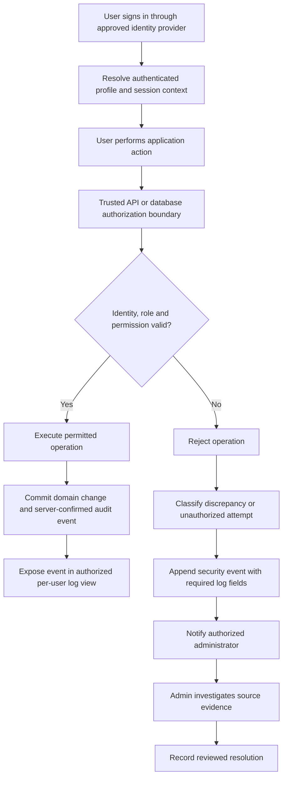

# TACResQ Admin IPS — Web UI/UX Redesign Master Plan

**Status:** Canonical design and implementation specification  
**Scope:** TACResQ administrator Information Processing System (Admin IPS) website  
**Theme decision:** Preserve the existing website theme. Redesign the interface, information architecture presentation, layout, typography, icons, components, responsiveness, and interactions without replacing the theme.  
**Repository baseline inspected:** `RamProjector/TACResQ-School-Project`, commit `b877cb3819484755145834f528252d13c04fb01b` (`main`)  
**Document rule:** This file is the single canonical web-admin redesign plan. Keep Android client redesign documents separate.

---

## 1. Final design decision

TACResQ Admin is an **administrative information system**, not a generic emergency dispatch command center.

The website's primary work is administration and governance: account management, access/security, reports, recorded activity, data continuity, preferences, and operator guidance. Emergency and incident data may appear where existing Admin capabilities require it, but the Admin interface must not be redesigned as a dispatcher console or given unverified dispatch powers.

### Non-negotiable decisions

1. **Keep the existing theme.** Preserve the current TACResQ palette, brand identity, backgrounds, surfaces, sidebar treatment, accent colors, semantic status colors, and existing theme behavior. Do not introduce a replacement palette, a new visual theme, or a competing design identity.
2. **Redesign the complete web experience.** This is not a task to delete paragraphs, hide sections, or apply a few cosmetic CSS changes. Rework the shell, every existing Admin workspace, page composition, tables, forms, dialogs, navigation, responsive behavior, and interaction details.
3. **Make the interface concise.** Remove repeated explanations and redundant labels. Keep essential field labels, status meaning, privacy notices, confirmation details, and accessibility names.
4. **Use information hierarchy rather than decoration.** Prefer clear alignment, compact headings, whitespace, tables, useful grouping, and contextual detail over oversized headings, decorative cards, or paragraphs that restate the page title.
5. **Create a distinctive administrative SVG icon family.** Custom SVGs should identify TACResQ Admin concepts. Keep Lucide for common utility actions; do not replace every familiar control with an unfamiliar custom symbol.
6. **Preserve real functionality.** Existing routes, permissions, API/RPC contracts, data semantics, security boundaries, and working features must remain intact unless a separate evidence-backed change is reviewed.
7. **Never invent operational certainty.** Unknown, unavailable, stale, uncollected, or unverified states must remain explicit. A successful dependency probe is not proof of complete system health.

### What this redesign is not

- Not a new theme or color-system redesign.
- Not a marketing/landing page redesign.
- Not a generic emergency dispatch dashboard.
- Not an excuse to add speculative modules or controls.
- Not a backend, database, infrastructure, or authorization rewrite.
- Not a reduction of critical information merely to make screens look empty.

---

## 2. Repository evidence and current baseline

The following observations were verified by reading source and documentation at the baseline commit above. They describe the inspected revision; re-check the current branch before implementation.

| Area | Verified baseline |
|---|---|
| Main Admin page | `backend/web/src/pages/AdminConsole.tsx` |
| Admin stylesheets | `AdminConsole.css`, `PortalVisualFoundation.css`, and `AdminResolution.css`, imported in that order by `AdminConsole.tsx` |
| Brand component | `backend/web/src/components/Brand.tsx`; displays the existing TACResQ app icon and wordmark |
| Global styles/theme tokens | `backend/web/src/index.css` |
| Web package | `backend/web/package.json`; React 19, Vite, TypeScript, Supabase JS and `lucide-react` |
| Existing Admin HCI contract | `tools/test_admin_hci_layout_contract.py` |
| Admin-only contract | `tools/test_web_admin_only_contract.py` |
| Admin page plan | `docs/plans/admin-page-feature-implementation-plan.md` |
| Admin completion/gap research | `docs/research/ADMIN_WEBSITE_COMPLETION_GAP_ASSESSMENT_2026-11-24.md` |
| Operator guide | `docs/admin-portal-operator-guide.md` |
| CI | `.github/workflows/ci.yml` runs the Admin HCI layout/form contract among other repository checks |

### 2.1 Existing Admin navigation

The inspected `AdminConsole.tsx` defines these eight primary sections:

1. Overview
2. User management
3. Security
4. Analytics & reports
5. Activity log
6. Data & continuity
7. Settings
8. Help & about

Settings is URL-backed and currently has General, Accessibility, Notifications, and Privacy subpages. Security is a separate primary section in the inspected code. Do not copy older documentation that describes a different section count or stale labels without reconciling it against the source.

The navigation groups currently communicate Workspace, Governance, Data & Continuity, and Preferences & Support. The final navigation may refine grouping and labels, but must preserve route compatibility and only expose implemented, authorized destinations.

### 2.2 Existing feature boundaries

| Workspace | Existing capability evidenced in source/docs | Redesign boundary |
|---|---|---|
| Overview | Account summaries, recent recorded-activity preview, dependency reachability probes, workspace shortcuts, explicit loading/error states | Make it a concise administrative landing page. Avoid duplicating Analytics aggregates or Activity Log records. Do not call dependency reachability end-to-end readiness. |
| User management | Protected paginated directory, search/role filters, reasoned role changes, account lifecycle history, protected account activity preview | Improve directory scanability and account detail presentation. Preserve server-side checks and reason/audit requirements. Do not add unverified profile fields. |
| Security | Administrator session/AAL/TOTP status and authenticator safeguards | Separate current-session/security controls from complete security monitoring. Do not imply full sign-in history or arbitrary user-session control unless the source supports it. |
| Analytics & reports | Date-bounded aggregate request metrics, status distribution, daily request volume, assignment timing, Manila-time reporting, CSV export | Keep aggregates distinct from event-level investigation. Make period, timezone, units, data freshness, and export scope clear. |
| Activity log | Searchable, filterable, paginated investigation feed with explicit source-coverage limitations | Keep event provenance and limitations visible. Do not label it a complete system-wide audit trail while sources are incomplete. |
| Data & continuity | Backup/recovery and attachment safeguards information with documented limits | Keep evidence and inspection dates explicit. Do not imply a live backup inventory, successful restore, or media browser without verified integration. |
| Settings | Browser-local density/page-size and accessibility preferences; informational guidance where server-backed policy is absent | Distinguish local preferences from global policy. Do not display inert toggles as functional controls. |
| Help & about | Searchable operator guidance | Keep concise, searchable, accurate, and synchronized with implemented behavior. |

### 2.3 Roles and authorization boundaries

- The Admin interface is for authorized administrators; it is not an alternate dispatcher workspace.
- The inspected Admin role-change options cover requester, responder, driver, and dispatcher. Admin provisioning is a separate trusted-operator process and must not become available through ordinary public signup or a casual role dropdown.
- Hiding a button or navigation item is not authorization. Every privileged read and mutation must remain enforced by the backend.
- Do not infer agency/tenant hierarchy, qualifications, certifications, duty rosters, or other data models unless the deployed schema and policies establish them.
- Keep current MFA/AAL2 requirements and protected investigation access intact.

### 2.4 Existing theme and typography

The inspected `index.css` defines the current theme foundation:

- Main interface font: **DM Sans**
- Display font: **Space Grotesk**
- Technical/monospaced font: **IBM Plex Mono**
- Existing palette tokens include `--ink`, `--ink-deep`, `--ink-soft`, `--paper`, `--card`, `--line`, `--ember`, `--ember-dark`, `--sage`, and semantic green/amber/red tokens.
- The Admin shell uses the existing deep navy sidebar, neutral workspace surfaces, white/near-white panels, and existing accent/status colors.
- `Brand.tsx` uses the existing TACResQ app-icon asset and wordmark.

**Theme freeze:** Continue consuming existing tokens. Do not redefine their values as part of this redesign. Do not add a new color palette, gradient system, dark theme, or new brand mark. If an existing token is insufficient for a specific component, document the gap and reuse the closest semantic token until separately approved.

The inspected global stylesheet imports the three fonts from Google Fonts. Treat font loading, fallback behavior, layout shift, and availability as performance concerns; do not change the typeface family as part of the redesign.

### 2.5 Existing layout and sidebar observations

- The Admin shell is a CSS grid with a sidebar and a min-width-safe main workspace.
- The desktop sidebar collapse state is represented by `admin-shell--sidebar-collapsed` and persisted in browser local storage.
- The Admin stylesheet contains a collapsed-grid contract expecting a `76px minmax(0, 1fr)` layout and hides the wordmark/context/navigation labels in the compact state.
- The source-contract test checks that behavior.
- The styles are split across three imported stylesheets. The shell's base grid width is declared more than once (including 238px and 270px variants), with additional responsive overrides. This creates a cascade/order risk for collapsed sizing.
- The desktop collapse control is inside the sidebar header. The mobile drawer opener is in the topbar outside the drawer; this is correct because the opener must remain reachable when the drawer is closed.
- At the mobile/tablet breakpoint, the sidebar becomes a fixed off-canvas drawer with a backdrop, close control, independent scrolling, focus handling, and reduced-motion treatment.

**Required verification:** Do not assume the reported collapse issue is solved merely because the class and source assertion exist. Inspect computed `grid-template-columns`, sidebar bounding width, and workspace bounding box at each desktop width and after resize. If only the sidebar's contents collapse while the grid column remains wide, fix the cascade/layout contract. Preserve the mobile opener outside the closed drawer.

---

## 3. Research findings and product references

The references below are design-pattern references, not templates to copy and not proof that TACResQ has equivalent features.

### 3.1 Product references

| Reference | Pattern worth borrowing | What not to copy |
|---|---|---|
| **Linear** | Quiet navigation, compact controls, restrained icon treatments, precise alignment, keyboard-friendly workflows, reduced decorative noise | Its issue-tracking information architecture or its theme |
| **Stripe Dashboard** | Data-first tables, clear value alignment, restrained surfaces, focused forms, progressive disclosure for detail | Financial workflows or data structures |
| **ArcGIS Mission** | Only where Admin reviews map-related/incident evidence: spatial context can be paired with contextual information rather than a separate decorative map card | A dispatch-first shell or operational capabilities not present in Admin |
| **Motorola CommandCentral** | High-signal status presentation and separating important alerts from routine information | Command-center navigation, wallboard density, or unimplemented dispatch controls |

### 3.2 Human-interface principles

1. **Recognition over recall:** use familiar navigation, predictable action placement, and visible current context.
2. **Progressive disclosure:** show the fields and actions needed for the current task; place technical detail, audit payloads, and explanatory material behind expandable details.
3. **Consistency:** the same control type should behave and look consistently across Admin pages.
4. **Task-oriented hierarchy:** the page should answer one primary question, such as “Which account needs review?” or “What recorded event occurred?”
5. **Information density without crowding:** prefer compact, aligned information over excessive cards or tiny unreadable text.
6. **Feedback and reversibility:** show whether an action is pending, saved, failed, or unavailable; confirm consequential actions and preserve recoverable form state.
7. **Honest system state:** distinguish healthy, degraded, stale, unknown, not collected, and unavailable.

### 3.3 Admin IPS-specific design conclusion

Use Linear and Stripe as the stronger references for the overall Admin IPS experience. Use GIS/emergency software references only for specific data views where the Admin portal actually needs geographic or incident context. The Admin website should remain an administration and information-processing workspace.

---

## 4. Final visual and interaction direction (existing theme retained)

### 4.1 Application shell

- Keep the existing TACResQ identity and palette.
- Build a stable desktop shell: sidebar, compact topbar, and main workspace.
- The sidebar must have a real expanded and collapsed width; the workspace must reclaim the released width.
- Keep navigation labels available through accessible names and tooltips in the collapsed state.
- Keep the collapse control reachable and visually aligned inside the desktop sidebar header.
- Keep the mobile drawer opener in the topbar, outside the closed drawer.
- Move sign-out into the existing account/profile menu only if a safe, discoverable account menu is implemented; do not simply hide sign-out.
- Keep breadcrumbs short and useful. Avoid repeating the same page name in a large eyebrow, title, subtitle, and card heading.
- Use a consistent page-header pattern: concise title, optional one-line context only when it adds meaning, and page actions aligned to the right.

### 4.2 Page composition

Avoid using the same dashboard template for every page.

| Page | Primary composition |
|---|---|
| Overview | Compact attention/summary area, recent recorded activity, limited shortcuts, dependency reachability with a precise scope label |
| User management | Search/filter toolbar, paginated directory table, contextual account details, guarded actions |
| Security | Current administrator session and authenticator status, grouped security controls, clear capability/coverage limits |
| Analytics & reports | Period/timezone controls, key aggregates, readable chart, supporting data table, scoped export |
| Activity log | Search/filter toolbar, event table/list, expandable event details, visible source coverage |
| Data & continuity | Evidence inventory and dated inspection context, clear unavailable/not-connected states, documented operator guidance |
| Settings | Short grouped preference controls with save/reset behavior; separate local preferences from read-only policy guidance |
| Help & about | Search-first reference, concise answers, version/support details only when grounded in configuration |

### 4.3 Cards, surfaces, and borders

- Do not place every element in a card.
- Use tables for records, lists for sequential activity, simple grouped sections for settings, and panels only when content is a distinct unit.
- Avoid nested cards inside cards.
- Use the existing border and surface tokens; reduce redundant outlines and decorative shadows.
- Use dividers to separate related rows rather than drawing a box around every row.
- Let whitespace and alignment create hierarchy.
- Keep action buttons near the content they affect.
- Keep dangerous actions visually distinct and require confirmation appropriate to their consequence.

### 4.4 Copy and labels

- Remove paragraphs that repeat the page title or explain an obvious control.
- Keep descriptions to one short line when a page needs context.
- Do not repeat the same status in a badge, heading, paragraph, and metadata line.
- Keep persistent form labels; placeholder text is not a replacement for a label.
- Keep critical security, privacy, data freshness, and consequence explanations even when they require more text.
- Prefer direct action names: “Export CSV”, “Refresh”, “Change role”, “View details”.
- Avoid unexplained abbreviations and excessive uppercase/letter spacing.
- Put technical definitions and source-coverage details in expandable help or details sections, not in the primary reading path.

---

## 5. Typography specification

Keep DM Sans, Space Grotesk, and IBM Plex Mono. Change their roles and hierarchy, not the font families.

| Role | Recommended size | Weight/use |
|---|---:|---|
| Page title | 22–26px | 600; Space Grotesk or existing display token |
| Section heading | 15–17px | 600; short and task-specific |
| Panel/table group heading | 14–16px | 600 |
| Body and table content | 13–14px | 400–500; DM Sans |
| Form label | 12–13px | 500–600; persistent |
| Supporting text | 12–13px | 400; only when useful |
| Metadata | 11–12px | 400–500; secondary contrast |
| IDs, timestamps, technical values | 11–12px | IBM Plex Mono; tabular numerals where useful |
| Icon-only tooltip | 12px minimum where feasible | concise action description |

### Typography rules

- Avoid oversized page titles. The current responsive title token reaches 40px; reduce the Admin page-title hierarchy toward the range above.
- Use fluid sizing only where it improves fit; never let viewport width inflate an administrative page title unnecessarily.
- Keep body copy comfortable and readable. Do not shrink table text to fit more columns.
- Use tabular numerals for counts, IDs, dates, and measurements where alignment helps scanning.
- Keep line length controlled for explanatory copy; avoid long full-width paragraphs.
- Use consistent line-height and avoid headings that wrap into awkward single-word lines.
- Respect browser zoom and user text scaling.
- Use font fallbacks that preserve layout if Google Fonts cannot load. Assess self-hosting only after license, build, and performance review; it is not a requirement to add a new font.

---

## 6. Custom TACResQ Admin SVG icon system

A unique SVG family is required, but it must represent **administrative information-system concepts**, not turn the site into an emergency-response icon showcase.

### 6.1 Icon families

Create original TACResQ-specific SVGs for these Admin concepts:

| Concept | Visual direction |
|---|---|
| Overview | Structured dashboard/grid with one emphasized information point |
| User management | Account/profile with a controlled directory or grouping motif |
| Security | Layered access/verification motif; distinct from generic emergency shield imagery |
| Analytics & reports | Measured data/chart motif with a recognizable report structure |
| Activity log | Ordered event/timeline or recorded-entry motif |
| Data & continuity | Structured data/archive with a continuity/restore cue; do not imply a backup is verified |
| Settings | Deliberate control/adjustment motif |
| Help & about | Knowledge/reference motif |

Custom icons should be recognizable at small sizes and should not depend on color alone.

### 6.2 Technical standards

- Use a consistent 24×24 viewBox for standard UI icons; use 32×32 or 48×48 for larger empty-state or feature illustrations.
- Keep stroke weight consistent (approximately 1.75–2px at 24px scale), with coherent caps, joins, corner radii, and optical alignment.
- Use `currentColor` so SVGs inherit the existing theme.
- Keep fills and strokes simple; avoid filters, gradients, tiny details, and excessive path complexity.
- Include outline and selected/emphasized variants only where a state genuinely changes.
- Decorative SVGs must be hidden from assistive technology. Meaningful icon-only controls need accessible names and visible focus.
- Preserve adequate target size around icons; the icon itself is not the interactive target.
- Optimize SVG output and avoid shipping a large icon font for a small set of symbols.

### 6.3 Use Lucide appropriately

Keep `lucide-react` for familiar utility actions such as search, close, refresh, edit, download, sort, pagination, and menu controls. Use the custom library for the TACResQ Admin identity and the eight primary administrative concepts. Do not replace familiar utility icons merely to make every icon different.

---

## 7. Component and page standards

### 7.1 Tables and directories

- Tables are primary interfaces for account directories, activity records, and report detail.
- Use clear column names, aligned numeric values, stable row heights, and subtle row separators.
- Keep search, filters, page size, result count, and pagination in a compact toolbar.
- Avoid forcing a wide table to shrink into unreadable text. Use a local horizontal scroll region or a carefully designed compact row/detail presentation.
- Keep important identity fields together; place secondary technical identifiers in lower-emphasis text.
- Make row actions keyboard accessible and give repeated actions names that identify the affected record.
- Preserve sorting/filter state where existing behavior supports it.
- Use explicit empty, loading, unavailable, and error states; do not show stale privileged data after authorization failure.

### 7.2 Forms and settings

- Prefer single-column forms; use two columns only for short, related fields when there is sufficient space.
- Keep persistent labels above controls.
- Place short hints and validation feedback next to the relevant field.
- Group related settings and clearly distinguish editable local preferences from read-only policy information.
- Explain whether a setting is browser-local or server-backed.
- Provide save/reset feedback and protect unsaved changes when leaving a form.
- Do not render inert toggles for unimplemented notification, privacy, security, or system policies.

### 7.3 Dialogs and confirmations

- Keep dialogs focused on one decision.
- State the affected account/record and consequence.
- Keep primary and destructive actions clearly differentiated.
- Fit within short viewport heights using internal scrolling where necessary.
- Preserve focus, return focus to the trigger, support Escape where safe, and prevent background interaction when modal.
- Do not put long policy paragraphs into every confirmation; link to the relevant details when appropriate.

### 7.4 Status, notifications, and feedback

- Pair status color with text or a meaningful icon; never rely on color alone.
- Distinguish success, warning, error, stale, unknown, and unavailable.
- Show freshness timestamps only when they belong to the currently displayed result set.
- Keep toast messages concise and non-blocking; persistent errors need an actionable recovery path.
- Never show “live”, “healthy”, “complete”, “delivered”, “backed up”, or “restorable” unless the source proves that exact claim.

---

## 8. Responsive and adaptive layout strategy

The design must respond to **available space**, not just device labels. Do not create one media query for every test resolution. Use content-driven breakpoints, fluid sizing, CSS Grid/Flexbox, container queries, and component-level adaptation.

### 8.1 Test viewport width matrix

Use these widths as a broad QA matrix, not as 31 required CSS breakpoints:

`320, 360, 375, 390, 414, 430, 480, 540, 600, 640, 720, 768, 800, 834, 900, 960, 1024, 1080, 1152, 1200, 1280, 1366, 1440, 1536, 1600, 1680, 1728, 1920, 2048, 2560, 3440 px`

### 8.2 Test viewport height matrix

`568, 640, 720, 768, 800, 900, 1080, 1440 px`

Test representative width/height combinations, especially narrow + short, medium + short, and ultrawide + tall. Do not exhaustively run every Cartesian combination on every commit.

### 8.3 Required adaptive behaviors

| Available space | Expected behavior |
|---|---|
| Wide desktop | Expanded sidebar, comfortable workspace, optional contextual detail column |
| Standard desktop | Expanded sidebar and content-width-aware page layout |
| Narrow desktop/laptop | Compact or collapsed sidebar when needed; toolbar wraps without overlap |
| Tablet landscape | Drawer or compact navigation; tables and filters reorganize |
| Tablet portrait | Single workspace column; panels stack; navigation remains reachable |
| Narrow/mobile browser | Drawer navigation, compact topbar, focused single-column task flow |
| Short viewport | Header and navigation remain usable; long panels/dialogs scroll internally |
| Split-screen/resized window | Components adapt to their container instead of assuming full-screen width |
| 200–400% zoom | Content reflows without clipped controls or page-level horizontal scrolling for ordinary content |

### 8.4 Browser and environment variations

Include:
- Portrait and landscape.
- Mouse, keyboard, and touch.
- 100%, 125%, 150%, 200%, and 400% browser zoom.
- Split-screen and narrow browser windows.
- Browser chrome reducing available height.
- High-DPI/device pixel ratio variations.
- Font loading delay/failure.
- Reduced motion and forced-colors/high-contrast modes.
- Resize while menus, dialogs, expanded rows, or filters are open.

### 8.5 Implementation rules

- Use page-level media queries only when the overall composition must change.
- Use container queries when an individual component should adapt to its own available width.
- Use `minmax(0, 1fr)`, `min-width: 0`, and bounded widths to prevent grid/flex overflow.
- Use `clamp()` for fluid spacing and restrained type sizing, with readable minimums.
- Use dynamic viewport units such as `dvh` where supported and safe fallbacks for viewport-height layouts.
- Keep horizontal scrolling local to genuinely wide data tables; avoid page-wide overflow.
- Keep modal and dropdown positioning within the visible viewport.
- Preserve focus and selected state when a layout changes from sidebar to drawer.
- Keep navigation usable with a keyboard and touch, including visible focus and adequate target dimensions.

### 8.6 Existing responsive implementation to consolidate

The inspected stylesheets contain overlapping breakpoints and shell overrides, including 1920px+, 1440px, 1201–1439px, 901–1200px, 761–900px, max 760px, max 480px, max 900px, max 1120px, max 960px, max 700px, and max 520px rules across different files.

Do not add another layer of overrides. First map all existing selectors and their cascade. Consolidate the Admin shell and component responsive rules into a clear, documented system while preserving the existing theme and behavior.

---

## 9. Accessibility and usability requirements

Target WCAG 2.2 AA as an engineering goal, but do not claim conformance without a complete audit.

- Text contrast: at least 4.5:1 for normal text and 3:1 for large text.
- Visible keyboard focus for every interactive element.
- Keyboard access to navigation, tables, menus, dialogs, filters, and pagination.
- Logical focus order and appropriate focus restoration.
- Semantic headings, landmarks, labels, table headers, status announcements, and form error associations.
- Accessible names for icon-only controls; decorative SVGs hidden from screen readers.
- Do not use color as the only signal for status, errors, or selection.
- Reflow at narrow equivalent widths and browser zoom; no loss of information or functionality.
- Touch targets should be comfortably usable; aim for approximately 40–44px where practical, while meeting applicable WCAG target-size requirements.
- Respect reduced-motion preferences; avoid non-essential animation.
- Test forced-colors/high-contrast mode.
- Keep error messages specific and actionable without exposing sensitive implementation details.
- Provide clear empty and unavailable states; do not rely on a blank panel to communicate absence of data.

---

## 10. Performance and implementation quality

- Preserve the current font families; optimize loading/fallback behavior and avoid layout shift.
- Avoid introducing new UI libraries or dependencies unless the repository review proves they are needed.
- Use the existing Lucide dependency and a small optimized custom SVG library.
- Avoid heavy blur, large shadow stacks, expensive animated backgrounds, and unnecessary motion.
- Keep tables and charts responsive; consider virtualization only if measured record volume justifies it.
- Avoid rendering large hidden page trees if it causes measurable performance or accessibility problems.
- Ensure CSS ownership is clear: reduce duplicate selectors and stylesheet-order dependencies.
- Keep components reusable where behavior is genuinely shared; do not over-generalize different workflows into one complex component.
- No console errors, broken links, inaccessible controls, or inert buttons in the redesigned pages.

---

## 11. Security, privacy, and truthful data presentation

The Admin UI is a privileged surface.

1. Backend authorization remains authoritative. UI visibility is never a substitute for RLS, RPC authorization, or server-side role checks.
2. Keep privileged data out of local storage. Browser-local storage may hold non-sensitive presentation preferences only.
3. Do not expose service-role credentials, access tokens, MFA secrets, recovery codes, private attachment bytes, or sensitive incident details unnecessarily.
4. Preserve MFA/AAL2 requirements for protected investigations and security-sensitive actions.
5. Keep role changes reasoned, auditable, and limited to server-authorized roles.
6. Do not expose Admin provisioning through public signup or ordinary role controls.
7. Keep CSV export scoped and protected against spreadsheet formula injection.
8. Keep audit source coverage visible. Missing events must not be interpreted as proof that no event occurred.
9. Do not represent dependency reachability as full application health or emergency readiness.
10. Do not add account suspension, deletion, restore, notification suppression, retention, or global policy controls until the underlying authorization, audit, recovery, and enforcement behavior is verified.
11. Do not invent privacy controller details, legal basis, retention periods, data-subject rights processing, or vendor disclosures.
12. Use synthetic accounts and synthetic records for QA; never use real emergency incidents or personal location data in test fixtures.

---

## 12. Testing and verification plan

### 12.1 Existing checks

At the inspected baseline:
- `tools/test_admin_hci_layout_contract.py` protects key navigation, sidebar, mobile drawer, focus, and form contracts.
- `tools/test_web_admin_only_contract.py` protects Admin-only frontend boundaries.
- `.github/workflows/ci.yml` runs the Admin HCI contract.
- `backend/web/package.json` exposes `build` (TypeScript check + Vite build), `dev`, and `preview`; it does not define a dedicated frontend test or viewport-matrix script.
- `tools/visual_regression.py` uses Playwright to capture the interactive mobile wireframe gallery at a fixed 1440×1080 browser viewport. It is not a live AdminConsole viewport suite; map views are excluded due to nondeterministic external tiles.

Re-check current scripts and workflows before relying on these statements.

### 12.2 Required checks for the redesign

| Check | Minimum expectation |
|---|---|
| TypeScript/web build | `pnpm --dir backend/web build` or the repository's current equivalent |
| Admin HCI contract | Run existing `tools/test_admin_hci_layout_contract.py` |
| Admin-only contract | Run existing `tools/test_web_admin_only_contract.py` |
| Relevant security/source contracts | Run the Admin/auth/audit/security tests affected by the change |
| Navigation | Every Admin section and legacy URL works; browser Back/Forward and keyboard navigation remain correct |
| Data behavior | Loading, empty, error, stale, unavailable, permission denied, and successful states are accurate |
| Sidebar | Verify actual sidebar width and workspace expansion when collapsed at multiple desktop widths |
| Responsive | Run the broad width/height matrix, including just below/at/above each chosen content-driven breakpoint |
| Accessibility | Keyboard-only, focus order, screen-reader names, contrast, zoom/reflow, reduced motion, forced colors |
| Visual review | Capture real Admin pages, not only wireframes; review every section and responsive state |
| Regression | Confirm routes, roles, permissions, APIs, filters, forms, exports, dialogs, and account workflows remain intact |

### 12.3 Viewport test execution strategy

- Pull request smoke suite: representative compact, standard, laptop, tablet, and mobile viewports, plus short-height and zoom checks for changed components.
- Major shell/layout change: full width matrix and representative height combinations.
- Release candidate: full matrix plus manual keyboard, touch, zoom, and assistive-technology review.
- Capture screenshots for each Admin section and key states: loading, populated, empty, error, expanded detail, open menu/dialog, collapsed sidebar, and mobile drawer.
- Test immediately below, at, and above each actual breakpoint.
- Keep screenshot differences report-only only where repository policy says so; navigation, functionality, accessibility, build, and security checks remain blocking.

---

## 13. Implementation phases

### Phase 0 — Baseline and inventory
- Record the current main SHA, open PRs, CI state, routes, section permissions, and backend dependencies.
- Capture screenshots and inspect every Admin section at representative widths.
- Inventory all existing selectors and stylesheet load order.
- Verify the sidebar collapse width using computed browser layout.
- Record existing defects separately from redesign regressions.

**Exit:** source inventory, screenshots, baseline test results, and a list of confirmed versus suspected issues.

### Phase 1 — Design foundation (theme preserved)
- Define spacing, typography roles, border/radius/elevation usage, focus styles, and component density using existing theme tokens.
- Define the custom TACResQ Admin SVG family.
- Define shared patterns for page headers, tables, filters, forms, status indicators, empty/error states, and dialogs.
- Do not change theme token values.

**Exit:** documented design tokens/roles, icon assets/components, and reviewed component examples.

### Phase 2 — Application shell and sidebar
- Consolidate the shell CSS and responsive rules.
- Fix the real desktop collapsed-column behavior.
- Preserve mobile drawer opener/closer placement and accessibility.
- Standardize topbar, breadcrumbs, profile/account menu, and workspace width.
- Verify short-height, zoom, keyboard, and resizing behavior.

**Exit:** sidebar physically shrinks, workspace expands, no overlap/overflow, drawer remains operable.

### Phase 3 — Page-by-page Admin redesign
Recommended order:
1. Overview
2. User management
3. Security
4. Analytics & reports
5. Activity log
6. Data & continuity
7. Settings
8. Help & about

For each page: improve information hierarchy, remove redundant copy, redesign its primary data view, standardize controls, and verify all states and role boundaries.

**Exit:** all existing Admin sections have a consistent but purpose-specific layout; no feature is silently removed.

### Phase 4 — Responsive and accessibility hardening
- Validate the viewport matrix and zoom levels.
- Fix overflow, short-height dialogs, nested scrolling, focus loss, and touch target issues.
- Verify contrast and reduced-motion/forced-color behavior.

**Exit:** responsive and accessibility evidence is attached to the implementation review.

### Phase 5 — Final regression and release review
- Run web build, Admin contracts, relevant security tests, and full repository CI.
- Review actual rendered pages at all major viewport families.
- Verify backend/API behavior and role isolation have not changed.
- Document any manual checks that remain outstanding.

**Exit:** exact-head checks pass, no unresolved blocking issues, and manual acceptance gaps are stated honestly.

---

## 14. Acceptance criteria

The redesign is ready for final review only when all applicable criteria are met:

- [ ] The existing TACResQ website theme and brand are preserved.
- [ ] The product remains clearly an Admin IPS website, not a dispatch dashboard.
- [ ] Every existing Admin section is redesigned and remains reachable.
- [ ] No existing feature, route, permission, or backend contract is removed or silently changed.
- [ ] The sidebar's desktop collapse changes the actual grid column and gives the width back to the workspace.
- [ ] The mobile drawer opener remains reachable outside the closed drawer.
- [ ] Typography is compact, readable, consistent, and not dominated by oversized page titles.
- [ ] Repeated paragraphs, redundant labels, duplicate cards, and decorative noise are removed without hiding essential meaning.
- [ ] Original TACResQ Admin SVG icons are used for core administrative concepts; Lucide remains for familiar utility actions.
- [ ] Tables, filters, forms, dialogs, status indicators, and feedback patterns are consistent.
- [ ] All states are truthful: loading, empty, stale, unavailable, error, success, and permission denied.
- [ ] Responsive layouts work across representative width/height combinations, split-screen, orientation, and zoom.
- [ ] Keyboard navigation, focus, screen-reader names, contrast, reduced motion, and reflow are reviewed.
- [ ] No new client-only security controls or unsupported operational claims are introduced.
- [ ] Build, Admin contracts, security checks, and required CI pass on the exact reviewed commit.
- [ ] Browser/device acceptance is recorded separately from automated source tests.

---

## 15. Research references

Use these as supporting guidance. Re-check current versions and applicability during implementation.

### Product/interface references
- [Linear — How we redesigned the UI](https://linear.app/now/how-we-redesigned-the-ui) — restraint, hierarchy, consistency, and reducing unnecessary interface decoration.
- [Esri — ArcGIS Mission](https://www.esri.com/en-us/arcgis/products/arcgis-mission/overview) — contextual spatial information, relevant only to Admin pages that genuinely need map/incident context.
- [Motorola Solutions — CommandCentral](https://www.motorolasolutions.com/en_us/products/command-center-software.html) — high-signal status and alert presentation; not an Admin IPS information-architecture template.

### Human-computer interaction and accessibility
- [Nielsen Norman Group — Recognition vs. recall](https://www.nngroup.com/articles/recognition-and-recall/) — make actions and context recognizable rather than requiring users to remember hidden conventions.
- [Nielsen Norman Group — Progressive disclosure](https://www.nngroup.com/articles/progressive-disclosure/) — reveal secondary detail when needed without hiding critical information.
- [W3C — WCAG 2.2](https://www.w3.org/TR/WCAG22/) — accessibility success criteria.
- [W3C — Reflow](https://www.w3.org/WAI/WCAG22/Understanding/reflow.html) — responsive reflow and avoiding two-dimensional scrolling for ordinary content.
- [W3C — Target Size (Minimum)](https://www.w3.org/WAI/WCAG22/Understanding/target-size-minimum.html) — interactive target-size requirements.
- [W3C — Decorative Images](https://www.w3.org/WAI/tutorials/images/decorative/) — accessible treatment of decorative graphics.
- [W3C — SVG 2](https://www.w3.org/TR/SVG2/) — SVG structure and semantics.

### Typography, icons, and responsive implementation
- [Material Design — Typography](https://m3.material.io/styles/typography/overview) — type roles and hierarchy.
- [Material Design — Icons](https://m3.material.io/styles/icons/overview) — consistent icon use and sizing.
- [Lucide — Icon design](https://lucide.dev/guide/design/icon-design) — coherent icon geometry.
- [Lucide — Accessibility](https://lucide.dev/guide/advanced/accessibility) — accessible icon implementation.
- [MDN — Responsive design](https://developer.mozilla.org/en-US/docs/Learn_web_development/Core/CSS_layout/Responsive_Design) — responsive layout foundations.
- [MDN — Container queries](https://developer.mozilla.org/en-US/docs/Web/CSS/CSS_containment/Container_queries) — component adaptation based on available space.
- [MDN — clamp()](https://developer.mozilla.org/en-US/docs/Web/CSS/clamp) — bounded fluid sizing.
- [Playwright — Emulation](https://playwright.dev/docs/emulation) — viewport/device emulation for automated verification.

### Security and emergency-context guidance
- [OWASP Application Security Verification Standard](https://owasp.org/www-project-application-security-verification-standard/) — application security verification baseline for privileged workflows.
- [ITU-T F.760.2](https://www.itu.int/rec/T-REC-F.760.2/en) — first-responder interface guidance; use only for relevant readability, feedback, and high-stress information presentation, not as the Admin IPS page architecture.

---

## 16. Maintenance rule

Update this file when the Admin navigation, page capabilities, theme tokens, icon system, responsive architecture, or acceptance gates materially change. Keep source-backed facts distinct from recommendations. If another document covers a narrow topic (for example, security-event coverage or the operator guide), link to it rather than duplicating its entire content here.

**This plan is the final design direction:** complete TACResQ Admin IPS web UI/UX redesign, existing theme preserved, concise professional interface, distinctive administrative SVG icons, real responsive behavior, and all current authorized functionality retained.

---

## 17. Additional research — administrative workflows and data-intensive interfaces

This section extends the existing design foundation with implementation guidance for a real administrative information system. These are design requirements and research conclusions, not claims that every capability already exists in TACResQ. Confirm each capability against current source, schema, RPCs, and authorization before implementing it.

### 17.1 Record lifecycle and end-to-end workflows

Design around the complete lifecycle of an administrative record, not isolated screens.

For every existing record type, document:
- Who can create, view, search, edit, review, export, archive, or delete it.
- Which fields are required, optional, immutable, or system-generated.
- Which state transitions are valid and who may perform them.
- What reason, confirmation, or supporting evidence is required for consequential changes.
- What happens when a save fails, a session expires, or another administrator changes the same record.
- Which events must be auditable and how the user can inspect the resulting history.

Create a workflow map for each current Admin capability: entry point → search/select → inspect → permitted action → confirmation → result → audit/history. Do not add lifecycle states or actions that are not supported by the backend.

**Design implication:** use a directory/list for finding records, a focused detail view for understanding one record, and contextual actions for operations on that record. Avoid forcing users through a dashboard card for every step.

### 17.2 Data tables and record directories

Tables are primary working surfaces in an Admin IPS. Treat them as structured tools, not decorative content.

Required patterns:
- Clear column names and semantic table headers.
- Stable row identity and predictable row actions.
- Sort indicators that disclose the active sort column and direction.
- Search and filters that apply to the complete result set, not only the currently visible page.
- Visible active filters with a simple way to clear one or all.
- Pagination that preserves the current query and filters when moving between pages.
- A clear result count and current page context.
- Column widths that prioritize the fields administrators actually use.
- Local horizontal scrolling or a deliberate compact/stacked alternative for genuinely wide tables; never cause accidental page-wide horizontal overflow.
- Loading, no-results, empty, error, stale, and permission-denied states.
- Selection checkboxes only when a real bulk action exists.
- Row click behavior that does not conflict with nested buttons, links, or checkboxes.

Do not make every column sortable or every field a visible column by default. Prioritize the common decision-making fields and place secondary data in a detail panel.

### 17.3 Search, filtering, and query persistence

Search should help administrators find known records quickly and understand why a result matched.

Specify:
- Which fields are searchable and whether matching is exact, prefix, or partial.
- Whether search is case-insensitive and how punctuation/spacing are normalized.
- How search combines with role, status, date, and other filters.
- Whether filters are server-side and whether counts reflect the full filtered result set.
- What happens when a query returns no matches.
- Whether query state is preserved in the URL so browser Back/Forward, refresh, and shareable links behave predictably.
- Debounce behavior and cancellation of stale requests.
- Clear/reset behavior that does not unexpectedly discard unrelated page state.

Avoid an unexplained universal search box if the backend only searches one dataset. Label the search scope accurately.

### 17.4 Bulk actions and imports/exports

Bulk actions can save time but amplify mistakes. Add them only where the existing data model and backend support safe batch operations.

Before implementation, require:
- Explicit selection count and clear all/none behavior.
- A preview of the affected records and the exact change.
- Permission checks for every affected record, not only the first selected row.
- A reason and confirmation for consequential changes.
- Defined partial-failure behavior and per-record results.
- Idempotency or safe retry behavior where supported.
- An audit event for each affected record or a traceable batch event with item-level outcomes.
- A safe maximum batch size and clear progress feedback.

For exports, show the applied filters, date range, timezone, included columns, and record count. Keep exports permission-checked and protect CSV output against spreadsheet formula injection. Do not imply that a download contains every record if it is limited to the current page.

Imports must not be introduced merely as a convenience. They require schema validation, duplicate handling, preview, rollback/partial-failure rules, and auditability.

### 17.5 Forms and validation

Use persistent labels, logical grouping, and concise help text only where a field is ambiguous or has consequential requirements.

Recommended form behavior:
- Validate required and format constraints at the appropriate point without surprising users.
- Show an error beside the affected field and provide a concise summary for long forms.
- Link summary errors to the corresponding fields and move focus appropriately after failed submission.
- Preserve valid entered values when validation or network submission fails.
- Distinguish field errors, permission errors, network failures, and server conflicts.
- Explain constraints before submission when users need them to complete the form correctly.
- Disable duplicate submission while a request is in flight, but do not leave the user with an indefinite spinner.
- Confirm navigation away only when meaningful unsaved work would be lost.
- Use explicit save/cancel actions; do not silently autosave privileged or consequential changes.
- Use confirmation dialogs for irreversible or high-impact actions, with the target and consequence named.

Do not use placeholder text as the only label. Do not make every field show a long explanatory paragraph. Keep security and privacy explanations when they materially affect the user's decision.

### 17.6 Audit trails and activity investigation

Separate operational activity feeds from security audit logs unless source coverage and semantics prove they are the same dataset.

For each event, establish which fields are actually available:
- Event/action type.
- Actor identity or system actor.
- Target record and stable identifier.
- Timestamp and timezone.
- Outcome (success, denied, failed, pending) where recorded.
- Source/channel and correlation/request identifier where available.
- Reason or change summary where safe and supported.

Audit views should support time range, actor, event type, target, and outcome filters only when the underlying records support them. Keep event details expandable and avoid exposing secrets, session tokens, MFA material, or unnecessary personal data.

Show coverage limitations and retention boundaries. A missing event is not proof that an action did not occur. Never label a partial activity feed as a complete system-wide audit trail.

### 17.7 Permissions and privileged-action UX

Use least privilege and defense in depth:
- Backend authorization remains authoritative for every read and write.
- The frontend should explain unavailable actions without exposing privileged data.
- Hide or disable controls based on verified permission context, but never rely on UI visibility as enforcement.
- Distinguish “not authorized”, “not configured”, “not available”, and “temporarily failed”.
- Require stronger confirmation for high-impact actions, with a reason where policy requires it.
- Do not expose privilege escalation, admin provisioning, role grants, account deletion, or security-policy controls unless the backend has a reviewed and auditable implementation.
- Keep session and MFA state understandable without displaying secrets or implying a stronger assurance level than the backend reports.

### 17.8 Concurrent edits, stale data, and recovery

Administrative records may be changed by more than one operator. Define behavior for:
- A record changing after the detail view was loaded.
- A save conflicting with a newer version.
- A session expiring during an edit.
- A network interruption during submission.
- A retry after an uncertain response.
- A record becoming inaccessible before the action completes.

Show when data was last refreshed if freshness matters. Prefer an explicit conflict state with a reload/review path over silently overwriting newer data. Preserve user-entered data where safe. Do not claim a mutation failed if the server may have completed it; reconcile the result before allowing a duplicate action.

### 17.9 Notifications and feedback

Use notifications for events that need attention, not as a second activity log.

Define:
- Which events warrant an in-app notification.
- Severity and urgency semantics.
- Read/unread state and whether it is server-backed.
- Destination when a notification is opened.
- Dismissal and retention behavior.
- How duplicate or repeated alerts are grouped.
- What happens when the destination is no longer accessible.

Use inline feedback for local actions, persistent banners for page-level conditions, and dialogs only when a decision is required. Avoid success toasts for actions that have not been confirmed by the server.

### 17.10 Analytics and reporting integrity

Every report must disclose enough context to interpret it:
- Metric definition and unit.
- Date range and timezone.
- Aggregation level and filters.
- Data freshness or last successful refresh, if known.
- Missing-data or coverage limitations.
- Whether values are live, cached, or historical.
- Export scope and included fields.

Use a chart only when it helps compare, trend, or understand a distribution. Provide a table or textual equivalent for exact values. Avoid 3D charts, decorative gauges, arbitrary color categories, and dashboards that repeat the same metric in multiple forms.

Do not infer service quality, response performance, or system readiness from metrics that do not measure those outcomes.

### 17.11 Reusable component and design-system governance

Maintain one shared implementation for genuinely shared patterns:
- Page header and action area.
- Search/filter toolbar.
- Data table and pagination.
- Status label and state description.
- Form field, field error, and error summary.
- Confirmation dialog.
- Empty/loading/error/unavailable state.
- Detail panel and expandable event content.
- Toast/banner feedback.
- Icon button and tooltip.

Document component states and interaction contracts, not just screenshots. Avoid a single giant “universal” component with many unrelated flags. A component should be shared when its semantics and behavior are shared, not merely because two pages look similar.

### 17.12 Operational design acceptance checklist

- [ ] Each existing Admin workflow is mapped from entry to completion.
- [ ] Record actions and valid state transitions are backed by current server behavior.
- [ ] Search/filter/sort/pagination operate on the complete intended result set.
- [ ] Query state survives refresh and browser navigation where appropriate.
- [ ] Bulk actions have preview, authorization, partial-failure handling, and audit evidence.
- [ ] Forms preserve input and identify errors accessibly.
- [ ] Concurrent updates cannot silently overwrite newer records.
- [ ] Audit/activity views accurately state their source coverage and retention limits.
- [ ] Permission failures are distinguishable from missing configuration and service errors.
- [ ] Reports disclose units, period, timezone, freshness, and scope.
- [ ] Every action has truthful pending/success/failure feedback.
- [ ] Empty, loading, stale, unavailable, error, and no-permission states are designed consistently.
- [ ] Shared components have documented states and keyboard behavior.

---

## 18. Additional research references

These references extend the source list in Section 15. Apply the guidance selectively and verify current versions during implementation.

### Administrative tables, navigation, and components
- [GOV.UK Design System — Components](https://design-system.service.gov.uk/components/) — reusable component patterns and usage guidance.
- [GOV.UK Design System — Pagination](https://design-system.service.gov.uk/components/pagination/) — responsive pagination, page context, and applying sort/filter behavior to the full result set.
- [GOV.UK Design System — Error summary](https://design-system.service.gov.uk/components/error-summary/) — accessible form error summaries and field links.
- [U.S. Web Design System — Patterns](https://designsystem.digital.gov/patterns/) — task-oriented patterns for complex forms and user profiles.
- [U.S. Web Design System — Validation](https://designsystem.digital.gov/components/validation/) — validation guidance and documented usability/accessibility limitations of its validation component.

### Accessibility and form behavior
- [W3C — WCAG 2.2](https://www.w3.org/TR/WCAG22/) — keyboard access, focus, reflow, target size, text alternatives, and input requirements.
- [W3C WAI — Understanding Error Identification](https://www.w3.org/WAI/WCAG22/Understanding/error-identification) — errors must be identified in text or a text alternative; choose inline or summary patterns according to context.

### Security, sessions, and logging
- [OWASP ASVS 5.0 — Security Logging and Error Handling (V16)](https://github.com/OWASP/ASVS/blob/master/5.0/en/0x25-V16-Security-Logging-and-Error-Handling.md) — structured security-event logging, log protection, sensitive-data minimization, and secure error handling.
- [OWASP ASVS 5.0 — Session Management (V7)](https://github.com/OWASP/ASVS/blob/master/5.0/en/0x16-V7-Session-Management.md) — unique sessions, invalidation, and inactivity timeouts.
- [OWASP Application Security Verification Standard](https://owasp.org/www-project-application-security-verification-standard/) — broader verification framework for privileged web applications.

### Application of research to TACResQ
- These sources support interface and verification requirements; they do not establish that TACResQ currently has bulk editing, imports, complete audit coverage, concurrent-edit versioning, or notification preferences.
- Confirm the current implementation and data contracts before specifying any of those features as deliverable behavior.
- Keep the existing theme and the Admin IPS product identity unchanged.

---

## 19. Mandatory IDS/IPS coursework criteria — source-based requirements

**Source:** user-provided *CRITERIA FOR THE IDS/IPS: Intrusion Detection/Intrusion Prevention System*, one-page handout, page 1. This section preserves the assignment's requirements and translates them into TACResQ-specific design and verification work. It does not claim that the repository currently satisfies them.

### 19.1 Requirements stated in the handout

The handout requires:

1. A web-, desktop-, or mobile-based IDS/IPS using the **same database** and linked to the mobile application.
2. Identification of application users, each user's roles/permissions, sessions per user, and operations/actions. The handout says operations/actions are only **ADD, EDIT, DELETE**.
3. An IDS/IPS system flowchart.
4. System logs recording all operation/actions and sessions with these exact field names: `session_id`, `log_id`, `actions`, `description`, `ip_address`, `timestamp`, `device_used`.
5. Each action must be included in system logs. Its example uses role-specific action names (student: borrow_books, return_books, view_all_books, reserve_books, search_books; staff: manage_borrow_books, manage_return_books, view_all_books, manage_reserve_books, search_books) and a human-readable action/description pair.
6. Each user must have their own system logs.
7. A user may have one or more roles, and roles/permissions may be assigned to users. The system must detect a role/permission assigned to a non-applicable user as a discrepancy/intrusion and warn/notify the administrator.
8. All listed criteria must be met.

### 19.2 TACResQ interpretation and important distinctions

- The handout's **ADD / EDIT / DELETE** is the required operation classification. The handout's examples also include named user activities such as viewing and searching. Preserve both levels: classify a mutation as ADD, EDIT, or DELETE, while recording the specific role action key and a readable description. For read-only events such as view/search, use a separate event category/action family rather than mislabeling them as ADD/EDIT/DELETE. Confirm the instructor's expected treatment if the rubric requires every event to map strictly to one of the three operation values.
- TACResQ's existing roles and workflows must be discovered from current source and database constraints. Do not import the library example's student/staff roles.
- A UI navigation item or hidden button is not a permission. Applicable-role checks and prevention must be enforced at the trusted database/API boundary.
- "Same database" must mean the IDS/IPS consumes authoritative records from the database used by TACResQ's mobile application, not a separate mock database or manually copied log store. Verify actual project environment and database connection before claiming this requirement is met.
- A session record and an action audit event are different things. A session lifecycle event records authentication/session context; an action event records an operation performed within that context. Do not fabricate a session identifier if the authentication provider does not expose a stable, safe identifier to the application.
- The required `ip_address` and `device_used` fields are sensitive/contextual metadata. Record them only from a trusted server/database edge where available, minimize retention and access, and never trust client-supplied IP/device strings as authoritative. If a field is unavailable for a particular source, represent that limitation honestly rather than inventing it.
- Per-user log access must be scoped by authenticated identity and role. Administrators may have a bounded investigation view; ordinary users must not be able to read another user's logs. Apply row-level/server-side authorization and test direct API/RPC/table access, not only UI filtering.
- The discrepancy detector must compare an observed assignment against an authoritative role/permission applicability policy. It must not treat every multi-role user as suspicious: the handout explicitly permits multiple roles. Detection needs an explicit matrix of allowed role combinations, user classes, and applicable permissions.
- Detection and prevention are separate outcomes: detect and record the discrepancy, notify an authorized administrator, and block or quarantine the unauthorized privilege transition where the trusted authorization boundary can enforce it. Do not silently repair role assignments or remove access without a reviewed policy and recovery path.

### 19.3 Verified repository baseline relevant to the criteria

The following are repository findings at baseline commit `b877cb3819484755145834f528252d13c04fb01b`, not live-production verification:

- The Admin authorization design documents distinct Supabase Auth/profile and Laravel Sanctum identity paths. They are not interchangeable; email matching is not a trusted identity link.
- The Admin portal's current role model is a single `admin` role with action-level server enforcement, AAL2 and TOTP for privileged RPCs. The existing managed ordinary roles are `requester`, `responder`, `driver`, and `dispatcher`. The repository's authorization review specifically cautions against inventing a multi-role Admin hierarchy without real responsibilities.
- The Admin audit history is currently a bounded, read-only application audit view focused on successful ordinary-role changes. It is not a complete authentication, session, security, or operational event history.
- A separate Supabase Auth Audit Log source is documented, but persistence into the target project's Postgres database was not verified in the referenced research.
- A later repository migration defines `public.app_action_audit_logs` for a limited set of server-confirmed actions: `incident_message_sent`, `notification_marked_read`, and `duty_status_changed`. Its fields include `id`, `correlation_id`, `actor_profile_id`, `actor_role`, `action`, `target_type`, `target_id`, `target_user_id`, `incident_id`, `outcome`, `metadata`, and `created_at`. It is append-only and intentionally excludes message content, credentials, tokens, and coordinates.
- That schema does **not** use the handout's exact required column names and does not by itself demonstrate per-user session lifecycle logging, IP/device capture, or coverage of every role action. Do not claim rubric compliance from the existence of this table alone.
- The repository contains distinct role-change audit, authentication-provider audit, incident/assignment histories, and app-action audit sources. These must remain source-distinguishable when shown together in an investigation interface.

### 19.4 Required role/action applicability matrix

Create and maintain a source-backed matrix before implementing detection. Fill it from actual app roles, routes, RPCs, database policies, and mobile action handlers. Do not infer permissions from labels alone.

| Principal / role | Action key | Operation class | Applicable? | Authoritative enforcement | Audit source |
|---|---|---|---|---|---|
| requester | create own incident | ADD | Verify against source | Owning RPC/RLS | Incident history + app audit if covered |
| requester | edit own eligible incident | EDIT | Verify status/ownership constraints | Owning RPC/RLS | Request-edit history |
| requester | cancel own eligible incident | EDIT or domain transition | Verify exact rubric classification | Owning RPC/RLS | Incident history |
| responder | duty status change | EDIT | Verify role and permitted transition | Trusted RPC/RLS | App-action audit migration |
| driver | duty status change | EDIT | Verify role and permitted transition | Trusted RPC/RLS | App-action audit migration |
| dispatcher | review/coordinate incident assignment | Domain-specific | Verify actual dispatcher endpoints | Trusted RPC/RLS | Assignment history |
| admin | change an ordinary user's role | EDIT | Admin + AAL2/TOTP + allowed target role + reason | Protected Admin RPC | Admin role-change audit |
| any role | view/search records | Read/query event, not ADD/EDIT/DELETE | Verify dataset-specific access | RLS/RPC/API | Add only if rubric requires read-event logging |

This table is a starting inventory, not a final authorization policy. Replace every "Verify" entry with evidence from the exact current source before implementation. Include all actions found in the Android app and web portal, not just the examples above.

### 19.5 Exact-field compatibility strategy

The assignment explicitly names seven fields. The design must make those fields available in the IDS/IPS system-log view and persisted record contract:

| Required handout field | Intended meaning | Design/verification rule |
|---|---|---|
| `session_id` | Session associated with the event | Nullable only when source cannot provide a safe stable reference; document provider semantics and avoid storing bearer tokens |
| `log_id` | Unique log record identifier | Stable immutable identifier, unique within the defined log source or normalized view |
| `actions` | Action/operation name | Store a stable action key and preserve required ADD/EDIT/DELETE classification |
| `description` | Human-readable event summary | Concise, actor/action/target context; no secrets or unnecessary personal data |
| `ip_address` | Trusted observed client/network address | Capture at trusted ingress where possible; never accept arbitrary client-provided values as authoritative |
| `timestamp` | Event occurrence time | Store UTC with timezone-aware type; render in user's locale/timezone while retaining UTC source |
| `device_used` | Device/client context | Derive from bounded user-agent/device classification where available; avoid fingerprinting and do not claim hardware identity |

Do not rename existing authoritative columns merely to match the assignment if that risks breaking RPCs, policies, or migrations. A safe compatibility view or normalized IDS/IPS projection can expose the exact required field names while retaining source IDs and provenance. If the assignment requires physical columns with those exact names, decide that explicitly before schema changes and provide a migration/backward-compatibility review.

### 19.6 Per-user system-log experience

The Admin IPS website should provide:
- A user-specific activity view reached from the account directory or investigation workspace.
- A clear identity header and the scope of records being shown.
- Filters for date/time, action, operation class, session, source, outcome, and target where supported.
- Server-side pagination and bounded date ranges.
- Source badges that distinguish application actions, Admin role changes, authentication events, and operational histories.
- A clear empty state that says no matching events were returned, not that no activity ever occurred.
- A permission-denied state that does not leak whether another user's private records exist.
- An export action only if implemented, permission-checked, audited, and privacy-reviewed.

The logged-in user may be allowed to inspect their own permitted activity; administrators may inspect other users only under explicit Admin authorization and least-privilege policy. Do not expose authentication secrets, session tokens, message contents, exact coordinates, or raw provider metadata.

### 19.7 IDS/IPS discrepancy detection and response workflow

Detection should be deterministic, explainable, and auditable.

1. **Observe:** a trusted database/API operation attempts to grant or use a role/permission, or a periodic reconciliation reads current assignments.
2. **Resolve principal:** map the authenticated identity to the authoritative application profile. Never correlate accounts solely by matching email.
3. **Evaluate policy:** compare the requested/current role and permission set against the versioned applicability matrix for that principal and context.
4. **Classify:** allowed, suspicious discrepancy, or denied unauthorized attempt. Distinguish invalid role, inapplicable role, missing permission, privilege escalation, stale assignment, and policy/configuration error.
5. **Prevent:** reject unauthorized grant/use at the server/database boundary. A frontend warning alone is not prevention.
6. **Record:** append a security event with source, actor, target, expected policy, observed assignment, outcome, timestamp, correlation identifier, and the seven required handout fields through the compatibility projection.
7. **Notify:** alert authorized administrators with severity, concise reason, affected principal, event time, and a safe link to the investigation view. Do not include secrets or unnecessary personal data.
8. **Investigate:** show evidence and source provenance; provide reviewed remediation steps. Do not auto-change roles or delete accounts without an approved policy.
9. **Close:** record who reviewed the event, the decision, and the resolution outcome, with immutable history.

False-positive controls:
- Support explicitly approved multi-role combinations.
- Distinguish historical role changes from current unauthorized assignments.
- Avoid alerting on a role merely because it is uncommon; use the documented applicability matrix.
- Deduplicate repeated detections while retaining event counts and first/last observed times.
- Show detector/policy version so an administrator can understand why an event was flagged.

### 19.8 IDS/IPS flowchart required by the handout

The following flow is the minimum design artifact to include in the final coursework and implementation documentation:

The flowchart must be checked against the real call paths and transaction boundaries. If an event cannot be written atomically with the domain change, document the failure mode and ensure audit failure cannot silently turn a denied operation into an allowed one.

### 19.9 IDS/IPS acceptance tests mapped to the handout

| Handout criterion | Required evidence / test | Pass condition |
|---|---|---|
| Same database linked to mobile app | Inspect mobile database config, Admin web data access, project/database identity and environment; run read-only integration verification | Both clients use the intended same authoritative database/environment; no mock/second source masquerades as linked |
| Identify users | Enumerate actual application principal types and profiles from source/schema | Complete source-backed user list; no invented roles |
| Roles/permissions per user | Build permission matrix from RPC grants, RLS, API middleware, and UI actions | Every listed action has an authoritative allow/deny rule and test |
| Record sessions per user | Inspect actual auth/session APIs, callbacks, and available session metadata | Session lifecycle events associated safely with users; no token storage |
| ADD/EDIT/DELETE operations | Inventory all mutating actions and map to operation classes | Every create/update/delete action is classified and recorded |
| Flowchart | Review the IDS/IPS flowchart against actual call paths | Shows identity, policy evaluation, allow/deny, logging, alert, and review |
| Exact seven log fields | Schema/view contract test and sample records | All seven names are exposed with correct semantics and populated when available |
| Every action logged | Role/action coverage matrix plus integration tests for each action | Each in-scope action produces a server-confirmed event or documented source-specific event |
| Per-user logs | Cross-user authorization tests | User A cannot read User B logs; Admin access is explicitly authorized and bounded |
| Detect non-applicable role/permission | Positive and negative role-matrix tests, including allowed multi-role combinations | Invalid assignment/use is rejected, recorded, and alerts an authorized Admin |
| Admin warning/notification | Notification integration test | Correct recipient, severity, safe detail, deduplication, and destination |
| Complete criteria | Traceability matrix signed off against handout | No criterion marked complete without evidence |

### 19.10 Critical gaps and non-claims

Based on the cited repository documentation and migration reviewed above:
- The exact seven-field handout contract is not demonstrated by the current `app_action_audit_logs` table.
- Full session lifecycle logging for each user is not demonstrated.
- A complete role/action applicability matrix for every mobile and web action is not yet demonstrated.
- Detection and notification for non-applicable role/permission assignments is not demonstrated by the reviewed Admin audit history.
- A complete IDS/IPS flowchart and end-to-end criterion test evidence must be produced and reviewed.
- Current audit sources are intentionally separate; a unified display must not imply that missing provider persistence, IP/device capture, or uncovered action logging is already solved.

These are verification and implementation gaps, not proof that no related code exists anywhere in the repository. Continue source tracing before declaring absence.

### 19.11 Research and standards to apply

- [OWASP Application Security Verification Standard](https://owasp.org/www-project-application-security-verification-standard/) — verify authentication, authorization, session handling, logging, and security controls at the actual enforcement boundary.
- [OWASP Logging Cheat Sheet](https://cheatsheetseries.owasp.org/cheatsheets/Logging_Cheat_Sheet.html) — event context, actor/action/outcome, sensitive-data exclusion, log integrity, and operational failure handling.
- [OWASP Authorization Cheat Sheet](https://cheatsheetseries.owasp.org/cheatsheets/Authorization_Cheat_Sheet.html) — deny by default, least privilege, and authorization checks on every request.
- [OWASP Session Management Cheat Sheet](https://cheatsheetseries.owasp.org/cheatsheets/Session_Management_Cheat_Sheet.html) — session identifier handling, lifecycle, renewal, invalidation, and secure storage.
- [Supabase Auth Audit Logs](https://supabase.com/docs/guides/auth/audit-logs) — provider-owned authentication event source; verify persistence/configuration in the actual project before use.
- [Supabase Auth Sessions](https://supabase.com/docs/guides/auth/sessions) — session lifecycle and token semantics; do not treat access JWT expiry as immediate global revocation.

### 19.12 Design impact on the Admin IPS website

Add these first-class Admin IPS workspaces or subviews, subject to existing feature boundaries:
- **Users & roles:** principal directory, role assignments, applicability status, and safe account context.
- **Sessions:** per-user session history and lifecycle status, only where the provider exposes authoritative data.
- **System logs:** required seven-field compatibility view with per-user scope and source provenance.
- **Security detections:** suspicious role/permission discrepancies, severity, evidence, status, and review history.
- **Notifications:** administrator warnings linked to the corresponding detection.
- **Policy matrix:** read-only view of approved role/action applicability, with changes restricted to a trusted reviewed process.

Do not add a visible module that has no working backend contract. The website must clearly distinguish implemented controls, provider-dependent evidence, and planned coursework requirements. Preserve the existing TACResQ theme.

---

## 20. Repository source audit — role actions, enforcement paths, and IDS/IPS logging coverage

**Audit baseline:** repository source at commit `b877cb3819484755145834f528252d13c04fb01b`, including the cited Supabase migrations and security/workflow reviews. This is a source inspection, not a live database audit, production telemetry review, or physical-device test. Re-check the current branch and deployed schema before implementation.

### 20.1 Architecture boundary: do not combine unlike identities

The repository documents two distinct identity paths:

- **Supabase Auth + `public.profiles`:** used by the Supabase-backed Android application and the Admin/dispatcher web client. The profile role model includes `requester`, `responder`, `driver`, `dispatcher`, and (in later Admin migrations) `admin`.
- **Laravel Sanctum + Eloquent users:** a separate Laravel/Render API identity store, with its own token lifecycle and role middleware. The REST API contract lists requester, responder, driver, and dispatcher roles; public registration creates requesters.

These are not interchangeable identities. Do not join them by email or assume that a role assignment in one system updates the other. The IDS/IPS should identify the source system and principal namespace for every event. If both identity paths are in scope, define and verify a trusted mapping first.

### 20.2 Source-backed action inventory

The table below lists workflows established by the inspected API contract, migrations, and security reviews. "Operation class" follows the coursework's ADD / EDIT / DELETE vocabulary for state-changing actions. Read-only queries are marked READ/SEARCH so they are not incorrectly called an ADD, EDIT, or DELETE. The precise classification of domain transitions such as cancellation should be confirmed against the instructor's expected convention.

| Role / principal | Action key | Operation class | Source-backed behavior and enforcement | Existing evidence/log source |
|---|---|---|---|---|
| Public visitor | register | ADD | Supabase signup trigger forces requester role; Laravel public registration contract also creates requester only | Auth provider signup events may exist; verify persistence; not proven to be in app-action log |
| Any authenticated user | sign_in / sign_out | Session event | Supabase Auth or Laravel Sanctum token lifecycle; separate provider/session source | Supabase Auth Audit Logs documented; target Postgres persistence not verified. Laravel token event coverage not established |
| requester | view_own_incidents | READ | Requester-scoped incident listing | Domain data access; read-event logging not established |
| requester | create_incident | ADD | Current idempotent Supabase creation RPC derives caller identity, requires requester role, and uses a single-active-request trigger; older compatibility RPCs remain | Incident status history records status transitions; app-action audit coverage for creation not established by reviewed migration |
| requester | edit_own_pending_incident | EDIT | Caller-derived identity, ownership check, pending/unassigned guard, row locks, field validation, cooldown/review confirmation | `incident_request_edit_logs` plus generic dispatcher notification; not shown in the limited app-action migration |
| requester | cancel_own_pending_incident | EDIT / domain transition | Caller-owned pending incident only; row lock and assignment race guard; assigned/in-progress cancellation denied | Incident status history; dispatcher cancellation notification documented |
| requester | send_incident_message | ADD | Incident-scoped conversation and caller-scoped message authorization | `app_action_audit_logs` migration includes `incident_message_sent`; content is intentionally excluded |
| requester | upload_incident_attachment | ADD / file operation | Private incident-scoped storage; upload-before-message lifecycle gap is documented | No complete upload-only audit coverage established; reservation/finalization and cleanup controls require separate verification |
| requester | mark_notification_read | EDIT | Recipient-scoped notification state change | `app_action_audit_logs` migration includes `notification_marked_read` |
| responder / driver | view_claimable_incidents | READ / SEARCH | Query availability and access are constrained by role/policy | Read/search event logging not established |
| responder / driver | claim_incident | ADD / assignment transition | Atomic claim RPC checks role, duty state, claimable incident, membership and capacity; assignment is represented in `incident_assignments` | Assignment/domain history; generic app-action audit coverage not established by reviewed migration |
| responder / driver | change_own_duty_status | EDIT | Only available/off-duty self-transition; active incident and active-account guards; server RPC | `app_action_audit_logs` migration includes `duty_status_changed` |
| responder / driver | view_assigned_incidents | READ | Assigned-member-scoped incident access | Read-event logging not established |
| responder / driver | update_original_emergency_report | DENY | Field units cannot rewrite the requester's original report | Denial logging is not demonstrated by reviewed sources |
| responder / driver | advance_shared_incident_status | DENY / legacy path | Latest documented workflow moves shared incident milestones to dispatcher-managed progression; legacy per-responder status RPC execute grants are revoked | Incident status history records transitions; denied attempt logging not established |
| dispatcher | view_incident_queue | READ / SEARCH | Dispatcher queue and authorized operational records | Read-event logging not established |
| dispatcher | assign_incident | EDIT / assignment transition | Dispatcher assigns an available unit through guarded assignment path; legacy single-unit path retained for compatibility | Assignment history; confirm actor and event completeness per every path |
| dispatcher | coordinate_team_members | EDIT / assignment transition | Team membership/assignment operations use protected server workflows and capacity rules | Assignment history; action-specific event coverage needs inventory |
| dispatcher | advance_incident_milestone | EDIT / domain transition | Dispatcher records shared incident milestone through allowed ordered transitions; DB guard prevents arbitrary field changes | `incident_status_logs` and operational histories; coverage needs full trigger/RPC path verification |
| dispatcher | view_units_and_duty_status | READ | Authorized unit directory/status visibility | Read-event logging not established |
| admin | view_admin_directory | READ | Admin RPC requires current Admin + AAL2 + TOTP | Not a mutation event; Admin query logging coverage not established |
| admin | change_ordinary_user_role | EDIT | Admin + AAL2 + TOTP; allowed target roles, reason, target lock, active-assignment guard; Admin promotion/demotion excluded | `admin_audit_logs`, transactionally coupled to successful role change |
| admin | view_admin_audit_history | READ / SEARCH | Bounded server-side paginated RPC and restrictive direct-table policy; currently role-change event source only | `admin_audit_logs` |
| admin | view_aggregate_analytics | READ | Protected Admin MFA RPC; aggregate reporting | Read-event logging not established |
| admin | manage_own_mfa | EDIT / security setting | Self-service authenticator enrollment/management on current signed-in account | Provider audit event may be available; target project persistence must be verified |
| admin | revoke_own_refreshable_sessions | EDIT / session action | Self-service global sign-out; provider semantics mean issued access JWTs may remain valid until expiry | Auth provider source; not in the role-change audit table |
| trusted operator | provision_or_rotate_admin | EDIT / privileged provisioning | Out-of-band runbook, not public signup or normal Admin UI | Runbook requires verification and audit evidence; unified event coverage needs verification |

This inventory is intentionally conservative. It does not assert that every action listed has its own dedicated event row. The source/log column identifies evidence found or the gap requiring follow-up.

### 20.3 Existing log sources and their actual scope

| Source | What it records | What it does not establish |
|---|---|---|
| `incident_status_logs` | Incident status transitions with incident, status, actor reference, and timestamp in the core schema | Complete read/search history; all assignment sub-events; authentication sessions |
| `incident_assignments` and assignment history | Field-unit membership/assignment state and associated lifecycle operations | Complete log coverage of every UI action or every denied attempt |
| `incident_request_edit_logs` | Before/after requester edit information, including sensitive report/location fields | General-purpose per-user activity stream; safe unrestricted Admin exposure |
| `admin_audit_logs` | Successful ordinary-role changes in the current Admin audit design | Full security audit, Auth history, every Admin read, denied calls, all app actions |
| Supabase Auth Audit Logs | Provider-owned authentication events as documented by Supabase | Verified Postgres persistence in the target project; all application domain actions |
| `app_action_audit_logs` | Three server-confirmed action families in the reviewed migration: incident message sent, notification marked read, duty status changed | Exact coursework field contract, full CRUD coverage, all role actions, session lifecycle, trusted IP/device capture, or comprehensive denied-attempt logging |
| Laravel Sanctum tokens | Current API token mechanism documented for the separate Laravel identity path | Complete token lifecycle audit coverage in the reviewed sources |

Do not flatten these sources into a single table without a source identifier, source event ID, and explicit field mapping. Do not count the same domain transition twice merely because a trigger and an RPC both expose it.

### 20.4 Coursework field coverage against current source

| Required field | Existing evidence | Assessment |
|---|---|---|
| `session_id` | Supabase Auth session context and Laravel Sanctum token model exist as separate mechanisms | **Not yet demonstrated** as a safely persisted per-event session reference across both clients |
| `log_id` | Existing tables use their own identifiers (for example, identity IDs) | **Partial**; normalized compatibility projection needs a stable source-qualified identifier |
| `actions` | Existing event keys include `user_role_changed`, `incident_message_sent`, `notification_marked_read`, and `duty_status_changed`; domain histories use their own status/action values | **Partial**; build a complete action taxonomy and map mutation classes |
| `description` | Some sources have event/action values and structured metadata | **Partial**; human-readable description projection not shown for every event |
| `ip_address` | Supabase provider audit documentation may include IP for some event types | **Not verified** for persistence or coverage; do not accept client-supplied address as authoritative |
| `timestamp` | Existing histories use timestamps such as `created_at` and `recorded_at` | **Partial**; normalize to one UTC timestamp contract with source provenance |
| `device_used` | Provider metadata may contain user-agent for some Auth events | **Not verified** for all sources; user-agent/device class is not proof of physical device identity |

**Conclusion:** current repository source demonstrates several useful audit histories, but does not demonstrate full compliance with the exact seven-field assignment contract. Build a normalized IDS/IPS view or projection that preserves original source IDs and makes all seven requested fields available. Keep optional/unavailable metadata nullable with a documented reason. Never fabricate values to make the table look complete.

### 20.5 Role and permission discrepancy rules

The handout permits a user to have one or more roles. Therefore, the detector must not flag multiple roles by default.

Create a versioned applicability policy with at least:
- Principal namespace and profile type.
- Permitted role set and permitted combinations.
- Action key and operation class.
- Required permission and contextual constraints.
- Target ownership/assignment requirements.
- Account lifecycle state requirements.
- Source of truth and policy version.
- Effective start/end time for an approved assignment where applicable.

The detector should classify:
1. **Invalid assignment:** role or permission is not in the approved policy for the principal.
2. **Unauthorized use:** assigned role is valid, but the requested action is not permitted in this context.
3. **Privilege escalation attempt:** caller attempts to grant itself or another principal authority outside the approved path.
4. **Stale/revoked access:** account/role/session state is no longer eligible.
5. **Policy ambiguity:** source data is incomplete or conflicting; route for review rather than asserting intrusion.

Enforcement must reject the unauthorized operation at the database/API boundary. The detection event should include observed assignment, expected policy, actor/target, source, result, and correlation reference. Notify an authorized Admin only after a trustworthy event has been recorded. The Admin UI must not provide a self-service policy editor until a trusted, reviewed policy-management workflow exists.

### 20.6 Logging coverage matrix and next verification work

| Test family | Required cases | Current evidence status |
|---|---|---|
| Public signup | Forged role metadata, unknown role, duplicate signup, requester default | Signup trigger and Laravel contract documented; run exact integration tests on current branch |
| Requester incident | Create, idempotent retry, duplicate active request, edit, urgent pin correction, cancel, cross-user ID substitution | Strong source reviews exist; execute current migration replay and Android integration tests |
| Field-unit actions | Claim success, claim race, capacity limit, duty on/off, assigned-report mutation denial, legacy status RPC denial | Guarded RPC/migration source exists; verify every current client call and denial path |
| Dispatcher actions | Queue read, single-unit assignment, team assignment/release, allowed milestones, invalid transition | Source guards exist; enumerate all current RPC signatures and legacy compatibility callers |
| Admin actions | Directory, role change, account lifecycle, audit read, analytics, MFA enrollment, own-session sign-out | Admin authorization and audit documentation exists; verify current helper and every wrapper on exact head |
| Sessions | Sign-in, sign-out, refresh, expiry, recovery, MFA add/remove/challenge, revoke | Provider source documented; target persistence and Laravel token events unresolved |
| Metadata | IP, user-agent/device, timestamp, source event ID | Provider-specific partial availability; no universal trusted coverage demonstrated |
| Detection | Invalid role assignment, invalid role combination, unauthorized action, stale/suspended account, repeated attempt | Policy engine and administrator notification coverage not demonstrated in inspected sources |
| Per-user view | User can see own permitted events; cannot inspect another user; Admin access is bounded and justified | Needs new normalized projection and cross-principal authorization tests |
| Exact schema | All seven assignment field names present with stable semantics | Not met by the reviewed app-action audit table alone |

Before implementation, inspect all Android call sites for the RPCs above and all current database grants, RLS policies, triggers, and functions. Search results and documentation are not substitutes for a complete source/permission inventory. For Laravel, separately enumerate `routes/api.php`, role middleware, controllers, Sanctum token operations, and migrations. For the web portal, enumerate route guards and each Admin RPC invocation. Produce one traceability row per actual action handler and its enforcement function.

### 20.7 IDS/IPS architecture recommendation

Use the following logical layers:

1. **Authoritative action boundary:** Supabase RPC/trigger/RLS or Laravel middleware/controller/policy. This is where allow/deny decisions are made.
2. **Domain history:** retain incident status, assignment, requester edit, and other domain-specific histories as authoritative records.
3. **Security event capture:** record security-relevant outcomes, including denied privileged attempts, role/permission discrepancies, and sensitive administrative changes, without logging secrets.
4. **Session event sources:** ingest provider/session events only through documented, configured, privacy-reviewed sources.
5. **Normalized IDS/IPS projection:** map source events into the exact coursework field names while preserving `source`, `source_event_id`, actor namespace, and provenance.
6. **Detection and notification:** evaluate a versioned role/action applicability matrix, deduplicate alerts, and notify authorized administrators.
7. **Admin investigation UI:** per-user event history, filters, event details, source/coverage labels, and reviewed resolution history.

A normalized projection is a presentation/compatibility contract, not permission to destroy or replace existing source tables. Use append-only event semantics, restricted read policies, bounded retention, pagination, and explicit export authorization. Keep message text, passwords, access/refresh tokens, MFA secrets, and unnecessary precise coordinates out of the generic security log.

### 20.8 Exit criteria before declaring the IDS/IPS complete

- [ ] Every Android action handler has a traceable server/database enforcement path.
- [ ] Every Admin web action has a traceable protected RPC or server-side policy.
- [ ] Every Laravel endpoint in scope has a traceable middleware/policy and service-layer check.
- [ ] The Supabase and Laravel identity namespaces remain distinct unless a trusted mapping is formally implemented.
- [ ] Every state-changing action has an operation class and durable server-confirmed event source.
- [ ] Read/search logging expectations are explicitly agreed with the coursework rubric.
- [ ] Every event exposes the seven required fields with honest nullability and provenance.
- [ ] Session lifecycle events are sourced from authoritative provider/token lifecycle hooks.
- [ ] IP/device metadata is captured only from trusted ingress/provider context and has a documented retention policy.
- [ ] Role combinations and action applicability are explicit, versioned, and tested.
- [ ] Unauthorized privilege assignment/use is denied, recorded, and not merely hidden in the UI.
- [ ] Authorized Admin notifications are delivered, deduplicated, and linked to an investigation record.
- [ ] Per-user log access is tested against cross-user access attempts.
- [ ] Clean migration replay, RPC grant contract, integration tests, and manual role walkthroughs pass on the exact proposed commit.
- [ ] The coursework traceability matrix has evidence for every handout criterion.
---

## 21. Backend responsibility audit — Supabase, Render, and Laravel

**Purpose:** Establish which backend components actually serve the Admin IPS and Android clients before adding administration, audit, or monitoring features. This section is based on repository source and documentation, not a live Render deployment, production database, or Supabase project inspection.

### 21.1 Corrected architecture summary

Render is not an unused backend. It hosts the Laravel service and the Admin web portal. However, the Android app's normal production data path is currently configured for direct Supabase access. The existence of Laravel routes does not mean all Android operations pass through Render.

| Component | Verified responsibility | Important boundary |
|---|---|---|
| Supabase Auth + PostgreSQL | Authoritative authentication/data/RPC platform for the current Android direct-Supabase path and Admin web portal | RLS and protected RPCs enforce the Supabase identity path. |
| Render-hosted Laravel 13 service | Hosts the Admin portal static build, runtime browser-safe Supabase configuration, Laravel API routes, selected Supabase bridge operations, and optional routing proxy | Hosting the portal does not make Laravel the system of record. |
| Laravel Sanctum + Eloquent | Separate legacy/API identity and data path with its own local User records and personal-access tokens | Do not assume Sanctum accounts, roles, sessions, or audit history synchronize with Supabase Auth/profiles. |
| Render PostgreSQL TACResQ_DB | A separate database instance documented as disposable staging, not required by the current Render service | Do not use it as production truth or store real emergency/personal data without a separately approved migration and security review. |

Repository evidence:
- backend/README.md states Laravel 13 hosts the administrator portal on Render; Supabase remains the source of truth for authentication, data, and RPC operations; the temporary Render PostgreSQL database is not required.
- backend/src/bootstrap/app.php registers Laravel's /up health endpoint.
- backend/src/routes/api.php contains Laravel API, Sanctum, bridge, and administrative-local-auth routes.
- backend/src/app/SupabaseBridge.php validates Supabase access tokens against Supabase Auth and forwards only allowlisted RPC calls using the caller's JWT. The bridge does not substitute a service-role token for the caller's business operation.
- backend/web/ contains the React Admin portal built into Laravel's public /admin/ path. Runtime config exposes only the Supabase URL and publishable key.
- docs/OWNED_BACKEND_MIGRATION.md records that Android's real API path is direct Supabase, while Laravel endpoints are not yet the single backend used by Android.

### 21.2 Android path selection — do not infer from the presence of Retrofit routes

app/src/main/java/com/tacresq/app/AppConfig.kt derives API selection from build configuration:
- Debug can default to the in-memory fake API.
- A configured non-fake build uses the Supabase adapter.
- USE_RENDER_BRIDGE is an opt-in QA canary for RPCs explicitly allowlisted by Render.
- The Render routing client is separately gated by route-preview build configuration.

app/src/main/java/com/tacresq/app/AppContainer.kt selects FakeTacApi or SupabaseTacApi for the normal app repository and passes the Render bridge flag into the Supabase adapter. The app's realtime notifications and push-token lifecycle are also separately Supabase-specific in the inspected source.

app/src/main/java/com/tacresq/app/data/remote/TacApi.kt contains the Laravel REST contract and comments describing its routes. The presence of that interface alone does not prove it is the selected production adapter. docs/API.md explicitly scopes that REST contract to the Laravel/Render adapter when both fake and Supabase modes are disabled.

**Required audit rule:** Every Android feature must be traced from the active build variant and dependency-injection selection to the concrete adapter implementation. Do not classify a feature as Render-backed solely because a Retrofit endpoint exists.

### 21.3 What Render currently contributes to the Admin IPS

The Admin web portal is served by Render, but its authentication and privileged data operations use Supabase Auth and protected Supabase RPC/RLS paths. Render's contribution is hosting, static asset delivery, runtime configuration, and selected backend proxy functions.

The current portal's dependency panel has a bounded scope:
- Laravel /up verifies that the Laravel service booted.
- Supabase Auth and a fixed-result database health RPC are checked separately.
- These checks do not prove FCM delivery, routing availability, or end-to-end incident workflow readiness.
- The panel uses the publishable key and signed-in user session; it must not expose service-role credentials, provider response bodies, or application data.

The Render Laravel service also contains optional route-preview proxy logic. The repository documents that it validates the Supabase caller and assignment context, derives the destination from the authorized incident, and calls a configured routing provider only when explicit backend and Android build gates are enabled. This is a separate optional capability, not the primary incident data API.

### 21.4 What the Laravel API still provides

The repository documents Laravel routes for local Sanctum login/register/logout, account recovery, current-user and duty-status operations, and incident-related endpoints. The Laravel REST contract defines requester registration and server-side role, ownership, status-transition, coordinate, and assignment checks.

The Laravel bridge additionally:
- Validates Supabase bearer tokens with Supabase Auth rather than trusting decoded client claims.
- Forwards only configured allowlisted RPC names.
- Uses the caller's JWT for the forwarded RPC, preserving the caller identity at the database boundary.
- Records provider-operation metadata such as operation, outcome, HTTP status, duration, and correlation ID through the Laravel API operation audit logger.
- Rejects non-allowlisted RPC requests and sanitizes upstream failures.

These are useful integration and observability capabilities. They do not mean every direct Supabase Android or web request is automatically audited by Laravel. Direct client-to-Supabase requests bypass the Laravel API operation logger.

### 21.5 Admin IPS implications

The Admin IPS must not present a fictional unified backend status. Use separate, clearly named components and evidence:

1. **Render service:** deployment/boot availability, /up, deployed revision where verified, runtime configuration availability, and Laravel request/error telemetry where actually collected.
2. **Supabase:** Auth availability, database/RPC availability, migration/schema evidence, and Supabase-side security/audit sources.
3. **Laravel API:** route-level authorization, Sanctum lifecycle, bridge allowlist, request correlation, API-operation audit coverage, and exception/rate-limit outcomes.
4. **Android direct-Supabase path:** actions that do not traverse Render must be captured and enforced through the appropriate Supabase/database mechanisms.
5. **Optional integrations:** FCM and routing must be shown as separately monitored dependencies; do not infer their health from /up.

Do not label a single green Render health check as “System healthy.” Use scoped states such as “Service reachable”, “Supabase Auth reachable”, “Database health RPC succeeded”, “FCM not checked”, or “Routing disabled”.

### 21.6 Consolidation decision — preserve the current architecture until migration evidence exists

Do not immediately migrate all Android traffic to Render, remove Laravel endpoints, or duplicate Supabase tables in Render PostgreSQL. First complete an operation-by-operation path inventory.

For every user-facing action, record:
- Client screen/handler and active build variant.
- Selected adapter and destination host.
- Whether the request is direct Supabase, Render Laravel, Render bridge, or another explicitly configured provider.
- Authentication principal namespace and token type.
- Authorization boundary (RLS, RPC checks, Laravel middleware/policy, or provider-specific validation).
- Authoritative data store and transaction boundary.
- Domain history and security/audit event source.
- Error, retry, idempotency, and offline behavior.
- Whether the Admin portal can inspect the resulting record/event.

A future single-backend decision must compare operational reliability, authorization consistency, observability, offline/retry behavior, migration risk, and cost. It must not be selected merely to make the architecture diagram look simpler.

### 21.7 Concrete audit gaps and next implementation sequence

| Priority | Work | Exit evidence |
|---|---|---|
| P0 | Trace active Android build variants and all API adapter selections | Source-backed call graph for fake, direct Supabase, Render bridge, and route-preview paths |
| P0 | Inventory Admin web Supabase calls and Laravel runtime endpoints | Every privileged read/write mapped to its true authorization and data boundary |
| P0 | Inventory Laravel API routes and their actual consumers | Used, QA-only, legacy, and unreferenced routes distinguished with evidence |
| P0 | Trace audit events across direct Supabase and Laravel requests | No claim that Laravel logs cover direct Supabase traffic |
| P1 | Verify Render deployment revision, /up, runtime configuration, and environment presence through authorized read-only checks | Current live state recorded with timestamp; no secret values disclosed |
| P1 | Verify whether Render PostgreSQL still exists and its current lifecycle/expiry | Treat as staging only unless separately reviewed and approved |
| P1 | Define a cross-system identity strategy only if both identity domains must coexist operationally | Immutable verified mapping, lifecycle rules, and cross-system authorization tests; never email-based joining |
| P2 | Design Admin dependency/observability UI from verified telemetry | Each status has source, timestamp, scope, and explicit unknown/not-checked state |

**Non-claims:** This source review does not establish the current live Render deployment state, whether a Render PostgreSQL instance still exists, whether environment variables are present, whether the optional bridge canary is enabled in a release build, or whether external FCM/routing providers are currently healthy. Those require separate authorized live verification.

---

## 22. Android transport trace — direct Supabase versus Render bridge

**Scope:** Source-level trace of the active Android API selection and the operation-level branch inside `SupabaseTacApi`. This supplements Section 21 and the existing security transport inventories. It does not establish live deployment flags or prove a physical-device request path.

### 22.1 Build selection and release boundary

- `AppContainer` selects `FakeTacApi` for fake/demo builds and `SupabaseTacApi` for the normal non-fake Supabase configuration.
- `SupabaseTacApi.create(..., useRenderBridge)` constructs a direct Supabase Auth/PostgREST/Storage client in all Supabase builds.
- When the bridge flag is enabled, it additionally constructs a separate authenticated Laravel transport using the Render API base URL.
- The Android Gradle configuration explicitly keeps `USE_RENDER_BRIDGE=false` in release builds. The bridge is an opt-in debug/QA canary, not the current default production gateway.
- The Render route-preview client is a separate feature gate and must not be confused with the RPC bridge.

**Conclusion:** The checked-in release contract is direct Supabase. A Retrofit interface or Laravel endpoint existing in the repository is not evidence that the production app uses it.

### 22.2 Operations routed through the optional Render bridge

When the bridge transport is instantiated, `SupabaseTacApi` branches these methods to the Laravel `bridge/rpc/{function}` transport:
- Profile read and initial profile fetch after authentication: `api_me`.
- Duty status: `api_set_duty_status`.
- Own incidents and dispatcher incident queue: `api_my_incidents`, `api_all_incidents`.
- Units and active responder locations: `api_units`, `api_active_responder_locations`.
- Requester incident create/cancel/edit: `api_create_incident_v4`, `api_cancel_my_incident`, `api_update_my_incident`.
- Dispatcher incident status and assignment: `api_update_incident_status`, `api_assign_incident`, `api_assign_incident_team`.
- Field-unit location recording: `api_record_location_v2`.

The bridge receives the user's Supabase bearer token. The Laravel bridge validates the token with Supabase Auth and forwards the allowlisted RPC using the caller's JWT. This preserves the caller identity at the PostgreSQL authorization boundary; it is not a service-role substitute for the user's operation.

### 22.3 Operations that remain direct Supabase even when the bridge is enabled

The inspected Android implementation deliberately keeps these operations on direct Supabase transports:
- Assignment release: `api_release_incident_assignment`.
- Field-unit claim and claimable-incident retrieval: `api_claim_incident`, `api_claimable_incidents`.
- Dispatcher claimability toggle: `api_set_incident_claimable`.
- Notification list/detail/read: `api_my_notifications`, `api_my_notification`, `api_mark_notification_read`.
- FCM token register/unregister: `api_register_fcm_token`, `api_unregister_fcm_token`.
- Assignment-history read: direct authenticated PostgREST SELECT on `incident_assignment_events`, relying on RLS.
- Chat history and send: `api_my_incident_messages`, `api_send_incident_message`, and image-message finalization RPC.
- Image reservation, upload, and download: direct Supabase RPC and Storage API calls.

The exact list and policy rationale are also recorded in `docs/security/admin-account-suspension-client-operation-map-batch-21.md` and `docs/RENDER_BRIDGE_CANARY.md`. Treat the bridge allowlist as a transport boundary, not as the complete set of Android operations or the database's authorization policy.

### 22.4 Authentication and audit consequences

- Android password sign-in and signup call Supabase Auth directly. They do not pass through Laravel's `ApiOperationAuditLogger`.
- Admin web sign-in also uses Supabase Auth directly.
- Laravel bridge token validation can create a Laravel provider-operation record, but it is not the original password sign-in, signup, refresh, or direct sign-out event.
- Direct Android PostgREST and Storage requests bypass Laravel request logging.
- Therefore Laravel API operation logs cannot be presented as the complete Android or system-wide audit trail.

The existing `docs/security/authentication-event-collection-boundaries.md` already records this distinction and the required provider-side verification. Preserve separate source labels for Supabase Auth events, database authorization/security events, Laravel API telemetry, Admin audit records, and operational incident history.

### 22.5 Admin IPS design implications

The Admin IPS should expose separate, source-attributed observability rather than a single undifferentiated backend status:
1. Render/Laravel service reachability and deployment telemetry.
2. Laravel API/bridge request telemetry, with route and outcome coverage.
3. Supabase Auth event availability and coverage.
4. Supabase database/RPC/RLS enforcement and audit coverage.
5. Supabase Storage policy and operation coverage.
6. Edge Function/service-role operations and notification delivery outcomes.
7. Optional routing-provider status, independent from the core incident database.

For every metric or event stream, show its collection source, last successful observation, coverage limitations, and whether it is unavailable, not configured, or simply not checked. A successful bridge request must not be counted as proof that all direct paths are covered.

### 22.6 Migration guardrails

Do not switch release builds to the bridge, move direct-only operations, or delete direct Supabase code as part of the Admin IPS redesign. Any future cutover requires:
- A complete Android and web operation inventory.
- Equivalent server-side authorization and caller-JWT preservation.
- Explicit bridge routes and allowlist entries for each operation.
- Equivalent RLS/Storage protections; bridge middleware is defense in depth.
- Idempotency, retry, timeout, offline, and emergency-workflow regression tests.
- Audit parity for success and rejection paths.
- Debug canary verification with synthetic accounts before any release decision.
- Explicit approval for the release transport change.

### 22.7 Next source audit

The remaining highest-value work is to trace the Admin web portal's direct Supabase calls and the Laravel API's actual route consumers separately. Map each Admin page action to its exact RPC/table/Auth endpoint, database grant/RLS or RPC authorization, audit event source, and whether the Laravel service is in that request path. Then inspect service-role Edge Functions and background jobs, because their privileged database access does not inherit normal user RLS behavior.

**Evidence boundary:** Reviewed `AppConfig.kt`, `AppContainer.kt`, `SupabaseTacApi.kt`, `app/build.gradle.kts`, `TacApi.kt`, `backend/src/app/SupabaseBridge.php`, `backend/src/config/tacru.php`, `docs/RENDER_BRIDGE_CANARY.md`, and the cited security transport inventories at the repository source baseline. No live Render deployment, Supabase project configuration, environment secret, production data, or Android device session was accessed or changed.

---

## 23. Admin web and Laravel telemetry boundary — first-pass source map

**Scope:** First-pass inspection of `backend/web/src/lib/supabase.ts`, the Admin portal's typed Supabase client, `ApiOperationAuditLogger.php`, `SupabaseBridge.php`, and Laravel API routes. This is not yet a complete page-handler-to-migration authorization audit.

### 23.1 Admin portal uses Supabase directly for privileged data

The Admin portal initializes a Supabase JS client using the runtime-provided Supabase URL and publishable key. The Supabase client persists and refreshes the signed-in browser session. The inspected data-access module invokes Supabase RPCs directly for Admin operations, including:
- `api_me`, `api_all_incidents`, `api_units`, and `api_active_responder_locations`.
- `api_admin_list_users_page` for paginated user directory results.
- `api_admin_set_user_role` and `api_admin_set_account_status` for protected account administration.
- `api_admin_list_audit_logs`, `api_admin_list_audit_logs_page`, `api_admin_list_account_lifecycle_events`, and `api_admin_list_investigation_events` for audit/investigation views.
- `api_admin_analytics_summary` for aggregate reporting.
- `api_dependency_health` for a fixed-result database dependency probe.

These are browser-to-Supabase calls. Render serves the portal and supplies runtime configuration, but these RPC requests do not automatically traverse Laravel's API operation logger. The browser's role checks, hidden controls, and TypeScript types are not trusted authorization controls; the database function grants, internal role/AAL checks, and underlying RLS/policy boundaries must remain authoritative.

### 23.2 Laravel API operation logger has a deliberately narrower scope

`ApiOperationAuditLogger::record()` writes metadata-only records to `api_operation_logs` using a server-only Supabase credential when configured. The inspected fields include correlation ID, actor Auth UUID when available, provider, operation, source `render_api`, outcome, HTTP status, duration, provider request ID, and error code. It does not copy request bodies, authorization headers, passwords, incident descriptions, or provider exception text into the database event.

The logger is fail-open with bounded network timeouts: a telemetry failure is not intended to block the operational API response. If the server-only Supabase secret is absent, the database write is skipped. Therefore:
- A missing audit row does not necessarily mean no API operation occurred.
- Laravel telemetry failure must be visible as a coverage/health limitation, not represented as zero security events.
- The logger is not a replacement for PostgreSQL-side audit events or Supabase Auth events.
- It records selected Laravel-mediated provider/RPC operations, not every HTTP route or every direct Supabase request.

### 23.3 Bridge behavior and trust boundaries

The bridge validates a supplied Supabase access token with Supabase Auth. It does not trust a decoded, unverified JWT or client-supplied role claim. For allowlisted RPCs it forwards the caller's own JWT to PostgREST; a separate server-only credential is used only to write metadata telemetry. Rejected non-allowlisted RPC attempts can be recorded using a bounded operation name and a fixed rejection code, without forwarding the attempted RPC.

The bridge logger can therefore observe bridge validation and bridge RPC outcomes. It cannot observe Android or browser requests sent directly to Supabase Auth, PostgREST, or Storage.

### 23.4 Separate privileged service-role path

The checked-in `supabase/functions/tacresq-notify/index.ts` uses a service-role Supabase client after validating the caller's bearer token. That service-role path bypasses normal authenticated-user RLS protections and must perform explicit caller, incident, and recipient checks in the function itself. It is a separate security and audit source from Laravel's API logger.

Laravel also contains server-side worker/provider integration code. Those jobs and Edge Functions need their own call graph: trigger/queue source, identity derivation, service credential use, data selection, recipient authorization, outcome logging, retry behavior, and cleanup path. Do not infer that all service-role activity is represented by the Admin investigation event feed.

### 23.5 Current Admin IPS coverage model

| Source | What it can establish | What it cannot establish by itself |
|---|---|---|
| Admin Supabase RPC calls | Result of the specific RPC and database-side events available for that operation | Render API logger coverage or every browser interaction |
| Laravel API operation logs | Selected Laravel-mediated Auth/provider/RPC outcomes and timing | Direct Android/web Supabase requests, full UI reads, or all Laravel route activity |
| Supabase Auth audit source | Provider-emitted authentication/session events, subject to actual project configuration and retention | Application authorization denials or all database business actions |
| PostgreSQL/domain audit tables | The event families actually written by their triggers/functions | Events not implemented at those enforcement points |
| Edge Function/worker telemetry | Only the operations instrumented by each function/worker | All service-role access or all recipient-side outcomes unless explicitly captured |
| Incident/assignment history | Operational lifecycle changes | Authentication, general user reads/searches, or complete IDS/IPS history |

### 23.6 Next required audit pass

Before claiming IDS/IPS completeness, inspect:
1. Every Admin page handler and map each call to the exact function name, migration definition, grants, role/AAL enforcement, and audit source.
2. Every Supabase migration that defines those Admin functions, including helper functions and effective execute privileges.
3. The deployed Edge Function and worker inventory, distinguishing checked-in source mirrors from verified deployed functions.
4. Laravel route middleware and controllers/jobs that use Sanctum, service credentials, or provider calls.
5. Whether Admin investigation RPCs expose every event family needed by the handout's seven-field log format, and where missing read/search/auth/denial events are captured.
6. Whether event views preserve original source, event IDs, timestamps, actor namespace, and nullable IP/device/session fields without inventing metadata.

**Evidence boundary:** The repository source establishes the direct browser Supabase client and the logger/bridge implementation boundaries. It does not establish live environment-secret presence, current Render deployment revision, live Supabase Auth log retention, deployed Edge Function parity, or end-to-end audit completeness.

---

## 24. Admin RPC authorization, account lifecycle, and investigation-feed audit

**Scope:** Source-level review of the Admin-facing Supabase migrations and the typed Admin web data-access module at repository baseline b877cb3819484755145834f528252d13c04fb01b. This verifies function bodies and grants in the checked-in migration sequence. It is not a live database privilege query, deployed-schema confirmation, or end-to-end runtime test.

### 24.1 Shared Admin authorization boundary

The migration sequence evolves private.tacresq_require_admin_mfa():

- The initial wrapper migration requires an authenticated UID, JWT AAL2, and a TOTP entry in the JWT AMR list, then checks that the caller's profile has the Admin role.
- Migration 20261125020924_admin_website_account_lifecycle_controls.sql strengthens the shared helper to require both role = 'admin' and account_status = 'active'.
- The helper is SECURITY DEFINER with a pinned pg_catalog search path and client EXECUTE revoked from PUBLIC, anon, and authenticated. Public Admin RPC wrappers invoke it from their own SECURITY DEFINER bodies.

**Finding:** This is the correct server-side enforcement pattern for browser-callable Admin reads and writes. The UI's MFA gate remains usability flow only; the database helper is the authoritative gate. Regression tests must continue to cover an Admin with a still-valid JWT after account suspension, because token validity alone must not preserve Admin privileges.

### 24.2 User directory and role mutation

The directory is server-paginated through api_admin_list_users_page(integer,integer,text,text):

- Page size is constrained to 1–100; offset is non-negative and bounded; search length is limited to 120; role filters are allowlisted.
- The current internal implementation removes phone-number search and output. It returns name, email, role, duty status, and creation time, with account status added by the later public wrapper.
- The legacy unbounded api_admin_list_users() is explicitly revoked from client roles.
- The public page RPC checks the shared active-Admin AAL2/TOTP helper before delegating to its private internal implementation.

The role-change public wrapper takes a transaction-scoped advisory lock shared with account lifecycle transitions, checks the shared helper, then delegates to the private implementation. Existing source reviews establish the internal role allowlist as requester, responder, driver, and dispatcher; Admin provisioning/promotion/demotion remains out-of-band. The role operation requires a reason, locks the target, blocks protected Admin targets and active assignments, and commits the role change with its audit row in one transaction.

**UI implication:** Keep role changes in the account's contextual detail/action area, not as a casual inline dropdown. Show the reason requirement at the point of action and report the confirmed result. Never offer Admin as an ordinary role option.

### 24.3 Account suspension/reactivation compare-and-set

The final checked-in lifecycle RPC signature is:

api_admin_set_account_status(bigint,text,text,text)

with arguments target profile ID, expected prior status, requested status, and reason. The migration first stages the internal transition and then replaces it with a four-argument compare-and-set function. Its body:

- Takes the same transaction-scoped advisory lock as role changes.
- Requires active Admin + AAL2 + TOTP.
- Locks the target profile row and rejects self-change and Admin targets.
- Requires a 10–500 character reason and valid active/suspended states.
- Rejects stale expected state with SQLSTATE 40001 so the browser must refresh rather than overwrite another administrator's change.
- Before suspension, checks both legacy incident assignment and multi-member assignment records; active work blocks suspension with 55006.
- Writes profile lifecycle state and an immutable account_lifecycle_audit_logs row in the same transaction.
- Returns a structured changed/unchanged result.

The final migration revokes client execution and grants the exact four-argument function to authenticated. The earlier three-argument function is dropped before the four-argument replacement, and the website-enablement migration's grant for the final signature appears later in migration order. The web client type and call include p_expected_account_status, matching the four-argument contract.

**UI implication:** The confirmation must display the account's currently reviewed state, explain the active-assignment block when returned, require a reason, and refresh on stale-state conflict. Never optimistically show a successful suspension before the RPC confirms it. The lifecycle audit preview is a distinct history source and must remain clearly labeled.

### 24.4 Audit-history and investigation readers

The checked-in Admin readers have distinct scopes:

| RPC/source | Verified behavior | Important limitation |
|---|---|---|
| api_admin_list_audit_logs_page | Bounded page (1–100), offset bound, search/date/action/actor/target filters, shared Admin AAL2/TOTP helper; authenticated EXECUTE only | Its action filter is currently limited to user_role_changed; it is not the whole IDS/IPS event universe. |
| api_admin_list_investigation_events | Bounded read-only union of Admin role audit, Supabase Auth audit entries, incident status, claimability, requester edit, assignment history, and metadata-only app actions; validates category/source/date/ID filters and requires shared Admin AAL2/TOTP | It is a source-union projection, not a complete event collector. It omits ordinary page reads/searches, many denied operations, universal session events, and the separate account lifecycle ledger. |
| api_admin_list_account_lifecycle_events | Separate bounded read-only reader; count and page use one SQL statement snapshot; shared Admin AAL2/TOTP helper; direct ledger table access remains revoked | Separate pagination means this ledger is not merged into the investigation feed's single cross-source ordering. |
| api_admin_analytics_summary | Public wrapper uses shared Admin AAL2/TOTP helper before delegating to private implementation | Aggregate reporting is not event-level audit evidence. |
| api_dependency_health | Fixed, data-free health literal; no application table reads or writes | Only proves the narrow RPC path responded; not business-service or workflow health. |

The investigation feed deliberately projects source-qualified event IDs, source, category, event type, timestamp, actor/target labels and IDs, incident ID, summary, and minimized details. It does not return raw Auth payloads or IP addresses. The later app-action migration adds app_action_audit_logs to the union for three committed action families: incident message sent, notification marked read, and duty status changed. It is not click tracking and does not establish general read/search coverage.

### 24.5 Material gaps against the IDS/IPS handout

The existing Admin screens and RPCs are useful building blocks, but the source does **not** establish full handout compliance:

1. **Seven-field event schema:** No single normalized event reader currently proves universal session_id, log_id, actions, description, ip_address, timestamp, and device_used coverage. Existing sources have different schemas and semantics. Do not fabricate missing session/IP/device values.
2. **Read/view/search logging:** Directory and investigation RPCs read data, but the reviewed source does not establish a complete per-user log of every applicable read/search action.
3. **Denied actions:** Authorization failures are not comprehensively represented in the investigation feed. A rejected RPC is not automatically a durable event in one of the listed source tables.
4. **Lifecycle-feed integration:** Account suspension/reactivation writes its own immutable ledger and has a separate reader; the main investigation feed does not union that ledger. Admin UI must show the separate lifecycle history or a future reviewed unified projection must include it.
5. **Authentication/session completeness:** Supabase Auth audit rows are one source, but Laravel Sanctum and direct client requests remain separate identity/transport domains. The feed cannot claim every session lifecycle event across both domains.
6. **Per-user logs:** The investigation reader is Admin-scoped. It does not implement the handout's separate user-facing “each user has their own logs” experience or prove that a user can only see their own event records.
7. **Role applicability detection:** Admin role changes are constrained, but a complete versioned role/action applicability matrix and detection/notification workflow for every non-applicable assignment/action is not established by these RPCs alone.

### 24.6 Admin IPS presentation requirements from this audit

- Separate **Role changes**, **Account lifecycle**, **Investigation events**, and **Analytics** as distinct evidence types. Do not merge their labels or imply equivalent coverage.
- In event details, retain source-qualified event ID, source, event type, timestamp, actor identity namespace where known, target/incident references, and explicit missing metadata state.
- Display source-coverage notes beside the investigation feed, not as an oversized warning paragraph on every page.
- Treat a missing event source, unavailable Auth audit table, failed logger write, or uncollected metadata as “coverage unavailable/not collected”, never as “no suspicious activity”.
- Keep account lifecycle history read-only and immutable in the UI. Do not add edit/delete controls for audit entries.
- Keep role and lifecycle mutations behind confirmation, reason capture, server-side authorization, and post-action refresh.
- Do not present api_dependency_health as an audit or security-monitoring check.

### 24.7 Required follow-up tests and implementation gates

| Priority | Test or review | Required evidence |
|---|---|---|
| P0 | Clean migration replay and effective privilege checks for every public Admin RPC | Exact signatures, anon denial, authenticated grant only where intended, internal function EXECUTE revoked, helper inaccessible to client roles |
| P0 | Same-valid-JWT tests for active vs suspended Admin | Every Admin wrapper denies suspended Admin, including directory, role change, audit, investigation, lifecycle history, and analytics |
| P0 | Role/lifecycle concurrency | Advisory-lock ordering, target row locking, last-Admin invariants, active-assignment serialization, immutable audit atomicity |
| P0 | Compare-and-set lifecycle behavior | Stale expected state returns 40001; no mutation or audit row on rejected transition; successful state and audit commit together |
| P0 | Investigation-source coverage contract | Explicitly enumerate included and omitted event families; include lifecycle history only through a reviewed schema-safe change |
| P1 | Per-user log privacy | Own-user read only; cross-user denial; role/permission and session scope tested independently |
| P1 | Read/search/denial event policy | Define which reads are auditable, avoid indiscriminate high-volume logging, and persist trusted actor/session/source metadata at the enforcement boundary |
| P1 | Seven-field normalized projection | Preserve original source and source IDs; nullable fields only where genuinely unavailable; UTC timestamps and documented action taxonomy |
| P1 | Admin UI response behavior | Stale state refresh, active-assignment explanation, ambiguous network outcome recovery, and no false success state |

**Evidence boundary:** This section is a source audit of the named checked-in migrations and web client at the stated repository baseline. It does not prove the migrations have been applied to the connected Supabase project, inspect live PostgreSQL function grants, validate production data, prove Auth audit retention, or replace SQL replay/runtime tests. It identifies no confirmed exploit; gaps above are missing or incomplete coverage evidence, not proof of compromise.

---

## 25. Admin page-to-RPC trace and audit-workflow usability boundaries

**Scope:** Source-level trace of `backend/web/src/pages/AdminConsole.tsx`, `backend/web/src/pages/AuditLogsPage.tsx`, the typed Supabase client, and the reviewed Admin investigation/lifecycle migrations. This section maps what the current Admin UI actually requests and displays. It does not establish live deployment, real-user behavior, or visual/browser acceptance.

### 25.1 Admin workspace navigation and page responsibilities

The current Admin shell exposes these primary sections:

| Navigation section | Source-backed responsibility | Evidence boundary |
|---|---|---|
| Overview | Today's recorded activity preview and summary cards | Preview is bounded to five returned rows; exact count comes from the approved investigation source union, not all system actions |
| User management | Paginated account directory, role changes, suspension/reactivation | Server RPCs enforce authorization; frontend performs preflight re-reads for stale-dialog protection |
| Security | Dependency probes and recent authentication events | Auth events are limited to the Supabase Auth source; probes cover Laravel liveness, Supabase Auth health, and a fixed database RPC only |
| Analytics & reports | Aggregate incident performance with 7/30/90-day period selection and CSV export | Aggregate current-status counts are not a historical event ledger |
| Activity log | Investigation event feed plus separate account lifecycle history | Two distinct readers and pagination states; lifecycle history is not part of the investigation feed's unified sort/filter |
| Data & continuity | Recovery/attachment-related administration surfaces | Requires separate operation-level source and authorization review; section label alone does not prove every recovery action is available |
| Settings | Admin preferences and presentation/accessibility options | Local preference persistence is not a server-side policy or account-security control |
| Help & about | Contextual product guidance | Informational content, not an authorization boundary |

### 25.2 User-management mutation sequence

The account directory uses server-side pagination and filter inputs. Before role or lifecycle mutation, the UI re-reads the selected account by profile ID, compares the current role/status with the values shown in the open dialog, and refuses to submit if the record changed. The database then independently revalidates authorization and target state.

Role changes:
- The UI offers only requester, responder, driver, and dispatcher as managed roles; Admin is not an ordinary selectable target role.
- A 10–500 character reason is required before submission.
- A successful RPC response is validated before a success message is shown.
- Ambiguous network outcomes are treated as unconfirmed; the client directs the operator to refresh the directory and audit history rather than blindly retry.

Account lifecycle:
- The dialog captures a reason and passes the previously observed account status as a compare-and-set precondition.
- The client refreshes on stale-state conflict and does not treat the dialog's original status as authoritative.
- The database additionally blocks suspension while either legacy single-assignee or multi-member assignment records still represent active work.
- Account status remains distinct from responder/driver duty status.
- The recent lifecycle table is a read-only history view; Admin account creation/promotion/demotion remains out-of-band.

**Assessment:** The UI's preflight re-read improves operator clarity, but the database compare-and-set, target lock, assignment guard, active-Admin/TOTP check, and atomic audit insert are the actual security/concurrency controls.

### 25.3 Activity-log page has two independent evidence streams

The Activity log page loads:
1. The investigation feed at 25 rows per page, with text, category, source, date, actor, target, and incident filters.
2. Account lifecycle history separately at five rows per page, with its own page state and refresh path.

The lifecycle reader is not passed the investigation feed's query, date range, source, actor, target, or incident filters. Its rows are not included in the investigation feed's total count or chronological ordering. A refresh updates both through separate request paths; success or failure of one source must not be represented as success or failure of the other.

**UI requirement:** Keep lifecycle history visibly distinct until a reviewed database projection supports safe, bounded, cross-source pagination. Do not display one combined result count or imply that the date/search filters apply to both streams. A future unified feed must retain source-qualified IDs and deterministic ordering across sources.

### 25.4 Evidence coverage statements already surfaced by the UI

The Activity log page explicitly warns that:
- Seven source readers being queried describes feed integration, not proof that all source writers or provider settings are active.
- A zero-row result is not proof that no activity occurred.
- Supabase Auth capture depends on optional Postgres storage configuration.
- Denied privileged RPC attempts, device-security events, and direct-client API/Storage activity are not included.

These are important accuracy safeguards. Preserve them in the redesign, but present them compactly in an expandable coverage panel and attach source-specific availability/last-checked state where the backend can substantiate it.

### 25.5 Additional findings and gaps

1. **Security-page authentication scope:** The recent authentication preview requests category `authentication` across all allowed sources, but the currently reviewed source union contributes Supabase Auth audit entries only. Do not label this as complete TACResQ authentication history across Android, Admin browser, and Laravel Sanctum.
2. **Activity-feed source labels:** The page has explicit labels for the seven integrated sources. It must not list account lifecycle history as one of those seven until the SQL reader actually includes it; it is a separate eighth evidence stream at the UI level, not an eighth member of the current investigation RPC union.
3. **Read/search telemetry:** Opening the Activity log, filtering the directory, opening user details, and querying investigation records are reads. The current UI call sites do not create durable audit events for each such read/search. Avoid claiming that all Admin reads are logged.
4. **Lifecycle filter asymmetry:** The independent lifecycle history pagination has no equivalent filter controls. This is a usability limitation for investigations and an architectural reason not to imply one complete searchable audit ledger.
5. **Data & continuity scope:** The navigation entry groups continuity/recovery surfaces, but it must not be represented as evidence that all attachment downloads, exports, recovery operations, or storage-provider actions are audited. Those require their own handler-to-policy-to-event trace.
6. **Dependency health scope:** The Security page's three probes are reachability checks only. A healthy Laravel `/up`, Supabase Auth health endpoint, or fixed database RPC does not prove FCM delivery, Storage integrity, routing, or an end-to-end incident workflow.

### 25.6 Redesign and acceptance implications

- Keep one primary navigation destination for activity investigation, but visually separate event stream filters/results from account lifecycle history until a genuinely unified backend reader exists.
- Add explicit source scope to every security/health status and every zero-result state.
- Show “last checked” separately for each independent reader; do not use one timestamp to imply all sources refreshed successfully.
- Keep filters and pagination local to the data stream they actually affect.
- Preserve stale-dialog protection, compare-and-set conflict messaging, assignment-block messaging, and “outcome unconfirmed” recovery guidance.
- Treat navigation labels, client-side route checks, and hidden buttons as presentation only. Reconfirm authorization at each database/API boundary.
- Test the Security, Activity log, User management, Analytics, and Data & continuity screens against unavailable-source, empty-source, timeout, stale-state, and partial-refresh scenarios.

**Evidence boundary:** The UI call-site review is based on the checked-in page and client source. It does not prove that each RPC is deployed, that optional Supabase Auth log storage is enabled, that the Laravel service is currently reachable, or that every event writer is active. No code, database, deployment, or production configuration was changed by this audit.

---

## 26. Data & continuity — attachment, Storage-policy, and recovery source trace

**Scope:** Checked-in Admin page, Android Storage transport, Supabase migrations, attachment inventory SQL, Storage-policy test SQL, and backup/restore procedures. This is a source-level contract audit. It does not prove current production migration state, current bucket configuration, successful HTTP transfer, backup freshness, or recoverability.

### 26.1 Admin workspace is intentionally guidance-only

The Data & continuity section contains two internal views:
- **Backup & recovery readiness:** documents the PostgreSQL, Storage object, Auth/configuration, Render, FCM, and isolated restore boundaries.
- **Attachment safeguards:** documents private bucket access, upload restrictions, staged reservation enforcement, lifecycle gaps, and outstanding acceptance.

Neither view exposes a backup/restore command, provider configuration control, attachment browser, object download, or deletion action. This is an intentional least-privilege boundary: Admin role does not imply access to private incident-chat media or authority to alter retention and recovery policy.

The checked-in UI clearly states that live backup evidence is not connected and Storage health is not monitored by the portal. Preserve these explicit limitations in any redesign; do not turn historical evidence or repository instructions into green live-health indicators.

### 26.2 Android attachment path and authorization chain

The reviewed Android implementation in `SupabaseTacApi.kt` performs the image lifecycle in this order:

1. Validate JPEG/PNG/WebP and a 5 MiB maximum in the client.
2. Call `api_reserve_incident_image_upload` with incident ID, MIME type, byte size, and client message UUID.
3. Require the returned deterministic object path to match the expected incident/profile/message path.
4. Upload to the private `incident-chat-attachments` bucket unless the reservation is already consumed.
5. Finalize through `api_send_incident_image_message`; the database checks the uploaded object and message metadata.
6. Download through the authenticated Supabase Storage object endpoint, not a public URL.

The reservation RPC derives the profile from `auth.uid()`; client-supplied sender identity is not the authority. The Storage insert policy independently checks bucket, path shape, caller-owned profile folder, MIME, size metadata, reservation validator, and current incident-chat membership. The read policy independently checks incident-chat membership. The bucket is private and the reviewed policy set does not grant authenticated UPDATE or DELETE.

**Important distinction:** the Android client now uses reserve → upload → finalize, but the database switch `private.incident_chat_upload_policy.reservation_enforcement_enabled` defaults to `false`. In that compatibility mode, the Storage policy still checks caller path, MIME, size, and incident membership, while the reservation validator permits the legacy upload path and finalization can accept a legacy no-reservation message. Reservation-capable clients still create and consume reservations. Therefore the UI's “staged enforcement” wording is accurate; source code alone does not establish that strict reservation enforcement is enabled in the deployed database.

### 26.3 Reservation controls and remaining abuse limits

The reviewed migration creates:
- A private singleton policy table with a configurable 60–3,600 second lease (default 900 seconds).
- A configurable per-profile message/upload ceiling capped at 20 per minute (default 20).
- A private reservation ledger keyed to profile, incident, client message UUID, deterministic object path, MIME, declared byte size, expiry, and consumption time.
- RLS on both private tables and explicit revocation of direct client table privileges.
- A Storage INSERT policy that requires a matching unconsumed, unexpired reservation only when strict enforcement is enabled.
- A finalization path that locks and validates a matching reservation, verifies the actual Storage object metadata, and consumes the reservation with message creation.

The 15-minute lease and 20-per-minute ceiling are implementation defaults, not measured usage targets or a complete storage budget. No daily quota, aggregate byte budget, approved retention period, orphan-cleanup grace period, or scheduled cleanup worker is established by these sources.

### 26.4 Inventory is report-only and metadata-only

`tools/report_incident_chat_attachment_inventory.sql` joins Storage object metadata, message references, and the private reservation ledger. Its aggregate output distinguishes:
- Objects referenced by messages.
- Uploaded but not yet finalized objects.
- Unreserved orphan candidates.
- Active or expired reservations without objects.
- Consumed reservations without message references.
- Missing message objects and path/metadata mismatches.
- Aggregate object counts and metadata byte totals.

The query intentionally omits object paths, reservation IDs, signed URLs, message content, and coordinates. It does not download object bytes, compute object checksums, mutate rows, or delete objects. A report row classed as an orphan is a candidate for investigation, not automatic authorization to delete it.

### 26.5 Backup and restore are separate operator procedures

The database backup procedure, Storage object backup procedure, and isolated restore-drill checklist correctly separate:
- PostgreSQL schema, data, and custom roles.
- Storage object bytes and a separate object manifest/checksum.
- Supabase Auth identities and project configuration.
- Storage policies and bucket settings.
- Render source/deployment configuration and secrets.
- FCM and external integration configuration.

A PostgreSQL dump does not preserve Storage object bytes or managed Auth state. A checksum manifest proves file consistency against that manifest, not that the database can be restored or the application works. The Storage procedure is operator-run, not an automated schedule. The restore checklist requires an approved isolated target and forbids testing destructive restore commands against production.

The Admin portal has no live connection to backup schedules, off-site destinations, manifests, object-copy results, or restore-drill evidence. It must not show an RPO/RTO as achieved; proposed objectives remain planning targets until measured through successful drills.

### 26.6 Security and operations findings

1. **No Admin media access:** preserve the rule that Admin cannot read private attachments merely by virtue of role. Any future exceptional evidence access would require a separately approved purpose, scoped authorization, audit trail, and privacy review—not a generic media-browser feature.
2. **Strict reservation rollout is unresolved at runtime:** the Android code now reserves before upload, but no live switch read is exposed in the Admin portal. Confirm all supported client versions and the deployed switch through a controlled read-only operator check before proposing strict enforcement.
3. **HTTP acceptance remains a distinct gate:** SQL RLS tests and migration replay do not prove actual Storage API binary upload/download, preflight metadata behavior, HTTP conflict retry, or physical-device recovery after network interruption.
4. **Storage telemetry is missing from Admin:** there is no connected live bucket policy probe, upload/download outcome feed, object integrity scan, backup freshness feed, or retention/cleanup status. Show “not connected/not verified,” not “healthy.”
5. **Orphan cleanup is unsafe without policy:** pending-send recovery state is partly device-local. Cleanup must remain disabled until retention, grace period, pending retry treatment, backup implications, bounded deletion, and audit requirements are approved. Never grant client DELETE as a shortcut.
6. **Backup destination remains a governance decision:** an off-site destination, encryption-key recovery, access ownership, retention, and recurring operator/job responsibility must be established before a backup can be called operational.
7. **Source inventory is not live provider evidence:** historical bucket inspection values and object counts must retain their inspection date and must never be presented as current provider configuration.

### 26.7 Admin UI requirements and acceptance gates

- Keep Attachment safeguards and Backup & recovery as separate subviews within Data & continuity.
- Label each item as one of: repository procedure, dated inspection, live provider check, automated telemetry, or completed restore evidence. Do not collapse these evidence classes into one status.
- Display the inspection timestamp and source for historical bucket configuration; visibly mark current state as unverified unless a live check is actually connected.
- Do not show object paths, private URLs, signed URLs, message text, coordinates, or attachment previews in the Admin workspace.
- Keep inventory guidance explicitly read-only and state that it measures metadata, not byte integrity.
- Keep backup and restore actions unavailable until a governed backend workflow, isolated acceptance, audit, and explicit operational approval exist.
- Test reserve → upload → finalize, idempotent retry, expired/unreserved denial under strict mode, participant read access, unrelated/removed-member denial, and no authenticated update/delete against an isolated project through the real HTTP Storage API.
- Verify the live reservation switch and bucket policies with a read-only check; never enable strict mode as part of a UI task or documentation change.
- Require a completed isolated restore drill that includes database, object bytes, Auth/configuration, policies, and representative application workflows before reporting recoverability.

**Evidence boundary:** Reviewed branch files include `SupabaseTacApi.kt`, the reservation and reconciliation migrations, the later chat idempotency guards, Storage-policy SQL tests, the report-only attachment inventory, and the documented backup/restore procedures. The source confirms the intended contracts and explicit outstanding gates; it does not establish current deployed switch state, production bucket policy, successful HTTP upload/download, active backup automation, or a completed restore.

## 27. Additional source audit — Admin authentication, account lifecycle, sessions, and authorization boundaries

**Scope:** Source audit of the Admin web MFA gate and Security workspace, Admin RPC migrations, account lifecycle directory/transition/audit reader, and related source-contract tests. This is not a live Supabase catalog query, deployed migration verification, connected-project session inspection, or executed PostgreSQL/HTTP regression run.

### 27.1 Admin MFA gate and current-session assurance

The Admin portal has a dedicated 'AdminMfaGate' before rendering the protected console:

- It reads the current Supabase Auth assurance level and authenticator factors.
- Access is allowed through the gate only when the session is AAL2 and its current authentication methods include TOTP.
- If a verified TOTP factor exists but the session is AAL1, the user must challenge and verify a registered factor.
- If no verified TOTP factor exists, the gate starts TOTP enrollment and requires a six-digit verification before entering the portal.
- Pending factors from another browser/device are not silently removed. Enrollment cleanup is limited to the factor created by the current gate instance.
- Sign-out remains available during MFA setup and MFA preparation errors do not silently bypass the gate.
- The manual setup secret is hidden by default and the UI warns that it must remain private. The component states that the secret is not written to TACResQ application tables.

The database authorization boundary independently checks 'auth.uid()', JWT AAL2, a TOTP entry in JWT AMR, and the current Admin profile role. The browser gate is a usability layer, not the authorization boundary. The Admin MFA helper is private and its direct client EXECUTE grant is revoked.

**Important refinement:** The earlier MFA migration '20261122050858_require_totp_for_admin_rpcs.sql' checks the Admin role but not lifecycle state. The later migration '20261125020924_admin_website_account_lifecycle_controls.sql' replaces the helper and additionally requires 'profiles.account_status = active'. Treat the later definition as the effective source definition when the complete migration sequence is applied.

### 27.2 Security workspace: factor management and self-session revocation

'AdminSecurityStatus.tsx' implements a current-account security workspace:

- Refresh reads the current session assurance level and TOTP factor inventory. It clears the previous snapshot and checked timestamp while loading; a failed read clears stale values rather than presenting them as current.
- Adding a backup authenticator requires a fresh AAL2/TOTP check immediately before enrollment, then a separate challenge-and-verify step. The code re-reads the factor inventory before enforcing the ten-factor ceiling.
- Factor removal also rechecks assurance before mutation and is scoped to the selected factor belonging to the signed-in administrator.
- Global sign-out requires a fresh AAL2/TOTP check and explicit confirmation. It calls Supabase Auth 'signOut({ scope: global })' for the current signed-in account; it does not accept a target profile ID or revoke another user's sessions.
- Ordinary sign-out remains a local-session operation elsewhere in the portal.

**Session semantics:** Supabase global sign-out revokes refreshable sessions for that same account, but access-token JWTs already issued can remain valid until expiry. Do not label the action 'immediately terminate every device' or imply that it is a session inventory. The residual access-token lifetime remains relevant to risk assessment; changing JWT expiry is outside this UI scope and requires separate operational research and approval.

### 27.3 Admin RPC authorization and grant boundary

The reviewed migration chain establishes these controls:

1. '20261122050858_require_totp_for_admin_rpcs.sql' moves privileged implementations behind wrappers, revokes direct client access to internal routines, and grants authenticated execution only to the MFA-enforcing public wrappers for bounded directory, role change, audit, and analytics operations. The legacy unbounded directory RPC remains revoked.
2. 'private.tacresq_require_admin_mfa()' is 'SECURITY DEFINER' with pinned 'search_path = pg_catalog', is not directly executable by client roles, and checks AAL2 plus TOTP AMR and Admin role.
3. '20261125020924_admin_website_account_lifecycle_controls.sql' strengthens that helper to require an active Admin, adds 'account_status' to the bounded directory response, and grants the website's three-argument lifecycle transition routine to 'authenticated'.
4. '20261125020926_admin_account_lifecycle_compare_and_set.sql' removes that three-argument transition overload and replaces it with the four-argument compare-and-set RPC:
   'api_admin_set_account_status(target_profile_id, expected_account_status, new_account_status, reason)'.
   The final four-argument routine is revoked from 'PUBLIC' and 'anon', and granted to 'authenticated'.

The final four-argument transition function independently requires an active Admin with AAL2/TOTP, takes a transaction-scoped advisory lock shared with Admin role changes, locks and re-reads the target profile, rejects self-change and Admin targets, checks the expected prior state, and writes the state transition plus immutable lifecycle audit record in the same transaction. A stale expected status returns a conflict rather than silently applying a decision based on an old directory row.

The routine also refuses to suspend a field unit while active incident assignments remain in either reviewed assignment model. It does not silently cancel incidents, remove assignments, or alter duty status. The Admin UI must preserve the explicit reassignment/resolution workflow and present conflict/active-assignment errors as actionable failures, not success.

**Do not confuse overloads:** The three-argument function in migration '20261125020838_account_lifecycle_admin_transition_rpc.sql' is an intermediate staged implementation whose client grant is revoked. It is subsequently dropped and replaced by the four-argument compare-and-set function in '20261125020926_admin_account_lifecycle_compare_and_set.sql'. The four-argument function is the website's client-callable contract in the reviewed migration sequence.

### 27.4 Account lifecycle UI and audit reader

The Admin web source imports 'setAdminAccountStatus' and 'getAdminAccountLifecycleEvents'; the typed client invokes the four-argument lifecycle RPC and validates its response. It distinguishes:
- Stale state ('40001'): refresh the directory and review the current state before trying again.
- Authorization, invalid input, missing target, or active assignment conflict: surface a failure rather than reporting a transition as successful.
- Ambiguous transport/invalid confirmation: instruct the operator to refresh directory and lifecycle history before retrying, avoiding blind duplicate mutations.

The bounded 'api_admin_list_account_lifecycle_events(limit, offset)' reader:
- Requires the shared active Admin + AAL2/TOTP helper.
- Bounds page size to 1–100 and offset to 0–1,000,000.
- Returns a separate lifecycle stream with actor, target, action, previous/new state, reason, timestamp, and total count.
- Keeps direct client access to the underlying lifecycle ledger revoked.
- Uses one SQL statement snapshot for the page and total.

Keep lifecycle history distinct from the general investigation feed unless a future migration deliberately unifies their pagination and source contracts. The source comment explicitly says the lifecycle reader remains separate until safe full cross-source pagination is available.

### 27.5 Critical documentation conflict resolved for this plan

Several account-suspension documents contain earlier status statements that are superseded by later migrations:

- 'admin-account-suspension-state-contract.md' still says the transition has no client EXECUTE grant and no Admin control is exposed.
- 'admin-account-suspension-surface-inventory.md' still describes the transition as staged and the browser UI as not guarded/not exposed.
- The later migration '20261125020924_admin_website_account_lifecycle_controls.sql', final compare-and-set migration '20261125020926_admin_account_lifecycle_compare_and_set.sql', current 'AdminConsole.tsx', and 'backend/web/src/lib/supabase.ts' show a website transition RPC with authenticated EXECUTE, active-Admin/AAL2/TOTP checks, and client integration.

For current UI planning, follow the later migration and current source implementation. Do not quote the older status paragraphs as current facts. The older docs remain useful for their enumerated outstanding coverage and release-gate warnings, but their top-level status needs reconciliation in a dedicated documentation cleanup before anyone uses them as operational instructions.

### 27.6 What this does not prove

Even though the latest checked-in migration sequence and client code expose the website lifecycle action, source inspection does not prove that those migrations have been applied to the connected Supabase project, that the deployed website bundle uses this exact source, or that the end-to-end action has passed runtime tests.

The source-contract tests and SQL replay definitions are not equivalent to:
- A fresh clean PostgreSQL migration replay at the exact candidate head.
- Effective grant/catalog inspection after replay.
- Same-still-valid-JWT active/suspended tests across every public and private callable, direct RLS read/write, and every Storage bucket.
- Isolated Edge Function tests proving denied calls make no external OAuth/FCM request and suspended recipients are excluded.
- Laravel/Sanctum identity and bridge route tests.
- Concurrency tests for suspension racing role changes, incident assignment/release, duty changes, location writes, and incident mutations.
- A live, read-only check of deployed migration version and effective authorization state.

The account lifecycle transition must remain clearly labelled as source-implemented but deployment/runtime-unverified until these checks are recorded against one exact commit and isolated environment.

### 27.7 Security detections, denied attempts, and provider authentication events

Do not present the current Activity Log or Security page as a complete IDS/IPS detection console:

- 'admin_audit_logs' primarily records reviewed application role-change events; it is not a universal record of Admin reads, denied RPC attempts, session events, or all security anomalies.
- 'account_lifecycle_audit_logs' records successful suspend/reactivate transitions; it does not by itself record rejected attempts or policy-detection alerts.
- Supabase Auth provider audit events are a separate stream. The reviewed session/audit boundary document says persistence to 'auth.audit_log_entries', retention, schema, and project configuration have not been verified.
- Direct Android/Admin Supabase Auth, PostgREST, and Storage calls do not traverse the Laravel operation logger. The logger only covers selected Laravel-mediated requests.
- A successful role/AAL2 denial check is not automatically an application audit event. Do not claim rejected Admin RPC calls are durably logged unless a verified provider/database writer proves it.

**Admin UI requirements:**
1. Keep current-session assurance/factor controls separate from cross-system security monitoring.
2. Show the lifecycle transition stream as its own source with its own pagination and clear successful-transition semantics.
3. Label authentication events as unavailable/unverified until provider persistence, schema, grants, retention, and safe projection are verified.
4. Do not show a 'threat detected', 'all sessions', 'all activity', or 'system protected' state without a source-backed detection rule, writer, coverage inventory, and tested delivery path.
5. For any future detection feed, define the rule/version, actor and principal namespace, evidence source, event time, decision, response state, notification recipient, retry/dead-letter behavior, and audit retention. Keep secrets, tokens, OTPs, raw Auth payloads, message contents, and unnecessary precise location out of event descriptions.
6. Record monitoring-source health and last successful collection independently from 'no events found'. An empty feed is not proof of no attack.

### 27.8 Acceptance matrix for the Admin security surface

- [ ] MFA gate denies Admin portal entry until a TOTP-authenticated AAL2 session is confirmed.
- [ ] Admin RPCs reject non-Admin, suspended Admin, AAL1, and AAL2-without-TOTP sessions at the database boundary.
- [ ] Private internal Admin implementations and helper routines have no unintended 'PUBLIC'/'anon'/client grants.
- [ ] Backup factor enrollment and factor removal perform fresh assurance checks and verify the resulting factor/session state.
- [ ] Global sign-out affects only the signed-in Admin's refreshable sessions and explains the access-token expiry limitation.
- [ ] Ordinary local sign-out remains distinct from global session revocation.
- [ ] Lifecycle UI uses the final four-argument compare-and-set RPC and handles stale state, active assignments, authorization errors, and ambiguous outcomes.
- [ ] Lifecycle audit reads remain bounded and inaccessible through direct client table grants.
- [ ] No lifecycle action silently changes duty status, assignment ownership, or active incident state.
- [ ] Every relevant public/private RPC, direct RLS surface, Storage bucket, Edge Function, and Laravel route passes same-valid-JWT active/suspended regression.
- [ ] Concurrency tests cover lifecycle changes against role changes and operational assignment/write paths.
- [ ] Provider Auth Audit Log persistence and retention are verified before authentication history is shown as live.
- [ ] Denied privileged attempts and security detections have an explicit writer and notification workflow before the UI claims coverage.
- [ ] Clean replay, effective grants, and runtime checks are attached to the exact release candidate; no live deployment is inferred from source.

**Reviewed source anchors:** 'AdminMfaGate.tsx', 'AdminSecurityStatus.tsx', 'AdminConsole.tsx', 'backend/web/src/lib/supabase.ts', '20261122050858_require_totp_for_admin_rpcs.sql', '20261125020838_account_lifecycle_admin_transition_rpc.sql', '20261125020844_admin_account_lifecycle_audit_reader.sql', '20261125020924_admin_website_account_lifecycle_controls.sql', '20261125020926_admin_account_lifecycle_compare_and_set.sql', 'admin-session-revocation-and-auth-audit-boundaries.md', and the lifecycle callable crosswalk. The findings are repository-source claims only, not live-provider verification.

## 28. Additional source audit — account suspension enforcement across RPC, Storage, Edge Functions, and Laravel identity domains

**Scope:** Reconciled the current branch's account-lifecycle migrations and source contracts against earlier security review documents. This section supersedes older gap statements where later migrations have implemented the guard, but it does not claim a live Supabase/Render deployment, full transitive authorization proof, or completed isolated integration testing.

### 28.1 Important correction: several earlier gap inventories are stale

The older review batches 1, 3, 5, 6, 22, 23, and 24 describe missing account-state checks. The current branch subsequently adds lifecycle-specific migrations from 20261125020823 onward. Examples:

- Batch 23 says tacresq_actor_role, tacresq_auth_profile_id, chat access, assignee checks, dispatch progress, location writes, and reservation validation need active-state guards. The later migrations implement several of these controls.
- Batch 24 describes the original chat/Storage helper chain as unguarded. Migration 20261125020823_account_lifecycle_identity_helpers.sql changes the shared identity and role helpers to resolve only active profiles; subsequent chat RPC guards and the Storage policy chain use those helpers.
- Batch 22 describes the notification Edge Function as lacking actor and recipient checks. The current tacresq-notify/index.ts explicitly reads actor account_status, denies non-active actors, and filters recipients to active profiles before FCM token lookup.
- Batch 22's later PR #347 addendum documents active-profile preflight on both Laravel Supabase bridge routes. The bridge remains separate from the Sanctum local-user domain.

These older files remain useful historical source reviews, but their top-level "not guarded" statements are not current status. Do not use them as a current coverage dashboard without a dated reconciliation.

### 28.2 Account-aware identity and role resolution

Migration 20261125020823_account_lifecycle_identity_helpers.sql replaces:

- private.tacresq_actor_role(): resolves the role only when profiles.account_status = 'active', under FOR SHARE.
- private.tacresq_auth_profile_id(): returns a profile ID only for the current auth.uid() when its account is active, also under FOR SHARE.

Both functions are VOLATILE SECURITY DEFINER, use search_path = pg_catalog, revoke PUBLIC and anon, and grant EXECUTE to authenticated.

The share lock is intentional: protected operations that acquire it serialize against the lifecycle transition's profile-row update. The identity helper is not a general account-status reporting API. A suspended user resolves to no usable profile in the protected paths; any exceptional self-cleanup flow must use a separately scoped helper and not turn identity resolution into protected authorization.

Migration 20261125020835_account_lifecycle_assignment_helper_guard.sql also makes private.tacresq_is_incident_assignee(bigint) return false for a suspended caller after taking the same active-profile share lock.

### 28.3 Read and write RPC guard families

The current migration sequence adds explicit active-profile gates to several SECURITY DEFINER entry points that bypass ordinary RLS:

- 20261125020833_account_lifecycle_read_rpc_guards.sql: notification list/detail, incident chat history, and claimable-incident discovery. These resolve or select the current active profile before returning protected rows.
- 20261125020840_account_lifecycle_chat_idempotency_guards.sql: image-upload reservation, text-message send, image-message finalization, and chat history/idempotency paths. Active profile resolution happens before replaying prior idempotent results, reservation lookup, or protected message reads. This prevents a suspended account from using an old valid JWT to retrieve a successful replay response.
- 20261125020842_account_lifecycle_write_rpc_entry_guards.sql: additional lifecycle-aware write entry points; inspect its complete current definition and the associated replay contract when extending this area.
- 20261125020846_account_lifecycle_fcm_token_guards.sql: FCM token registration requires an active profile. Token cleanup remains a deliberately separate self-owned cleanup path and must not be conflated with permission to register or receive notifications.
- 20261125020835_account_lifecycle_assignment_helper_guard.sql: direct assignment-membership helper denies suspended callers.
- 20261125020856_account_lifecycle_dispatch_progress_guard.sql: the private dispatcher progress implementation requires an active dispatcher under a profile share lock.
- 20261125020857_account_lifecycle_team_assignment_guard.sql and 20261125020859_account_lifecycle_assignment_release_guard.sql: privileged assignment and release paths use active-dispatcher guards, preserving their internal implementations behind revoked client grants.
- 20261125020901_account_lifecycle_location_writer_guard.sql: location writes require an active responder/driver under a share lock; internal privileged implementation remains inaccessible directly to client roles.
- 20261125020903_account_lifecycle_dispatcher_directory_guard.sql: dispatcher queue and field-unit directory reads require active dispatcher state; the preserved directory implementation is private and not directly client-callable.

The clean-replay and source-contract tooling has been extended to check selected exact signatures, source fragments, function volatility/search path, active-state predicates, profile locks, and grant boundaries. These are useful drift guards, but string-based source checks and migration replay assertions do not prove every nested call path is authorized correctly.

**Historical count correction:** the earlier raw 75 public callable / 24 definer / 51 invoker aggregate and twelve-private-helper wording are superseded by Section 30. The connected Supabase catalog shows 38 authenticated-callable public application API functions (24 definers and 14 invokers), 13 callable private definers, and one separate trigger-only public function. Keep the exact-head clean replay and runtime denial tests as release gates; the live catalog is not a substitute for them.

### 28.4 Supabase Storage: shared helper guard is implemented, HTTP integration remains open

The current profile identity helper returns NULL for suspended callers. The incident-chat Storage INSERT and SELECT policies depend on the caller-derived profile/chat helper chain, so both upload and download authorization fail closed for suspended accounts while preserving the existing incident membership checks.

The attachment contract test now explicitly requires source and SQL replay evidence for:
- A suspended requester cannot upload a new incident image.
- A suspended requester with an unexpired JWT is denied chat and Storage access.
- The shared profile resolver includes the active-state predicate and profile share lock.
- Existing bucket inventory remains read-only and fails closed if an unreviewed application bucket appears.

The reservation compatibility switch remains independent. Do not enable strict reservation mode to achieve account suspension. Do not delete historical objects when suspending a profile. The remaining release test is an isolated Supabase Storage HTTP test using the same still-valid JWT, covering upload and download of an existing object, reservation-on and reservation-off modes, and unrelated/non-member denial. SQL policy tests are not binary HTTP upload/download integration tests.

### 28.5 Notification Edge Function: service-role gates are explicit

The current supabase/functions/tacresq-notify/index.ts:

1. Validates the supplied bearer token with Supabase Auth.
2. Resolves the actor profile by verified Auth UUID and selects id, role, account_status.
3. Rejects missing, lookup-error, or non-active actors before incident lookup.
4. Preserves event-specific role, ownership, assignment, and status checks.
5. Resolves event-specific target IDs, then queries target profiles with account_status = 'active'.
6. Loads FCM tokens only for those active recipients.
7. Validates request size (8 KiB), UTF-8, JSON object shape, supported event, and positive safe incident ID before provider work.

This is essential because service-role queries bypass ordinary client RLS. It must not be described as RLS-protected. The source-order contract checks gate ordering, but it does not execute Deno or prove that denied requests make zero Google OAuth/FCM calls in a deployed function. The isolated test matrix in admin-account-suspension-notification-edge-test-contract.md remains a release requirement. No live Edge Function deployment is claimed.

### 28.6 Render bridge versus legacy Laravel Sanctum

Keep these as two distinct identity namespaces:

**Supabase-token bridge:** GET /bridge/me and POST /bridge/rpc/{function} validate the Supabase bearer token and perform an api_me preflight using the same caller JWT before returning identity or forwarding an allowlisted RPC. Suspended or unprovisioned profiles are hidden by profile RLS and fail closed. The bridge does not use email matching or a service-role credential for the profile preflight. It does not cover direct Android/Admin Supabase calls.

**Legacy Laravel Sanctum:** local Laravel User records and personal-access tokens are a separate identity domain with no immutable mapping to profiles.auth_user_id. The current source documents local default-active lifecycle state, account.active middleware on protected Sanctum routes, denial of token issuance for suspended local users, self-service logout/logout-all exceptions, and an append-only local lifecycle ledger. A local Admin step-up/TOTP middleware and audit recorder exist, but no production privileged local-account transition endpoint consumes them. Thus a Supabase Admin suspension does not suspend a Sanctum local user, and a Laravel local suspension does not imply a Supabase profile suspension. Never link these domains by email.

If the legacy Sanctum API is still intended to be operational, it needs a separate reviewed Admin transition endpoint, explicit authorization/recovery policy, route coverage, audit semantics, and disposable-PostgreSQL integration tests before the local lifecycle controls are represented as fully manageable.

### 28.7 Current Admin IPS presentation and release implications

The Admin portal must distinguish these states instead of showing one misleading "account protected" badge:

- Supabase account lifecycle: source-implemented Admin transition and separate lifecycle audit stream; deployment/runtime state unverified.
- Supabase session assurance: current Admin's TOTP/AAL2 and own refreshable-session revocation; not a global session inventory or immediate JWT invalidation.
- Direct Supabase enforcement: several read/write RPC, role, assignment, location, chat, and Storage helper paths now have active-state gates; the complete 75-function transitive coverage is not proven.
- Notification Edge Function: actor/recipient checks source-implemented; isolated provider-spy and deployed-function verification outstanding.
- Render bridge: Supabase caller preflight source and HTTP-fake tests present; exact-head integration run and deployment unverified.
- Laravel Sanctum: separate local account lifecycle gate exists, but no privileged local transition endpoint is available.
- Detection and alerts: a denied request or suspended-account gate is not automatically a durable IDS/IPS security event. Do not claim comprehensive intrusion detection, denied-attempt auditing, or alert delivery without an explicit writer, tested rule, recipient, retries, and source-health telemetry.

### 28.8 Acceptance matrix

- [ ] Re-run a clean PostgreSQL migration replay at the exact candidate commit and save the full callable/grant/policy/view/trigger/sequence inventory.
- [ ] Reconcile all public callable signatures, all authenticated-callable private functions, nested SECURITY DEFINER calls, invoker/RLS paths, views, triggers, and direct privileges.
- [ ] For every protected surface, use the same unexpired JWT before and after suspension; prove protected reads, writes, replay responses, and metadata are denied.
- [ ] Verify suspension racing incident creation/edit/cancel, assignment/claim/release, status progress, location writes, chat send/finalization, and notifications obey the profile-row lock order.
- [ ] Run isolated Supabase Storage HTTP upload/download tests with reservation enforcement both disabled and enabled; do not infer this from SQL policy tests.
- [ ] Run isolated Deno Edge Function tests with provider spies; assert denied actor and no-active-recipient cases make zero Google OAuth and FCM calls.
- [ ] Run the Laravel Supabase bridge feature tests and confirm upstream outage is fail-closed without misclassifying it as a suspended user.
- [ ] Decide whether Sanctum remains a supported production account domain; if yes, implement and test its own privileged lifecycle transition and recovery path.
- [ ] Verify exact deployed migration/function state read-only before describing any guard as live.
- [ ] Keep detection, authentication history, lifecycle success events, and provider health as distinct sources in the Admin UI.

**Reviewed source anchors:** 20261125020823_account_lifecycle_identity_helpers.sql, 20261125020833_account_lifecycle_read_rpc_guards.sql, 20261125020835_account_lifecycle_assignment_helper_guard.sql, 20261125020840_account_lifecycle_chat_idempotency_guards.sql, 20261125020842_account_lifecycle_write_rpc_entry_guards.sql, 20261125020846_account_lifecycle_fcm_token_guards.sql, 20261125020856_account_lifecycle_dispatch_progress_guard.sql, 20261125020857_account_lifecycle_team_assignment_guard.sql, 20261125020859_account_lifecycle_assignment_release_guard.sql, 20261125020901_account_lifecycle_location_writer_guard.sql, 20261125020903_account_lifecycle_dispatcher_directory_guard.sql, tacresq-notify/index.ts, SupabaseBridgeTest.php, and legacy-sanctum-account-lifecycle-boundary.md. Repository-source findings only; no connected provider state is asserted.

## 29. Database callable authorization baseline and stale-matrix reconciliation

### 29.1 Current source-contract baseline

The current branch contains executable SQL inventory contracts that define the expected callable surface:

| Surface | Expected count | Evidence |
|---|---:|---|
| Authenticated-callable public functions | 75 | Public callable inventory contract |
| Public SECURITY DEFINER functions | 24 | Exact-signature inventory and aggregate count assertion |
| Public SECURITY INVOKER functions | 51 | Aggregate count assertion |
| Authenticated-callable private SECURITY DEFINER helpers | 13 | Exact-signature private inventory contract |

The public inventory is enforced by tools/test_account_suspension_definer_inventory.sql. It enumerates 24 exact public definer signatures and asserts 75 total authenticated-callable public functions, split 24/51. The private inventory is enforced by tools/test_account_suspension_private_definer_inventory.sql and enumerates 13 exact private definer signatures. These are expected clean-replay contract values, not a newly executed live or disposable catalog snapshot in this review. Do not label them as a fresh replay result until the current candidate commit's replay job completes and its output is inspected.

The twelve-helper figure in older documents is stale. The exact current private contract includes:
- private.tacresq_active_responder_locations()
- private.tacresq_actor_role()
- private.tacresq_assign_incident_team_guarded(bigint,bigint[])
- private.tacresq_auth_can_access_incident_chat(bigint)
- private.tacresq_auth_profile_id()
- private.tacresq_auth_profile_id_for_token_cleanup()
- private.tacresq_current_account_active()
- private.tacresq_current_account_active_read()
- private.tacresq_dispatch_update_incident_status(bigint,text)
- private.tacresq_is_incident_assignee(bigint)
- private.tacresq_record_location_v2(bigint,double precision,double precision,real,timestamptz)
- private.tacresq_release_incident_assignment(bigint,bigint)
- private.tacresq_upload_reservation_allows_insert(text,text,bigint)

Do not confuse directly callable private helpers with private internal functions whose EXECUTE privilege is revoked from client roles. Both groups require review, but only the former belong in the authenticated-callable total.

### 29.2 Corrections to stale review records

The following historical records must not be used as the current authorization register without the corrections recorded here:

- The clean-replay snapshot's 74/23/12 counts and the later raw 75/24/51 aggregate are historical, extension-schema-dependent observations. Section 30 supersedes them with the connected live catalog's 38/24/14 application API baseline and 13 callable private definers. The old snapshot's table/policy counts remain historical observations, not current counts.
- The signature-matrix index repeats the old 74 / 23 / 51 and eleven-private figures. Its baseline must point to the current contract values while retaining the historical snapshot as dated evidence.
- Batch 24 incorrectly labels the duty-status signature unresolved. The current exact signature is public.api_set_duty_status(text), implemented as SECURITY INVOKER with an authenticated grant and active responder/driver check under a profile FOR UPDATE lock.
- Batch 24's public team-assignment RPC is SECURITY INVOKER, not SECURITY DEFINER. It delegates to private.tacresq_assign_incident_team_guarded(bigint,bigint[]), which is SECURITY DEFINER and authenticated-callable. The preserved underlying implementation has client EXECUTE revoked.
- Batch 25 omits the exact reservation signature. It is public.api_reserve_incident_image_upload(bigint,text,bigint,uuid).
- Batch 20 calls api_unregister_fcm_token(text) an invoker path. The current crosswalk and public definer inventory classify it as authenticated-callable SECURITY DEFINER with narrowly scoped self-token cleanup. Do not weaken that ownership boundary.
- The older matrix's 52-invoker statement is inconsistent with the current 51-invoker aggregate assertion. Treat 52 as historical and verify extension-provided routines separately from TACResQ application RPCs.

### 29.3 Invoker authorization is a full database-boundary review

For each of the 51 public invokers, the release review must establish:
1. Exact regprocedure signature, owner, execution mode, volatility, pinned search_path, effective authenticated/anon/PUBLIC grants.
2. Direct table, view, sequence, schema, and column privileges used by its body.
3. Every RLS policy on every referenced relation, including permissive OR composition and restrictive AND composition.
4. Whether any referenced view is security-invoker or executes with owner privileges; materialized views require separate stored-data and refresh-owner analysis.
5. Nested helper calls, including private SECURITY DEFINER helpers, and their effective grants and caller assumptions.
6. Trigger-mediated writes and side effects, including lock order and whether all effects remain in the initiating transaction.
7. Same-valid-JWT active and suspended tests for each protected operation, plus positive tests for intentionally retained narrow exceptions.

The current read-only inventory SQL reports public views and materialized views, effective client relation/column privileges, triggers, sequences, schema privileges, role membership in elevated roles, default ACLs, and anon-callable routines. It also prints private SECURITY DEFINER bodies. This is valuable catalog discovery but does not parse a complete transitive function-call graph, prove view security semantics by itself, or execute runtime denial tests. Reviewers must inspect the actual view options/owners, nested source bodies, RLS predicates, and exact replay output.

### 29.4 Application functions versus extension routines

The aggregate public invoker count includes functions that are not TACResQ business RPCs, including extension-provided crypto routines. Keep two inventories:
- TACResQ application entry points, mapped to Android, Admin web, Laravel, direct PostgREST, and Storage call sites.
- Extension-provided functions, reviewed for schema exposure, grants, and unintended access to sensitive values but not misrepresented as application workflows.

A function name match or a public schema location alone does not establish that Android or the Admin portal calls it.

### 29.5 Required exact-head evidence and release gate

- [ ] Run the full migration replay at the exact PR head and archive the resulting public/private callable catalog.
- [ ] Confirm the extension-schema-independent 38/24/14 application API contract and 13 private callable helper contract against exact-head replay output.
- [ ] Reconcile all 51 invoker signatures individually, separating application and extension functions.
- [ ] Inspect view owner/options, materialized-view contents and refresh authority, direct grants, RLS policy composition, triggers, and nested helper calls.
- [ ] Confirm no unexpected anon/PUBLIC execution, client schema CREATE, elevated role inheritance, or unsafe default ACL.
- [ ] Run same-valid-JWT tests for direct RPC, direct table/view reads and writes, private callable helpers, Storage HTTP paths, and service-role Edge Function paths.
- [ ] Run concurrency tests for suspension against assignment, claim, release, duty, location, incident progress, chat, and notification operations.
- [ ] Keep the Supabase profile lifecycle and Laravel Sanctum lifecycle as separate identity domains unless a verified immutable mapping and explicit transition contract are implemented.

**Evidence boundary:** The counts above are source-contract expectations on the reviewed branch. They are not a fresh production catalog, a fresh PostgreSQL replay result, or proof that every runtime path is secure. Do not mark the authorization audit complete until exact-head replay output and the still-valid-JWT integration matrix have been inspected.

## 30. Privileged notification delivery, Edge Function, and worker audit

**Scope and evidence:** source-level review of the branch's `supabase/functions/tacresq-notify/index.ts`, Laravel `FcmNotificationDispatcher`, Artisan command, FCM queue migrations, and notification/dispatch architecture records. This does not establish the current deployed function source, invocation history, active Render process configuration, or successful physical-device delivery. The mirrored Edge Function is repository evidence, not proof that the deployed bundle is byte-for-byte identical.

### 30.1 Two distinct server-side delivery paths

The repository contains two materially different FCM send paths:

1. **Canonical Laravel queue sender:** `php artisan tacresq:dispatch-fcm` calls the service-role-only `api_claim_fcm_delivery_batch`, processes bounded notification/token attempts, sends through the shared Firebase HTTP v1 client using Render ADC, and updates `fcm_delivery_attempts`.
2. **Legacy `tacresq-notify` Edge Function:** validates a caller's Supabase bearer token with `admin.auth.getUser`, then uses a service-role client to read profiles, incidents and FCM registrations and sends directly to FCM. It does not claim queue rows, update the delivery ledger, or participate in the Laravel lease/retry/deduplication contract.

Do not describe these as one unified sender. Do not add new callers to the legacy Edge Function or enable both paths for the same event family: doing so can bypass ledger controls and create duplicate pushes.

### 30.2 Legacy Edge Function authorization checks

The mirrored function performs several meaningful checks:
- POST-only method and required bearer token; validates the token through Supabase Auth rather than trusting decoded client claims.
- Resolves the actor from `profiles.auth_user_id` and requires an active account.
- Accepts only three event keys: `incident_created`, `incident_assigned`, and `incident_status`.
- Resolves the incident from the database rather than trusting a client-supplied recipient.
- Checks requester ownership for incident creation, dispatcher role and assigned state for assignment, and assigned responder/driver identity for status notification.
- Rechecks recipient account state as active before loading FCM registrations.
- Uses a server-side service-account secret and fixed generic notification text rather than accepting arbitrary client message text.

These checks reduce arbitrary-recipient and suspended-recipient risk, but do not make the function equivalent to the canonical queue sender.

### 30.3 Legacy Edge Function residual risks and telemetry gaps

The checked-in source mirror shows:
- No explicit request-body byte limit.
- No per-account, per-incident, or per-token rate limit.
- No idempotency key or durable event-to-delivery ledger.
- A caller can submit a supported event and incident ID repeatedly; role/ownership checks do not prove that each invocation corresponds to one unique committed domain event.
- Provider failures are written to console as bounded status/registration identifiers, but no durable per-attempt event source is shown in this function.
- The response exposes aggregate `sent` and `attempted` counts, which describe provider request outcomes, not confirmed device receipt.
- Invalid-token cleanup is attempted for typed UNREGISTERED responses; cleanup failure is only surfaced as a console diagnostic and response flag.

The function's service-role client bypasses ordinary RLS. Its own explicit actor, incident, assignment and recipient checks are therefore critical authorization controls and require dedicated regression tests. The mirror does not establish that every related account lifecycle, assignment race, or concurrent status transition is transactionally bound to the notification send.

### 30.4 Canonical Laravel queue and ledger controls

The Laravel dispatcher:
- Validates Supabase server configuration and Firebase ADC availability before claiming work, so missing credentials do not consume a queue attempt.
- Caps a batch at 50; the database claim RPC independently enforces the 1–50 batch bound and 60–1800 second lease bound.
- Uses the server-only `api_claim_fcm_delivery_batch` RPC, which is revoked from PUBLIC, anon and authenticated and granted to service_role.
- Uses a unique notification/token pair, claim leases, attempt count capped at eight, due-time retry state, and terminal statuses for sent, invalid-token and permanent failure.
- Skips read notifications and, in the later migration, joins the recipient profile with `account_status = 'active'` before claiming.
- Sends a fixed data-only payload with notification ID, recipient profile ID, event type and optional incident ID.
- Uses bounded retry backoff and typed FCM error classification; invalid-token cleanup is restricted to definitive invalid-token outcomes.
- Logs ledger/cleanup failures with attempt identifiers and exception classes rather than provider bodies or token values. CLI output is aggregate-only.

The active-recipient guard is particularly important because service-role workers bypass RLS. It prevents a stale unread inbox item from being newly claimed for a suspended recipient. It does not by itself prove that a recipient cannot be suspended during an already-claimed send; that race and its accepted semantics need an explicit test/policy.

### 30.5 Worker invocation and operational status

The Artisan command is implemented, but command existence is not evidence of automatic execution. The reviewed Render startup path launches the PHP web server and does not itself invoke the FCM dispatcher. The architecture records state that the Supabase project did not have `pg_cron` or `pg_net` installed at the recorded read-only audit time, so no database Cron invocation of the signed Render endpoint was established by that evidence.

The signed Render dispatch endpoint and Supabase-trigger proposal are implementation/design artifacts until the live scheduler, secret placement, invocation logs, and worker execution are verified. Render Free spin-down also means a Supabase-to-Render request can incur cold-start delay; it is not a prompt-delivery SLA. Do not add a paid worker, new secret, extension, Cron job, or deployment without explicit approval.

Operational guarantee must remain carefully worded: the persistent authenticated in-app inbox is the authoritative notification channel; automatic queue processing, provider acceptance, and physical-device receipt are not established by source code alone. FCM is supplemental and must not be the sole emergency-alert channel.

### 30.6 Admin IPS observability and audit mapping

The FCM attempt ledger is operational delivery telemetry, not a general user-action audit log. It should not be flattened into `api_operation_logs` or represented as proof that a user read or acted on a notification.

For the Admin IPS, expose distinct, role-protected operational summaries only if supported by verified read contracts:
- Queue backlog and oldest due attempt age.
- Counts by claimed, sent/accepted-by-FCM, retrying/failed, invalid-token and permanent-failure states.
- Expired leases and attempts approaching/exceeding retry cap.
- Last successful worker run, last failure category, scheduler invocation status and telemetry-sink health.
- Provider acceptance separated from device receipt, inbox read state and user action.

Do not expose FCM tokens, service-account data, raw provider response bodies, notification content, incident narrative, coordinates, or unrestricted profile identifiers in routine monitoring. Admin investigation events and FCM delivery attempts are different evidence families; a delivery ledger row must not be presented as an authenticated human action.

The current Admin investigation feed's inclusion and field-level projection of every FCM attempt must be verified against its exact RPC definition and effective grants before claiming it provides this operational view. A separate bounded aggregate health RPC may be preferable to granting broad access to token-bearing attempt rows.

### 30.7 Required follow-up checks

- [ ] Compare deployed `tacresq-notify` source/version with the checked-in mirror and inspect invocation logs over a representative period.
- [ ] Identify external callers, Dashboard invocations, manually configured webhooks, and third-party schedulers before retiring the legacy function.
- [ ] Verify current Render startup command, service type/plan, ADC path presence (without reading or printing credential contents), and actual dispatcher invocation history.
- [ ] Verify current Supabase extension inventory, Cron jobs, Vault grants and any `pg_net` request queue visibility; prior inventory is dated and can become stale.
- [ ] Run role/ownership/assignment-race tests for each legacy Edge Function event and repeated/replayed invocation tests.
- [ ] Test service-role claim behavior for suspended recipients, concurrent suspension after claim, lease expiry, concurrent workers, duplicate notifications and retry exhaustion.
- [ ] Verify every ledger outcome write and failure path; distinguish FCM acceptance from device receipt.
- [ ] Trace `fcm_delivery_attempts` into the Admin investigation RPC and confirm whether token-bearing fields are excluded, event family and outcome are safely projected, pagination is bounded, and access is Admin/AAL2 protected.
- [ ] Confirm the Admin UI does not imply that an FCM send means a recipient received, opened, or acknowledged an emergency alert.
- [ ] Keep automatic delivery marked unverified until the exact deployed scheduler/worker and synthetic physical-device test are independently confirmed.

**Conclusion:** The Laravel queue sender is the stronger canonical design because it has a service-only claim boundary and durable per-token retry ledger. The legacy Edge Function has explicit role and ownership checks but remains a separate direct-send path with weaker idempotency and durable observability. The immediate Admin IPS requirement is truthful separation of delivery telemetry from security/audit events—not another generic “notification health” green indicator.

## 31. Admin Activity Log integration audit — database projection, UI behavior, and IDS/IPS compliance

**Scope:** traced the current branch's investigation migration, subsequent app-action audit migration, `backend/web/src/lib/supabase.ts`, `backend/web/src/pages/AuditLogsPage.tsx`, and Admin overview/security call sites in `AdminConsole.tsx`. This is source-level evidence for the branch, not confirmation that the migration chain is deployed or that provider event capture is enabled.

### 31.1 Actual feed source inventory

The effective investigation reader in the later migration contains seven source families:
1. `admin_audit_logs` — successful ordinary role changes.
2. `auth.audit_log_entries` projected as `supabase_auth_audit_logs` — provider authentication events, conditional on Supabase Postgres Auth Audit Log storage being enabled and populated.
3. `incident_status_logs` — recorded resulting incident statuses.
4. `incident_claimability_logs` — claimability transitions.
5. `incident_request_edit_logs` — sanitized changed-field names and edit number, not raw before/after values.
6. `incident_assignment_events` — assignment, release, and team-closure events.
7. `app_action_audit_logs` — currently three selected actions: chat-message send, notification marked read, and field-unit duty-status change.

The first investigation migration predates app-action coverage. The later `20261123045611_20261122230000_app_action_audit_coverage.sql` migration replaces the RPC and adds the seventh source. Review/deploy the ordered migration chain, not the first migration in isolation.

Not included in the investigation feed:
- `api_operation_logs` — Laravel-only, best-effort transport/provider telemetry.
- `fcm_delivery_attempts` — service-only notification delivery ledger.
- `device_security_events` — no verified integrated trusted event writer/read path.
- Comprehensive denied privileged RPC attempts.
- Direct Android/browser Supabase PostgREST, Auth, and Storage operation telemetry.

The Activity Log page explicitly lists these exclusions and distinguishes empty results from proof of no activity. It also describes Auth capture as conditional on the optional provider Postgres-storage setting.

### 31.2 Database authorization and projection

The investigation RPC:
- Calls `private.tacresq_require_admin_mfa()` before reading.
- Is SECURITY DEFINER with a pinned `search_path = pg_catalog`.
- Validates page size (1–100), offset (0–1,000,000), search length (≤120), fixed category/source allowlists, date ordering, and positive profile/incident IDs.
- Uses a fixed UNION projection over approved sources; the caller cannot provide a table name or SQL fragment.
- Applies filters and pagination server-side and returns a deterministic timestamp/event-ID ordering with a total count.
- Revokes default execution from PUBLIC, anon, and authenticated, then grants the exact signature to authenticated; the trusted function body enforces Admin + AAL2 + TOTP.
- Adds a restrictive AAL2/TOTP SELECT policy for Admin reads of assignment history while preserving the dispatcher read branch.

The RPC does not grant broad direct table access to the underlying server-only sources. This is the right general pattern: narrow protected projection rather than exposing operational tables to the browser.

### 31.3 Frontend behavior and separation of responsibilities

The Activity Log UI:
- Uses the protected RPC directly through the typed Supabase client; it is not routed through the Laravel operation logger.
- Provides category, source, search, date, actor, target, and incident filters with server-side pagination.
- Clears old result rows when filters/page change, validates date and numeric ID filters, handles stale/out-of-range pages, and has explicit loading/error/empty/retry states.
- Displays source-specific summaries/details, bounded detail depth/item counts/text lengths, and Asia/Manila timestamps.
- Includes a separate account suspension/reactivation history reader and panel. This is a distinct protected RPC and table, not one of the seven UNION sources.
- Explains that a zero-result query is not proof that no activity occurred, and exposes the current known source gaps in the page.

Admin overview separately queries today's recorded events from the investigation feed and displays a bounded five-event preview with the exact total count. The Security page separately requests the latest five events in the authentication category. These previews are conveniences over the same protected feed, not additional independent event writers or complete session histories.

### 31.4 Important correctness and coverage limits

**The seven coursework fields are not yet satisfied by the unified projection.** The event shape has a source-qualified `event_id`, source, category, event type, `occurred_at`, nullable actor/target/incident IDs, labels, summary, and JSON details. It does not expose a universal:
- `session_id`;
- exact handout `log_id` field (the source-qualified `event_id` is similar in purpose but not the same named contract);
- normalized `actions` field with the required ADD/EDIT/DELETE/read/search distinctions;
- consistently standardized `description` field (the UI uses `summary`);
- `ip_address`;
- `device_used`.

Do not fill missing session/IP/device values with browser guesses, arbitrary client strings, or invented IDs. A normalized compatibility projection can expose nullable values with source provenance only after trusted source capture exists.

**The event feed records selected successful events, not all user operations.** It includes selected mutation/domain events and optional provider Auth events. It does not capture every read/view/search, every direct client operation, or every denied privileged request. Do not label it a complete system-wide activity log.

**App-action semantics are narrow.** The app-action table is populated by database triggers for exactly three action families. It does not represent every button click, every read/search, every failed action, or all CRUD. The trigger records only server-observed successful state changes and bounded metadata; it does not capture message content. Duty-status actor resolution is derived from the authenticated profile where available; null actor values must remain unknown rather than inferred.

**Authentication is conditional.** The feed can query `auth.audit_log_entries`, but source code cannot enable Supabase's optional Postgres storage or prove that it is enabled. Earlier connected-database inventory found zero rows at that audit time; that is a point-in-time observation, not a current live check. The UI correctly avoids claiming complete sign-in/session history.

**Account lifecycle is separate.** Suspension/reactivation history is read from `account_lifecycle_audit_logs` through `api_admin_list_account_lifecycle_events`, not included in the seven-source UNION. The UI currently presents it as a separate section. A future export or consolidated investigation view must include it deliberately, with its own source and semantics, rather than silently omitting it.

**Operational telemetry is separate.** The Activity Log page explicitly says Laravel API operation telemetry and FCM delivery attempts are not included. That is accurate. Do not imply an FCM provider acceptance is a device receipt or human acknowledgement.

### 31.5 Security and UI review notes

- The investigation page renders projected `details` dynamically. Current SQL projections are allowlisted and minimize sensitive values; preserve that server-side allowlist. A generic client renderer is not a substitute for server data minimization.
- The app-action projection includes correlation ID, actor role, target type/ID, outcome and bounded metadata. Keep this metadata constrained and review each future action family before exposing it.
- The feed's search currently includes `details::text`; this is acceptable only while details remain a small, explicitly allowlisted projection. Never add raw incident snapshots, Auth payloads, coordinates, contact data, chat text, attachment paths, access tokens, or FCM tokens to details.
- The Activity Log UI's technical event ID copy function is a reference convenience, not an audit-export or evidence-integrity guarantee.
- The account lifecycle reader is fetched independently from the main event feed. Its loading/error state must remain distinct so failure of one source is not presented as a successful complete history.
- Client-side page/role visibility is supplementary. The database MFA gate and underlying source privileges remain authoritative.

### 31.6 Admin IPS implementation implications

Keep the current Activity Log as the event-level investigation workspace and keep Analytics & Reports separate. Do not combine aggregate metrics with event evidence.

Recommended next increment, subject to verified backend contracts:
1. Add an explicit source-availability/last-capture status separate from row counts. “No events” and “source unavailable/not configured” must never share the same success state.
2. Add account lifecycle history as a first-class filterable event source only after deciding and testing a unified reader contract; until then, retain its separate clearly labeled panel.
3. Add an operational diagnostics view for Laravel `api_operation_logs` and FCM `fcm_delivery_attempts` only through bounded, metadata-only, Admin/AAL2-protected read RPCs. Do not expose raw operational tables or token-bearing rows.
4. Add a trusted event-capture path for denied privileged operations and direct-client actions; do not accept browser-reported denial events.
5. Design the seven-field normalized coursework projection with source namespace, nullable session/IP/device metadata, UTC timestamp, exact action taxonomy, and a human-readable description. Preserve each source's original ID and timestamp.
6. Add tests that assert no raw Auth payload, IP, user-agent, token, message content, incident narrative, precise coordinates, or attachment data enters the browser projection.
7. Verify the actual deployed migration head, Auth Audit Logs storage setting, source writer activity, and effective grants before calling the deployed Admin IPS compliant.

**Conclusion:** The Admin Activity Log is now a meaningful, bounded seven-source investigation interface with a separately displayed account-lifecycle history and explicit known gaps. It is not a universal IDS/IPS event ledger and does not yet meet the handout's exact seven-field log schema or full read/search/denial coverage. Its most important strength is that it states those limits rather than presenting empty or partial data as complete monitoring.

## 30. Live database callable reconciliation and trigger-only grant correction

**Evidence source:** read-only catalog queries against the connected Supabase project named TACResQ-School-Project on 2026-11-26, compared with the current branch migrations and inventory contracts. No live data was modified and no production migration was applied.

### 30.1 Correct application callable baseline

The connected database currently reports:

| Callable surface | Count | Notes |
|---|---:|---|
| Authenticated-callable public application API functions | 38 | 24 SECURITY DEFINER and 14 SECURITY INVOKER |
| Authenticated-callable private SECURITY DEFINER helpers | 13 | anon EXECUTE false for all observed entries |
| Additional public trigger-only function | 1 | Not an application RPC; direct grants are unnecessarily broad |
| Total authenticated-callable public functions including trigger | 39 | 24 definers + 15 invokers |

This supersedes Section 29's raw 75/24/51 public-schema aggregate as the application API count. The 51 invoker figure is not a stable application count: extension routines can inflate a schema-wide count when a clean replay installs extensions into public. The connected Supabase project has pgcrypto, uuid-ossp, and pg_stat_statements installed in the extensions schema. Count application functions by exact api_ signatures, and inventory extension routines separately by extension/schema. The current source contract now asserts the exact 38 API signatures (24 definers and 14 invokers), rather than all functions visible in public.

### 30.2 Exact public application invoker register

The live catalog returned these 14 authenticated-callable public SECURITY INVOKER API functions:

1. public.api_active_responder_locations()
2. public.api_all_incidents()
3. public.api_assign_incident(bigint,bigint)
4. public.api_assign_incident_team(bigint,bigint[])
5. public.api_create_incident(text,text,double precision,double precision,real)
6. public.api_create_incident_v2(text,text,double precision,double precision,real,text,timestamp with time zone)
7. public.api_create_incident_v3(text,text,double precision,double precision,real,text,timestamp with time zone,text)
8. public.api_dependency_health()
9. public.api_me()
10. public.api_my_incidents()
11. public.api_record_location_v2(bigint,double precision,double precision,real,timestamp with time zone)
12. public.api_release_incident_assignment(bigint,bigint)
13. public.api_set_duty_status(text)
14. public.api_update_incident_status(bigint,text)

The API register excludes public.tacresq_require_incident_location(), which is a trigger-returning function rather than an API RPC. api_dependency_health() is the one intentional anon-callable application API in this invoker set; its immutable SQL body returns a fixed data-free constant and reads no application table. All other listed application invokers returned anon EXECUTE false.

### 30.3 Per-invoker dependency and authorization map

| Invoker | Live body dependency | Effective security boundary to preserve |
|---|---|---|
| api_active_responder_locations | private.tacresq_active_responder_locations() | Active dispatcher check and profile share lock inside private definer wrapper |
| api_all_incidents | incidents, profiles, incident_assignments; tacresq_actor_role() | Active dispatcher helper plus SECURITY INVOKER base-table RLS |
| api_assign_incident | api_assign_incident_team(...) | Legacy alias must remain a thin route to guarded team assignment |
| api_assign_incident_team | tacresq_assign_incident_team_guarded(...) | Active dispatcher check and profile lock in private definer guard; underlying implementation remains inaccessible |
| api_create_incident, v2, v3 | profiles, incidents, incident triggers | Requester role check, incident INSERT RLS, restrictive active-account policy and suspended-account write trigger |
| api_dependency_health | No application tables or helpers | Immutable fixed-result health exception; anon execution is intentional and data-free |
| api_me | profiles, incidents, incident_assignments | Self-profile RLS and active-account restrictive policy |
| api_my_incidents | incidents, profiles, incident_assignments; tacresq_is_incident_assignee(...) | Direct-table RLS and active-aware assignment helper |
| api_record_location_v2 | tacresq_record_location_v2(...) | Active responder/driver wrapper; assignment, coordinate, timestamp and rate-limit validation |
| api_release_incident_assignment | tacresq_release_incident_assignment(...) | Active dispatcher wrapper and profile share lock |
| api_set_duty_status | profiles, incidents | Active responder/driver check under FOR UPDATE profile lock; active-incident restriction |
| api_update_incident_status | tacresq_dispatch_update_incident_status(...) | Active dispatcher wrapper and profile lock |

The source and catalog map does not replace same-valid-JWT positive/negative runtime tests or transaction-race tests.

### 30.4 Direct table privileges and RLS

The read-only query found RLS enabled on the reviewed operational relations profiles, incidents, incident_assignments, location_logs, incident_status_logs, and fcm_tokens. The selected incident, assignment, location and status-log tables grant authenticated SELECT but no table-level INSERT, UPDATE or DELETE. Profiles has table-level SELECT/INSERT/UPDATE, with self/dispatcher read policy, restricted self-update policy and a restrictive active-account policy. fcm_tokens has SELECT but no direct table DML; its restrictive operation-specific policies preserve a narrow suspended self-cleanup DELETE path, subject to the required table privilege.

RLS policy composition remains significant: permissive policies combine with OR and restrictive policies combine with AND. A policy name alone is not proof of effective authorization. The same-valid-JWT test matrix must exercise direct table paths in addition to RPC calls.

### 30.5 Views and materialized views

The connected database returned no public views or materialized views at this snapshot. Therefore, no public view-owner or security_invoker exposure path was observed. Re-run the inventory after migrations because future views can create a new boundary. Do not infer that the whole database has no views; this statement is scoped to public views/materialized views in the observed catalog.

### 30.6 Trigger-only function direct EXECUTE finding

The live catalog found public.tacresq_require_incident_location() attached to incidents_require_location_before_write as a BEFORE INSERT OR UPDATE OF latitude, longitude, location_notes, type, description trigger. Its explicit ACL currently includes EXECUTE for PUBLIC, anon, authenticated and service_role.

This function returns trigger and enforces a row invariant. PostgreSQL's trigger machinery invokes it; clients do not need EXECUTE on it. The grants are unnecessary exposure and must be removed without dropping or changing the trigger. Branch migration 20261126100000_revoke_incident_trigger_function_client_execute.sql now revokes EXECUTE from PUBLIC, anon, authenticated and service_role. The foundation replay contract verifies the trigger remains enabled and attached while all those direct EXECUTE checks are false. This is a branch fix only until replay, merge and approved migration deployment occur.

### 30.7 Branch/deployment drift and release requirements

The connected migration ledger's latest observed version is 20261125030354. It contains read_only_account_profile_rls and remove_legacy_fcm_active_account_policy under versions 20261125025825 and 20261125030010, while the current branch carries the same migration names/content under versions 20261125120000 and 20261125130000. This is a migration version-identity mismatch, not proof that those schema changes are absent. Reconcile canonical filenames/versions and history before merge so the logical migrations are not represented twice. The current branch also adds 20261126100000_revoke_incident_trigger_function_client_execute.sql, which remains pending.

- [ ] Run exact-head clean PostgreSQL replay with the new extension-independent 24/14 API inventory contract.
- [ ] Verify the trigger-only EXECUTE revocation and trigger attachment in replay.
- [ ] Reconcile the connected migration ledger against the branch and approved deployment history.
- [ ] Run same-valid-JWT active/suspended tests for all 14 invokers, 24 definers, 13 private callable helpers, and direct table paths.
- [ ] Test the legacy incident-create invokers and duty/assignment/location wrappers against account suspension races.
- [ ] Keep Storage HTTP tests, Edge Function provider-spy tests, and Laravel/Sanctum cross-domain tests as separate release gates.

**Evidence boundary:** This is a live catalog snapshot, not an application penetration test. No user data was selected, no function was invoked, no migration was applied, and no production account or operational record was changed.

---

## 32. Screenshot-informed Admin IPS layout direction — Quicken reference, TACResQ implementation

**Reference interpretation:** The user supplied a Quicken desktop dashboard screenshot as a structural/layout reference. It is not a request to copy Quicken's finance product, brand, palette, typography, or data model. The screenshot informs spatial organization and information hierarchy only. The existing TACResQ theme and Admin IPS product boundaries remain authoritative.

### 32.1 Structural patterns worth adapting

| Screenshot pattern | TACResQ Admin IPS adaptation | Guardrail |
|---|---|---|
| Narrow, persistent icon rail at the far left | A compact primary navigation rail for the existing Admin destinations, using the planned original TACResQ administrative SVG icon family | Do not create new destinations or duplicate the existing route tree. Every icon needs an accessible name; tooltips supplement, not replace, labels. |
| Separate, full-height Accounts pane | A secondary navigation/context pane that can hold grouped Admin navigation or page-specific filters when that improves the current task | This is not a second permanent navigation system on every page. Use it only where it provides real context. |
| Large workspace to the right | Main Admin work area that receives the width released by collapsing the secondary pane | The CSS grid/flex layout must resize the actual columns and content; hiding labels alone is not a collapse. |
| Unequal, content-led card grid | Responsive overview and analytics composition where high-priority summaries receive more room than supporting panels | Do not force all pages into a dashboard grid. Record directories and investigation feeds remain table/list-first. |
| Compact cards with a clear value and short supporting line | Concise metric/status panels for verified Admin aggregates and dependency state | Only show values supported by current RPC/source contracts. Include period, unit, freshness, and scope where material. |
| Persistent left navigation with icon-only compact state | Preserve the current route and active destination while reducing navigation width | Do not make the compact state ambiguous; use active indicator, tooltip, keyboard focus, and accessible label. |
| Strong separation between navigation and workspace | Keep navigation visually distinct from page content while consuming the existing TACResQ surface, border, and accent tokens | No Quicken logo, purple accent, finance iconography, or copied palette. |

### 32.2 Recommended shell composition

The reference suggests a useful three-part desktop shell, but the Admin implementation should remain simpler than a financial application:

1. **Primary icon rail:** a narrow, persistent rail for top-level Admin workspaces. Use the existing eight verified destinations and their route compatibility. If the current implementation already uses a full sidebar, treat the rail as the collapsed state of that sidebar rather than introducing an unrelated navigation layer.
2. **Secondary navigation/context pane:** an independently collapsible pane for grouped destination labels, sub-navigation, or page-specific filters. It must not duplicate the icon rail's purpose. On pages that do not need a contextual pane, let the main workspace use the full available width.
3. **Main workspace:** page header and task-specific content. The workspace should own scrolling where appropriate; navigation panes should maintain their own stable behavior and must not create nested scroll traps.

**Important:** The screenshot's separate icon rail and Accounts pane are a visual reference, not a mandate to add two always-visible sidebars. The current TACResQ shell's route structure, existing collapse bug, and available viewport width must decide whether the secondary pane is shown, collapsed, or omitted for a page. At narrow widths, navigation should become an accessible drawer or compact navigation pattern rather than squeezing all three columns.

### 32.3 Page composition rules derived from the reference

- **Overview:** Use a deliberate asymmetric grid for a small number of verified administrative summaries, recent recorded activity, and dependency status. Prioritize actionable attention items over decorative metric tiles. Do not duplicate the full Activity Log or Analytics page.
- **User management:** Use the workspace width for the paginated user directory. Filters belong in a compact toolbar or contextual pane only if their state remains visible and easy to clear. Account details should appear in a detail panel/drawer or dedicated route, not as a permanent finance-style hierarchy.
- **Security:** Keep current administrator assurance/session controls separate from investigation events and operational telemetry. Security detections, if/when backed by trusted sources, need severity, time, principal, rule, evidence source, and response state—not generic KPI cards.
- **Activity log:** Prefer a dense, readable event table with a filter toolbar and expandable evidence details. Do not use small dashboard cards for every event. Preserve source labels, pagination, coverage warnings, and the distinction between empty results and unavailable sources.
- **Analytics & reports:** Use an asymmetric grid only for verified aggregates and charts. Keep date range, timezone, unit, source, and export scope explicit. Charts must have accessible text/table equivalents.
- **Data & continuity:** Use evidence/inventory rows and dated inspection summaries. Do not imitate the screenshot's account tree or imply that an inventory, backup, or restore operation is live when it is not.
- **Settings and Help:** Prefer grouped sections and searchable reference content over dashboard cards.

### 32.4 Density, hierarchy, and visual restraint

The screenshot works because navigation is quiet, content regions are clearly separated, and the largest panel receives the most space. Translate that into these rules:

- Reserve large typography for the page title and genuinely important values. Keep section titles and card headings compact.
- Put the key value or state first; keep its explanation to one short line when necessary.
- Use one primary heading per page and avoid repeating the same wording in a subtitle, panel title, and explanatory paragraph.
- Use existing theme tokens for every surface, border, text, and semantic status. Do not copy the screenshot's light gray background, white-card treatment, cyan/green chart colors, purple controls, or black footer as new TACResQ tokens.
- Use cards only for independent summary units. Prefer tables, lists, grouped forms, and whitespace for operational content.
- Keep card heights content-driven. Avoid fixed heights that clip text at browser zoom or with longer translated/user-provided values.
- Align values and metadata consistently; use tabular numerals for counts, durations, IDs, and timestamps where helpful.
- Do not add a persistent branded footer modeled on the screenshot. Use the existing TACResQ header/brand placement and available viewport height for work.

### 32.5 Collapse and adaptive behavior acceptance

The current source already contains a desktop sidebar collapse state and a mobile off-canvas drawer. The screenshot must not be interpreted as permission to bypass or replace that behavior without testing. Validate these states:

1. Expanded desktop navigation: all intended labels and groups are visible; the content column starts at the correct grid boundary.
2. Collapsed desktop navigation: the rail reaches its actual compact width, the secondary pane (if present) independently changes width or closes, and the workspace expands by the reclaimed width.
3. Re-expansion: active route, scroll position where appropriate, keyboard focus, and filter state are preserved.
4. Mobile/tablet: the drawer opener remains reachable outside the closed drawer; backdrop, Escape, focus return, and scroll locking work.
5. Intermediate widths: panes collapse or reflow based on available content width, not only named device categories.
6. Browser zoom and text scaling: no clipped labels, inaccessible controls, horizontal page overflow, or forced tiny table text.
7. Short viewports and split-screen: headers and navigation remain usable without hiding the primary task actions.

Instrument the layout test with actual computed grid columns and bounding rectangles for the rail, optional context pane, and workspace. A class name or hidden text is not sufficient evidence that the layout physically collapsed.

### 32.6 Decision and implementation boundary

**Adopt:** compact icon-led navigation, an optional independent context pane, asymmetric content allocation where appropriate, concise value-first cards, and a spacious task-specific workspace.

**Do not adopt:** Quicken branding, logo, finance terminology, account hierarchy, budget/spending charts, transaction cards, purple/cyan palette, typography, footer, or any financial information architecture.

This section is a design specification based on the supplied screenshot and the repository's already documented Admin capabilities. It does not claim that the layout has been implemented, visually tested, or deployed. Before implementation, inspect the current branch's actual Admin shell and route composition; preserve all existing routes, authorization, RPC/API contracts, data semantics, and working interactions.

## 33. Private SECURITY DEFINER helper audit and live Supabase Advisor findings

**Evidence source:** connected TACResQ-School-Project Supabase catalog, function bodies, RLS policies, Storage policies, trigger definitions, migration ledger, and Supabase security/performance advisors inspected on 2026-11-26. Read-only only; no live schema or data was changed.

### 33.1 Private schema and callable-grant interpretation

The connected catalog has 13 private SECURITY DEFINER helpers with effective authenticated EXECUTE. All 13 are owned by postgres, pin search_path to pg_catalog, and have no effective PUBLIC or anon EXECUTE. Authenticated has USAGE on private so SECURITY INVOKER wrappers and Storage policies can resolve the helper names; anon does not. Authenticated has no CREATE on private. The five privileged implementation functions used by guarded wrappers and the shared chat predicate are not directly executable by authenticated or anon.

The repository migrations explicitly state that private is outside the PostgREST-exposed Data API, consistent with Supabase's current documentation. However, the live SQL role settings do not reveal the external Dashboard API Exposed Schemas configuration. Verify that private is absent from the actual project setting before release. Schema USAGE is not itself proof of REST exposure, and the 13 private helpers are not 13 additional public RPC endpoints.

### 33.2 Thirteen-helper register and trusted call graph

| Private helper | Current active-account / authorization behavior | Downstream dependency |
|---|---|---|
| tacresq_active_responder_locations() | Active dispatcher profile under FOR SHARE | tacresq_active_responder_locations_internal(); fresh en-route team location rows only |
| tacresq_actor_role() | Returns role only for active profile | Role-sensitive RLS and internal role checks |
| tacresq_assign_incident_team_guarded(bigint,bigint[]) | Active dispatcher under FOR SHARE | tacresq_assign_incident_team(); internal function has no client EXECUTE |
| tacresq_auth_can_access_incident_chat(bigint) | Resolves active profile ID; false if missing/suspended | tacresq_can_access_incident_chat(); dispatcher/requester/assigned field unit membership |
| tacresq_auth_profile_id_for_token_cleanup() | Returns caller's own profile ID even while suspended | Narrow FCM self-unregister / self-cleanup exception only |
| tacresq_auth_profile_id() | Active profile ID under FOR SHARE | Chat RPCs, Storage upload/read policy helpers |
| tacresq_current_account_active_read() | STABLE, non-locking account_status predicate | Restrictive RLS and FCM SELECT/INSERT/UPDATE policies |
| tacresq_current_account_active() | VOLATILE account_status predicate under FOR SHARE | Write-entry triggers and mutation boundaries |
| tacresq_dispatch_update_incident_status(bigint,text) | Active dispatcher under FOR SHARE; locks incident and applies validated transition | Incident, team status, and duty-state updates in one transaction |
| tacresq_is_incident_assignee(bigint) | Active profile under FOR SHARE before membership check | Incident and assignment participant RLS |
| tacresq_record_location_v2(bigint,double precision,double precision,real,timestamptz) | Active responder/driver under FOR SHARE | tacresq_record_location_v2_internal(); assignment/en-route, coordinate, timestamp, and eight-second throttle checks |
| tacresq_release_incident_assignment(bigint,bigint) | Active dispatcher under FOR SHARE | tacresq_release_incident_assignment_internal(); membership, last-unit, legacy primary and duty-state rules |
| tacresq_upload_reservation_allows_insert(text,text,bigint) | Active profile resolver first | Storage INSERT policy; strict mode checks matching unconsumed/unexpired reservation and chat membership |

The internal assignment, release, and location implementations do not all independently repeat account_status checks. That is safe only while they remain non-client-executable and their sole live function-body caller is the corresponding active-account guarded wrapper. The active-location internal reader and shared chat membership predicate are also non-client-executable. Do not grant direct execution to these implementation helpers or add new callers without a new review.

### 33.3 Intentional suspended-account exception: FCM self-cleanup

tacresq_auth_profile_id_for_token_cleanup() deliberately resolves the authenticated caller's own profile ID without requiring active status. Its purpose is to let a suspended user unregister their own installation token while signing out. It does not return profile fields and does not itself mutate data. The supported cleanup is the narrowly scoped api_unregister_fcm_token(text) RPC; direct authenticated DELETE on fcm_tokens is false. Registration, selection, update, rotation, and other-user deletion remain subject to active-account checks and grants.

The live catalog shows both legacy fcm_tokens_delete_self and restrictive tacresq_fcm_delete_self_cleanup policies using the same own-profile predicate. Preserve the restrictive policy composition and the no-direct-DML grant boundary; do not add broad suspended-account exceptions.

### 33.4 RLS and Storage dependency map

- tacresq_actor_role() is referenced by role-sensitive policies on admin_audit_logs, incident_assignment_events, incident_assignments, incident_status_logs, incidents, location_logs, and profiles.
- tacresq_is_incident_assignee() is used in incident/assignment participant read and update rules.
- tacresq_current_account_active_read() supplies the restrictive active-account predicate for directly accessible operational tables and the active FCM SELECT/INSERT/UPDATE rules. It is intentionally STABLE and non-locking so ordinary reads remain safe in read-only transactions.
- tacresq_current_account_active() is the locking mutation/write helper; do not substitute it into SELECT/USING policies.
- storage.objects has RLS enabled. The incident-chat-attachments INSERT policy combines bucket, path shape, profile folder, MIME, numeric size, reservation and chat-membership predicates. SELECT combines the bucket and chat-membership predicates. Both reviewed policies target authenticated, not anon.
- private.incident_chat_upload_policy and private.incident_chat_upload_reservations have RLS enabled, no client policies, and no anon/authenticated table privileges. They remain helper/server-only.

The upload reservation enforcement switch is still a separate rollout gate. When disabled, the reservation predicate returns true for an active profile, but this does not remove the other conjunctive Storage path/MIME/size/bucket/chat-membership checks. Do not describe reservation enforcement as strict until the deployed switch is verified and both compatibility and strict-mode HTTP tests pass.

### 33.5 Supabase Advisor snapshot and plan-aware remediation

The live security advisor returned:
- One WARN: leaked-password protection is disabled. Supabase's current password-security documentation says its HaveIBeenPwned-backed option is available on Pro and above. Do not upgrade or add a paid dependency for this project. Verify the current project plan and Auth settings; if unavailable on the current plan, record the limitation and use the password-strength controls available without claiming leaked-password screening.
- Sixteen RLS-enabled tables without policies. A read-only effective-privilege query verified all 16 (14 public audit/device/notification/incident-support tables plus private.incident_chat_upload_policy and private.incident_chat_upload_reservations) have no anon/authenticated table-level SELECT/INSERT/UPDATE/DELETE or column-level SELECT/INSERT/UPDATE grants. The no-policy state is therefore deny-by-default for direct client access at this snapshot. Do not add permissive policies merely to silence the advisor; verify grants and RLS together.
- Twenty-four authenticated-callable public SECURITY DEFINER functions. This is the reviewed public RPC surface and a generic advisor warning, not an automatic vulnerability verdict. Each remains subject to exact signature/body/grant/authorization review.

The performance advisor also returned ten unindexed foreign keys and one RLS initplan warning on incident_assignment_events_dispatch_read. It returned unused-index notices as well; do not drop indexes from advisor output alone. Schedule a separate query-plan and workload-based performance review.

### 33.6 Migration-ledger alignment clarification

The live migration ledger includes read_only_account_profile_rls and remove_legacy_fcm_active_account_policy under versions 20261125025825 and 20261125030010. The current branch contains the same migration names/content under versions 20261125120000 and 20261125130000. This is a version-identity mismatch, not evidence that the schema changes are absent. Reconcile the canonical migration filenames/versions and repository history before merge so the same logical migrations are not replayed or treated as pending twice. The connected schema currently reflects the non-locking read predicate and the absence of the legacy all-operations FCM policy. The new trigger-function EXECUTE revocation remains pending. The live ledger also records 20261125030354_make_actor_role_lookup_read_only_safe, but no correspondingly named migration file was found in the inspected PR branch or repository default branch. Its SQL body and provenance have not been recovered. Do not recreate a migration from its name or assume either of the two later branch files represents it; recover the original SQL from trusted repository history/backup or a verified schema diff, then reconcile the source and ledger identity. Until that is done, repository migration history is incomplete relative to the live ledger. The live function definition confirms the resulting `private.tacresq_actor_role()` is `STABLE SECURITY DEFINER` with `search_path=pg_catalog` and returns the active caller's role. In contrast, the branch's `20261125020823_account_lifecycle_identity_helpers.sql` currently defines that helper as `VOLATILE`; the later branch migration `20261125020836_account_lifecycle_helper_volatility.sql` changes other helpers but does not correct this actor-role volatility. Therefore a clean replay from the current branch is expected to differ from the live function's volatility unless the missing migration is recovered and represented. Treat this as a concrete source/replay drift, not a harmless filename-only discrepancy.

### 33.7 Release checklist

- [ ] Read-only verify private is absent from Supabase Dashboard → API → Exposed Schemas.
- [ ] Run exact-head clean replay with the 38/24/14 API inventory, 13 private helper inventory, and trigger-only function grant assertion.
- [ ] Test all 13 helper paths with the same still-valid JWT before and after suspension.
- [ ] Verify only the caller's own FCM token can be unregistered after suspension; registration, enumeration, rotation, and other-user deletion remain denied.
- [ ] Test incident-chat Storage HTTP upload/download for requester, assigned field unit, dispatcher, unrelated profile, removed member, and suspended caller in both reservation modes.
- [ ] Test assignment, release, and GPS writes concurrently with suspension and role changes.
- [ ] Keep the five internal implementation helpers and shared chat predicate non-client-executable.
- [ ] Reconcile migration versions before merge; the current trigger-grant SQL is a draft branch file and was not generated with the Supabase CLI. Recreate its canonical filename with `supabase migration new`, carry the reviewed SQL into that generated file, update the migration-history contract, and run clean replay before merge. Do not apply it to production until approved.
- [ ] Record the leaked-password protection plan limitation accurately; no paid plan change is authorized.

**Evidence boundary:** Catalog and advisor findings are snapshots, not penetration tests. No user rows were selected, no helper was invoked, no Storage object was read or written, no migration was applied, and no production account or operational record was changed.

---

## 34. Admin Overview workspace audit — apply the reference to the page, not the sidebar

### 34.1 Correction to the shell interpretation

The current Admin sidebar is already collapsible and already becomes an icon rail on desktop. The reference screenshot must not be used to justify replacing that behavior, adding a second permanent navigation rail, or treating sidebar collapse as unfinished.

Verified in the current branch:
- `AdminConsole.tsx` stores the desktop collapsed state under `tacresq.admin.sidebar-collapsed.v1`.
- The shell applies `admin-shell--sidebar-collapsed` when collapsed.
- At desktop widths, `AdminConsole.css` changes the shell grid to `76px minmax(0, 1fr)`.
- The sidebar retains its navigation icons while hiding wordmark, context label, group labels, bottom content, and link text.
- The mobile layout has a separate drawer/open-close behavior and hides the desktop collapse control.
- The toggle is inside the sidebar header and has an accessible name, `aria-controls`, and `aria-expanded`.

This is source verification of the implementation, not a claim of browser-level visual QA. The next design work belongs in the workspace composition.

### 34.2 Current Overview composition observed in source

The current Overview is one vertical sequence:
1. Page heading with a large responsive title and a full explanatory sentence.
2. Two metric cards: matching accounts and recorded events today.
3. A separate long note explaining the metrics' exact scope.
4. Recent recorded activity panel with freshness, refresh, open-log actions, five-row preview, and a long coverage footnote.
5. A separate four-card workspace-shortcut panel.
6. Dependency reachability panel with three probes, refresh/freshness state, a long limitations paragraph, and a further “Not covered by these probes” list.

The CSS confirms a two-column metric strip constrained to `max-width:840px`, followed by panels that occupy the normal document flow. The current layout does not yet use the screenshot's unequal main/supporting workspace allocation.

### 34.3 Recommended Overview composition

Use the screenshot's spatial hierarchy to improve scanning, while keeping the Admin content and TACResQ theme:

- **Page header:** compact title and only the action relevant to the current page. Remove the long overview sentence if the page title and concise section labels already establish context.
- **Summary row:** retain the two existing verified metrics, but render them as compact summary units. Do not invent extra counts such as active sessions, blocked attacks, online responders, or system health scores without trusted supporting contracts.
- **Primary/supporting workspace grid:** place Recent recorded activity in the larger column; place Dependency reachability in the narrower supporting column when available width permits. The activity feed is an investigation preview; dependency checks are on-demand reachability probes. Their different purposes must remain explicit.
- **Workspace shortcuts:** reduce the large standalone four-card section to a compact set of clearly labeled actions near the page header or as a small secondary list. Do not repeat the same destinations already visible in the persistent navigation unless they are genuinely frequent task shortcuts.
- **Narrow layouts:** stack the primary and supporting panels in a deliberate order: summary, recent activity, dependency reachability, then secondary shortcuts. No squeezed two-column cards or horizontal page overflow.

### 34.4 Content and density corrections

The current overview is careful about limitations, but the same explanation is repeated at several levels. Preserve the facts while reducing repetition:

- Keep a concise coverage indicator adjacent to the activity preview and link to the full Activity Log for source-level detail.
- Keep the distinction between “no recorded events” and “source unavailable”; never collapse them into one empty state.
- Keep the probe limitation visible near Dependency reachability, but move the exhaustive list of unprobed capabilities into a disclosure or dedicated details surface.
- Do not repeat “not a complete system monitor” in the page heading, panel introduction, summary, and footnote.
- Retain exact Manila time scope and data freshness, but avoid multiple competing timestamps or redundant “refresh” controls.
- Prefer compact headings, restrained title sizes, value-first metrics, and short action labels. Avoid decorative chart tiles; the current overview has no source-backed chart contract that needs to be introduced here.

### 34.5 Data and security invariants

The layout change must not alter data meaning:
- Matching accounts remains dependent on the directory's active search and role filters; it is not a total registered-user count.
- Recorded events today remains the exact count returned by the protected investigation feed since Manila midnight, with the seven-source coverage limits documented in Section 31.
- The activity preview remains only the returned preview rows and must not be described as a complete audit trail.
- Dependency reachability remains the three current probes (Laravel liveness, Supabase Auth health, and the fixed data-free database RPC). It is not end-to-end emergency readiness, notification delivery, routing, Storage health, or scheduled monitoring.
- Do not combine the activity count and dependency probes into a single “security score” or overall system-health percentage.
- Preserve Admin MFA, RPC authorization, loading/error/empty states, retry behavior, source freshness, and all existing route/action contracts.

### 34.6 Responsive composition and acceptance

Test the Overview at the existing Section 8 width/height matrix, with particular attention to widths just above and below the point where the primary/supporting grid stacks.

Acceptance:
1. At wide desktop widths, Recent recorded activity receives the larger share of the content grid; Dependency reachability remains legible in the supporting column.
2. The two metric summaries align to the content grid and do not leave an arbitrary narrow strip of unused workspace.
3. At medium widths, the grid stacks before either panel becomes cramped; the order preserves task priority.
4. At mobile widths, each panel uses the available width and actions wrap without clipping.
5. At 200% and 400% zoom, no essential content is hidden, clipped, or made dependent on hover.
6. Loading, unavailable, empty, and stale states remain visually and semantically distinct.
7. Keyboard and screen-reader users can reach all panel actions; collapsed sidebar navigation remains accessible through its existing labels/tooltips.
8. No new metrics, alerts, charts, or data sources are introduced solely to fill visual space.

**Decision:** The next implementation slice should be the Overview workspace grid and copy/density reduction. Do not spend that slice rebuilding the already-collapsible sidebar. This is a source-grounded design recommendation; no application code, visual regression, or browser test is claimed by this section.

## 35. Live trigger-function EXECUTE grant audit — incident location invariant

**Evidence source:** connected TACResQ Supabase pg_proc, pg_trigger, pg_depend, effective function privileges, and checked-in migration source inspected on 2026-11-26. Read-only only; no ACL, trigger, schema, or data changes were made.

### 35.1 The specific grant defect

The live function public.tacresq_require_incident_location():
- Returns trigger, is SECURITY INVOKER, and pins search_path=pg_catalog.
- Has one recorded dependent object: incidents_require_location_before_write on public.incidents.
- Is a BEFORE INSERT OR UPDATE OF latitude, longitude, location_notes, type, description row trigger.
- Validates paired latitude/longitude, requires either coordinates or nonblank location notes, and requires a description when incident type is other.
- Has an effective live ACL granting EXECUTE to PUBLIC, anon, authenticated, and service_role.

The original source migration 20261112215721_require_incident_location_fallback.sql creates the trigger function and trigger but does not revoke the default function EXECUTE privilege. This is an unnecessary direct-execution grant for a trigger-only function. Because it returns trigger, this is not evidence of a normal callable RPC endpoint or proof of an exploitable client path; the least-privilege defect is the broader-than-needed function ACL.

### 35.2 Scope of the wider trigger inventory

The read-only inventory of non-system trigger-returning functions found:
- TACResQ private trigger functions are owned by postgres, pin search_path=pg_catalog, and have no effective anon, authenticated, or service-role EXECUTE.
- Other TACResQ public trigger functions in the snapshot have service-role EXECUTE only, not anon/authenticated EXECUTE. They should remain a separate review item; do not broaden this one-function patch without checking each function's migration source and operational callers.
- The reviewed Supabase-owned realtime and storage trigger functions are provider-managed and are outside this TACResQ migration scope.

### 35.3 Proposed correction and release boundary

The branch currently contains 20261126100000_revoke_incident_trigger_function_client_execute.sql, which revokes EXECUTE from PUBLIC, anon, authenticated, and service_role, and documents the trigger-only boundary. It has not been applied. Its filename was not generated with the Supabase CLI, so it remains a draft and must not be treated as merge-ready migration history.

Before merge:
1. Generate the canonical filename with supabase migration new and move the reviewed SQL into that generated file; update migration-history allowlists/contracts accordingly.
2. On clean replay, verify the trigger remains enabled and attached to the expected incident columns while has_function_privilege is false for anon, authenticated, and service_role (and PUBLIC inheritance is absent).
3. In an isolated test database, verify valid incident inserts/updates still pass and malformed coordinate pairs, missing location fallback, and other incidents without descriptions are rejected after revocation.
4. Confirm ordinary trigger invocation continues to work despite the direct EXECUTE revocation. Do not use production data or apply the migration to the live project as part of this review.
5. Review the remaining public trigger functions with service-role-only grants individually; do not remove them in bulk.

**Evidence boundary:** This is a catalog/source audit, not a live denial test. No trigger was invoked manually, no ACL was changed, and no migration was applied. The direct grant finding is current for the connected catalog snapshot; runtime behavior after revocation remains unverified.

## 36. Material 3 design-system research applied to the Admin IPS website

**Research date:** 2026-11-26.  
**Scope:** Apply Material Design 3 principles to the TACResQ Admin IPS web portal without replacing its established theme, changing its product identity, or importing Android-only interaction assumptions. These are design and implementation requirements, not claims that the current UI already satisfies them.

### 36.1 Governing principle: adopt behavior and structure, not another visual theme

Material 3 is useful here as a design-system reference for adaptive composition, component behavior, semantic tokens, accessibility, and interaction feedback. It is not authorization to replace TACResQ's existing colors, backgrounds, branding, or light/dark behavior.

- Keep the existing TACResQ theme as the source of truth.
- Map semantic roles (primary action, surface, border, muted text, success, warning, error, focus) onto existing theme tokens. Do not introduce a parallel Material palette or hard-coded Material colors.
- Apply Material-style component consistency only where it improves usability and does not conflict with the current brand.
- Do not add Material Web or another component framework solely to imitate the appearance. Prefer the repository's existing stack and components.
- Preserve the custom TACResQ administrative SVG icon family. Material icon guidance may inform consistency and optical sizing, but must not replace the requested distinctive iconography.

### 36.2 Adaptive layout: resize, reveal, and change presentation

Material 3 adaptive guidance describes three practical strategies: resizing components, showing/hiding detail, and changing presentation as available space changes. It also cautions against simply stretching every component across a large screen. See the [Material adaptive layout guidance](https://developer.android.com/codelabs/adaptive-material-guidance) and [responsive navigation guidance](https://developer.android.com/develop/ui/views/layout/build-responsive-navigation).

Apply these strategies to the web portal:

1. **Resize:** allow workspace columns, panels, and table regions to use available space while retaining readable maximum widths and sensible minimum widths.
2. **Reveal:** show secondary metadata, descriptions, and supporting controls when there is room; keep essential actions and status visible at every size.
3. **Reposition:** move supporting panels beside the main task on wide windows and below it when the content column becomes constrained.
4. **Change presentation:** convert multi-column detail layouts into stacked or list-detail flows when needed; do not merely shrink controls.
5. **Preserve continuity:** when a layout changes, preserve selected record, active filters, sort order, pagination, scroll context where practical, and unsaved form state.

The existing Section 8 viewport matrix remains the test matrix. Material window-size classes are useful conceptual categories, not a replacement for content-driven breakpoints or the existing 31 width test points.

### 36.3 Navigation: retain the actual desktop sidebar, fix its geometry

Material 3 responsive navigation guidance differentiates compact, medium, and expanded windows and describes navigation bars, rails, and drawers as alternatives suited to available space. It also warns against showing competing navigation systems simultaneously.

For this Admin IPS portal:

- Keep the established desktop sidebar as the primary navigation pattern unless repository testing demonstrates a better equivalent.
- A collapsed sidebar must be a real compact navigation rail: its containing column and the workspace grid must resize together. Hiding labels alone is not a collapse.
- Keep the desktop expand/collapse control inside the sidebar header and visible in both expanded and collapsed states. A control must not drift into the workspace when the sidebar changes width.
- At compact widths, use a temporary drawer opened by a topbar control; do not leave a narrow permanent sidebar consuming the workspace.
- At intermediate widths, choose between a compact rail and a temporary drawer based on actual available content width and the number of primary destinations.
- Do not display a bottom navigation bar, rail, and drawer simultaneously.
- Keep navigation labels available to assistive technology when visual labels are hidden. Provide visible focus, selected state, tooltip on hover/focus where labels are icon-only, and predictable keyboard navigation.
- Do not mechanically replace the existing multi-destination Admin sidebar with a 3–7 item rail if doing so would hide important destinations or add unnecessary navigation levels.

### 36.4 Workspace composition: use canonical layouts by task

Material 3 adaptive examples identify feed, list-detail, and supporting-pane compositions as useful starting patterns. Translate them into Admin tasks rather than applying one generic dashboard grid to every route.

| Admin task | Recommended composition |
|---|---|
| Overview | Primary activity/operational summary with a narrower supporting dependency panel; avoid empty metric tiles |
| User management | Search/filter toolbar + dense account table; selected account opens a detail side pane on wide screens and a dedicated detail view on narrow screens |
| Activity/investigation | Filterable event list/table + event detail pane; keep investigation and lifecycle streams distinct |
| Security detections | Prioritized detection queue + selected detection investigation pane; only show source-backed detections |
| Analytics/reports | One primary report or chart region with supporting definitions, filters, and provenance; avoid arbitrary multi-card grids |
| Settings | Grouped settings sections with clear save/cancel state and scoped destructive actions |
| Data & continuity | Separate evidence/readiness sections; do not imply that guidance-only controls are operational backup or Storage controls |

A two-pane layout must have a clear master/detail relationship. A supporting pane is not a dumping ground for unrelated cards. On constrained widths, preserve task priority and switch to a single-column flow.

### 36.5 Tables and dense administrative data

Material's adaptive composition principles imply that data-heavy content should adapt without sacrificing the task. For this portal:

- Preserve row identity, column meaning, sorting, filtering, pagination, selection, and authorization semantics when the table changes presentation.
- Use a stable header and consistent alignment for comparable values; right-align numeric values and keep timestamps consistently formatted.
- Keep row actions discoverable without requiring hover. Hover may add convenience but must not be the only way to access an action.
- On narrow screens, prioritize columns by task importance, move secondary fields into a row detail disclosure, or use a list-detail presentation. Do not compress text until values become unreadable.
- Keep bulk actions hidden or disabled until selection exists; communicate selection count and scope.
- Distinguish loading, empty, filtered-empty, stale, partial, unavailable, and error states.
- Use pagination or bounded loading for large audit/event histories; avoid rendering unbounded records in the browser.
- Do not introduce optimistic success for security-sensitive mutations. Show pending, confirmed, rejected, stale-conflict, and outcome-unconfirmed states distinctly.
- Preserve server-side filtering and pagination where the existing backend contract requires it.

### 36.6 Semantic tokens and component consistency

Material Web documents system tokens for color, typography, and shape, with component-level tokens layered on top. See the [Material Web theming reference](https://github.com/material-components/material-web/blob/main/docs/theming/README.md).

Use the concept, not its default values:

- Define or reuse semantic aliases that point to TACResQ's existing theme variables.
- Avoid direct color literals inside individual components when a semantic token exists.
- Keep typography roles consistent: page title, section title, panel title, body, metadata, table header, form label, and validation message.
- Use a restrained shape scale; do not round every surface identically or add card containers around every section.
- Elevation/shadow should communicate actual layering (drawer, menu, dialog, popover), not decorate ordinary page regions.
- Component variants should be intentional and shared: primary, secondary, quiet/tertiary, destructive, selected, disabled, loading.
- Keep density appropriate for an Admin IPS workflow: compact enough for scanning and comparison, but never below accessible legibility or target-size requirements.
- Do not let component token changes silently override light/dark theme contrast.

### 36.7 Interaction states, feedback, and motion

Material's theming and component guidance treats interaction feedback as part of component behavior. Apply it consistently:

- Provide distinct default, hover, focus-visible, pressed, selected, disabled, loading, success, warning, and error states where relevant.
- Keyboard focus must be visible and must not be represented only by a subtle color shift.
- Every asynchronous action needs an understandable pending state and a truthful completion or failure result.
- Avoid duplicate toast + banner + inline message for the same event unless each serves a distinct purpose.
- Confirm destructive or irreversible actions with the affected target and consequence; do not add confirmation friction to routine reversible navigation.
- Use motion to explain state transitions (drawer opening, pane repositioning, disclosure expansion), not to decorate. Respect reduced-motion preferences and avoid large or blocking transitions.
- Maintain stable focus when dialogs close, menus open, or responsive navigation changes.

### 36.8 Accessibility and responsive validation

Use Material 3 as a supplement to the existing WCAG 2.2 acceptance baseline, not a replacement.

- Test keyboard-only navigation, visible focus, screen-reader names/roles/states, zoom/reflow, contrast, reduced motion, and touch/pointer interaction.
- Icon-only controls need accessible names and adequate hit areas.
- Do not communicate status by color alone; include text or a meaningful icon/label.
- Validate every layout immediately below, at, and above each content-driven transition point.
- Test browser zoom and split-window use; ensure the actual application viewport, not the physical monitor size, controls composition.
- Keep critical controls available when labels or secondary content are hidden.
- Ensure dialogs, menus, popovers, and temporary navigation have correct focus entry, escape behavior, and focus return.

### 36.9 Implementation sequence and acceptance criteria

**Recommended order:**

1. Audit existing theme tokens and map semantic component roles without changing values.
2. Fix sidebar geometry and responsive navigation behavior.
3. Implement adaptive workspace primitives (content container, grid, panes, list-detail).
4. Apply the primitives to Overview, then User Management and Activity/Investigation.
5. Standardize table, filter, form, dialog, menu, notification, and state-feedback behavior.
6. Extend page-specific patterns to Security, Analytics, Data & Continuity, Settings, and Help.
7. Run viewport, keyboard, screen-reader, zoom, reduced-motion, and regression checks.

**Acceptance:**
- The original TACResQ theme remains visually intact in light and dark modes.
- The sidebar's expanded/collapsed states resize the sidebar and workspace as one layout; its control stays inside the sidebar header.
- No navigation mode is duplicated at the same viewport.
- Every page uses a task-appropriate composition rather than a universal dashboard-card template.
- Tables remain usable without hover-only actions or unreadable compressed columns.
- Selected record, filters, pagination, and unsaved form state survive responsive layout changes.
- Every control exposes truthful pending/success/failure/disabled states and keyboard access.
- Reduced-motion preference is honored.
- No new backend, API, data source, permission, role, or paid dependency is introduced by the visual redesign.

### 36.10 Research references

- [Google Android Developers — Design an Adaptive Layout with Material Design](https://developer.android.com/codelabs/adaptive-material-guidance)
- [Google Android Developers — Build responsive navigation](https://developer.android.com/develop/ui/views/layout/build-responsive-navigation)
- [Google Android Developers — Create an accessible and personalized theme with Material Design 3](https://developer.android.com/codelabs/m3-design-theming)
- [Material Web — Theming and system/component tokens](https://github.com/material-components/material-web/blob/main/docs/theming/README.md)
- [W3C — WCAG 2.2](https://www.w3.org/TR/WCAG22/)

**Evidence boundary:** This section records researched design guidance and a proposed application plan. It does not claim that the portal has been redesigned, that Material components have been installed, or that browser/accessibility acceptance testing has passed.

## 37. Material 3-informed administrative data workflows: tables, search, forms, dialogs, and feedback

**Research date:** 2026-11-26.  
**Scope:** Extend Section 36 from adaptive composition into the high-frequency interactions used by Admin IPS operators. Material 3 is a behavior and consistency reference; retain TACResQ's existing theme, React stack, current API contracts, and custom administrative icon family.

### 37.1 Administrative table design is about comparison and action, not decoration

Material's historical data-table guidance discusses column density, long headers, inline editing, and selection patterns. Its specific dp values belong to that older platform guidance and must not be copied as web CSS constants. Use the principles only: preserve meaning, keep comparable values aligned, and make editing explicit. See [Material data-table guidance](https://m1.material.io/components/data-tables.html).

For TACResQ:
- Use semantic HTML tables for genuinely tabular records, with caption, column headers, correct header scope, and row identity. Do not use ARIA grid semantics unless implementing the full keyboard interaction model of a grid.
- Keep the header row visually stable when scrolling long result sets; ensure sticky headers do not cover focused cells or anchor targets.
- Use a compact row height only while text remains legible and controls remain operable. Dense is not synonymous with tiny.
- Keep primary identity and decision-critical status visible. Secondary metadata can be revealed in a row-detail pane or responsive detail view.
- Do not truncate the only copy of a critical identifier, permission, timestamp, error, or audit description. If truncation is necessary, provide a reliable keyboard-accessible disclosure or detail view, not hover-only text.
- Prefer horizontal scrolling for genuinely wide analytical tables over silently deleting important fields; provide a visible indication that more columns exist and keep the first identifying column usable where technically reliable.
- Avoid nested interactive controls inside clickable rows. Give each action its own button/link and prevent ambiguous row activation.
- Use selection checkboxes only when a real bulk operation exists. Show selected count and scope; clear selection when filters or page context make it ambiguous.
- Preserve sorting/filter/page state across refresh where appropriate, but reset invalid page offsets when result counts shrink.
- Make empty, no-match, loading, partial, stale, unavailable, and failed states distinct.

### 37.2 Table actions and inline editing

- Use inline editing only for short, low-risk values with an obvious save/cancel path and a clear changed-state indicator.
- For security-sensitive changes (role, account status, permissions, MFA, access policy), use a deliberate confirmation workflow that names the target, old value, new value, required reason, and expected effect.
- Do not use a menu as the only discoverability mechanism for critical actions. Keep frequent actions visible; place secondary actions in a clearly named overflow menu.
- Menu triggers must expose expanded state and accessible name. Menus must support keyboard operation, predictable focus entry/return, Escape dismissal, and correct disabled/selected semantics. Material Web's menu documentation illustrates anchored positioning and keyboard/typeahead behavior; it is reference behavior, not a requirement to install Material Web. [Material Web menu](https://github.com/material-components/material-web/blob/main/docs/components/menu.md)
- Never treat a hidden/disabled menu item as authorization. Every privileged mutation remains enforced by the existing database/RPC boundary.

### 37.3 Search and filters: make scope visible

Material's search guidance distinguishes search within a specific view from global search, and recommends choosing an entry point according to the task. For Admin IPS, avoid a global search box that implies access to every source or record when the backend does not provide that capability. See [Material search guidance](https://www.getbook.com/en/book/material-design-3/components/search/guidelines).

Requirements:
- Label search scope explicitly, e.g. “Search users” or “Search investigation events”, not a generic “Search everything”.
- Keep search and filters close to the result set they affect.
- Distinguish text search from structured filters (source, actor, target, category, date range, status).
- Show active filters as removable chips or a concise filter summary, and provide a clear reset action.
- Preserve independent filters and pagination for the existing investigation and lifecycle streams; do not visually imply they are one unified feed.
- Display result count only when it is authoritative for the current query and page scope. Do not invent a total from a partial page.
- Debounce only text input where appropriate; explicit filter selections should have understandable apply behavior. Avoid firing duplicate expensive requests on every keystroke.
- Expose loading and query failure separately from a genuine zero-result state.
- Ensure search works by keyboard and assistive technology; suggestions must not steal focus or obscure the current value.
- Do not add cross-source global search until a defined backend query, source authorization, retention, and pagination contract exists.

### 37.4 Forms: validation should prevent mistakes and explain recovery

Use a consistent form pattern across Admin settings and privileged dialogs:
1. A concise title naming the task.
2. Fields with persistent, programmatically associated labels.
3. Constraints and examples before the user commits where they materially prevent mistakes.
4. Field-level error text plus an error summary when a multi-field submission has several errors.
5. Preserve safe user-entered values after validation or network failure.
6. Move focus to the error summary or first invalid field in a predictable manner.
7. Distinguish client validation from server/RPC rejection; server authority always wins.
8. Do not clear a form on an ambiguous transport outcome; show “outcome unconfirmed” and provide a safe refresh/reconciliation path.

For role changes and account lifecycle:
- Show target identity and current role/status before mutation.
- Show the exact requested new value and reason.
- Preserve the existing reason-length and role allowlist contract.
- Treat stale-state conflicts as a request to refresh and review, not as a generic failure or an automatic retry.
- Never report success before the RPC confirms it.
- Do not add fields or controls for unsupported capabilities (e.g. arbitrary permission editing or cross-system account synchronization).

W3C guidance requires errors to be identified in text or a text alternative; the presentation can be inline, in a summary, or both depending on complexity. [W3C error identification](https://www.w3.org/WAI/WCAG22/Understanding/error-identification)

### 37.5 Dialogs and confirmation flows

Material Web's dialog reference demonstrates headline/content/action regions, labelled dialogs, alert-dialog semantics, and focus trapping. Apply the interaction contract while keeping the existing component stack. [Material Web dialog](https://github.com/material-components/material-web/blob/main/docs/components/dialog.md)

- Use dialogs for focused decisions, not as a substitute for a full multi-step workspace.
- Use an alert/confirmation dialog only when the consequence warrants interruption (delete, suspend, revoke, or another high-impact action).
- Dialog title must identify the action; body must identify the affected target and consequence.
- Primary and secondary actions must be unambiguous; destructive action labels should name the verb, not say “OK”.
- Keep the dialog within the viewport at high zoom and short heights; content scrolls inside the dialog while actions remain reachable.
- Trap focus while modal, support Escape when cancellation is safe, and restore focus to the invoking control.
- If the operation is long-running, show pending state and prevent duplicate submission.
- If the server result is ambiguous, do not close and imply completion; preserve context and explain how to verify the result.
- Do not use a modal for every small edit; inline or side-pane editing can preserve context for low-risk tasks.

### 37.6 Feedback and status vocabulary

Use a small, stable state vocabulary across all pages:
- **Loading:** request in progress; avoid displaying stale data as if refreshed.
- **Current:** latest successful read with a visible last-checked time when operationally important.
- **Stale:** last known data remains visible but a refresh has not confirmed it.
- **Partial:** some sources responded and others did not; identify which.
- **Unavailable:** the source or feature is not connected/configured.
- **Empty:** successful query with no records.
- **No matches:** filters/search returned no matching records.
- **Error:** request failed; explain safe next action.
- **Pending:** mutation submitted but not yet confirmed.
- **Confirmed:** server returned the expected successful outcome.
- **Outcome unconfirmed:** transport failed after submission or response was ambiguous; reconcile state before retry.

Do not use green/red alone. Pair status with concise text and, where useful, a semantic icon. Avoid duplicate toast, banner, and inline messages that repeat the same content. Persistent security warnings should not disappear as transient toasts.

### 37.7 Accessibility requirements that directly affect implementation

The WCAG 2.2 baseline remains the normative accessibility target; Material patterns do not override it. [WCAG 2.2](https://www.w3.org/TR/WCAG22/)

- All functionality keyboard-operable; no keyboard traps.
- Visible focus indicator with adequate contrast and not hidden by sticky headers, drawers, or dialogs.
- Minimum target size follows WCAG 2.2 AA 24 × 24 CSS px or its defined exceptions; choose larger targets where space permits, especially for frequent actions.
- Use real buttons for actions and links for navigation.
- Provide labels and accessible names for icon-only controls; decorative SVGs are hidden from assistive technology.
- Announce async state changes through appropriate live regions without making the whole page noisy.
- Respect zoom/reflow; no loss of function or two-dimensional scrolling except where content intrinsically requires it (such as a wide data table).
- Tables must have meaningful headers and relationships; avoid over-complex nested structures.
- Provide a skip link and meaningful page landmarks/headings; keep page titles descriptive.
- Test with keyboard, screen reader, zoom, touch, and reduced motion—not only automated axe-style scans.

Useful references: [W3C navigation design](https://www.w3.org/WAI/curricula/designer-modules/navigation-design/), [W3C design accessibility tips](https://www.w3.org/WAI/tips/designing/), [Chrome accessibility coding guidance](https://developer.chrome.com/docs/modern-web-guidance/guides/accessibility/accessibility).

### 37.8 Page-specific application to the current TACResQ Admin portal

| Page | Design requirements |
|---|---|
| User management | Search users within the directory; keep role/status and account identity easy to compare; open selected account details in a side pane on wide layouts; privileged actions show current and proposed state and reason |
| Activity / investigation | Filters belong to the investigation feed; retain source, actor, target, category, date, and incident scope; detail pane exposes event provenance without pretending the feed is complete |
| Account lifecycle | Keep lifecycle events as a distinct stream with independent pagination; stale state and active-assignment conflicts receive specific explanations |
| Security | Separate verified authentication/provider events, application audit, denied operations, and unavailable sources; never imply a single complete security timeline |
| Analytics | Show definition, source, period, and freshness for each metric; do not imply a metric is real-time unless its source and refresh support that claim |
| Data & continuity | Guidance-only backup and attachment safeguards remain visibly non-operational until live provider evidence and approved workflows exist |
| Settings | Group settings by purpose; make unsaved changes visible; avoid exposing unsupported role/permission or system policy controls |

### 37.9 Implementation and verification sequence

1. Build a shared semantic table wrapper and verify it against User Management and both Activity streams.
2. Standardize search/filter toolbar behavior without merging independent data streams.
3. Standardize privileged forms and dialogs around existing RPC contracts.
4. Introduce one consistent async state model (loading/current/stale/partial/unavailable/error/pending/confirmed/outcome-unconfirmed).
5. Validate keyboard and screen-reader behavior for tables, menus, dialogs, filter chips, and side panes.
6. Verify all layouts against the established viewport matrix, browser zoom, split-window, and short-height cases.
7. Run source/API regression tests to ensure UI changes do not change authorization, data scope, mutation semantics, or backend calls.

**Evidence boundary:** These are design requirements derived from Material and W3C guidance and the already documented TACResQ source audit. They do not assert that the current UI or backend already implements every behavior, and they do not authorize new data access, privileges, APIs, or paid dependencies.

---

## 38. Admin IPS information architecture, wayfinding, and navigation hierarchy

**Research date:** 2026-11-26.  
**Scope:** Refine the existing Admin portal's navigation and page organization using task-oriented information architecture. Preserve existing routes, the eight verified primary sections, current permissions, and TACResQ's established theme. This section does not authorize new pages or backend capabilities.

### 38.1 Organize around administrator tasks, not backend components

An administrator should be able to predict where a task lives from its purpose. Navigation should describe the work and the information being handled, not expose internal implementation details such as Supabase tables, Laravel services, RPC names, or database schemas.

Use these principles:
- Group destinations by the administrator's recurring task and mental model.
- Put frequent, high-consequence tasks where they are easy to find without making every destination visually compete.
- Keep labels concrete and recognizable; avoid abstract labels that require users to learn the product's internal vocabulary.
- Avoid using the organization's internal technical architecture as the primary navigation hierarchy.
- Do not create a new navigation destination merely because a backend table, provider, or log source exists.
- Keep help and explanatory material available without turning the main navigation into a documentation index.

This aligns with government information-architecture guidance to structure navigation around user needs and common tasks rather than internal organizational structures. See [GCIS information architecture guidance](https://www.gcis.gov.za/guidelines/website/information-architecture) and [GOV.UK service navigation](https://design-system.service.gov.uk/patterns/navigate-a-service/).

### 38.2 Retain the eight existing primary destinations

The current source-backed primary destinations remain the baseline:

1. Overview
2. User management
3. Security
4. Analytics & reports
5. Activity log
6. Data & continuity
7. Settings
8. Help & about

Do not merge or rename these solely to make the sidebar shorter. First test whether users can predict where representative tasks belong. A future label adjustment is acceptable only if it improves comprehension and route compatibility is preserved.

The current group headings (Workspace, Governance, Data & Continuity, Preferences & Support) may be refined after task-based validation, but must not introduce artificial categories or hide destinations behind deep nested menus. A group heading is an aid to scanning, not a separate route.

### 38.3 Navigation labels and page identity

- Use short, noun-based labels that describe a destination: “User management”, “Activity log”, “Settings”.
- Avoid ambiguous labels such as “Manage”, “Records”, “Monitor”, or “System” without a clear object.
- Keep the same label in the sidebar, page heading, breadcrumb, and help references unless there is a documented reason to use a shorter contextual form.
- Give every route a unique, descriptive document title and one clear page-level heading.
- Do not repeat the same label as a large eyebrow, page title, subtitle, and first panel title.
- Keep action labels verb-led and distinguish them from destination labels.
- Use “Security” for the current administrator security workspace; do not relabel it “Security monitoring” while provider/session coverage is incomplete.
- Use “Activity log” only with its source-coverage limitations; do not imply complete system-wide audit coverage.
- Keep “Data & continuity” descriptive of its current guidance/evidence scope, not an operational backup console.

W3C navigation guidance recommends descriptive page titles, clear names, consistent current-page indication, multiple navigation strategies, and a way to bypass repeated blocks. See [W3C Navigation Design](https://www.w3.org/WAI/curricula/designer-modules/navigation-design/).

### 38.4 Current-location and wayfinding contract

Every Admin page should answer three questions without forcing the user to infer context:
1. Where am I? — persistent selected navigation state and a descriptive page title.
2. What can I do here? — concise page actions and task-specific content.
3. How do I return or move elsewhere? — persistent primary navigation and browser-history compatibility.

Implementation requirements:
- Expose the current destination programmatically (for example, the active link state) as well as visually.
- Keep navigation order, placement, labels, and interaction behavior consistent across routes.
- Use breadcrumbs only when they add real hierarchy or context. With a shallow eight-destination portal, a breadcrumb such as “Admin / User management” may add noise; the selected sidebar item and page title may be sufficient.
- If a detail view introduces a meaningful parent-child hierarchy, show a concise breadcrumb or back-to-list affordance that returns to the preserved list context.
- Do not use breadcrumbs as a replacement for browser back, primary navigation, or a clear page title.
- Preserve search/filter/sort/page state when moving from a result list into a detail pane and back, where technically practical.
- Keep a skip link to the main content and meaningful navigation/main landmarks.
- Do not auto-navigate when a menu item receives keyboard focus; navigation occurs only after activation.

### 38.5 Navigation versus search

Navigation and search solve different problems:
- Navigation communicates the overall structure and stable destinations.
- Search finds records or content within a defined data scope.
- A page-level filter narrows the current result set.
- Help search finds operator guidance, not user accounts or incident data.

Therefore:
- Do not add a universal global search field unless there is a defined cross-source index, permission model, retention policy, pagination contract, and clear user need.
- Keep “Search users” within User management, “Search investigation events” within Activity log, and help search within Help & about.
- State the search scope in the field label or adjacent context.
- Do not imply that a result set spans Android, Supabase Auth, Laravel Sanctum, Storage, Edge Functions, or other sources unless the backend query actually spans those sources.
- Search results must not bypass record-level authorization or reveal the existence of records the user cannot access.
- Keep filters local to the stream they affect; investigation and account-lifecycle history remain separate datasets and independent navigational contexts.

### 38.6 Role-aware navigation without confusing visibility and authorization

- The Admin portal remains an administrator workspace, not a general user-role switchboard.
- Only show destinations the signed-in principal is authorized to use, but keep server/database authorization authoritative.
- A hidden item is not a security control; direct route entry and direct RPC invocation must still be rejected by the trusted boundary.
- Do not show disabled destinations for features that do not exist merely to advertise future functionality.
- If access is denied after a route is opened (for example, because the session or account state changed), explain that access is no longer available and provide a safe route back. Do not leave a blank page or silently redirect without context.
- Do not expose Admin provisioning, arbitrary permission editing, cross-system identity linking, or user-session administration as navigation destinations without source-backed implementation and approval.

### 38.7 Sidebar behavior and hierarchy

- Keep the desktop sidebar as the persistent primary navigation.
- Use group headings only when they reduce scanning effort; do not create groups containing a single item unless the separation has a clear semantic reason.
- Avoid more than one nested level for this eight-destination portal unless evidence shows a genuine need.
- Keep all eight destinations reachable in the expanded state without excessive scrolling at common desktop heights.
- In collapsed mode, preserve accessible names and provide tooltips on pointer hover and keyboard focus; do not rely on icon shape alone.
- The selected destination must remain visually and programmatically identifiable in both expanded and collapsed states.
- The collapse control remains inside the sidebar header. The mobile drawer opener remains in the topbar outside the closed drawer.
- At compact widths, use the temporary drawer behavior already specified in Section 36; do not add a second competing navigation bar.
- Ensure long labels wrap or truncate safely without causing horizontal overflow; the full accessible name remains available.

### 38.8 Help, settings, and account controls are not interchangeable

- Help & about contains instructions, definitions, troubleshooting, and grounded product information.
- Settings contains user-adjustable preferences and clearly identified read-only guidance. It must not imply that browser-local preferences are global system policy.
- Security contains current administrator authentication assurance and authenticator controls supported by the source.
- Account/profile controls in the topbar identify the signed-in administrator and expose account-level actions only when implemented.
- Sign-out must remain discoverable and must not be hidden inside an unrelated Settings or Help page.
- Do not duplicate the same setting across the topbar, Settings, and Security.

### 38.9 Information scent and task validation

Before changing group names or nesting, validate navigation with realistic administrator tasks rather than asking whether the sidebar “looks clean”. Use representative scenarios:
- Find a user and inspect the current role/status.
- Change an eligible user's role with a reason.
- Review an account suspension/reactivation history.
- Check the current administrator's MFA assurance.
- Find a recorded investigation event and inspect its source.
- Export a date-bounded analytics report.
- Determine whether backup or attachment safeguards have live evidence.
- Change a browser-local accessibility preference.
- Find the operator guidance for an unavailable or stale source.

For each task, record:
- first destination selected;
- whether the label matched the user's expectation;
- wrong turns and backtracking;
- time to reach the correct information;
- whether the user misunderstood a capability or data-coverage boundary;
- whether keyboard-only navigation worked.

Use short moderated task tests or card sorting with actual intended administrators when available. Do not claim validation from developer intuition alone. If no participants are available, document the exercise as an expert heuristic review rather than user research.

### 38.10 Acceptance criteria

- The eight source-backed destinations remain reachable and route-compatible.
- Every label accurately describes the current page capability and does not imply unsupported functionality.
- Current location is clear visually and programmatically.
- Search scope is explicit; no misleading global search is introduced.
- Detail navigation preserves list context where practical.
- Navigation order, labels, and placement remain consistent across routes.
- All destinations work with keyboard, screen reader, touch, zoom, and collapsed sidebar.
- Hidden navigation items do not substitute for backend authorization.
- No new route, permission, data source, provider integration, or paid dependency is introduced by this IA work.

### 38.11 Research references

- [W3C — Navigation Design](https://www.w3.org/WAI/curricula/designer-modules/navigation-design/)
- [GOV.UK Design System — Navigate a service](https://design-system.service.gov.uk/patterns/navigate-a-service/)
- [GOV.UK Design System — Service navigation](https://design-system.service.gov.uk/components/service-navigation/)
- [Government Communication and Information System — Information architecture](https://www.gcis.gov.za/guidelines/website/information-architecture)
- [Home Office User-Centred Design Manual — Navigation](https://design.homeoffice.gov.uk/accessibility/page-structure/navigation)
- [Microsoft Learn — Information architecture principles](https://learn.microsoft.com/en-us/sharepoint/information-architecture-principles)

**Evidence boundary:** Section 38 is research and design specification. It does not claim that navigation has been restructured or usability-tested, and it does not authorize new Admin capabilities or backend changes.

---

## 39. Visual hierarchy, typography, spacing, and information density

**Research date:** 2026-11-26.  
**Scope:** Establish a precise visual hierarchy for the TACResQ Admin IPS website. Preserve the existing DM Sans, Space Grotesk, IBM Plex Mono, current theme colors, backgrounds, and semantic tokens. This section refines the earlier typography guidance; it does not authorize a new theme or a blanket reduction of text sizes.

### 39.1 Core rule: prioritize legibility, then tune density

An administrative interface needs to display many records and controls, but compactness must not make the information harder to read. Optimize the layout before shrinking type:
1. Remove repeated copy and redundant labels.
2. Remove decorative containers and unnecessary card padding.
3. Improve column widths, alignment, and grouping.
4. Move secondary details into an accessible detail pane or disclosure.
5. Use responsive composition to reposition content.
6. Only then consider a smaller typographic role for genuinely dense metadata or tabular values.

Do not make all text small to make the page look “professional”. Keep body text stable across viewports; adapt layout and content presentation before reducing essential interface text. This follows USWDS typography guidance on readable body text, line length, line height, and whitespace, and Home Office guidance on readable layouts. [USWDS Typography](https://designsystem.digital.gov/components/typography/) · [Home Office Layout and typography](https://design.homeoffice.gov.uk/accessibility/page-structure/layout-typography)

### 39.2 Semantic type roles and proposed sizing ranges

Keep the current font families and map these roles to the existing type tokens. The ranges below are starting points for browser testing, not mandatory pixel constants. Prefer relative units and existing CSS variables; respect browser zoom and text scaling.

| Role | Proposed range | Font and treatment |
|---|---:|---|
| Page title | 1.5–1.75rem | Space Grotesk, 600; one per page, concise |
| Major section heading | 1.125–1.25rem | DM Sans or existing display role, 600 |
| Panel/region heading | 1–1.125rem | DM Sans, 600 |
| Body and explanatory copy | 0.9375–1rem | DM Sans, 400–500; readable line height |
| Table primary content | 0.875–0.9375rem | DM Sans, 400–500 |
| Form labels and control text | 0.8125–0.875rem | DM Sans, 500–600; persistent labels |
| Secondary metadata | 0.75–0.8125rem | DM Sans, 400–500; limited use |
| Numeric values and technical identifiers | 0.75–0.875rem | IBM Plex Mono only where alignment/literal syntax benefits |
| Icon tooltips | 0.8125rem or larger | concise action wording |

Important constraints:
- These ranges do not override the existing Section 5 typography baseline or WCAG reflow/zoom requirements without visual and accessibility verification.
- USWDS recommends an effective 16px for most running text. Treat that as a strong readability reference for explanatory body content, not a reason to force every dense table cell or compact control to 16px.
- Do not use metadata sizing for essential status, permission, error, or action information.
- Avoid text below 12 CSS px for ordinary interface content. Any exception needs a clear purpose, contrast, zoom, and usability verification.
- Do not introduce a second display font, use IBM Plex Mono for paragraphs, or change the font family to imitate another product.
- Use sentence case. Avoid long uppercase headings, excessive letter spacing, and long runs of bold or italic text.

### 39.3 Heading hierarchy and semantic structure

Visual size and HTML heading level must agree with the content hierarchy, not be chosen independently:
- One descriptive H1 for the page.
- H2 for major page regions.
- H3 for subsections within a region.
- Do not skip heading levels to obtain a desired font size; use CSS variants when necessary.
- Keep page titles short enough to scan and avoid repeating the same wording in eyebrow, title, subtitle, and first panel.
- Headings should sit closer to the content they introduce than to the preceding section.
- Use paragraph text for explanation, labels for controls, and table headers for column meaning; do not simulate structure with bold text alone.

Reference: [Scottish Government Design System — Typography](https://designsystem.gov.scot/styles/typography) and [USWDS Typography](https://designsystem.digital.gov/components/typography/).

### 39.4 Vertical rhythm and spacing system

Use the existing spacing tokens where present. If the current implementation has inconsistent one-off values, define a small semantic spacing scale that aliases existing values rather than creating a new visual theme.

Recommended roles:
- **Tight:** icon-to-label, inline status, compact control internals.
- **Related:** label-to-field, table cell content, heading-to-description.
- **Component:** spacing between controls within one toolbar or form group.
- **Section:** spacing between logically distinct page regions.
- **Page:** outer workspace padding and separation from the page shell.

Rules:
- Related content receives less space than unrelated content.
- Use consistent page gutters across routes; adapt them to available width without causing content to touch viewport edges.
- Do not use large empty vertical gaps to create a premium look in an information-processing interface.
- Do not pack unrelated controls together merely because the screen is wide.
- Keep page-header spacing consistent, but let page-specific composition determine the distance between the header and primary task.
- Use dividers sparingly; alignment and spacing should do most of the grouping.
- Avoid nesting multiple padded cards, which compounds spacing and reduces useful content area.
- Prefer CSS Grid/Flexbox gap and tokenized padding over arbitrary per-element margins.

USWDS notes that less whitespace groups related elements and more whitespace distinguishes separate elements; it also emphasizes the relationship between heading spacing and the content below it. [USWDS Typography](https://designsystem.digital.gov/components/typography/).

### 39.5 Page-header proportions

The page header should establish identity and immediate action, not dominate the workspace:
- Left: page title and optional concise context.
- Right: one primary action and only the secondary actions relevant to that page.
- Do not force every page to show a subtitle.
- Avoid a tall hero region, oversized icon, decorative page illustration, or oversized statistic strip.
- Keep header actions aligned consistently, with a responsive wrap/stack when space is insufficient.
- If the title wraps, preserve readable line length and avoid squeezing the action controls into the same row.
- Do not repeat actions in both the page header and first content panel unless the two controls have clearly different scopes.

### 39.6 Information density by component

**Tables**
- Density should follow the information type. Compact rows may suit numeric audit/analytics records; prose-heavy descriptions need more vertical room.
- Keep primary identifiers, statuses, and action affordances readable.
- Normalize number formats and align comparable numeric columns.
- Use a stable header for long lists only when it does not obscure keyboard focus.
- Avoid global compact styling for every table.
- On narrow screens, choose a scrollable or stacked/list-detail presentation based on the record type. Do not remove essential fields just to fit.

**Forms**
- Keep labels persistent and close to fields.
- Group fields by task and meaning, not by arbitrary equal-sized cards.
- Keep validation text close to the field and preserve entered values after safe failures.
- Avoid placing every field in a separate bordered panel.

**Activity and investigation**
- Use compact metadata for source, actor, time, and category, but give the event description enough space to be understood.
- Keep event identity and source provenance visually distinct from the event's narrative.
- Avoid turning every event into a large card.

**Analytics**
- Emphasize the measure, unit, period, and definition; do not use oversized numbers without context.
- Keep labels close to their values and chart legends close to the chart.
- Use chart space for the data, not decorative framing.
- Show source and freshness in a consistent secondary location.

**Settings**
- Use grouped sections and aligned controls rather than a grid of unrelated cards.
- Keep setting name, current value, scope (local vs server), and save state understandable.

### 39.7 Numeric and tabular typography

- Use tabular numerals for values that users compare vertically: counts, rates, durations, IDs where fixed-width alignment helps, and monetary/percentage figures if present.
- Use IBM Plex Mono only where literal strings, identifiers, or numeric alignment benefit from it; do not render all metadata in monospace.
- Right-align numeric columns; keep dates, phone numbers, and other non-quantitative digit strings in their natural readable format.
- Keep units visible and consistent within a column.
- Do not use color as the only distinction between positive, negative, warning, or missing values.
- Distinguish zero, unavailable, not collected, and not applicable. Never render missing values as zero.

Reference: [USWDS Table](https://designsystem.digital.gov/components/table/).

### 39.8 Density modes and user preferences

The existing browser-local density preference may remain, but it must not create separate design systems:
- A comfortable mode prioritizes readable row spacing and longer descriptions.
- A compact mode reduces nonessential vertical padding and supports scanning of structured data.
- Both modes use the same type hierarchy, content, permissions, and available actions.
- Do not shrink essential labels, status text, focus indicators, or hit targets in compact mode.
- Keep the selected preference visibly applied and persist only within the scope already supported by the current implementation.
- Do not claim that a local preference changes organization-wide policy or other administrators' settings.
- Test both modes at 100%, 200%, and 400% zoom and at narrow widths.

### 39.9 Visual hierarchy and accessibility

- Maintain sufficient contrast using the existing theme's semantic tokens; do not solve hierarchy by introducing new colors.
- Use weight, size, alignment, spacing, and grouping before adding extra accent colors.
- Status must include text or a meaningful icon; color alone is insufficient.
- Focus indicators must remain visible against existing surfaces and must not be clipped by overflow containers.
- Allow text to wrap at high zoom; do not enforce fixed heights that clip headings, table cells, or validation messages.
- Keep line length appropriate for reading; USWDS cites 45–90 characters as a useful range for most text blocks.
- Longer explanatory text needs more generous line height than short labels or buttons.
- Verify all type roles with actual DM Sans/Space Grotesk/IBM Plex Mono rendering, not only design-tool approximations.
- Check font-loading fallback and layout shift so content does not jump after web fonts load.

### 39.10 Validation matrix

Review representative screens in both light/dark theme states and both density preferences:
- Overview: page title, summary values, recent activity, dependency status.
- User management: dense directory, search/filter row, role/status labels, selected-account pane.
- Activity log: long event descriptions, timestamps, source metadata, pagination.
- Security: MFA/session state and consequential controls.
- Analytics: chart labels, numeric columns, date range, export action.
- Data & continuity: evidence labels and long operational caveats.
- Settings: grouped controls, helper text, validation and unsaved state.

For each, inspect:
- normal desktop, split-window, tablet, compact phone, and the Section 8 viewport matrix;
- 100%, 125%, 150%, 200%, and 400% zoom;
- keyboard focus and screen-reader heading/landmark structure;
- long names, long identifiers, missing values, translated/expanded copy, and empty/error states;
- font loading failure and fallback;
- compact and comfortable density.

### 39.11 Acceptance criteria

- Existing TACResQ theme, palette, font families, and light/dark behavior remain unchanged.
- Typography is role-based and consistent; body copy remains readable.
- Page titles are compact and subordinate to the actual task content.
- Whitespace groups related content and separates unrelated content without decorative empty space.
- No nested-card or all-card layout is introduced.
- Dense tables are compact only where content supports it; descriptions and critical states remain legible.
- Numeric values are consistently formatted and aligned.
- Density preference changes spacing, not semantics, permissions, content, or accessibility.
- Zoom, reflow, keyboard, and screen-reader checks pass before implementation is declared complete.

### 39.12 Research references

- [U.S. Web Design System — Typography](https://designsystem.digital.gov/components/typography/)
- [U.S. Web Design System — Table](https://designsystem.digital.gov/components/table/)
- [Home Office User-Centred Design Manual — Layout and typography](https://design.homeoffice.gov.uk/accessibility/page-structure/layout-typography)
- [Scottish Government Design System — Typography](https://designsystem.gov.scot/styles/typography)
- [GOV.UK Design System — Type scale](https://design-system.service.gov.uk/styles/type-scale/)
- [Intelligence Community Design System — Typography](https://design.sis.gov.uk/styles/typography/)

**Evidence boundary:** Section 39 is a researched visual specification. It does not claim that the Admin UI has been restyled, that accessibility testing has passed, or that any theme tokens or application code have changed.

## 40. Admin IPS overview, operational information, and attention hierarchy

**Research date:** 2026-11-26.  
**Scope:** Define what the Admin IPS Overview should communicate, how operational evidence should be prioritized, and how it should differ from Analytics, Activity Log, and Security. Preserve the existing TACResQ theme, eight-destination information architecture, current backend boundaries, and source-backed capability limits. This is a design and evidence specification, not authorization to add monitoring infrastructure, alert delivery, or new backend capabilities.

### 40.1 The Overview is an orientation and triage surface

The Overview should answer, in order:

1. Is there a verified condition that needs administrator attention?
2. Which connected system or capability is affected?
3. How current and complete is the evidence?
4. What is the safest next place to investigate?

It should not attempt to answer every analytical or forensic question on one page. Google SRE guidance distinguishes dashboards used to summarize service health from logs and detailed analysis used to investigate causes. It also recommends metrics that serve a defined operational purpose rather than collecting and displaying measurements merely because they are available. See [Google SRE — Monitoring Distributed Systems](https://sre.google/sre-book/monitoring-distributed-systems/) and [Google SRE Workbook — Monitoring](https://sre.google/workbook/monitoring/).

For TACResQ, the Overview is an administrator's orientation surface, not a dispatch control room, not a live map, and not a promise of comprehensive IDS/IPS monitoring.

### 40.2 Keep four information jobs distinct

| Destination | Primary question | Appropriate content |
|---|---|---|
| Overview | What needs attention now, and where should I go next? | Verified high-priority conditions, concise dependency readiness, recent confirmed noteworthy events, and links to the responsible workspace |
| Analytics & reports | What patterns or changes occurred over a defined period? | Aggregated metrics, definitions, periods, source provenance, comparisons and export where supported |
| Activity log | What recorded action or investigation event occurred? | Source-qualified event records, actor/target/time/context, filters, pagination and event detail |
| Security | What security assurance and administrator security controls are currently evidenced? | Admin MFA assurance, supported authenticator controls, and clearly separated provider/application security evidence |

Do not duplicate full tables, charts, or event streams on Overview. A small recent-event preview may link to Activity Log, but must identify the stream and its coverage limitations. A dependency summary may link to the relevant diagnostics or Settings/Help explanation; it must not become a second health-monitoring product.

### 40.3 Evidence-first dependency summary

The existing health panel's source-level scope is limited:
- Render Laravel service health through the `/up` endpoint.
- Supabase Auth health.
- A fixed-result database health RPC.

These checks do not prove FCM delivery, routing-provider availability, Supabase Storage integrity, background worker health, Android end-to-end functionality, or successful user workflows. A successful component probe is evidence only for that probe at the time it ran.

Present each dependency as an independent row with:
- component/provider name;
- exact check performed (not a vague “system health” label);
- last successful check time;
- most recent attempt time and outcome;
- freshness state;
- source and scope;
- a link to relevant troubleshooting or provider details when supported.

Use bounded labels:
- **Healthy (probe):** the named check succeeded.
- **Degraded:** the named check returned a known partial/failure condition.
- **Unavailable:** the check could not be completed or the dependency is not reachable.
- **Stale:** the last result is too old to represent current state.
- **Not monitored:** no telemetry/check exists for this component.
- **Not configured / not connected:** the integration is known not to be connected in this environment.
- **Unknown:** evidence is absent or inconclusive.

Never convert missing telemetry into “healthy”, “offline”, or “no incidents”. Do not aggregate several independent components into one green “All systems operational” indicator when unmonitored dependencies remain. If a summary is necessary, it must say “3 checks passed; 4 components not monitored” or equivalent exact accounting, not claim full-system health.

The source-backed baseline is that FCM, routing, Storage integrity, worker execution and end-to-end workflows are not proven by the current three-check health panel. Retain explicit “not monitored / not verified” states until a real source is implemented and validated.

### 40.4 Attention hierarchy: urgency, confidence, and actionability

Use a restrained hierarchy rather than a wall of colored cards:

1. **Immediate attention:** a verified, current condition with material security or service impact and a clear authorized response.
2. **Needs investigation:** a credible discrepancy, repeated failure, stale critical check, or unresolved event that requires review but is not proven to be an active incident.
3. **Needs review:** lower-risk changes, policy/configuration drift, or a non-urgent source limitation.
4. **Informational:** successful administrative changes, routine events, and historical context.

Each attention item should answer:
- What was observed?
- Which source reported it?
- Which principal, component, or operation is affected, if known and authorized?
- When did it occur, and when was it last observed?
- Is the event confirmed, suspected, stale, or unresolved?
- Why does it matter?
- What is the safe next action, and which page owns that action?

Severity is not confidence. A potentially severe but unverified signal should be labelled as suspected/unconfirmed, not presented as a confirmed breach. Confidence is not impact either. Keep evidence confidence and impact/severity as separate attributes in the data contract if the backend supports them.

Do not invent detections from ordinary audit events. A role change, login event, failed probe, or empty log result is not automatically an intrusion. Use a security detection only when a defined, versioned rule identifies a specific policy violation and the event has a traceable source.

Google SRE recommends human alerts be simple, actionable, and tied to a real or imminent user-visible problem; its monitoring workbook also describes severity levels and alert suppression to reduce noise. Apply these principles to administrator attention without adding paging or notification delivery that the current system does not support. See [Monitoring Distributed Systems](https://sre.google/sre-book/monitoring-distributed-systems/) and [Monitoring](https://sre.google/workbook/monitoring/).

### 40.5 Overview content order and layout

Recommended page composition:

**A. Page heading and context**
- Compact “Overview” title.
- Optional last-updated indicator for the data currently displayed.
- No oversized hero, decorative illustration, or generic welcome paragraph.
- No universal global search field.

**B. Attention queue (only when supported)**
- Show verified, actionable items first.
- Keep each item concise and source-labelled.
- If no qualifying item exists, show a neutral “No verified items currently require attention” only when the underlying detection source was successfully checked. If no detection source is connected, say “Security detection feed not connected” instead.
- Do not fabricate an empty “alerts” panel simply to fill space.

**C. Dependency readiness**
- A compact list/table of the actual probes and their evidence states.
- Keep the Render, Supabase Auth and database checks distinct.
- Show unmonitored components as explicit coverage gaps, not green statuses.
- Avoid large colored status tiles; status text and a restrained semantic icon are sufficient.

**D. Recent noteworthy activity**
- A small, bounded preview of an existing event source only.
- Show source, timestamp, actor/target when authorized, and concise action.
- Label the preview's source and known coverage boundary.
- Link to Activity Log for full filtering and investigation.
- Do not imply the preview includes every Android, Supabase Auth, Storage, Edge Function, Laravel Sanctum, or direct Supabase event.

**E. Analytical context only when useful**
- At most a small number of source-backed trends that support an administrator decision.
- Every metric needs definition, unit, period, source, freshness and a link to its detailed report.
- Do not duplicate Analytics & reports or use arbitrary KPI tiles.

Use a responsive two-region composition on wide screens only when the attention queue and dependency summary have a clear relationship. On narrower screens, stack them in priority order. Do not create a fixed grid of identical cards irrespective of content.

### 40.6 Metrics: no vanity counts and no unsupported real-time claims

Before showing a metric, define:
- name and business/operational meaning;
- numerator, denominator and exclusions where relevant;
- unit and aggregation;
- time window and timezone;
- source table/API/provider;
- freshness and known ingestion delay;
- permission and privacy scope;
- whether the metric is a count, rate, snapshot, or estimate.

Examples of metrics that may be useful only if a trustworthy source and definition exist:
- request/API success and failure rates;
- latency percentiles separated by successful and failed requests;
- volume of specific recorded security detections by rule and period;
- unresolved investigation items by severity and age;
- dependency probe success rate over a defined interval.

Do not display:
- fabricated “active users” from a paginated subset;
- total incidents derived from only the current page;
- “online responders” based on stale GPS locations or a narrow query;
- total security events by summing overlapping streams;
- zero for a missing or unavailable source;
- real-time labels for cached or delayed data;
- capacity/saturation metrics without a real measured resource and denominator.

Google SRE's four golden signals—latency, traffic, errors and saturation—are a useful service-monitoring framework, but they should not be pasted into the TACResQ Admin Overview unless each metric is actually instrumented for the relevant service and has a clear operational use. For the current portal, source-specific dependency checks and evidence limitations take precedence over generic golden-signal tiles.

### 40.7 Security events versus routine activity

Keep three concepts distinct:

- **Administrative activity:** an action occurred, such as a role change or account lifecycle transition.
- **Security-relevant event:** an event may affect assurance or authorization, such as a failed privileged operation or authentication-provider event.
- **Security detection:** a defined rule has evaluated evidence and classified a policy discrepancy or suspected violation.

The UI must not silently promote one category into another. For example:
- A successful ordinary role change is administrative activity and may be security-relevant for review; it is not inherently an intrusion.
- A failed request may be a client error, stale state, missing permission, or malicious attempt; it needs a classified reason before it is described as an attack.
- A missing audit row may indicate absent coverage or telemetry failure; it does not prove no action occurred.
- A valid multi-role assignment is not a discrepancy where the approved role-applicability matrix permits it.

Display event source, event type, outcome, and rule/version when applicable. Keep raw event records and derived detections linked but distinct so investigators can inspect the evidence behind a classification. Do not expose tokens, secrets, MFA material, private attachment paths, message contents, or unnecessary precise location data in overview previews.

### 40.8 Freshness, partial failure, and aggregation rules

- Timestamp every provider check and every data aggregation with an explicit timezone.
- Distinguish event occurrence time from ingestion/observation time where both are available.
- Use a source-specific freshness threshold; do not invent one universal threshold for all providers.
- If one source fails, retain successful results from other sources but mark the overall view partial.
- Never silently replace a failed refresh with old data presented as current.
- If stale values remain visible for continuity, label them stale and show the last successful observation.
- Keep counts tied to the exact query scope and pagination semantics.
- Avoid combining event streams with different retention, completeness, identity namespaces, or time semantics into one total.
- Show “not available” separately from zero.
- Make refresh behavior explicit; avoid a fake live indicator or automatic polling that the current backend does not support.

The Google SRE Workbook notes that stale monitoring data can lead operators to make incorrect decisions and recommends planning freshness requirements around the operational use of the data. Its exact timing examples are not a TACResQ SLA; define and validate thresholds for each actual source rather than copying them.

### 40.9 Dashboard interaction and navigation

- Overview items should deep-link to the existing page and filter/detail context that owns the task.
- Preserve the selected event, user, or filter when navigating to a detail pane and back where practical.
- Do not put privileged mutation controls on Overview when the canonical action belongs in User management or Security.
- Do not introduce a generic “Resolve” button unless a backend workflow defines what resolution means, who may do it, and how it is audited.
- Do not create an Alerts destination or notification center solely to host hypothetical alerts.
- A refresh control must indicate which sources are refreshed and whether each succeeded.
- Use skeleton/loading states only while a request is pending; do not use animated placeholders as permanent decoration.
- Every item must have an accessible text label and keyboard-operable destination.

### 40.10 Acceptance criteria

- Overview answers what needs attention and where to investigate without duplicating Analytics, Activity Log or Security.
- Every displayed status or metric has a traceable source, scope, freshness and meaning.
- Current Render, Supabase Auth and database probes are represented independently and accurately.
- FCM, routing, Storage integrity, workers, Sanctum identity and end-to-end workflows are not presented as monitored unless verified telemetry is added.
- Missing, stale, partial, unavailable, and zero values are distinguishable.
- No unverified event is labelled a confirmed intrusion.
- Security detections identify their rule/version and preserve a path to underlying evidence.
- No unsupported global search, alert delivery, automatic remediation, or privileged mutation is introduced.
- Responsive composition preserves priority and readable content without a generic all-card grid.
- The page remains useful with no qualifying alerts, partial source failure, and no telemetry configured.
- No existing theme, route, role, permission, API contract, or backend behavior changes as a result of this design specification.

### 40.11 Research references

- [Google SRE — Monitoring Distributed Systems](https://sre.google/sre-book/monitoring-distributed-systems/)
- [Google SRE Workbook — Monitoring](https://sre.google/workbook/monitoring/)
- [Google SRE — The Four Golden Signals](https://sre.google/sre-book/monitoring-distributed-systems/#monitoring)
- [W3C — WCAG 2.2](https://www.w3.org/TR/WCAG22/)

**Evidence boundary:** Section 40 is a researched design specification grounded in the documented repository and backend audits. It does not claim that new monitoring, detection, alerting, or metrics pipelines exist; it does not assert that every source is complete or live; and it does not change application code, backend services, database schema, permissions, theme tokens, or production configuration.

## 41. Security detection presentation, investigation workflow, and evidence traceability

**Research date:** 2026-11-26.  
**Scope:** Specify how the TACResQ Admin IPS should present a security-relevant event, a derived detection, and the evidence behind an investigation. Preserve the current theme, existing routes and authorization boundaries, and the source-coverage limitations recorded in Sections 19–35. This is a design and governance specification; it does not claim that a complete detection engine, case-management workflow, immutable evidence store, or centralized logging platform currently exists.

### 41.1 Distinguish event, signal, detection, and incident

These terms must not be interchangeable:

- **Event:** a recorded occurrence from a named source, such as a database audit row, an authentication-provider event, or a Laravel operation record.
- **Signal:** an observation or pattern that may be relevant to security, but has not necessarily met a detection rule.
- **Detection:** the output of an identified rule evaluated against available evidence and a defined policy/version.
- **Investigation:** a human review of a detection and its supporting evidence.
- **Security incident:** a confirmed or formally declared security event requiring response under an approved process.

A single failed RPC is an event. Several related failures may become a signal. A versioned rule may classify a sequence as a detection. An authorized reviewer may then investigate and determine whether it is a false positive, expected behavior, policy violation, or incident. Do not skip these distinctions in labels, counters, filters, or reports.

OWASP recommends separating process/audit/transaction trails from security-event logging because their purposes and event details differ. Keep source records intact and create explicit relationships between them rather than flattening everything into one timeline. See [OWASP Logging Cheat Sheet](https://cheatsheetseries.owasp.org/cheatsheets/Logging_Cheat_Sheet.html).

### 41.2 Current evidence coverage: what the portal can and cannot claim

The current source audit documents multiple separate evidence domains:
- `admin_audit_logs`: successful ordinary-role changes, not a complete Admin action history.
- Account lifecycle ledger: successful suspension/reactivation history, separate from investigation feed.
- Investigation feed: a bounded set of source-specific records; seven configured source families do not prove every writer is active or every action is captured.
- Supabase Auth audit events: provider-derived authentication evidence with persistence/retention and cross-client completeness still unverified.
- `app_action_audit_logs`: reviewed message-sent, notification-read, and duty-status event families only.
- Laravel `api_operation_logs`: selected Laravel-mediated operations; direct Android and Admin browser calls to Supabase bypass this logger.
- Incident status, assignment and requester-edit histories: domain-specific histories, not a universal security audit.
- Supabase Storage, Edge Functions, FCM, Android direct-Supabase traffic, and Laravel Sanctum: separate coverage boundaries requiring independent verification.

Therefore:
- Never call the current Activity Log a complete security timeline.
- Never infer that an action did not occur because a particular stream has no matching row.
- Never combine these sources into one total without documented overlap, retention, time semantics, and completeness.
- Display source coverage and source availability alongside any investigation result.
- Distinguish “no matching records found” from “source unavailable”, “source not connected”, “query incomplete”, and “coverage not established”.

This is a direct consequence of the current repository transport and telemetry architecture: multiple clients and identity namespaces do not pass through one universal logger.

### 41.3 Detection record: minimum explainable fields

If a future approved backend detection pipeline is implemented, each detection should expose a stable, versioned record contract. At minimum, consider:

| Field | Purpose |
|---|---|
| Detection ID | Stable identifier for the derived detection |
| Rule ID and version | Exact policy logic that produced the result |
| Detection type | Bounded category, such as invalid role assignment or repeated authorization denial |
| First observed / last observed | Event time range, not merely dashboard display time |
| Detection created time | When the rule engine created the result |
| Source namespace | Supabase Auth, Postgres/RPC, Laravel API, Sanctum, Edge Function, Storage, or another verified source |
| Source record references | Stable source-qualified IDs or references to supporting events |
| Principal reference | Authenticated identity namespace and identifier when known; never infer identity by email |
| Target reference | Affected account, resource, operation, or component where authorized |
| Policy context | Applicable role/action matrix and version, when relevant |
| Outcome and confidence | What the rule concluded and how strong the evidence is |
| Impact/severity | Potential consequence, separate from confidence |
| Status | Detection lifecycle state, only if a governed workflow exists |
| Evidence coverage | Which relevant sources were checked, unavailable, or not monitored |

Do not display empty fields as zero or invent values for unavailable source metadata. Keep the coursework's exact seven log fields (`session_id`, `log_id`, `actions`, `description`, `ip_address`, `timestamp`, `device_used`) as a separate compatibility requirement from this richer detection projection. A detection record is not itself a replacement for the source event log.

### 41.4 Explain why a detection exists

The detail view must make a detection reviewable without requiring the administrator to reverse-engineer the rule.

Recommended layout:

**Detection summary**
- Human-readable title and concise explanation.
- Severity/impact and confidence displayed independently.
- Current state and first/last observed times.
- Rule identifier and version.
- Affected source and principal namespace.

**Why it matched**
- Plain-language rule condition.
- Relevant observed values, thresholds, and time window.
- Policy version or role/action applicability context.
- Which conditions matched and which were unavailable.
- Whether the result is deterministic or heuristic.

**Supporting evidence**
- Source-qualified event references.
- Event time and ingestion/observation time where both exist.
- Event outcome and bounded reason code.
- Correlation/interaction identifier when present.
- Source coverage and known missing telemetry.
- Links to the original authorized record detail, not copied sensitive payloads.

**Next action**
- A safe navigation path to the page that owns the action.
- No automatic block, suspension, permission change, session revocation, or data deletion merely because a detection was opened.
- No “Resolve” or “Dismiss” control until a backend state transition, permission, audit record, and policy are defined.

A reviewer must be able to answer: “What evidence supports this result, which rule interpreted it, and what important evidence is missing?”

### 41.5 Investigation workspace: preserve evidence context

For a future governed investigation workflow, use a master/detail composition:

- **Queue:** bounded list of detections with source, severity, confidence, age, status (if implemented), and concise title.
- **Investigation pane:** selected detection summary, explanation, supporting evidence and source coverage.
- **Related records:** links to underlying audit/domain/provider records within their existing authorization scope.
- **History:** recorded investigator actions and state changes, only if a durable backend workflow exists.

Interaction requirements:
- Preserve queue filters, sort, pagination, selected detection and scroll context when opening and closing a detail pane.
- On constrained widths, open a dedicated detail view with a clear return-to-queue action.
- Never rely on color alone to distinguish severity, confidence, source, or state.
- Keep event time separate from detection time and investigation-action time.
- Do not present a merged chronological sequence as authoritative if source clocks, ingestion delays, or timestamp confidence differ.
- Provide a visible indication when evidence is incomplete or a source query failed.
- Do not allow the detail panel to reveal records the current Admin principal is not authorized to inspect.

This follows the evidence-oriented approach in NIST incident handling guidance: evidence collection and handling need documented accountability, and transfers between handlers should be recorded when chain-of-custody requirements apply. See [NIST SP 800-61 Rev. 2 — Evidence Gathering and Handling](https://nvlpubs.nist.gov/nistpubs/specialpublications/nist.sp.800-61r2.pdf). This design reference does not by itself establish legal admissibility or a legally sufficient chain of custody.

### 41.6 Evidence integrity and provenance

The interface should make the origin and trust boundary of every evidence item visible.

Requirements for any future evidence pipeline:
- Preserve the source record and its original source identifier.
- Store a source namespace and source system identifier; do not rely on an unqualified numeric ID that can collide across databases.
- Record event time and collection/ingestion time separately where possible.
- Record collection method and query/snapshot scope.
- Record whether the source was directly trusted, provider-supplied, client-supplied, or derived.
- Validate and safely encode untrusted values before logging or rendering.
- Use stable correlation IDs where available; do not invent session IDs or interaction identifiers.
- Record any transformation, normalization, enrichment, or redaction applied to the evidence.
- Restrict modification and deletion of evidence records through server/database authorization, not UI hiding.
- If integrity controls such as checksums or append-only storage are added, describe precisely what they protect and what they do not prove.
- If evidence is exported, record who exported it, when, the selected scope, and the export outcome where the approved audit contract supports it.

A checksum can detect changes relative to a trusted checksum; it does not prove that the original event was truthful, complete, or collected from an uncompromised source. A UI badge saying “verified” must name the actual verification mechanism.

OWASP specifically recommends recording when, where, who and what, correlating related interactions, treating data from other trust zones as untrusted, and testing logging for injection, access-control and failure behavior. See [OWASP Logging Cheat Sheet](https://cheatsheetseries.owasp.org/cheatsheets/Logging_Cheat_Sheet.html) and [OWASP Developer Guide — Security Logging and Monitoring](https://devguide.owasp.org/en/04-design/02-web-app-checklist/09-logging-monitoring/).

### 41.7 Detection rule governance and false-positive handling

Every rule must have:
- Stable rule ID and semantic version.
- Owner and purpose.
- Explicit source prerequisites.
- Required fields and their trust level.
- Condition, threshold, time window and aggregation logic.
- Severity/impact mapping.
- Confidence method and limitations.
- Known false-positive scenarios.
- Suppression/deduplication behavior and expiry.
- Effective date and retirement/replacement history.
- Test fixtures for true-positive, false-positive, boundary, missing-source and malformed-input cases.

Rules must not be edited silently after a detection is generated. Preserve the rule version that produced each historical detection.

For the TACResQ role-applicability rules:
- Multiple roles are permitted where the approved policy matrix says they are applicable.
- A role mismatch is a discrepancy only when the assignment is invalid for the actor, target, action, context, or policy version.
- Distinguish attempted unauthorized action from a successful privilege change.
- Do not automatically “repair” a role assignment without an approved remediation policy and audit trail.
- A rule with missing source data should return an indeterminate/insufficient-evidence result rather than a false clean bill of health.

The joint government best-practices guidance emphasizes event quality, approved logging policy, source coverage, centralized correlation, secure storage/integrity, and detection strategy. It also warns that high-volume logs alone do not guarantee useful detection. See [Best Practices for Event Logging and Threat Detection](https://media.defense.gov/2024/Aug/21/2003530453/-1/-1/0/JOINT-CSI-BEST-PRACTICES-EVENT-LOGGING-THREAT-DETECTION.PDF).

### 41.8 Investigation lifecycle: do not imply workflow that is not implemented

A possible future lifecycle, subject to an approved backend contract, is:

1. **New:** a rule produced a detection.
2. **Acknowledged:** an authorized reviewer accepted responsibility for review.
3. **Under review:** evidence and source coverage are being examined.
4. **Escalated:** an approved incident-response owner/process has been engaged.
5. **False positive:** the reviewer documented why the rule result did not represent the suspected condition.
6. **Confirmed:** the reviewer documented the policy violation or security incident determination.
7. **Closed:** required review and response steps are complete under the approved procedure.

This is a proposed state model, not a description of current TACResQ behavior. Do not add these statuses to the live UI until ownership, permissions, concurrency, audit history, reopening, retention, and notification requirements are implemented and tested.

Any state transition should record actor namespace/ID, prior and new state, timestamp, reason, linked evidence references, and outcome. Use server-side compare-and-set or equivalent concurrency protection so two reviewers cannot silently overwrite each other's work. A failed network response must show outcome-unconfirmed and require a safe refresh/reconciliation before retry.

### 41.9 Privacy and least-privilege evidence display

Investigation access does not imply unrestricted access to all source data.

- Keep message contents, private attachment paths, signed URLs, tokens, password material, MFA secrets, and unnecessary precise coordinates out of detection summaries.
- Show a minimum necessary preview and require an independently authorized detail action for sensitive source records.
- Scope every evidence query server-side to the current Admin principal and approved investigation permission.
- Do not expose a target's existence or metadata through an error response when the caller lacks access.
- Record sensitive evidence access if the approved audit architecture supports it; do not claim such read auditing currently exists.
- Separate evidence access from permission to change the underlying account, incident, assignment, or policy.
- Use retention and deletion rules approved for each source; do not create an indefinite duplicate evidence store by default.

### 41.10 Failure states and investigator safeguards

The interface must distinguish:
- **Evidence available:** source query succeeded and returned records.
- **No matching evidence:** source query succeeded and returned no records within the displayed scope.
- **Partial evidence:** some relevant sources succeeded and others failed or are not connected.
- **Stale evidence:** data exists but is older than its source-specific freshness requirement.
- **Unavailable source:** provider/query failed.
- **Coverage unknown:** source completeness or retention is not established.
- **Access denied:** the current principal cannot inspect the requested evidence.
- **Outcome unconfirmed:** a requested investigation-state mutation may have reached the server but its result was not confirmed.

Safeguards:
- Never silently substitute cached data for a failed refresh.
- Never treat a logging failure as proof that the underlying operation failed.
- Never treat a missing log record as proof that an operation did not happen.
- Do not automatically block users based solely on an unverified heuristic or a client-supplied value.
- Rate-limit expensive searches and bound page sizes.
- Sanitize untrusted descriptions and identifiers before rendering; prevent log injection and stored cross-site scripting.
- Ensure investigation search and export do not become a new path for bulk disclosure.

### 41.11 Acceptance and verification plan

Before claiming the Admin IPS supports security investigations:
- [ ] Inventory every event source and producer, including Android direct Supabase, Admin browser direct Supabase, Laravel API/bridge, Sanctum, Auth, Postgres/RPC, Storage, Edge Functions and provider integrations.
- [ ] Map source identity namespace, event types, stable IDs, timestamp semantics, retention and known coverage gaps.
- [ ] Verify that each detection links to exact source-qualified evidence and a versioned rule.
- [ ] Test true-positive, false-positive, boundary, duplicate, out-of-order, delayed, malformed and missing-source cases.
- [ ] Verify evidence rendering safely encodes hostile input and redacts sensitive values.
- [ ] Test per-source authorization and cross-user/cross-tenant denial at the trusted boundary.
- [ ] Verify concurrent reviewer transitions, stale-state conflicts, failed writes and outcome-unconfirmed recovery if a case workflow is introduced.
- [ ] Verify event ordering does not imply precision unsupported by source clock/ingestion data.
- [ ] Verify export access, scope, redaction and audit behavior if export is introduced.
- [ ] Test logging failure, provider outage, partial query, retention expiry and high-volume conditions.
- [ ] Perform an authorized end-to-end exercise with synthetic records in an isolated environment; do not manufacture production detections or alter live user records.
- [ ] Document the remaining blind spots and do not describe the result as complete IDS/IPS coverage while direct-client and provider gaps remain.

### 41.12 Research references

- [OWASP — Logging Cheat Sheet](https://cheatsheetseries.owasp.org/cheatsheets/Logging_Cheat_Sheet.html)
- [OWASP Developer Guide — Implement Security Logging and Monitoring](https://devguide.owasp.org/en/04-design/02-web-app-checklist/09-logging-monitoring/)
- [NIST SP 800-61 Rev. 2 — Computer Security Incident Handling Guide](https://nvlpubs.nist.gov/nistpubs/specialpublications/nist.sp.800-61r2.pdf)
- [Joint Cybersecurity Agencies — Best Practices for Event Logging and Threat Detection](https://media.defense.gov/2024/Aug/21/2003530453/-1/-1/0/JOINT-CSI-BEST-PRACTICES-EVENT-LOGGING-THREAT-DETECTION.PDF)
- [CISA — Logging Reference Architecture](https://www.cisa.gov/resources-tools/resources/logging-reference-architecture)

**Evidence boundary:** Section 41 is a researched design and governance specification. It does not claim that TACResQ currently has a complete detection engine, case-management lifecycle, immutable evidence repository, universal audit coverage, or legally sufficient chain of custody. It does not add new database tables, RPCs, permissions, alert delivery, remediation actions, or provider integrations.

## 41. Administrator account governance, role boundaries, and safe lifecycle UX

**Research date:** 2026-11-26.  
**Scope:** Clarify the single Admin-portal role model, separate application roles from administrator privilege, and specify safe directory and account-lifecycle interactions. This section combines current repository source evidence with NIST account-management and least-privilege guidance and OWASP authorization principles. It does not authorize new roles, new account-provisioning paths, or backend changes.

### 41.1 Keep the Admin portal's privileged role singular

The current portal is explicitly gated to the `admin` role. The User Management directory can manage operational roles for requester, responder, driver, and dispatcher accounts, while Admin accounts are labelled operator-managed and are not available for in-portal creation, promotion, demotion, or editing.

Preserve that separation:

- **Admin portal authorization:** one privileged `admin` role, protected by the existing administrator authentication and AAL2/TOTP requirements.
- **Operational application roles:** requester, responder, driver, and dispatcher. These describe application workflows and are not Admin-portal privilege tiers.
- **Duty status:** an operational availability/state field. It is not account enabled/disabled state, authentication state, or suspension status.
- **Account status:** active/suspended lifecycle state, enforced by protected backend controls.

Do not introduce `super_admin`, `security_admin`, `auditor`, `support_admin`, or other Admin sub-roles merely to imitate a larger enterprise product. A new privileged role is justified only by a documented separation-of-duties requirement, a named accountable owner, a complete resource/action permission matrix, server-side enforcement, migration and recovery planning, and negative authorization tests. A UI-only role selector or hidden navigation item is not a security boundary.

This is consistent with NIST SP 800-53 AC-2 (account management) and AC-6 (least privilege): accounts and privileges should be assigned and managed according to authorized tasks. OWASP further recommends deny-by-default authorization, checking permissions on every request, and enforcing authorization at the server/resource boundary rather than relying on client-side controls.

### 41.2 Verified repository behavior to preserve

The current Admin implementation provides these source-backed behaviors:

- The directory is read through the protected Admin users-page RPC and supports server-side name/email/profile-ID search, operational-role filtering, bounded page sizes (10/25/50/100), and pagination.
- The directory exposes account role, account status, duty status, creation date, and a contextual details panel. The UI explicitly distinguishes duty status from account suspension.
- Admin accounts are marked operator-managed; the UI does not expose role or suspension actions for them.
- Operational role changes require a reason, reject unchanged roles, re-read the target immediately before mutation, and refuse to submit if the role changed while the dialog was open.
- Suspension/reactivation requires a 10–500 character reason, re-reads the target account, checks the expected account status and role, and relies on a protected compare-and-set database transition. Successful changes are recorded in lifecycle history.
- The UI blocks role changes for field units assigned to an active incident according to the documented backend rule; the backend remains authoritative.
- Directory results are cleared while a new filter/page request is pending and after protected retrieval failures, preventing stale privileged data from appearing to belong to a new query.
- Recent account activity is a bounded preview from integrated investigation sources, not a complete account timeline.

These behaviors are the baseline to retain during redesign. Re-check the source and protected RPC contract before changing any of them.

### 41.3 Account directory: prioritize identity and decision context

Keep the directory table-first. The primary row should answer: who is this account, which operational role does it have, is the account active or suspended, what is its duty state, and which actions are permitted?

Recommended ordering and presentation:

1. Account identity (display name, email, stable profile reference).
2. Operational role.
3. Account lifecycle status.
4. Operational duty status, clearly separated and visually secondary.
5. Creation date or another verified account-age field.
6. Contextual actions.

Do not collapse account status and duty status into one badge or one status column. Do not infer online presence from duty status or recent GPS activity. Do not present a stale location as account activity.

Keep search and role filters visibly scoped to the server-side directory query. Preserve the current matching-count and retrieval-freshness explanation. Reset pagination when filters change, and do not show a previous result set while a new query is pending. Empty results, query failure, loading, and zero accounts are distinct states.

On narrow workspaces, retain access to every field and action. Prefer a responsive row-to-record presentation or a deliberate horizontal scroll region with a visible affordance; do not silently hide role, account state, or actions. Ensure the row action labels remain understandable without relying on icon-only controls.

### 41.4 Separate the three state machines

The UI and any future API projection must keep these independent:

| State | Meaning | Examples | Must not be treated as |
|---|---|---|---|
| Authorization role | What the identity is permitted to do | requester, responder, driver, dispatcher, admin | duty or account status |
| Account lifecycle | Whether the account is enabled for normal use | active, suspended | operational availability |
| Duty/assignment state | Current operational participation/availability | off duty, available, en route, on scene, transporting; assignment reservation | authentication or account suspension |

A suspended responder may still have a historical duty state in stored records; the interface must not reinterpret that value as proof the account is usable. A role change must not silently change duty status. Suspending an account must not fabricate an operational completion or incident release. Those are distinct backend transitions and require their own authorized workflows.

### 41.5 Privileged actions: explain, verify, commit, and report

For role changes and account suspension/reactivation, use a consistent four-stage interaction:

1. **Explain:** identify the target account, current state, requested state, and practical consequence.
2. **Verify:** require a reason; show any relevant guard such as active-incident assignment; re-read the current record before committing.
3. **Commit:** submit one protected server-side operation with the expected prior state. Disable duplicate submission while the operation is in flight.
4. **Report:** show success only after the backend confirms the mutation; identify the resulting state and link to the corresponding history where available. On conflict, close or invalidate the stale confirmation and require a fresh review.

Do not use a generic browser confirmation as the only explanation for a consequential state change. Do not allow a stale open dialog to overwrite a change made by another administrator. Do not optimistically update the row before the server confirms the transition.

Keep the audit reason specific and proportionate. The current 10–500 character contract should remain visible and validated consistently. Do not ask for unnecessary personal, medical, incident-narrative, or credential details in the reason field.

### 41.6 Account provisioning and administrator bootstrap

The current in-portal boundary is intentional: administrator accounts are operator-managed, not created or promoted through the ordinary user directory. Preserve that boundary unless a separately reviewed bootstrap and recovery design is approved.

Any future administrator-provisioning process must define, before implementation:

- who may request and approve a privileged account;
- how the person's identity and authority are verified;
- how MFA enrollment and recovery are established;
- how the first privileged account is bootstrapped without public self-registration;
- how lost-factor and compromised-account recovery work;
- how an administrator is disabled or removed without locking out the system;
- how every provisioning, recovery, and privilege change is attributable and reviewed;
- how break-glass access is controlled, time-bounded, monitored, and revoked, if it is required at all.

Do not add an in-app “Create Admin” action, public admin signup, or an unverified secondary admin role as a convenience shortcut.

### 41.7 Evidence, privacy, and history boundaries

Account details and activity previews should expose only the fields needed for the administrative decision. Keep the current protected RPC boundary and do not broaden the directory response to include raw authentication metadata, tokens, MFA secrets, IP addresses, device identifiers, precise location, private incident narratives, or attachment paths.

A recent activity preview must retain its source-coverage caveat. Absence of an event from the integrated feed is not proof that the account performed no action. Lifecycle history is a separate trusted source and must not be merged into a fictitious complete audit timeline.

Do not expose internal account IDs as the only identity cue. Retain a stable reference for support and investigation, but pair it with the authorized display identity and explain its purpose.

### 41.8 Acceptance and regression criteria

- [ ] Only the existing `admin` role grants access to the Admin portal unless a separately approved permission model is implemented end-to-end.
- [ ] Operational roles are not presented as Admin privilege tiers.
- [ ] Admin accounts remain operator-managed; no public or self-service Admin promotion path is introduced.
- [ ] Role, account lifecycle, and duty/assignment states remain distinct in labels, filters, data contracts, and actions.
- [ ] Search and role filters remain server-side and their scope is visible.
- [ ] Loading, empty, stale, error, and successful directory states remain distinct; stale results are not shown as current.
- [ ] Role and account-status mutations require a reason, revalidate the current record, and use protected server-side authorization and expected-state checks.
- [ ] Concurrent changes cause a conflict/review state, not an overwrite.
- [ ] No success message or optimistic row update occurs before backend confirmation.
- [ ] Activity and lifecycle-history coverage limitations remain explicit.
- [ ] Sensitive authentication, device, location, and incident content is not added to general account views.
- [ ] Negative tests prove non-admin callers cannot read or mutate protected Admin operations, regardless of client navigation visibility.

### 41.9 Research references

- [NIST SP 800-53 Rev. 5, updated publication page](https://csrc.nist.gov/pubs/sp/800/53/r5/upd1/final) — account management (AC-2) and least privilege (AC-6); NIST records a minor Release 5.2.0 update in August 2025.
- [NIST SP 800-53 Rev. 5 controls download and supporting material](https://csrc.nist.gov/Projects/risk-management/sp800-53-controls/downloads) — authoritative control catalog and derivative formats.
- [OWASP Authorization Cheat Sheet](https://cheatsheetseries.owasp.org/cheatsheets/Authorization_Cheat_Sheet.html) — least privilege, deny by default, per-request authorization, server-side enforcement, and safe handling of authorization failures.
- [OWASP Authorization Patterns Cheat Sheet](https://cheatsheetseries.owasp.org/cheatsheets/Authorization_Patterns_Cheat_Sheet.html) — enforcement close to protected resources and separation of policy decision from enforcement.

**Evidence boundary:** Section 41 records existing repository behavior and a recommended UX/security contract. It does not claim formal NIST compliance, a complete account-management program, or a new Admin role model. No application code, database, authorization grant, or production configuration is changed by this research section.

## 42. Cross-source event correlation, identity resolution, and detection-rule design

**Research date:** 2026-11-26.  
**Scope:** Define a safe event-correlation model for the TACResQ Admin IPS across Supabase, Android direct-Supabase operations, the Admin browser, Laravel/Render, Laravel Sanctum, provider authentication events, Storage, and Edge Functions. Preserve the existing architecture and the source-coverage limitations documented in Sections 20–35. This section is a design and verification specification; it does not claim that a central event collector, cross-system identity map, distributed trace, or production detection engine currently exists.

### 42.1 Correlation must preserve uncertainty

Correlation is a conclusion about relationships between records. It is not a license to merge records because they look similar.

A correlation result must distinguish:
- **Directly linked:** records share a trusted, explicitly propagated correlation/request identifier or a verified source foreign key.
- **Strongly associated:** a documented rule links records using multiple independently reliable attributes and a bounded time window.
- **Possibly related:** evidence suggests a relationship but is incomplete or ambiguous.
- **Not correlated:** no supported relationship has been established.
- **Indeterminate:** a required source, identity mapping, timestamp, or field is unavailable.

The UI must not convert “possibly related” or “indeterminate” into a confirmed multi-stage attack. Preserve original source records and show why the relationship was made.

The joint cybersecurity-agency logging guidance recommends consistent structured event formats, normalization, reliable time sources and unique event identifiers where possible; it also emphasizes source coverage and log quality over collecting volume alone. See [ASD ACSC / CISA / FBI / NSA / NCSC — Best Practices for Event Logging and Threat Detection](https://www.cyber.gov.au/publication/best-practices-for-event-logging-and-threat-detection).

### 42.2 TACResQ identity domains must remain separate

The source audit identifies at least two independent identity namespaces:
- **Supabase Auth + `public.profiles`:** used by Android's direct Supabase path and the Admin browser portal.
- **Laravel Sanctum + Eloquent users/tokens:** a separate Laravel identity and token lifecycle.

Do not correlate these identities by email, display name, phone number, or matching role. Those values can change, be duplicated, be absent, or be controlled by a user.

Safe correlation rules:
1. Keep the source namespace on every principal reference (for example, `supabase_auth` versus `laravel_sanctum`).
2. Use the immutable provider principal identifier within that namespace.
3. Join the two namespaces only through an explicit, trusted, reviewed mapping with provenance, effective dates, and revocation behavior.
4. If no such mapping exists, show two principals as separate identities even if their email addresses match.
5. Do not infer a shared human identity from a shared device, IP address, user-agent, or similar timestamps.
6. Record service principals and background workers as their own actors; do not attribute them to the last human user without verified delegation context.

The current source review has not established a universal immutable mapping between Sanctum users and Supabase profiles. Therefore, cross-domain user correlation must remain disabled/unknown until an approved mapping is verified.

### 42.3 Event identity, source qualification, and deduplication

Every normalized event should retain:
- source namespace and source system/environment;
- source-native event ID, where available;
- normalized event ID, namespaced to avoid collisions;
- event type and schema version;
- actor principal namespace and identifier, if known;
- target/resource namespace and identifier, if applicable;
- original event timestamp and its timezone/precision;
- collector/ingestion timestamp;
- correlation/request/interaction ID only when actually supplied or propagated;
- source record reference and collection status.

Recommended normalized identity:
`<source_namespace>:<source_instance>:<source_event_id>`

Do not treat a numeric `log_id` from one database as globally unique across Supabase and Laravel. A source-qualified identifier prevents accidental collisions and preserves provenance.

Deduplication policy:
- Prefer an exact source-native event ID plus source instance.
- For sources without stable IDs, use a documented deterministic fingerprint over a carefully selected set of stable fields and retain the fingerprint version.
- Keep the original records even when a normalized projection groups duplicates.
- Record the reason and method for deduplication.
- Do not deduplicate solely because actor, action, target and timestamps look similar.
- Do not merge retries with successful operations unless the source proves they share one idempotency/request identity.
- A repeated event may represent repeated attempts, a replay, duplicate delivery, or separate legitimate actions. Preserve attempt count and source occurrences.

The joint agency guidance recommends unique event identifiers for correlation where possible and structured key/value records for consistent extraction. See [Best Practices for Event Logging and Threat Detection](https://www.cyber.gov.au/publication/best-practices-for-event-logging-and-threat-detection).

### 42.4 Correlation identifiers and distributed request context

Use a request/trace identifier only when the system can propagate it across the actual request path.

- A browser-to-Supabase RPC may carry a client-generated request ID only if the trusted server/database boundary validates and records it safely.
- A Laravel API request can generate a server-owned request/correlation ID and include it in its own operation telemetry.
- A Laravel bridge request can preserve a correlation ID across the bridge and the downstream RPC only if both sides explicitly support and validate that propagation.
- Android direct-Supabase calls do not automatically pass through Laravel; do not assign them a Laravel request ID.
- Supabase Auth provider events, Postgres logs, Storage events, Edge Function logs and FCM provider results may have independent identifiers. Join them only when a verified reference exists.
- Never accept a client-supplied correlation ID as proof of actor identity or authorization.
- Treat correlation IDs as metadata, not secrets or access tokens.

If a request crosses a service boundary but the downstream service does not preserve the ID, show the trace as partial. Do not fabricate a complete trace by matching timestamps.

The OWASP Logging Cheat Sheet recommends recording interaction identifiers where possible and using consistent event formats so records can be correlated and analyzed. See [OWASP Logging Cheat Sheet](https://cheatsheetseries.owasp.org/cheatsheets/Logging_Cheat_Sheet.html).

### 42.5 Time normalization and ordering

Store normalized times in UTC using ISO 8601/RFC 3339-compatible representations, with precision appropriate to the source. Preserve the source timestamp rather than overwriting it.

At minimum distinguish:
- `event_time`: when the source says the action occurred;
- `observed_at`: when the collector or receiving service observed it;
- `ingested_at`: when the normalized event became available to the correlation system;
- `time_source` and `time_confidence`: whether the time came from a trusted server/provider or an untrusted client device;
- `clock_offset_ms` or a bounded uncertainty indicator, only when measured or otherwise supportable.

Rules:
- Normalize known timezone offsets to UTC, but retain the original timestamp and offset.
- Do not silently assume a timezone for a naive timestamp.
- A mobile device's local clock is not authoritative; use server observation time as a separate fact.
- Do not claim millisecond accuracy if the source only records seconds.
- Do not order two events as definitively sequential when their time uncertainty overlaps.
- Preserve late-arriving and out-of-order events; correlation should support bounded re-evaluation rather than silently discarding them.
- Display ingestion delay when it materially affects an investigation.
- Use a source-specific correlation window justified by the behavior being detected; do not use one arbitrary global time window.

The joint agency guidance recommends synchronized trustworthy clocks and UTC/ISO 8601 formatting for cross-system analysis. OWASP cautions that timestamps from devices outside the operator's control may be unreliable and that time offset/confidence should be considered. See [Best Practices for Event Logging and Threat Detection](https://www.cyber.gov.au/publication/best-practices-for-event-logging-and-threat-detection) and [OWASP Logging Cheat Sheet](https://cheatsheetseries.owasp.org/cheatsheets/Logging_Cheat_Sheet.html).

### 42.6 Correlation graph and normalized event model

A future correlation layer should model relationships explicitly rather than flattening all records into a single table with guessed foreign keys.

Core conceptual objects:
- **Event:** immutable reference to one source occurrence.
- **Principal:** source-qualified user, service, worker, or system identity.
- **Resource:** source-qualified account, incident, assignment, token, file/object, API operation, or system component.
- **Session:** source-specific authenticated session/token lifecycle reference; not a universal cross-provider session.
- **Request/interaction:** a bounded execution context with a trusted correlation identifier where available.
- **Detection:** versioned rule output with evidence references.
- **Relationship:** typed edge between records with method, confidence, provenance and time validity.

Possible relationship types:
- `same_source_request`
- `same_provider_session`
- `same_verified_principal`
- `same_resource`
- `caused_by`
- `retry_of`
- `derived_from`
- `temporally_associated`
- `identity_mapping_verified`

A relationship should carry:
- relationship type;
- source and target event IDs;
- correlation method/rule version;
- confidence or evidence class;
- creation/observation time;
- supporting fields;
- any unresolved assumptions.

Do not create a `same_verified_principal` edge from email or display-name equality. Do not create `caused_by` from temporal proximity alone.

### 42.7 Candidate TACResQ detection scenarios and evidence gates

The following are candidate detection use cases, not claims that the current system can already detect them. Each requires the listed telemetry to be implemented and tested before it can be enabled.

| Candidate | Correlation logic | Required evidence and limitation |
|---|---|---|
| Suspended account continues attempting protected actions | Link a verified account lifecycle transition to later authorization denials for the same Supabase principal | Needs durable denial events across direct Supabase RPC, RLS, Storage and relevant Edge Functions; current coverage is incomplete |
| Role/permission applicability discrepancy | Compare a role/action/target/context against the effective versioned applicability matrix | Needs a trusted policy version and complete actor/target/action context; multiple roles alone are not suspicious |
| Privileged role change followed by unusual access | Link a successful role change to subsequent actions by the same verified principal and check whether the actions are allowed | Existing role-change audit is partial; read/search coverage is incomplete; temporal proximity alone is not a violation |
| Repeated authorization failures | Group repeated denials by principal, operation, target, source and bounded time window | Requires normalized denial reason codes and protection against client-controlled identity fields; distinguish stale state and ordinary permission errors |
| Unexpected cross-domain identity activity | Detect attempts to use an unapproved Supabase/Sanctum identity mapping | Requires a governed identity mapping and events from both domains; no email-based matching |
| Audit/telemetry interruption | Detect expected source heartbeat or ingestion gaps against an approved source inventory and freshness objective | Requires source health/heartbeat telemetry; absence of rows alone cannot distinguish inactivity from collection failure |
| Attachment authorization anomaly | Correlate reservation, Storage upload, finalization and membership state | Requires Storage/provider outcome events and correlation IDs; current inventory SQL is report-only and not a live transfer event feed |
| Admin session assurance anomaly | Correlate Admin privileged RPC attempts with current AAL2/TOTP assurance and account state | Requires safe, durable authorization outcome events; provider Auth audit alone is not a complete session/RPC history |

Do not enable a candidate rule until its source prerequisites, expected coverage, false-positive cases, privacy impact, and response owner are documented.

### 42.8 Correlation rules must be explainable and deterministic where possible

Every rule specification should define:
- stable rule ID and version;
- source prerequisites and required fields;
- principal/resource namespaces;
- event types and outcomes included/excluded;
- exact matching keys and relationship types;
- time window and timestamp uncertainty handling;
- deduplication method;
- threshold and aggregation;
- severity/impact mapping, separate from confidence;
- behavior when one source is missing or stale;
- expected false positives and legitimate workflows;
- suppression and re-notification policy;
- test fixtures and retirement criteria.

Prefer deterministic joins based on trusted identifiers and policy state. Heuristic association may be useful for analyst leads, but must be labelled as a hypothesis and never silently upgraded into a confirmed identity or causal relationship.

A rule must return **insufficient evidence** when a required source or field is missing. It must not interpret unavailable telemetry as a clean result.

### 42.9 Source coverage and ingestion-health correlation

The correlation layer itself needs monitoring. Otherwise, a broken collector can create a false impression that the system is quiet.

For each source, define:
- expected event families and critical event types;
- whether collection is enabled and configured;
- last successful collection time;
- last observed event time;
- last ingestion time;
- collection lag and query failures;
- known retention and pagination limits;
- schema/version changes;
- expected cadence or heartbeat, where applicable;
- owner and remediation route.

Do not set an expected event rate for sources whose activity is naturally intermittent. Use a verified heartbeat or scheduled collector check where a meaningful availability signal exists.

A source-health detection should say “telemetry source not reporting” or “ingestion delayed”, not “no attacks detected”. Keep source health separate from threat detections.

The joint agency guidance explicitly treats logging policy, centralized access/correlation, integrity, and detection strategy as separate requirements, and identifies missing relevant logs as a limitation on detection effectiveness. See [Best Practices for Event Logging and Threat Detection](https://www.cyber.gov.au/publication/best-practices-for-event-logging-and-threat-detection).

### 42.10 Privacy, security, and performance controls

- Do not centralize message bodies, private attachment bytes, signed URLs, MFA secrets, passwords, access/refresh tokens, or unnecessary precise coordinates for correlation.
- Use the minimum stable identifier required to establish a supported relationship.
- Restrict raw event access separately from aggregate detection access.
- Enforce authorization in the trusted query/API/database layer; a UI filter is not a security boundary.
- Validate and sanitize untrusted event fields before indexing, joining, or rendering.
- Bound event payload size, query ranges, fan-out, and correlation windows.
- Index only fields that support defined queries; do not add broad indexes without query-plan and workload evidence.
- Avoid N+1 cross-source lookups; materialize a bounded normalized projection only when its refresh, provenance, deletion and retention semantics are defined.
- Make correlation failure visible without blocking the underlying application operation unless a separately approved prevention control explicitly requires fail-closed behavior.
- A detection must not automatically suspend an account, revoke a token, block a device, or delete an object without a separately approved and tested enforcement policy.
- Retention and deletion must follow the source-specific approved policy; centralization does not justify indefinite duplicate retention.

OWASP recommends consistent application event logging, safe handling of untrusted data, access control, testing of logging failure modes, and proportionate event collection. See [OWASP Logging Cheat Sheet](https://cheatsheetseries.owasp.org/cheatsheets/Logging_Cheat_Sheet.html).

### 42.11 Implementation sequence and release gates

**Phase A — Inventory, no schema changes**
1. Reconfirm every active producer and direct/bridged request path from current source.
2. Record source-native identifiers, timestamps, principal namespaces, event families and retention.
3. Identify where existing request/correlation identifiers already exist; do not invent propagation claims.
4. Mark unavailable or unverified sources.

**Phase B — Contract and test design**
1. Define normalized event schema and schema versioning.
2. Define source-qualified identifiers and deduplication.
3. Define the explicit identity mapping governance, if cross-domain correlation is genuinely required.
4. Define time semantics and source-specific uncertainty.
5. Write deterministic fixtures for true relationships, non-relationships, duplicates, retries, late events and missing sources.

**Phase C — Isolated prototype**
1. Use synthetic events only.
2. Implement one deterministic correlation use case at a time.
3. Verify the source links and rule explanation shown in the Admin UI.
4. Measure query cost, indexing, ingestion delay and failure behavior.
5. Verify privacy and cross-principal access denial.

**Phase D — Controlled production consideration**
- Requires an approved logging policy, source-owner sign-off, retention decision, data-protection review, operational ownership, rollback plan, and evidence that the isolated tests pass.
- Do not add a paid SIEM or external service without explicit approval.
- Do not change the current Android/Supabase/Render architecture simply to make correlation easier.
- Do not enable automatic prevention as part of a correlation-only rollout.

### 42.12 Acceptance criteria

- Supabase Auth and Laravel Sanctum identities remain distinct unless a verified mapping exists.
- Email, display name, IP, device, and timestamp similarity never establish identity.
- Every event retains source namespace and source-qualified identity.
- Correlation IDs are propagated only across paths that demonstrably support them.
- Event time, observation time, ingestion time and clock confidence remain distinguishable.
- Duplicate delivery, retries and repeated legitimate actions are not silently collapsed.
- Correlation relationships show method, provenance, confidence and rule version.
- Missing sources produce indeterminate/coverage-gap states, not “no threat”.
- Candidate rules have explicit evidence prerequisites and false-positive tests.
- Detection presentation links to original source records without expanding data access.
- Correlation does not automatically mutate accounts, sessions, assignments, incidents, Storage or policy.
- No production schema, telemetry provider, paid dependency, API, permission, or app transport change occurs without separate approval.

### 42.13 Research references

- [ASD ACSC / CISA / FBI / NSA / NCSC — Best Practices for Event Logging and Threat Detection](https://www.cyber.gov.au/publication/best-practices-for-event-logging-and-threat-detection)
- [OWASP — Logging Cheat Sheet](https://cheatsheetseries.owasp.org/cheatsheets/Logging_Cheat_Sheet.html)
- [NIST SP 800-61 Rev. 2 — Computer Security Incident Handling Guide](https://nvlpubs.nist.gov/nistpubs/SpecialPublications/NIST.SP.800-61r2.pdf)
- [NIST SP 800-92 — Guide to Computer Security Log Management](https://csrc.nist.gov/pubs/sp/800/92/final)

**Evidence boundary:** Section 42 is a researched architecture and rule-design specification. It does not claim TACResQ has centralized log ingestion, cross-domain identity mapping, universal trace propagation, reliable telemetry from every provider, or production-ready correlation rules. It does not change schema, app transport, backend behavior, retention, permissions, theme, or production configuration.

## 43. Detection-rule validation, false-positive control, and alert fatigue

**Research date:** 2026-11-26.  
**Scope:** Define how TACResQ Admin IPS detection rules should be specified, tested, promoted, monitored, tuned, and retired so that administrators receive explainable, actionable findings rather than noisy or misleading alerts. Preserve the existing architecture, source-coverage boundaries, role model, permissions, and theme. This section is a research and release-gate specification; it does not claim that a production detection engine, rule registry, alert-delivery service, or case workflow currently exists.

### 43.1 A detection rule is software and needs a release lifecycle

A rule can be logically plausible and still be unsafe to operate. It may depend on a field that is not collected, confuse retries with repeated attacks, fire on ordinary administrative activity, or become inaccurate after an application change.

Treat every rule as a versioned software artifact with:
- a stable rule identifier and immutable version;
- a concise purpose and threat/policy behavior it detects;
- an owner responsible for maintenance and review;
- source prerequisites and expected collection coverage;
- exact event types, fields, joins, thresholds and time windows;
- expected benign behavior and known false-positive scenarios;
- impact/severity and confidence semantics;
- test fixtures and expected outcomes;
- rollout status, effective date and retirement/supersession relationship.

A rule version that has generated detections must remain retrievable. Editing a rule in place must not rewrite the explanation for historical detections. Store the exact rule version and, where applicable, policy-matrix version on each detection.

Sigma's current specification provides useful rule-governance concepts: stable identifiers, status, log-source definitions, detection logic, false-positive notes, level, and explicit informational versus alert-worthy classifications. TACResQ should adopt the governance principles, not install a Sigma engine or assume its generic Windows/EDR log sources fit this application. See [Sigma Rules Specification 2.1.0](https://sigmahq.io/sigma-specification/specification/sigma-rules-specification.html) and [Sigma rule guidance](https://sigmahq.io/docs/basics/rules.html).

### 43.2 Rule lifecycle and promotion gates

Use an explicit lifecycle, separate from the investigation status of any individual detection:

1. **Draft:** rule intent and required evidence are being defined.
2. **Test:** deterministic fixtures and source-contract tests are being developed.
3. **Shadow:** rule evaluates available events in an isolated or non-alerting mode; outputs are measured but do not notify operators or trigger prevention.
4. **Pilot:** approved limited use with named reviewers, bounded scope and documented rollback.
5. **Active:** rule meets the acceptance criteria and has an accountable owner.
6. **Paused:** rule is temporarily disabled because its source, schema, behavior, or false-positive rate is no longer trustworthy.
7. **Deprecated:** replaced by a newer rule or no longer relevant; historical results remain interpretable.

Promotion requirements:
- Draft to Test: purpose, threat/policy hypothesis, evidence prerequisites and owner recorded.
- Test to Shadow: positive, negative, boundary, missing-source and malformed-event fixtures pass.
- Shadow to Pilot: source freshness and coverage verified; duplicate/retry behavior measured; false-positive scenarios reviewed; privacy and query-cost checks pass.
- Pilot to Active: operator feedback, precision/actionability, stable source schema, runbook and rollback path accepted.
- Any material change to joins, thresholds, time windows, source prerequisites, severity, or suppression behavior creates a new rule version and repeats the relevant tests.

Do not label a rule "stable" merely because its SQL or code compiles. Rule stability depends on the quality and continuity of its input data and the observed behavior of its results.

### 43.3 Test strategy: prove both matches and non-matches

A useful rule test suite must prove that expected events match and legitimate or incomplete events do not produce unjustified conclusions.

Required fixture classes:
- **True positive:** the exact policy violation or suspicious behavior the rule is intended to identify.
- **True negative:** ordinary, authorized behavior that resembles the detection superficially.
- **Boundary:** event counts immediately below, at and above the threshold; events immediately inside and outside the time window.
- **Missing evidence:** absent source, missing actor, unknown identity mapping, null timestamp, incomplete pagination, stale data or untrusted client time.
- **Duplicate/retry:** duplicate delivery, same idempotency key, retry after timeout, repeated independent attempts, and successful action after a denied attempt.
- **Ordering:** late arrival, out-of-order ingestion, overlapping timestamp uncertainty and clock skew.
- **Concurrency:** simultaneous role change/suspension/action, multiple workers evaluating the same event, and duplicate detector execution.
- **Malformed/untrusted:** invalid identifiers, oversized descriptions, unexpected enum values, injection strings and inconsistent source metadata.
- **Regression:** prior false-positive examples and previously confirmed matches must retain their expected classification after rule changes.

For each fixture, assert:
- whether a detection is emitted;
- the exact rule and policy versions;
- the source-qualified evidence references;
- relationship type and correlation method;
- severity/impact and confidence;
- suppression/deduplication result;
- human-readable explanation;
- whether the output is indeterminate because a prerequisite is missing.

Use synthetic records in isolated test environments. Do not create artificial security detections in production or modify real user accounts to demonstrate a rule.

### 43.4 Measure detection quality instead of relying on intuition

For each rule, maintain a review record with at least:
- total evaluations over a defined period;
- matches emitted;
- confirmed relevant findings;
- false positives;
- duplicates/suppressed repeats;
- indeterminate evaluations due to missing or stale evidence;
- time from source event to detection availability;
- time to human review, if an approved investigation workflow exists;
- proportion of detections with a documented safe next action.

Useful derived measures, only when denominators and labels are trustworthy:

- **Precision:** confirmed relevant detections divided by all reviewed detections. Do not count unreviewed detections as false positives or confirmed positives.
- **False-positive rate:** false positives divided by all verified benign test/operational cases evaluated under the same scope. Do not calculate this from only the alert feed; true negatives require a defined denominator.
- **Coverage:** proportion of required source/event families that are actually available and current. This is not the same as detection accuracy.
- **Detection latency:** detection availability time minus source event time, interpreted with timestamp uncertainty.
- **Actionability:** proportion of reviewed detections for which the administrator had a clear, authorized next step.

Do not display a single "accuracy" percentage without a defined ground-truth dataset and denominator. Do not claim a rule is effective because it emits many detections. A low count may mean little suspicious activity, missing telemetry, broken ingestion, an overly narrow rule, or insufficient test coverage.

### 43.5 Severity, confidence, and notification are separate decisions

Keep three independent questions separate:

1. **Impact/severity:** how consequential would the behavior be if the finding were true?
2. **Confidence:** how strongly does the available evidence support the rule's conclusion?
3. **Notification urgency:** does a human need to interrupt other work now, review it soon, or see it in a routine queue?

A high-impact hypothesis with weak evidence must not be displayed as a confirmed critical incident. A high-confidence low-impact policy violation may be appropriate for routine review rather than an urgent notification.

Recommended presentation classes:
- **Informational:** enrichment or context; no alert delivery or case creation by default.
- **Low:** noteworthy event for routine review or trend analysis.
- **Medium:** suspicious or policy-relevant result requiring scheduled review.
- **High:** well-supported result with material impact and a clear prompt human action.
- **Critical:** exceptional result with very high confidence and material impact; reserve for cases where the evidence and response procedure justify immediate attention.

These are proposed semantics, not configured TACResQ thresholds. Rule owners must document the actual mapping and validate it against source quality and operational capacity.

Sigma's current specification distinguishes informational/low/medium results from high/critical alert-worthy results and describes critical as requiring exceptionally strong evidence. Use this as a calibration reference, not as a blanket mapping of every TACResQ security event. See [Sigma Rules Specification — Level](https://sigmahq.io/sigma-specification/specification/sigma-rules-specification.html).

### 43.6 Alert fatigue: notify only when a human action is justified

An alert is not useful merely because a rule matched. Before sending an interruptive notification, require:
- a verified or sufficiently strong finding;
- material impact or a meaningful risk of imminent impact;
- a named authorized recipient or response owner;
- a specific action the recipient can take;
- enough evidence to explain why the alert was generated;
- a delivery path that is actually configured and tested.

Do not notify for every informational event, every failed request, every retry, every repeated row, or every stale source check. Source-health warnings and security detections have different meanings and should not be mixed into one threat-alert count.

Use aggregation and suppression carefully:
- Group repeated occurrences only when they share a verified rule, principal/resource scope and relationship.
- Preserve the underlying event count and time range in the grouped item.
- Apply a documented suppression key and expiry; do not suppress distinct targets or principals simply because they share an IP address.
- Escalate only when a defined threshold, impact change or new evidence justifies it.
- Provide a route to inspect suppressed/aggregated counts for authorized reviewers.
- Never suppress the only indication that a critical source has stopped collecting.
- Do not create paging, push notification or email delivery until the delivery provider, recipient authorization, retry behavior, rate limits and audit contract are verified.

Google SRE's incident-management guidance emphasizes timely, actionable alerts and warns that non-actionable alerts create noise. Its on-call guidance connects low signal-to-noise ratios with alert fatigue. Apply these principles to the Admin IPS, but do not copy Google's on-call thresholds or staffing assumptions into a school project without operational evidence. See [Google SRE — Incident Management Guide](https://sre.google/resources/practices-and-processes/incident-management-guide/) and [Google SRE Workbook — On-call](https://sre.google/workbook/on-call/).

### 43.7 Baseline and threshold calibration

Avoid arbitrary thresholds such as "five failures in one minute" unless the source behavior, user population, retry semantics and expected legitimate traffic support that choice.

For every threshold:
- state whether it is per principal, target, operation, source, device installation or global;
- define which events count and which outcomes are excluded;
- distinguish independent attempts from transport retries and duplicate delivery;
- define the time window and event-time/ingestion-time semantics;
- document the rationale and observed baseline;
- test low-volume and high-volume conditions;
- define what happens when the source is delayed or incomplete;
- version the threshold and preserve the version used by historical detections.

Use a baseline only when the source provides enough representative history and stable collection. Do not train an anomaly model on a short, incomplete, or heavily changing dataset and then present its output as objective truth. For low-volume school-project environments, transparent deterministic rules may be safer and easier to validate than complex behavioral scoring.

### 43.8 Rule tuning and false-positive handling

When a false positive is reported:
1. Preserve the original detection and its rule version.
2. Identify the exact source events and fields that matched.
3. Determine whether the issue is a legitimate exception, a missing filter, a source-quality problem, a clock/deduplication issue, or a flawed hypothesis.
4. Add a regression fixture reproducing the benign scenario.
5. Change the rule only through a reviewed new version.
6. Re-run positive, negative, boundary, missing-source and historical regression tests.
7. Compare shadow-mode output before promotion.
8. Record who approved the change and why, where a governed review record exists.

Do not silently add broad exclusions such as "ignore this user", "ignore this IP", or "ignore this role". Exceptions must be scoped, justified, time-bounded where appropriate, and versioned. An exclusion must not conceal an unauthorized action merely because it came from an administrator account.

Keep these outcomes distinct:
- false positive: rule matched, but review established benign behavior;
- expected/authorized behavior: rule should have filtered the event under its intended policy;
- insufficient evidence: not enough information to classify;
- duplicate: same source occurrence delivered more than once;
- related but separate: a distinct event belongs to the same investigation;
- confirmed policy violation: evidence supports the rule's conclusion.

### 43.9 Admin UI implications

The existing eight-destination navigation remains unchanged. If and when a real rule registry and detection source are implemented:

- Overview shows only verified, actionable high-priority findings and source-coverage caveats.
- Security shows current assurance and security-source status; it must not become an undifferentiated alert feed.
- Activity Log remains a source-qualified event/investigation record workspace.
- A future detection detail view shows rule ID/version, lifecycle status, source prerequisites, why it matched, false-positive notes, severity, confidence, and evidence links.
- Rule status (draft/test/shadow/pilot/active/paused/deprecated) must be distinguishable from detection/investigation status.
- Rule evaluation counts and false-positive metrics must show time window, denominator, source scope and freshness.
- Suppressed/grouped results must retain visible occurrence counts and access to underlying evidence for authorized reviewers.
- Do not add a "tune rule", "disable detection", "resolve", "block", or "auto-remediate" control until the backend contract, permissions, audit record, concurrency and rollback behavior exist.
- Do not display a green "all clear" state when rule evaluation is disabled, sources are missing, or no rules are active.

### 43.10 Operational safeguards and failure handling

- A rule whose required source is stale or unavailable should move to an indeterminate/degraded evaluation state, not continue to emit clean results.
- If evaluation fails, expose the failure and last successful evaluation time.
- If the detector is behind, show processing lag; do not call delayed detections real-time.
- Prevent concurrent workers from creating duplicate detections through an idempotent, source-qualified evaluation key.
- Keep rule evaluation bounded by time range, result count, query cost and execution time.
- Protect the rule registry from unauthorized changes and preserve review history.
- Test malformed input, log injection, stored XSS, oversized events, query abuse and authorization bypass.
- Ensure the detection system cannot become a new route to enumerate user accounts, incidents, private messages, attachment paths or tokens.
- Keep alert-delivery failure distinct from detection-evaluation failure: a detection may exist even when notification delivery fails.
- Do not make detection or alert delivery a synchronous dependency for core incident creation, messaging, assignment or GPS workflows unless a separately approved prevention requirement justifies that risk.

### 43.11 Implementation and release sequence

1. **Rule inventory:** identify existing rule-like checks, source dependencies, and any current hard-coded warnings; do not call them a detection engine without verifying execution and persistence.
2. **Rule contract:** define version, source prerequisites, matching logic, false-positive notes, severity, confidence, owner and status.
3. **Fixture suite:** implement positive, negative, boundary, duplicate, retry, missing-source, late-event and malformed-input tests.
4. **Offline evaluation:** evaluate synthetic historical fixtures without notifications or prevention.
5. **Shadow evaluation:** compare results against reviewed source evidence and measure duplicates, false positives and missing-data outcomes.
6. **Pilot:** enable a small approved rule set with named reviewers and a rollback procedure.
7. **Operational review:** confirm source freshness, query performance, alert actionability, privacy and support ownership.
8. **Controlled activation:** only then consider active alerts; no automatic account or resource remediation is included.

### 43.12 Acceptance criteria

- Every rule has a stable ID, immutable version, owner, purpose and source contract.
- Positive, negative, boundary, duplicate, retry, missing-source, late-arrival, malformed and regression tests pass.
- Rule status is distinct from detection/investigation status.
- Severity, confidence and notification urgency are separate and documented.
- No alert is sent without a named recipient, actionable response and verified delivery path.
- False-positive reports result in preserved evidence and regression fixtures.
- Thresholds have a documented baseline/rationale and are tested against retry and low-volume behavior.
- Missing or stale telemetry produces indeterminate/degraded results, not a clean bill of health.
- Deduplication and suppression preserve source occurrences and do not hide distinct principals or targets.
- Historical detections retain the exact rule and policy versions that generated them.
- Rule evaluation and notification failures are independently visible.
- No detection automatically blocks, suspends, revokes, deletes, or changes TACResQ operational records.
- No new paid service, provider, schema, permission, notification channel, theme, or production configuration is introduced without separate approval.

### 43.13 Research references

- [Sigma Rules Specification 2.1.0](https://sigmahq.io/sigma-specification/specification/sigma-rules-specification.html)
- [Sigma — Rules and false-positive guidance](https://sigmahq.io/docs/basics/rules.html)
- [Google SRE — Incident Management Guide](https://sre.google/resources/practices-and-processes/incident-management-guide/)
- [Google SRE Workbook — On-call](https://sre.google/workbook/on-call/)
- [OWASP — Logging Cheat Sheet](https://cheatsheetseries.owasp.org/cheatsheets/Logging_Cheat_Sheet.html)

**Evidence boundary:** Section 43 is a researched rule-engineering and operational-governance specification. It does not claim that TACResQ currently has a rule registry, test harness, shadow evaluator, alert delivery, production thresholds, or an operational security response team. It does not change application code, database schema, provider configuration, notification delivery, permissions, theme, or production behavior.

## 44. Incident response procedures and administrator decision workflows

**Research date:** 2026-11-26.  
**Scope:** Define a proportionate response process for a TACResQ Admin IPS finding, from initial triage through evidence preservation, escalation, authorized containment, recovery and post-incident improvement. Apply current NIST incident-response guidance while respecting TACResQ's actual source coverage, single Admin portal role, separate identity domains, and existing backend capabilities. This section is a proposed operating model and UI specification; it is not a claim that TACResQ currently has a formal incident-response team, case-management engine, escalation service, forensic evidence vault, or automated containment workflow.

### 44.1 Use current incident-response guidance and adapt its scale

NIST SP 800-61 Revision 3, finalized in April 2025, supersedes Revision 2. It places incident response within the broader Cybersecurity Framework 2.0 risk-management model: Govern, Identify, Protect, Detect, Respond and Recover. Govern/Identify/Protect establish the preparation and risk-management foundation; Detect/Respond/Recover describe the incident-response lifecycle; improvement feeds lessons back into the wider program. Do not keep citing SP 800-61 Rev. 2 as the current primary NIST incident-response guide. See [NIST SP 800-61 Rev. 3](https://csrc.nist.gov/pubs/sp/800/61/r3/final) and [NIST's incident-response overview](https://csrc.nist.gov/projects/incident-response).

TACResQ is a school project with a documented, multi-service architecture and incomplete cross-source telemetry. It should use a concise, repeatable process rather than copy federal agency staffing, reporting deadlines, or enterprise SOC assumptions. CISA's Federal Government playbooks are useful process references for coordinated identification, response, mitigation and recovery, but their mandatory federal coordination context does not automatically apply to TACResQ. See [CISA Federal Government Cybersecurity Incident and Vulnerability Response Playbooks](https://www.cisa.gov/sites/default/files/2024-08/Federal_Government_Cybersecurity_Incident_and_Vulnerability_Response_Playbooks_508C.pdf).

### 44.2 Distinguish an alert, a detection, an investigation and a declared incident

The administrator must not be forced to treat every rule match as a confirmed security incident.

- **Alert/attention item:** a notification or queue entry that asks a person to review a condition.
- **Detection:** a versioned rule output supported by source evidence.
- **Investigation:** a human examination of a detection, source coverage, impact and context.
- **Suspected incident:** an investigation has credible indications of a security event, but the conclusion is not yet confirmed.
- **Confirmed incident:** an authorized decision-maker has determined that the available evidence meets the organization's documented incident criteria.
- **False positive / benign:** the detection was reviewed and found not to represent the suspected violation or threat.
- **Insufficient evidence:** source gaps, identity ambiguity, stale records or other limitations prevent a defensible conclusion.

A detection may be valid while the underlying behavior is benign; for example, an authorization denial can be correctly detected but may reflect an ordinary stale session rather than an attack. A security incident may also be reported by a person or provider without first appearing as a rule-generated detection.

Keep these classifications separate in UI labels, counts, reports and lifecycle state. Do not use “incident” as a synonym for every alert.

### 44.3 A proportionate response lifecycle

A future governed workflow may use these stages:

1. **Receive and record:** record the detection or report, source, observed time, collection time, and evidence availability.
2. **Triage:** determine scope, likely impact, urgency, confidence and whether the event is within TACResQ's systems or a third-party provider.
3. **Preserve:** identify relevant records and preserve copies/metadata before actions that could destroy, rotate, overwrite or alter them.
4. **Investigate:** examine source records, validate correlation, identify affected principals/resources, and document uncertainty.
5. **Decide and authorize:** determine whether the condition is benign, unresolved, suspected or confirmed; identify who may approve response actions.
6. **Contain:** apply the narrowest approved action necessary to limit harm, with an explicit impact and rollback plan.
7. **Eradicate and remediate:** address the verified cause, vulnerability, configuration or compromised credential through the responsible technical owner.
8. **Recover:** restore normal service and validate affected workflows and controls.
9. **Close and improve:** document outcome, residual risk, evidence limitations, corrective work and lessons learned.

This is an operational sequence for the proposed Admin workflow, not a claim that all steps should be performed by one administrator or that each stage has a dedicated current application feature. NIST Rev. 3 emphasizes prioritizing response based on scope, likely impact, time-criticality and resources, and balancing rapid recovery against the need to preserve observations or conduct further analysis. That trade-off should be recorded when it materially affects a decision. See [NIST SP 800-61 Rev. 3](https://nvlpubs.nist.gov/nistpubs/SpecialPublications/NIST.SP.800-61r3.pdf).

### 44.4 Triage: decide what needs attention first

A triage record should capture:
- detection/report identifier and originating source;
- rule and policy version, if rule-generated;
- affected system, principal namespace and resource;
- event time, observation/ingestion time and freshness;
- source coverage, missing telemetry and correlation confidence;
- potential confidentiality, integrity, availability or operational impact;
- whether an active harmful condition is continuing;
- time sensitivity and dependencies;
- recommended next review or escalation;
- reviewer and review timestamp.

Prioritize using impact, confidence, scope and time-criticality—not severity alone. A high-impact but weakly supported hypothesis should remain visibly unconfirmed. A lower-impact issue that is actively disrupting incident reporting may still require prompt operational attention.

Suggested triage outcomes:
- **Close as benign/false positive:** evidence supports the benign explanation; retain the decision and reason.
- **Monitor / gather evidence:** a signal is plausible but insufficient for an incident declaration.
- **Investigate:** source evidence and potential impact justify deeper review.
- **Escalate:** the issue exceeds the current administrator's technical authority, skill, or operational responsibility.
- **Declare incident:** documented criteria are met and an authorized decision-maker records the determination.

Do not infer a severity from the number of log rows, a user's role, IP address, device label, or an isolated failed request.

### 44.5 Escalation and responsibility without inventing application roles

The current Admin portal is an administrator workspace. The repository's operational roles and the portal's Admin access must not be expanded just to represent an incident-response org chart.

Separate **application authorization roles** from **human response responsibilities**. A response procedure may assign responsibilities such as:
- **Administrator/reviewer:** triages the finding, checks source coverage and records the decision.
- **Technical maintainer:** investigates the affected application, API, database, deployment or provider integration.
- **Project owner/authorized decision-maker:** approves consequential response, risk acceptance, external communication and restoration priorities.
- **Provider/support contact:** handles issues that require Supabase, Render, FCM or another service operator.
- **Privacy/legal adviser or institutional authority:** consulted when personal data, external reporting, disciplinary action or legal obligations may be involved.

These are responsibility descriptions, not new TACResQ login roles or permissions. One person may hold multiple responsibilities in a small project, but high-impact decisions should receive an independent review when feasible. The Admin portal must not infer that a person is authorized to perform every response function merely because they can sign in as Admin.

For every escalation, record the reason, receiving responsibility/contact, time sent, acknowledgement and unresolved dependency. If no response owner or escalation path has been designated, show the process as an operational gap rather than fabricating a contact or silently treating escalation as complete.

### 44.6 Evidence preservation before investigation or containment

Before changing accounts, sessions, database rows, Storage objects, provider settings or deployments, determine what evidence may be lost or altered.

Minimum preservation record for an evidence item:
- evidence reference and source namespace;
- source record identifier or exact query/export scope;
- collection method, operator and collection time;
- source event time and timezone, if available;
- original format and any transformation/redaction;
- integrity digest, only if actually computed over the collected artifact;
- storage location and access restrictions, without exposing private object paths in ordinary UI;
- each transfer, access, copy or analysis action when chain-of-custody requirements apply;
- retention or disposal authority.

Preserve source records where possible and analyze a controlled copy. Record the exact filters, time range, pagination, source health and any unavailable pages so an export is not misrepresented as complete. A checksum supports comparison against a trusted digest; it does not prove the source event was true, complete or originally untampered.

NIST SP 800-86 describes collection, examination, analysis and reporting as distinct forensic activities and recommends documenting collection and integrity verification. It is an older technical guide, not a legal-admissibility guarantee or a substitute for applicable institutional/legal advice. See [NIST SP 800-86](https://csrc.nist.gov/pubs/sp/800/86/final).

TACResQ-specific cautions:
- Do not assume the Activity Log is complete; Sections 20–23 and 41 identify direct-client and provider telemetry gaps.
- Do not assume Supabase Auth and Laravel Sanctum records identify the same person.
- Do not expose message contents, private attachment bytes, signed URLs, access tokens, refresh tokens, passwords, MFA secrets or unnecessary precise GPS coordinates in an incident summary.
- Do not turn the metadata-only attachment inventory into permission to download or delete incident media.
- Do not claim legal chain of custody, forensic soundness or admissibility without a defined process and competent review.

### 44.7 Containment decisions require explicit authority and impact analysis

Containment can protect the system, but it can also interrupt emergency-response workflows. A security response must account for operational safety and the risk of disabling legitimate users or services.

Before containment, record:
- the suspected/confirmed condition and evidence supporting it;
- affected principal, service, resource and scope;
- why the action is necessary now;
- expected operational effect on requesters, responders, drivers, dispatchers and administrators;
- alternatives considered and why they are insufficient;
- approver and executor, if different;
- exact action, target, time and trusted outcome;
- rollback/recovery method and conditions;
- follow-up verification.

Possible containment categories, only where an existing authorized control supports them:
- restrict a compromised or misconfigured integration through its provider owner;
- revoke or rotate a credential through the approved owner-controlled process;
- suspend a Supabase profile using the existing guarded Admin account-lifecycle operation when the documented preconditions and approval are met;
- pause a deployment or integration using the responsible service owner's approved process;
- preserve affected records and isolate a test environment for analysis.

Important limits:
- A detection must not automatically suspend an account or revoke a session.
- The existing account lifecycle RPC is not a universal incident containment engine; its restrictions and effects remain as documented in Sections 27–28.
- Supabase account suspension does not automatically suspend the separate Laravel Sanctum identity.
- Global sign-out revokes refreshable sessions but existing access JWTs may remain valid until expiry; do not promise immediate universal revocation.
- Do not delete incidents, messages, attachments, logs or user records as a containment shortcut.
- Do not block responder/driver activity without evaluating active assignments and operational impact.
- Do not enable new service-role, production, or provider actions from the Admin UI without a separate security and operational design.
- If authority or impact is unclear, escalate rather than improvise.

### 44.8 Recovery and return-to-service validation

Recovery is more than changing a status to “resolved”. Before declaring normal operation restored:
- identify the verified root cause or clearly state what remains unknown;
- confirm the remediation was applied by the responsible owner;
- verify relevant authentication, authorization, database, API, Storage and provider paths individually;
- validate critical TACResQ workflows using approved test accounts and isolated/safe test data;
- confirm that account role, account status, duty status, assignment and incident state remain consistent;
- check for stale tokens, cached state, delayed events and queued work where relevant;
- verify that security monitoring/telemetry has resumed and is not silently failing;
- document residual risk, rollback readiness and any temporary controls;
- obtain the required decision-maker's approval before closing a significant incident.

A successful Render /up check, Supabase Auth health check or fixed-result database health RPC is not proof that Android, Admin RPCs, Storage, FCM, routing, Edge Functions or complete user workflows are healthy. Keep component probes and end-to-end validation distinct, consistent with Sections 21, 26 and 40.

### 44.9 Communications and privacy

A response workflow should communicate enough to coordinate action without spreading sensitive information.

- Use an approved channel and known recipient; do not invent contact addresses or use public comments for sensitive incident details.
- Share a concise summary, current confidence, operational impact, actions taken, requested decision and next update time.
- Distinguish confirmed facts, working hypotheses and unknowns.
- Limit personal data and technical details to those who need them.
- Do not disclose private incident reports, chat content, exact coordinates, credentials, tokens, private attachment URLs or account security factors in broad notifications.
- Do not promise a breach notification, law-enforcement referral, regulatory report or public statement unless the authorized institutional/legal decision-maker has determined the applicable obligation and process.
- Keep external provider support tickets scoped to the minimum evidence needed and use approved provider channels.

### 44.10 Incident record and decision history

If a durable incident/case workflow is later approved, its record should include:
- stable incident/case ID and classification;
- linked detection IDs and source-qualified evidence references;
- affected systems, principal namespaces and resources;
- declaration state, impact, confidence and scope;
- assigned human response responsibilities (not automatically new application roles);
- timeline of triage, decisions, escalations and actions;
- approvals, executor identity and outcomes;
- evidence collection, integrity and access history where required;
- containment, remediation and recovery verification;
- communications and dependencies;
- closure rationale, residual risk and follow-up actions.

Every state transition should be authorized and concurrency-safe. Record prior/new state, actor, time, reason and outcome. Failed network responses must be treated as outcome-unconfirmed until the authoritative state is re-read. Do not let two reviewers silently overwrite each other's decisions.

Do not implement a full case-management database merely to display a proposed lifecycle. First decide whether the project actually needs durable multi-step case handling, who owns it, retention/privacy requirements, and what backend authority exists.

### 44.11 Post-incident review and continuous improvement

For a significant incident or exercise, conduct a blameless, evidence-based review:
- what happened, when, and which sources support the timeline;
- what was detected and what was missed;
- which source gaps, clock issues or identity ambiguities affected confidence;
- what decisions were made, by whom and on what evidence;
- what response actions helped or caused unintended operational impact;
- whether recovery validation was adequate;
- what changes are required to rules, controls, documentation, tests or training;
- who owns each corrective action and its due date;
- how completion will be verified.

Separate a confirmed root cause from a plausible hypothesis. Do not create blame or disciplinary conclusions from incomplete technical logs. Feed lessons into the preparation, detection, response and recovery capabilities. This continuous-improvement loop aligns with NIST SP 800-61 Rev. 3 and its CSF 2.0 model.

### 44.12 Admin IPS interface implications

The current eight navigation destinations remain unchanged. If a governed incident-response capability is later implemented:

- **Overview:** display only actionable, verified attention items and source-coverage caveats; no automatic containment buttons.
- **Security:** show assurance and supported security controls; link to investigations without implying complete telemetry.
- **Activity log:** preserve source-specific event records and existing separate streams.
- **Investigation detail:** show detection rationale, evidence provenance, confidence, impact, missing sources and safe next step.
- **Future case workspace (only if approved):** show case timeline, responsibility, decision history, evidence references, escalation and recovery verification.

Use a clear decision hierarchy:
1. Review evidence.
2. Record the classification.
3. Escalate if beyond authority or capability.
4. Request/record approval for consequential action.
5. Execute only through an existing authorized backend/provider process.
6. Verify outcome and record it.

Controls such as “Declare incident”, “Escalate”, “Approve containment”, “Suspend account”, “Revoke sessions”, “Close case” or “Restore service” must not be shown as functional until a backend contract defines authorization, preconditions, audit, concurrency, outcome reconciliation and rollback. A design-only mock button must not imply that the action is available.

### 44.13 Implementation sequence and release gates

**Phase A — Procedure before product**
1. Define what counts as a report, detection, suspected incident and confirmed incident.
2. Name the human response responsibilities and escalation contacts outside the application role model.
3. Define severity/impact, urgency, declaration authority and approval thresholds.
4. Document evidence preservation and privacy expectations.
5. Define provider-specific contacts and recovery ownership.

**Phase B — Safe manual workflow**
1. Use existing source records and approved provider consoles.
2. Keep a manual response record if no governed case backend exists.
3. Record evidence scope, decision, approver, action and outcome.
4. Do not add automated containment or new production privileges.

**Phase C — Product design**
1. Validate whether a durable case workspace is needed.
2. Define schema, permissions, retention, export, audit and concurrency contracts.
3. Reuse existing source-qualified detection/evidence references.
4. Design accessible queue/detail and decision flows in the preserved TACResQ theme.

**Phase D — Isolated verification**
1. Test benign, suspected, confirmed and insufficient-evidence paths.
2. Test escalation and approval boundaries.
3. Test containment impact on active incident workflows using synthetic data.
4. Test ambiguous network outcomes and concurrent decisions.
5. Test evidence access, privacy, export and audit.
6. Conduct a tabletop exercise before production activation.

### 44.14 Acceptance criteria

- The workflow distinguishes alerts, detections, investigations, suspected incidents and confirmed incidents.
- Triage records impact, confidence, scope, freshness, source coverage and urgency.
- Human response responsibilities do not create unsupported application roles or privileges.
- Evidence preservation records source, collection scope, operator, time and integrity method where applicable.
- Sensitive content and credentials are not exposed in summaries or broad notifications.
- Containment requires documented authority, impact analysis, approval and rollback/verification.
- No automatic suspension, session revocation, deletion, or operational-record mutation is triggered by a detection.
- Supabase and Sanctum identities remain separate unless an approved mapping exists.
- Recovery verifies individual dependencies and critical workflows, not only component health probes.
- Incident decisions and actions are attributable, time-stamped and safe under concurrent/ambiguous outcomes.
- Post-incident improvement produces owned, verifiable corrective actions.
- No new case-management schema, provider, paid service, permission, alert channel, or production action is introduced without separate approval.

### 44.15 Research references

- [NIST SP 800-61 Rev. 3 — Incident Response Recommendations and Considerations](https://csrc.nist.gov/pubs/sp/800/61/r3/final)
- [NIST — Incident Response project overview](https://csrc.nist.gov/projects/incident-response)
- [NIST SP 800-86 — Guide to Integrating Forensic Techniques into Incident Response](https://csrc.nist.gov/pubs/sp/800/86/final)
- [CISA — Federal Government Cybersecurity Incident and Vulnerability Response Playbooks](https://www.cisa.gov/sites/default/files/2024-08/Federal_Government_Cybersecurity_Incident_and_Vulnerability_Response_Playbooks_508C.pdf)

**Evidence boundary:** Section 44 is a proposed incident-response procedure and Admin IPS design specification. It does not claim TACResQ has a staffed security response team, formal incident declaration authority, complete forensic capability, durable case-management workflow, escalation integrations, or automated containment/recovery. It does not change application code, database schema, roles, permissions, provider configuration, alert delivery, theme, or production behavior.
