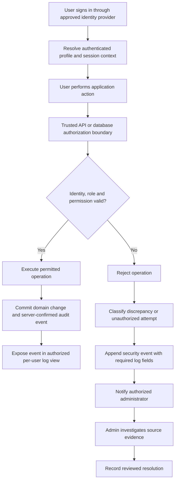

# TACResQ Admin IPS — Web UI/UX Redesign Master Plan

**Status:** Canonical design and implementation specification  
**Scope:** TACResQ administrator Information Processing System (Admin IPS) website  
**Theme decision:** Preserve the existing website theme. Redesign the interface, information architecture presentation, layout, typography, icons, components, responsiveness, and interactions without replacing the theme.  
**Repository baseline inspected:** `RamProjector/TACResQ-School-Project`, commit `b877cb3819484755145834f528252d13c04fb01b` (`main`)  
**Document rule:** This file is the single canonical web-admin redesign plan. Keep Android client redesign documents separate.

---

## 1. Final design decision

TACResQ Admin is an **administrative information system**, not a generic emergency dispatch command center.

The website's primary work is administration and governance: account management, access/security, reports, recorded activity, data continuity, preferences, and operator guidance. Emergency and incident data may appear where existing Admin capabilities require it, but the Admin interface must not be redesigned as a dispatcher console or given unverified dispatch powers.

### Non-negotiable decisions

1. **Keep the existing theme.** Preserve the current TACResQ palette, brand identity, backgrounds, surfaces, sidebar treatment, accent colors, semantic status colors, and existing theme behavior. Do not introduce a replacement palette, a new visual theme, or a competing design identity.
2. **Redesign the complete web experience.** This is not a task to delete paragraphs, hide sections, or apply a few cosmetic CSS changes. Rework the shell, every existing Admin workspace, page composition, tables, forms, dialogs, navigation, responsive behavior, and interaction details.
3. **Make the interface concise.** Remove repeated explanations and redundant labels. Keep essential field labels, status meaning, privacy notices, confirmation details, and accessibility names.
4. **Use information hierarchy rather than decoration.** Prefer clear alignment, compact headings, whitespace, tables, useful grouping, and contextual detail over oversized headings, decorative cards, or paragraphs that restate the page title.
5. **Create a distinctive administrative SVG icon family.** Custom SVGs should identify TACResQ Admin concepts. Keep Lucide for common utility actions; do not replace every familiar control with an unfamiliar custom symbol.
6. **Preserve real functionality.** Existing routes, permissions, API/RPC contracts, data semantics, security boundaries, and working features must remain intact unless a separate evidence-backed change is reviewed.
7. **Never invent operational certainty.** Unknown, unavailable, stale, uncollected, or unverified states must remain explicit. A successful dependency probe is not proof of complete system health.

### What this redesign is not

- Not a new theme or color-system redesign.
- Not a marketing/landing page redesign.
- Not a generic emergency dispatch dashboard.
- Not an excuse to add speculative modules or controls.
- Not a backend, database, infrastructure, or authorization rewrite.
- Not a reduction of critical information merely to make screens look empty.

---

## 2. Repository evidence and current baseline

The following observations were verified by reading source and documentation at the baseline commit above. They describe the inspected revision; re-check the current branch before implementation.

| Area | Verified baseline |
|---|---|
| Main Admin page | `backend/web/src/pages/AdminConsole.tsx` |
| Admin stylesheets | `AdminConsole.css`, `PortalVisualFoundation.css`, and `AdminResolution.css`, imported in that order by `AdminConsole.tsx` |
| Brand component | `backend/web/src/components/Brand.tsx`; displays the existing TACResQ app icon and wordmark |
| Global styles/theme tokens | `backend/web/src/index.css` |
| Web package | `backend/web/package.json`; React 19, Vite, TypeScript, Supabase JS and `lucide-react` |
| Existing Admin HCI contract | `tools/test_admin_hci_layout_contract.py` |
| Admin-only contract | `tools/test_web_admin_only_contract.py` |
| Admin page plan | `docs/plans/admin-page-feature-implementation-plan.md` |
| Admin completion/gap research | `docs/research/ADMIN_WEBSITE_COMPLETION_GAP_ASSESSMENT_2026-11-24.md` |
| Operator guide | `docs/admin-portal-operator-guide.md` |
| CI | `.github/workflows/ci.yml` runs the Admin HCI layout/form contract among other repository checks |

### 2.1 Existing Admin navigation

The inspected `AdminConsole.tsx` defines these eight primary sections:

1. Overview
2. User management
3. Security
4. Analytics & reports
5. Activity log
6. Data & continuity
7. Settings
8. Help & about

Settings is URL-backed and currently has General, Accessibility, Notifications, and Privacy subpages. Security is a separate primary section in the inspected code. Do not copy older documentation that describes a different section count or stale labels without reconciling it against the source.

The navigation groups currently communicate Workspace, Governance, Data & Continuity, and Preferences & Support. The final navigation may refine grouping and labels, but must preserve route compatibility and only expose implemented, authorized destinations.

### 2.2 Existing feature boundaries

| Workspace | Existing capability evidenced in source/docs | Redesign boundary |
|---|---|---|
| Overview | Account summaries, recent recorded-activity preview, dependency reachability probes, workspace shortcuts, explicit loading/error states | Make it a concise administrative landing page. Avoid duplicating Analytics aggregates or Activity Log records. Do not call dependency reachability end-to-end readiness. |
| User management | Protected paginated directory, search/role filters, reasoned role changes, account lifecycle history, protected account activity preview | Improve directory scanability and account detail presentation. Preserve server-side checks and reason/audit requirements. Do not add unverified profile fields. |
| Security | Administrator session/AAL/TOTP status and authenticator safeguards | Separate current-session/security controls from complete security monitoring. Do not imply full sign-in history or arbitrary user-session control unless the source supports it. |
| Analytics & reports | Date-bounded aggregate request metrics, status distribution, daily request volume, assignment timing, Manila-time reporting, CSV export | Keep aggregates distinct from event-level investigation. Make period, timezone, units, data freshness, and export scope clear. |
| Activity log | Searchable, filterable, paginated investigation feed with explicit source-coverage limitations | Keep event provenance and limitations visible. Do not label it a complete system-wide audit trail while sources are incomplete. |
| Data & continuity | Backup/recovery and attachment safeguards information with documented limits | Keep evidence and inspection dates explicit. Do not imply a live backup inventory, successful restore, or media browser without verified integration. |
| Settings | Browser-local density/page-size and accessibility preferences; informational guidance where server-backed policy is absent | Distinguish local preferences from global policy. Do not display inert toggles as functional controls. |
| Help & about | Searchable operator guidance | Keep concise, searchable, accurate, and synchronized with implemented behavior. |

### 2.3 Roles and authorization boundaries

- The Admin interface is for authorized administrators; it is not an alternate dispatcher workspace.
- The inspected Admin role-change options cover requester, responder, driver, and dispatcher. Admin provisioning is a separate trusted-operator process and must not become available through ordinary public signup or a casual role dropdown.
- Hiding a button or navigation item is not authorization. Every privileged read and mutation must remain enforced by the backend.
- Do not infer agency/tenant hierarchy, qualifications, certifications, duty rosters, or other data models unless the deployed schema and policies establish them.
- Keep current MFA/AAL2 requirements and protected investigation access intact.

### 2.4 Existing theme and typography

The inspected `index.css` defines the current theme foundation:

- Main interface font: **DM Sans**
- Display font: **Space Grotesk**
- Technical/monospaced font: **IBM Plex Mono**
- Existing palette tokens include `--ink`, `--ink-deep`, `--ink-soft`, `--paper`, `--card`, `--line`, `--ember`, `--ember-dark`, `--sage`, and semantic green/amber/red tokens.
- The Admin shell uses the existing deep navy sidebar, neutral workspace surfaces, white/near-white panels, and existing accent/status colors.
- `Brand.tsx` uses the existing TACResQ app-icon asset and wordmark.

**Theme freeze:** Continue consuming existing tokens. Do not redefine their values as part of this redesign. Do not add a new color palette, gradient system, dark theme, or new brand mark. If an existing token is insufficient for a specific component, document the gap and reuse the closest semantic token until separately approved.

The inspected global stylesheet imports the three fonts from Google Fonts. Treat font loading, fallback behavior, layout shift, and availability as performance concerns; do not change the typeface family as part of the redesign.

### 2.5 Existing layout and sidebar observations

- The Admin shell is a CSS grid with a sidebar and a min-width-safe main workspace.
- The desktop sidebar collapse state is represented by `admin-shell--sidebar-collapsed` and persisted in browser local storage.
- The Admin stylesheet contains a collapsed-grid contract expecting a `76px minmax(0, 1fr)` layout and hides the wordmark/context/navigation labels in the compact state.
- The source-contract test checks that behavior.
- The styles are split across three imported stylesheets. The shell's base grid width is declared more than once (including 238px and 270px variants), with additional responsive overrides. This creates a cascade/order risk for collapsed sizing.
- The desktop collapse control is inside the sidebar header. The mobile drawer opener is in the topbar outside the drawer; this is correct because the opener must remain reachable when the drawer is closed.
- At the mobile/tablet breakpoint, the sidebar becomes a fixed off-canvas drawer with a backdrop, close control, independent scrolling, focus handling, and reduced-motion treatment.

**Required verification:** Do not assume the reported collapse issue is solved merely because the class and source assertion exist. Inspect computed `grid-template-columns`, sidebar bounding width, and workspace bounding box at each desktop width and after resize. If only the sidebar's contents collapse while the grid column remains wide, fix the cascade/layout contract. Preserve the mobile opener outside the closed drawer.

---

## 3. Research findings and product references

The references below are design-pattern references, not templates to copy and not proof that TACResQ has equivalent features.

### 3.1 Product references

| Reference | Pattern worth borrowing | What not to copy |
|---|---|---|
| **Linear** | Quiet navigation, compact controls, restrained icon treatments, precise alignment, keyboard-friendly workflows, reduced decorative noise | Its issue-tracking information architecture or its theme |
| **Stripe Dashboard** | Data-first tables, clear value alignment, restrained surfaces, focused forms, progressive disclosure for detail | Financial workflows or data structures |
| **ArcGIS Mission** | Only where Admin reviews map-related/incident evidence: spatial context can be paired with contextual information rather than a separate decorative map card | A dispatch-first shell or operational capabilities not present in Admin |
| **Motorola CommandCentral** | High-signal status presentation and separating important alerts from routine information | Command-center navigation, wallboard density, or unimplemented dispatch controls |

### 3.2 Human-interface principles

1. **Recognition over recall:** use familiar navigation, predictable action placement, and visible current context.
2. **Progressive disclosure:** show the fields and actions needed for the current task; place technical detail, audit payloads, and explanatory material behind expandable details.
3. **Consistency:** the same control type should behave and look consistently across Admin pages.
4. **Task-oriented hierarchy:** the page should answer one primary question, such as “Which account needs review?” or “What recorded event occurred?”
5. **Information density without crowding:** prefer compact, aligned information over excessive cards or tiny unreadable text.
6. **Feedback and reversibility:** show whether an action is pending, saved, failed, or unavailable; confirm consequential actions and preserve recoverable form state.
7. **Honest system state:** distinguish healthy, degraded, stale, unknown, not collected, and unavailable.

### 3.3 Admin IPS-specific design conclusion

Use Linear and Stripe as the stronger references for the overall Admin IPS experience. Use GIS/emergency software references only for specific data views where the Admin portal actually needs geographic or incident context. The Admin website should remain an administration and information-processing workspace.

---

## 4. Final visual and interaction direction (existing theme retained)

### 4.1 Application shell

- Keep the existing TACResQ identity and palette.
- Build a stable desktop shell: sidebar, compact topbar, and main workspace.
- The sidebar must have a real expanded and collapsed width; the workspace must reclaim the released width.
- Keep navigation labels available through accessible names and tooltips in the collapsed state.
- Keep the collapse control reachable and visually aligned inside the desktop sidebar header.
- Keep the mobile drawer opener in the topbar, outside the closed drawer.
- Move sign-out into the existing account/profile menu only if a safe, discoverable account menu is implemented; do not simply hide sign-out.
- Keep breadcrumbs short and useful. Avoid repeating the same page name in a large eyebrow, title, subtitle, and card heading.
- Use a consistent page-header pattern: concise title, optional one-line context only when it adds meaning, and page actions aligned to the right.

### 4.2 Page composition

Avoid using the same dashboard template for every page.

| Page | Primary composition |
|---|---|
| Overview | Compact attention/summary area, recent recorded activity, limited shortcuts, dependency reachability with a precise scope label |
| User management | Search/filter toolbar, paginated directory table, contextual account details, guarded actions |
| Security | Current administrator session and authenticator status, grouped security controls, clear capability/coverage limits |
| Analytics & reports | Period/timezone controls, key aggregates, readable chart, supporting data table, scoped export |
| Activity log | Search/filter toolbar, event table/list, expandable event details, visible source coverage |
| Data & continuity | Evidence inventory and dated inspection context, clear unavailable/not-connected states, documented operator guidance |
| Settings | Short grouped preference controls with save/reset behavior; separate local preferences from read-only policy guidance |
| Help & about | Search-first reference, concise answers, version/support details only when grounded in configuration |

### 4.3 Cards, surfaces, and borders

- Do not place every element in a card.
- Use tables for records, lists for sequential activity, simple grouped sections for settings, and panels only when content is a distinct unit.
- Avoid nested cards inside cards.
- Use the existing border and surface tokens; reduce redundant outlines and decorative shadows.
- Use dividers to separate related rows rather than drawing a box around every row.
- Let whitespace and alignment create hierarchy.
- Keep action buttons near the content they affect.
- Keep dangerous actions visually distinct and require confirmation appropriate to their consequence.

### 4.4 Copy and labels

- Remove paragraphs that repeat the page title or explain an obvious control.
- Keep descriptions to one short line when a page needs context.
- Do not repeat the same status in a badge, heading, paragraph, and metadata line.
- Keep persistent form labels; placeholder text is not a replacement for a label.
- Keep critical security, privacy, data freshness, and consequence explanations even when they require more text.
- Prefer direct action names: “Export CSV”, “Refresh”, “Change role”, “View details”.
- Avoid unexplained abbreviations and excessive uppercase/letter spacing.
- Put technical definitions and source-coverage details in expandable help or details sections, not in the primary reading path.

---

## 5. Typography specification

Keep DM Sans, Space Grotesk, and IBM Plex Mono. Change their roles and hierarchy, not the font families.

| Role | Recommended size | Weight/use |
|---|---:|---|
| Page title | 22–26px | 600; Space Grotesk or existing display token |
| Section heading | 15–17px | 600; short and task-specific |
| Panel/table group heading | 14–16px | 600 |
| Body and table content | 13–14px | 400–500; DM Sans |
| Form label | 12–13px | 500–600; persistent |
| Supporting text | 12–13px | 400; only when useful |
| Metadata | 11–12px | 400–500; secondary contrast |
| IDs, timestamps, technical values | 11–12px | IBM Plex Mono; tabular numerals where useful |
| Icon-only tooltip | 12px minimum where feasible | concise action description |

### Typography rules

- Avoid oversized page titles. The current responsive title token reaches 40px; reduce the Admin page-title hierarchy toward the range above.
- Use fluid sizing only where it improves fit; never let viewport width inflate an administrative page title unnecessarily.
- Keep body copy comfortable and readable. Do not shrink table text to fit more columns.
- Use tabular numerals for counts, IDs, dates, and measurements where alignment helps scanning.
- Keep line length controlled for explanatory copy; avoid long full-width paragraphs.
- Use consistent line-height and avoid headings that wrap into awkward single-word lines.
- Respect browser zoom and user text scaling.
- Use font fallbacks that preserve layout if Google Fonts cannot load. Assess self-hosting only after license, build, and performance review; it is not a requirement to add a new font.

---

## 6. Custom TACResQ Admin SVG icon system

A unique SVG family is required, but it must represent **administrative information-system concepts**, not turn the site into an emergency-response icon showcase.

### 6.1 Icon families

Create original TACResQ-specific SVGs for these Admin concepts:

| Concept | Visual direction |
|---|---|
| Overview | Structured dashboard/grid with one emphasized information point |
| User management | Account/profile with a controlled directory or grouping motif |
| Security | Layered access/verification motif; distinct from generic emergency shield imagery |
| Analytics & reports | Measured data/chart motif with a recognizable report structure |
| Activity log | Ordered event/timeline or recorded-entry motif |
| Data & continuity | Structured data/archive with a continuity/restore cue; do not imply a backup is verified |
| Settings | Deliberate control/adjustment motif |
| Help & about | Knowledge/reference motif |

Custom icons should be recognizable at small sizes and should not depend on color alone.

### 6.2 Technical standards

- Use a consistent 24×24 viewBox for standard UI icons; use 32×32 or 48×48 for larger empty-state or feature illustrations.
- Keep stroke weight consistent (approximately 1.75–2px at 24px scale), with coherent caps, joins, corner radii, and optical alignment.
- Use `currentColor` so SVGs inherit the existing theme.
- Keep fills and strokes simple; avoid filters, gradients, tiny details, and excessive path complexity.
- Include outline and selected/emphasized variants only where a state genuinely changes.
- Decorative SVGs must be hidden from assistive technology. Meaningful icon-only controls need accessible names and visible focus.
- Preserve adequate target size around icons; the icon itself is not the interactive target.
- Optimize SVG output and avoid shipping a large icon font for a small set of symbols.

### 6.3 Use Lucide appropriately

Keep `lucide-react` for familiar utility actions such as search, close, refresh, edit, download, sort, pagination, and menu controls. Use the custom library for the TACResQ Admin identity and the eight primary administrative concepts. Do not replace familiar utility icons merely to make every icon different.

---

## 7. Component and page standards

### 7.1 Tables and directories

- Tables are primary interfaces for account directories, activity records, and report detail.
- Use clear column names, aligned numeric values, stable row heights, and subtle row separators.
- Keep search, filters, page size, result count, and pagination in a compact toolbar.
- Avoid forcing a wide table to shrink into unreadable text. Use a local horizontal scroll region or a carefully designed compact row/detail presentation.
- Keep important identity fields together; place secondary technical identifiers in lower-emphasis text.
- Make row actions keyboard accessible and give repeated actions names that identify the affected record.
- Preserve sorting/filter state where existing behavior supports it.
- Use explicit empty, loading, unavailable, and error states; do not show stale privileged data after authorization failure.

### 7.2 Forms and settings

- Prefer single-column forms; use two columns only for short, related fields when there is sufficient space.
- Keep persistent labels above controls.
- Place short hints and validation feedback next to the relevant field.
- Group related settings and clearly distinguish editable local preferences from read-only policy information.
- Explain whether a setting is browser-local or server-backed.
- Provide save/reset feedback and protect unsaved changes when leaving a form.
- Do not render inert toggles for unimplemented notification, privacy, security, or system policies.

### 7.3 Dialogs and confirmations

- Keep dialogs focused on one decision.
- State the affected account/record and consequence.
- Keep primary and destructive actions clearly differentiated.
- Fit within short viewport heights using internal scrolling where necessary.
- Preserve focus, return focus to the trigger, support Escape where safe, and prevent background interaction when modal.
- Do not put long policy paragraphs into every confirmation; link to the relevant details when appropriate.

### 7.4 Status, notifications, and feedback

- Pair status color with text or a meaningful icon; never rely on color alone.
- Distinguish success, warning, error, stale, unknown, and unavailable.
- Show freshness timestamps only when they belong to the currently displayed result set.
- Keep toast messages concise and non-blocking; persistent errors need an actionable recovery path.
- Never show “live”, “healthy”, “complete”, “delivered”, “backed up”, or “restorable” unless the source proves that exact claim.

---

## 8. Responsive and adaptive layout strategy

The design must respond to **available space**, not just device labels. Do not create one media query for every test resolution. Use content-driven breakpoints, fluid sizing, CSS Grid/Flexbox, container queries, and component-level adaptation.

### 8.1 Test viewport width matrix

Use these widths as a broad QA matrix, not as 31 required CSS breakpoints:

`320, 360, 375, 390, 414, 430, 480, 540, 600, 640, 720, 768, 800, 834, 900, 960, 1024, 1080, 1152, 1200, 1280, 1366, 1440, 1536, 1600, 1680, 1728, 1920, 2048, 2560, 3440 px`

### 8.2 Test viewport height matrix

`568, 640, 720, 768, 800, 900, 1080, 1440 px`

Test representative width/height combinations, especially narrow + short, medium + short, and ultrawide + tall. Do not exhaustively run every Cartesian combination on every commit.

### 8.3 Required adaptive behaviors

| Available space | Expected behavior |
|---|---|
| Wide desktop | Expanded sidebar, comfortable workspace, optional contextual detail column |
| Standard desktop | Expanded sidebar and content-width-aware page layout |
| Narrow desktop/laptop | Compact or collapsed sidebar when needed; toolbar wraps without overlap |
| Tablet landscape | Drawer or compact navigation; tables and filters reorganize |
| Tablet portrait | Single workspace column; panels stack; navigation remains reachable |
| Narrow/mobile browser | Drawer navigation, compact topbar, focused single-column task flow |
| Short viewport | Header and navigation remain usable; long panels/dialogs scroll internally |
| Split-screen/resized window | Components adapt to their container instead of assuming full-screen width |
| 200–400% zoom | Content reflows without clipped controls or page-level horizontal scrolling for ordinary content |

### 8.4 Browser and environment variations

Include:
- Portrait and landscape.
- Mouse, keyboard, and touch.
- 100%, 125%, 150%, 200%, and 400% browser zoom.
- Split-screen and narrow browser windows.
- Browser chrome reducing available height.
- High-DPI/device pixel ratio variations.
- Font loading delay/failure.
- Reduced motion and forced-colors/high-contrast modes.
- Resize while menus, dialogs, expanded rows, or filters are open.

### 8.5 Implementation rules

- Use page-level media queries only when the overall composition must change.
- Use container queries when an individual component should adapt to its own available width.
- Use `minmax(0, 1fr)`, `min-width: 0`, and bounded widths to prevent grid/flex overflow.
- Use `clamp()` for fluid spacing and restrained type sizing, with readable minimums.
- Use dynamic viewport units such as `dvh` where supported and safe fallbacks for viewport-height layouts.
- Keep horizontal scrolling local to genuinely wide data tables; avoid page-wide overflow.
- Keep modal and dropdown positioning within the visible viewport.
- Preserve focus and selected state when a layout changes from sidebar to drawer.
- Keep navigation usable with a keyboard and touch, including visible focus and adequate target dimensions.

### 8.6 Existing responsive implementation to consolidate

The inspected stylesheets contain overlapping breakpoints and shell overrides, including 1920px+, 1440px, 1201–1439px, 901–1200px, 761–900px, max 760px, max 480px, max 900px, max 1120px, max 960px, max 700px, and max 520px rules across different files.

Do not add another layer of overrides. First map all existing selectors and their cascade. Consolidate the Admin shell and component responsive rules into a clear, documented system while preserving the existing theme and behavior.

---

## 9. Accessibility and usability requirements

Target WCAG 2.2 AA as an engineering goal, but do not claim conformance without a complete audit.

- Text contrast: at least 4.5:1 for normal text and 3:1 for large text.
- Visible keyboard focus for every interactive element.
- Keyboard access to navigation, tables, menus, dialogs, filters, and pagination.
- Logical focus order and appropriate focus restoration.
- Semantic headings, landmarks, labels, table headers, status announcements, and form error associations.
- Accessible names for icon-only controls; decorative SVGs hidden from screen readers.
- Do not use color as the only signal for status, errors, or selection.
- Reflow at narrow equivalent widths and browser zoom; no loss of information or functionality.
- Touch targets should be comfortably usable; aim for approximately 40–44px where practical, while meeting applicable WCAG target-size requirements.
- Respect reduced-motion preferences; avoid non-essential animation.
- Test forced-colors/high-contrast mode.
- Keep error messages specific and actionable without exposing sensitive implementation details.
- Provide clear empty and unavailable states; do not rely on a blank panel to communicate absence of data.

---

## 10. Performance and implementation quality

- Preserve the current font families; optimize loading/fallback behavior and avoid layout shift.
- Avoid introducing new UI libraries or dependencies unless the repository review proves they are needed.
- Use the existing Lucide dependency and a small optimized custom SVG library.
- Avoid heavy blur, large shadow stacks, expensive animated backgrounds, and unnecessary motion.
- Keep tables and charts responsive; consider virtualization only if measured record volume justifies it.
- Avoid rendering large hidden page trees if it causes measurable performance or accessibility problems.
- Ensure CSS ownership is clear: reduce duplicate selectors and stylesheet-order dependencies.
- Keep components reusable where behavior is genuinely shared; do not over-generalize different workflows into one complex component.
- No console errors, broken links, inaccessible controls, or inert buttons in the redesigned pages.

---

## 11. Security, privacy, and truthful data presentation

The Admin UI is a privileged surface.

1. Backend authorization remains authoritative. UI visibility is never a substitute for RLS, RPC authorization, or server-side role checks.
2. Keep privileged data out of local storage. Browser-local storage may hold non-sensitive presentation preferences only.
3. Do not expose service-role credentials, access tokens, MFA secrets, recovery codes, private attachment bytes, or sensitive incident details unnecessarily.
4. Preserve MFA/AAL2 requirements for protected investigations and security-sensitive actions.
5. Keep role changes reasoned, auditable, and limited to server-authorized roles.
6. Do not expose Admin provisioning through public signup or ordinary role controls.
7. Keep CSV export scoped and protected against spreadsheet formula injection.
8. Keep audit source coverage visible. Missing events must not be interpreted as proof that no event occurred.
9. Do not represent dependency reachability as full application health or emergency readiness.
10. Do not add account suspension, deletion, restore, notification suppression, retention, or global policy controls until the underlying authorization, audit, recovery, and enforcement behavior is verified.
11. Do not invent privacy controller details, legal basis, retention periods, data-subject rights processing, or vendor disclosures.
12. Use synthetic accounts and synthetic records for QA; never use real emergency incidents or personal location data in test fixtures.

---

## 12. Testing and verification plan

### 12.1 Existing checks

At the inspected baseline:
- `tools/test_admin_hci_layout_contract.py` protects key navigation, sidebar, mobile drawer, focus, and form contracts.
- `tools/test_web_admin_only_contract.py` protects Admin-only frontend boundaries.
- `.github/workflows/ci.yml` runs the Admin HCI contract.
- `backend/web/package.json` exposes `build` (TypeScript check + Vite build), `dev`, and `preview`; it does not define a dedicated frontend test or viewport-matrix script.
- `tools/visual_regression.py` uses Playwright to capture the interactive mobile wireframe gallery at a fixed 1440×1080 browser viewport. It is not a live AdminConsole viewport suite; map views are excluded due to nondeterministic external tiles.

Re-check current scripts and workflows before relying on these statements.

### 12.2 Required checks for the redesign

| Check | Minimum expectation |
|---|---|
| TypeScript/web build | `pnpm --dir backend/web build` or the repository's current equivalent |
| Admin HCI contract | Run existing `tools/test_admin_hci_layout_contract.py` |
| Admin-only contract | Run existing `tools/test_web_admin_only_contract.py` |
| Relevant security/source contracts | Run the Admin/auth/audit/security tests affected by the change |
| Navigation | Every Admin section and legacy URL works; browser Back/Forward and keyboard navigation remain correct |
| Data behavior | Loading, empty, error, stale, unavailable, permission denied, and successful states are accurate |
| Sidebar | Verify actual sidebar width and workspace expansion when collapsed at multiple desktop widths |
| Responsive | Run the broad width/height matrix, including just below/at/above each chosen content-driven breakpoint |
| Accessibility | Keyboard-only, focus order, screen-reader names, contrast, zoom/reflow, reduced motion, forced colors |
| Visual review | Capture real Admin pages, not only wireframes; review every section and responsive state |
| Regression | Confirm routes, roles, permissions, APIs, filters, forms, exports, dialogs, and account workflows remain intact |

### 12.3 Viewport test execution strategy

- Pull request smoke suite: representative compact, standard, laptop, tablet, and mobile viewports, plus short-height and zoom checks for changed components.
- Major shell/layout change: full width matrix and representative height combinations.
- Release candidate: full matrix plus manual keyboard, touch, zoom, and assistive-technology review.
- Capture screenshots for each Admin section and key states: loading, populated, empty, error, expanded detail, open menu/dialog, collapsed sidebar, and mobile drawer.
- Test immediately below, at, and above each actual breakpoint.
- Keep screenshot differences report-only only where repository policy says so; navigation, functionality, accessibility, build, and security checks remain blocking.

---

## 13. Implementation phases

### Phase 0 — Baseline and inventory
- Record the current main SHA, open PRs, CI state, routes, section permissions, and backend dependencies.
- Capture screenshots and inspect every Admin section at representative widths.
- Inventory all existing selectors and stylesheet load order.
- Verify the sidebar collapse width using computed browser layout.
- Record existing defects separately from redesign regressions.

**Exit:** source inventory, screenshots, baseline test results, and a list of confirmed versus suspected issues.

### Phase 1 — Design foundation (theme preserved)
- Define spacing, typography roles, border/radius/elevation usage, focus styles, and component density using existing theme tokens.
- Define the custom TACResQ Admin SVG family.
- Define shared patterns for page headers, tables, filters, forms, status indicators, empty/error states, and dialogs.
- Do not change theme token values.

**Exit:** documented design tokens/roles, icon assets/components, and reviewed component examples.

### Phase 2 — Application shell and sidebar
- Consolidate the shell CSS and responsive rules.
- Fix the real desktop collapsed-column behavior.
- Preserve mobile drawer opener/closer placement and accessibility.
- Standardize topbar, breadcrumbs, profile/account menu, and workspace width.
- Verify short-height, zoom, keyboard, and resizing behavior.

**Exit:** sidebar physically shrinks, workspace expands, no overlap/overflow, drawer remains operable.

### Phase 3 — Page-by-page Admin redesign
Recommended order:
1. Overview
2. User management
3. Security
4. Analytics & reports
5. Activity log
6. Data & continuity
7. Settings
8. Help & about

For each page: improve information hierarchy, remove redundant copy, redesign its primary data view, standardize controls, and verify all states and role boundaries.

**Exit:** all existing Admin sections have a consistent but purpose-specific layout; no feature is silently removed.

### Phase 4 — Responsive and accessibility hardening
- Validate the viewport matrix and zoom levels.
- Fix overflow, short-height dialogs, nested scrolling, focus loss, and touch target issues.
- Verify contrast and reduced-motion/forced-color behavior.

**Exit:** responsive and accessibility evidence is attached to the implementation review.

### Phase 5 — Final regression and release review
- Run web build, Admin contracts, relevant security tests, and full repository CI.
- Review actual rendered pages at all major viewport families.
- Verify backend/API behavior and role isolation have not changed.
- Document any manual checks that remain outstanding.

**Exit:** exact-head checks pass, no unresolved blocking issues, and manual acceptance gaps are stated honestly.

---

## 14. Acceptance criteria

The redesign is ready for final review only when all applicable criteria are met:

- [ ] The existing TACResQ website theme and brand are preserved.
- [ ] The product remains clearly an Admin IPS website, not a dispatch dashboard.
- [ ] Every existing Admin section is redesigned and remains reachable.
- [ ] No existing feature, route, permission, or backend contract is removed or silently changed.
- [ ] The sidebar's desktop collapse changes the actual grid column and gives the width back to the workspace.
- [ ] The mobile drawer opener remains reachable outside the closed drawer.
- [ ] Typography is compact, readable, consistent, and not dominated by oversized page titles.
- [ ] Repeated paragraphs, redundant labels, duplicate cards, and decorative noise are removed without hiding essential meaning.
- [ ] Original TACResQ Admin SVG icons are used for core administrative concepts; Lucide remains for familiar utility actions.
- [ ] Tables, filters, forms, dialogs, status indicators, and feedback patterns are consistent.
- [ ] All states are truthful: loading, empty, stale, unavailable, error, success, and permission denied.
- [ ] Responsive layouts work across representative width/height combinations, split-screen, orientation, and zoom.
- [ ] Keyboard navigation, focus, screen-reader names, contrast, reduced motion, and reflow are reviewed.
- [ ] No new client-only security controls or unsupported operational claims are introduced.
- [ ] Build, Admin contracts, security checks, and required CI pass on the exact reviewed commit.
- [ ] Browser/device acceptance is recorded separately from automated source tests.

---

## 15. Research references

Use these as supporting guidance. Re-check current versions and applicability during implementation.

### Product/interface references
- [Linear — How we redesigned the UI](https://linear.app/now/how-we-redesigned-the-ui) — restraint, hierarchy, consistency, and reducing unnecessary interface decoration.
- [Esri — ArcGIS Mission](https://www.esri.com/en-us/arcgis/products/arcgis-mission/overview) — contextual spatial information, relevant only to Admin pages that genuinely need map/incident context.
- [Motorola Solutions — CommandCentral](https://www.motorolasolutions.com/en_us/products/command-center-software.html) — high-signal status and alert presentation; not an Admin IPS information-architecture template.

### Human-computer interaction and accessibility
- [Nielsen Norman Group — Recognition vs. recall](https://www.nngroup.com/articles/recognition-and-recall/) — make actions and context recognizable rather than requiring users to remember hidden conventions.
- [Nielsen Norman Group — Progressive disclosure](https://www.nngroup.com/articles/progressive-disclosure/) — reveal secondary detail when needed without hiding critical information.
- [W3C — WCAG 2.2](https://www.w3.org/TR/WCAG22/) — accessibility success criteria.
- [W3C — Reflow](https://www.w3.org/WAI/WCAG22/Understanding/reflow.html) — responsive reflow and avoiding two-dimensional scrolling for ordinary content.
- [W3C — Target Size (Minimum)](https://www.w3.org/WAI/WCAG22/Understanding/target-size-minimum.html) — interactive target-size requirements.
- [W3C — Decorative Images](https://www.w3.org/WAI/tutorials/images/decorative/) — accessible treatment of decorative graphics.
- [W3C — SVG 2](https://www.w3.org/TR/SVG2/) — SVG structure and semantics.

### Typography, icons, and responsive implementation
- [Material Design — Typography](https://m3.material.io/styles/typography/overview) — type roles and hierarchy.
- [Material Design — Icons](https://m3.material.io/styles/icons/overview) — consistent icon use and sizing.
- [Lucide — Icon design](https://lucide.dev/guide/design/icon-design) — coherent icon geometry.
- [Lucide — Accessibility](https://lucide.dev/guide/advanced/accessibility) — accessible icon implementation.
- [MDN — Responsive design](https://developer.mozilla.org/en-US/docs/Learn_web_development/Core/CSS_layout/Responsive_Design) — responsive layout foundations.
- [MDN — Container queries](https://developer.mozilla.org/en-US/docs/Web/CSS/CSS_containment/Container_queries) — component adaptation based on available space.
- [MDN — clamp()](https://developer.mozilla.org/en-US/docs/Web/CSS/clamp) — bounded fluid sizing.
- [Playwright — Emulation](https://playwright.dev/docs/emulation) — viewport/device emulation for automated verification.

### Security and emergency-context guidance
- [OWASP Application Security Verification Standard](https://owasp.org/www-project-application-security-verification-standard/) — application security verification baseline for privileged workflows.
- [ITU-T F.760.2](https://www.itu.int/rec/T-REC-F.760.2/en) — first-responder interface guidance; use only for relevant readability, feedback, and high-stress information presentation, not as the Admin IPS page architecture.

---

## 16. Maintenance rule

Update this file when the Admin navigation, page capabilities, theme tokens, icon system, responsive architecture, or acceptance gates materially change. Keep source-backed facts distinct from recommendations. If another document covers a narrow topic (for example, security-event coverage or the operator guide), link to it rather than duplicating its entire content here.

**This plan is the final design direction:** complete TACResQ Admin IPS web UI/UX redesign, existing theme preserved, concise professional interface, distinctive administrative SVG icons, real responsive behavior, and all current authorized functionality retained.

---

## 17. Additional research — administrative workflows and data-intensive interfaces

This section extends the existing design foundation with implementation guidance for a real administrative information system. These are design requirements and research conclusions, not claims that every capability already exists in TACResQ. Confirm each capability against current source, schema, RPCs, and authorization before implementing it.

### 17.1 Record lifecycle and end-to-end workflows

Design around the complete lifecycle of an administrative record, not isolated screens.

For every existing record type, document:
- Who can create, view, search, edit, review, export, archive, or delete it.
- Which fields are required, optional, immutable, or system-generated.
- Which state transitions are valid and who may perform them.
- What reason, confirmation, or supporting evidence is required for consequential changes.
- What happens when a save fails, a session expires, or another administrator changes the same record.
- Which events must be auditable and how the user can inspect the resulting history.

Create a workflow map for each current Admin capability: entry point → search/select → inspect → permitted action → confirmation → result → audit/history. Do not add lifecycle states or actions that are not supported by the backend.

**Design implication:** use a directory/list for finding records, a focused detail view for understanding one record, and contextual actions for operations on that record. Avoid forcing users through a dashboard card for every step.

### 17.2 Data tables and record directories

Tables are primary working surfaces in an Admin IPS. Treat them as structured tools, not decorative content.

Required patterns:
- Clear column names and semantic table headers.
- Stable row identity and predictable row actions.
- Sort indicators that disclose the active sort column and direction.
- Search and filters that apply to the complete result set, not only the currently visible page.
- Visible active filters with a simple way to clear one or all.
- Pagination that preserves the current query and filters when moving between pages.
- A clear result count and current page context.
- Column widths that prioritize the fields administrators actually use.
- Local horizontal scrolling or a deliberate compact/stacked alternative for genuinely wide tables; never cause accidental page-wide horizontal overflow.
- Loading, no-results, empty, error, stale, and permission-denied states.
- Selection checkboxes only when a real bulk action exists.
- Row click behavior that does not conflict with nested buttons, links, or checkboxes.

Do not make every column sortable or every field a visible column by default. Prioritize the common decision-making fields and place secondary data in a detail panel.

### 17.3 Search, filtering, and query persistence

Search should help administrators find known records quickly and understand why a result matched.

Specify:
- Which fields are searchable and whether matching is exact, prefix, or partial.
- Whether search is case-insensitive and how punctuation/spacing are normalized.
- How search combines with role, status, date, and other filters.
- Whether filters are server-side and whether counts reflect the full filtered result set.
- What happens when a query returns no matches.
- Whether query state is preserved in the URL so browser Back/Forward, refresh, and shareable links behave predictably.
- Debounce behavior and cancellation of stale requests.
- Clear/reset behavior that does not unexpectedly discard unrelated page state.

Avoid an unexplained universal search box if the backend only searches one dataset. Label the search scope accurately.

### 17.4 Bulk actions and imports/exports

Bulk actions can save time but amplify mistakes. Add them only where the existing data model and backend support safe batch operations.

Before implementation, require:
- Explicit selection count and clear all/none behavior.
- A preview of the affected records and the exact change.
- Permission checks for every affected record, not only the first selected row.
- A reason and confirmation for consequential changes.
- Defined partial-failure behavior and per-record results.
- Idempotency or safe retry behavior where supported.
- An audit event for each affected record or a traceable batch event with item-level outcomes.
- A safe maximum batch size and clear progress feedback.

For exports, show the applied filters, date range, timezone, included columns, and record count. Keep exports permission-checked and protect CSV output against spreadsheet formula injection. Do not imply that a download contains every record if it is limited to the current page.

Imports must not be introduced merely as a convenience. They require schema validation, duplicate handling, preview, rollback/partial-failure rules, and auditability.

### 17.5 Forms and validation

Use persistent labels, logical grouping, and concise help text only where a field is ambiguous or has consequential requirements.

Recommended form behavior:
- Validate required and format constraints at the appropriate point without surprising users.
- Show an error beside the affected field and provide a concise summary for long forms.
- Link summary errors to the corresponding fields and move focus appropriately after failed submission.
- Preserve valid entered values when validation or network submission fails.
- Distinguish field errors, permission errors, network failures, and server conflicts.
- Explain constraints before submission when users need them to complete the form correctly.
- Disable duplicate submission while a request is in flight, but do not leave the user with an indefinite spinner.
- Confirm navigation away only when meaningful unsaved work would be lost.
- Use explicit save/cancel actions; do not silently autosave privileged or consequential changes.
- Use confirmation dialogs for irreversible or high-impact actions, with the target and consequence named.

Do not use placeholder text as the only label. Do not make every field show a long explanatory paragraph. Keep security and privacy explanations when they materially affect the user's decision.

### 17.6 Audit trails and activity investigation

Separate operational activity feeds from security audit logs unless source coverage and semantics prove they are the same dataset.

For each event, establish which fields are actually available:
- Event/action type.
- Actor identity or system actor.
- Target record and stable identifier.
- Timestamp and timezone.
- Outcome (success, denied, failed, pending) where recorded.
- Source/channel and correlation/request identifier where available.
- Reason or change summary where safe and supported.

Audit views should support time range, actor, event type, target, and outcome filters only when the underlying records support them. Keep event details expandable and avoid exposing secrets, session tokens, MFA material, or unnecessary personal data.

Show coverage limitations and retention boundaries. A missing event is not proof that an action did not occur. Never label a partial activity feed as a complete system-wide audit trail.

### 17.7 Permissions and privileged-action UX

Use least privilege and defense in depth:
- Backend authorization remains authoritative for every read and write.
- The frontend should explain unavailable actions without exposing privileged data.
- Hide or disable controls based on verified permission context, but never rely on UI visibility as enforcement.
- Distinguish “not authorized”, “not configured”, “not available”, and “temporarily failed”.
- Require stronger confirmation for high-impact actions, with a reason where policy requires it.
- Do not expose privilege escalation, admin provisioning, role grants, account deletion, or security-policy controls unless the backend has a reviewed and auditable implementation.
- Keep session and MFA state understandable without displaying secrets or implying a stronger assurance level than the backend reports.

### 17.8 Concurrent edits, stale data, and recovery

Administrative records may be changed by more than one operator. Define behavior for:
- A record changing after the detail view was loaded.
- A save conflicting with a newer version.
- A session expiring during an edit.
- A network interruption during submission.
- A retry after an uncertain response.
- A record becoming inaccessible before the action completes.

Show when data was last refreshed if freshness matters. Prefer an explicit conflict state with a reload/review path over silently overwriting newer data. Preserve user-entered data where safe. Do not claim a mutation failed if the server may have completed it; reconcile the result before allowing a duplicate action.

### 17.9 Notifications and feedback

Use notifications for events that need attention, not as a second activity log.

Define:
- Which events warrant an in-app notification.
- Severity and urgency semantics.
- Read/unread state and whether it is server-backed.
- Destination when a notification is opened.
- Dismissal and retention behavior.
- How duplicate or repeated alerts are grouped.
- What happens when the destination is no longer accessible.

Use inline feedback for local actions, persistent banners for page-level conditions, and dialogs only when a decision is required. Avoid success toasts for actions that have not been confirmed by the server.

### 17.10 Analytics and reporting integrity

Every report must disclose enough context to interpret it:
- Metric definition and unit.
- Date range and timezone.
- Aggregation level and filters.
- Data freshness or last successful refresh, if known.
- Missing-data or coverage limitations.
- Whether values are live, cached, or historical.
- Export scope and included fields.

Use a chart only when it helps compare, trend, or understand a distribution. Provide a table or textual equivalent for exact values. Avoid 3D charts, decorative gauges, arbitrary color categories, and dashboards that repeat the same metric in multiple forms.

Do not infer service quality, response performance, or system readiness from metrics that do not measure those outcomes.

### 17.11 Reusable component and design-system governance

Maintain one shared implementation for genuinely shared patterns:
- Page header and action area.
- Search/filter toolbar.
- Data table and pagination.
- Status label and state description.
- Form field, field error, and error summary.
- Confirmation dialog.
- Empty/loading/error/unavailable state.
- Detail panel and expandable event content.
- Toast/banner feedback.
- Icon button and tooltip.

Document component states and interaction contracts, not just screenshots. Avoid a single giant “universal” component with many unrelated flags. A component should be shared when its semantics and behavior are shared, not merely because two pages look similar.

### 17.12 Operational design acceptance checklist

- [ ] Each existing Admin workflow is mapped from entry to completion.
- [ ] Record actions and valid state transitions are backed by current server behavior.
- [ ] Search/filter/sort/pagination operate on the complete intended result set.
- [ ] Query state survives refresh and browser navigation where appropriate.
- [ ] Bulk actions have preview, authorization, partial-failure handling, and audit evidence.
- [ ] Forms preserve input and identify errors accessibly.
- [ ] Concurrent updates cannot silently overwrite newer records.
- [ ] Audit/activity views accurately state their source coverage and retention limits.
- [ ] Permission failures are distinguishable from missing configuration and service errors.
- [ ] Reports disclose units, period, timezone, freshness, and scope.
- [ ] Every action has truthful pending/success/failure feedback.
- [ ] Empty, loading, stale, unavailable, error, and no-permission states are designed consistently.
- [ ] Shared components have documented states and keyboard behavior.

---

## 18. Additional research references

These references extend the source list in Section 15. Apply the guidance selectively and verify current versions during implementation.

### Administrative tables, navigation, and components
- [GOV.UK Design System — Components](https://design-system.service.gov.uk/components/) — reusable component patterns and usage guidance.
- [GOV.UK Design System — Pagination](https://design-system.service.gov.uk/components/pagination/) — responsive pagination, page context, and applying sort/filter behavior to the full result set.
- [GOV.UK Design System — Error summary](https://design-system.service.gov.uk/components/error-summary/) — accessible form error summaries and field links.
- [U.S. Web Design System — Patterns](https://designsystem.digital.gov/patterns/) — task-oriented patterns for complex forms and user profiles.
- [U.S. Web Design System — Validation](https://designsystem.digital.gov/components/validation/) — validation guidance and documented usability/accessibility limitations of its validation component.

### Accessibility and form behavior
- [W3C — WCAG 2.2](https://www.w3.org/TR/WCAG22/) — keyboard access, focus, reflow, target size, text alternatives, and input requirements.
- [W3C WAI — Understanding Error Identification](https://www.w3.org/WAI/WCAG22/Understanding/error-identification) — errors must be identified in text or a text alternative; choose inline or summary patterns according to context.

### Security, sessions, and logging
- [OWASP ASVS 5.0 — Security Logging and Error Handling (V16)](https://github.com/OWASP/ASVS/blob/master/5.0/en/0x25-V16-Security-Logging-and-Error-Handling.md) — structured security-event logging, log protection, sensitive-data minimization, and secure error handling.
- [OWASP ASVS 5.0 — Session Management (V7)](https://github.com/OWASP/ASVS/blob/master/5.0/en/0x16-V7-Session-Management.md) — unique sessions, invalidation, and inactivity timeouts.
- [OWASP Application Security Verification Standard](https://owasp.org/www-project-application-security-verification-standard/) — broader verification framework for privileged web applications.

### Application of research to TACResQ
- These sources support interface and verification requirements; they do not establish that TACResQ currently has bulk editing, imports, complete audit coverage, concurrent-edit versioning, or notification preferences.
- Confirm the current implementation and data contracts before specifying any of those features as deliverable behavior.
- Keep the existing theme and the Admin IPS product identity unchanged.

---

## 19. Mandatory IDS/IPS coursework criteria — source-based requirements

**Source:** user-provided *CRITERIA FOR THE IDS/IPS: Intrusion Detection/Intrusion Prevention System*, one-page handout, page 1. This section preserves the assignment's requirements and translates them into TACResQ-specific design and verification work. It does not claim that the repository currently satisfies them.

### 19.1 Requirements stated in the handout

The handout requires:

1. A web-, desktop-, or mobile-based IDS/IPS using the **same database** and linked to the mobile application.
2. Identification of application users, each user's roles/permissions, sessions per user, and operations/actions. The handout says operations/actions are only **ADD, EDIT, DELETE**.
3. An IDS/IPS system flowchart.
4. System logs recording all operation/actions and sessions with these exact field names: `session_id`, `log_id`, `actions`, `description`, `ip_address`, `timestamp`, `device_used`.
5. Each action must be included in system logs. Its example uses role-specific action names (student: borrow_books, return_books, view_all_books, reserve_books, search_books; staff: manage_borrow_books, manage_return_books, view_all_books, manage_reserve_books, search_books) and a human-readable action/description pair.
6. Each user must have their own system logs.
7. A user may have one or more roles, and roles/permissions may be assigned to users. The system must detect a role/permission assigned to a non-applicable user as a discrepancy/intrusion and warn/notify the administrator.
8. All listed criteria must be met.

### 19.2 TACResQ interpretation and important distinctions

- The handout's **ADD / EDIT / DELETE** is the required operation classification. The handout's examples also include named user activities such as viewing and searching. Preserve both levels: classify a mutation as ADD, EDIT, or DELETE, while recording the specific role action key and a readable description. For read-only events such as view/search, use a separate event category/action family rather than mislabeling them as ADD/EDIT/DELETE. Confirm the instructor's expected treatment if the rubric requires every event to map strictly to one of the three operation values.
- TACResQ's existing roles and workflows must be discovered from current source and database constraints. Do not import the library example's student/staff roles.
- A UI navigation item or hidden button is not a permission. Applicable-role checks and prevention must be enforced at the trusted database/API boundary.
- "Same database" must mean the IDS/IPS consumes authoritative records from the database used by TACResQ's mobile application, not a separate mock database or manually copied log store. Verify actual project environment and database connection before claiming this requirement is met.
- A session record and an action audit event are different things. A session lifecycle event records authentication/session context; an action event records an operation performed within that context. Do not fabricate a session identifier if the authentication provider does not expose a stable, safe identifier to the application.
- The required `ip_address` and `device_used` fields are sensitive/contextual metadata. Record them only from a trusted server/database edge where available, minimize retention and access, and never trust client-supplied IP/device strings as authoritative. If a field is unavailable for a particular source, represent that limitation honestly rather than inventing it.
- Per-user log access must be scoped by authenticated identity and role. Administrators may have a bounded investigation view; ordinary users must not be able to read another user's logs. Apply row-level/server-side authorization and test direct API/RPC/table access, not only UI filtering.
- The discrepancy detector must compare an observed assignment against an authoritative role/permission applicability policy. It must not treat every multi-role user as suspicious: the handout explicitly permits multiple roles. Detection needs an explicit matrix of allowed role combinations, user classes, and applicable permissions.
- Detection and prevention are separate outcomes: detect and record the discrepancy, notify an authorized administrator, and block or quarantine the unauthorized privilege transition where the trusted authorization boundary can enforce it. Do not silently repair role assignments or remove access without a reviewed policy and recovery path.

### 19.3 Verified repository baseline relevant to the criteria

The following are repository findings at baseline commit `b877cb3819484755145834f528252d13c04fb01b`, not live-production verification:

- The Admin authorization design documents distinct Supabase Auth/profile and Laravel Sanctum identity paths. They are not interchangeable; email matching is not a trusted identity link.
- The Admin portal's current role model is a single `admin` role with action-level server enforcement, AAL2 and TOTP for privileged RPCs. The existing managed ordinary roles are `requester`, `responder`, `driver`, and `dispatcher`. The repository's authorization review specifically cautions against inventing a multi-role Admin hierarchy without real responsibilities.
- The Admin audit history is currently a bounded, read-only application audit view focused on successful ordinary-role changes. It is not a complete authentication, session, security, or operational event history.
- A separate Supabase Auth Audit Log source is documented, but persistence into the target project's Postgres database was not verified in the referenced research.
- A later repository migration defines `public.app_action_audit_logs` for a limited set of server-confirmed actions: `incident_message_sent`, `notification_marked_read`, and `duty_status_changed`. Its fields include `id`, `correlation_id`, `actor_profile_id`, `actor_role`, `action`, `target_type`, `target_id`, `target_user_id`, `incident_id`, `outcome`, `metadata`, and `created_at`. It is append-only and intentionally excludes message content, credentials, tokens, and coordinates.
- That schema does **not** use the handout's exact required column names and does not by itself demonstrate per-user session lifecycle logging, IP/device capture, or coverage of every role action. Do not claim rubric compliance from the existence of this table alone.
- The repository contains distinct role-change audit, authentication-provider audit, incident/assignment histories, and app-action audit sources. These must remain source-distinguishable when shown together in an investigation interface.

### 19.4 Required role/action applicability matrix

Create and maintain a source-backed matrix before implementing detection. Fill it from actual app roles, routes, RPCs, database policies, and mobile action handlers. Do not infer permissions from labels alone.

| Principal / role | Action key | Operation class | Applicable? | Authoritative enforcement | Audit source |
|---|---|---|---|---|---|
| requester | create own incident | ADD | Verify against source | Owning RPC/RLS | Incident history + app audit if covered |
| requester | edit own eligible incident | EDIT | Verify status/ownership constraints | Owning RPC/RLS | Request-edit history |
| requester | cancel own eligible incident | EDIT or domain transition | Verify exact rubric classification | Owning RPC/RLS | Incident history |
| responder | duty status change | EDIT | Verify role and permitted transition | Trusted RPC/RLS | App-action audit migration |
| driver | duty status change | EDIT | Verify role and permitted transition | Trusted RPC/RLS | App-action audit migration |
| dispatcher | review/coordinate incident assignment | Domain-specific | Verify actual dispatcher endpoints | Trusted RPC/RLS | Assignment history |
| admin | change an ordinary user's role | EDIT | Admin + AAL2/TOTP + allowed target role + reason | Protected Admin RPC | Admin role-change audit |
| any role | view/search records | Read/query event, not ADD/EDIT/DELETE | Verify dataset-specific access | RLS/RPC/API | Add only if rubric requires read-event logging |

This table is a starting inventory, not a final authorization policy. Replace every "Verify" entry with evidence from the exact current source before implementation. Include all actions found in the Android app and web portal, not just the examples above.

### 19.5 Exact-field compatibility strategy

The assignment explicitly names seven fields. The design must make those fields available in the IDS/IPS system-log view and persisted record contract:

| Required handout field | Intended meaning | Design/verification rule |
|---|---|---|
| `session_id` | Session associated with the event | Nullable only when source cannot provide a safe stable reference; document provider semantics and avoid storing bearer tokens |
| `log_id` | Unique log record identifier | Stable immutable identifier, unique within the defined log source or normalized view |
| `actions` | Action/operation name | Store a stable action key and preserve required ADD/EDIT/DELETE classification |
| `description` | Human-readable event summary | Concise, actor/action/target context; no secrets or unnecessary personal data |
| `ip_address` | Trusted observed client/network address | Capture at trusted ingress where possible; never accept arbitrary client-provided values as authoritative |
| `timestamp` | Event occurrence time | Store UTC with timezone-aware type; render in user's locale/timezone while retaining UTC source |
| `device_used` | Device/client context | Derive from bounded user-agent/device classification where available; avoid fingerprinting and do not claim hardware identity |

Do not rename existing authoritative columns merely to match the assignment if that risks breaking RPCs, policies, or migrations. A safe compatibility view or normalized IDS/IPS projection can expose the exact required field names while retaining source IDs and provenance. If the assignment requires physical columns with those exact names, decide that explicitly before schema changes and provide a migration/backward-compatibility review.

### 19.6 Per-user system-log experience

The Admin IPS website should provide:
- A user-specific activity view reached from the account directory or investigation workspace.
- A clear identity header and the scope of records being shown.
- Filters for date/time, action, operation class, session, source, outcome, and target where supported.
- Server-side pagination and bounded date ranges.
- Source badges that distinguish application actions, Admin role changes, authentication events, and operational histories.
- A clear empty state that says no matching events were returned, not that no activity ever occurred.
- A permission-denied state that does not leak whether another user's private records exist.
- An export action only if implemented, permission-checked, audited, and privacy-reviewed.

The logged-in user may be allowed to inspect their own permitted activity; administrators may inspect other users only under explicit Admin authorization and least-privilege policy. Do not expose authentication secrets, session tokens, message contents, exact coordinates, or raw provider metadata.

### 19.7 IDS/IPS discrepancy detection and response workflow

Detection should be deterministic, explainable, and auditable.

1. **Observe:** a trusted database/API operation attempts to grant or use a role/permission, or a periodic reconciliation reads current assignments.
2. **Resolve principal:** map the authenticated identity to the authoritative application profile. Never correlate accounts solely by matching email.
3. **Evaluate policy:** compare the requested/current role and permission set against the versioned applicability matrix for that principal and context.
4. **Classify:** allowed, suspicious discrepancy, or denied unauthorized attempt. Distinguish invalid role, inapplicable role, missing permission, privilege escalation, stale assignment, and policy/configuration error.
5. **Prevent:** reject unauthorized grant/use at the server/database boundary. A frontend warning alone is not prevention.
6. **Record:** append a security event with source, actor, target, expected policy, observed assignment, outcome, timestamp, correlation identifier, and the seven required handout fields through the compatibility projection.
7. **Notify:** alert authorized administrators with severity, concise reason, affected principal, event time, and a safe link to the investigation view. Do not include secrets or unnecessary personal data.
8. **Investigate:** show evidence and source provenance; provide reviewed remediation steps. Do not auto-change roles or delete accounts without an approved policy.
9. **Close:** record who reviewed the event, the decision, and the resolution outcome, with immutable history.

False-positive controls:
- Support explicitly approved multi-role combinations.
- Distinguish historical role changes from current unauthorized assignments.
- Avoid alerting on a role merely because it is uncommon; use the documented applicability matrix.
- Deduplicate repeated detections while retaining event counts and first/last observed times.
- Show detector/policy version so an administrator can understand why an event was flagged.

### 19.8 IDS/IPS flowchart required by the handout

The following flow is the minimum design artifact to include in the final coursework and implementation documentation:

The flowchart must be checked against the real call paths and transaction boundaries. If an event cannot be written atomically with the domain change, document the failure mode and ensure audit failure cannot silently turn a denied operation into an allowed one.

### 19.9 IDS/IPS acceptance tests mapped to the handout

| Handout criterion | Required evidence / test | Pass condition |
|---|---|---|
| Same database linked to mobile app | Inspect mobile database config, Admin web data access, project/database identity and environment; run read-only integration verification | Both clients use the intended same authoritative database/environment; no mock/second source masquerades as linked |
| Identify users | Enumerate actual application principal types and profiles from source/schema | Complete source-backed user list; no invented roles |
| Roles/permissions per user | Build permission matrix from RPC grants, RLS, API middleware, and UI actions | Every listed action has an authoritative allow/deny rule and test |
| Record sessions per user | Inspect actual auth/session APIs, callbacks, and available session metadata | Session lifecycle events associated safely with users; no token storage |
| ADD/EDIT/DELETE operations | Inventory all mutating actions and map to operation classes | Every create/update/delete action is classified and recorded |
| Flowchart | Review the IDS/IPS flowchart against actual call paths | Shows identity, policy evaluation, allow/deny, logging, alert, and review |
| Exact seven log fields | Schema/view contract test and sample records | All seven names are exposed with correct semantics and populated when available |
| Every action logged | Role/action coverage matrix plus integration tests for each action | Each in-scope action produces a server-confirmed event or documented source-specific event |
| Per-user logs | Cross-user authorization tests | User A cannot read User B logs; Admin access is explicitly authorized and bounded |
| Detect non-applicable role/permission | Positive and negative role-matrix tests, including allowed multi-role combinations | Invalid assignment/use is rejected, recorded, and alerts an authorized Admin |
| Admin warning/notification | Notification integration test | Correct recipient, severity, safe detail, deduplication, and destination |
| Complete criteria | Traceability matrix signed off against handout | No criterion marked complete without evidence |

### 19.10 Critical gaps and non-claims

Based on the cited repository documentation and migration reviewed above:
- The exact seven-field handout contract is not demonstrated by the current `app_action_audit_logs` table.
- Full session lifecycle logging for each user is not demonstrated.
- A complete role/action applicability matrix for every mobile and web action is not yet demonstrated.
- Detection and notification for non-applicable role/permission assignments is not demonstrated by the reviewed Admin audit history.
- A complete IDS/IPS flowchart and end-to-end criterion test evidence must be produced and reviewed.
- Current audit sources are intentionally separate; a unified display must not imply that missing provider persistence, IP/device capture, or uncovered action logging is already solved.

These are verification and implementation gaps, not proof that no related code exists anywhere in the repository. Continue source tracing before declaring absence.

### 19.11 Research and standards to apply

- [OWASP Application Security Verification Standard](https://owasp.org/www-project-application-security-verification-standard/) — verify authentication, authorization, session handling, logging, and security controls at the actual enforcement boundary.
- [OWASP Logging Cheat Sheet](https://cheatsheetseries.owasp.org/cheatsheets/Logging_Cheat_Sheet.html) — event context, actor/action/outcome, sensitive-data exclusion, log integrity, and operational failure handling.
- [OWASP Authorization Cheat Sheet](https://cheatsheetseries.owasp.org/cheatsheets/Authorization_Cheat_Sheet.html) — deny by default, least privilege, and authorization checks on every request.
- [OWASP Session Management Cheat Sheet](https://cheatsheetseries.owasp.org/cheatsheets/Session_Management_Cheat_Sheet.html) — session identifier handling, lifecycle, renewal, invalidation, and secure storage.
- [Supabase Auth Audit Logs](https://supabase.com/docs/guides/auth/audit-logs) — provider-owned authentication event source; verify persistence/configuration in the actual project before use.
- [Supabase Auth Sessions](https://supabase.com/docs/guides/auth/sessions) — session lifecycle and token semantics; do not treat access JWT expiry as immediate global revocation.

### 19.12 Design impact on the Admin IPS website

Add these first-class Admin IPS workspaces or subviews, subject to existing feature boundaries:
- **Users & roles:** principal directory, role assignments, applicability status, and safe account context.
- **Sessions:** per-user session history and lifecycle status, only where the provider exposes authoritative data.
- **System logs:** required seven-field compatibility view with per-user scope and source provenance.
- **Security detections:** suspicious role/permission discrepancies, severity, evidence, status, and review history.
- **Notifications:** administrator warnings linked to the corresponding detection.
- **Policy matrix:** read-only view of approved role/action applicability, with changes restricted to a trusted reviewed process.

Do not add a visible module that has no working backend contract. The website must clearly distinguish implemented controls, provider-dependent evidence, and planned coursework requirements. Preserve the existing TACResQ theme.

---

## 20. Repository source audit — role actions, enforcement paths, and IDS/IPS logging coverage

**Audit baseline:** repository source at commit `b877cb3819484755145834f528252d13c04fb01b`, including the cited Supabase migrations and security/workflow reviews. This is a source inspection, not a live database audit, production telemetry review, or physical-device test. Re-check the current branch and deployed schema before implementation.

### 20.1 Architecture boundary: do not combine unlike identities

The repository documents two distinct identity paths:

- **Supabase Auth + `public.profiles`:** used by the Supabase-backed Android application and the Admin/dispatcher web client. The profile role model includes `requester`, `responder`, `driver`, `dispatcher`, and (in later Admin migrations) `admin`.
- **Laravel Sanctum + Eloquent users:** a separate Laravel/Render API identity store, with its own token lifecycle and role middleware. The REST API contract lists requester, responder, driver, and dispatcher roles; public registration creates requesters.

These are not interchangeable identities. Do not join them by email or assume that a role assignment in one system updates the other. The IDS/IPS should identify the source system and principal namespace for every event. If both identity paths are in scope, define and verify a trusted mapping first.

### 20.2 Source-backed action inventory

The table below lists workflows established by the inspected API contract, migrations, and security reviews. "Operation class" follows the coursework's ADD / EDIT / DELETE vocabulary for state-changing actions. Read-only queries are marked READ/SEARCH so they are not incorrectly called an ADD, EDIT, or DELETE. The precise classification of domain transitions such as cancellation should be confirmed against the instructor's expected convention.

| Role / principal | Action key | Operation class | Source-backed behavior and enforcement | Existing evidence/log source |
|---|---|---|---|---|
| Public visitor | register | ADD | Supabase signup trigger forces requester role; Laravel public registration contract also creates requester only | Auth provider signup events may exist; verify persistence; not proven to be in app-action log |
| Any authenticated user | sign_in / sign_out | Session event | Supabase Auth or Laravel Sanctum token lifecycle; separate provider/session source | Supabase Auth Audit Logs documented; target Postgres persistence not verified. Laravel token event coverage not established |
| requester | view_own_incidents | READ | Requester-scoped incident listing | Domain data access; read-event logging not established |
| requester | create_incident | ADD | Current idempotent Supabase creation RPC derives caller identity, requires requester role, and uses a single-active-request trigger; older compatibility RPCs remain | Incident status history records status transitions; app-action audit coverage for creation not established by reviewed migration |
| requester | edit_own_pending_incident | EDIT | Caller-derived identity, ownership check, pending/unassigned guard, row locks, field validation, cooldown/review confirmation | `incident_request_edit_logs` plus generic dispatcher notification; not shown in the limited app-action migration |
| requester | cancel_own_pending_incident | EDIT / domain transition | Caller-owned pending incident only; row lock and assignment race guard; assigned/in-progress cancellation denied | Incident status history; dispatcher cancellation notification documented |
| requester | send_incident_message | ADD | Incident-scoped conversation and caller-scoped message authorization | `app_action_audit_logs` migration includes `incident_message_sent`; content is intentionally excluded |
| requester | upload_incident_attachment | ADD / file operation | Private incident-scoped storage; upload-before-message lifecycle gap is documented | No complete upload-only audit coverage established; reservation/finalization and cleanup controls require separate verification |
| requester | mark_notification_read | EDIT | Recipient-scoped notification state change | `app_action_audit_logs` migration includes `notification_marked_read` |
| responder / driver | view_claimable_incidents | READ / SEARCH | Query availability and access are constrained by role/policy | Read/search event logging not established |
| responder / driver | claim_incident | ADD / assignment transition | Atomic claim RPC checks role, duty state, claimable incident, membership and capacity; assignment is represented in `incident_assignments` | Assignment/domain history; generic app-action audit coverage not established by reviewed migration |
| responder / driver | change_own_duty_status | EDIT | Only available/off-duty self-transition; active incident and active-account guards; server RPC | `app_action_audit_logs` migration includes `duty_status_changed` |
| responder / driver | view_assigned_incidents | READ | Assigned-member-scoped incident access | Read-event logging not established |
| responder / driver | update_original_emergency_report | DENY | Field units cannot rewrite the requester's original report | Denial logging is not demonstrated by reviewed sources |
| responder / driver | advance_shared_incident_status | DENY / legacy path | Latest documented workflow moves shared incident milestones to dispatcher-managed progression; legacy per-responder status RPC execute grants are revoked | Incident status history records transitions; denied attempt logging not established |
| dispatcher | view_incident_queue | READ / SEARCH | Dispatcher queue and authorized operational records | Read-event logging not established |
| dispatcher | assign_incident | EDIT / assignment transition | Dispatcher assigns an available unit through guarded assignment path; legacy single-unit path retained for compatibility | Assignment history; confirm actor and event completeness per every path |
| dispatcher | coordinate_team_members | EDIT / assignment transition | Team membership/assignment operations use protected server workflows and capacity rules | Assignment history; action-specific event coverage needs inventory |
| dispatcher | advance_incident_milestone | EDIT / domain transition | Dispatcher records shared incident milestone through allowed ordered transitions; DB guard prevents arbitrary field changes | `incident_status_logs` and operational histories; coverage needs full trigger/RPC path verification |
| dispatcher | view_units_and_duty_status | READ | Authorized unit directory/status visibility | Read-event logging not established |
| admin | view_admin_directory | READ | Admin RPC requires current Admin + AAL2 + TOTP | Not a mutation event; Admin query logging coverage not established |
| admin | change_ordinary_user_role | EDIT | Admin + AAL2 + TOTP; allowed target roles, reason, target lock, active-assignment guard; Admin promotion/demotion excluded | `admin_audit_logs`, transactionally coupled to successful role change |
| admin | view_admin_audit_history | READ / SEARCH | Bounded server-side paginated RPC and restrictive direct-table policy; currently role-change event source only | `admin_audit_logs` |
| admin | view_aggregate_analytics | READ | Protected Admin MFA RPC; aggregate reporting | Read-event logging not established |
| admin | manage_own_mfa | EDIT / security setting | Self-service authenticator enrollment/management on current signed-in account | Provider audit event may be available; target project persistence must be verified |
| admin | revoke_own_refreshable_sessions | EDIT / session action | Self-service global sign-out; provider semantics mean issued access JWTs may remain valid until expiry | Auth provider source; not in the role-change audit table |
| trusted operator | provision_or_rotate_admin | EDIT / privileged provisioning | Out-of-band runbook, not public signup or normal Admin UI | Runbook requires verification and audit evidence; unified event coverage needs verification |

This inventory is intentionally conservative. It does not assert that every action listed has its own dedicated event row. The source/log column identifies evidence found or the gap requiring follow-up.

### 20.3 Existing log sources and their actual scope

| Source | What it records | What it does not establish |
|---|---|---|
| `incident_status_logs` | Incident status transitions with incident, status, actor reference, and timestamp in the core schema | Complete read/search history; all assignment sub-events; authentication sessions |
| `incident_assignments` and assignment history | Field-unit membership/assignment state and associated lifecycle operations | Complete log coverage of every UI action or every denied attempt |
| `incident_request_edit_logs` | Before/after requester edit information, including sensitive report/location fields | General-purpose per-user activity stream; safe unrestricted Admin exposure |
| `admin_audit_logs` | Successful ordinary-role changes in the current Admin audit design | Full security audit, Auth history, every Admin read, denied calls, all app actions |
| Supabase Auth Audit Logs | Provider-owned authentication events as documented by Supabase | Verified Postgres persistence in the target project; all application domain actions |
| `app_action_audit_logs` | Three server-confirmed action families in the reviewed migration: incident message sent, notification marked read, duty status changed | Exact coursework field contract, full CRUD coverage, all role actions, session lifecycle, trusted IP/device capture, or comprehensive denied-attempt logging |
| Laravel Sanctum tokens | Current API token mechanism documented for the separate Laravel identity path | Complete token lifecycle audit coverage in the reviewed sources |

Do not flatten these sources into a single table without a source identifier, source event ID, and explicit field mapping. Do not count the same domain transition twice merely because a trigger and an RPC both expose it.

### 20.4 Coursework field coverage against current source

| Required field | Existing evidence | Assessment |
|---|---|---|
| `session_id` | Supabase Auth session context and Laravel Sanctum token model exist as separate mechanisms | **Not yet demonstrated** as a safely persisted per-event session reference across both clients |
| `log_id` | Existing tables use their own identifiers (for example, identity IDs) | **Partial**; normalized compatibility projection needs a stable source-qualified identifier |
| `actions` | Existing event keys include `user_role_changed`, `incident_message_sent`, `notification_marked_read`, and `duty_status_changed`; domain histories use their own status/action values | **Partial**; build a complete action taxonomy and map mutation classes |
| `description` | Some sources have event/action values and structured metadata | **Partial**; human-readable description projection not shown for every event |
| `ip_address` | Supabase provider audit documentation may include IP for some event types | **Not verified** for persistence or coverage; do not accept client-supplied address as authoritative |
| `timestamp` | Existing histories use timestamps such as `created_at` and `recorded_at` | **Partial**; normalize to one UTC timestamp contract with source provenance |
| `device_used` | Provider metadata may contain user-agent for some Auth events | **Not verified** for all sources; user-agent/device class is not proof of physical device identity |

**Conclusion:** current repository source demonstrates several useful audit histories, but does not demonstrate full compliance with the exact seven-field assignment contract. Build a normalized IDS/IPS view or projection that preserves original source IDs and makes all seven requested fields available. Keep optional/unavailable metadata nullable with a documented reason. Never fabricate values to make the table look complete.

### 20.5 Role and permission discrepancy rules

The handout permits a user to have one or more roles. Therefore, the detector must not flag multiple roles by default.

Create a versioned applicability policy with at least:
- Principal namespace and profile type.
- Permitted role set and permitted combinations.
- Action key and operation class.
- Required permission and contextual constraints.
- Target ownership/assignment requirements.
- Account lifecycle state requirements.
- Source of truth and policy version.
- Effective start/end time for an approved assignment where applicable.

The detector should classify:
1. **Invalid assignment:** role or permission is not in the approved policy for the principal.
2. **Unauthorized use:** assigned role is valid, but the requested action is not permitted in this context.
3. **Privilege escalation attempt:** caller attempts to grant itself or another principal authority outside the approved path.
4. **Stale/revoked access:** account/role/session state is no longer eligible.
5. **Policy ambiguity:** source data is incomplete or conflicting; route for review rather than asserting intrusion.

Enforcement must reject the unauthorized operation at the database/API boundary. The detection event should include observed assignment, expected policy, actor/target, source, result, and correlation reference. Notify an authorized Admin only after a trustworthy event has been recorded. The Admin UI must not provide a self-service policy editor until a trusted, reviewed policy-management workflow exists.

### 20.6 Logging coverage matrix and next verification work

| Test family | Required cases | Current evidence status |
|---|---|---|
| Public signup | Forged role metadata, unknown role, duplicate signup, requester default | Signup trigger and Laravel contract documented; run exact integration tests on current branch |
| Requester incident | Create, idempotent retry, duplicate active request, edit, urgent pin correction, cancel, cross-user ID substitution | Strong source reviews exist; execute current migration replay and Android integration tests |
| Field-unit actions | Claim success, claim race, capacity limit, duty on/off, assigned-report mutation denial, legacy status RPC denial | Guarded RPC/migration source exists; verify every current client call and denial path |
| Dispatcher actions | Queue read, single-unit assignment, team assignment/release, allowed milestones, invalid transition | Source guards exist; enumerate all current RPC signatures and legacy compatibility callers |
| Admin actions | Directory, role change, account lifecycle, audit read, analytics, MFA enrollment, own-session sign-out | Admin authorization and audit documentation exists; verify current helper and every wrapper on exact head |
| Sessions | Sign-in, sign-out, refresh, expiry, recovery, MFA add/remove/challenge, revoke | Provider source documented; target persistence and Laravel token events unresolved |
| Metadata | IP, user-agent/device, timestamp, source event ID | Provider-specific partial availability; no universal trusted coverage demonstrated |
| Detection | Invalid role assignment, invalid role combination, unauthorized action, stale/suspended account, repeated attempt | Policy engine and administrator notification coverage not demonstrated in inspected sources |
| Per-user view | User can see own permitted events; cannot inspect another user; Admin access is bounded and justified | Needs new normalized projection and cross-principal authorization tests |
| Exact schema | All seven assignment field names present with stable semantics | Not met by the reviewed app-action audit table alone |

Before implementation, inspect all Android call sites for the RPCs above and all current database grants, RLS policies, triggers, and functions. Search results and documentation are not substitutes for a complete source/permission inventory. For Laravel, separately enumerate `routes/api.php`, role middleware, controllers, Sanctum token operations, and migrations. For the web portal, enumerate route guards and each Admin RPC invocation. Produce one traceability row per actual action handler and its enforcement function.

### 20.7 IDS/IPS architecture recommendation

Use the following logical layers:

1. **Authoritative action boundary:** Supabase RPC/trigger/RLS or Laravel middleware/controller/policy. This is where allow/deny decisions are made.
2. **Domain history:** retain incident status, assignment, requester edit, and other domain-specific histories as authoritative records.
3. **Security event capture:** record security-relevant outcomes, including denied privileged attempts, role/permission discrepancies, and sensitive administrative changes, without logging secrets.
4. **Session event sources:** ingest provider/session events only through documented, configured, privacy-reviewed sources.
5. **Normalized IDS/IPS projection:** map source events into the exact coursework field names while preserving `source`, `source_event_id`, actor namespace, and provenance.
6. **Detection and notification:** evaluate a versioned role/action applicability matrix, deduplicate alerts, and notify authorized administrators.
7. **Admin investigation UI:** per-user event history, filters, event details, source/coverage labels, and reviewed resolution history.

A normalized projection is a presentation/compatibility contract, not permission to destroy or replace existing source tables. Use append-only event semantics, restricted read policies, bounded retention, pagination, and explicit export authorization. Keep message text, passwords, access/refresh tokens, MFA secrets, and unnecessary precise coordinates out of the generic security log.

### 20.8 Exit criteria before declaring the IDS/IPS complete

- [ ] Every Android action handler has a traceable server/database enforcement path.
- [ ] Every Admin web action has a traceable protected RPC or server-side policy.
- [ ] Every Laravel endpoint in scope has a traceable middleware/policy and service-layer check.
- [ ] The Supabase and Laravel identity namespaces remain distinct unless a trusted mapping is formally implemented.
- [ ] Every state-changing action has an operation class and durable server-confirmed event source.
- [ ] Read/search logging expectations are explicitly agreed with the coursework rubric.
- [ ] Every event exposes the seven required fields with honest nullability and provenance.
- [ ] Session lifecycle events are sourced from authoritative provider/token lifecycle hooks.
- [ ] IP/device metadata is captured only from trusted ingress/provider context and has a documented retention policy.
- [ ] Role combinations and action applicability are explicit, versioned, and tested.
- [ ] Unauthorized privilege assignment/use is denied, recorded, and not merely hidden in the UI.
- [ ] Authorized Admin notifications are delivered, deduplicated, and linked to an investigation record.
- [ ] Per-user log access is tested against cross-user access attempts.
- [ ] Clean migration replay, RPC grant contract, integration tests, and manual role walkthroughs pass on the exact proposed commit.
- [ ] The coursework traceability matrix has evidence for every handout criterion.
---

## 21. Backend responsibility audit — Supabase, Render, and Laravel

**Purpose:** Establish which backend components actually serve the Admin IPS and Android clients before adding administration, audit, or monitoring features. This section is based on repository source and documentation, not a live Render deployment, production database, or Supabase project inspection.

### 21.1 Corrected architecture summary

Render is not an unused backend. It hosts the Laravel service and the Admin web portal. However, the Android app's normal production data path is currently configured for direct Supabase access. The existence of Laravel routes does not mean all Android operations pass through Render.

| Component | Verified responsibility | Important boundary |
|---|---|---|
| Supabase Auth + PostgreSQL | Authoritative authentication/data/RPC platform for the current Android direct-Supabase path and Admin web portal | RLS and protected RPCs enforce the Supabase identity path. |
| Render-hosted Laravel 13 service | Hosts the Admin portal static build, runtime browser-safe Supabase configuration, Laravel API routes, selected Supabase bridge operations, and optional routing proxy | Hosting the portal does not make Laravel the system of record. |
| Laravel Sanctum + Eloquent | Separate legacy/API identity and data path with its own local User records and personal-access tokens | Do not assume Sanctum accounts, roles, sessions, or audit history synchronize with Supabase Auth/profiles. |
| Render PostgreSQL TACResQ_DB | A separate database instance documented as disposable staging, not required by the current Render service | Do not use it as production truth or store real emergency/personal data without a separately approved migration and security review. |

Repository evidence:
- backend/README.md states Laravel 13 hosts the administrator portal on Render; Supabase remains the source of truth for authentication, data, and RPC operations; the temporary Render PostgreSQL database is not required.
- backend/src/bootstrap/app.php registers Laravel's /up health endpoint.
- backend/src/routes/api.php contains Laravel API, Sanctum, bridge, and administrative-local-auth routes.
- backend/src/app/SupabaseBridge.php validates Supabase access tokens against Supabase Auth and forwards only allowlisted RPC calls using the caller's JWT. The bridge does not substitute a service-role token for the caller's business operation.
- backend/web/ contains the React Admin portal built into Laravel's public /admin/ path. Runtime config exposes only the Supabase URL and publishable key.
- docs/OWNED_BACKEND_MIGRATION.md records that Android's real API path is direct Supabase, while Laravel endpoints are not yet the single backend used by Android.

### 21.2 Android path selection — do not infer from the presence of Retrofit routes

app/src/main/java/com/tacresq/app/AppConfig.kt derives API selection from build configuration:
- Debug can default to the in-memory fake API.
- A configured non-fake build uses the Supabase adapter.
- USE_RENDER_BRIDGE is an opt-in QA canary for RPCs explicitly allowlisted by Render.
- The Render routing client is separately gated by route-preview build configuration.

app/src/main/java/com/tacresq/app/AppContainer.kt selects FakeTacApi or SupabaseTacApi for the normal app repository and passes the Render bridge flag into the Supabase adapter. The app's realtime notifications and push-token lifecycle are also separately Supabase-specific in the inspected source.

app/src/main/java/com/tacresq/app/data/remote/TacApi.kt contains the Laravel REST contract and comments describing its routes. The presence of that interface alone does not prove it is the selected production adapter. docs/API.md explicitly scopes that REST contract to the Laravel/Render adapter when both fake and Supabase modes are disabled.

**Required audit rule:** Every Android feature must be traced from the active build variant and dependency-injection selection to the concrete adapter implementation. Do not classify a feature as Render-backed solely because a Retrofit endpoint exists.

### 21.3 What Render currently contributes to the Admin IPS

The Admin web portal is served by Render, but its authentication and privileged data operations use Supabase Auth and protected Supabase RPC/RLS paths. Render's contribution is hosting, static asset delivery, runtime configuration, and selected backend proxy functions.

The current portal's dependency panel has a bounded scope:
- Laravel /up verifies that the Laravel service booted.
- Supabase Auth and a fixed-result database health RPC are checked separately.
- These checks do not prove FCM delivery, routing availability, or end-to-end incident workflow readiness.
- The panel uses the publishable key and signed-in user session; it must not expose service-role credentials, provider response bodies, or application data.

The Render Laravel service also contains optional route-preview proxy logic. The repository documents that it validates the Supabase caller and assignment context, derives the destination from the authorized incident, and calls a configured routing provider only when explicit backend and Android build gates are enabled. This is a separate optional capability, not the primary incident data API.

### 21.4 What the Laravel API still provides

The repository documents Laravel routes for local Sanctum login/register/logout, account recovery, current-user and duty-status operations, and incident-related endpoints. The Laravel REST contract defines requester registration and server-side role, ownership, status-transition, coordinate, and assignment checks.

The Laravel bridge additionally:
- Validates Supabase bearer tokens with Supabase Auth rather than trusting decoded client claims.
- Forwards only configured allowlisted RPC names.
- Uses the caller's JWT for the forwarded RPC, preserving the caller identity at the database boundary.
- Records provider-operation metadata such as operation, outcome, HTTP status, duration, and correlation ID through the Laravel API operation audit logger.
- Rejects non-allowlisted RPC requests and sanitizes upstream failures.

These are useful integration and observability capabilities. They do not mean every direct Supabase Android or web request is automatically audited by Laravel. Direct client-to-Supabase requests bypass the Laravel API operation logger.

### 21.5 Admin IPS implications

The Admin IPS must not present a fictional unified backend status. Use separate, clearly named components and evidence:

1. **Render service:** deployment/boot availability, /up, deployed revision where verified, runtime configuration availability, and Laravel request/error telemetry where actually collected.
2. **Supabase:** Auth availability, database/RPC availability, migration/schema evidence, and Supabase-side security/audit sources.
3. **Laravel API:** route-level authorization, Sanctum lifecycle, bridge allowlist, request correlation, API-operation audit coverage, and exception/rate-limit outcomes.
4. **Android direct-Supabase path:** actions that do not traverse Render must be captured and enforced through the appropriate Supabase/database mechanisms.
5. **Optional integrations:** FCM and routing must be shown as separately monitored dependencies; do not infer their health from /up.

Do not label a single green Render health check as “System healthy.” Use scoped states such as “Service reachable”, “Supabase Auth reachable”, “Database health RPC succeeded”, “FCM not checked”, or “Routing disabled”.

### 21.6 Consolidation decision — preserve the current architecture until migration evidence exists

Do not immediately migrate all Android traffic to Render, remove Laravel endpoints, or duplicate Supabase tables in Render PostgreSQL. First complete an operation-by-operation path inventory.

For every user-facing action, record:
- Client screen/handler and active build variant.
- Selected adapter and destination host.
- Whether the request is direct Supabase, Render Laravel, Render bridge, or another explicitly configured provider.
- Authentication principal namespace and token type.
- Authorization boundary (RLS, RPC checks, Laravel middleware/policy, or provider-specific validation).
- Authoritative data store and transaction boundary.
- Domain history and security/audit event source.
- Error, retry, idempotency, and offline behavior.
- Whether the Admin portal can inspect the resulting record/event.

A future single-backend decision must compare operational reliability, authorization consistency, observability, offline/retry behavior, migration risk, and cost. It must not be selected merely to make the architecture diagram look simpler.

### 21.7 Concrete audit gaps and next implementation sequence

| Priority | Work | Exit evidence |
|---|---|---|
| P0 | Trace active Android build variants and all API adapter selections | Source-backed call graph for fake, direct Supabase, Render bridge, and route-preview paths |
| P0 | Inventory Admin web Supabase calls and Laravel runtime endpoints | Every privileged read/write mapped to its true authorization and data boundary |
| P0 | Inventory Laravel API routes and their actual consumers | Used, QA-only, legacy, and unreferenced routes distinguished with evidence |
| P0 | Trace audit events across direct Supabase and Laravel requests | No claim that Laravel logs cover direct Supabase traffic |
| P1 | Verify Render deployment revision, /up, runtime configuration, and environment presence through authorized read-only checks | Current live state recorded with timestamp; no secret values disclosed |
| P1 | Verify whether Render PostgreSQL still exists and its current lifecycle/expiry | Treat as staging only unless separately reviewed and approved |
| P1 | Define a cross-system identity strategy only if both identity domains must coexist operationally | Immutable verified mapping, lifecycle rules, and cross-system authorization tests; never email-based joining |
| P2 | Design Admin dependency/observability UI from verified telemetry | Each status has source, timestamp, scope, and explicit unknown/not-checked state |

**Non-claims:** This source review does not establish the current live Render deployment state, whether a Render PostgreSQL instance still exists, whether environment variables are present, whether the optional bridge canary is enabled in a release build, or whether external FCM/routing providers are currently healthy. Those require separate authorized live verification.

