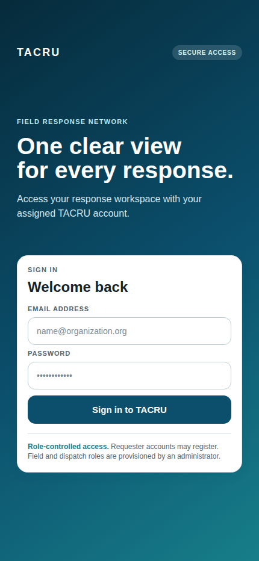
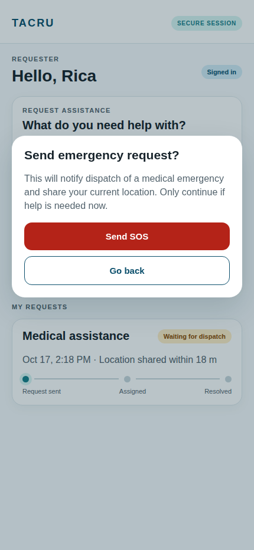
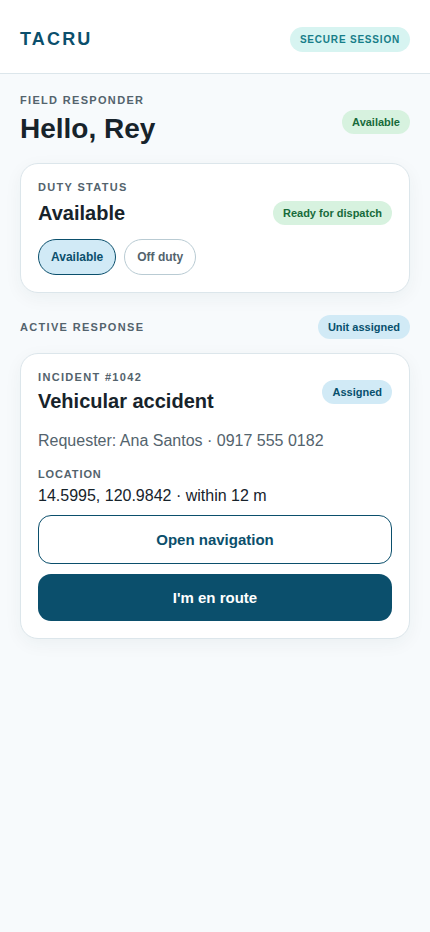
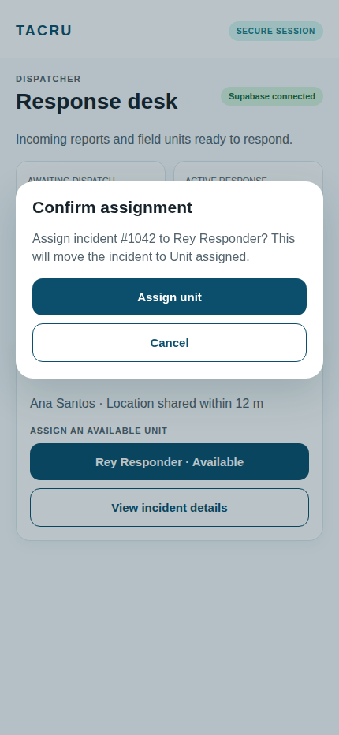

# TACRU Android Wireframe Gallery

High-fidelity screen previews for the TACRU Android response client. These images represent the current Compose UI direction and interaction flows; they are design screenshots rendered from the approved wireframe layouts, not emulator captures.

## Screens

### Authentication

Role-controlled sign-in for requesters, field responders, drivers, and dispatchers.

### Requester — SOS confirmation

The requester selects an incident type, adds optional details, and reviews the location-sharing warning before sending an SOS.

### Responder — active assignment

The responder manages duty status, reviews assignment details, opens navigation, and advances the incident through its allowed workflow.

### Dispatcher — assignment confirmation

The dispatcher sees operational counts, pending incidents, available units, and confirms an assignment before changing the incident state.

## Source preview

`gallery.html` contains the reusable visual source for the four screen states. Open it with one of these fragments to inspect a state in a browser:

- `gallery.html#auth`
- `gallery.html#requester`
- `gallery.html#responder`
- `gallery.html#dispatcher`

The screens use the same TACRU palette, status language, role hierarchy, and safety confirmations implemented in the Android Compose sources.
